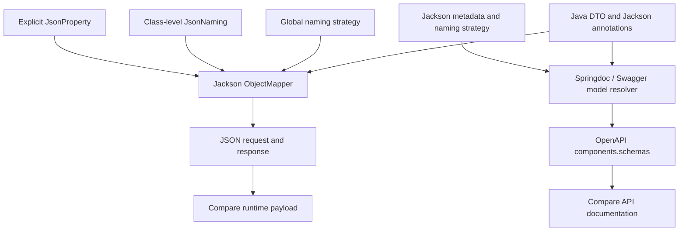

# JSON Property Names and Naming Strategies

Java field names do not have to match the property names exchanged over JSON. A DTO may use `customerId` following Java's camelCase convention, while the API exposes `customer_id` in snake_case. Jackson determines property names during serialization and deserialization; Springdoc uses metadata from Java types, annotations, and its model analysis mechanism to generate the corresponding OpenAPI schema.

If the Jackson configuration and the OpenAPI documentation are out of sync, a client might send `customerId` while the server only accepts `customer_id`, or Swagger UI might display a different field name from the actual JSON. Therefore, property names should be managed from a single clear source of truth, you should understand the scope of each strategy, and you should verify both the runtime payload and the `components.schemas` generated by Springdoc.

**Version note:** the code snippets use Jackson 2.x packages (`com.fasterxml.jackson.databind...`), which are common in Spring Boot 3. Spring Boot 4 uses Jackson 3 by default: databind packages move to `tools.jackson...`, where `@JsonNaming` and `PropertyNamingStrategies` must be imported from `tools.jackson.databind...`; `@JsonProperty` and `@JsonAlias` remain under `com.fasterxml.jackson.annotation`. Use imports and a Springdoc version compatible with your project's actual stack.

## 1. Java Names and JSON Names Are Two Different Concepts

Java typically uses lower camelCase for fields and accessors:

```java
public record CustomerRequest(
    Long customerId,
    String fullName,
    String emailAddress
) {
}
```

With Jackson's default configuration, JSON usually looks like:

```json
{
  "customerId": 42,
  "fullName": "Nguyen An",
  "emailAddress": "an@example.com"
}
```

Another API might specify snake_case:

```json
{
  "customer_id": 42,
  "full_name": "Nguyen An",
  "email_address": "an@example.com"
}
```

Both representations above can map to the same Java model. JSON property names are part of the HTTP contract visible to clients; Java field names are an implementation detail of the application.

## 2. How Jackson Determines Property Names When Reading and Writing JSON

Jackson inspects fields, getters, setters, constructors, or record components to identify logical properties. The external property name used in JSON can come from:

- The default name Jackson infers from the field/accessor/constructor parameter.
- An annotation specifying an explicit name such as `@JsonProperty`.
- A class-level naming strategy such as `@JsonNaming`.
- The default naming strategy of the `ObjectMapper`.
- Mix-ins or additional Jackson configuration in the application.

When Spring MVC receives `@RequestBody`, the message converter uses Jackson to deserialize JSON into a DTO. When a controller returns a DTO, Jackson serializes the DTO into a JSON response. Therefore, a naming strategy affects both input and output data unless configured separately for one direction.

Overview diagram:



Springdoc and Swagger Core provide model analysis mechanisms based on Jackson metadata. However, the final result still depends on library versions, the `ObjectMapper` in use, and application customizers. Always inspect the generated documentation rather than assuming every custom Jackson configuration is automatically reflected identically in OpenAPI.

## 3. Explicit Naming with `@JsonProperty`

`@JsonProperty` specifies the canonical JSON property name for a property. This is the right choice when only a few fields need names that differ from the general convention.

```java
import com.fasterxml.jackson.annotation.JsonProperty;

public record CustomerRequest(
    @JsonProperty("customer_id")
    Long customerId,

    @JsonProperty("full_name")
    String fullName,

    @JsonProperty("email_address")
    String emailAddress
) {
}
```

When serializing, Jackson uses the declared names:

```json
{
  "customer_id": 42,
  "full_name": "Nguyen An",
  "email_address": "an@example.com"
}
```

When deserializing, these names are also the canonical property names that Jackson recognizes. For records, you can place the annotation on the record component as shown; make sure to use a Jackson version that supports records for your project's Java version.

`@JsonProperty` can also be placed on a field, getter, setter, or constructor parameter. When the same logical property appears in multiple places, Jackson merges metadata according to its introspection rules. Avoid declaring different names for the same property on a getter and setter because that can produce unpredictable behavior.

### When Should You Use `@JsonProperty`?

- A few fields have special names required by an external contract.
- The JSON name must stay stable even if the Java field is renamed.
- Integrating with a legacy API that has inconsistent naming conventions.
- The field name contains characters or abbreviations that must be published verbatim.

There is no need to add `@JsonProperty` to every field if the entire DTO follows a consistent naming convention. Using a shared strategy reduces repetitive annotations.

## 4. Using `@JsonAlias` to Accept Legacy Names During Deserialization

When an API needs to migrate gradually from old JSON names to new ones, `@JsonAlias` lets Jackson accept one or more alternative names when reading JSON.

```java
import com.fasterxml.jackson.annotation.JsonAlias;
import com.fasterxml.jackson.annotation.JsonProperty;

public record CustomerRequest(
    @JsonProperty("customer_id")
    @JsonAlias({"customerId", "client_id"})
    Long customerId
) {
}
```

With the configuration above, Jackson uses `customer_id` as the canonical name when serializing and accepts `customerId` or `client_id` as aliases when deserializing.

| Item | Effect |
|---|---|
| `@JsonProperty("customer_id")` | Defines the canonical property name |
| `@JsonAlias({"customerId", "client_id"})` | Accepts additional input names during deserialization |
| Response serialization | Always uses the canonical name; does not emit aliases |

An alias is not a way to publish multiple output names. OpenAPI should describe the canonical property name returned by the server. If older clients still send aliases, document the compatibility window in the description or migration guide; do not assume Swagger UI or client generators will automatically list all aliases as independent properties.

If a request sends multiple aliases of the same property simultaneously with different values, the result may depend on field order in the JSON and Jackson's assignment rules. Avoid encouraging clients to send multiple names for the same field.

## 5. Applying a Naming Strategy to a DTO with `@JsonNaming`

When all properties in a DTO follow the same rule, use `@JsonNaming` at the class level.

```java
import com.fasterxml.jackson.databind.PropertyNamingStrategies;
import com.fasterxml.jackson.databind.annotation.JsonNaming;
import io.swagger.v3.oas.annotations.media.Schema;

@JsonNaming(PropertyNamingStrategies.SnakeCaseStrategy.class)
@Schema(name = "CustomerRequest")
public record CustomerRequest(
    Long customerId,
    String fullName,
    String emailAddress
) {
}
```

Jackson converts property names to snake_case:

```json
{
  "customer_id": 42,
  "full_name": "Nguyen An",
  "email_address": "an@example.com"
}
```

`@JsonNaming` applies only to the annotated class and the properties Jackson recognizes within that class. According to Jackson documentation, a class-level strategy overrides the default naming strategy of `ObjectMapper` for that class. Thus, you can use one application-wide convention and still make exceptions on specific DTOs.

### Combining `@JsonNaming` and `@JsonProperty`

Some fields may need a fixed name that differs from the general rule:

```java
import com.fasterxml.jackson.annotation.JsonProperty;
import com.fasterxml.jackson.databind.PropertyNamingStrategies;
import com.fasterxml.jackson.databind.annotation.JsonNaming;

@JsonNaming(PropertyNamingStrategies.SnakeCaseStrategy.class)
public record CustomerRequest(
    Long customerId,
    String fullName,
    @JsonProperty("email") String emailAddress
) {
}
```

The first two fields follow snake_case; the last field uses the explicitly specified name `email`. This approach is useful when the contract has a general convention but a few legacy names exist.

For complex naming cases or multiple annotations across getters/fields/constructors, verify the actual JSON output. Do not infer the final name solely by looking at the Java variable name.

## 6. Application-Wide Naming Strategy in Spring Boot

If most of the API uses the same convention, you can configure a global naming strategy for Jackson in `application.yml`.

Example using snake_case:

```yaml
spring:
  jackson:
    property-naming-strategy: SNAKE_CASE
```

Or in `application.properties`:

```properties
spring.jackson.property-naming-strategy=SNAKE_CASE
```

Spring Boot supports Jackson `PropertyNamingStrategies` constants or the fully qualified class name of a `PropertyNamingStrategy` implementation. The specific value must be compatible with the Jackson version used by the application.

You can use a different strategy if the contract requires it. Avoid enabling a global strategy just because one endpoint needs different names; a global setting can change the payloads of many controllers and DTOs already in use.

### Global Strategy vs. Class-Level Exceptions

| Configuration | Scope | When to use |
|---|---|---|
| `spring.jackson.property-naming-strategy` | POJOs using the shared ObjectMapper configuration | When the entire API shares one naming convention |
| `@JsonNaming(...)` | A specific DTO or class | When a group of DTOs needs its own convention |
| `@JsonProperty(...)` | A specific property | When a field name must be fixed or is an exception |
| `@JsonAlias(...)` | Alternative input names for a property | When compatibility with legacy names is needed |

In standard setups, `@JsonNaming` on a class overrides the global strategy for that class; `@JsonProperty` provides an explicit property name. Mix-ins, custom introspectors, or custom serializers can complicate the result, so inspect the application's final `ObjectMapper`.

## 7. Common Naming Strategies

Jackson provides several strategies for deriving JSON names from Java names. The table below illustrates common strategies in `PropertyNamingStrategies`:

| Strategy | Java Name | Example JSON Name |
|---|---|---|
| `LOWER_CAMEL_CASE` | `customerId` | `customerId` |
| `SNAKE_CASE` | `customerId` | `customer_id` |
| `UPPER_CAMEL_CASE` | `customerId` | `CustomerId` |
| `KEBAB_CASE` | `customerId` | `customer-id` |
| `LOWER_CASE` | `customerId` | `customerid` |
| `UPPER_SNAKE_CASE` | `customerId` | `CUSTOMER_ID` |

Java example:

```java
PropertyNamingStrategies.SNAKE_CASE
PropertyNamingStrategies.KEBAB_CASE
PropertyNamingStrategies.LOWER_CAMEL_CASE
```

Or using a strategy class in `@JsonNaming`:

```java
@JsonNaming(PropertyNamingStrategies.KebabCaseStrategy.class)
public record SearchRequest(String searchText, Integer pageSize) {
}
```

Corresponding JSON:

```json
{
  "search-text": "springdoc",
  "page-size": 20
}
```

Some names with consecutive uppercase letters like `URLValue`, `userID`, or `OAuthClientId` may be transformed differently from what a reader expects. Word-splitting rules for uppercase letters depend on the specific implementation. For fields with special names or that are critical parts of the contract, use `@JsonProperty` and test the output instead of guessing.

`PropertyNamingStrategies` is an API introduced in Jackson 2.12. If a project uses an older Jackson version, class or constant names may differ; check the Javadoc of your exact dependency before using it.

## 8. How Springdoc Reflects JSON Names in the OpenAPI Schema

The OpenAPI schema describes the property names clients see in JSON. Example DTO:

```java
@JsonNaming(PropertyNamingStrategies.SnakeCaseStrategy.class)
@Schema(name = "CustomerRequest")
public record CustomerRequest(
    Long customerId,
    String fullName,
    String emailAddress
) {
}
```

The corresponding schema should contain these properties:

```yaml
components:
  schemas:
    CustomerRequest:
      type: object
      properties:
        customer_id:
          type: integer
          format: int64
        full_name:
          type: string
        email_address:
          type: string
```

If Springdoc generates `customerId`, `fullName` while Jackson at runtime expects `customer_id`, `full_name`, the documentation and API are inconsistent. Client generators may produce SDKs that send the wrong field names; Swagger UI may also generate incorrect example bodies.

Swagger Core's `ModelResolver` reads Jackson annotations such as `@JsonProperty` and `@JsonNaming` when building models. However, if the application creates multiple `ObjectMapper` instances, uses mix-ins, custom serializers, or replaces the model resolver, verify that Springdoc analyzes models using the same rules as the HTTP message converter.

### Do Not Confuse Component Schema Names with Property Names

These two kinds of names belong in different places:

```java
@Schema(name = "CustomerPayload")
@JsonNaming(PropertyNamingStrategies.SnakeCaseStrategy.class)
public record CustomerRequest(
    Long customerId,
    String fullName
) {
}
```

- `@Schema(name = "CustomerPayload")` sets the component name under `components.schemas`.
- `@JsonNaming(...)` renames the JSON properties such as `customer_id`, `full_name`.

The documentation may have this structure:

```yaml
components:
  schemas:
    CustomerPayload:
      type: object
      properties:
        customer_id:
          type: integer
        full_name:
          type: string
```

Renaming the component schema does not rename JSON fields. Renaming JSON fields does not necessarily rename the component either. Manage these two decisions separately.

## 9. Things a Naming Strategy Does Not Automatically Change

A property naming strategy primarily affects POJO property names introspected by Jackson. Do not assume it changes every string in JSON.

| Element | Automatically transformed by POJO naming strategy? | Notes |
|---|---|---|
| DTO field/property | Yes, if no explicit name overrides it | Primary scope of the strategy |
| `@JsonProperty` | Uses the specified name | Explicit name takes precedence as an exception |
| `@JsonAlias` | Does not change output name | Only adds accepted names during deserialization |
| Keys of `Map<String, Object>` | Do not assume so | Map keys have their own serialization mechanism |
| Dynamic keys in `JsonNode` | Not automatically transformed | Keys are data already present in the JSON tree |
| Query parameters and path variables | No | Belong to HTTP mapping, e.g., `@RequestParam` and `@PathVariable` |
| HTTP headers | No | Header names belong to a separate HTTP contract |
| Enum values | Not automatically transformed by property strategy | Use enum configuration such as `@JsonValue` or `@JsonProperty` if needed |
| `components.schemas` keys | No | Use `@Schema(name = ...)` or a schema naming mechanism |

Query parameter example:

```java
@GetMapping("/customers")
List<CustomerResponse> search(
    @RequestParam("pageSize") Integer pageSize
) {
    return customerService.search(pageSize);
}
```

`spring.jackson.property-naming-strategy: SNAKE_CASE` does not automatically turn the `pageSize` query parameter into `page_size`. If the API requires the query parameter name `page_size`, declare that name in the Spring mapping and ensure OpenAPI reflects it accurately:

```java
@RequestParam("page_size") Integer pageSize
```

## 10. Impact on Requests, Responses, and Compatibility

Changing the global naming strategy can alter the JSON of many endpoints at once. For example, switching from camelCase to snake_case can cause:

- Older clients to send `customerId` while the new server only accepts `customer_id`.
- Responses to change from `emailAddress` to `email_address`, breaking clients reading the old property.
- OpenAPI schema property names to change, creating large diffs and altering generated client code.
- External integrations, messages, or stored JSON files to stop matching the new names.

Before changing the naming strategy of a published API, decide on a transition plan:

1. Keep the existing JSON names and only rename Java fields if the goal is internal refactoring.
2. Accept multiple input names with `@JsonAlias` during a transition period while keeping one canonical output name.
3. Release a new API version if changing output names breaks existing clients.
4. Update the OpenAPI spec, SDKs, request/response examples, and migration documentation together.
5. Monitor logs or telemetry to see whether clients are still sending legacy names during the transition.

Do not treat `@JsonAlias` as a complete solution for response changes, because aliases only assist input reading; they do not make older clients understand new field names in responses.

## 11. Testing the Actual `ObjectMapper`

When verifying JSON names, test the exact `ObjectMapper` used by Spring MVC rather than instantiating a new mapper in the test. For example, in a Spring Boot test you can inject the mapper:

```java
@SpringBootTest
class CustomerJsonTest {

    @Autowired
    ObjectMapper objectMapper;

    @Test
    void serializesCustomerUsingSnakeCase() throws Exception {
        CustomerRequest request = new CustomerRequest(
            42L,
            "Nguyen An",
            "an@example.com"
        );

        String json = objectMapper.writeValueAsString(request);

        assertThat(json).contains("\"customer_id\":42");
        assertThat(json).contains("\"full_name\":\"Nguyen An\"");
    }
}
```

To verify deserialization, read JSON using the same mapper and assert the Java values:

```java
String json = """
    {
      "customer_id": 42,
      "full_name": "Nguyen An",
      "email_address": "an@example.com"
    }
    """;

CustomerRequest request = objectMapper.readValue(json, CustomerRequest.class);
assertThat(request.customerId()).isEqualTo(42L);
```

If the application has multiple `HttpMessageConverter` instances or a custom mapper for a specific endpoint, inspect the exact converter handling that request/response. An `ObjectMapper` injected in a test might not represent every converter if MVC has been customized.

## 12. Verifying the OpenAPI Schema Generated by Springdoc

Open the documentation endpoint, usually `/v3/api-docs`, and inspect the schema:

```bash
curl -s http://localhost:8080/v3/api-docs \
  | jq '.components.schemas.CustomerRequest.properties | keys'
```

If using snake_case, the expected list includes:

```json
[
  "customer_id",
  "email_address",
  "full_name"
]
```

Also inspect the request body or response of the operation using that schema:

```bash
curl -s http://localhost:8080/v3/api-docs \
  | jq '.paths["/api/customers"].post.requestBody.content["application/json"].schema'
```

If the operation uses `$ref`, follow the referenced component to verify property names. With multiple documentation groups, call the URL for each group because each group may contain a different set of DTOs.

### When Runtime JSON and OpenAPI Schema Differ

Investigate in this order:

1. Serialize and deserialize the DTO using the actual `ObjectMapper`.
2. Check `@JsonProperty`, `@JsonAlias`, `@JsonNaming`, and Jackson mix-ins.
3. Check `spring.jackson.property-naming-strategy` and any custom `ObjectMapper`/`HttpMessageConverter` beans.
4. Check the Springdoc/Swagger Core versions and model resolver.
5. Inspect `components.schemas` and `$ref` targets in the OpenAPI JSON.
6. Check whether any customizer or schema annotation modifies property names after the resolver builds the model.

If a fix is needed, align runtime Jackson and OpenAPI so both describe the same canonical name. Then re-run serialization/deserialization tests and re-check the schema.

## 13. Common Pitfalls

| Symptom | Possible Cause | Resolution |
|---|---|---|
| JSON response is still camelCase | Global strategy not applied or separate `ObjectMapper` exists | Inspect the actual mapper/converter and configuration profiles |
| snake_case request fails to bind to DTO | Mapper uses a different naming strategy or explicit names conflict | Check `@JsonProperty`, `@JsonNaming`, and the mapper |
| OpenAPI shows camelCase while runtime JSON is snake_case | Model resolver uses a different config or customizer alters it | Check Swagger Core/Springdoc version and generated schema |
| A field ignores the global strategy | Explicit `@JsonProperty` or mix-in overrides it | Check annotations on fields, accessors, and constructors |
| Acronym names are transformed unexpectedly | Strategy's uppercase word-splitting rules | Use `@JsonProperty` for the canonical name and add a test |
| Old clients fail to read responses after strategy change | JSON output names changed | Plan API versioning or compatibility migration |
| `@JsonAlias` does not change response names | Alias only applies during deserialization | Set output name with `@JsonProperty` or a strategy |
| Expected query/headers to change to snake_case too | Confusing Jackson naming with HTTP parameter naming | Specify explicit names in Spring mappings and OpenAPI |
| Map keys do not change with strategy | Map keys are not POJO properties | Use a key serializer or normalize map keys separately |

## 14. Naming Strategy Checklist

- [ ] Canonical JSON names published by the API have been defined.
- [ ] Decided between `@JsonProperty`, `@JsonNaming`, or a global naming strategy.
- [ ] Exceptions are declared explicitly and do not conflict.
- [ ] `@JsonAlias` is used only for input names needing backward compatibility.
- [ ] Both response serialization and request deserialization are tested with the actual `ObjectMapper`.
- [ ] Springdoc generates property names matching runtime JSON.
- [ ] Distinguished property names from `components.schemas` names.
- [ ] Verified Map keys, JsonNode, enums, query parameters, and headers separately.
- [ ] Evaluated impact on existing clients before changing a global naming strategy.
- [ ] OpenAPI diff, SDKs, and migration docs are updated if the contract changed.

Java names and JSON names can differ, but runtime Jackson and OpenAPI must agree on the names clients use. Use `@JsonProperty` for exceptions, `@JsonNaming` per DTO, and `spring.jackson.property-naming-strategy` for application-wide conventions. Inspecting actual payloads alongside `components.schemas` helps catch mismatches early before documentation is distributed to clients.

## References

- [Spring Boot – Common Application Properties](https://docs.spring.io/spring-boot/3.5/appendix/application-properties/index.html)
- [Jackson – `JsonNaming` Javadoc](https://javadoc.io/doc/com.fasterxml.jackson.core/jackson-databind/2.13.5/com/fasterxml/jackson/databind/annotation/JsonNaming.html)
- [Jackson – `JsonAlias` Javadoc](https://javadoc.io/doc/com.fasterxml.jackson.core/jackson-annotations/2.21/com/fasterxml/jackson/annotation/JsonAlias.html)
- [Jackson – `PropertyNamingStrategies` Javadoc](https://www.javadoc.io/doc/com.fasterxml.jackson.core/jackson-databind/2.13.3/com/fasterxml/jackson/databind/PropertyNamingStrategies.html)
- [Spring – Introducing Jackson 3 support](https://spring.io/blog/2025/10/07/introducing-jackson-3-support-in-spring/)
- [Jackson – Migrating to Jackson 3](https://github.com/FasterXML/jackson/blob/main/jackson3/MIGRATING_TO_JACKSON_3.md)
- [Swagger Core – `ModelResolver`](https://github.com/swagger-api/swagger-core/blob/master/modules/swagger-core/src/main/java/io/swagger/v3/core/jackson/ModelResolver.java)
