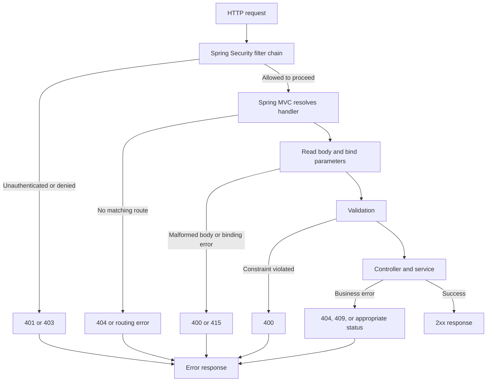

# Binding, Validation, Authentication, and Authorization Errors

A request can fail at multiple stages before producing a success response: an unreadable body, invalid data, an unauthenticated caller, or a caller lacking permission for the operation. Spring Boot handles these errors across different layers, while springdoc-openapi documents the error responses so clients know what can occur. Good design standardizes error formats, preserves HTTP semantics, and keeps OpenAPI docs aligned with runtime behavior.

## 1. Viewing Errors by Request Processing Stage

A request entering Spring Boot typically passes through this processing chain:



These stages rely on different mechanisms:

- **Security filter chain:** authenticates identity and checks permissions before requests enter controllers. Errors here are typically handled by `AuthenticationEntryPoint` or `AccessDeniedHandler`.
- **Handler mapping and binding:** Spring selects the controller method, reads path/query/header/body values, and converts types. Errors are usually represented by Spring MVC exceptions.
- **Validation:** Spring evaluates constraints on DTOs or method parameters. Validation failures should produce responses identifying failing fields and violated rules.
- **Business logic:** services may detect missing resources, state conflicts, or unmet business conditions.
- **OpenAPI documentation:** springdoc describes the responses advertised by the API. It cannot automatically discover every runtime exception if the application does not declare them.

Do not collapse every error into `500 Internal Server Error`. Status codes must reflect the cause and tell clients whether to fix the request, authenticate, request permissions, or retry.

## 2. Distinguishing Binding Errors from Validation Errors

Both groups often return `400 Bad Request`, yet they occur at different steps:

| Group | Meaning | Example |
|---|---|---|
| Binding / deserialization | Spring cannot convert HTTP input into the declared Java types | Malformed JSON, `"abc"` cannot parse into a number, missing required query parameter |
| Validation | Input bound cleanly yet violates input rules | Blank name, invalid email format, quantity less than 1 |

Request DTO example:

```java
public record CreateProductRequest(
    @NotBlank
    @Size(max = 120)
    String name,

    @NotNull
    @DecimalMin("0.0")
    BigDecimal price,

    @NotNull
    @Min(1)
    Integer quantity
) {}
```

Controller:

```java
@PostMapping("/api/products")
@ResponseStatus(HttpStatus.CREATED)
ProductResponse create(@Valid @RequestBody CreateProductRequest request) {
    return productService.create(request);
}
```

If the body is invalid JSON, Jackson may fail to deserialize and Spring raises `HttpMessageNotReadableException`. If the JSON is valid while `name` is blank or `quantity` is 0, validation catches the failure and Spring typically raises `MethodArgumentNotValidException`.

Both cases may return 400, but their error payloads should differ: binding errors explain that the request body cannot be parsed in the expected format/types; validation errors identify which properties violated constraints.

## 3. Common Binding Exceptions in Spring MVC

Common exceptions and the statuses Spring typically maps them to:

| Exception | Common cause | Typical status |
|---|---|---|
| `HttpMessageNotReadableException` | Malformed JSON/XML body, deserialization failure, or body incompatible with target type | `400` |
| `MethodArgumentTypeMismatchException` | Query/path parameter cannot be converted to the Java type | `400` |
| `MissingServletRequestParameterException` | Missing required `@RequestParam` | `400` |
| `MissingRequestHeaderException` | Missing required `@RequestHeader` | `400` |
| `MethodArgumentNotValidException` | `@Valid` DTO fails validation | `400` |
| `BindException` | Model or form data binding/validation fails | `400` |
| `HttpMediaTypeNotSupportedException` | Request sent an unsupported media type | `415` |
| `HttpMediaTypeNotAcceptableException` | Server cannot produce a representation matching `Accept` | `406` |
| `NoHandlerFoundException` or `NoResourceFoundException` | Route/resource not found per Spring configuration | `404` |

Actual statuses may be overridden by exception handlers or application configuration. This table is a diagnostic guide and does not replace checking your project's responses and logs.

Example of a client sending the wrong type for a query parameter:

```http
GET /api/products?page=not-a-number HTTP/1.1
```

If the controller declares `@RequestParam int page`, Spring cannot convert `not-a-number` to an integer. This is a binding error, not a service-layer business error.

## 4. DTO Validation and Method Parameter Validation

### DTO Validation with `@Valid`

For `@RequestBody`, Spring typically uses Bean Validation to validate the DTO after deserialization:

```java
public record RegisterRequest(
    @NotBlank(message = "Email must not be blank")
    @Email(message = "Invalid email format")
    String email,

    @NotBlank(message = "Password must not be blank")
    @Size(min = 12, message = "Password must be at least 12 characters")
    String password
) {}
```

```java
@PostMapping("/api/accounts")
AccountResponse register(@Valid @RequestBody RegisterRequest request) {
    return accountService.register(request);
}
```

In Spring MVC, validation errors on a command object annotated with `@Valid` or `@Validated` are usually reported via `MethodArgumentNotValidException`. You can extract field errors from `BindingResult` to construct the client error list.

### Query, Path, and Header Parameter Validation

Constraints can also be placed directly on method parameters:

```java
@GetMapping("/api/products")
List<ProductResponse> search(
    @RequestParam @Min(0) int page,
    @RequestParam @Min(1) @Max(100) int size
) {
    return productService.search(page, size);
}
```

With Spring Framework 6.1+, Spring MVC includes built-in method validation and may raise `HandlerMethodValidationException` when parameter or return-value constraints fail. In older setups or when using AOP proxy method validation via `@Validated`, failures may surface as `ConstraintViolationException` or a validation-provider exception. Handle the exact exceptions matching your Spring version and method-validation configuration.

`@Valid` on a DTO and method validation are not the same mechanism. To standardize responses across validation exception types, handle each exception your application version actually raises and test them with MockMvc.

## 5. Standardizing Errors with `ProblemDetail`

Spring Framework 6 provides `ProblemDetail` to represent errors under Problem Details for HTTP APIs (RFC 9457). Spring Boot 3 natively supports serializing this object as `application/problem+json` when returned from Spring MVC.

A Problem Details response includes standard fields:

| Field | Meaning |
|---|---|
| `type` | URI identifying the problem type; may use `about:blank` when no dedicated type exists |
| `title` | Short summary of the error type |
| `status` | HTTP status code |
| `detail` | Specific explanation for this occurrence of the error |
| `instance` | URI referring to this specific error occurrence |

Applications can add extension properties such as `code`, `traceId`, or `errors`. Example:

```json
{
  "type": "https://api.example.test/problems/validation-error",
  "title": "Invalid data",
  "status": 400,
  "detail": "One or more fields failed input validation rules.",
  "instance": "/api/products",
  "code": "VALIDATION_FAILED",
  "errors": [
    {
      "field": "name",
      "code": "NotBlank",
      "message": "Product name must not be blank"
    }
  ]
}
```

`code` and `errors` are application-defined extensions. Keep their names and structures stable so clients can handle errors by error code instead of parsing `detail` prose.

Never include sensitive values such as passwords, tokens, full request bodies, or personal data in `detail`/`errors`. Error messages should be helpful to clients without leaking internal information.

## 6. Handling Business Errors with `@RestControllerAdvice`

`@RestControllerAdvice` gathers exception handlers across controllers. It is the right place to turn business exceptions and Spring MVC exceptions into uniform responses.

Business exception examples:

```java
public class ProductNotFoundException extends RuntimeException {
    public ProductNotFoundException(Long id) {
        super("Product not found " + id);
    }
}

public class DuplicateProductCodeException extends RuntimeException {
    public DuplicateProductCodeException() {
        super("Product code already exists");
    }
}
```

Advice producing `ProblemDetail`:

```java
@RestControllerAdvice
class ApiExceptionHandler {

    @ExceptionHandler(ProductNotFoundException.class)
    ResponseEntity<ProblemDetail> handleNotFound(
        ProductNotFoundException exception,
        HttpServletRequest request
    ) {
        ProblemDetail problem = ProblemDetail.forStatusAndDetail(
            HttpStatus.NOT_FOUND,
            "Requested resource was not found."
        );
        problem.setType(URI.create(
            "https://api.example.test/problems/product-not-found"
        ));
        problem.setTitle("Product not found");
        problem.setInstance(URI.create(request.getRequestURI()));
        problem.setProperty("code", "PRODUCT_NOT_FOUND");

        return ResponseEntity.status(HttpStatus.NOT_FOUND)
            .contentType(MediaType.APPLICATION_PROBLEM_JSON)
            .body(problem);
    }

    @ExceptionHandler(DuplicateProductCodeException.class)
    ResponseEntity<ProblemDetail> handleConflict(HttpServletRequest request) {
        ProblemDetail problem = ProblemDetail.forStatusAndDetail(
            HttpStatus.CONFLICT,
            "Product code is already in use."
        );
        problem.setTitle("Data conflict");
        problem.setInstance(URI.create(request.getRequestURI()));
        problem.setProperty("code", "PRODUCT_CODE_CONFLICT");

        return ResponseEntity.status(HttpStatus.CONFLICT)
            .contentType(MediaType.APPLICATION_PROBLEM_JSON)
            .body(problem);
    }
}
```

This example intentionally returns a stable `detail` without exposing internal exception details to clients. In a production system, log the exception with a trace ID, then include `traceId` as an extension property for operations lookup.

### Handling Validation Exceptions

Add a handler for `MethodArgumentNotValidException`:

```java
@ExceptionHandler(MethodArgumentNotValidException.class)
ResponseEntity<ProblemDetail> handleInvalidBody(
    MethodArgumentNotValidException exception,
    HttpServletRequest request
) {
    ProblemDetail problem = ProblemDetail.forStatusAndDetail(
        HttpStatus.BAD_REQUEST,
        "One or more fields failed input validation rules."
    );
    problem.setTitle("Invalid data");
    problem.setInstance(URI.create(request.getRequestURI()));
    problem.setProperty("code", "VALIDATION_FAILED");

    List<Map<String, String>> errors = exception.getBindingResult()
        .getFieldErrors()
        .stream()
        .map(error -> Map.of(
            "field", error.getField(),
            "code", error.getCode() == null ? "INVALID" : error.getCode(),
            "message", error.getDefaultMessage() == null
                ? "Invalid value"
                : error.getDefaultMessage()
        ))
        .toList();

    problem.setProperty("errors", errors);
    return ResponseEntity.badRequest()
        .contentType(MediaType.APPLICATION_PROBLEM_JSON)
        .body(problem);
}
```

Do not return `FieldError.getRejectedValue()` by default, as the rejected value may be a password, token, or sensitive data. For nested object errors, `getField()` preserves property paths such as `address.postalCode`.

### Handling Unreadable Body Errors

For `HttpMessageNotReadableException`, return a generic message without leaking parser details or fragments of the invalid body:

```java
@ExceptionHandler(HttpMessageNotReadableException.class)
ResponseEntity<ProblemDetail> handleUnreadableBody(HttpServletRequest request) {
    ProblemDetail problem = ProblemDetail.forStatusAndDetail(
        HttpStatus.BAD_REQUEST,
        "Request body is malformed or cannot be parsed."
    );
    problem.setTitle("Unable to read request body");
    problem.setInstance(URI.create(request.getRequestURI()));
    problem.setProperty("code", "REQUEST_BODY_INVALID");

    return ResponseEntity.badRequest()
        .contentType(MediaType.APPLICATION_PROBLEM_JSON)
        .body(problem);
}
```

For applications needing to handle many framework exceptions, extend `ResponseEntityExceptionHandler` and override the appropriate methods for your Spring Framework version. Method signatures can vary across releases; check the Javadoc for your installed dependency version.

Never write `@ExceptionHandler(Exception.class)` and return 400 for everything. Programming bugs, database failures, or unclassified system errors must remain server errors—typically 500—and be logged fully on the server.

## 7. Distinguishing Authentication (401) and Authorization (403)

Authentication and authorization answer two distinct questions:

- **Authentication:** who is the caller? If credentials are missing or invalid, the server cannot verify identity; the appropriate status is usually `401 Unauthorized`.
- **Authorization:** is the authenticated caller permitted to perform this operation? If identity is valid yet lacks permissions, the appropriate status is `403 Forbidden`.

| Scenario | Common outcome |
|---|---|
| No access token sent to a protected endpoint | `401` |
| Expired, invalid-signature, or malformed token | `401` |
| Missing or invalid API key | `401` or response per published authentication policy |
| Valid token lacking the required scope/role | `403` |
| Authenticated user does not own the target resource | `403`, or `404` if policy intentionally hides resource existence |

The word `Unauthorized` in `401 Unauthorized` can be misleading. Under HTTP semantics, 401 means unauthenticated, and the response must include at least one `WWW-Authenticate` header issuing a challenge appropriate to the authentication scheme. 403 indicates the server understood the request yet refuses to fulfill it due to insufficient permissions.

## 8. Why `@RestControllerAdvice` Usually Cannot Catch Security Errors

Spring Security processes requests in the filter chain before Spring MVC dispatches to controllers. If a filter detects a missing token or denied access, request processing can terminate in the security layer. When that happens, `@RestControllerAdvice` is not the primary handler for these errors.

Spring Security exposes two extension points:

- `AuthenticationEntryPoint`: handles initiating or requiring authentication, typically producing a 401 response.
- `AccessDeniedHandler`: handles authenticated callers lacking sufficient permissions, typically producing a 403 response.

Configuration example:

```java
@Configuration
class ApiSecurityConfiguration {

    @Bean
    SecurityFilterChain apiSecurity(
        HttpSecurity http,
        AuthenticationEntryPoint problemAuthenticationEntryPoint,
        AccessDeniedHandler problemAccessDeniedHandler
    ) throws Exception {
        http
            .authorizeHttpRequests(auth -> auth
                .requestMatchers("/public/**").permitAll()
                .requestMatchers(HttpMethod.DELETE, "/api/products/**")
                    .hasAuthority("products:delete")
                .anyRequest().authenticated()
            )
            .exceptionHandling(exceptions -> exceptions
                .authenticationEntryPoint(problemAuthenticationEntryPoint)
                .accessDeniedHandler(problemAccessDeniedHandler)
            );

        return http.build();
    }
}
```

The `AuthenticationEntryPoint` and `AccessDeniedHandler` beans can share a helper to construct `ProblemDetail`, set `Content-Type: application/problem+json`, and serialize with Spring's `ObjectMapper`.

Helper example:

```java
@Component
class SecurityProblemWriter {

    private final ObjectMapper objectMapper;

    SecurityProblemWriter(ObjectMapper objectMapper) {
        this.objectMapper = objectMapper;
    }

    void write(
        HttpServletResponse response,
        HttpStatus status,
        String code,
        String title,
        String detail,
        String authenticateChallenge
    ) throws IOException {
        ProblemDetail problem = ProblemDetail.forStatusAndDetail(status, detail);
        problem.setTitle(title);
        problem.setProperty("code", code);

        response.setStatus(status.value());
        response.setContentType(MediaType.APPLICATION_PROBLEM_JSON_VALUE);
        if (authenticateChallenge != null) {
            response.setHeader("WWW-Authenticate", authenticateChallenge);
        }
        objectMapper.writeValue(response.getOutputStream(), problem);
    }
}
```

Then `AuthenticationEntryPoint` invokes the helper with `UNAUTHORIZED`, while `AccessDeniedHandler` invokes it with `FORBIDDEN`. Example:

```java
@Bean
AuthenticationEntryPoint problemAuthenticationEntryPoint(SecurityProblemWriter writer) {
    return (request, response, exception) -> writer.write(
        response,
        HttpStatus.UNAUTHORIZED,
        "AUTHENTICATION_REQUIRED",
        "Authentication required",
        "Authentication credentials are missing or invalid.",
        "Bearer realm=\"api\""
    );
}

@Bean
AccessDeniedHandler problemAccessDeniedHandler(SecurityProblemWriter writer) {
    return (request, response, exception) -> writer.write(
        response,
        HttpStatus.FORBIDDEN,
        "ACCESS_DENIED",
        "Insufficient permissions",
        "The current identity does not have permission to perform this operation.",
        null
    );
}
```

This illustrates Bearer authentication; the challenge `Bearer realm="api"` is a placeholder and should be replaced with your system's realm/challenge. When using OAuth2 Resource Server, Basic, form login, or multiple `SecurityFilterChain` beans, configure entry points per authentication mechanism and request matcher. For invalid Bearer tokens, the challenge may also need `error="invalid_token"`; consider keeping `BearerTokenAuthenticationEntryPoint` or integrating with default mechanisms instead of losing challenge parameters. Specialized filters may also handle errors before `ExceptionTranslationFilter`; verify actual responses for each mechanism.

Never return access tokens, refresh tokens, JWT signature internals, or sensitive authentication failure details in responses. For Bearer authentication, preserve an appropriate `WWW-Authenticate` header on 401 responses per protocol and resource server configuration.

## 9. Standardizing Error Codes and Validation Error Structures

Clients should handle errors using status codes and stable error codes, without depending on prose that may change across languages or versions.

A simple convention:

| Status | Example `code` | What should the client do? |
|---|---|---|
| `400` | `VALIDATION_FAILED` | Highlight field errors and prompt the user to fix input |
| `400` | `REQUEST_BODY_INVALID` | Check submitted payload formatting or data types |
| `401` | `AUTHENTICATION_REQUIRED` | Sign in or refresh credentials via the auth flow |
| `403` | `ACCESS_DENIED` | Show permission-denied message; do not retry automatically |
| `404` | `PRODUCT_NOT_FOUND` | Report that the resource does not exist or is inaccessible |
| `409` | `PRODUCT_CODE_CONFLICT` | Ask the user to pick another code or resolve the conflict |
| `415` | `UNSUPPORTED_MEDIA_TYPE` | Resend the body using a media type supported by the endpoint |
| `500` | `INTERNAL_ERROR` | Show a generic error and provide the trace ID if available |

For validation, `errors` can be an array of objects containing `field`, `code`, and `message`. Keep property names aligned with the JSON contract, especially if Jackson uses a naming strategy different from Java identifiers. When clients need nested field locations, include full paths such as `items[0].quantity`.

Do not treat validation providers' default messages as API codes. Wording can vary by locale and library version. Keep `code` stable and treat `message` as display text.

## 10. Describing Error Responses in OpenAPI with springdoc

Springdoc can infer success response schemas from return types, yet it cannot know every error originating in binding, validation, security filters, or services. Document important error responses using Swagger annotations or OpenAPI configuration.

Error DTO/schema example for documentation:

```java
@Schema(name = "ApiProblem", description = "Problem Details returned when the API handles an error")
public class ApiProblemSchema {
    @Schema(format = "uri-reference")
    public String type;

    public String title;
    public Integer status;
    public String detail;

    @Schema(format = "uri-reference")
    public String instance;

    public String code;
    public List<ApiFieldError> errors;
}

public record ApiFieldError(
    String field,
    String code,
    String message
) {}
```

This schema is a documentation model. If runtime returns `ProblemDetail`, ensure extension properties and the actual JSON structure match; otherwise use a real error DTO as the return type. Do not declare a fake schema that differs from the actual payload merely to make Swagger UI look tidy.

Example response declarations on an endpoint:

```java
@Operation(summary = "Create product")
@ApiResponses({
    @ApiResponse(
        responseCode = "201",
        description = "Product created",
        content = @Content(
            mediaType = MediaType.APPLICATION_JSON_VALUE,
            schema = @Schema(implementation = ProductResponse.class)
        )
    ),
    @ApiResponse(
        responseCode = "400",
        description = "Unreadable body or invalid data",
        content = @Content(
            mediaType = MediaType.APPLICATION_PROBLEM_JSON_VALUE,
            schema = @Schema(implementation = ApiProblemSchema.class)
        )
    ),
    @ApiResponse(
        responseCode = "401",
        description = "Missing or invalid authentication credentials",
        content = @Content(
            mediaType = MediaType.APPLICATION_PROBLEM_JSON_VALUE,
            schema = @Schema(implementation = ApiProblemSchema.class)
        )
    ),
    @ApiResponse(
        responseCode = "403",
        description = "Insufficient permission to create product",
        content = @Content(
            mediaType = MediaType.APPLICATION_PROBLEM_JSON_VALUE,
            schema = @Schema(implementation = ApiProblemSchema.class)
        )
    ),
    @ApiResponse(
        responseCode = "409",
        description = "Product code already exists",
        content = @Content(
            mediaType = MediaType.APPLICATION_PROBLEM_JSON_VALUE,
            schema = @Schema(implementation = ApiProblemSchema.class)
        )
    )
})
@PostMapping("/api/products")
ProductResponse create(@Valid @RequestBody CreateProductRequest request) {
    return productService.create(request);
}
```

The `@ApiResponse` annotations here describe the outcomes the operation can return. They do not configure `@RestControllerAdvice`, create an `AuthenticationEntryPoint`, or cause runtime to emit those statuses automatically.

### Reusing Error Responses in `components`

If multiple operations share an error structure, define response components in OpenAPI:

```yaml
components:
  schemas:
    ApiProblem:
      type: object
      properties:
        type:
          type: string
          format: uri-reference
        title:
          type: string
        status:
          type: integer
        detail:
          type: string
        instance:
          type: string
          format: uri-reference
        code:
          type: string
        errors:
          type: array
          items:
            $ref: '#/components/schemas/ApiFieldError'
    ApiFieldError:
      type: object
      properties:
        field:
          type: string
        code:
          type: string
        message:
          type: string
  responses:
    BadRequest:
      description: Invalid request body or parameters
      content:
        application/problem+json:
          schema:
            $ref: '#/components/schemas/ApiProblem'
    Unauthorized:
      description: Missing or invalid authentication credentials
      headers:
        WWW-Authenticate:
          description: Challenge of the authentication scheme supported by the endpoint
          schema:
            type: string
      content:
        application/problem+json:
          schema:
            $ref: '#/components/schemas/ApiProblem'
    Forbidden:
      description: Caller lacks permission to perform the operation
      content:
        application/problem+json:
          schema:
            $ref: '#/components/schemas/ApiProblem'
    Conflict:
      description: Request conflicts with current state
      content:
        application/problem+json:
          schema:
            $ref: '#/components/schemas/ApiProblem'
```

Operations can reference shared responses via `$ref`:

```yaml
paths:
  /api/products:
    post:
      responses:
        '201':
          description: Product created
        '400':
          $ref: '#/components/responses/BadRequest'
        '401':
          $ref: '#/components/responses/Unauthorized'
        '403':
          $ref: '#/components/responses/Forbidden'
        '409':
          $ref: '#/components/responses/Conflict'
```

You can use `@ApiResponse(ref = "#/components/responses/BadRequest")` if your Swagger Core version supports it and springdoc preserves the reference in the output; inspect the generated JSON/YAML. To ensure shared responses apply across all relevant operations, use `OpenApiCustomizer` or group configuration. Do not assume a global exception handler automatically equips every operation with complete error responses.

## 11. Declaring Authentication and Authorization Errors in OpenAPI

Security schemes describe how authentication works, whereas 401/403 responses describe what happens when authentication or authorization fails. Both complement each other.

Bearer authentication example:

```yaml
components:
  securitySchemes:
    BearerAuth:
      type: http
      scheme: bearer
      bearerFormat: JWT
```

Protected operation:

```yaml
paths:
  /api/products:
    post:
      security:
        - BearerAuth: []
      responses:
        '201':
          description: Product created
        '401':
          $ref: '#/components/responses/Unauthorized'
        '403':
          $ref: '#/components/responses/Forbidden'
```

`security` indicates the client must supply a Bearer token. Responses 401/403 explain what happens if credentials are missing/invalid or permissions are insufficient. Declaring `securitySchemes` alone does not secure endpoints; declaring a 401 response alone does not make Spring Security authenticate requests.

With OAuth2, you can specify scopes in Security Requirements, such as `products:write`. If a token is valid yet lacks the scope, runtime typically returns 403; publish that response on the operation.

## 12. Global Error Responses and Documentation Scope

An API often shares common errors such as 400, 401, 403, 404, and 500. Shared responses can be applied by:

- Declaring `@ApiResponses` directly on important operations.
- Using composite annotations or project meta-annotations when many controllers share the same response set.
- Using `OpenApiCustomizer` to add responses by path/method or per group.
- Declaring response components in OpenAPI and referencing them via `$ref`.

Choose the right scope. Not every endpoint can return every status. For example, a public health endpoint may have no 401/403; a bodyless GET endpoint normally has no request-body validation error; an upload endpoint may need 413 if the app limits file sizes.

With `@ControllerAdvice`, springdoc may pick up some metadata from exception handlers depending on configuration and version, but that does not replace inspecting the final operations. In particular, errors raised inside the Security filter chain do not pass through MVC advice. Open `/v3/api-docs` to verify error responses actually appear on each operation.

## 13. Testing Error Responses with MockMvc

Verify status codes, media types, and body structures. Validation example:

```java
@WebMvcTest(ProductController.class)
class ProductControllerTest {

    @Autowired
    MockMvc mockMvc;

    @MockitoBean
    ProductService productService;

    @Test
    void returnsProblemDetailsWhenNameIsBlank() throws Exception {
        mockMvc.perform(post("/api/products")
                .contentType(MediaType.APPLICATION_JSON)
                .content("""
                    {"name":"","price":12000,"quantity":1}
                    """))
            .andExpect(status().isBadRequest())
            .andExpect(content().contentTypeCompatibleWith(
                MediaType.APPLICATION_PROBLEM_JSON))
            .andExpect(jsonPath("$.code").value("VALIDATION_FAILED"))
            .andExpect(jsonPath("$.errors[0].field").value("name"));
    }
}
```

`@MockitoBean` illustrates newer Spring Framework versions; on older Spring Boot projects, use `@MockBean` if that is the available test annotation. Even though the service is not invoked on validation failure, the controller still needs its dependency supplied when building the test context.

Testing malformed JSON:

```java
mockMvc.perform(post("/api/products")
        .contentType(MediaType.APPLICATION_JSON)
        .content("{invalid-json"))
    .andExpect(status().isBadRequest())
    .andExpect(content().contentTypeCompatibleWith(
        MediaType.APPLICATION_PROBLEM_JSON))
    .andExpect(jsonPath("$.code").value("REQUEST_BODY_INVALID"));
```

Testing authentication/authorization requires loading the Spring Security filter chain:

```java
@SpringBootTest
@AutoConfigureMockMvc
class ProductSecurityTest {

    @Autowired
    MockMvc mockMvc;

    @Test
    void rejectsAnonymousRequest() throws Exception {
        mockMvc.perform(delete("/api/products/101"))
            .andExpect(status().isUnauthorized());
    }

    @Test
    @WithMockUser(authorities = "products:read")
    void rejectsAuthenticatedUserWithoutDeleteAuthority() throws Exception {
        mockMvc.perform(delete("/api/products/101"))
            .andExpect(status().isForbidden());
    }
}
```

The test above assumes the security policy requires authentication and the `products:delete` authority for DELETE, and that test config does not alter outcomes via CSRF. If CSRF is enabled for unsafe requests, tests may need `.with(csrf())` to reach the authorization branch properly. For JWT Resource Servers, use the `jwt()` request post-processor with the corresponding scopes/authorities.

Beyond status codes, verify that 401 responses preserve `WWW-Authenticate` matching the authentication scheme, 403 responses leak no internal details, and validation responses contain no sensitive rejected values.

## 14. Testing the OpenAPI Document

After the application starts, download `/v3/api-docs` or `/v3/api-docs.yaml` and confirm the operation publishes the right errors:

1. `400` documents binding/validation errors and the Problem Details schema.
2. `401` documents the error response along with `WWW-Authenticate` when required by the scheme.
3. `403` describes authenticated callers with insufficient permissions.
4. `404`, `409`, `415`, or `406` appear on operations where those situations can happen.
5. `security` is declared at the right operation or global scope.
6. `$ref` targets point to existing components and schemas match runtime payloads.

You can assert this with MockMvc:

```java
mockMvc.perform(get("/v3/api-docs"))
    .andExpect(status().isOk())
    .andExpect(jsonPath(
        "$.paths['/api/products'].post.responses['400'].content['application/problem+json']"
    ).exists())
    .andExpect(jsonPath(
        "$.paths['/api/products'].post.responses['401']"
    ).exists())
    .andExpect(jsonPath(
        "$.paths['/api/products'].post.responses['403']"
    ).exists());
```

Adjust path names and JSONPath expressions to match context paths, documentation groups, and actual configuration. When error responses use `$ref`, inspect the corresponding component under `components.responses` instead of checking only inline content.

Swagger UI lets users inspect possible responses. It does not verify actual permissions or replace security testing; verify both documentation and real HTTP requests across anonymous, authenticated-without-authority, and authenticated-with-authority states.

## 15. Common Design Pitfalls

| Issue | Consequence | Fix |
|---|---|---|
| Returning 500 for every exception | Clients cannot tell request errors from server errors | Separate binding, validation, business, and internal errors |
| Returning 401 when authenticated caller lacks permission | Incorrect authentication/authorization semantics | Return 403 for access denied after authentication |
| Relying on `@RestControllerAdvice` for all Security errors | Early filter-chain errors bypass MVC advice | Configure `AuthenticationEntryPoint` and `AccessDeniedHandler` |
| Returning raw exception messages | Can leak SQL, classes, tokens, or internal data | Return safe details and record specifics in logs |
| Returning rejected values in validation errors | Can expose passwords or sensitive data | Return only controlled field, code, and message |
| OpenAPI documents only 2xx responses | Clients are unaware of possible failures | Document 4xx/5xx responses and error schemas |
| Declaring security scheme without security requirement | Swagger UI does not know the operation needs credentials | Attach `security` globally or per operation |
| Docs list 401/403 while runtime leaves endpoint unprotected | Contract and real security diverge | Test the filter chain and actual authorization rules |
| Using an error schema mismatching ProblemDetail JSON | Client generators create wrong models | Align DTO/schema with runtime payloads |

## 16. Workflow for Building and Maintaining the Error Contract

When designing an endpoint, follow this sequence:

1. List potential errors across binding, validation, authentication, authorization, and business logic.
2. Pick the right HTTP status for each error category.
3. Standardize the error payload, preferring Problem Details with stable `code` values.
4. Handle MVC errors with `@RestControllerAdvice` or `ResponseEntityExceptionHandler`.
5. Handle filter-chain errors with `AuthenticationEntryPoint` and `AccessDeniedHandler`.
6. Avoid returning sensitive data; write technical details to access-controlled logs.
7. Document error responses in OpenAPI using `@ApiResponses` or shared response components.
8. Declare security schemes and security requirements at the appropriate scope.
9. Test status, media type, body, headers, and OpenAPI docs.
10. Diff error schemas across releases so clients never encounter unexpected contract changes.

Binding, validation, authentication, and authorization errors belong to different layers in Spring. When each layer handles its errors appropriately and returns a consistent error format, clients integrate more cleanly, operations trace issues faster, and OpenAPI documentation faithfully reflects application behavior.

## 17. References

- [Spring Framework – Validation](https://docs.spring.io/spring-framework/reference/core/validation/beanvalidation.html): Bean Validation and validation integration in Spring.
- [Spring Framework – MVC Exceptions](https://docs.spring.io/spring-framework/reference/web/webmvc/mvc-controller/ann-exceptions.html): exception handling in controllers and `@ControllerAdvice`.
- [Spring Security – Exception Translation](https://docs.spring.io/spring-security/reference/servlet/architecture.html): placement of the security filter chain and exception handling mechanics.
- [Spring Security – Authentication](https://docs.spring.io/spring-security/reference/servlet/authentication/index.html): authentication flow and `AuthenticationEntryPoint`.
- [Spring Security – Authorization](https://docs.spring.io/spring-security/reference/servlet/authorization/index.html): permission checks and access denied handling.
- [RFC 9457 – Problem Details for HTTP APIs](https://www.rfc-editor.org/rfc/rfc9457.html): standard error response format and extension properties.
- [OpenAPI Specification – Responses Object](https://spec.openapis.org/oas/latest.html#responses-object): documenting responses per status code.
- [Springdoc OpenAPI](https://springdoc.org/): generating and customizing response and security metadata in OpenAPI.
