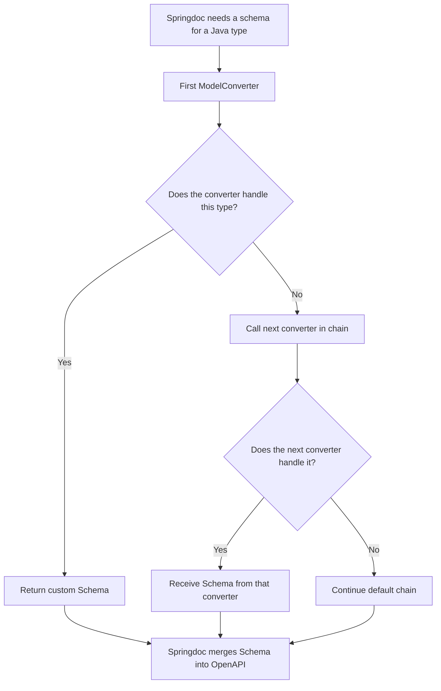

# Customizing Schemas with `ModelConverter` When Default Inference Is Not Enough

Springdoc-openapi infers OpenAPI Schemas from Java types, annotations, Spring metadata, and how Jackson handles data. This automatic approach works well for most ordinary DTOs. However, there are special data types whose JSON shape does not match their Java structure: value objects serialized as strings, third-party library types, legacy classes that cannot be annotated, or a data convention reused across many endpoints.

When you need to change how a Java type is converted into a schema across many places, you can implement Swagger Core's `ModelConverter`. A converter participates in the model resolution chain: it receives the type being processed and can return a custom schema or delegate to the next converter. In Spring Boot, you can register the converter as a Spring bean so springdoc includes it in the model processing chain.

`ModelConverter` is a type-level extension point. Use it when the same type needs to be described consistently across the entire document. For a single field or individual endpoint, `@Schema`, `@Parameter`, `@ApiResponse`, or `OpenApiCustomizer` is usually clearer and easier to maintain.

## 1. When Is `ModelConverter` Needed?

Suppose an application has a `Money` value object. In Java, this type holds a `BigDecimal`, yet the API serializes it as a decimal string to preserve exact monetary values and prevent clients from converting it to floating-point numbers:

```java
import com.fasterxml.jackson.annotation.JsonCreator;
import com.fasterxml.jackson.annotation.JsonValue;

import java.math.BigDecimal;
import java.math.RoundingMode;
import java.util.Objects;

public record Money(BigDecimal amount) {

    public Money {
        amount = Objects.requireNonNull(amount)
            .setScale(2, RoundingMode.UNNECESSARY);
    }

    @JsonValue
    public String toJson() {
        return amount.toPlainString();
    }

    @JsonCreator(mode = JsonCreator.Mode.DELEGATING)
    public static Money fromJson(String value) {
        return new Money(new BigDecimal(value));
    }
}
```

The wire format of `Money` is a JSON string:

```json
{
  "price": "125000.00"
}
```

Inspecting only the Java structure, an inference tool might treat `Money` as an object with an `amount` property. Yet clients actually send and receive a string. The schema must describe the wire format accurately:

```yaml
type: string
pattern: '^-?\d+\.\d{2}$'
example: '125000.00'
description: Monetary amount as a decimal string
```

If `Money` appears in requests, responses, nested DTOs, and many endpoints, repeating `@Schema(type = "string")` on every field is error-prone. A `ModelConverter` handling `Money` centrally keeps the schema consistent.

Other suitable scenarios:

- Special ID types serialized as strings in a custom format.
- Classes from third-party libraries where you cannot edit source or add annotations.
- A date/time or value object with a custom wire format used throughout the API.
- A shared schema convention that must apply to all properties of the same Java type.

Do not write a converter just to change the description of a single field. When the scope is a single location, a local annotation usually expresses intent more clearly.

## 2. Where Does `ModelConverter` Sit in Schema Generation?

Swagger Core provides the `io.swagger.v3.core.converter.ModelConverter` interface. When springdoc needs to describe a Java type, model resolution uses a converter chain. A converter can:

1. Receive an `AnnotatedType` describing the Java type along with related metadata.
2. Check whether the type falls within the converter's responsibility.
3. Return a `Schema` if it handles that type itself.
4. Invoke the next converter in the `chain` if it does not handle the current type.

High-level flow:



`ModelConverter` is not `OpenApiCustomizer`. Converters participate during data type resolution; `OpenApiCustomizer` edits the already-generated OpenAPI document. Thus, converters fit rules mapping Java types to schemas, whereas customizers fit modifying `paths`, `operations`, components, or document-level metadata.

## 3. Implementing a Converter for the `Money` Type

A simple converter can recognize the `Money` type and return a `StringSchema`. For all other types, it delegates to the next converter:

```java
import com.fasterxml.jackson.databind.JavaType;
import com.fasterxml.jackson.databind.type.TypeFactory;
import io.swagger.v3.core.converter.AnnotatedType;
import io.swagger.v3.core.converter.ModelConverter;
import io.swagger.v3.core.converter.ModelConverterContext;
import io.swagger.v3.oas.models.media.Schema;
import io.swagger.v3.oas.models.media.StringSchema;

import java.util.Iterator;

public final class MoneyModelConverter implements ModelConverter {

    @Override
    public Schema<?> resolve(
        AnnotatedType annotatedType,
        ModelConverterContext context,
        Iterator<ModelConverter> chain
    ) {
        if (annotatedType != null && annotatedType.getType() != null) {
            JavaType javaType = TypeFactory.defaultInstance()
                .constructType(annotatedType.getType());

            if (Money.class.equals(javaType.getRawClass())) {
                return new StringSchema()
                    .description("Monetary amount as a decimal string with two decimal places")
                    .pattern("^-?\\d+\\.\\d{2}$")
                    .example("125000.00");
            }
        }

        if (chain != null && chain.hasNext()) {
            return chain.next().resolve(annotatedType, context, chain);
        }

        return null;
    }
}
```

Key points to note:

- `AnnotatedType` provides the type to resolve. `getType()` returns the Java reflected type, which can be a class or generic type.
- `TypeFactory` converts the reflected type into a `JavaType` to obtain the raw class.
- The converter handles `Money` specifically; other types are forwarded.
- `StringSchema` describes JSON string data along with a pattern and example.
- When there is no next converter, return `null` to indicate the type is not handled.

Never return a generic schema for unrecognized types. If a converter short-circuits the chain without delegating, it can break how springdoc describes DTOs, collections, enums, or other types.

## 4. Registering the Converter as a Spring Bean

In a Spring Boot application using springdoc, the natural integration is declaring `ModelConverter` as a bean:

```java
@Configuration
class OpenApiModelConfiguration {

    @Bean
    ModelConverter moneyModelConverter() {
        return new MoneyModelConverter();
    }
}
```

Springdoc has a mechanism to register `ModelConverter` beans into its model resolution pipeline. As a result, the converter is managed within the application context and applied when springdoc builds schemas.

There is no need to additionally call `ModelConverters.getInstance().addConverter(...)` once the converter is registered as a Spring bean in a springdoc environment. Using the static singleton can register the converter globally outside the Spring lifecycle, making ordering hard to control and affecting other application initializations or tests.

If an application uses multiple converters, keep each converter focused on a single type or clear rule. You can use `@Order` to control bean ordering when needed; ordering matters because an earlier converter can return a schema and terminate the chain. Converters should be stateless or thread-safe since document generation may be invoked across multiple requests.

## 5. Schema Output When `Money` Appears in a DTO

Suppose a DTO has two `Money` properties:

```java
public record ProductResponse(
    UUID id,
    String name,
    Money price,
    Money shippingFee
) {}
```

When springdoc generates the schema for `ProductResponse`, both `price` and `shippingFee` are described as strings according to the converter:

```yaml
ProductResponse:
  type: object
  properties:
    id:
      type: string
      format: uuid
    name:
      type: string
    price:
      type: string
      pattern: '^-?\d+\.\d{2}$'
      example: '125000.00'
    shippingFee:
      type: string
      pattern: '^-?\d+\.\d{2}$'
      example: '25000.00'
```

The example above illustrates the expected result; component names and property order may vary by configuration. What to verify is that the properties have type `string` and are not mistakenly represented as `{ amount: ... }` objects.

If `Money` also appears in a request DTO, the converter applies the same rule to the request schema. However, the converter only modifies documentation. Jackson must still deserialize strings into `Money` and serialize `Money` into strings as shown in the `@JsonValue`/`@JsonCreator` example above.

## 6. Delegating to Default Converters Is Mandatory

A common mistake is having a converter return `null` immediately when it does not recognize a type. Without calling `chain.next()`, remaining converters get no chance to run. This can break support for:

- DTOs and nested models.
- `List<T>`, `Set<T>`, `Map<K,V>`, and generic types.
- Enums, date/time types, and Jackson-supported types.
- Polymorphism, `oneOf`, discriminators, and referenced schemas.
- Converters registered by springdoc for files, nullability, or other built-in types.

The safe rule is to return a schema only when the converter truly recognizes the type it owns; all remaining cases must delegate:

```java
if (isSupportedCustomType(annotatedType)) {
    return buildCustomSchema();
}

return chain.hasNext()
    ? chain.next().resolve(annotatedType, context, chain)
    : null;
```

If you need to alter part of how the default resolver handles models rather than replacing an entire type, consider extending `ModelResolver` and overriding a specific hook. `ModelResolver` is the default Jackson-based implementation; extending it preserves most built-in inference logic while allowing targeted metadata adjustments. Overridden method signatures may change across Swagger Core versions, so always use the exact dependency managed by your springdoc release line.

## 7. When to Choose Annotations, `PropertyCustomizer`, or `OpenApiCustomizer`?

Not every schema customization requirement calls for `ModelConverter`:

| Tool | Impact Scope | When to Use |
| --- | --- | --- |
| `@Schema` | A single annotated class or property | The DTO can be edited and only local metadata needs to be added. |
| `PropertyCustomizer` | One property while springdoc builds a schema | Need to modify a property based on metadata or specific property rules. |
| `ModelConverter` | How a Java type is mapped in the model pipeline | The same type appears in many DTOs and needs a uniform schema. |
| `OpenApiCustomizer` | One OpenAPI document or group | Need to edit components, paths, operations, or document after generation. |

For example, if only one field needs a different description, using `@Schema` is easy to read right on the DTO:

```java
public record InvoiceResponse(
    @Schema(description = "Internal invoice code", example = "INV-2026-001")
    String invoiceCode
) {}
```

If you need to adjust an operation after springdoc has generated schemas, you can use `OpenApiCustomizer`. However, the customizer must manage components and `$ref`s properly; if a schema is reused in many places, mutating a shared component can affect multiple operations. For rules keyed on Java types, `ModelConverter` is generally the better intervention point.

## 8. Caution with `ModelConverters.getInstance()` and Referenced Schemas

Swagger Core has the `ModelConverters.getInstance()` singleton API to register converters and resolve models standalone. This API is useful in pure Swagger Core applications or isolated tests, but understand how it differs inside springdoc.

Springdoc registers its own converter pipeline to handle integrations like polymorphism, nullability, and special types. Calling Swagger Core's `ModelConverters` singleton directly can bypass the pipeline springdoc configured. When resolving a model manually with the singleton, the result may include secondary referenced schemas (`referencedSchemas`); adding the root schema to `components` while forgetting secondary schemas leaves dangling `$ref`s in the document.

In customizers running inside a Spring context, prefer springdoc utility APIs such as `SpringDocAnnotationsUtils.extractSchema(...)` when generating schemas with springdoc's registered converters. If using an API that returns `ResolvedSchema`, copy both the root schema and referenced schemas into `components.schemas` under their exact names. Avoid hand-crafting `$ref` strings unless you are certain the target component is registered.

## 9. Testing Converters

A converter is only useful when the generated schema matches runtime JSON data. Check both sides:

1. **Type recognition check:** `Money` resolves to `string`; unrelated types still pass through the default resolver.
2. **Schema check:** open `/v3/api-docs`, locate `ProductResponse`, and confirm `price` and `shippingFee` are `string` with the right pattern and example.
3. **Request check:** send JSON with `"price": "125000.00"` and confirm Jackson constructs `Money`.
4. **Response check:** confirm the server serializes `Money` as a string, not an object with an `amount` field.
5. **Nested model check:** place `Money` inside nested DTOs, collections, and other responses to confirm the converter works consistently.
6. **Document group check:** if the application uses `GroupedOpenApi`, confirm the converter applies to every published document.
7. **Compatibility check:** build with the springdoc/Swagger Core versions managed by your project; avoid upgrading a standalone Swagger Core dependency just to access newer converter APIs.

An example direct unit test for the converter can verify the schema it returns:

```java
@Test
void describesMoneyAsDecimalString() {
    MoneyModelConverter converter = new MoneyModelConverter();
    Schema<?> schema = converter.resolve(
        new AnnotatedType(Money.class),
        mock(ModelConverterContext.class),
        Collections.emptyIterator()
    );

    assertThat(schema).isInstanceOf(StringSchema.class);
    assertThat(schema.getPattern()).isEqualTo("^-?\\d+\\.\\d{2}$");
    assertThat(schema.getExample()).isEqualTo("125000.00");
}
```

This test focuses on the converter in isolation. Add a Spring Boot integration test to confirm the bean is actually registered by springdoc and `/v3/api-docs` reflects the custom schema.

## 10. Common Errors and Resolutions

| Symptom | Possible Cause | Resolution |
| --- | --- | --- |
| Converter is never called | Bean not registered, package not component-scanned, or springdoc configuration not loaded | Declare `@Bean ModelConverter` in the application context and inspect logs/spec. |
| Every model becomes `string` | Converter returns a schema unconditionally or fails to delegate | Handle only the target type; call `chain.next()` for all other types. |
| Nested DTO loses component schema | Converter intercepts too early or resolves models manually while dropping referenced schemas | Delegate properly and verify every `$ref` in `components.schemas`. |
| Swagger describes `Money` as an object while JSON is a string | Pipeline did not apply the converter or converter did not recognize `AnnotatedType` | Check raw class, converter order, and `/v3/api-docs` output. |
| Request body fails to deserialize despite correct schema | Jackson lacks matching `@JsonCreator`/converter | Synchronize schema with actual serializer/deserializer. |
| Schema differs across groups | Customizer or converter was applied only in one scope | Register converter in shared application context and check each group document. |
| `NoSuchMethodError` after adding converter | `swagger-core` version mismatched with springdoc | Remove arbitrary overrides and use the compatible dependency managed by the springdoc branch. |
| Results change across restarts | Repeated static converter registration or converter has mutable state | Prefer stateless singleton Spring beans and control ordering explicitly. |

## 11. Adoption Guidelines

- Create a `ModelConverter` only when a Java type needs special mapping and that rule is used in multiple places.
- Inspect the type from `AnnotatedType`; handle only the target scope and delegate the rest to the converter chain.
- Register converters as Spring beans in springdoc applications.
- Keep converters stateless, concurrency-safe, and avoid duplicate static singleton registrations.
- Consider `ModelResolver` when you only want to customize part of the default resolver.
- Choose `@Schema`, `PropertyCustomizer`, or `OpenApiCustomizer` when the scope of change is smaller or document-level.
- Keep schemas synchronized with Jackson serializers/deserializers and runtime validation.
- Verify `/v3/api-docs`, `$ref`s, nested models, every document group, and actual JSON.
- Do not force a standalone Swagger Core version without verifying compatibility with springdoc.

`ModelConverter` gives you control over how a Java type is represented in OpenAPI when default inference does not reflect the wire format. When a converter handles only the types it owns, delegates the rest, and is registered in the Spring context, custom schemas apply consistently while preserving springdoc's default inference capabilities.

## References

- [Swagger Core – ModelConverter and schema extensions](https://github.com/swagger-api/swagger-core/wiki/Swagger-2.X---Extensions)
- [Springdoc OpenAPI FAQ – OpenAPI customization and schema handling](https://springdoc.org/faq.html)
- [Springdoc OpenAPI v2 FAQ – integration and custom schemas](https://springdoc.org/v2/faq.html)
- [Springdoc OpenAPI – official documentation](https://springdoc.org/)
