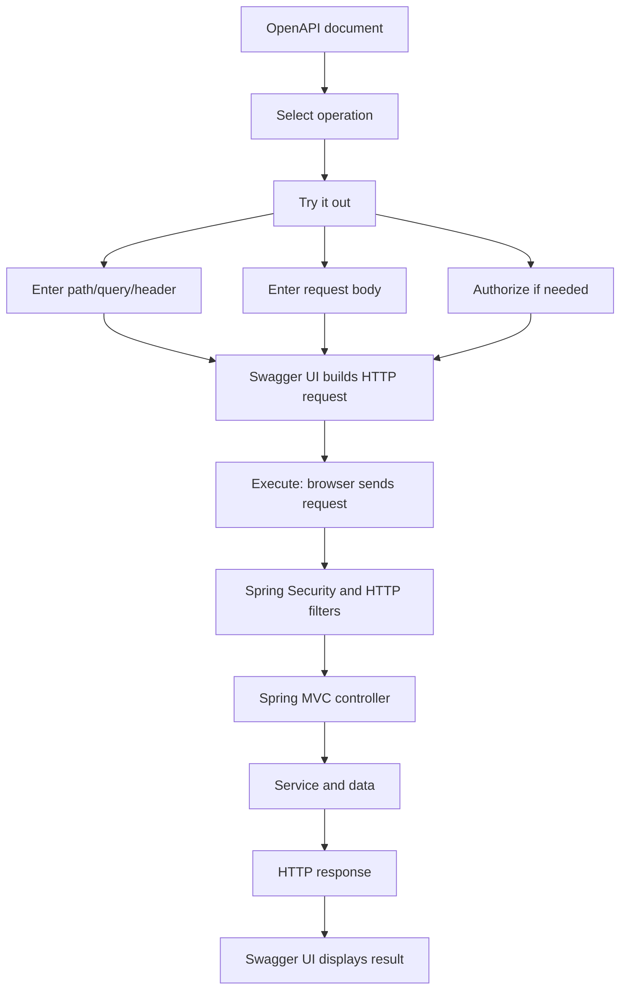

# Try it out and Making Real HTTP Requests

Swagger UI does not only display OpenAPI as documentation. The **Try it out** feature allows users to fill in parameters, request bodies, and authentication details, then send real HTTP requests to the selected server. When clicking **Execute**, the browser executes the request over the network; Spring Boot controllers, filters, security chains, validation, and services handle the request just as when an external client calls the API.

For requests to succeed properly, the OpenAPI document must accurately describe the method, path, server, parameters, request body, media types, and security schemes. Swagger UI constructs the request based on that information. If the documentation is wrong, the interface may generate URLs, headers, or bodies that do not match the runtime endpoint.

## 1. What steps does Try it out perform?

For an operation such as `POST /api/orders`, Swagger UI uses the OpenAPI document to build the request:

1. Select the server URL declared at the document, path, or operation level.
2. Join the server URL with the operation's path.
3. Substitute path parameters with the values entered by the user.
4. Serialize query parameters according to the schema and `style`/`explode` rules.
5. Add header parameters and cookie parameters described in the operation.
6. Choose the request body media type and serialize the data according to the schema.
7. Attach credentials from the security scheme the user authorized.
8. Send the request via the browser when the user clicks **Execute**.
9. Display the request URL, response status, response headers, response body, and response duration if the UI is configured to show it.

Flow diagram:



Try it out does not invoke Java methods directly and does not bypass the network. Requests pass through the actual HTTP stack, so DNS, TLS, proxy, CORS, authentication, authorization, validation, or business logic errors can all occur.

## 2. Selecting the right server before Execute

OpenAPI can declare servers at multiple levels:

- Document level: `servers` at the root of OpenAPI.
- Path level: `servers` in a Path Item.
- Operation level: `servers` in an Operation.

A server at a more specific level can override servers inherited from a higher level. Swagger UI uses the server corresponding to the operation being tested.

Example:

```yaml
servers:
  - url: https://api.example.com
    description: Production API
  - url: https://staging-api.example.com
    description: Staging API
paths:
  /api/orders:
    get:
      summary: List orders
      responses:
        '200':
          description: Order list
```

Swagger UI can allow selecting a server from the list. If production is selected, **Execute** calls real production. If a server URL contains variables, the user needs to choose or supply appropriate values according to Swagger UI's configuration.

The server URL must reflect an address reachable by the client. When the application runs behind a reverse proxy, API gateway, or context path, verify that `servers.url` has the right public host, scheme, port, and base path. An internal URL like `http://localhost:8080` may work in development but cannot be used by someone opening documentation from another machine.

## 3. Path parameters and query parameters

Swagger UI renders input fields for parameters declared by the operation. Controller example:

```java
import io.swagger.v3.oas.annotations.Operation;
import io.swagger.v3.oas.annotations.Parameter;
import io.swagger.v3.oas.annotations.media.Schema;
import org.springframework.web.bind.annotation.GetMapping;
import org.springframework.web.bind.annotation.PathVariable;
import org.springframework.web.bind.annotation.RequestParam;

@GetMapping("/{orderId}")
@Operation(summary = "Get order by ID")
OrderResponse getOrder(
    @Parameter(
        description = "Order ID to query",
        example = "4201",
        schema = @Schema(minimum = "1")
    )
    @PathVariable Long orderId,

    @Parameter(
        description = "Whether to include order line items",
        example = "true"
    )
    @RequestParam(defaultValue = "false") boolean includeItems
) {
    return orderService.getOrder(orderId, includeItems);
}
```

Swagger UI displays `orderId` in the path parameters section and `includeItems` in the query parameters section. When entering `orderId=4201` and `includeItems=true`, the generated URL takes the form:

```text
GET https://api.example.com/api/orders/4201?includeItems=true
```

Path parameters must be declared `required: true` in OpenAPI. Springdoc usually infers this from `@PathVariable`. For query parameters, describe defaults, required flags, minimum/maximum constraints, and examples accurately so users know which values are accepted.

### Array query parameters

OpenAPI supports multiple ways to serialize arrays and objects. For example, repeatable query parameters:

```text
GET /api/orders?status=NEW&status=PAID
```

Corresponding parameter:

```yaml
- name: status
  in: query
  description: Filter by one or more order statuses.
  schema:
    type: array
    items:
      type: string
      enum: [NEW, PAID, CANCELLED]
  style: form
  explode: true
```

`style` and `explode` affect how Swagger UI serializes values. If the server expects `status=NEW,PAID` yet OpenAPI describes `explode: true`, the request generated by the UI may not bind as expected. Cross-check the OpenAPI schema with how Spring MVC receives parameters.

## 4. Header parameters and cookie parameters

Header parameters can be entered directly in the Parameters section:

```java
import java.util.List;
import io.swagger.v3.oas.annotations.Parameter;
import io.swagger.v3.oas.annotations.enums.ParameterIn;
import org.springframework.web.bind.annotation.GetMapping;
import org.springframework.web.bind.annotation.RequestHeader;

@GetMapping
List<OrderResponse> search(
    @Parameter(
        name = "X-Request-Id",
        in = ParameterIn.HEADER,
        description = "Request correlation ID",
        example = "req-2026-001"
    )
    @RequestHeader("X-Request-Id") String requestId
) {
    return orderService.search(requestId);
}
```

Swagger UI places the `X-Request-Id` value into the request header. Use this approach for business headers or custom metadata.

Do not describe `Authorization`, `Accept`, or `Content-Type` as regular header parameters. `Authorization` must be described using a security scheme; `Accept` and `Content-Type` are expressed through response/request body media types. For Bearer tokens, users supply credentials via the **Authorize** button.

Cookie parameters can be described in OpenAPI with `in: cookie`. However, cookie transmission behavior also depends on browser cookie policies, origin, SameSite, Secure, and credentials settings. `HttpOnly` cookies cannot be read or set by JavaScript; the browser sends cookies automatically when conditions are satisfied.

## 5. Request body and media types

For operations with a request body, Swagger UI creates an input area for JSON, XML, form, or file data depending on `requestBody.content`.

DTO example:

```java
import io.swagger.v3.oas.annotations.media.Schema;

@Schema(name = "CreateOrderRequest")
public record CreateOrderRequest(
    @Schema(description = "Product ID", example = "501")
    Long productId,

    @Schema(description = "Order quantity", minimum = "1", example = "2")
    Integer quantity,

    @Schema(description = "Delivery note", example = "Deliver during business hours")
    String note
) {
}
```

Controller:

```java
import io.swagger.v3.oas.annotations.Operation;
import io.swagger.v3.oas.annotations.media.Content;
import io.swagger.v3.oas.annotations.media.ExampleObject;
import io.swagger.v3.oas.annotations.media.Schema;
import io.swagger.v3.oas.annotations.parameters.RequestBody;
import org.springframework.http.MediaType;
import org.springframework.http.ResponseEntity;
import org.springframework.web.bind.annotation.PostMapping;
import org.springframework.web.bind.annotation.RestController;

@PostMapping(
    value = "/api/orders",
    consumes = MediaType.APPLICATION_JSON_VALUE
)
@Operation(
    summary = "Create order",
    requestBody = @RequestBody(
        required = true,
        content = @Content(
            mediaType = MediaType.APPLICATION_JSON_VALUE,
            schema = @Schema(implementation = CreateOrderRequest.class),
            examples = @ExampleObject(value = """
                {
                  "productId": 501,
                  "quantity": 2,
                  "note": "Deliver during business hours"
                }
                """)
        )
    )
)
ResponseEntity<OrderResponse> create(
    @org.springframework.web.bind.annotation.RequestBody CreateOrderRequest request
) {
    return ResponseEntity.status(201).body(orderService.create(request));
}
```

Notice the example uses two annotations both named `RequestBody`: the Swagger annotation describes the request body in OpenAPI; the Spring MVC annotation binds the HTTP body to the controller parameter. Fully qualify the Spring annotation to avoid import confusion.

When schemas and examples are declared properly, Swagger UI can pre-populate sample JSON for users to edit. An example is suggested data; it does not validate requests on its own and does not replace runtime validation.

### Content-Type and Accept

`Content-Type` describes the body format sent by the client. It is typically determined from the media types in `requestBody.content` and the user's selection in the UI.

`Accept` describes the response format desired by the client. It is derived from the media types in the operation's `responses.content`.

Example of an operation accepting JSON and returning JSON:

```yaml
requestBody:
  required: true
  content:
    application/json:
      schema:
        $ref: '#/components/schemas/CreateOrderRequest'
responses:
  '201':
    description: Order created
    content:
      application/json:
        schema:
          $ref: '#/components/schemas/OrderResponse'
```

If an endpoint only accepts `application/json` yet a request is sent with another `Content-Type`, Spring may return `415 Unsupported Media Type`. If the client requests a media type the endpoint does not produce, the server may return `406 Not Acceptable` depending on negotiation and configuration.

## 6. Sending multipart and file uploads

For file upload endpoints, OpenAPI needs to describe `multipart/form-data` and the schema of each part:

```yaml
requestBody:
  required: true
  content:
    multipart/form-data:
      schema:
        type: object
        required:
          - file
        properties:
          file:
            type: string
            format: binary
          description:
            type: string
```

Spring MVC controller:

```java
import org.springframework.http.MediaType;
import org.springframework.web.bind.annotation.PostMapping;
import org.springframework.web.bind.annotation.RequestPart;
import org.springframework.web.multipart.MultipartFile;

@PostMapping(value = "/api/documents", consumes = MediaType.MULTIPART_FORM_DATA_VALUE)
DocumentResponse upload(
    @RequestPart("file") MultipartFile file,
    @RequestPart(value = "description", required = false) String description
) {
    return documentService.upload(file, description);
}
```

Swagger UI renders a file picker control for the `file` property when the schema is described accurately. The browser automatically generates the multipart boundary; do not manually set a `Content-Type: multipart/form-data` header when using browser FormData because the boundary must match the generated body.

## 7. Authorize and sending credentials

When the document declares `components.securitySchemes`, Swagger UI can display the **Authorize** button. Security requirements at the document or operation level indicate which operations require that scheme. For Bearer authentication, OpenAPI needs to declare the scheme and attach it to the operation or document:

```yaml
components:
  securitySchemes:
    bearerAuth:
      type: http
      scheme: bearer
      bearerFormat: JWT
security:
  - bearerAuth: []
```

Users open **Authorize**, enter a token as prompted by the UI, and confirm. When executing a protected operation, Swagger UI adds the header:

```http
Authorization: Bearer eyJhbGciOi...
```

The token must be valid for the selected server environment. Authorize only helps Swagger UI send credentials; Spring Security still validates signature, issuer, audience, expiration, and permissions.

If the Authorize button does not appear, check both parts:

- Has `components.securitySchemes` defined the scheme?
- Does the operation have a `security` requirement referencing the exact scheme name?

Defining a scheme without applying a requirement can leave Swagger UI unaware that the operation needs credentials. Conversely, a requirement pointing to a nonexistent scheme makes the document invalid.

Do not place real tokens in `@ExampleObject`, query strings, URLs, source code, or shared documentation. Use test tokens with minimal privileges and clear authorization state when finished on shared machines.

## 8. Clicking Execute and reading the sent request

After filling in parameters and body, click **Execute**. Swagger UI displays request and response information. Depending on the version, typical sections include:

- **Request URL**: the final URL after selecting the server and substituting path/query parameters.
- **Curl**: the equivalent cURL command to reproduce the request from a terminal.
- **Server response**: HTTP status code and reason phrase.
- **Response headers**: headers returned by the server.
- **Response body**: response payload if present.
- **Request duration**: elapsed send-and-receive time if display is enabled.

Example generated request:

```bash
curl -X 'POST' \
  'https://api.example.com/api/orders' \
  -H 'accept: application/json' \
  -H 'Content-Type: application/json' \
  -H 'Authorization: Bearer <ACCESS_TOKEN>' \
  -d '{
    "productId": 501,
    "quantity": 2,
    "note": "Deliver during business hours"
  }'
```

The cURL command illustrates how the request can be sent. Replace the token placeholder with valid credentials in a test environment. When copying cURL commands, protect tokens, cookies, and personal data before saving to logs or sharing with others.

Swagger UI normally formats the response body according to what the server returns. For `204 No Content`, an empty response body is the expected behavior. For errors like `400`, `401`, `403`, `404`, `409`, `415`, or `500`, inspect the status and response body to identify which layer rejected the request.

## 9. Configuring default Try it out in Springdoc

You can configure Swagger UI to open Try it out mode by default:

```yaml
springdoc:
  swagger-ui:
    tryItOutEnabled: true
```

Or:

```properties
springdoc.swagger-ui.tryItOutEnabled=true
```

This property enables Try it out state by default in the UI. Users still have to click Execute to send the request.

You can restrict which HTTP methods are allowed to be tested using `supportedSubmitMethods`:

```yaml
springdoc:
  swagger-ui:
    supportedSubmitMethods:
      - get
      - head
      - options
```

Swagger UI only permits submitting the listed methods. Set an empty list to disable the Try it out button for all operations:

```yaml
springdoc:
  swagger-ui:
    supportedSubmitMethods: []
```

This is a UI setting, not an API security mechanism. Clients can still call endpoints with cURL, Postman, or other programs. Access permissions and action restrictions must be enforced on the server.

Other useful options:

```yaml
springdoc:
  swagger-ui:
    displayRequestDuration: true
    persistAuthorization: false
```

`displayRequestDuration` displays request elapsed time in the UI. `persistAuthorization` controls keeping authorization state across page reloads according to Swagger UI's behavior configured by Springdoc. On shared machines, consider not persisting credentials across sessions.

Springdoc property names are subject to configuration binding case rules; check documentation for your exact starter version if an option is not picked up.

## 10. CORS when Swagger UI and the API have different origins

If Swagger UI is served from `https://docs.example.com` while the API is at `https://api.example.com`, the two addresses have different origins. Browsers enforce the Same-Origin Policy and only permit JavaScript to make cross-origin API calls when the server returns matching CORS headers.

Requests carrying `Authorization`, custom headers, or `Content-Type: application/json` usually cause the browser to send an `OPTIONS` preflight before the main request. The server must return CORS responses for the required origin, methods, and headers.

Spring MVC configuration example:

```java
import java.util.List;
import org.springframework.context.annotation.Bean;
import org.springframework.context.annotation.Configuration;
import org.springframework.web.cors.CorsConfiguration;
import org.springframework.web.cors.CorsConfigurationSource;
import org.springframework.web.cors.UrlBasedCorsConfigurationSource;

@Configuration
class ApiCorsConfiguration {

    @Bean
    CorsConfigurationSource corsConfigurationSource() {
        CorsConfiguration configuration = new CorsConfiguration();
        configuration.setAllowedOrigins(List.of("https://docs.example.com"));
        configuration.setAllowedMethods(List.of(
            "GET", "POST", "PUT", "PATCH", "DELETE", "OPTIONS"
        ));
        configuration.setAllowedHeaders(List.of(
            "Authorization", "Content-Type", "X-Request-Id"
        ));

        UrlBasedCorsConfigurationSource source = new UrlBasedCorsConfigurationSource();
        source.registerCorsConfiguration("/**", configuration);
        return source;
    }
}
```

If the application uses Spring Security, enable CORS integration in the filter chain so preflights are handled properly:

```java
import org.springframework.context.annotation.Bean;
import org.springframework.security.config.Customizer;
import org.springframework.security.config.annotation.web.builders.HttpSecurity;
import org.springframework.security.web.SecurityFilterChain;

@Bean
SecurityFilterChain securityFilterChain(HttpSecurity http) throws Exception {
    return http
        .cors(Customizer.withDefaults())
        // Add application authorization rules here.
        .build();
}
```

Do not open wildcard origins carelessly. If using cross-origin cookie credentials, configure explicit origins, `allowCredentials`, and appropriate cookie attributes; `Access-Control-Allow-Origin: *` cannot be used with credentialed browser requests.

CORS is a browser policy, not authentication. A request may succeed in cURL yet be blocked by the browser due to CORS; that does not mean the endpoint is broken.

## 11. CSRF and session cookie authentication

If the API uses session cookies, the browser may send cookies automatically when Swagger UI calls endpoints. For state-changing requests such as POST, PUT, PATCH, or DELETE, Spring Security may require a CSRF token.

When the token is missing, the server may return `403 Forbidden` even if the user is logged in. For Try it out to work properly, supply the CSRF token according to the application's mechanism and document that header if clients must send it manually.

Do not disable CSRF just so Swagger UI can send requests. Identify the authentication type and how credentials are sent:

- Stateless Bearer tokens sent in `Authorization` are usually handled differently from session cookies.
- Session cookies are sent automatically by the browser and require CSRF consideration for state-changing requests.
- CORS and CSRF configurations solve two different problems; allowing CORS does not mean a request carries a valid CSRF token.

## 12. Try it out can modify real data

Execute sends requests to the selected server. If an operation is a POST creating data, a DELETE deleting data, or a PATCH modifying state, the action executes in that environment.

Therefore, provide development or staging servers for learners and integrators. For operations with side effects, clearly document test data, required permissions, and cleanup procedures. Do not rely on hiding the Try it out button to protect production; the server must enforce real authorization and business controls.

## 13. Diagnosing when Try it out fails to send requests

| Symptom | Possible cause | How to check |
|---|---|---|
| Request URL has wrong host or path | `servers.url`, context path, or proxy config is wrong | Inspect Request URL and call that URL directly |
| Try it out button is missing | `supportedSubmitMethods` excludes the method or UI config disables submit | Check Swagger UI configuration |
| Execute button is disabled | Operation does not support submit or required parameters are invalid | Check OpenAPI operation and required fields |
| Browser reports CORS error | Preflight or CORS response lacks origin/header/method | Inspect Network tab, especially OPTIONS requests |
| Received `401 Unauthorized` | Missing token, invalid/expired token, or not Authorized yet | Check scheme, header, and token for the right server |
| Received `403 Forbidden` | Missing permissions, CSRF token, or policy denial | Check security logs and response body |
| Received `400 Bad Request` | Malformed JSON, binding failure, or validation error | Compare request body against schema and validation errors |
| Received `404 Not Found` | Wrong path, base URL, or path parameter | Check Request URL and controller mapping |
| Received `405 Method Not Allowed` | HTTP method in docs differs from runtime mapping | Cross-check `@GetMapping`, `@PostMapping`, etc. |
| Received `406 Not Acceptable` | `Accept` does not match response media type | Check `responses.content` and negotiation |
| Received `415 Unsupported Media Type` | `Content-Type` is not in `consumes` | Check requestBody media type and controller mapping |
| cURL works but browser fails | CORS, cookie policy, or TLS/browser restriction | Compare Network tab and response CORS headers |
| Response 204 treated as error | Client or documentation expects a body | Check response status and OpenAPI response without content |

## 14. Verification workflow from OpenAPI to HTTP runtime

When requests built by Swagger UI are incorrect, follow this sequence:

1. Open `/v3/api-docs` or the group URL Swagger UI loads.
2. Confirm `servers`, path, and HTTP method.
3. Confirm parameter names, locations, types, defaults, and serialization.
4. Confirm `requestBody.content` and schemas/examples.
5. Confirm security schemes and security requirements.
6. Use Try it out, and observe the generated Request URL, cURL, and headers/body.
7. Open the browser Network tab to inspect the actual request, preflight, and response.
8. Send the same request with cURL to distinguish browser issues from server issues.
9. If the request reaches the server, check Spring Security, controller binding, validation, and service logic.
10. Fix OpenAPI metadata or runtime mappings at the source of mismatch, then retry.

Example checking the document from the terminal:

```bash
curl -s http://localhost:8080/v3/api-docs \
  | jq '.paths["/api/orders"].post'
```

Example calling the endpoint independently of Swagger UI:

```bash
curl -i -X POST http://localhost:8080/api/orders \
  -H 'Content-Type: application/json' \
  -H 'Accept: application/json' \
  -d '{"productId":501,"quantity":2}'
```

If cURL and Swagger UI send the exact same method, URL, headers, and body yet produce different results, focus on CORS, cookies, browser credentials, TLS, and proxies. If both fail identically, inspect the endpoint and runtime configuration.

## 15. Checklist before enabling Try it out

- [ ] `servers` points to the right environment users are allowed to test.
- [ ] Method and path match Spring MVC mappings.
- [ ] Path/query/header/cookie parameters have accurate names, types, and serialization.
- [ ] Request body has appropriate schema, media type, and examples.
- [ ] `Accept` and `Content-Type` are described via media types.
- [ ] Security schemes and requirements match runtime authentication.
- [ ] CORS permits the docs origin, methods, and required headers if cross-origin.
- [ ] CSRF is handled properly if the API uses session cookies.
- [ ] Success and error responses reflect actual status codes and bodies.
- [ ] Tested requests via both Swagger UI and cURL.
- [ ] Operations with side effects are tested in an appropriate environment.
- [ ] Restricted `supportedSubmitMethods` if the UI should disallow testing certain methods.

Try it out turns OpenAPI into an interface for sending real HTTP requests. Swagger UI uses servers, parameters, media types, schemas, and security requirements to build requests; on Execute, the browser sends the request over the network and the server processes it like any other client. Therefore, documentation must match runtime, CORS/CSRF must match the authentication model, and real responses must be checked after every test.

## References

- [Swagger UI – Configuration](https://swagger.io/docs/open-source-tools/swagger-ui/usage/configuration/)
- [Swagger UI – Supported Submit Methods](https://swagger.io/docs/open-source-tools/swagger-ui/usage/configuration/#network)
- [Springdoc OpenAPI – Official documentation](https://springdoc.org/)
- [Springdoc OpenAPI – FAQ](https://springdoc.org/faq.html)
- [OpenAPI Specification – Operation Object](https://spec.openapis.org/oas/v3.1.1.html#operation-object)
- [OpenAPI Specification – Parameter Object](https://spec.openapis.org/oas/v3.1.1.html#parameter-object)
