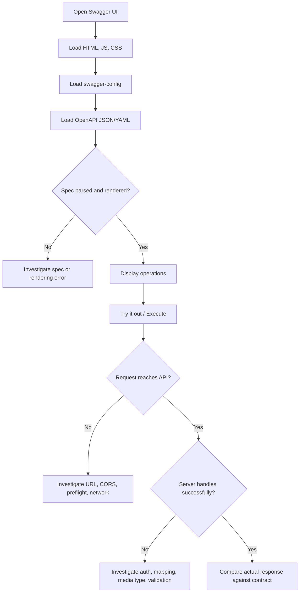

# Distinguishing Specification Errors from Browser Rendering or Request Errors

When Swagger UI does not behave as expected, the root cause can lie in three distinct layers: the OpenAPI specification generated by springdoc, the Swagger UI interface running in the browser, or the HTTP request the browser sends to the API. These three layers interact, yet each requires different diagnostics and fixes.

An OpenAPI document may be completely valid while Swagger UI fails to load due to JavaScript errors, static resources, CORS, or URL configuration. Conversely, the UI may display every operation properly yet **Try it out** requests fail because the server returns `401`, `404`, `415`, or validation errors. Therefore, identify which request failed and which data is wrong before editing annotations or configuration.

## 1. Three layers to distinguish

| Layer | Components | Question to answer | Common symptoms |
| --- | --- | --- | --- |
| OpenAPI specification | springdoc, `/v3/api-docs`, schemas, paths, responses, security | Is the JSON/YAML document generated and describing the contract accurately? | Malformed JSON, missing operations, broken `$ref`, wrong schema or security requirements. |
| Swagger UI rendering | HTML, JavaScript, CSS, `swagger-config`, browser | Does the UI load configuration and spec, then render properly? | Blank page, Failed to load API definition, JS errors, CSS missing, CORS when loading doc. |
| Browser request dispatch | Try it out, URL, headers, body, CORS, Spring Security, controller | Is the actual request valid and handled successfully by the server? | `401`, `403`, `404`, `400`, `415`, failed preflight, or response mismatches docs. |

This classification prevents fixing the wrong layer. For instance, editing `@Schema` will not fix a CORS error; opening access to Swagger UI will not fix a malformed request body; and tweaking CSS will not make an endpoint return the right status code.

## 2. Understanding the flow before diagnosing

In a typical setup, the browser loads Swagger UI in this order:

1. Open the UI entry page, typically `/swagger-ui.html`.
2. Load HTML, JavaScript, and CSS from `/swagger-ui/**` resources.
3. Call `/v3/api-docs/swagger-config` to fetch UI configuration.
4. Read `url` or `urls` from configuration and fetch the OpenAPI document, typically `/v3/api-docs` or `/v3/api-docs/{group}`.
5. Parse the specification and render tags, operations, parameters, schemas, and responses.
6. When the user selects **Try it out** and clicks **Execute**, Swagger UI builds a request from the specification and sends it to the API URL.



Each step produces a separate request in the Network tab. Pinpoint the first failing request instead of looking only at generic banners on the Swagger UI page.

## 3. First step: inspect the OpenAPI document directly

Open the documentation endpoint in a browser tab or use curl:

```bash
curl -i http://localhost:8080/v3/api-docs
```

For a document group:

```bash
curl -i http://localhost:8080/v3/api-docs/store-v1
```

If the application changed `springdoc.api-docs.path`, use the configured base path. Check the following:

- Is the HTTP status `200`?
- Is `Content-Type` valid JSON?
- Is the response OpenAPI JSON or HTML of a login/proxy error page?
- Is the `openapi` field present with the version the application intends to publish?
- Are `paths` and expected operations present?
- Do schemas referenced by `$ref` exist?

A `200` response alone does not prove the specification is right. For example, a reverse proxy may return an HTML page with status `200`, or syntactically valid JSON may be missing required operations.

Check the Swagger UI configuration endpoint separately:

```bash
curl -i http://localhost:8080/v3/api-docs/swagger-config
```

`swagger-config` must return configuration JSON, typically containing `url` or `urls` pointing to the OpenAPI document. If this endpoint is blocked or returns bad content, Swagger UI may fail to load configuration even when `/v3/api-docs` works directly.

## 4. Identifying OpenAPI specification errors

An error belongs to the specification when the document is not generated, is invalid, or describes something different from the intended API contract.

Common signs:

- `/v3/api-docs` returns `500` due to an exception while resolving models, annotations, or customizers.
- JSON fails to parse or mandatory OpenAPI fields are missing.
- `paths` omits an endpoint even though the controller is registered.
- An operation has the wrong method, path, parameters, or request body.
- Schemas use wrong `type`, `format`, `required`, `enum`, `additionalProperties`, or bounds.
- `$ref` points to a nonexistent component.
- `security` or `securitySchemes` fails to reflect the published authentication mechanism.
- Response codes, media types, headers, or examples differ from actual responses.

For example: a controller accepts `LocalDate` as a query parameter yet documentation describes it as an arbitrary string without `format: date`. That is a schema/metadata issue. If the controller accepts the valid date format yet the server rejects it for violating a business rule, that is a runtime validation issue.

### Checking paths and operations

Locate the path and method under `paths`:

```yaml
paths:
  /api/orders/{id}:
    get:
      operationId: getOrder
      parameters:
        - name: id
          in: path
          required: true
          schema:
            type: string
            format: uuid
```

If the path is missing, check controller mappings, `GroupedOpenApi` package/path filters, hiding annotations, and group configuration. If the path exists with the wrong method, check Spring MVC mappings and how endpoints are discovered.

### Checking schemas and `$ref`

Example response referencing a schema:

```yaml
responses:
  '200':
    description: Order found
    content:
      application/json:
        schema:
          $ref: '#/components/schemas/OrderResponse'
```

The reference target must exist in `components.schemas`. When adding schemas manually via customizers or `ModelConverter`, ensure all nested helper schemas are registered as well. A dangling `$ref` can prevent validators or renderers from reading part of the document.

### Checking media types and security

For request bodies, verify `requestBody.content` has the exact media type accepted by the controller. For responses, verify `responses[status].content`. If the API requires a bearer token, check both `components.securitySchemes` and `security` at the operation or document level. Declaring a security scheme without attaching a security requirement leaves Swagger UI unaware that the operation requires a token.

## 5. Identifying Swagger UI rendering errors

If the OpenAPI document opens directly with valid content yet Swagger UI fails to display properly, focus on the UI and the requests serving it:

| Request | Role | Error signs |
| --- | --- | --- |
| `/swagger-ui.html` | UI entry URL | `404`, wrong redirect, or blocked by Spring Security. |
| `/swagger-ui/**` | JavaScript, CSS, fonts, and images | `404`, wrong content type, CSP, or stale cache. |
| `/v3/api-docs/swagger-config` | UI configuration | `401`, `403`, `404`, malformed JSON, or wrong document URL. |
| `/v3/api-docs` or group URL | OpenAPI document | Load failure, returns HTML, invalid JSON, or CORS. |

A message like *Failed to load API definition* does not identify a single cause. It can appear when the document URL is wrong, the server returns `401`, JSON is invalid, CORS blocks reading the response, or Swagger UI cannot parse the specification format.

Open Developer Tools:

1. **Network** tab, enable Preserve log if redirects occur.
2. Reload the Swagger UI page.
3. Filter by `swagger`, `api-docs`, `js`, `css`.
4. Inspect request URL, status, response body, and `Content-Type`.
5. **Console** tab to look for JavaScript, CSP, mixed content, or CORS errors.

Do not conclude springdoc generated a broken specification just because the UI is blank. If the document loads directly without issues, isolate the fault in `swagger-config`, UI assets, cache, CSP, or Swagger UI compatibility.

## 6. Errors when `Try it out` sends requests

Once operations render and the user clicks **Execute**, Swagger UI builds an HTTP request from:

- `servers` in the OpenAPI document.
- Operation path and HTTP method.
- Path/query/header/cookie parameters.
- Request body and media type.
- Security requirements along with credentials entered in **Authorize**.

Inspect the real request in the Network tab or the **Curl** snippet shown by Swagger UI. Cross-check URL, method, query string, request headers, and body against the controller. Do not inspect only the response summary; examine the raw request and response.

Common statuses:

| Status or symptom | Common meaning | Where to check |
| --- | --- | --- |
| `400 Bad Request` | Malformed JSON, binding failure, or validation error | Request body, parameters, Jackson converters, Bean Validation, and error handlers. |
| `401 Unauthorized` | Missing or invalid authentication credentials | Security scheme, Authorize button, `Authorization` header, token, and Spring Security. |
| `403 Forbidden` | Authenticated but insufficient permissions, or CSRF/policy denial | Roles/authorities, method security, CSRF, and access rules. |
| `404 Not Found` | URL/path does not match an endpoint or base path is wrong | `servers`, context path, reverse proxy, controller mapping, and path variables. |
| `405 Method Not Allowed` | URL exists but HTTP method is unsupported | Method in operation and controller mapping. |
| `406 Not Acceptable` | Server cannot produce a response matching `Accept` | `Accept`, `produces`, and message converters. |
| `415 Unsupported Media Type` | Request `Content-Type` is unsupported by endpoint/converter | `Content-Type`, `consumes`, multipart part encoding, and message converters. |
| `422 Unprocessable Content` | Server understands request yet rejects it under business rules | Validation or business rules; status usage varies by API. |
| `500 Internal Server Error` | Server-side failure | Application logs, exceptions, services, and infrastructure. |

A status code is a clue, not a verdict. For example, `404` may mean an endpoint does not exist, yet it can also stem from a proxy rewriting prefixes incorrectly or security intentionally hiding endpoints.

## 7. Distinguishing CORS from API errors

CORS is a browser policy governing cross-origin requests. Swagger UI may be served from `https://docs.example.com` while calling an API at `https://api.example.com`; the API server must then permit the UI page's origin.

For requests requiring preflight, the browser sends `OPTIONS` before the actual request. Preflights typically occur when requests use non-simple methods, headers such as `Authorization`, or `Content-Type: application/json`. If preflight fails, the business request may not even be sent.

Check that the `OPTIONS` response includes appropriate headers, for example:

```http
Access-Control-Allow-Origin: https://docs.example.com
Access-Control-Allow-Methods: GET, POST, PUT, DELETE, OPTIONS
Access-Control-Allow-Headers: Authorization, Content-Type
```

If the frontend needs to read custom response headers such as `ETag`, `Link`, or `X-Total-Count`, the server must also expose them via `Access-Control-Expose-Headers`.

Distinguish three cases:

- **Preflight fails:** inspect the `OPTIONS` request; the real API request was usually never dispatched.
- **API request reaches the server yet the browser reports CORS:** check whether the API response lacks `Access-Control-Allow-Origin` or mismatches the origin. The server may have already processed the request even though JavaScript cannot read the response.
- **No CORS involved:** if UI and API share the same origin, errors usually lie in URLs, authentication, or API handling rather than CORS.

Never use `Access-Control-Allow-Origin: *` with credentials. If cookies or HTTP credentials are required, configure explicit origins and enable credentials per application policy.

## 8. Distinguishing authentication errors from security documentation errors

Swagger UI sends credentials strictly according to OpenAPI security schemes/requirements and whatever the user entered in **Authorize**. For instance, a JWT bearer setup requires declaring an HTTP bearer scheme and attaching a security requirement to the operation or document.

If the **Authorize** button is missing, or operations lack the expected lock icon, inspect `components.securitySchemes` and `security` in OpenAPI. That is a contract documentation error.

If the UI shows security accurately yet requests return `401` or `403`, inspect the token, `Authorization` header, issuer/audience, expiration, roles, and Spring Security. That is a runtime authentication/authorization error or invalid supplied credentials.

Conversely, if docs omit security declarations while the server enforces tokens, the UI may dispatch requests without tokens. Keep OpenAPI security requirements aligned with runtime configuration; adding `@SecurityRequirement` alone does not enable Spring Security.

## 9. Checking `servers` URLs, context path, and reverse proxies

Swagger UI constructs request URLs from the server URL and operation path. If `servers` is wrong, requests may target the wrong host or prefix even when paths under `paths` are completely accurate.

Example published document:

```yaml
servers:
  - url: https://api.example.com/service
paths:
  /orders:
    get:
      responses:
        '200':
          description: OK
```

Generated requests combine the base URL in `servers` with `/orders`. If a reverse proxy exposes the API under `/service` yet the application does not recognize forwarded prefixes, OpenAPI may generate a server URL missing or duplicating the prefix.

Check:

- `server.servlet.context-path` and servlet path.
- `springdoc.api-docs.path` and `springdoc.swagger-ui.path`.
- `Forwarded`, `X-Forwarded-Host`, `X-Forwarded-Proto`, and `X-Forwarded-Prefix` sent by the proxy.
- `server.forward-headers-strategy`.
- `servers` in the document and the actual Request URL in the Network tab.

Trust forwarded headers only from controlled reverse proxies. Never fix URL mismatches by adding prefixes onto every controller mapping if the real cause is proxy config or wrong `servers`.

## 10. Comparing the contract with runtime behavior

A valid OpenAPI document does not guarantee endpoints execute properly. Verify both sides separately:

| Aspect | OpenAPI contract check | Runtime check |
| --- | --- | --- |
| Path/method | Do `paths` have the right path and method? | Does the controller match the request URL/method? |
| Parameters | Are name, `in`, `required`, schema, and examples accurate? | Does Spring bind values and apply defaults? |
| Request body | Are media types and schemas accurate? | Can Jackson/message converters deserialize it? |
| Validation | Are constraints documented? | Do Bean Validation/business rules enforce them? |
| Security | Are schemes and requirements published? | Does Spring Security authenticate and authorize properly? |
| Response | Are status, headers, media type, and schemas accurate? | Does the server return the expected status/headers/body? |

For instance, documentation publishes `201 Created` while the controller returns `200 OK`. Swagger UI can still render the operation and send requests successfully; the problem is a contract-runtime mismatch. Similarly, `@ApiResponse(responseCode = "400")` only documents a response; it does not make the controller return `400`.

## 11. Automated checks in the project

Maintain at least two kinds of tests:

**Specification tests:** call `/v3/api-docs`, parse JSON, and verify key contracts such as paths, operations, schemas, security, and response codes. You can run an OpenAPI validator/linter in CI to catch invalid structure, broken `$ref`s, or inconsistent documentation conventions.

**HTTP tests:** use MockMvc or WebTestClient to send real requests and check status, headers, content type, and body. Cover valid requests, malformed requests, insufficient permissions, and missing resources.

Example checking the document with MockMvc:

```java
@SpringBootTest
@AutoConfigureMockMvc
class OpenApiDocumentTest {

    @Autowired
    MockMvc mockMvc;

    @Test
    void exposesOrdersGetOperation() throws Exception {
        mockMvc.perform(get("/v3/api-docs"))
            .andExpect(status().isOk())
            .andExpect(jsonPath("$.openapi").exists())
            .andExpect(jsonPath("$['paths']['/api/orders']['get']").exists());
    }
}
```

This test confirms only that the document is served and contains the chosen operation. It does not prove schemas are complete or the endpoint executes accurately; add assertions for key scenarios and separate HTTP tests.
If the documentation endpoint is protected by Spring Security, supply appropriate authentication in tests or use the corresponding test configuration.

## 12. Symptom-driven diagnostic workflow

| Symptom | First check | Likely layer involved |
| --- | --- | --- |
| `/v3/api-docs` returns `500` | Read springdoc logs and exceptions resolving schemas/customizers | Spec generation |
| `/v3/api-docs` returns HTML or redirect | Check Spring Security, proxy, and response `Content-Type` | Docs endpoint/deployment |
| Valid OpenAPI JSON yet missing operations | Check controller mappings, group filters, `@Hidden` | Specification |
| JSON loads yet Swagger UI is blank | Check `swagger-config`, JavaScript, CSS, and Console | Rendering |
| Swagger UI reports Failed to load API definition | Inspect doc fetch request, status, response body, and CORS | Rendering or docs endpoint |
| Operation renders yet Try it out calls wrong host/path | Check `servers`, context path, and proxy prefix | Request construction |
| Request lacks Authorization | Check security requirements and Authorize state | Security spec/UI |
| Request carries token yet returns `401`/`403` | Check token and Spring Security | Runtime security |
| Request returns `415` | Check `Content-Type`, `consumes`, multipart encoding | Runtime binding |
| Request returns `400` | Check JSON, parameter conversion, and validation | Runtime binding/validation |
| Request returns `404`/`405` | Compare URL/method with controller mapping and proxy | Routing/runtime |
| Browser reports CORS | Check `OPTIONS` preflight and API CORS headers | Browser/network |
| Curl succeeds yet browser fails | Compare origin, preflight, credentials, and browser-sent headers | Browser/network |

## 13. Practical checklist

When encountering Swagger UI issues, proceed in order:

1. Call `/v3/api-docs` or the group document directly to confirm the specification is generated.
2. Call `/v3/api-docs/swagger-config` to confirm UI config points to the right document.
3. Inspect the UI page and `/swagger-ui/**` resources in the Network tab.
4. If the UI renders, select an operation and inspect Request URL, method, headers, and body before Execute.
5. If requests are cross-origin, check preflight and CORS; if using tokens, check security requirements and the Authorization header.
6. Read raw HTTP responses and server logs to distinguish requests that never reached the server from requests rejected by the server.
7. Compare actual responses against published status codes, headers, media types, and schemas.
8. Add specification tests and runtime tests to prevent regressions.

Do not modify multiple layers at once. Change only the configuration or annotations tied to the identified failing request, then re-test the same step to verify whether the root cause was resolved.

## 14. Guiding principles

- Inspect OpenAPI JSON/YAML directly before concluding Swagger UI generated a wrong spec.
- Use Network and Console to pinpoint the exact failing UI, config, document, or API request.
- Distinguish spec parsing/rendering errors from static resource loading errors.
- When Try it out fails, cross-check the actual request against `servers`, operations, parameters, bodies, and security requirements.
- Classify `400`, `401`, `403`, `404`, `405`, `406`, `415`, and `500` statuses by their corresponding processing layer.
- Inspect `OPTIONS` preflights before altering controllers if the browser reports CORS.
- Keep OpenAPI synchronized with Spring MVC, Jackson, validation, and Spring Security.
- Maintain specification tests and HTTP tests as two separate pillars of contract testing.

Swagger UI is a tool for reading specifications and sending test requests; it does not guarantee documentation accuracy or runtime API correctness. Separating OpenAPI generation failures, UI rendering failures, and browser request failures makes diagnostics evidence-driven: which URL failed, which response came back, and which contract mismatched. From there, you can fix the right layer and verify against both raw docs and real HTTP calls.

## References

- [Springdoc OpenAPI – official documentation](https://springdoc.org/)
- [Springdoc OpenAPI FAQ – Swagger UI and OpenAPI endpoints](https://springdoc.org/faq.html)
- [Swagger UI – Configuration and usage](https://swagger.io/docs/open-source-tools/swagger-ui/usage/)
- [OpenAPI Specification](https://spec.openapis.org/oas/latest.html)
- [MDN – CORS](https://developer.mozilla.org/en-US/docs/Web/HTTP/CORS)
