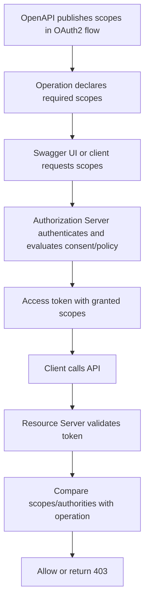

# Published Scopes, Required Scopes, and Actually Granted Scopes

When describing OAuth 2.0 or OpenID Connect in OpenAPI, the word "scope" appears at several different stages. A scope can be published in an OAuth2 flow definition, required for an operation, requested by a client in an authorization request, and finally granted by the authorization server in an access token. These lists are related, but not synonymous.

With Springdoc, three primary layers must be distinguished:

1. **Published scopes**: the catalog of scopes described in `components.securitySchemes.<scheme>.flows.<flow>.scopes`.
2. **Required scopes**: scopes that an operation needs, declared in `security` of the OpenAPI document or operation.
3. **Actually granted scopes**: permissions the authorization server actually grants to the client, reflected in the access token or introspection result.

For example, an API publishes `orders:read` and `orders:write`; the read-order operation requires `orders:read`; the client requests both scopes, but the authorization server only grants `orders:read`. That token can call the read operation, but lacks sufficient permissions to call the update operation. OpenAPI describes the contract and the operation's needs; the authorization server and resource server decide which scopes are granted and whether they are accepted at runtime.

## 1. Three scope layers in an OAuth2 flow

Consider an orders API with two operations:

| Operation | Required scope |
|---|---|
| `GET /api/orders/{id}` | `orders:read` |
| `POST /api/orders` | `orders:write` |

The authorization server supports both scopes. A client can request one or both depending on the task. After the user logs in and consents, the authorization server issues an access token with the approved scopes according to its policy.



The layers can differ:

| Layer | Example | Where described or checked |
|---|---|---|
| Published scopes | `orders:read`, `orders:write` | OAuth2 Flow Object in OpenAPI; authorization server scope catalog |
| Required scope for operation | `orders:read` | Operation's Security Requirement |
| Scopes requested by client | `orders:read orders:write` | Authorization request or token request depending on flow |
| Granted scope | `orders:read` | Token response, access token claims, or introspection response |
| Checked scope | `SCOPE_orders:read` | Resource server authorization rule, e.g., Spring Security |

Do not use a single scope list for all five roles. The published catalog may be larger than the scope needed by one operation; the client may request multiple scopes; the authorization server may grant fewer; the resource server must check the actual permissions in the token.

## 2. Published scopes in the OAuth2 Flow Object

In OpenAPI, an OAuth2 Security Scheme describes one or more flows. Each flow has a `scopes` map, where the key is the scope name and the value is a description for integrators.

```yaml
components:
  securitySchemes:
    ordersOAuth:
      type: oauth2
      flows:
        authorizationCode:
          authorizationUrl: https://identity.example.com/oauth2/authorize
          tokenUrl: https://identity.example.com/oauth2/token
          scopes:
            orders:read: Read order information
            orders:write: Create and update orders
            orders:cancel: Cancel orders
```

The `scopes` map is the catalog of scopes published by documentation for that flow. It helps Swagger UI, client generators, and readers know which scopes the authorization server/API supports under the contract. OpenAPI does not query the authorization server itself to verify whether a scope exists or whether the current client has been granted that scope.

Scope names are often structured by resource and action, such as `orders:read`, `orders:write`, `customers:read`. The `:` character is just a naming convention; OAuth2 does not require this syntax. Keep names stable and case-sensitive, and avoid renaming them arbitrarily because clients, authorization servers, and resource servers may all depend on them.

Scope descriptions should clearly state the allowed action or data. Avoid overly broad names like `admin` if the API can split permissions by specific resource and action.

## 3. Required scopes in Security Requirement

A published scope catalog does not mean every operation automatically requires all scopes. Each operation specifies its required scopes using `security`.

```yaml
paths:
  /api/orders/{id}:
    get:
      operationId: getOrder
      security:
        - ordersOAuth:
            - orders:read
      responses:
        '200':
          description: Order details
  /api/orders:
    post:
      operationId: createOrder
      security:
        - ordersOAuth:
            - orders:write
      responses:
        '201':
          description: Order created
```

The `getOrder` operation requires `orders:read`; `createOrder` requires `orders:write`. There is no need to require `orders:write` merely because it is published in the same flow.

The Security Requirement Object references the scheme by name and lists the scopes required for the operation. The scheme name must match a key in `components.securitySchemes`; scope names must match scopes declared in the flow. This is contract metadata, not an expression automatically read by Spring Security to configure authorization.

### Multiple scopes in the same requirement

```yaml
security:
  - ordersOAuth:
      - orders:read
      - customers:read
```

With the same OAuth2 scheme, all scopes inside one Security Requirement Object are required. The client needs a token containing both `orders:read` and `customers:read` to satisfy this operation.

### Multiple requirement objects as OR alternatives

```yaml
security:
  - ordersOAuth:
      - orders:read
  - partnerOAuth:
      - partner:orders:view
```

The client can satisfy this with either option: a token from `ordersOAuth` with `orders:read`, or a token from `partnerOAuth` with `partner:orders:view`. Both tokens are not required simultaneously.

## 4. Scopes requested by the client in the authorization request

With Authorization Code Flow, the client redirects the user to the authorization endpoint. The `scope` parameter in the authorization request represents the scopes the client is asking for. Illustrative example:

```http
GET /oauth2/authorize?response_type=code&client_id=orders-web&redirect_uri=https%3A%2F%2Fclient.example.com%2Fcallback&scope=orders%3Aread%20orders%3Awrite&state=abc123 HTTP/1.1
Host: identity.example.com
```

In the request above, the client asks for two scopes: `orders:read` and `orders:write`. For production applications, Authorization Code Flow should use PKCE and verify `state`; the URL above only illustrates the placement of the `scope` parameter, not a complete security implementation template.

The scope in the authorization request is the client's request sent to the authorization server. It does not prove the authorization server granted all of those scopes. The server can apply policies per client, user, consent, tenant, or resource, and then issue an appropriate set of scopes.

For other flows, the place where scopes are sent may differ. For example, Client Credentials Flow sends scopes in the token request to the token endpoint. Describe the exact flow being used; do not apply Authorization Code browser redirection to every OAuth2 flow.

## 5. Scopes actually granted in the token response

The authorization server returns an access token after processing the request. Example:

```json
{
  "access_token": "<ACCESS_TOKEN>",
  "token_type": "Bearer",
  "expires_in": 3600,
  "scope": "orders:read"
}
```

The client requested `orders:read orders:write`, but the server only granted `orders:read`. The client must rely on the actually granted permissions and must not assume `orders:write` exists simply because it was sent in the request.

According to OAuth 2.0, if the granted scopes differ from the requested scopes, the token response must include the `scope` parameter to indicate the actual scopes. If the granted scopes are identical to the requested scopes, the `scope` parameter in the token response may be omitted. Therefore, an omitted `scope` field in the response does not necessarily mean the token has no scopes; the client must apply the protocol rules and authorization server specification properly.

When the token response includes `scope`, the value is usually a space-delimited string of scope tokens. That is OAuth2's wire representation; in an OpenAPI Security Requirement, scopes are written as separate elements in a YAML/JSON array.

Do not place real access tokens in documentation, public examples, logs, or source control. Tokens shown in this article are placeholders only.

## 6. Scopes in JWT Access Tokens and Opaque Tokens

The resource server needs to determine granted scopes from the validated access token. How this is read depends on the token format and the identity provider's contract.

### JWT access token

A JWT may contain a scope claim, for example:

```json
{
  "iss": "https://identity.example.com",
  "sub": "user-42",
  "aud": ["orders-api"],
  "scope": "orders:read",
  "exp": 1893456000
}
```

Another provider may use an array `scp` claim:

```json
{
  "sub": "user-42",
  "scp": ["orders:read", "customers:read"]
}
```

There is no single mandatory claim name for all JWT access tokens. The resource server must follow the issuer's token contract and validate signature, issuer, audience, expiration, and related conditions before trusting claims. Simply Base64-decoding a JWT does not prove the token is valid.

### Opaque access token

Opaque tokens do not carry locally readable JWT claims. The resource server usually verifies the token via an introspection endpoint or a mechanism provided by the authorization server. The introspection response may return `active` and `scope` along with other metadata.

Do not assume every access token is a JWT. Resource server configuration must match the actual token type of the system.

## 7. Mapping scopes to authorities in Spring Security

With Spring Security Resource Server JWT, the default `JwtGrantedAuthoritiesConverter` can read scopes from the `scope` or `scp` claim and create authorities prefixed with `SCOPE_`.

For example, if a token has:

```json
{
  "scope": "orders:read orders:write"
}
```

The corresponding authorities are typically:

```text
SCOPE_orders:read
SCOPE_orders:write
```

Endpoints can be protected using authorities:

```java
import org.springframework.context.annotation.Bean;
import org.springframework.context.annotation.Configuration;
import org.springframework.http.HttpMethod;
import org.springframework.security.config.Customizer;
import org.springframework.security.config.annotation.web.builders.HttpSecurity;
import org.springframework.security.web.SecurityFilterChain;

@Configuration
class ApiSecurityConfiguration {

    @Bean
    SecurityFilterChain apiSecurity(HttpSecurity http) throws Exception {
        return http
            .authorizeHttpRequests(authorize -> authorize
                .requestMatchers(HttpMethod.GET, "/api/orders/**")
                    .hasAuthority("SCOPE_orders:read")
                .requestMatchers(HttpMethod.POST, "/api/orders")
                    .hasAuthority("SCOPE_orders:write")
                .anyRequest().authenticated()
            )
            .oauth2ResourceServer(oauth2 -> oauth2.jwt(Customizer.withDefaults()))
            .build();
    }
}
```

This example assumes the application has configured an appropriate `JwtDecoder` or issuer. If the issuer emits a custom claim such as `permissions`, configure a converter to map that claim to `GrantedAuthority`; do not assume Spring Security automatically understands arbitrary custom claims.

Scopes can be checked at the method level with `@PreAuthorize` after enabling method security:

```java
import org.springframework.security.access.prepost.PreAuthorize;
import org.springframework.stereotype.Service;

@Service
class OrderQueryService {

    @PreAuthorize("hasAuthority('SCOPE_orders:read')")
    OrderResponse getOrder(Long id) {
        // Read order after authorization succeeds.
        return loadOrder(id);
    }
}
```

Scopes in OpenAPI and authorities in Spring Security should reflect the same policy. Springdoc does not automatically read `@PreAuthorize` or `hasAuthority(...)` to infer OpenAPI scopes in general; declare documentation explicitly and test for consistency.

## 8. Declaring published scopes with Springdoc annotations

Springdoc uses Swagger annotations to generate OAuth2 Security Schemes. `@OAuthScope` defines each scope in a flow.

```java
import io.swagger.v3.oas.annotations.enums.SecuritySchemeType;
import io.swagger.v3.oas.annotations.security.OAuthFlow;
import io.swagger.v3.oas.annotations.security.OAuthFlows;
import io.swagger.v3.oas.annotations.security.OAuthScope;
import io.swagger.v3.oas.annotations.security.SecurityScheme;
import org.springframework.context.annotation.Configuration;

@Configuration
@SecurityScheme(
    name = "ordersOAuth",
    type = SecuritySchemeType.OAUTH2,
    flows = @OAuthFlows(
        authorizationCode = @OAuthFlow(
            authorizationUrl = "https://identity.example.com/oauth2/authorize",
            tokenUrl = "https://identity.example.com/oauth2/token",
            scopes = {
                @OAuthScope(
                    name = "orders:read",
                    description = "Read order information"
                ),
                @OAuthScope(
                    name = "orders:write",
                    description = "Create and update orders"
                ),
                @OAuthScope(
                    name = "orders:cancel",
                    description = "Cancel orders"
                )
            }
        )
    )
)
class OAuth2OpenApiConfiguration {
}
```

This is the catalog of published scopes. Annotations do not grant permissions to clients, do not configure authorization server client registrations, and do not create claims in access tokens.

If multiple flows are used in the same scheme, each flow can publish an appropriate scope list. Cross-check authorization/token URLs, flows, and scopes against the actual identity provider. Do not use example URLs in production.

## 9. Declaring required scopes per operation

After defining the scheme, operations reference required scopes using `@SecurityRequirement`:

```java
import io.swagger.v3.oas.annotations.Operation;
import io.swagger.v3.oas.annotations.security.SecurityRequirement;
import org.springframework.web.bind.annotation.GetMapping;
import org.springframework.web.bind.annotation.PathVariable;
import org.springframework.web.bind.annotation.PostMapping;
import org.springframework.web.bind.annotation.RestController;

@RestController
class OrderController {

    @GetMapping("/api/orders/{id}")
    @Operation(
        operationId = "getOrder",
        summary = "Get order",
        security = @SecurityRequirement(
            name = "ordersOAuth",
            scopes = {"orders:read"}
        )
    )
    OrderResponse getOrder(@PathVariable Long id) {
        return orderService.getOrder(id);
    }

    @PostMapping("/api/orders")
    @Operation(
        operationId = "createOrder",
        summary = "Create order",
        security = @SecurityRequirement(
            name = "ordersOAuth",
            scopes = {"orders:write"}
        )
    )
    OrderResponse createOrder() {
        return orderService.createOrder();
    }
}
```

Each operation should request only the scopes needed for that task. If there is a root-level security requirement on the document, security declared specifically on an operation overrides the root requirement for that operation. Avoid accidentally placing `orders:write` at the root if read-only endpoints do not need write access.

If an operation needs multiple scopes of the same scheme, list all of them in `scopes`. If there are alternative authentication options, use multiple Security Requirement Objects following the OR rule and check the generated OpenAPI output.

## 10. Equivalent programmatic configuration

When scopes must be generated dynamically from configuration, you can construct the OAuth2 scheme using the OpenAPI model instead of annotations:

```java
import io.swagger.v3.oas.models.Components;
import io.swagger.v3.oas.models.OpenAPI;
import io.swagger.v3.oas.models.info.Info;
import io.swagger.v3.oas.models.security.OAuthFlow;
import io.swagger.v3.oas.models.security.OAuthFlows;
import io.swagger.v3.oas.models.security.Scopes;
import io.swagger.v3.oas.models.security.SecurityScheme;
import org.springframework.context.annotation.Bean;
import org.springframework.context.annotation.Configuration;

@Configuration
class ProgrammaticOAuthConfiguration {

    @Bean
    OpenAPI ordersOpenApi() {
        Scopes scopes = new Scopes()
            .addString("orders:read", "Read order information")
            .addString("orders:write", "Create and update orders");

        SecurityScheme ordersOAuth = new SecurityScheme()
            .type(SecurityScheme.Type.OAUTH2)
            .flows(new OAuthFlows().authorizationCode(
                new OAuthFlow()
                    .authorizationUrl("https://identity.example.com/oauth2/authorize")
                    .tokenUrl("https://identity.example.com/oauth2/token")
                    .scopes(scopes)
            ));

        return new OpenAPI()
            .info(new Info().title("Orders API").version("1.0.0"))
            .components(new Components().addSecuritySchemes(
                "ordersOAuth",
                ordersOAuth
            ));
    }
}
```

Operations still must declare security requirements to indicate required scopes. Defining the scheme only publishes the scope catalog; it does not automatically apply all scopes to all operations.

Do not declare the same scheme using both annotations and a bean if the two sources could produce conflicting configuration. Choose one clear configuration source, then inspect the generated document.

## 11. Swagger UI and required scopes

When an OpenAPI document declares an OAuth2 scheme and security requirements, Swagger UI can use that information in the **Authorize** flow. With Authorization Code Flow, the UI redirects the user to the authorization server; scopes related to operations can be included in the authorization request depending on Swagger UI configuration.

Some UI configurations can provide `clientId`, `clientSecret` (if the client is genuinely confidential and the UI runs in an appropriate environment), default `scopes`, and `usePkceWithAuthorizationCodeGrant`. Example Springdoc configuration:

```yaml
springdoc:
  swagger-ui:
    oauth:
      clientId: orders-swagger-ui
      usePkceWithAuthorizationCodeGrant: true
```

Do not embed a client secret into Swagger UI running in a public browser. Browser-based UI is a public client; use PKCE and register the exact redirect URI. `clientId` must be a client registered at the authorization server, and the redirect URI must match provider settings.

In the Authorize dialog, selected or requested scopes do not prove the final token has sufficient permissions. The authorization server may require consent, enforce policies, or grant narrower scopes. After authentication, inspect the access token or introspection safely to confirm actual permissions.

If Swagger UI sends only one scope while an operation requires another, check the OpenAPI Security Requirement, OAuth UI configuration, and the authorization request in the Network tab. Never relax the resource server to accept a token lacking permissions merely to make the Try it out button succeed.

## 12. OIDC scopes are not API authorization scopes

OpenID Connect extends OAuth2 to authenticate users. The `openid` scope signals a request for an OpenID Connect flow. Standard scopes such as `profile` and `email` request user information within OIDC's scope.

Example:

```text
scope=openid profile email orders:read
```

In this example, `openid`, `profile`, and `email` relate to OIDC/user claims requests; `orders:read` is a business scope that the orders API can use to control read access to data. Receiving `profile` from the provider does not mean the client is permitted to read all orders.

Distinguish tokens:

- **ID token**: contains authentication information about the user for the OIDC client; do not use it in place of an access token to call a resource server unless a specific protocol explicitly specifies otherwise.
- **Access token**: credentials sent by the client to the API; the resource server validates the token and checks scopes/authorities.
- **Refresh token**: used to request new access tokens according to authorization server policy; never send refresh tokens to business APIs.

If describing OpenID Connect with `type: openIdConnect`, `openIdConnectUrl` points to the provider's discovery document. If you need to describe specific OAuth2 API scopes by flow and endpoint, you can use an OAuth2 Security Scheme. Choose the model that reflects the protocol the client actually uses, and avoid treating OIDC profile/email scopes as API CRUD permissions.

## 13. Granted scopes can be fewer than requested scopes

The authorization server has the authority to decide actual scopes based on client, user, consent, policy, tenant, or resource. Clients must not assume that every scope sent in the authorization request will be granted.

Example:

| Stage | Scopes |
|---|---|
| OpenAPI publishes | `orders:read`, `orders:write`, `orders:cancel` |
| Operation `GET /api/orders/{id}` requires | `orders:read` |
| Client requests | `orders:read orders:write` |
| Authorization server grants | `orders:read` |
| Resource server allows | Reading orders |
| Resource server denies | Creating or updating orders |

A token with broader scopes than the operation's minimum required scope can still call that operation, provided other conditions are valid. However, clients should request the minimum permissions needed to reduce risk if a token is exposed.

If the authorization server grants narrower scopes, the client should adjust its behavior or inform the user that the operation was not authorized. Avoid repeating authorization requests continuously to try to obtain broader scopes after policy has denied them.

## 14. When published, required, and granted scopes mismatch

| Mismatch | Consequence | Resolution |
|---|---|---|
| Operation requires a scope not declared in the flow | OpenAPI references a scope missing from the published catalog; UI/tooling may not describe or request the right scope | Add the scope to the flow if supported by the provider, or fix the requirement to match the real contract |
| OpenAPI publishes a scope the authorization server does not support | Clients may request the scope, but the provider rejects or ignores it | Synchronize the catalog with provider settings and test the authorization request |
| Client requests more scopes than the server grants | Token lacks permissions for some operations | Read actual scopes, call only eligible operations, or follow the proper consent/policy process |
| Token has scope but resource server does not map it to an authority | Request fails with 403 even though claim contains permission | Check claim name, converter, and authority prefix |
| Resource server is more permissive than OpenAPI | Documentation understates actual permissions or runtime lacks enforcement | Review authorization rules and update the contract once policy is confirmed |
| OpenAPI requires more than runtime | Swagger UI requests unnecessary permissions or clients misunderstand | Narrow requirements to match API policy and verify with security tests |
| OIDC `profile` scope used as permission to read orders | Confusing user information with resource authorization | Use API scopes such as `orders:read` for resource permissions |
| Using ID token as Bearer token for API | Resource server may reject due to wrong audience/token type | Send the access token intended for the API resource server |

## 15. Inspecting the OpenAPI document generated by Springdoc

After starting the application, open `/v3/api-docs` or the corresponding group document. Check the published scope catalog:

```bash
curl -s http://localhost:8080/v3/api-docs \
  | jq '.components.securitySchemes.ordersOAuth.flows.authorizationCode.scopes'
```

Check the required scopes of the read operation:

```bash
curl -s http://localhost:8080/v3/api-docs \
  | jq '.paths["/api/orders/{id}"].get.security'
```

Check the create-order operation:

```bash
curl -s http://localhost:8080/v3/api-docs \
  | jq '.paths["/api/orders"].post.security'
```

Ensure:

- The scheme name in the requirement exists in `components.securitySchemes`.
- Required scopes exist in `flows.<flow>.scopes` of the corresponding scheme.
- Read operations do not accidentally require write scopes.
- Public operations do not unintentionally inherit security requirements.
- Each group document has schemes and requirements matching the operations filtered into that group.

If using `@OpenAPIDefinition.security` at the root, operations without their own security declaration inherit that requirement. If each operation needs different scopes, declare separate requirements per method or use a customizer to adjust the model; verify the output rather than inferring from annotation source.

## 16. Testing tokens and runtime authorization

Accurate documentation is not enough; test real tokens or test tokens issued by the system. For JWTs, verify signature, `iss`, `aud`, `exp`, and scope claims per the issuer contract. For opaque tokens, verify introspection or the corresponding validation mechanism.

Test matrix for the two operations:

| Token | `GET /api/orders/{id}` | `POST /api/orders` |
|---|---|---|
| No token | `401 Unauthorized` | `401 Unauthorized` |
| Token with `orders:read` | Allowed if other conditions are valid | `403 Forbidden` |
| Token with `orders:write` | Policy-dependent; usually lacks read permission unless `orders:read` is also granted | Allowed if other conditions are valid |
| Token with both scopes | Allowed | Allowed |
| Expired/wrong issuer/wrong audience token | Authentication rejected | Authentication rejected |

Exact status codes also depend on the authentication entry point, authorization handler, and application policy. Typically, missing or invalid tokens result in 401; valid tokens lacking required authorities result in 403.

Test example with Spring Security Test and mocked JWT:

```java
import static org.springframework.security.test.web.servlet.request.SecurityMockMvcRequestPostProcessors.jwt;
import static org.springframework.test.web.servlet.request.MockMvcRequestBuilders.get;
import static org.springframework.test.web.servlet.result.MockMvcResultMatchers.status;
import org.springframework.security.core.authority.SimpleGrantedAuthority;

@Test
void readEndpointRejectsTokenWithoutReadScope() throws Exception {
    mockMvc.perform(get("/api/orders/42")
            .with(jwt().authorities(
                new SimpleGrantedAuthority("SCOPE_orders:write")
            )))
        .andExpect(status().isForbidden());
}
```

This test simulates an authenticated JWT that only has the write authority. It tests the authorization rule of the read endpoint. Requires the `spring-security-test` dependency and importing `SimpleGrantedAuthority`; runtime unit tests do not replace verifying tokens issued by a real authorization server.

## 17. Scope management conventions across the API lifecycle

Scopes are part of the integration contract and may be used by clients, authorization servers, resource servers, gateways, and SDKs. When changing scopes:

1. Define the meaning and permission boundary before publishing a name.
2. Synchronize scope names across the authorization server, OpenAPI, and resource server.
3. Request only the minimum scopes for each operation.
4. Check client registrations and scope-granting consent/policies.
5. Check claims or introspection representing actual scopes.
6. Update SDKs, integration guides, and authorization request examples.
7. If removing or renaming a published scope, plan a transition period and notify clients.

Do not reuse an old scope name for a broader meaning. A client already granted the old scope might suddenly gain new permissions if the authorization server changes its meaning without changing the name. If permissions change significantly, create a new scope and plan a migration.

## 18. Common errors

| Symptom | Cause | Resolution |
|---|---|---|
| Swagger UI does not display the desired scope | Scope not declared in the OAuth2 flow or viewing a different document | Check `components.securitySchemes` and group URL |
| Operation requires a scope missing from the catalog | Wrong name in requirement or missing flow declaration | Synchronize `security` and `flows.<flow>.scopes` |
| Client requests `orders:write` but token only has `orders:read` | Authorization server restricts based on policy/consent | Inspect token response and actually granted scopes |
| Token has scope claim but Spring Security still returns 403 | Claim is not read by converter or authority prefix differs | Check `JwtGrantedAuthoritiesConverter` and `GrantedAuthority` |
| Token only has `SCOPE_orders:read` but endpoint requires `ROLE_USER` | Confusing scope authority with role | Use the right authority or map roles separately per policy |
| Defined a scope and now every operation requires it | Requirement was placed at root | Move requirements down to individual operations or adjust root |
| `profile` scope used to read API resources | Confusing OIDC user claims with API permissions | Define business scopes such as `orders:read` |
| API receives ID token and rejects it | Wrong token type or audience sent | Send an access token intended for the resource server |
| OpenAPI and runtime have different permission lists | Documentation and authorization policy managed independently | Synchronize changes and add contract/security tests |

## 19. Checklist for verifying the three scope layers

- [ ] Published scopes in the OAuth2 flow match scopes supported by the authorization server.
- [ ] Each scope has a clear description of the permission and protected resource.
- [ ] Each operation's Security Requirement asks only for necessary scopes.
- [ ] Scope names in requirements exist in the flow's scope catalog.
- [ ] Write scopes are not placed at the root if most operations only need read access.
- [ ] Clients send scopes matching the flow and task.
- [ ] Clients inspect actually granted scopes rather than assuming the server grants all requested scopes.
- [ ] Resource server validates tokens and reads the right claim/introspection field.
- [ ] Scopes map consistently to authorities, such as `SCOPE_orders:read`.
- [ ] OIDC scopes like `openid`, `profile`, `email` are not confused with API permissions.
- [ ] Access tokens are used to call APIs; ID tokens are not used as substitutes.
- [ ] Both the default document and each OpenAPI group have been checked.
- [ ] Tested with sufficient scope, missing scope, expired, and wrong-audience tokens.
- [ ] Compatibility plan exists when adding, removing, or changing scope semantics.

Published scopes form the permission catalog that a described flow can use; required scopes are the permissions an operation needs; granted scopes are the permissions the authorization server actually puts into the access token. A client may request multiple scopes and receive only a subset. The resource server must validate the token and check actual authorities before allowing an operation. When these three layers are synchronized across Springdoc, the authorization server, and Spring Security, OpenAPI documentation accurately reflects required permissions and helps clients avoid requesting overly broad access.

## References

- [OpenAPI Specification – OAuth Flows Object](https://spec.openapis.org/oas/v3.1.1.html#oauth-flows-object)
- [OpenAPI Specification – Security Requirement Object](https://spec.openapis.org/oas/v3.1.1.html#security-requirement-object)
- [RFC 6749 – OAuth 2.0 Authorization Framework, Scope and Token Response](https://www.rfc-editor.org/rfc/rfc6749)
- [OpenID Connect Core 1.0 – Scope Values](https://openid.net/specs/openid-connect-core-1_0.html#ScopeClaims)
- [Spring Security – OAuth 2.0 Resource Server JWT](https://docs.spring.io/spring-security/reference/servlet/oauth2/resource-server/jwt.html)
- [Springdoc OpenAPI – Official documentation](https://springdoc.org/)
