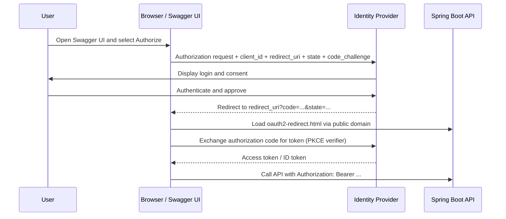

# OAuth Redirect URL When Changing Domains or Application Paths

Swagger UI uses a dedicated callback URL to receive the result after a user logs in via OAuth 2.0 or OpenID Connect. When changing domains, enabling HTTPS, adding a context path, or placing the application behind a reverse proxy, the callback URL Swagger UI sends to the Identity Provider (IdP) may no longer match the registered URL. The usual outcome is a `redirect_uri_mismatch` error, a 404 callback, or the browser returning to the UI without completing authentication.

With springdoc-openapi, the property to watch is `springdoc.swagger-ui.oauth2-redirect-url`. Configure the public URL reachable by the browser, register that exact URL at the IdP, and ensure the reverse proxy forwards callback requests to the right Swagger UI resource.

## 1. Where does the Redirect URI sit in the OAuth flow?

When a user clicks Authorize in Swagger UI, the browser navigates to the IdP's authorization endpoint. The request includes the `redirect_uri` parameter, telling the IdP which address to return the browser to after the user grants consent. With Swagger UI, the callback is usually the `oauth2-redirect.html` page bundled with the UI.

The Authorization Code flow can be visualized as follows:



The callback URL in this flow is the URL of the Swagger UI page that processes the OAuth result. It is not an API endpoint URL and is not necessarily Spring Security's login callback.

For example, if the application is published at:

```text
https://api.example.com/store/docs/swagger-ui.html
```

the callback URL may be:

```text
https://api.example.com/store/swagger-ui/oauth2-redirect.html
```

These are two different URLs. The Swagger UI page can be changed via `springdoc.swagger-ui.path`, while the OAuth callback is configured separately via `springdoc.swagger-ui.oauth2-redirect-url`.

## 2. Distinguishing easily confused redirect URLs

A system may have several URLs named redirect or callback. Identify which client is performing OAuth:

| URL / Property | Used For | Example |
|---|---|---|
| `springdoc.swagger-ui.oauth2-redirect-url` | OAuth callback in browser-based Swagger UI | `/swagger-ui/oauth2-redirect.html` |
| `springdoc.swagger-ui.path` | Main HTML page of Swagger UI | `/docs/swagger-ui.html` |
| `authorizationUrl` in OpenAPI | IdP endpoint receiving authorization requests | `https://id.example.com/oauth2/authorize` |
| `tokenUrl` in OpenAPI | IdP endpoint receiving authorization code to issue tokens | `https://id.example.com/oauth2/token` |
| `openIdConnectUrl` in OpenAPI | Discovery metadata of the OpenID Provider | `https://id.example.com/.well-known/openid-configuration` |
| `spring.security.oauth2.client.registration.*.redirect-uri` | OAuth/OIDC login callback handled by Spring Security on the backend | `{baseUrl}/login/oauth2/code/{registrationId}` |
| `post_logout_redirect_uri` | Address the IdP returns the browser to after logout | `https://app.example.com/signed-out` |

If Swagger UI is the OAuth client, modifying `spring.security.oauth2.client.registration.*.redirect-uri` does not change Swagger UI's callback. Conversely, modifying `springdoc.swagger-ui.oauth2-redirect-url` does not change the callback Spring Security uses to process user logins into the application.

`authorizationUrl`, `tokenUrl`, and `openIdConnectUrl` are not redirect URIs either. They indicate where to begin authorization, where to exchange codes for tokens, and where to fetch OpenID Provider metadata.

## 3. Defaults of springdoc and Swagger UI

In the springdoc-openapi v2 property documentation for Spring Boot 3.x, `springdoc.swagger-ui.oauth2RedirectUrl` has the default value:

```text
/swagger-ui/oauth2-redirect.html
```

The corresponding YAML property name via Spring Boot relaxed binding is `oauth2-redirect-url`. It can be configured as:

```yaml
springdoc:
  swagger-ui:
    oauth2-redirect-url: https://api.example.com/swagger-ui/oauth2-redirect.html
```

When using a specific domain and context path, set an absolute URL to prevent Swagger UI or the browser from constructing a callback based on an incorrect internal host, scheme, or path.

Do not confuse this property with `springdoc.swagger-ui.path`. Example:

```yaml
springdoc:
  swagger-ui:
    path: /docs/swagger-ui.html
    oauth2-redirect-url: https://api.example.com/store/swagger-ui/oauth2-redirect.html
```

The UI page is `/docs/swagger-ui.html`, while the callback is `/store/swagger-ui/oauth2-redirect.html` on the public domain. Both paths must be properly configured in proxy and security rules.

If not configured explicitly, springdoc v2 defaults to the path `/swagger-ui/oauth2-redirect.html`. When the application has a context path or is exposed via a reverse proxy, the default path may not reflect the external URL the IdP expects. After changing domain or paths, check `oauth2RedirectUrl` in the Swagger UI config loaded by the browser and the `redirect_uri` parameter in the authorization request.

## 4. Changing domains: updating the callback URL and IdP registration

Suppose the old environment used:

```text
http://localhost:8080/swagger-ui/oauth2-redirect.html
```

After deployment, the UI is published at:

```text
https://docs.example.com/swagger-ui.html
```

The new callback needs to be:

```text
https://docs.example.com/swagger-ui/oauth2-redirect.html
```

Two places must be updated in sync:

1. Swagger UI configuration in the application, using `springdoc.swagger-ui.oauth2-redirect-url`.
2. The client's Valid Redirect URIs / Allowed Callback URLs list in the IdP.

Example configuration:

```yaml
springdoc:
  swagger-ui:
    oauth2-redirect-url: ${SWAGGER_UI_OAUTH2_REDIRECT_URL:https://docs.example.com/swagger-ui/oauth2-redirect.html}
```

Environment variable:

```text
SWAGGER_UI_OAUTH2_REDIRECT_URL=https://docs.example.com/swagger-ui/oauth2-redirect.html
```

In the IdP admin console, add that exact URL to the allowed redirect URIs for the Swagger UI client. If the old environment still needs to work during transition, you can register both old and new URLs per IdP policy, then remove the old URL once migration finishes.

### Exact URL matching

The redirect URI must match the registered value. Check all parts thoroughly:

- Scheme: `https` and `http` are two different URIs.
- Host: `api.example.com` and `docs.example.com` are two different URIs.
- Port: explicit ports and default ports may be handled per URI rules, but do not rely on provider normalization.
- Path: `/swagger-ui/oauth2-redirect.html` differs from `/docs/oauth2-redirect.html`.
- Trailing `/`: `/callback` and `/callback/` may not match.
- Case sensitivity and encoding: do not assume the IdP normalizes all components the same way as the application.

RFC 9700 recommends that authorization servers compare registered redirect URIs using exact string matching, with a narrow exception for localhost ports of native apps. Do not use broad wildcards or arbitrary redirector endpoints to bypass mismatch errors; that increases the risk of authorization code and token leakage.

## 5. Changing context path or adding a prefix on deployment

An application may run internally at root yet be published under a prefix.

Example:

| Component | URL |
|---|---|
| Internal address | `http://app:8080/swagger-ui/oauth2-redirect.html` |
| Public address | `https://example.com/platform/swagger-ui/oauth2-redirect.html` |
| Public Swagger UI page | `https://example.com/platform/docs/swagger-ui.html` |

If the reverse proxy strips `/platform` before forwarding requests to the application, the internal callback can remain `/swagger-ui/oauth2-redirect.html`, but the `redirect_uri` sent to the IdP must be the public URL with the `/platform` prefix.

There are two common deployment patterns:

### Application itself runs under a context path

If Spring Boot directly serves the application at `/platform`, configure:

```yaml
server:
  servlet:
    context-path: /platform

springdoc:
  swagger-ui:
    path: /docs/swagger-ui.html
    oauth2-redirect-url: https://example.com/platform/swagger-ui/oauth2-redirect.html
```

In this case, the context path is part of the application path. Confirm that the callback endpoint is actually served at that public URL.

### Reverse proxy adds a prefix and strips it before forwarding

If the application runs at root on `http://app:8080`, the proxy may receive `/platform/...`, strip `/platform`, and forward the remainder to the application. The callback configuration must still use the public URL:

```yaml
springdoc:
  swagger-ui:
    path: /docs/swagger-ui.html
    oauth2-redirect-url: ${SWAGGER_UI_OAUTH2_REDIRECT_URL:https://example.com/platform/swagger-ui/oauth2-redirect.html}
```

The proxy must route public callback requests to the right internal resource. Adding a prefix to `redirect_uri` without a corresponding route causes the IdP redirect to succeed while the callback returns 404.

## 6. Handling scheme, host, and prefix through a reverse proxy

When TLS terminates at a load balancer or reverse proxy, requests reaching Spring Boot may use HTTP and an internal host, while the browser accesses HTTPS via a public domain. If the application generates URLs from the request without recognizing forwarded headers, Swagger UI may emit a callback like:

```text
http://app:8080/swagger-ui/oauth2-redirect.html
```

instead of:

```text
https://docs.example.com/platform/swagger-ui/oauth2-redirect.html
```

Proxies usually forward original details using these headers:

| Header | Information |
|---|---|
| `Forwarded` | Scheme, host, and client information per RFC 7239 |
| `X-Forwarded-Host` | Host the browser used to access the site |
| `X-Forwarded-Proto` | Public scheme, usually `https` |
| `X-Forwarded-Port` | Public port if needed |
| `X-Forwarded-Prefix` | Prefix added or stripped by the proxy before forwarding |

With Spring Boot 3.x, forwarded header support can be enabled via:

```yaml
server:
  forward-headers-strategy: framework
```

`FRAMEWORK` uses `ForwardedHeaderFilter` for the Servlet stack and `ForwardedHeaderTransformer` for the reactive stack. If the embedded server natively supports all headers sent by the proxy, `NATIVE` may be more appropriate. Choose based on the actual server, proxy, and headers.

Nginx example when publishing the application under `/platform` and stripping the prefix before forwarding:

```nginx
location /platform/ {
    proxy_pass http://app:8080/;

    proxy_set_header Host $host;
    proxy_set_header X-Forwarded-Host $host;
    proxy_set_header X-Forwarded-Proto $scheme;
    proxy_set_header X-Forwarded-Port $server_port;
    proxy_set_header X-Forwarded-Prefix /platform;
}
```

With `proxy_pass` having a trailing `/` as shown, Nginx strips the `/platform/` prefix from the URI sent upstream. Verify your actual proxy's rewrite rules; even a difference in a trailing `/` can alter path concatenation.

### Only trust forwarded headers from trusted proxies

Forwarded headers affect how the application identifies host, scheme, and public address. Proxies at the trust boundary must strip `Forwarded`/`X-Forwarded-*` headers sent by external clients and rewrite them with accurate values from the received request. Do not allow direct Internet requests to spoof `X-Forwarded-Host` to manipulate callback URLs generated by the application.

If the application can be reached directly outside the proxy, block that direct path or restrict trusted proxies in server configuration. Do not trust all proxies blindly in production.

### Spring Boot 4.x notes

Check the exact minor version because the forwarded header namespace changed in the Boot 4 line:

- Spring Boot 4.0 still uses `server.forward-headers-strategy` in embedded web server documentation.
- Spring Boot 4.2 uses `server.request.header.forwarded.strategy`, with values such as `web-server`, `framework`, or `none`.

Example for Boot 4.2 when the proxy sends `X-Forwarded-*` and strips the `/platform` prefix before forwarding:

```yaml
server:
  request:
    header:
      forwarded:
        strategy: web-server
        use-prefix: true
```

`use-prefix: true` enables `X-Forwarded-Prefix` handling; otherwise, the prefix header may be ignored. If the web server does not support the needed header, choose `framework` to use `ForwardedHeaderFilter` or `ForwardedHeaderTransformer`. Do not copy properties from Boot 3.x or Boot 4.0 to Boot 4.2 without checking configuration metadata for the running version.

## 7. Configuring OAuth for Swagger UI alongside the redirect URL

A typical configuration for Authorization Code + PKCE looks like:

```yaml
springdoc:
  swagger-ui:
    path: /docs/swagger-ui.html
    oauth2-redirect-url: ${SWAGGER_UI_OAUTH2_REDIRECT_URL:https://api.example.com/platform/swagger-ui/oauth2-redirect.html}
    oauth:
      client-id: ${SWAGGER_UI_OAUTH_CLIENT_ID}
      use-pkce-with-authorization-code-grant: true
```

In this example:

- `oauth2-redirect-url` is the callback Swagger UI sends in the authorization request.
- `client-id` is the client ID registered for Swagger UI in the IdP.
- `use-pkce-with-authorization-code-grant` enables PKCE for authorization code flow.
- The callback URL must be present in the client's valid redirect URIs list at the IdP.

Swagger UI runs in the browser and should be treated as a public client. Never place a real client secret in production Swagger UI configuration. A client secret sent to the browser can be viewed by users in JavaScript or network requests. Use Authorization Code + PKCE instead of trying to hide secrets in the frontend.

RFC 9700 requires public clients to use PKCE to prevent authorization code injection/misuse; the `S256` method is recommended because it does not expose the verifier in the authorization request. The IdP must support and enforce PKCE.

## 8. Declaring OAuth2 or OIDC in OpenAPI does not replace the callback URL

OpenAPI describes security schemes so Swagger UI knows the authorization endpoint, token endpoint, and scopes. Swagger UI's redirect URL is still configured separately.

OAuth2 Authorization Code example:

```java
@Configuration
@OpenAPIDefinition(
    info = @Info(title = "Store API", version = "1.0.0")
)
@SecurityScheme(
    name = "storeOAuth",
    type = SecuritySchemeType.OAUTH2,
    flows = @OAuthFlows(
        authorizationCode = @OAuthFlow(
            authorizationUrl = "https://id.example.com/oauth2/authorize",
            tokenUrl = "https://id.example.com/oauth2/token",
            scopes = {
                @OAuthScope(name = "openid", description = "OpenID Connect"),
                @OAuthScope(name = "profile", description = "Profile information"),
                @OAuthScope(name = "products:read", description = "Read products")
            }
        )
    )
)
class OpenApiSecurityConfiguration {}
```

Attach security requirements to an operation or the whole document:

```java
@Operation(
    summary = "Search products",
    security = @SecurityRequirement(
        name = "storeOAuth",
        scopes = {"openid", "products:read"}
    )
)
@GetMapping("/api/products")
List<ProductResponse> search() {
    return productService.search();
}
```

For an OpenID Connect discovery scheme, you can use:

```java
@SecurityScheme(
    name = "storeOidc",
    type = SecuritySchemeType.OPENIDCONNECT,
    openIdConnectUrl = "https://id.example.com/.well-known/openid-configuration"
)
```

`openIdConnectUrl` is the discovery metadata URL. The discovery document typically provides `authorization_endpoint`, `token_endpoint`, and `jwks_uri`; it does not register `redirect_uri` for Swagger UI. You still must configure `springdoc.swagger-ui.oauth2-redirect-url` and register the callback at the IdP.

## 9. Environment-specific configuration

Domains and paths usually differ across local, development, staging, and production. Do not hardcode a fixed production URL across all profiles when each environment has a different host.

You can use environment variables:

```yaml
springdoc:
  swagger-ui:
    oauth2-redirect-url: ${SWAGGER_UI_OAUTH2_REDIRECT_URL}
    oauth:
      client-id: ${SWAGGER_UI_OAUTH_CLIENT_ID}
      use-pkce-with-authorization-code-grant: true
```

Example values by environment:

| Environment | `SWAGGER_UI_OAUTH2_REDIRECT_URL` |
|---|---|
| Local | `http://localhost:8080/swagger-ui/oauth2-redirect.html` |
| Development | `https://dev-api.example.com/swagger-ui/oauth2-redirect.html` |
| Staging | `https://staging-api.example.com/platform/swagger-ui/oauth2-redirect.html` |
| Production | `https://api.example.com/platform/swagger-ui/oauth2-redirect.html` |

Register the exact corresponding URLs for each client/environment in the IdP. You can use a separate client per environment to reduce blast radius when rotating configuration or revoking permissions.

Do not use wildcards like `https://*.example.com/**` just to avoid updating the redirect URI when changing domains. If the IdP supports multiple redirect URIs, register each full URL. When changing domains, both old and new URLs can be kept during a controlled transition period.

## 10. Distinguishing context path and springdoc Swagger UI path

Three settings can affect final URLs while having different meanings:

| Configuration | Meaning |
|---|---|
| `server.servlet.context-path` | Root prefix of the Servlet application |
| `springdoc.swagger-ui.path` | HTML endpoint where users open Swagger UI |
| `springdoc.swagger-ui.oauth2-redirect-url` | Callback URL sent in the OAuth authorization request |

Example:

```yaml
server:
  servlet:
    context-path: /store

springdoc:
  swagger-ui:
    path: /docs/swagger-ui.html
    oauth2-redirect-url: https://api.example.com/store/swagger-ui/oauth2-redirect.html
```

The public UI page is:

```text
https://api.example.com/store/docs/swagger-ui.html
```

The public callback is:

```text
https://api.example.com/store/swagger-ui/oauth2-redirect.html
```

Do not prepend `context-path` to the callback yourself if the property already contains the full absolute URL. Also do not add `/docs` to the callback just because the UI page sits under `/docs`; the callback resource usually has its own path provided by springdoc/Swagger UI.

## 11. Verifying the actual URL sent by Swagger UI

After configuring, check the runtime value rather than only reading the YAML file.

### Checking swagger-config

Open the Swagger UI configuration endpoint, by default:

```text
https://api.example.com/v3/api-docs/swagger-config
```

In the JSON, look for the property:

```json
{
  "oauth2RedirectUrl": "https://api.example.com/platform/swagger-ui/oauth2-redirect.html"
}
```

The config endpoint path may change if `springdoc.api-docs.path` or groups are customized. If the JSON still contains an internal host or default callback, check property binding, active profiles, and springdoc configuration.

### Checking the authorization request

1. Open Swagger UI on the public domain.
2. Open Developer Tools → Network.
3. Click Authorize.
4. Locate the request to the IdP's authorization endpoint.
5. Inspect the `redirect_uri` query parameter after URL decoding.
6. Compare character-by-character against the URL registered at the IdP.

Example of what a valid request must send:

```text
redirect_uri=https%3A%2F%2Fapi.example.com%2Fplatform%2Fswagger-ui%2Foauth2-redirect.html
```

Do not only check `oauth2RedirectUrl` in swagger-config; confirm the final parameter in the authorization request because custom JavaScript or other Swagger UI configuration could override it.

### Checking the callback route

After login, the IdP redirects the browser to the callback. Confirm:

- Domain and path in the address bar match the public URL.
- The reverse proxy forwards the request to the right `oauth2-redirect.html` resource.
- The callback returns HTTP 200, without a 301/302 to an internal URL or another login page.
- Swagger UI's JavaScript processes `code` and `state` and completes the token exchange.
- The token endpoint returns a valid result; if the browser calls the token endpoint directly, the IdP's CORS must also allow Swagger UI's origin.

A valid Redirect URI does not fix CORS automatically. If the callback loads but exchanging the code for a token is blocked by the browser, inspect the authorization server/token endpoint's CORS policy separately.

## 12. Common errors when changing domains or paths

| Symptom | Possible Cause | Resolution |
|---|---|---|
| IdP reports `redirect_uri_mismatch` | Scheme, host, port, path, or trailing slash differs from registered URL | Compare `redirect_uri` in the authorization request with the client's redirect URI list |
| Authorization request uses `http` instead of `https` | App only sees HTTP connection from proxy, forwarded proto not handled | Configure proxy to send `X-Forwarded-Proto`/`Forwarded` and enable appropriate forwarded header support |
| Callback redirects to internal hostname | Host header or forwarded host wrong/untrusted | Check `Host`, `X-Forwarded-Host`, and explicit URL in `oauth2-redirect-url` |
| Callback missing `/platform` prefix | Proxy strips prefix without sending or app not recognizing forwarded prefix | Configure callback route and forwarded prefix consistently |
| Callback returns 404 | Proxy routes Swagger UI page but not callback resource | Add route for `/swagger-ui/oauth2-redirect.html` under the public prefix |
| UI opens but callback gets 403 | Security matcher blocks callback or static resource | Allow callback per documentation policy; check filter chain and matchers |
| Callback loads but fails to complete | `state` mismatch, script error, or wrong asset response | Check console, `state` query parameter, cache, and Swagger UI resources |
| Token endpoint gets CORS error | Browser calls token endpoint from unallowed Swagger UI origin | Configure CORS on IdP/token endpoint; redirect URL does not resolve CORS |
| Staging works but production fails | Production domain/path unregistered or profile loads wrong env vars | Check environment variables, profiles, and production client registration |
| Changing `springdoc.swagger-ui.path` does not change callback | UI page and callback are separate settings | Configure `oauth2-redirect-url` independently |
| Spring Security login works but Swagger UI OAuth fails | Accidentally editing backend login's `registration.*.redirect-uri` | Fix Swagger UI's callback and matching client registration |

## 13. Testing configuration across layers

Do not test solely by opening the Swagger UI page. Verify each layer in order:

| Layer | What to Verify | Evidence |
|---|---|---|
| Spring configuration | Properties loaded from right profile/environment | Controlled config logs or protected Actuator env |
| Springdoc | `oauth2RedirectUrl` has accurate public value | JSON `/v3/api-docs/swagger-config` |
| OpenAPI | Security scheme has right authorization/token/discovery endpoints | `/v3/api-docs` or YAML |
| Reverse proxy | Public callback URL routed to application | Proxy access logs and callback response |
| Identity Provider | Redirect URI registered for the right client | Client settings on IdP |
| Browser | Authorization request sends exact `redirect_uri` | Network tab |
| Token exchange | Callback processes code and PKCE successfully | Network tab and console, without logging tokens |

Example quick check of swagger-config using curl:

```bash
curl -sS https://api.example.com/v3/api-docs/swagger-config
```

If documentation is protected by authentication, supply credentials per environment policy and avoid recording access tokens in shell history or shared logs.

An integration test can be used to confirm that the JSON config contains the expected callback:

```java
@SpringBootTest
@AutoConfigureMockMvc
class SwaggerOAuthConfigTest {

    @Autowired
    MockMvc mockMvc;

    @Test
    void exposesPublicOAuthRedirectUrl() throws Exception {
        mockMvc.perform(get("/v3/api-docs/swagger-config"))
            .andExpect(status().isOk())
            .andExpect(jsonPath("$.oauth2RedirectUrl").value(
                "https://api.example.com/platform/swagger-ui/oauth2-redirect.html"
            ));
    }
}
```

This test checks the configuration value published by springdoc. It does not replace real proxy testing, verifying redirect URI at the IdP, or browser flow testing.

## 14. Security when changing the redirect URL

The Redirect URI is a critical part of protecting authorization codes and tokens. When changing domains/paths, follow these principles:

- Register only HTTPS callbacks in environments with public TLS; reserve HTTP localhost for local development.
- Register full, exact URIs and avoid broad wildcards.
- Do not create an endpoint that takes an arbitrary URL from a query parameter and redirects there. That can become an open redirector leaking codes/tokens.
- Use Authorization Code flow and PKCE for the Swagger UI public client; avoid Implicit flow.
- Use a transaction-specific `state` and let Swagger UI manage callback state; do not disable state verification.
- Never send a production client secret to the browser.
- Trust forwarded headers only from authenticated proxies; proxies must overwrite headers sent by clients.
- Do not record authorization codes, access tokens, ID tokens, or full callback queries in public access logs.
- After migration, remove old redirect URIs once no clients use them to shrink the attack surface.

If multiple IdPs need to be distinguished, use separate security scheme configurations and clearly identified clients. Do not use a generic callback redirector accepting a `target` parameter to forward OAuth results across domains.

## 15. Checklist when moving the application to a new domain or path

Before putting a new domain into operation, check:

1. New Swagger UI page URL has been determined.
2. `oauth2-redirect.html` callback URL has been determined independently of UI path.
3. `springdoc.swagger-ui.oauth2-redirect-url` uses the exact public URL.
4. Environment variables/profiles are deployed with values for the right environment.
5. IdP has registered the exact redirect URI for the corresponding client.
6. Reverse proxy routes the UI page, swagger-config, OpenAPI document, and callback resource.
7. Forwarded host/proto/prefix are passed accurately and trusted only from trusted proxies.
8. Callback returns HTTP 200 on the public domain/path.
9. Actual authorization request contains the exact `redirect_uri`.
10. Authorization Code + PKCE completes; token endpoint CORS is valid if called directly by the browser.
11. Spring Security matchers do not block the callback or necessary UI resources.
12. Old redirect URIs are removed after the transition period concludes.

When changing an application's domain or path, update the callback configuration in springdoc, the reverse proxy's public routes, and the IdP's redirect URI list together. Verifying `oauth2RedirectUrl` in swagger-config alongside the `redirect_uri` parameter in the Network tab pinpoints exactly which layer is producing the wrong URL.

## 16. References

- [Springdoc OpenAPI v2 – Swagger UI Properties](https://springdoc.org/v2/ui-properties.html): `springdoc.swagger-ui.oauth2RedirectUrl` property and OAuth UI configurations.
- [Swagger UI – OAuth 2.0 Configuration](https://swagger.io/docs/open-source-tools/swagger-ui/usage/oauth2/): configuring clientId, PKCE, and OAuth in Swagger UI.
- [Swagger UI – Configuration](https://swagger.io/docs/open-source-tools/swagger-ui/usage/configuration/): `oauth2RedirectUrl` and UI network properties.
- [Spring Boot 3.5 – Running Behind a Front-end Proxy Server](https://docs.spring.io/spring-boot/3.5/how-to/webserver.html#howto.webserver.use-behind-a-proxy-server): forwarded headers and `server.forward-headers-strategy`.
- [Spring Boot 4.0 – Embedded Web Servers](https://docs.spring.io/spring-boot/4.0/how-to/webserver.html): forwarded header configuration in Boot 4.0.
- [Spring Boot 4.2 – Embedded Web Servers](https://docs.spring.io/spring-boot/4.2/how-to/webserver.html): `server.request.header.forwarded.*` and `X-Forwarded-Prefix` support in Boot 4.2.
- [RFC 9700 – Best Current Practice for OAuth 2.0 Security](https://www.rfc-editor.org/rfc/rfc9700.html): exact redirect URI matching, Authorization Code, and PKCE.
- [RFC 6749 – The OAuth 2.0 Authorization Framework](https://www.rfc-editor.org/rfc/rfc6749.html): `redirect_uri` parameter and redirect URI validation rules.
