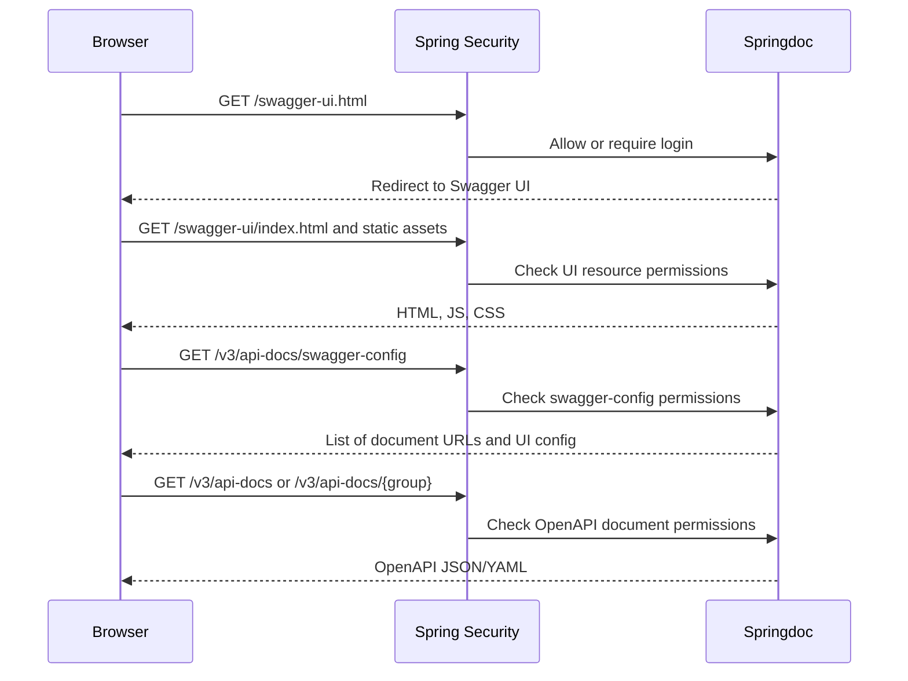

# Access Rules for /v3/api-docs, swagger-config, and UI Resources

Springdoc provides multiple resources to generate and display API documentation. Protecting the Swagger UI page alone is not enough: users can still call OpenAPI JSON/YAML directly, the `swagger-config` endpoint, or each group's documentation. When implementing Spring Security, you need to identify all documentation paths and apply a consistent access policy across all of them.

Documentation can be public, require login, or be restricted to a group such as `API_DOCS`. This decision is independent of the policy protecting business endpoints. An application can allow reading documentation while still requiring an access token for `/api/**`; or only let employees view documentation while partner APIs have their own authentication mechanism.

## 1. Endpoints and Resources to Identify

With a common default Springdoc 2.x configuration, the main paths include:

| Path | Role |
| --- | --- |
| `/v3/api-docs` | Default OpenAPI JSON |
| `/v3/api-docs.yaml` | Default OpenAPI YAML |
| `/v3/api-docs/{group}` | OpenAPI JSON of a `GroupedOpenApi` |
| `/v3/api-docs/{group}.yaml` | OpenAPI YAML of a group when supported/configured |
| `/v3/api-docs/swagger-config` | Configuration loaded by Swagger UI to discover document URLs and UI settings |
| `/swagger-ui.html` | Common UI path, typically redirects to Swagger UI |
| `/swagger-ui/**` | HTML, JavaScript, CSS, icons, and Swagger UI static resources |

Some older versions or custom configurations may serve additional assets via paths like `/webjars/**`. Inspect actual requests made by the Springdoc version in use before adding matchers. Do not permit a broad static path if the application does not need it.

`swagger-config` typically lives under the API docs path, for example `/v3/api-docs/swagger-config`. Therefore, the matcher `/v3/api-docs/**` covers this endpoint along with group docs. Allowing only exact `/v3/api-docs` may leave sub-requests blocked.

## 2. Understanding the Swagger UI Documentation Loading Flow

When a user opens Swagger UI, the browser typically loads a sequence of resources:



If you only permit `/swagger-ui.html` while blocking `/swagger-ui/**`, the interface may render a blank page or asset-loading errors. If you permit the UI while blocking `swagger-config` or the OpenAPI document, the page may load without displaying any operations.

Conversely, if you only protect the UI while leaving `/v3/api-docs/**` public, unauthorized users can still download the API contract using curl or another HTTP tool. Test each URL directly instead of only trying to open the UI page.

## 3. Allowing Everyone to Read Documentation

If OpenAPI is public documentation, you can allow GET requests to the docs and UI endpoints while requiring authentication for business APIs.

Spring Boot 3 and Spring Security 6 example:

```java
package com.example.config;

import org.springframework.context.annotation.Bean;
import org.springframework.context.annotation.Configuration;
import org.springframework.http.HttpMethod;
import org.springframework.security.config.Customizer;
import org.springframework.security.config.annotation.web.builders.HttpSecurity;
import org.springframework.security.web.SecurityFilterChain;

@Configuration
public class SecurityConfig {

    @Bean
    SecurityFilterChain securityFilterChain(HttpSecurity http) throws Exception {
        http.authorizeHttpRequests(auth -> auth
            .requestMatchers(
                HttpMethod.GET,
                "/swagger-ui.html",
                "/swagger-ui/**",
                "/v3/api-docs",
                "/v3/api-docs.yaml",
                "/v3/api-docs/**"
            ).permitAll()
            .anyRequest().authenticated()
        );

        http.httpBasic(Customizer.withDefaults());
        return http.build();
    }
}
```

In this configuration:

- Users can load Swagger UI, `swagger-config`, OpenAPI JSON/YAML, and group documents via GET.
- Remaining requests still require authentication.
- `httpBasic` is only an example login mechanism; the application can use form login, OAuth2 Resource Server, or SSO depending on architecture.

If using `hasRole` or `hasAuthority` instead of `permitAll`, apply rules tailored to the documentation audience as shown in the next section. Do not open all of `/v3/**` if the application has other endpoints under that prefix needing their own policy.

## 4. Allowing Only Authorized Groups to Read Documentation

For internal documentation, you can restrict docs endpoints to the `API_DOCS` role:

```java
package com.example.config;

import org.springframework.context.annotation.Bean;
import org.springframework.context.annotation.Configuration;
import org.springframework.security.config.Customizer;
import org.springframework.security.config.annotation.web.builders.HttpSecurity;
import org.springframework.security.web.SecurityFilterChain;

@Configuration
public class SecurityConfig {

    @Bean
    SecurityFilterChain securityFilterChain(HttpSecurity http) throws Exception {
        http.authorizeHttpRequests(auth -> auth
            .requestMatchers(
                "/swagger-ui.html",
                "/swagger-ui/**",
                "/v3/api-docs",
                "/v3/api-docs.yaml",
                "/v3/api-docs/**"
            ).hasRole("API_DOCS")
            .anyRequest().authenticated()
        );

        http.formLogin(Customizer.withDefaults());
        return http.build();
    }
}
```

`hasRole("API_DOCS")` checks for the authority `ROLE_API_DOCS`. If the system grants authorities without the `ROLE_` prefix, you can use `hasAuthority("API_DOCS")` and ensure user data contains that exact authority.

Unauthenticated users are typically redirected to the login page when using form login. Authenticated users without the required role receive `403 Forbidden`. With HTTP Basic, unauthenticated responses are usually `401 Unauthorized`.

The docs rule must come before `.anyRequest()` because Spring Security evaluates matchers in order. If a broader matcher catches the request first, the specific rule for Swagger UI may not be executed as expected.

## 5. Protecting UI, swagger-config, and OpenAPI Documents Together

A complete configuration must consider at least three resource groups:

1. **UI page and assets:** `/swagger-ui.html`, `/swagger-ui/**`.
2. **UI configuration:** `/v3/api-docs/swagger-config` by default.
3. **API specifications:** `/v3/api-docs`, `/v3/api-docs.yaml`, `/v3/api-docs/**`, and groups.

Common omission example:

```java
// Only protects the UI, while JSON/YAML may remain public.
.requestMatchers("/swagger-ui.html", "/swagger-ui/**").hasRole("API_DOCS")
```

Users cannot open the UI, yet they can still call `/v3/api-docs` directly if another rule permits it. If the goal is to protect documentation, apply the same policy to the API docs path and the config endpoint.

Conversely, if you protect only `/v3/api-docs` and forget `/swagger-ui/**`, UI assets may load while requests for configuration and the specification are denied. As a result, the UI cannot display the API.

## 6. When Using Multiple `GroupedOpenApi` Beans

Springdoc can generate separate documents such as `public`, `partner`, or `internal`. Each group is typically loaded via `/v3/api-docs/{group}` and declared in `swagger-config`.

Example:

```java
@Bean
GroupedOpenApi partnerApi() {
    return GroupedOpenApi.builder()
        .group("partner")
        .pathsToMatch("/api/partner/**")
        .build();
}

@Bean
GroupedOpenApi internalApi() {
    return GroupedOpenApi.builder()
        .group("internal")
        .pathsToMatch("/api/internal/**")
        .build();
}
```

If all groups share the same policy, the `/v3/api-docs/**` matcher can cover them. If groups have different policies, design appropriate distinct URLs and matchers, or serve the documents through separate endpoints/applications. Do not infer access rights from a group name; the name `internal` does not automatically make a document private.

If Swagger UI configures multiple URLs via `springdoc.swagger-ui.urls`, verify every URL the UI actually fetches. All of those URLs must be protected according to the intended audience.

## 7. Customizing OpenAPI and Swagger UI Paths

Springdoc allows changing the default paths:

```yaml
springdoc:
  api-docs:
    path: /api-docs
  swagger-ui:
    path: /docs
```

When changing paths, update Spring Security matchers to match the new endpoints. Example:

```java
.requestMatchers(
    "/docs",
    "/swagger-ui/**",
    "/api-docs",
    "/api-docs.yaml",
    "/api-docs/**"
).hasRole("API_DOCS")
```

`springdoc.api-docs.path` changes the base path of OpenAPI documents; `springdoc.swagger-ui.path` changes the entry path to the UI. Static UI assets may still be served under `/swagger-ui/**`, so do not assume protecting `/docs` alone is enough.

Swagger UI can be configured with a custom `config-url`. If the configuration endpoint is no longer at its default location, add that exact URL to the access policy. Similarly, if `url` or `urls` points to a document on another host, protection policies must be enforced on the host serving that document.

## 8. Disabling Swagger UI or All OpenAPI Endpoints

If you only want to disable the UI while keeping OpenAPI JSON/YAML for pipelines or other tools:

```yaml
springdoc:
  swagger-ui:
    enabled: false
```

If you want to disable the OpenAPI endpoint provided by Springdoc:

```yaml
springdoc:
  api-docs:
    enabled: false
```

If you want to disable both:

```yaml
springdoc:
  api-docs:
    enabled: false
  swagger-ui:
    enabled: false
```

This configuration disables the features in Springdoc. It differs from simply blocking access with Spring Security: when blocked, the endpoint still exists but unauthorized users cannot access it; when disabled, Springdoc does not expose the corresponding endpoint/resource as configured.

Profiles can be used to enable docs only in the development environment:

```yaml
spring:
  config:
    activate:
      on-profile: dev

springdoc:
  api-docs:
    enabled: true
  swagger-ui:
    enabled: true
```

And configure production separately if policy requires disabling them. Verify which profile configuration is actually loaded upon deployment; do not rely on YAML filenames without checking the active profile.

## 9. Do Not Use `WebSecurityCustomizer.ignoring()` to Open Documentation

Do not bypass the entire security filter chain for Swagger UI or `/v3/api-docs/**` just to avoid UI loading errors. Example to avoid:

```java
// Not recommended: bypasses the security filter chain for docs.
web.ignoring().requestMatchers("/swagger-ui/**", "/v3/api-docs/**");
```

When bypassing the filter chain, security filters and related logging/auditing mechanisms are not applied to those requests. If documentation should be public, use `permitAll()` in `authorizeHttpRequests`; if it should be restricted, use `hasRole` or `hasAuthority`. This keeps requests inside the security pipeline and makes the policy easier to govern.

## 10. CSRF and the Try it out Button

Requests loading Swagger UI, `swagger-config`, and OpenAPI documents are mainly GETs. CSRF protection usually does not block these read requests. However, the **Try it out** button can send POST, PUT, PATCH, or DELETE to business APIs.

If the application uses session/cookie authentication, state-changing requests must still comply with CSRF protection. Swagger UI does not automatically guarantee a CSRF token is present. You must configure an appropriate token-passing mechanism if you want to use Try it out in a CSRF-protected app.

Do not disable CSRF globally just so Swagger UI works. For stateless APIs using Bearer tokens in headers and not relying on automatically sent cookies, a separate CSRF policy may apply after evaluating the authentication model. This belongs to runtime API protection, not documentation endpoint rules.

If an environment only allows reading documentation and should not send requests from the UI, you can disable Try it out methods:

```yaml
springdoc:
  swagger-ui:
    supported-submit-methods: []
```

This setting only hides/disables request submission from the UI. It does not stop other clients from calling the API; Spring Security must still protect business endpoints.

## 11. CORS When UI and OpenAPI Are Served from Different Origins

If Swagger UI and the OpenAPI document share the same origin, separate CORS rules are usually not needed for loading documentation. If the UI is hosted separately and fetches `/v3/api-docs` from another domain, the browser will enforce CORS.

Example Spring Security CORS configuration for a specific documentation origin:

```java
@Bean
CorsConfigurationSource corsConfigurationSource() {
    CorsConfiguration configuration = new CorsConfiguration();
    configuration.setAllowedOrigins(List.of("https://docs.example.com"));
    configuration.setAllowedMethods(List.of("GET", "OPTIONS"));
    configuration.setAllowedHeaders(List.of("Authorization", "Content-Type"));
    configuration.setAllowCredentials(true);

    UrlBasedCorsConfigurationSource source = new UrlBasedCorsConfigurationSource();
    source.registerCorsConfiguration("/v3/api-docs/**", configuration);
    return source;
}
```

And enable CORS integration in the security chain:

```java
http.cors(Customizer.withDefaults());
```

This is a minimal example; imports and bean setup must be added in the application. When enabling `allowCredentials(true)`, do not use wildcard `*` for allowed origins. Only allow origins that genuinely need access and the necessary HTTP methods/headers.

If documentation requires authentication, CORS does not replace authentication. CORS only determines whether the browser allows reading responses from another origin; users still have to pass Spring Security.

## 12. Multiple `SecurityFilterChain` Beans and Matcher Ordering

An application may declare multiple `SecurityFilterChain` beans, such as one chain for actuator and one chain for APIs. In that case, a request is handled by the first chain whose `securityMatcher` matches. If Swagger UI or `/v3/api-docs/**` falls into a different chain than expected, the docs policy might not be applied.

Verify:

1. Which chain matches `/swagger-ui.html` and `/swagger-ui/**`.
2. Which chain matches `/v3/api-docs/**`.
3. Whether `@Order` and `securityMatcher` cause a broader chain to catch requests first.
4. Whether `requestMatchers` rules appear before `.anyRequest()` in the corresponding chain.

Do not simply add matchers to a chain and assume every request goes through that chain. With multiple chains, inspect the complete security routing structure.

## 13. Verifying Access Permissions with HTTP Requests

Test URLs directly, even when Swagger UI appears to work.

```bash
# UI interface
curl -i http://localhost:8080/swagger-ui.html

# UI assets
curl -i http://localhost:8080/swagger-ui/index.html

# OpenAPI JSON
curl -i http://localhost:8080/v3/api-docs

# swagger-config
curl -i http://localhost:8080/v3/api-docs/swagger-config

# Group documentation
curl -i http://localhost:8080/v3/api-docs/partner
```

If docs are protected with HTTP Basic, test a request without credentials and a request with a user granted the role:

```bash
curl -i -u docs-reader:REPLACE_WITH_TEST_PASSWORD \
  http://localhost:8080/v3/api-docs
```

Do not record real passwords in shell history or documentation. Use test accounts and an appropriate secret store.

Typical expected results:

| Case | Typical Result |
| --- | --- |
| Public endpoint not requiring login | `200 OK` |
| HTTP Basic requiring login, no credentials sent | `401 Unauthorized` |
| Form login requiring login | May redirect `302` to login page |
| Logged in but missing role | `403 Forbidden` |
| Has role and valid URL | `200 OK` |
| Nonexistent path | `404 Not Found` |

Specific status codes depend on the authentication entry point, exception handling, proxy, and application configuration. Also inspect response headers, redirect locations, and Spring Security logs when results differ from expectations.

## 14. Inspecting the List of URLs Swagger UI Actually Loads

Open the browser Developer Tools, go to the Network tab, reload Swagger UI, and filter by Fetch/XHR. Observe:

- Whether the `swagger-config` request succeeds.
- Which default OpenAPI URL or group URLs are loaded.
- Whether any request fails with `401`, `403`, `404`, or a CORS error.
- Whether JavaScript/CSS assets under `/swagger-ui/**` load successfully.
- Whether the UI enters a redirect loop to the login page.

If `swagger-config` returns a custom document URL, test that exact URL. If the UI uses `urls` to display multiple groups, check every URL instead of checking only `/v3/api-docs`.

## 15. Common Pitfalls

| Symptom | Possible Cause | Resolution |
| --- | --- | --- |
| `/swagger-ui.html` opens as a blank page | Static assets `/swagger-ui/**` are blocked | Add matchers for UI resources |
| UI loads but has no operations | `swagger-config` or OpenAPI JSON/YAML is blocked | Check `/v3/api-docs/swagger-config` and document URLs |
| UI is locked yet JSON is publicly accessible | Only `/swagger-ui/**` is protected | Protect both `/v3/api-docs` and `/v3/api-docs/**` |
| Group docs return `403` even though default docs work | Matcher only allows exact `/v3/api-docs` path | Cover `/v3/api-docs/**` and check group URLs |
| User with role is still denied | Wrong role prefix, matcher, or filter chain | Check `ROLE_`, authorities, and actual active chain |
| Changed `springdoc.api-docs.path` yet new endpoint is blocked | Security matcher still uses default path | Update matchers to the new path |
| Changed Swagger UI path yet static resources fail | Only updated matcher for the UI entry path | Protect both the entry path and actual static resource paths |
| Docs exposed unintentionally | `permitAll` is too broad or another chain captures requests | Narrow matchers and inspect multiple SecurityFilterChains |
| Try it out receives `403` | Missing CSRF token or API requires separate permissions | Keep proper CSRF policy and configure token/auth for requests |
| Browser reports CORS error | UI and docs are on different origins, origin not allowed | Configure CORS for exact origin, path, method, and headers |
| Disabled Swagger UI yet OpenAPI JSON still accessible | Only disabled `swagger-ui.enabled` | Disable `api-docs.enabled` to turn off the document endpoint too |

## 16. Documentation Protection Checklist

- [ ] Decided whether documentation is public, requires login, or is restricted by role.
- [ ] Matchers cover `/swagger-ui.html` and `/swagger-ui/**` resources.
- [ ] Matchers cover `/v3/api-docs`, `/v3/api-docs.yaml`, and `/v3/api-docs/**` (including `swagger-config` and group docs).
- [ ] `swagger-config` is protected; by default it typically sits under `/v3/api-docs/**`.
- [ ] Documentation of every `GroupedOpenApi` has the appropriate policy applied.
- [ ] Custom URLs via `config-url`, `url`, or `urls` have been inspected and protected.
- [ ] Docs rules appear before `.anyRequest()` and inside the right `SecurityFilterChain`.
- [ ] Used `permitAll()` or role/authority matchers instead of ignoring the security filter chain.
- [ ] Distinguished documentation viewing access from business API execution access.
- [ ] Did not disable CSRF globally just to support Swagger UI.
- [ ] CORS allows only required origins and methods if UI is on a different origin.
- [ ] Directly tested UI, assets, swagger-config, JSON/YAML, and group docs via HTTP requests.
- [ ] When docs must be disabled, configured `springdoc.swagger-ui.enabled` and `springdoc.api-docs.enabled` appropriately.

To protect Springdoc documentation, you need to control the UI, static resources, `swagger-config`, and all OpenAPI documents. Apply matchers to the actual paths, distinguish documentation read permissions from API call permissions, and verify with direct requests and the Network tab. Then protection does not depend on whether a user can see the Swagger UI page.
