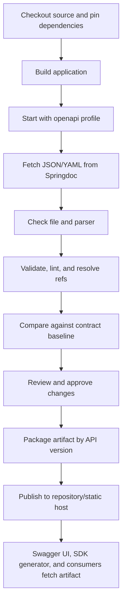

# Distributing Static Specifications Independently of the Running Application

Springdoc commonly serves OpenAPI documents through a runtime endpoint such as `/v3/api-docs`. This is convenient for Swagger UI and integration tools, yet document consumers must be able to reach a running application. In many workflows, the API contract needs to be archived, reviewed, released, or used for SDK generation even when the service is not running or when exposing the documentation endpoint publicly is not permitted.

The solution is to **generate the OpenAPI document as a static artifact during the build or release process**, then distribute the JSON/YAML file via an artifact repository, static web hosting, or CDN. The application may still run Springdoc temporarily to generate the file, yet consumers of the artifact no longer need to call the service's runtime endpoint.

The static specification becomes a versioned output of the build process. It can be reviewed alongside source code, checked for breaking changes, stored per release, used to generate clients, and served to Swagger UI independently of the application deployment lifecycle.

## 1. How do a runtime endpoint and a static artifact differ?

Springdoc builds the OpenAPI document from the application's controllers, DTOs, annotations, Spring configuration, and model converters. There are two common ways to deliver the document:

| Delivery Method | Characteristics | Depends on a running application? |
|---|---|---:|
| Runtime endpoint `/v3/api-docs` | HTTP requests are handled by a running Spring Boot application | Yes |
| Static JSON/YAML file | Document is pre-generated, saved as a file, and distributed from an artifact repository or static host | No, once the file has been generated |

Runtime endpoint example:

```bash
curl -fsS http://localhost:8080/v3/api-docs
```

Published file retrieval example:

```bash
curl -fsS https://contracts.example.com/orders/1.4.0/openapi.yaml
```

In the second approach, the web server/CDN only needs to serve the generated file. It does not need to boot Spring Boot, scan controllers, or regenerate schemas per request.

Note: Springdoc's Maven/Gradle plugins typically start the application inside a build process, call the API Docs endpoint, and write the response to a file. Therefore, "independent static distribution" refers to how the artifact is consumed and hosted after generation; it does not imply every generation tool can analyze source code without running the application.

## 2. When should static specifications be published?

Static specifications are useful when one or more of these needs apply:

- Frontend teams need a stable contract to develop against before the backend is deployed.
- Partners need to download release-specific documentation without access to the service's internal network.
- SDK or client generation pipelines require a storable, reusable input file.
- Contract tests need to compare the new document against the previous release's baseline.
- Swagger UI is hosted separately on a static web server.
- Runtime API Docs are disabled or restricted to internal network access only.
- The organization wants to archive the exact contract released alongside each binary/container image.

You do not necessarily have to remove the runtime endpoint. Many systems keep `/v3/api-docs` for developers and integration tests while publishing static files for external consumers. Both outputs should be generated from the same source and intentional configuration.

## 3. Choosing document content before generating the artifact

The exported file reflects the Spring Boot configuration active when the application starts to generate it. Profiles, environment variables, server URLs, groups, and feature flags can all alter the document.

Before exporting, determine:

1. **OpenAPI version**: whether the application emits 3.0.x or 3.1.x.
2. **API release**: the `info.version` value and the artifact version.
3. **API scope**: the default document or one/multiple `GroupedOpenApi` instances.
4. **Server URL**: relative URLs, stable public URLs, or per-environment server lists.
5. **Sensitive information**: exclude tokens, passwords, private hostnames, or real data from examples.
6. **Generation profile**: which configuration boots the application during the export step.

Do not confuse `info.version` with the OpenAPI version. For example, `openapi: 3.1.0` specifies the specification language version, whereas `info.version: 1.4.0` can be the contract version of the Orders API.

## 4. Generating static files with the Springdoc Maven Plugin

`springdoc-openapi-maven-plugin` fetches the OpenAPI document from the application's endpoint and writes it to a file during the Maven build. The plugin works alongside `spring-boot-maven-plugin`: the application starts in the `pre-integration-test` phase, the generate plugin runs in `integration-test`, and the application stops in `post-integration-test`.

Configuration example in `pom.xml`:

```xml
<build>
    <plugins>
        <plugin>
            <groupId>org.springframework.boot</groupId>
            <artifactId>spring-boot-maven-plugin</artifactId>
            <configuration>
                <jvmArguments>-Dspring.application.admin.enabled=true</jvmArguments>
            </configuration>
            <executions>
                <execution>
                    <id>pre-integration-test</id>
                    <goals>
                        <goal>start</goal>
                    </goals>
                </execution>
                <execution>
                    <id>post-integration-test</id>
                    <goals>
                        <goal>stop</goal>
                    </goals>
                </execution>
            </executions>
        </plugin>

        <plugin>
            <groupId>org.springdoc</groupId>
            <artifactId>springdoc-openapi-maven-plugin</artifactId>
            <version>${springdoc-openapi-maven-plugin.version}</version>
            <executions>
                <execution>
                    <id>generate-openapi</id>
                    <phase>integration-test</phase>
                    <goals>
                        <goal>generate</goal>
                    </goals>
                </execution>
            </executions>
            <configuration>
                <apiDocsUrl>http://localhost:8080/v3/api-docs</apiDocsUrl>
                <outputDir>${project.build.directory}</outputDir>
                <outputFileName>openapi.json</outputFileName>
                <attachArtifact>true</attachArtifact>
                <failOnError>true</failOnError>
            </configuration>
        </plugin>
    </plugins>
</build>
```

Define the plugin version in a Maven property or parent build for centralized management:

```xml
<properties>
    <springdoc-openapi-maven-plugin.version>1.6</springdoc-openapi-maven-plugin.version>
</properties>
```

The version in this example must be verified against the current release and your project's Maven environment before use. Springdoc v2 documentation lists parameters such as `apiDocsUrl`, `outputDir`, `outputFileName`, `attachArtifact`, `attachArtifactClassifier`, `headers`, `timeout`, `skip`, and `failOnError`.

Run the full lifecycle through `verify`:

```bash
mvn clean verify
```

After the plugin runs successfully, the default file in this example is located at:

```text
target/openapi.json
```

`attachArtifact=true` attaches the document to the Maven project artifact so it is installed or deployed with the release. The default classifier documented by the plugin is `openapi`; another classifier can be configured if your repository requires a specific convention.

Set `failOnError=true` in CI so the build fails if the document cannot be fetched or the plugin cannot write the file. If left at the default `false`, certain errors may only be logged while the build continues without the artifact.

Operational note: if the Maven build fails before `post-integration-test`, Maven may skip the `spring-boot:stop` goal and leave the application process started for export still running. When troubleshooting a failed build, check and stop that process before the next run to avoid port conflicts or skewed results in subsequent builds.

## 5. Exporting YAML instead of JSON with the Maven Plugin

The Maven plugin can fetch YAML from the Springdoc endpoint by pointing `apiDocsUrl` to `/v3/api-docs.yaml` and changing the output filename:

```xml
<configuration>
    <apiDocsUrl>http://localhost:8080/v3/api-docs.yaml</apiDocsUrl>
    <outputDir>${project.build.directory}</outputDir>
    <outputFileName>openapi.yaml</outputFileName>
    <failOnError>true</failOnError>
</configuration>
```

The artifact will be:

```text
target/openapi.yaml
```

Choose JSON or YAML based on consuming tools. Both formats represent the exact same OpenAPI document; they differ only in serialization. When reviewing diffs in Git, YAML is often easier to read; when pipelines use JSON parsers or JSON-first tooling, exporting JSON works well.

Do not rename the extension to `.yaml` if the endpoint still returns JSON. Content format must match the filename extension and content type received by the plugin.

## 6. Authenticating when exporting documents

If the API Docs endpoint requires authentication, the Maven plugin supports configuring request headers to fetch the document.

```xml
<configuration>
    <apiDocsUrl>https://localhost:8443/v3/api-docs</apiDocsUrl>
    <outputDir>${project.build.directory}</outputDir>
    <outputFileName>openapi.json</outputFileName>
    <headers>
        <Authorization>Bearer ${env.OPENAPI_READ_TOKEN}</Authorization>
    </headers>
    <failOnError>true</failOnError>
</configuration>
```

Tokens must be supplied from a CI secret store or equivalent secure mechanism. Never place real tokens in `pom.xml`, commit settings files containing secrets, or print request headers into logs.

If the endpoint uses HTTPS with an internal CA, configure an appropriate truststore for the JVM/plugin instead of disabling TLS verification. Some plugins provide `trustStore`/`trustStorePassword` parameters; check the exact documentation for the Maven plugin version you use.

If the document can be exported using a dedicated profile without exposing a public endpoint, prefer an internal build network and credentials with read-only API Docs permissions. Once exported, the static file must still be distributed under the contract's access policy.

## 7. Generating static files with the Springdoc Gradle Plugin

`springdoc-openapi-gradle-plugin` provides the `generateOpenApiDocs` task. In the 2.x plugin line, the task automatically starts the Spring Boot application, calls the API Docs URL, writes the file into the build directory, and stops the application. Starting from version 2.1, the build must declare the Spring Boot Gradle plugin; the Springdoc plugin no longer applies the Spring Boot plugin automatically.

`build.gradle.kts` example:

```kotlin
plugins {
    java
    id("org.springframework.boot") version "<spring-boot-version>"
    id("org.springdoc.openapi-gradle-plugin") version "<springdoc-gradle-plugin-version>"
}

dependencies {
    implementation("org.springdoc:springdoc-openapi-starter-webmvc-api:<springdoc-version>")
}

openApi {
    apiDocsUrl.set("http://localhost:8080/v3/api-docs")
    outputDir.set(layout.buildDirectory.dir("openapi"))
    outputFileName.set("openapi.json")
    customBootRun {
        args.set(listOf("--spring.profiles.active=openapi"))
    }
}
```

Run the task:

```bash
./gradlew generateOpenApiDocs
```

Output file in this example:

```text
build/openapi/openapi.json
```

The Gradle v2 plugin requires Gradle 8.0 or higher per current documentation. Check compatibility with your Gradle Wrapper, Spring Boot, and Java toolchain before adopting it. Version placeholders in the example must be replaced with pinned compatible versions.

### Configuring YAML export

```kotlin
openApi {
    apiDocsUrl.set("http://localhost:8080/v3/api-docs.yaml")
    outputDir.set(layout.buildDirectory.dir("openapi"))
    outputFileName.set("openapi.yaml")
}
```

When the URL ends with `.yaml`, the Gradle plugin can write a YAML document. Inspect the actual file and do not rely solely on the extension if the endpoint returns another format.

### Configuring multiple groups

```kotlin
openApi {
    groupedApiMappings.set(
        mapOf(
            "http://localhost:8080/v3/api-docs/public" to "openapi-public.json",
            "http://localhost:8080/v3/api-docs/admin" to "openapi-admin.json"
        )
    )
}
```

When `groupedApiMappings` is set, the plugin uses those mappings instead of the single `apiDocsUrl` and `outputFileName`. Each URL is fetched into its corresponding file. Ensure the groups are registered in the application and the generation profile does not accidentally exclude group controllers.

## 8. Dedicated profile for document generation

An application may need to connect to a database, message broker, identity provider, or external service on startup. To generate documents reliably in CI, you can use a dedicated profile such as `openapi`:

```yaml
# application-openapi.yml
springdoc:
  api-docs:
    enabled: true
  swagger-ui:
    enabled: false

app:
  integrations:
    payment-provider:
      enabled: false
```

This example keeps API Docs enabled so the plugin can fetch the document, disables UI since no interface is needed during export, and illustrates disabling an integration unnecessary for schema generation. Properties under `app.integrations.*` are application-specific configuration; use them only if your codebase actually supports them.

With Maven, you can pass the profile via `spring-boot-maven-plugin` or configure the application runtime environment in the build. With the Gradle plugin, use `customBootRun.args`, for example:

```kotlin
openApi {
    customBootRun {
        args.set(listOf("--spring.profiles.active=openapi"))
    }
}
```

The generation profile must produce the exact contract that will be released. Do not use a mock profile that alters request/response schemas, strips security requirements, or drops operations just to make the application boot more easily. If external integrations must be mocked, replace only underlying runtime dependencies while keeping controllers, DTOs, validation, and OpenAPI metadata intact.

## 9. Manual export without a build plugin

A plugin is not mandatory. You can start the application with the generation configuration and fetch the file using `curl`:

```bash
mkdir -p build/openapi

curl --fail --silent --show-error \
  http://localhost:8080/v3/api-docs \
  --output build/openapi/openapi.json
```

For YAML:

```bash
curl --fail --silent --show-error \
  http://localhost:8080/v3/api-docs.yaml \
  --output build/openapi/openapi.yaml
```

If the endpoint is protected, supply a header from a secret environment variable:

```bash
curl --fail --silent --show-error \
  -H "Authorization: Bearer ${OPENAPI_READ_TOKEN}" \
  http://localhost:8080/v3/api-docs \
  --output build/openapi/openapi.json
```

After downloading, verify that the file is non-empty, valid JSON/YAML, contains `openapi`, `info`, and `paths`, and run a parser/validator. `curl --fail` makes the command exit with an error on HTTP 4xx/5xx statuses; it does not replace checking the body because a proxy or login redirect can still return HTML with a success status.

## 10. Verifying the artifact before publishing

Do not publish a file simply because the export command exited without error. A verification step should check at minimum:

- The file exists and is non-empty.
- The content parses cleanly as JSON or YAML.
- The `openapi` field is within versions accepted by the project.
- `info.title`, `info.version`, and `paths` contain expected values.
- Every group scheduled for release has its corresponding file.
- No internal URLs, tokens, passwords, or examples containing sensitive data appear.
- Internal and external `$ref` pointers resolve according to project policy.
- OpenAPI validators and contract checks pass.
- It can be compared against the baseline artifact to detect breaking changes.

Quick JSON check example using `jq`:

```bash
jq -e '
  (.openapi | type == "string") and
  (.info.title | type == "string" and length > 0) and
  (.info.version | type == "string" and length > 0) and
  (.paths | type == "object")
' build/openapi/openapi.json
```

Verify YAML files using an appropriate parser in Java or a version-pinned CLI validator. Do not use `grep` to confirm valid YAML; YAML syntax and OpenAPI semantics require a real parser.

## 11. Storing artifacts in version control or an artifact repository?

There are two common storage strategies:

### Storing files in Git

Suitable when documents are small, contracts must be reviewed alongside pull requests, and changes should be tracked via diffs.

```text
contracts/
  orders/
    1.3.0/openapi.yaml
    1.4.0/openapi.yaml
  customers/
    2.1.0/openapi.yaml
```

Generated files can be committed if the team wants to review outputs prior to merging. Establish a process to trace which source commit produced each file, avoiding manual edits that diverge from controllers/DTOs.

### Publishing to an artifact repository

Suitable when the contract is a release artifact fetched by multiple projects or partners. The Maven plugin has the `attachArtifact` option to attach the OpenAPI file to the project artifact during install/deploy. Other repositories can store the file as a generic/raw artifact, package, or release asset.

Artifact structure example:

```text
com.example:orders-api:1.4.0:openapi@yaml
```

This is an illustrative convention; coordinates/classifier/extension must match your organization's repository and plugin setup. If not using a Maven repository, you can upload files to object storage or release assets.

Whether choosing Git or an artifact repository, keep each release's artifact immutable. When a contract needs an update, release a new version or traceable revision rather than silently overwriting a file consumers already rely on.

## 12. Versioning paths and metadata

A straightforward distribution pattern embeds the API version in the URL:

```text
https://contracts.example.com/orders/1.4.0/openapi.yaml
https://contracts.example.com/orders/1.5.0/openapi.yaml
https://contracts.example.com/customers/2.1.0/openapi.json
```

You can provide a `latest` or `current` alias for convenience, but that alias is mutable and changes across releases. Production clients, SDK generators, and reproducible contract tests should use pinned version URLs.

Keep concepts distinct:

| Value | Example | Meaning |
|---|---|---|
| OpenAPI version | `3.1.0` | Specification language version |
| `info.version` | `1.4.0` | API/contract version managed by the development team |
| Artifact version | `orders-api-1.4.0-openapi.yaml` | Version of the stored and distributed file |
| Application version | `orders-service:2026.11.20` | Version of the deployed binary/container |
| Git commit | `a1b2c3d` | Source revision that produced the artifact |

These values may follow aligned conventions yet are not synonymous. One binary may serve multiple groups; one API contract may be packaged across multiple service artifacts; `info.version` also does not auto-increment on build unless configured by the project.

Store provenance alongside the artifact, such as commit SHA, build number, generation timestamp, Springdoc version, OpenAPI version, and generation profile. Metadata can live in a separate manifest or the artifact repository's release metadata.

## 13. Distributing static files via web server, object storage, or CDN

Once generated, files can be hosted using:

- Nginx/Apache static file servers.
- Object storage with HTTP access, such as S3-compatible storage.
- Static hosting or release pages.
- A CDN in front of object storage or web servers.
- Artifact repositories with download endpoints.

Object storage layout example:

```text
contracts/orders/1.4.0/openapi.yaml
contracts/orders/1.4.0/openapi.json
contracts/orders/1.5.0/openapi.yaml
contracts/orders/latest/openapi.yaml
```

Statically hosted files should return appropriate content types, such as `application/json` for JSON and `application/yaml` or the YAML media type standardized across your system for YAML. Check response headers and how Swagger UI/parsers consume the file.

For pinned version URLs, you can use long-lived caching and `Cache-Control: public, max-age=31536000, immutable` if the file truly never changes. For `latest` aliases, use shorter cache TTLs or revalidation with `ETag`/`Last-Modified` to prevent consumers from holding stale versions too long.

Do not apply immutable caching to URLs whose contents can be overwritten. Conversely, do not make caches overly short for immutable release artifacts. Caching rules must align with versioning rules.

## 14. Using standalone Swagger UI to display static files

Swagger UI can run independently as a static site and load OpenAPI documents by URL. When the UI and file share an origin, configuration is simpler; if cross-origin, the file server must configure CORS for the UI's origin.

Example Swagger UI configuration pointing to a published file:

```javascript
SwaggerUIBundle({
  url: "https://contracts.example.com/orders/1.4.0/openapi.yaml",
  dom_id: "#swagger-ui"
});
```

For multiple APIs:

```javascript
SwaggerUIBundle({
  urls: [
    {
      name: "Orders 1.4.0",
      url: "https://contracts.example.com/orders/1.4.0/openapi.yaml"
    },
    {
      name: "Customers 2.1.0",
      url: "https://contracts.example.com/customers/2.1.0/openapi.json"
    }
  ],
  "urls.primaryName": "Orders 1.4.0",
  dom_id: "#swagger-ui"
});
```

This is a standalone Swagger UI setup; there is no need to run Springdoc merely to render published files. If you still use the Swagger UI page served by Springdoc, you can configure `springdoc.swagger-ui.url` or `urls` to point to external documents, though the application must still serve UI resources. For a fully independent UI, host Swagger UI assets and config separately.

If the file is protected by authentication, ensure users' browsers can retrieve the document through an appropriate mechanism. Never embed long-lived tokens in static JavaScript. For internal docs, place the UI and files behind a shared reverse proxy/SSO or use short-lived access URLs per policy.

## 15. CORS, authentication, and document classification

An OpenAPI document may expose more information than a typical guide page: internal paths, schema names, admin operations, security schemes, payload examples, and error models. Classify documents before publishing.

| Document Type | Common Distribution Approach |
|---|---|
| Public API contract | Public static host/CDN, pinned version URLs |
| Partner API contract | Authenticated portal or object storage with auditing |
| Internal API contract | Artifact repository or static site on internal network |
| Restricted/admin API contract | Group-based access control, never exposed via public buckets |

If Swagger UI runs at `docs.example.com` and OpenAPI files live at `contracts.example.com`, browsers perform cross-origin requests. The file server must return CORS headers for allowed origins. CORS only controls whether browsers can read responses; it is not an authentication mechanism and does not protect files from `curl` or other HTTP clients.

For private documents, enforce authentication/authorization at the static host or artifact repository. Do not treat unguessable URLs as security. Inspect JSON/YAML files, group files, and external `$ref` links to ensure public documents do not reference private content or vice versa.

Before publishing, verify:

- No real API keys, Bearer tokens, passwords, or cookies appear in examples.
- No internal hostnames, IPs, or ports appear unless intended for internal consumers.
- `servers` does not accidentally point to `localhost` or private staging environments.
- No examples contain PII, customer data, or production data.
- No internal operations are exposed outside the public contract scope.
- Security schemes describe authentication mechanisms without embedding credentials.

## 16. Managing `servers` when documents are generated during builds

An OpenAPI document can include `servers` so Swagger UI knows which URL to call for Try it out. When generated while the app runs on `localhost:8080`, the static document may record that server URL. When published to partners, `localhost` is not their API address.

Example of a server URL unsuitable for public artifacts:

```yaml
servers:
  - url: http://localhost:8080
```

You can use a relative URL if the document is hosted under an appropriate path structure:

```yaml
servers:
  - url: /api
```

Or declare a stable public URL:

```yaml
servers:
  - url: https://api.example.com/api
    description: Production API
```

If multiple environments have distinct server URLs, decide whether to publish one contract with multiple server entries or separate per-environment artifacts. A shared contract with multiple `servers` entries is usually easier to reuse, yet private hostnames must never enter public documents. Per-environment artifacts require clear versioning and provenance to prevent confusion.

Server metadata can be configured via `@OpenAPIDefinition(servers = ...)`, an `OpenAPI` bean, or customizers. If a plugin sends forwarded headers for Springdoc to build server URLs, inspect the URL in the output file and do not depend on internal build-agent hostnames.

## 17. Publishing multiple documents per `GroupedOpenApi`

An application can define multiple groups, such as `public`, `partner`, and `admin`. When distributing statically, each group should become a separate artifact if consumers have different permission scopes.

Directory layout example:

```text
openapi/
  orders-public-1.4.0.yaml
  orders-partner-1.4.0.yaml
  orders-admin-1.4.0.yaml
```

With the Maven plugin, you can run one execution per URL/group or use suitable plugin configuration to fetch each document. With the Gradle plugin, `groupedApiMappings` maps each group document URL to an output filename.

Do not combine `public` and `admin` into a single file and publish the entire file if public users are not permitted to view admin operations. Distribute artifacts along the same security boundaries as the API contract. Each file should be independently verified for paths, security schemes, server URLs, and `$ref` references.

## 18. CI/CD pipeline for publishing OpenAPI artifacts

A reference pipeline:



Steps should be split into jobs or stages with clear outputs:

1. **Generate**: create JSON/YAML from the exact source commit and profile.
2. **Validate**: parse with a version-compatible parser, validate OpenAPI, and check external references.
3. **Diff**: compare against the baseline to detect breaking changes.
4. **Review**: require approval when the contract changes per organizational policy.
5. **Package**: assign filenames and metadata per API release.
6. **Publish**: upload the artifact only after all checks pass.
7. **Consume**: SDK generators, Swagger UI, and contract tests fetch the exact published version.

Do not publish files if generation or validation fails. If the contract contains breaking changes, the pipeline should halt before publishing until versioning/release policies are addressed.

## 19. Example script for validating and packaging artifacts

A simple shell script can verify the file prior to upload:

```bash
set -euo pipefail

SPEC="build/openapi/openapi.json"
test -s "$SPEC"

jq -e '
  (.openapi | type == "string") and
  (.info.title | type == "string" and length > 0) and
  (.info.version | type == "string" and length > 0) and
  (.paths | type == "object")
' "$SPEC" >/dev/null

sha256sum "$SPEC" > "$SPEC.sha256"
```

Checksums help detect whether the file changed after publishing or downloading. A hash does not prove artifact provenance if stored in the same mutable location; when provenance verification is needed, use CI-issued signatures or attestations stored in a trusted system.

When uploading, use a pinned version path:

```text
orders/1.4.0/openapi.json
```

Do not use `latest` as the sole artifact name. Update the `latest` alias only after the pinned version has published successfully.

## 20. Ensuring artifact reproducibility

Two builds from the same source can yield different documents if runtime configuration differs. Common causes:

- Different profiles altering controllers, groups, or conditional beans.
- Environment variables modifying `servers`, title, version, or security metadata.
- Upgraded Springdoc/Swagger Core/Jackson dependencies.
- Model converters or customizers producing non-deterministic schemas.
- Collection ordering or dynamically generated values altering serialization.
- External references pointing to modified resources.

To keep artifacts reproducible:

- Pin versions of Spring Boot, Springdoc, Swagger Core, and generation plugins.
- Use a generation profile whose configuration is tracked in source control.
- Avoid injecting current timestamps, random hosts, or runtime data into schemas unnecessarily.
- Pin external schemas by version or commit.
- Record commit SHA, build ID, and tool versions.
- Compare documents semantically rather than byte-for-byte if serialization order may vary.
- Store published files immutably and retain checksums.

If `info.version` is populated from a build property, ensure that property comes from a deterministic source such as the Maven/Gradle project version or release tag.

## 21. Distinguishing static artifacts from hand-authored documents

Do not manually edit a Springdoc-generated file and publish it as if it were the output of the current source code. When descriptions, schemas, or examples need updates:

1. Edit controllers, DTOs, Swagger annotations, `OpenAPI` beans, or customizers.
2. Re-run the generation step.
3. Review the document diff.
4. Run parsers, validators, and compatibility checks.
5. Publish the new artifact.

If post-processing the generated document is strictly unavoidable, turn that step into a versioned script/build task stored in source control and executed automatically. The artifact is then the deterministic result of both Springdoc generation and controlled transformation.

Never leave a hand-edited file outside the source of truth, as the next generation run will overwrite and lose those edits.

## 22. Common mistakes

| Symptom | Possible Cause | Resolution |
|---|---|---|
| File is not created | Application not ready or wrong API Docs endpoint | Check start task, port, readiness, and `apiDocsUrl` |
| Maven build succeeds yet file is missing | `failOnError` is `false` | Set `failOnError=true` in CI and verify artifact existence |
| Gradle task times out | Application needs longer startup time | Increase `waitTimeInSeconds`, inspect boot logs and external dependencies |
| `.yaml` file contains JSON | Fetch URL is still `/v3/api-docs` | Use `/v3/api-docs.yaml` and a YAML output filename |
| File has `localhost` in `servers.url` | Generated locally without public server config | Configure stable `servers` or an appropriate profile |
| Document missing a group | Wrong group URL or profile excludes that group | Check `GroupedOpenApi` and per-group mappings |
| CI cannot fetch protected endpoint | Missing header or expired token | Supply read-only credentials via secret store |
| HTTPS export certificate error | JVM/plugin does not trust CA | Configure a valid truststore; do not disable TLS verification |
| Standalone Swagger UI fails to load file | Wrong URL or CORS blocks cross-origin request | Check URL from browser and CORS response headers |
| Consumers receive stale version | CDN/cached alias not revalidated | Use immutable version URLs, `ETag`, and matching cache policy |
| Artifacts differ between two builds | Different profile, dependency, or dynamic data | Pin configuration and record provenance |
| Public file exposes internal operations | Wrongly merged groups or wrong artifact published | Separate groups and verify security boundaries before publish |
| Export fails because runtime API Docs disabled | Generation profile also disables `api-docs.enabled` | Enable API Docs in the generation-only profile |

## 23. Checklist for publishing static specifications

- [ ] Chosen JSON or YAML and confirmed the export endpoint emits the matching format.
- [ ] Selected the API version and set `info.version` intentionally.
- [ ] Identified the OpenAPI version and compatible parser/validator.
- [ ] Generation profile produces accurate controllers, DTOs, groups, and security metadata.
- [ ] Maven/Gradle plugin versions are pinned and compatible with the build tool.
- [ ] Plugin is configured to fail the build if export fails.
- [ ] Output file exists, is non-empty, and parses cleanly.
- [ ] Validated the document, `$ref` pointers, schemas, and compatibility baseline.
- [ ] `servers` contains no unintended `localhost` or internal hostnames.
- [ ] No secrets, tokens, PII, or production-data examples appear.
- [ ] Groups are exported and distributed according to access boundaries.
- [ ] Artifacts have immutable version paths/coordinates and provenance metadata.
- [ ] Static host returns proper content types, CORS, and cache headers.
- [ ] Standalone Swagger UI points to the exact published file URLs.
- [ ] Artifacts are published only after validation and review pass.
- [ ] Checksums or signatures are stored if the workflow requires provenance verification.
- [ ] A release process exists for publishing new versions instead of silently overwriting old artifacts.

Distributing static specifications begins by generating OpenAPI JSON/YAML from Springdoc during a build or release, validating the document, and storing it as a versioned artifact. The Maven plugin can start the application in `pre-integration-test`, export in `integration-test`, and stop in `post-integration-test`; the Gradle plugin provides `generateOpenApiDocs` for a similar workflow. Once generated, the file can be distributed independently via Git, artifact repositories, object storage, static hosting, or CDNs. Keep artifacts immutable, verify `servers` and sensitive data, isolate groups by access boundary, and run parsers/validators plus breaking-change checks before publishing.

## References

- [Springdoc OpenAPI v2 – Maven and Gradle Plugins](https://springdoc.org/v2/plugins.html)
- [Springdoc OpenAPI Maven Plugin – README](https://github.com/springdoc/springdoc-openapi-maven-plugin)
- [Springdoc OpenAPI Gradle Plugin – README](https://github.com/springdoc/springdoc-openapi-gradle-plugin)
- [Swagger UI – Configuration](https://swagger.io/docs/open-source-tools/swagger-ui/usage/configuration/)
- [OpenAPI Specification](https://spec.openapis.org/oas/latest.html)
