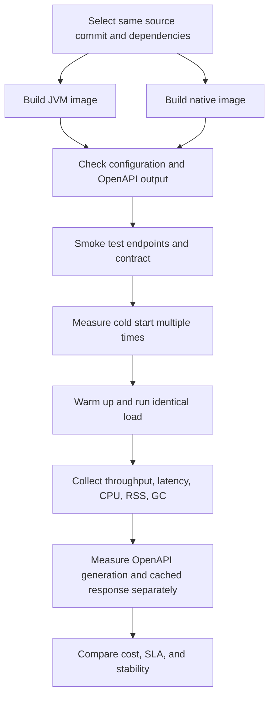

# Comparing Native Results Against JVM Execution

Spring Boot can run as a conventional JVM application or be compiled into a GraalVM Native Image. The two deployment modes have distinct performance characteristics: native images typically start faster and use less memory, whereas the JVM includes a JIT compiler that optimizes hot paths after a warm-up period. Neither option wins across all workloads; you must measure on your exact application, configuration, and intended deployment environment.

For applications using springdoc-openapi, comparisons must verify both business API performance and OpenAPI document generation capability. The native image must retain the required `/v3/api-docs`, YAML, group, and Swagger UI endpoints. A binary that starts fast yet lacks schemas due to missing reflection hints or incomplete AOT configuration is not a valid deployment artifact.

## 1. Two Different Execution Models

### JVM: Bytecode and JIT

In the traditional execution model, Spring Boot is packaged as an executable JAR. The JVM loads classes, creates the Spring ApplicationContext, and executes bytecode. The JIT compiler monitors frequently called methods, gathers runtime profiling data, and compiles hot code paths into machine code.

This process creates a warm-up phase. Right after the service starts, some early requests may be slower. Once the workload stabilizes, the JIT has more data to optimize heavily used code paths. For continuously running services under heavy load, this advantage can give the JVM higher throughput or better steady-state latency.

### Native Image: AOT and Closed-World Analysis

GraalVM Native Image analyzes reachable code paths from entry points at build time, then compiles them into an executable for a specific operating system and CPU architecture. Runtime requires no separate JVM installation and has no JIT compiler to optimize code dynamically by runtime request profile.

Native Image generally has faster startup and a lower memory footprint than the JVM. Code is pre-compiled, delivering consistent performance from the very first requests. In return, builds are heavier, binaries are platform-specific, and dynamic features such as reflection, resource loading, serialization, or dynamic proxies must be discovered and declared via proper metadata.

Spring Boot adds Spring AOT processing prior to GraalVM compilation. Spring generates source code, proxy bytecode, and reachability hints for beans and features it recognizes. This model assumes the bean set and classpath are fixed at build time; certain structural bean changes driven by runtime profiles or conditional properties are restricted.

## 2. Comparing by Metric Category

| Metric | JVM | Native Image | Evaluation Significance |
|---|---|---|---|
| Cold startup | Must start JVM, load classes, and create Spring context | Usually faster because code is AOT-compiled | Matters for scale-to-zero, short jobs, and autoscaling |
| Warm-up | Has a JIT phase optimizing hot code | No JIT warm-up; application caches and initialization still exist | Do not compare JVM throughput right after startup with steady-state native |
| Steady-state throughput | Can rise after warm-up thanks to JIT | Depends on AOT compilation quality, workload, and build options | Measure under representative load; do not infer from startup |
| Initial latency | Can be higher while class loading/JIT are active | Usually less volatile early on | Measure first request and p95/p99 separately |
| Memory footprint | Includes JVM, heap, metaspace, code cache, and native memory | Usually smaller, though heap and native allocations still exist | Compare RSS/container memory under identical load |
| Build time | JAR build is usually fast | Native compilation typically consumes high CPU/RAM and time | Account for CI cost and release time |
| Artifact | JAR requiring a compatible Java runtime | OS- and architecture-specific executable/container | Account for image size and platform matrix |
| Dynamic behavior | Reflection/classpath/proxies are generally more flexible | Requires reachability metadata; classpath closed at build | Run full smoke tests on the native binary |

These descriptions represent general trends, not guaranteed numbers. JDK/GraalVM versions, CPUs, libraries, GC, container limits, and request types can alter results substantially.

## 3. When Is Native Usually Advantageous?

Native Image is worth testing when an application has one or more of these traits:

- Instances are created and destroyed frequently, so cold startup directly affects serving time.
- Workloads have low or intermittent traffic without enough runtime for JVM warm-up.
- Running functions, short-lived workers, jobs, or services requiring scale-to-zero.
- Container RAM limits are tight and per-replica footprint drives deployment density.
- Rapid readiness is needed so an autoscaler can add replicas when load spikes.

The JVM may fit better when a service runs continuously, serves many repeated requests, requires high steady-state throughput, relies on dynamic Java libraries, or wants to leverage the JVM profiling/diagnostics ecosystem.

For springdoc-openapi, `/v3/api-docs` is usually not a business hot path and the document is computed once and cached by default. Therefore, native optimization may impact whole-application startup time much more than cached documentation request throughput. Measure these two aspects separately.

## 4. Building Two Variants from the Same Springdoc Application

For a meaningful comparison, build both images from the exact same source commit and dependency versions:

1. A JVM image running the executable JAR with the chosen JRE/JDK.
2. A native image built from the same project using Spring AOT and GraalVM Native Image.

With Spring Boot 3 and Maven, when the project configures the Spring Boot parent and Native Build Tools plugin, you can build a native container via:

```bash
mvn -Pnative spring-boot:build-image
```

With Gradle, apply `org.graalvm.buildtools.native` alongside the Spring Boot Gradle plugin, then run:

```bash
./gradlew bootBuildImage
```

When the Native Image plugin is applied, the Spring Boot Gradle plugin configures required AOT tasks and `bootBuildImage` produces a native image. Check documentation for your exact Spring Boot, Gradle, GraalVM, and Buildpacks versions before putting configuration into CI.

To create the JVM image, build the same application without activating the native profile/Native Image plugin for that image. Use the same base OS family where possible, the same CPU architecture, and identical resource limits. When comparing containers, record both image size and runtime memory.

Do not build native on an ARM machine and compare it against a JVM image running on x86, or vice versa. A native executable is a platform-dependent artifact; architecture and instruction set must match the target host. If distributing across multiple platforms, build separately for each target.

## 5. Ensuring Springdoc Works in Native Image

Springdoc supports GraalVM Native Image in the Spring Boot 3 ecosystem. Springdoc documentation highlights two practical points:

- OpenAPI REST endpoints must be built within the native profile of the Spring Boot application.
- If `@OpenAPIDefinition` or `@SecurityScheme` is placed on an annotation-only class with no implementation and that class is not retained as Spring configuration, it may be stripped during native compilation. Mark the configuration class with `@Configuration` so Spring recognizes and retains it.

Example:

```java
import io.swagger.v3.oas.annotations.OpenAPIDefinition;
import io.swagger.v3.oas.annotations.info.Info;
import io.swagger.v3.oas.annotations.security.SecurityScheme;
import io.swagger.v3.oas.annotations.enums.SecuritySchemeType;
import org.springframework.context.annotation.Configuration;

@Configuration(proxyBeanMethods = false)
@OpenAPIDefinition(
    info = @Info(
        title = "Orders API",
        version = "1.0.0",
        description = "Order management API"
    )
)
@SecurityScheme(
    name = "bearerAuth",
    type = SecuritySchemeType.HTTP,
    scheme = "bearer",
    bearerFormat = "JWT"
)
public class OpenApiConfiguration {
}
```

If the application has custom model converters, serializers, dynamically discovered DTOs, or libraries using reflection, check Spring AOT hints and reachability metadata. Spring Boot generates many hints automatically, but certain third-party libraries or custom code may need additional `RuntimeHintsRegistrar`, `@RegisterReflectionForBinding`, or library-specific metadata.

Do not add reflection hints indiscriminately before identifying an error. Run native smoke tests, read reachability messages, and add only the types/resources/proxies truly needed.

## 6. Keeping Configuration Identical When Benchmarking

Before running benchmarks, tabulate configuration and lock down variables affecting results:

| Component | Must Be Kept Identical |
|---|---|
| Source | Same commit, controllers, DTOs, and OpenAPI annotations |
| Dependencies | Same Spring Boot, Springdoc, Jackson, driver, and business library versions |
| Application config | Same profiles, feature flags, security, and `servers` metadata |
| Data | Same database snapshot, seed data, and business cache state |
| Network | Same client host, TLS, proxy, and network path |
| Container | Same CPU quota, memory limit, OS family, and runtime topology |
| Workload | Same endpoints, payloads, request rate, concurrency, and test duration |
| Observability | Same logging, metrics agents, and tracing sampling |

Do not enable debug logging for one variant and disable it for the other. If the JVM variant uses an APM agent that native cannot use, run two rounds: one without the agent to compare pure runtime behavior, and one production-like round with equivalent observability tools.

Record JDK/GraalVM versions, native-image compiler, Spring Boot, Springdoc, OS kernel, CPU model, container runtime, JVM flags, and Native Image build options. Different toolchain versions can change code generation and GC behavior.

## 7. Measuring Cold Startup Properly

Cold startup should be measured from process/container creation until the application is genuinely ready to serve traffic. Do not take only the `Started ...` log line as the result, because lazy initialization, cache population, or background tasks may still run afterward.

Recommended procedure:

1. Pull images before measuring so image pull time is excluded.
2. Confirm no stale containers are running.
3. Start a fresh process/container.
4. Poll the readiness endpoint at the same interval for both variants.
5. Record the process start timestamp and the first successful readiness response.
6. Stop the container and repeat multiple times.
7. Compare median, p95, and variance across runs.

If Spring Boot Actuator is present, use `/actuator/health/readiness` after configuring readiness probes appropriately. Otherwise, expose a lightweight health endpoint with stable semantics. Do not use `/v3/api-docs` as a readiness endpoint because it may perform document generation work and skew the startup measurement itself.

Manual measurement skeleton on Linux with pre-pulled images:

```bash
start_ns=$(date +%s%N)
container_id=$(docker run -d --rm -p 18080:8080 orders-api:native)

until curl --fail --silent http://localhost:18080/actuator/health/readiness >/dev/null; do
  sleep 0.05
done

ready_ns=$(date +%s%N)
elapsed_ms=$(( (ready_ns - start_ns) / 1000000 ))
printf 'readiness_ms=%s\n' "$elapsed_ms"

docker stop "$container_id" >/dev/null
```

Re-run with the JVM image on the same port and conditions. This script is an illustrative skeleton; real benchmarks should add timeouts, handle early exits, record exit codes, and ensure image pull time is excluded. Using a monotonic clock in a dedicated harness is more accurate than `date` if the system clock can adjust during execution.

Also measure **first-request latency** after readiness. Startup readiness and the first request are distinct milestones; the first request can trigger lazy initialization, pool connections, or caches.

## 8. Measuring Throughput and Latency After Warm-Up

To compare steady-state performance, send a workload representative of the real application. For the JVM, allocate a warm-up phase long enough for JIT compilation and caches to stabilize before collecting metrics. Do not enforce a single fixed duration across every service; monitor throughput/latency over intervals and start the measurement window only once metrics stop fluctuating sharply.

Native Image has no JIT warm-up, yet business caches, connection pools, DNS caches, TLS sessions, and lazy initializations still exist. Run the same preparation phase for both, then measure over identical window durations.

Example using `wrk` to generate HTTP load:

```bash
wrk -t4 -c64 -d120s --latency http://localhost:8080/api/orders
```

Choose parameters according to benchmark host limits and expected workload. Never run two benchmark clients concurrently if they contend for CPU or network. If the API uses request bodies or auth, use k6/Gatling or scripted clients to reproduce exact requests.

Metrics to collect:

- Throughput: requests/second or transactions/second.
- Latency: p50, p90, p95, p99, and max.
- Error rate: timeouts, HTTP 5xx, serialization/deserialization errors, and connection errors.
- CPU: average utilization, peak, and CPU time per request.
- Memory: RSS/container working set at idle and under load.
- GC: frequency, pause times, allocation rate, and memory after load stops.
- Saturation: connection pools, thread pools, queues, databases, and network.

Do not declare native faster from a single requests/second number. If native has lower throughput yet better p99 at low load, the choice still depends on SLAs and cost. If both are waiting on a database, compiler differences may be negligible compared to I/O bottlenecks.

## 9. Measuring Springdoc OpenAPI Endpoints Separately

Springdoc builds documents from Spring mappings, controllers, DTOs, validation annotations, and Swagger metadata. Consequently, `/v3/api-docs` behaves differently from an ordinary CRUD endpoint.

Measure at least three flows:

1. **Business API**: e.g., `GET /api/orders/{id}` or a write request touching the database.
2. **OpenAPI document**: `GET /v3/api-docs` and `/v3/api-docs.yaml`.
3. **Swagger UI**: entry point and static assets if the UI starter is included.

For API Docs, separate two scenarios:

- **Cold document generation**: the very first request after the process starts.
- **Cached document response**: subsequent requests after the document has been generated.

Springdoc computes the OpenAPI description once and caches it by default. Therefore, calling `/v3/api-docs` repeatedly measures returning the cached document, not initial controller scanning and schema construction cost. Each `Accept-Language` locale can hold a separate cached copy.

To measure per-request generation cost, you can temporarily configure:

```yaml
springdoc:
  cache:
    disabled: true
```

Do not use different cache settings between native and JVM. When benchmarking production behavior, keep default caching in both. When benchmarking isolated document generation cost, disable caching in both and clearly label it as an isolated measurement rather than default production behavior.

Swagger UI primarily serves static HTML/JavaScript/CSS and then fetches the OpenAPI document. To compare API docs performance cleanly, measure `/v3/api-docs` separately from static assets so file download time is not mixed with schema generation time.

## 10. Verifying OpenAPI Output Equivalence

Before comparing performance, confirm JVM and native produce the same contract. If native omits controllers or schemas, fast throughput is meaningless.

Check the required endpoints:

```bash
curl --fail --silent http://localhost:8080/v3/api-docs -o openapi-jvm.json
curl --fail --silent http://localhost:8081/v3/api-docs -o openapi-native.json

curl --fail --silent http://localhost:8080/v3/api-docs.yaml -o openapi-jvm.yaml
curl --fail --silent http://localhost:8081/v3/api-docs.yaml -o openapi-native.yaml
```

If using groups, check each group:

```bash
curl --fail --silent http://localhost:8080/v3/api-docs/public
curl --fail --silent http://localhost:8081/v3/api-docs/public
```

Use a version-compatible OpenAPI parser to parse both files, then perform a semantic document comparison or inspect critical sections:

- `openapi`, `info`, `servers`.
- List of `paths` and HTTP methods.
- `operationId`, parameters, requestBody, and response codes.
- `components.schemas`, required fields, nullable types, and enums.
- Security schemes and security requirements.
- External/local `$ref`s and group filtering.

Non-contract differences such as key ordering or build metadata may exist. However, missing operations, wrong schemas, responses, or security definitions are functional bugs that must be resolved before benchmarking.

## 11. Specific Items to Check in Native Image

### OpenAPI Configuration Class

If placing `@OpenAPIDefinition` or `@SecurityScheme` on an annotation-only class, annotate the class with `@Configuration`. The Springdoc FAQ notes that classes without implementations may be stripped during native compilation if not recognized as configuration.

### Reflection and Serialization

DTOs serialized by Jackson, custom converters, or model introspection may require runtime hints. Check these cases:

- DTOs referenced only via reflection or generic types.
- Custom serializers/deserializers and Jackson mix-ins.
- Annotations placed on fields/getters/constructor parameters.
- Schemas added via `ModelConverter` or customizers.
- Classes loaded by name or resources looked up on the classpath.

### GroupedOpenApi and Conditional Configuration

Groups must exist inside the native binary. Spring AOT locks down the bean structure at build time, so do not assume you can toggle groups or alter the bean set with any runtime property just like on the JVM. Verify actual build/profile configuration.

### Swagger UI Static Resources

If using `springdoc-openapi-starter-webmvc-ui` or the WebFlux UI starter, verify JavaScript, CSS, favicon, and `swagger-config` are served cleanly in the native image. If only JSON/YAML endpoints are needed, use the appropriate API starter to drop unnecessary UI assets.

## 12. Measuring Memory Properly

Do not compare the JVM's `-Xmx` against native memory as if the two numbers mean the same thing. `-Xmx` is only the heap limit; RSS or container memory also includes metaspace, code cache, thread stacks, direct buffers, native libraries, and other memory regions.

Measure at minimum:

- Idle RSS after the service reaches readiness and stabilizes.
- Peak RSS under identical workload.
- Memory after the workload finishes and the system settles.
- Container working set or cgroup memory under identical limits.
- Number of replicas that can run per node with safe headroom.

For containers, you can observe:

```bash
docker stats --no-stream
```

Take multiple samples over the same window rather than a single snapshot. For JVM, record heap usage, metaspace, code cache, and GC metrics. For native, record heap/native memory using tools supported by the GraalVM version in use.

A native image with low idle RSS that spikes sharply under heavy load can still require a high memory limit. Never set Kubernetes limits solely from startup footprint.

## 13. Accounting for Build and Operational Costs

Native Image typically increases build time and build resource consumption substantially. Pipelines may need more CPU/RAM, dedicated builder images, and build caching to avoid recompiling everything from scratch every time.

Include these metrics in the decision:

| Cost Metric | How It Is Used |
|---|---|
| Native build duration | Affects feedback loops and release lead time |
| CI CPU/RAM minutes | Affects pipeline cost and concurrency |
| Container image size | Affects registry storage and image transfer |
| Idle/peak memory | Affects pod density and node cost |
| Cold start/readiness | Affects scale-out, scale-to-zero, and recovery |
| Throughput per vCPU | Affects compute cost under steady load |
| Error rate and p99 | Determines SLA compliance |

Native can reduce replica counts or RAM allocation, yet if throughput/vCPU is significantly lower or build costs are prohibitive, total cost may not drop. Calculate cost based on realistic workloads and usage patterns.

## 14. Optimizing Native When Results Fall Short

If native starts well yet exhibits low throughput, first pinpoint the bottleneck with profilers/metrics. Then evaluate:

- Native Image optimization level; `-O2` is commonly the default balancing performance, image size, and build time.
- Garbage collector and memory tuning appropriate for the workload.
- Profile-Guided Optimization (PGO) if supported by your GraalVM distribution/edition and you have a representative workload profile.
- `-march` and instruction sets matching deployment hosts; avoid building `native` for a newer CPU and running on older hosts lacking those instructions.
- Connection pools, serialization, database queries, and networking before blaming the compiler.

GraalVM Native Image offers PGO: build an instrumented binary, run a representative workload to capture a profile, and rebuild using that profile. Exact features and optimization levels depend on the GraalVM edition; current documentation notes PGO is absent from GraalVM Community Edition. Do not apply flags merely because they appear in a blog post; verify availability in your exact distribution and version.

If the JVM had insufficient warm-up, JVM throughput may be underestimated. If the native build uses `-Os` to shrink size, performance may trail a performance-tuned configuration. Record optimization flags so results remain reproducible.

## 15. Sample Results Recording Table

Fill in measurements from a real benchmark environment; never use numbers from another machine or blog post as project results.

| Metric | JVM | Native | Notes |
|---|---:|---:|---|
| Build duration | — | — | Record median or total build time |
| Image size | — | — | Same base image family |
| Cold start to readiness | — | — | Multiple fresh process runs |
| First request latency | — | — | After readiness |
| Idle RSS | — | — | After stabilization |
| Peak RSS under load | — | — | Same workload and duration |
| Throughput | — | — | Requests/second |
| p50 latency | — | — | ms |
| p95 latency | — | — | ms |
| p99 latency | — | — | ms |
| Error rate | — | — | % |
| CPU per request | — | — | CPU time / successful requests |
| `/v3/api-docs` first call | — | — | Immediately after process start |
| `/v3/api-docs` cached call | — | — | Subsequent requests |

Alongside the results table, archive commands, load profiles, toolchain versions, container limits, readiness logs, and OpenAPI artifacts for both variants.

## 16. Repeatable Benchmark Workflow



Execution sequence:

1. Pin commit, dependencies, profiles, and container limits.
2. Build JVM and native images, saving build logs and toolchain versions.
3. Run smoke tests confirming functional and OpenAPI contract parity.
4. Measure cold starts with fresh processes/containers across enough iterations to observe variance.
5. Run warm-up workloads and measure steady-state over identical windows.
6. Run isolated measurements for `/v3/api-docs` first generation and cached responses.
7. Aggregate latency percentiles, throughput, error rates, CPU, RSS, GC, and build costs.
8. Re-run at production-representative load levels before selecting the deployment variant.

Alternate the execution order of JVM/native across rounds to minimize effects from CPU thermals, background jobs, or host noise. If using a single host, never run both variants concurrently during the same benchmark pass because they will contend for CPU and memory.

## 17. Mistakes That Skew Results

| Mistake | Why It Is Wrong | How to Fix |
|---|---|---|
| Measuring JVM right after startup and concluding native throughput is higher | JVM has not finished JIT warm-up | Separate cold-start and steady-state; warm up until stable |
| Measuring only the `Started` log line | Lazy init may remain and readiness is not yet reached | Measure process start to readiness and first request separately |
| Measuring native once and JVM once | System noise and load variance can flip outcomes | Run multiple rounds; compare medians and variance |
| Comparing containers with different CPU or memory limits | Unequal resources | Fix CPU, RAM, architecture, and OS |
| Using different JVM tuning flags without recording them | Non-reproducible results | Record flags and run deliberate configurations |
| Calling `/v3/api-docs` repeatedly and calling it schema generation | Springdoc caches documents by default | Separate first call and cached calls; disable cache only for isolated tests |
| Ignoring OpenAPI parity | Native may drop controllers/schemas while still starting | Compare paths, schemas, security, and groups |
| Comparing only `-Xmx` against native RSS | Heap limit does not equal process memory | Measure RSS/cgroup memory and GC metrics |
| Using different generation profiles | Documents and bean graphs may differ | Use identical profiles and environments |
| Benchmarking only trivial endpoints without database access | Does not represent real workload | Include requests with real I/O and dependencies |
| Looking only at throughput while ignoring p99/error rate | Average speed hides tail latency or failures | Report full percentiles and error rates |

## 18. Checklist Before Choosing JVM or Native

- [ ] Same source commit and dependency versions for both variants.
- [ ] Same Spring configuration, profiles, database, security, and API groups.
- [ ] Native build completes with Spring AOT and required reachability metadata.
- [ ] OpenAPI configuration classes include `@Configuration` where needed.
- [ ] `/v3/api-docs`, YAML, group endpoints, and Swagger UI work on native if used.
- [ ] Native and JVM OpenAPI outputs match in paths, schemas, responses, and security.
- [ ] Cold startup measured to readiness, not solely from startup logs.
- [ ] First-request latency recorded separately.
- [ ] JVM receives representative warm-up before measuring steady-state throughput.
- [ ] Native and JVM run identical workloads, durations, concurrency, and clients.
- [ ] Measured p50/p95/p99, throughput, error rate, CPU, RSS, and GC.
- [ ] Springdoc initial document generation separated from cached responses.
- [ ] Recorded build time, image size, and CI cost.
- [ ] Native executable built for the exact target OS/CPU architecture.
- [ ] Tested under production-like load and resource limits.

Comparing native against the JVM requires clearly separating cold startup, first request, and post-warm-up throughput. Native Image generally excels in startup time and memory footprint thanks to Spring AOT and GraalVM AOT compilation; the JVM can leverage JIT to optimize hot paths for continuously running services. With Springdoc, confirm the native image still exposes complete OpenAPI endpoints, groups, schemas, and Swagger UI, and measure initial document generation separately from cached responses. Choose the deployment option based on workload, SLAs, memory, throughput, build cost, and stability measured in the same environment.

## References

- [Spring Boot – Introducing GraalVM Native Images](https://docs.spring.io/spring-boot/reference/packaging/native-image/introducing-graalvm-native-images.html)
- [Spring Boot – Developing Your First Native Application](https://docs.spring.io/spring-boot/3.4/how-to/native-image/developing-your-first-application.html)
- [Spring Boot – Advanced Native Image Topics](https://docs.spring.io/spring-boot/reference/packaging/native-image/advanced-topics.html)
- [Springdoc OpenAPI – FAQ: GraalVM support and native configuration](https://springdoc.org/faq.html)
- [Springdoc OpenAPI – FAQ: OpenAPI document cache](https://springdoc.org/faq.html)
- [GraalVM – Native Image Optimizations and Performance](https://www.graalvm.org/dev/reference-manual/native-image/optimizations-and-performance/)
- [Spring – Runtime Efficiency with Spring](https://spring.io/blog/2023/10/16/runtime-efficiency-with-spring/)
