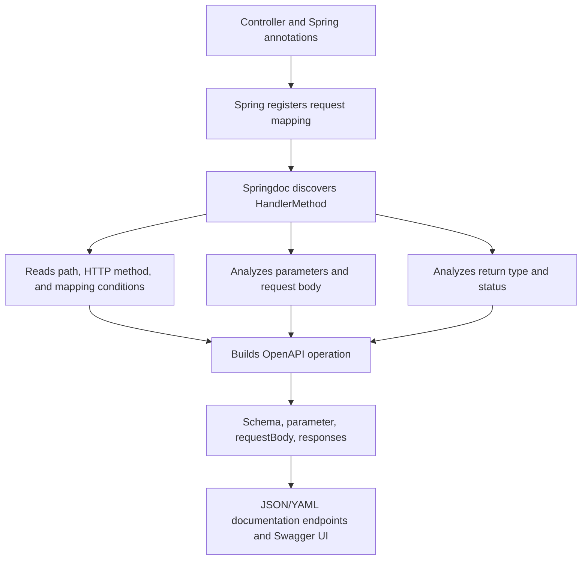

# Inference from Mappings, Method Signatures, and Return Types

Springdoc-openapi can generate most of an OpenAPI contract from Spring Boot controllers without manually writing every operation. The library reads Spring MVC/WebFlux mappings, analyzes method parameters, and determines return types to build paths, HTTP methods, parameters, request bodies, responses, and schemas. Understanding this inference process helps you predict how documentation will be generated and know where to add annotations when source code information is not explicit enough.

## 1. Where Does Springdoc Get Its Information?

In a Spring MVC application, Spring Boot registers controllers and mappings via Spring's request mapping mechanism. Each mapping binds a path and an HTTP method to a specific handler method. Springdoc reads the handlers discovered by Spring, then combines mapping metadata with method signatures and related annotations to construct the OpenAPI model.

This process can be pictured as a sequence:



Springdoc primarily describes what can be determined from endpoint structure. It does not execute business logic to know which error code an `if` branch returns, does not infer the meaning of every field solely from variable names, and cannot know every runtime value returned by a service. That information must be expressed through explicit data types, annotations, or documentation configuration.

## 2. Mappings Determine Paths and Operations

Spring MVC provides `@RequestMapping` along with shorthand annotations such as `@GetMapping`, `@PostMapping`, `@PutMapping`, `@PatchMapping`, and `@DeleteMapping`. Springdoc uses the registered mapping to determine:

- The API path, combining class-level and method-level path segments.
- The HTTP method corresponding to the operation.
- Mapping conditions such as `consumes` and `produces`.
- Related routing information published by Spring for the handler.

Example:

```java
@RestController
@RequestMapping("/api/products")
class ProductController {

    @GetMapping("/{productId}")
    ProductResponse findById(@PathVariable UUID productId) {
        return productService.findById(productId);
    }

    @PostMapping(consumes = MediaType.APPLICATION_JSON_VALUE)
    @ResponseStatus(HttpStatus.CREATED)
    ProductResponse create(@RequestBody CreateProductRequest request) {
        return productService.create(request);
    }
}
```

The mappings generate two operations of the form:

| Java Method | OpenAPI Operation |
|---|---|
| `findById` | `GET /api/products/{productId}` |
| `create` | `POST /api/products` |

`@RequestMapping("/api/products")` at the class level provides the shared prefix. `@GetMapping("/{productId}")` adds the method-level path segment. Thus, the documented path is `/api/products/{productId}`.

The `consumes` and `produces` attributes also affect media type descriptions of the request body and response. For instance, `consumes = application/json` indicates the operation accepts a JSON body; `produces = application/json` indicates it can return JSON. This mechanism links directly to `Content-Type`, `Accept`, and `content` entries in OpenAPI.

Conditions such as `params` and `headers` can participate in handler selection at runtime. However, do not assume every routing condition expression is represented as a full OpenAPI parameter. If clients need to send a specific query parameter or header, declare it explicitly with `@RequestParam` or `@RequestHeader` and add descriptions when needed.

## 3. Method Signatures Determine How Parameters Are Documented

Springdoc reads parameter annotations to determine where clients must send data. Common Spring annotations map as follows:

| Spring Annotation | Location in HTTP | Typical OpenAPI Representation |
|---|---|---|
| `@PathVariable` | Part of URL path | `parameters` with `in: path`; always required |
| `@RequestParam` | Query string or form parameter depending on context | `parameters` with `in: query` or corresponding form info |
| `@RequestHeader` | HTTP request header | `parameters` with `in: header` |
| `@CookieValue` | Request cookie | Parameter with `in: cookie` when supported by the document model |
| `@RequestBody` | Request body content | `requestBody.content` with schema |
| `@RequestPart` | One part of a multipart request | Schema of each part in multipart content |
| `@ModelAttribute` | Object bound from request fields | Usually decomposed into corresponding parameters |

Example of a method with a path parameter, query parameter, and header:

```java
@GetMapping("/{productId}")
ProductResponse find(
    @PathVariable UUID productId,
    @RequestParam(defaultValue = "false") boolean includeInventory,
    @RequestHeader(name = "X-Request-Id", required = false) String requestId
) {
    return productService.find(productId, includeInventory, requestId);
}
```

Springdoc can document these inputs as three independent parameters:

```yaml
parameters:
  - name: productId
    in: path
    required: true
    schema:
      type: string
      format: uuid
  - name: includeInventory
    in: query
    required: false
    schema:
      type: boolean
      default: false
  - name: X-Request-Id
    in: header
    required: false
    schema:
      type: string
```

Parameter names are usually taken from the annotation name or parameter name metadata. To keep documentation stable across builds, declare names explicitly in annotations—such as `@PathVariable("productId")` or `@RequestParam(name = "page")`—especially when builds do not retain Java parameter names.

The parameter's Java type also helps determine the schema. For example:

| Java Type | Typical OpenAPI Schema |
|---|---|
| `String` | `type: string` |
| `boolean` / `Boolean` | `type: boolean` |
| `int`, `Integer`, `long`, `Long` | `type: integer` with appropriate format |
| `double`, `Double`, `BigDecimal` | `type: number` with appropriate format |
| `UUID` | `type: string`, usually with `format: uuid` |
| `LocalDate` | `type: string`, usually with `format: date` |
| `LocalDateTime` / `OffsetDateTime` | `type: string` with corresponding date-time format |
| Enum | `type: string` with `enum` list if values are recognized |
| `List<T>` | `type: array` with `items` describing type `T` |

Specific data types and Jackson/Jakarta Validation annotations can add extra schema details. For example, `@NotNull`, `@NotBlank`, `@Size`, or `@Min` can help describe data constraints if the integration library and configuration recognize them.

## 4. @RequestBody and DTOs Generating Request Schemas

When a method parameter has `@RequestBody`, Spring reads the body through an `HttpMessageConverter` and converts it into the declared Java type. Springdoc uses that type to build the `requestBody` schema.

DTO example:

```java
public record CreateProductRequest(
    @NotBlank
    @Schema(description = "Product name", example = "Ballpoint pen")
    String name,

    @NotNull
    @DecimalMin("0.0")
    @Schema(description = "Selling price", example = "12000")
    BigDecimal price,

    @Size(max = 500)
    @Schema(description = "Product description")
    String description
) {}
```

Controller using the DTO:

```java
@PostMapping(
    consumes = MediaType.APPLICATION_JSON_VALUE,
    produces = MediaType.APPLICATION_JSON_VALUE
)
@ResponseStatus(HttpStatus.CREATED)
ProductResponse create(@Valid @RequestBody CreateProductRequest request) {
    return productService.create(request);
}
```

From the DTO type, springdoc can build an object schema with `name`, `price`, and `description` properties. `@Schema` adds descriptions and examples; validation annotations can influence the required fields list and data constraints.

A portion of the generated documentation may look like:

```yaml
requestBody:
  required: true
  content:
    application/json:
      schema:
        $ref: '#/components/schemas/CreateProductRequest'
```

And the component schema:

```yaml
CreateProductRequest:
  type: object
  required:
    - name
    - price
  properties:
    name:
      type: string
      description: Product name
      example: Ballpoint pen
    price:
      type: number
      description: Selling price
      example: 12000
    description:
      type: string
      maxLength: 500
```

This is an illustrative shape. The actual schema depends on the library version, Jackson configuration, validation annotations, data types, and the project's nullable handling. Inspect `/v3/api-docs` instead of assuming every annotation translates identically across all configurations.

## 5. Return Types Determine Response Schemas

Springdoc analyzes the method's return type to generate response schemas. With concrete DTO types, the schema usually references the corresponding component:

```java
@GetMapping("/{productId}")
ProductResponse findById(@PathVariable UUID productId) {
    return productService.findById(productId);
}
```

If `ProductResponse` is a DTO, the documentation describes the response body according to that DTO's structure. Common types are inferred as follows:

| Return Type | Typical Response Description |
|---|---|
| `ProductResponse` | Object schema of `ProductResponse` |
| `List<ProductResponse>` | Array whose `items` is `ProductResponse` |
| `ProductResponse[]` | Array whose elements are `ProductResponse` |
| `Page<ProductResponse>` | Paged result schema; exact structure depends on integration support |
| `ResponseEntity<ProductResponse>` | Body schema is `ProductResponse`; status needs to be inferred or explicitly documented |
| `ResponseEntity<Void>` | Response without a body schema |
| `ApiEnvelope<ProductResponse>` | Wrapper schema with type parameter resolved if generics are fully declared |
| `Map<String, Object>` or `Object` | Generic schema, less detailed than a concrete DTO |

Example with a generic wrapper:

```java
public record ApiEnvelope<T>(
    boolean success,
    T data,
    String message
) {}

@GetMapping("/{productId}")
ApiEnvelope<ProductResponse> find(@PathVariable UUID productId) {
    return new ApiEnvelope<>(true, productService.findById(productId), null);
}
```

Declaring `ApiEnvelope<ProductResponse>` lets the tool resolve type `T` as `ProductResponse`, producing a more structured schema than a raw `ApiEnvelope` type.

If a method returns only `Object`, raw generics, or an unresolvable wrapper type, the documentation may become overly generic. Prefer concrete return types or use `@ApiResponse` and `@Schema(implementation = ...)` to describe the intended payload.

## 6. ResponseEntity, Status Codes, and Empty Responses

`ResponseEntity<T>` allows controllers to decide status codes, headers, and bodies at runtime. Springdoc can use `T` to infer the body schema, but it cannot know all possible status codes if they are decided by business logic in individual branches.

Example:

```java
@PostMapping
ResponseEntity<ProductResponse> create(@RequestBody CreateProductRequest request) {
    ProductResponse created = productService.create(request);
    return ResponseEntity.status(HttpStatus.CREATED).body(created);
}
```

The return type indicates the body is `ProductResponse`, while status `201` is determined in a runtime expression. To make the contract clear, declare responses explicitly:

```java
@Operation(summary = "Create product")
@ApiResponses({
    @ApiResponse(
        responseCode = "201",
        description = "Product created",
        content = @Content(
            mediaType = MediaType.APPLICATION_JSON_VALUE,
            schema = @Schema(implementation = ProductResponse.class)
        )
    ),
    @ApiResponse(responseCode = "400", description = "Invalid data"),
    @ApiResponse(responseCode = "409", description = "Product already exists")
})
@PostMapping
ResponseEntity<ProductResponse> create(@Valid @RequestBody CreateProductRequest request) {
    // ...
}
```

If an endpoint returns `ResponseEntity<Void>` or `void`, the response usually has no body. If using `@ResponseStatus(HttpStatus.NO_CONTENT)` or a corresponding response annotation, status `204` can be reflected in the documentation. For endpoints with multiple status codes, document them thoroughly with `@ApiResponse` or `@ApiResponses` so clients know possible outcomes.

Do not rely on return-type inference to document business errors. For instance, a service might throw `ProductNotFoundException`, but springdoc cannot automatically know whether that exception is handled as `404` or `500` unless the handling rule is explicitly published.

## 7. Asynchronous and Reactive Types

In Spring MVC applications, methods can return asynchronous types such as `CompletableFuture<T>` or `CompletionStage<T>`. With Spring WebFlux, controllers can return `Mono<T>` or `Flux<T>`. Springdoc supports recognizing many common wrappers and inferring the inner data type rather than publishing the Java wrapper type name itself.

Example:

```java
@GetMapping("/{productId}")
Mono<ProductResponse> find(@PathVariable UUID productId) {
    return productService.findById(productId);
}

@GetMapping
Flux<ProductResponse> findAll() {
    return productService.findAll();
}
```

`Mono<ProductResponse>` represents a single asynchronous result of type `ProductResponse`. `Flux<ProductResponse>` represents multiple items; its exact representation in OpenAPI also depends on media types and how the endpoint emits data, such as a JSON array or a stream. Inspect the generated documentation with your exact springdoc version and web stack.

With custom project-defined wrapper types, tooling may not know which class holds the actual payload. In that case, consider configuring generic resolution, using `@Schema`, or documenting the response with `@ApiResponse`.

## 8. Additional Annotations When Inference Is Not Enough

Source code provides technical structure, but often lacks descriptions for API consumers. OpenAPI annotations add information that method names or Java types cannot express:

| Annotation | Role |
|---|---|
| `@Operation` | Describes the operation, summary, description, operationId, and tags |
| `@Tag` | Groups operations and describes the API group |
| `@Parameter` | Adds display name, description, example, or schema for a parameter |
| `@Parameters` | Groups multiple `@Parameter` annotations on one operation |
| `@ApiResponse` | Describes a status code and response content |
| `@ApiResponses` | Groups possible responses |
| Swagger `@RequestBody` | Customizes request body documentation |
| `@Content` | Declares media type and content schema |
| `@Schema` | Describes objects, properties, data types, examples, and constraints |
| `@Hidden` | Hides an operation or element from generated documentation |

Example adding parameter descriptions:

```java
@Operation(
    summary = "Find product",
    description = "Find a product by its identifier."
)
@GetMapping("/{productId}")
ProductResponse find(
    @Parameter(
        description = "Product UUID",
        example = "550e8400-e29b-41d4-a716-446655440000"
    )
    @PathVariable UUID productId
) {
    return productService.findById(productId);
}
```

Annotations should add semantics that Java code does not express, such as business conditions, error cases, realistic examples, and pagination rules. Avoid documenting a return type different from what the controller actually produces; inaccurate docs can cause generated clients to break compatibility.

## 9. End-to-End Example from Controller to OpenAPI

The following controller combines mappings, parameters, request DTOs, response DTOs, and response descriptions:

```java
@RestController
@RequestMapping("/api/products")
@Tag(name = "Products", description = "Product management")
class ProductController {

    @Operation(summary = "Get product by ID")
    @ApiResponses({
        @ApiResponse(
            responseCode = "200",
            description = "Product found",
            content = @Content(
                mediaType = MediaType.APPLICATION_JSON_VALUE,
                schema = @Schema(implementation = ProductResponse.class)
            )
        ),
        @ApiResponse(responseCode = "404", description = "Product not found")
    })
    @GetMapping("/{id}")
    ProductResponse findById(@PathVariable("id") UUID id) {
        return productService.findById(id);
    }

    @Operation(summary = "Create a new product")
    @ApiResponses({
        @ApiResponse(
            responseCode = "201",
            description = "Product created",
            content = @Content(
                mediaType = MediaType.APPLICATION_JSON_VALUE,
                schema = @Schema(implementation = ProductResponse.class)
            )
        ),
        @ApiResponse(responseCode = "400", description = "Invalid data")
    })
    @PostMapping(consumes = MediaType.APPLICATION_JSON_VALUE)
    @ResponseStatus(HttpStatus.CREATED)
    ProductResponse create(@Valid @RequestBody CreateProductRequest request) {
        return productService.create(request);
    }
}
```

The generated OpenAPI will have an overall structure like:

```yaml
tags:
  - name: Products
    description: Product management
paths:
  /api/products/{id}:
    get:
      summary: Get product by ID
      operationId: findById
      parameters:
        - name: id
          in: path
          required: true
          schema:
            type: string
            format: uuid
      responses:
        '200':
          description: Product found
          content:
            application/json:
              schema:
                $ref: '#/components/schemas/ProductResponse'
        '404':
          description: Product not found
  /api/products:
    post:
      summary: Create a new product
      requestBody:
        required: true
        content:
          application/json:
            schema:
              $ref: '#/components/schemas/CreateProductRequest'
      responses:
        '201':
          description: Product created
          content:
            application/json:
              schema:
                $ref: '#/components/schemas/ProductResponse'
        '400':
          description: Invalid data
```

The YAML snippet only illustrates the structure of relevant sections; the actual document may also include `info`, `servers`, `components`, schema properties, security, and other metadata. The default `operationId` may change based on method names, naming conventions, and configuration. If client generators or other systems depend on operationId, assign a stable value using `@Operation(operationId = "...")`.

## 10. Limits of Automatic Inference

Automatic inference generates docs quickly, yet there are cases where source code does not supply enough information:

| Situation | Possible Result | How to Handle |
|---|---|---|
| Returning `Object`, raw generics, or `Map<String, Object>` | Generic schema unable to convey clear structure | Use concrete DTOs or `@Schema`/`@ApiResponse` |
| Returning `ResponseEntity<?>` with multiple status branches | Cannot know all runtime statuses and bodies | Declare each response with `@ApiResponses` |
| Using custom wrappers or specialized reactive types | Unable to resolve inner payload | Check version support, configure generics, or document manually |
| Mappings with complex `params`/`headers` conditions | Part of the routing condition may not become a client-friendly parameter | Declare parameters and document conditions explicitly |
| Multiple handlers on the same path and HTTP method differing only by conditions | Hard to merge into a single OpenAPI operation | Design representations within one operation or split paths/methods appropriately |
| DTO with inherited fields, nested generics, or custom Jackson annotations | Schema may differ from expectations | Inspect the actual schema and add `@Schema` |
| Response modified by `ResponseBodyAdvice` or exception handlers | Controller return type may not reflect the final body | Document the actual response and inspect docs after shared handlers |

The OpenAPI specification allows only one operation per path and HTTP method pair. If Spring registers multiple handlers for the same pair under distinct conditions, the documentation needs to merge media types or clearly express a single contract. Do not expect each runtime handler to automatically become a separate operation under the same path and method.

## 11. Verifying Generated Documentation

After the application starts, download JSON at `/v3/api-docs` or YAML at `/v3/api-docs.yaml`. Pick a representative controller and cross-check each part against the source code:

1. **Path and method:** does the final path combine class-level and method-level mappings properly?
2. **Parameters:** do path, query, header, and cookie parameters have the right names, types, and required flags?
3. **Request body:** does the schema match the DTO, media types, and required status?
4. **Responses:** do body types, media types, and status codes match actual outcomes?
5. **Components:** do schemas contain all required properties, enums, formats, validations, and descriptions?
6. **Operation metadata:** are summary, description, tags, and operationId stable and understandable?

When Swagger UI displays missing or wrong information, inspect the raw JSON/YAML first. If OpenAPI is already wrong, check mappings and annotations. If OpenAPI is right but the UI renders unexpectedly, check Swagger UI configuration and UI version support.

You can use `@Hidden` to exclude an internal endpoint from public documentation, or configure documentation groups to publish only a subset of controllers. Hiding an endpoint from OpenAPI does not replace application-layer security; the endpoint can still be called without proper authorization mechanisms.

## 12. Controller Design Workflow for Clean Inference

To let springdoc produce clear and stable contracts, apply these principles:

1. Use explicit mapping annotations for HTTP methods and paths.
2. Name things clearly and declare names in `@PathVariable`, `@RequestParam`, `@RequestHeader` when needed.
3. Use concrete DTOs for requests and responses; avoid raw types or `Object` when the data structure is known.
4. Declare `consumes` and `produces` when endpoints have explicit media type requirements or support multiple representations.
5. Use `@ResponseStatus` when status is fixed; use `@ApiResponses` to describe success and error outcomes.
6. Add `@Operation`, `@Parameter`, and `@Schema` for business descriptions, examples, and constraints.
7. Check `/v3/api-docs` after changing method signatures or DTOs, because small changes in Java code can alter the contract.
8. Diff OpenAPI documents across releases to catch breaking changes before publishing.

Springdoc works best when controllers express an explicit HTTP contract: mappings show routing, method signatures show inputs, return types show response structures, and annotations add meaning that source code cannot express. Generated documentation should be treated as part of the API contract and verified alongside runtime behavior.

## 13. References

- [Springdoc OpenAPI](https://springdoc.org/): how to integrate springdoc with Spring Boot and customize generated documentation.
- [Spring Framework: Mapping Requests](https://docs.spring.io/spring-framework/reference/web/webmvc/mvc-controller/ann-requestmapping.html): mapping annotations, paths, and request conditions.
- [Spring Framework: Method Arguments](https://docs.spring.io/spring-framework/reference/web/webmvc/mvc-controller/ann-methods/arguments.html): how Spring resolves handler method parameters.
- [Spring Framework: Return Values](https://docs.spring.io/spring-framework/reference/web/webmvc/mvc-controller/ann-methods/return-types.html): return types supported by Spring MVC.
- [OpenAPI Specification](https://spec.openapis.org/oas/latest.html): path, operation, parameter, request body, response, and schema model.
- [Swagger Core Annotations](https://github.com/swagger-api/swagger-core/wiki/Swagger-2.X---Annotations): annotations used to enrich OpenAPI metadata.
