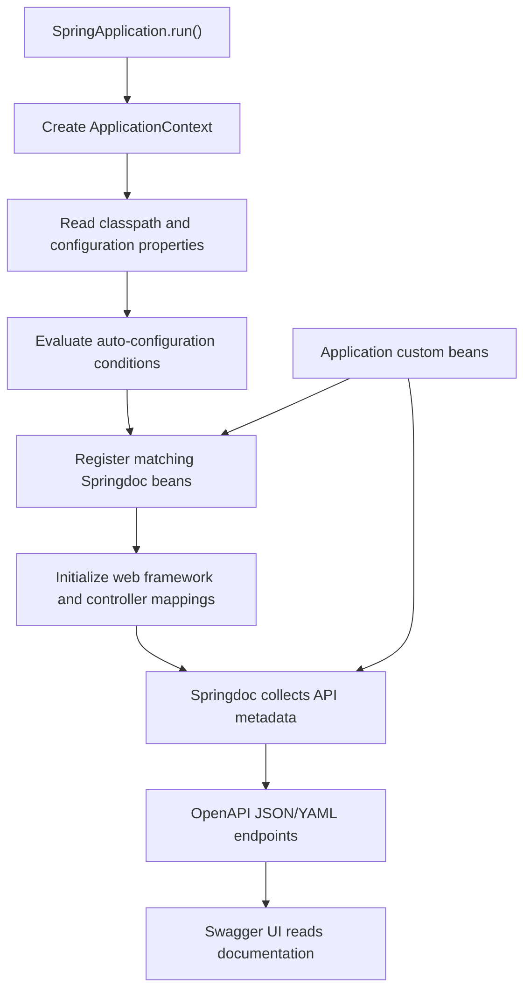

# Role of Auto-Configuration and Custom Beans

When adding springdoc-openapi to a Spring Boot application, OpenAPI documentation and Swagger UI usually work right after application startup without needing to write custom controllers for them. This comes from **Spring Boot auto-configuration**: Spring Boot detects libraries on the classpath, evaluates environment conditions, and registers appropriate beans. Springdoc uses that integration mechanism to hook into Spring MVC or WebFlux, collect endpoint information, and expose documentation access points.

When defaults do not meet project needs, developers can declare beans to add metadata, split documentation into groups, or customize operations and schemas. Understanding how auto-configuration and custom beans collaborate helps configure springdoc at the right lifecycle stage, avoid duplicate component registration, and keep documentation aligned with the running API.

## 1. What Is Spring Boot Auto-Configuration?

Spring Boot auto-configuration is a mechanism that automatically configures an application based on what is present in the runtime environment. Spring Boot inspects the classpath, application type, configuration properties, and beans already registered in the ApplicationContext to decide which configurations apply.

For example, when a project adds the starter for Spring MVC, Spring Boot can configure web components such as DispatcherServlet, message converters, and related integrations. When adding the appropriate springdoc starter, the springdoc library can register the components needed to generate OpenAPI documentation and serve Swagger UI.

Auto-configuration typically relies on conditions such as:

- **Classpath:** whether a required class or library is present.
- **Application type:** whether the application runs on a servlet, reactive, or non-web model.
- **Existing beans:** whether the application has already registered a corresponding bean itself.
- **Configuration properties:** whether a feature is enabled or disabled in application.yml or application.properties.

These conditions are expressed with annotations like `@ConditionalOnClass`, `@ConditionalOnMissingBean`, `@ConditionalOnProperty`, and `@ConditionalOnWebApplication`. You do not need to place these annotations on every application configuration; they are primarily used inside Spring Boot's and integration libraries' auto-configuration classes.

## 2. How Does Springdoc Participate in the Startup Lifecycle?

For a Spring Boot application using springdoc-openapi, the process can be pictured in these steps:

1. Spring Boot reads application configuration, initializes the environment, and creates the ApplicationContext.
2. Auto-configuration inspects dependencies, web conditions, and springdoc properties to register necessary beans.
3. Spring MVC or WebFlux initializes request-handling infrastructure and discovers controller mappings.
4. Springdoc components integrate with the Spring environment to collect mappings, data types, and OpenAPI metadata.
5. When a client accesses a documentation endpoint, springdoc serves the corresponding OpenAPI specification. Swagger UI loads that document for display.

Conceptual diagram:



The diagram shows the conceptual flow. Exact bean ordering depends on the Spring Boot version, springdoc version, and application type. The key takeaway is that configuration beans are registered in the ApplicationContext, while documentation is generated from metadata observable by springdoc inside the application.

### 2.1. Why Does Adding Only a Starter Already Provide Documentation?

A springdoc starter bundles the dependencies required for an application type. For Spring MVC, Spring Boot 3 projects commonly use `springdoc-openapi-starter-webmvc-ui` if both API docs and Swagger UI are needed. The API-only starter can be chosen if only the documentation endpoint is needed. For WebFlux, choose the corresponding WebFlux starter.

Maven example:

```xml
<dependency>
    <groupId>org.springdoc</groupId>
    <artifactId>springdoc-openapi-starter-webmvc-ui</artifactId>
    <version>${springdoc.version}</version>
</dependency>
```

Once a compatible dependency is added and the application starts, springdoc integrates with Spring to expose default documentation endpoints such as `/v3/api-docs`. Starters with UI components also provide Swagger UI, typically accessed via `/swagger-ui.html`.

Do not add multiple UI and API starters simultaneously to the same application without a clear reason. Choose the starter based on your web model and actual needs. The springdoc version must be compatible with the project's Spring Boot version.

## 3. Distinguishing Auto-Configuration, Component Scan, and Application-Declared Beans

These three mechanisms all contribute to creating the ApplicationContext, but serve different purposes:

| Mechanism | How It Works | Project Example |
|---|---|---|
| Auto-configuration | Registers configurations based on classpath, properties, and existing beans | Springdoc starter enables documentation integration |
| Component scan | Finds classes marked with stereotypes within scanned packages | Discovers `@RestController`, `@Service`, `@Configuration` |
| Custom beans | Application explicitly declares objects via `@Bean` or stereotypes | Declares `OpenAPI`, `GroupedOpenApi`, customizers |

`@SpringBootApplication` typically includes `@EnableAutoConfiguration`, `@ComponentScan`, and `@SpringBootConfiguration`. Therefore, a typical Spring Boot application both scans components within its package scope and enables auto-configuration.

Custom beans can be declared in a `@Configuration` class within component scan scope:

```java
@SpringBootApplication
public class Application {
    public static void main(String[] args) {
        SpringApplication.run(Application.class, args);
    }
}

@Configuration
public class ApiDocumentationConfiguration {
    // @Bean methods are registered in the ApplicationContext.
}
```

If a configuration class sits outside the scanned packages, Spring will not discover it automatically just because the Java file exists. Place the configuration class in an appropriate package or import it explicitly with `@Import`.

## 4. Configuring Springdoc Features via application.yml

Not every change requires creating a bean. Many common options can be declared via application.yml or application.properties. For example:

```yaml
springdoc:
  api-docs:
    enabled: true
    path: /v3/api-docs
  swagger-ui:
    enabled: true
    path: /swagger-ui.html
  packages-to-scan:
    - com.example.product.api
  paths-to-match:
    - /api/**
  paths-to-exclude:
    - /api/internal/**
```

Meaning:

- `api-docs.enabled` enables or disables the documentation generation endpoint.
- `api-docs.path` changes the OpenAPI documentation path.
- `swagger-ui.enabled` enables or disables Swagger UI.
- `swagger-ui.path` configures the UI access path.
- `packages-to-scan` limits which controller packages are inspected.
- `paths-to-match` selects paths to include in documentation.
- `paths-to-exclude` excludes paths from documentation.

These properties tune springdoc behavior through Spring Boot's configuration mechanism. Verify property names for the springdoc version in use if the project runs an older version or uses a different starter.

### 4.1. When to Use Properties vs. Beans?

Use configuration properties when the goal is toggling features, changing docs/UI endpoints, restricting packages, or filtering paths. Use beans when you need structured metadata, documentation grouping, or custom Java logic.

For example, to simply omit internal endpoints from docs, `paths-to-exclude` is usually enough. If you need to add metadata based on application logic or modify the OpenAPI model after endpoints are collected, a customizer is a better fit.

Avoid declaring both a property and a customizer that modify the same content without clear conventions. When multiple sources act on the same item, the final result depends on ordering and configuration merging.

## 5. Declaring an OpenAPI Bean for General Metadata

Springdoc supports using an `OpenAPI` bean to declare document-level details such as API title, version, description, servers, and security components. Example:

```java
import io.swagger.v3.oas.models.OpenAPI;
import io.swagger.v3.oas.models.info.Info;
import io.swagger.v3.oas.models.servers.Server;
import org.springframework.context.annotation.Bean;
import org.springframework.context.annotation.Configuration;

import java.util.List;

@Configuration
public class OpenApiConfiguration {

    @Bean
    public OpenAPI productOpenAPI() {
        return new OpenAPI()
            .info(new Info()
                .title("Product API")
                .version("1.0.0")
                .description("Product management API"))
            .servers(List.of(
                new Server()
                    .url("https://api.example.com")
                    .description("Production")
            ));
    }
}
```

This bean supplies general metadata for the document. Springdoc remains responsible for collecting operations from controllers. You do not have to manually rewrite all paths just to set title, version, or description.

Similar metadata can be declared with `@OpenAPIDefinition` and related annotations. Within a project, choose one declaration approach as the primary source for general metadata so maintainers know where to look and competing configurations are avoided.

`Info.version` is the published documentation/API version. It does not automatically change the springdoc dependency version or the Spring Boot application version.

## 6. Customizing Documentation with OpenApiCustomizer

`OpenApiCustomizer` allows modifying the OpenAPI model after springdoc builds the document. This approach fits when adding tags, extensions, metadata, or adjusting shared document components.

Example adding a shared tag:

```java
import io.swagger.v3.oas.models.tags.Tag;
import org.springdoc.core.customizers.OpenApiCustomizer;
import org.springframework.context.annotation.Bean;
import org.springframework.context.annotation.Configuration;

@Configuration
public class OpenApiCustomizerConfiguration {

    @Bean
    public OpenApiCustomizer platformTagCustomizer() {
        return openApi -> openApi.addTagsItem(
            new Tag()
                .name("Platform")
                .description("Shared platform capabilities")
        );
    }
}
```

The customizer receives the OpenAPI model and can mutate it before returning the document to clients. Write logic that runs safely whether or not a specific component already exists. For instance, if updating info.description, check that openApi.getInfo() is non-null before calling setters.

Scope of application depends on registration and customizer type. For the default document, an OpenApiCustomizer bean can be used. For documentation groups, consider global customizers or attach customizers directly to the GroupedOpenApi configuration to ensure changes apply to the intended group.

## 7. Creating GroupedOpenApi Beans to Split Documentation

When an application has multiple API groups, such as public and admin, each group can be declared with a GroupedOpenApi bean.

```java
import org.springdoc.core.models.GroupedOpenApi;
import org.springframework.context.annotation.Bean;
import org.springframework.context.annotation.Configuration;

@Configuration
public class OpenApiGroupsConfiguration {

    @Bean
    public GroupedOpenApi publicApi() {
        return GroupedOpenApi.builder()
            .group("public")
            .pathsToMatch("/api/public/**")
            .build();
    }

    @Bean
    public GroupedOpenApi adminApi() {
        return GroupedOpenApi.builder()
            .group("admin")
            .pathsToMatch("/api/admin/**")
            .build();
    }
}
```

With the configuration above, each group's documentation is usually accessed as `/v3/api-docs/{group}`, for example:

- `/v3/api-docs/public`
- `/v3/api-docs/admin`

A group-specific customizer can be attached to the group:

```java
@Bean
public GroupedOpenApi publicApi() {
    return GroupedOpenApi.builder()
        .group("public")
        .pathsToMatch("/api/public/**")
        .addOpenApiCustomizer(openApi ->
            openApi.getInfo().setTitle("Public Product API")
        )
        .build();
}
```

The example assumes an OpenAPI bean already provided an Info object. If that metadata is absent, initialize Info before calling setTitle. The builder API may vary across springdoc versions; verify imports and methods provided by the project's version.

Group names must be unique within the application. pathsToMatch and packagesToScan filters must reflect the intended controller scope. If no endpoints appear in a group, check package scan, path match, and path exclude settings.

## 8. Customizing Operations with OperationCustomizer

`OperationCustomizer` works at the individual operation level. It receives the Operation model and Spring's HandlerMethod info, allowing operations to be adjusted based on the Java method handling the endpoint.

Example adding a fallback summary from the method name if the operation lacks a summary:

```java
import org.springdoc.core.customizers.OperationCustomizer;
import org.springframework.context.annotation.Bean;
import org.springframework.context.annotation.Configuration;

@Configuration
public class OperationCustomizerConfiguration {

    @Bean
    public OperationCustomizer operationSummaryFallback() {
        return (operation, handlerMethod) -> {
            if (operation.getSummary() == null
                    || operation.getSummary().isBlank()) {
                operation.setSummary(
                    handlerMethod.getMethod().getName()
                );
            }
            return operation;
        };
    }
}
```

This serves as a fallback for operations without descriptions. For public APIs, summaries should be written as short sentences clear to API consumers. Java method names are helpful for technical context but are not always the best documentation content.

OperationCustomizer can also add extensions, adjust tags, or apply documentation rules based on custom annotations. Do not use it to mask route design flaws or replace clear request/response descriptions.

## 9. How Auto-Configuration and Custom Beans Work Together

A core principle of Spring Boot auto-configuration is that automatic configuration is designed to back off when the application already supplies an appropriate bean. This mechanism is typically implemented using conditions like `@ConditionalOnMissingBean`.

However, do not assume any springdoc bean can be replaced simply by declaring an arbitrary bean with the same name or package. Exact back-off conditions depend on the configuration type and library version. The safe approach is using the extension points published by springdoc, such as OpenAPI, GroupedOpenApi, OpenApiCustomizer, and OperationCustomizer.

The relationship can be summarized as follows:

| Need | Appropriate Configuration Approach |
|---|---|
| Enable/disable documentation endpoint | `springdoc.api-docs.enabled` |
| Enable/disable Swagger UI | `springdoc.swagger-ui.enabled` |
| Change documentation or UI path | `springdoc.*.path` properties |
| Set API name, description, version | OpenAPI bean or `@OpenAPIDefinition` |
| Split docs into public/admin | GroupedOpenApi beans |
| Modify OpenAPI model after generation | OpenApiCustomizer |
| Modify individual operations by handler method | OperationCustomizer |

There is no need to recreate springdoc's internal beans just to change metadata or filter APIs. Replacing internal beans can break web framework integration or cause configuration conflicts.

## 10. Configuration Order and Bean Registration Errors

Spring manages beans in the ApplicationContext. When the application starts, configuration classes are processed to register beans; dependent beans are created according to dependency relationships. Common errors include:

### 10.1. Configuration Bean Not Found

If custom documentation does not show up, check:

- Does the configuration class have `@Configuration` or is it declared otherwise?
- Is the configuration class's package within component scan scope?
- Does the active profile exclude that bean?
- Does a `@ConditionalOnProperty` or other condition prevent the bean from registering?

### 10.2. Duplicate or Conflicting Beans

If two `@Bean` methods create the same bean name, Spring may report a duplicate registration error depending on application settings. If multiple beans of the same type are injected into a single injection point without disambiguation, a non-unique bean error may occur.

Give beans meaningful names, avoid copying old configurations, and only use `@Primary` or `@Qualifier` when you genuinely need to pick one candidate among several. Do not enable bean definition overriding merely to mask a duplicate configuration error.

### 10.3. Circular Dependencies

A customizer should not depend back on a service that in turn needs the OpenAPI document or that customizer. Circular dependencies can prevent the ApplicationContext from initializing. Keep documentation configuration beans simple, inject only necessary components, and avoid circular dependencies between documentation infrastructure and business logic.

### 10.4. Customizing at the Wrong Time

Do not query controllers or call business services to fetch dynamic data while initializing documentation configuration beans if doing so introduces dependencies on a database or external services. Documentation metadata should usually be static and constructible during startup. If environment information is needed, use configuration properties or appropriate configuration beans.

## 11. Distinguishing Documentation Configuration from Endpoint Protection

Properties like `springdoc.api-docs.enabled` or `springdoc.swagger-ui.enabled` control documentation serving. They do not replace Spring Security.

For example, hiding a path from documentation with `paths-to-exclude` does not prevent clients from sending requests directly to the controller. Similarly, disabling Swagger UI does not mean business API endpoints are protected.

If documentation is internal-only, configure access control for docs and UI endpoints with Spring Security or an architecture-appropriate security layer. If the API uses JWT or OAuth2, describing security schemes in OpenAPI helps Swagger UI know how to authenticate, while token verification is still enforced by the backend.

## 12. Verifying Auto-Configuration and Custom Beans

After changing dependencies or configuration, verify with these steps:

1. Start the application and confirm the ApplicationContext finishes initializing.
2. Check logs for auto-configuration condition issues, duplicate beans, or missing beans.
3. Access the JSON documentation endpoint, usually `/v3/api-docs`.
4. Inspect `info.title`, `info.version`, `servers`, `paths`, and tags in the document.
5. If groups exist, access `/v3/api-docs/{group}` and verify paths belong to the right scope.
6. Open Swagger UI and confirm the UI loads the right documentation URL.
7. Test representative requests to ensure documentation accurately reflects mappings and application behavior.

Spring Boot supports debug mode to print the auto-configuration conditions report:

```bash
java -jar application.jar --debug
```

The conditions report shows which auto-configurations were applied, excluded, and why. If the application includes Spring Boot Actuator, the conditions endpoint can also help inspect auto-configuration; enable and secure management endpoints per operational policy.

In integration tests, you can use `@SpringBootTest` and `MockMvc` to verify the docs endpoint:

```java
@SpringBootTest
@AutoConfigureMockMvc
class OpenApiDocumentationTest {

    @Autowired
    MockMvc mockMvc;

    @Test
    void shouldExposeOpenApiDocument() throws Exception {
        mockMvc.perform(get("/v3/api-docs"))
            .andExpect(status().isOk())
            .andExpect(jsonPath("$.openapi").exists())
            .andExpect(jsonPath("$.info.title").value("Product API"));
    }
}
```

The example assumes the application uses Spring MVC, has an OpenAPI bean configured with title Product API, and declares the necessary static imports. For WebFlux, use the corresponding reactive testing tools. When changing the API docs path or API name, update assertions to match the actual configuration.

## 13. Organizing Configuration in a Project

A clean structure helps developers locate customization points:

```text
com.example.product
├── Application.java
├── api
│   ├── ProductController.java
│   └── AdminController.java
└── config
    ├── OpenApiConfiguration.java
    ├── OpenApiGroupsConfiguration.java
    └── OpenApiCustomizerConfiguration.java
```

Responsibilities should be separated:

- application.yml holds toggle properties, endpoints, and global filters.
- OpenApiConfiguration holds general document metadata.
- OpenApiGroupsConfiguration defines documentation groups when needed.
- Customizers hold logic for modifying the model or operations.
- Controllers and DTOs keep descriptive annotations close to the endpoints and data they implement.

It is not necessary to create all of the above classes for small applications. Split configurations only when the number of beans or API groups is large enough that separation improves maintainability.

## 14. Key Takeaways

- Spring Boot auto-configuration inspects the classpath, application type, properties, and existing beans to register matching configurations.
- Springdoc starters integrate OpenAPI documentation with Spring MVC or WebFlux; UI starters also provide Swagger UI.
- Component scan discovers configurations and controllers within package scope; custom beans are registered in the ApplicationContext.
- springdoc.* properties fit toggle options, paths, and filters.
- OpenAPI beans declare general metadata; GroupedOpenApi splits documentation; customizers adjust the OpenAPI model or operations.
- Custom beans must be within Spring-managed scope and must not create conflicts or circular dependencies.
- Documentation configuration does not replace API protection mechanisms; docs/UI access permissions must be managed separately.

When extending springdoc-openapi, let Spring Boot and the starter handle automatic integration, then add beans at the appropriate extension points. Inspecting the JSON/YAML document after every change confirms the configuration actually produces the contract the development team intends to publish.
