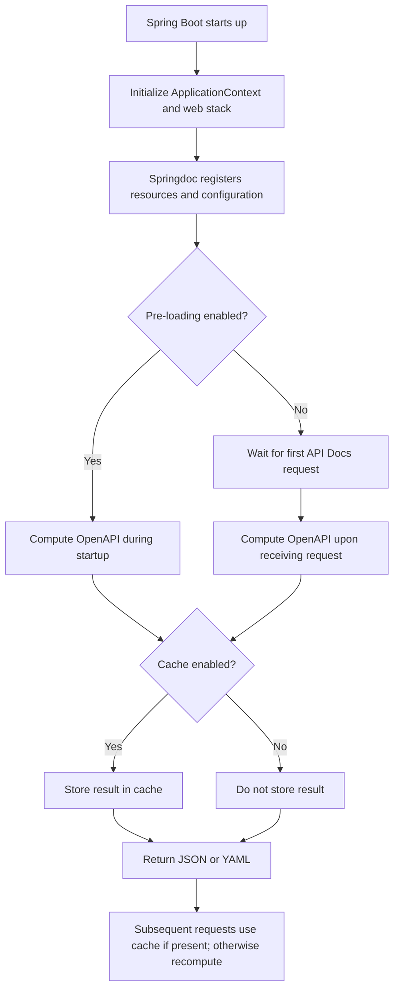

# Documentation Build Timing, Caching, and Pre-loading

Springdoc does not necessarily build the entire OpenAPI specification as soon as Spring Boot starts running. Under typical configuration, the application prepares the required components during startup, and the documentation is computed when a request arrives at the API Docs endpoint. The computed result is cached so subsequent requests do not have to repeat all of the work.

Springdoc also supports pre-loading documentation during application startup. This option shifts the OpenAPI generation cost to the startup phase, helping the first request after the application becomes ready avoid documentation generation latency. Choosing when to build, whether to enable caching, and whether to pre-load affects startup time, first-request latency, memory usage, and the ability to reflect runtime changes.

## 1. When Is Documentation Built?

To generate the specification, Springdoc needs information from the Spring ApplicationContext and the running web stack. Information commonly used includes:

- Controllers and mappings registered in Spring MVC or WebFlux.
- Parameter types, return types, DTOs, generic types, and related schemas.
- Spring, Swagger/OpenAPI annotations, and validation constraints.
- OpenAPI configuration, the `OpenAPI` bean, customizers, and documentation groups.
- Environment information such as server URL, locale, and integration settings.

Therefore, distinguish two moments: Spring Boot initializing the application and Springdoc computing the OpenAPI content. Springdoc can register resources, beans, and configurations during startup without having to serialize the entire document right at that moment.

Under default configuration, `springdoc.pre-loading-enabled` is `false`. Documentation is typically generated when a client first calls an API Docs endpoint, for example:

```text
GET /v3/api-docs
GET /v3/api-docs.yaml
```

If a user opens Swagger UI first, the browser loads the UI page and then calls the documentation endpoint to render operations. Swagger UI's request may therefore be the first request triggering OpenAPI generation. If a CI tool, health check, or another client calls API Docs earlier, that request becomes the first one.

High-level flow:



The diagram shows the high-level flow. Exact ordering of beans and lifecycle events may differ across Springdoc versions, but the two operating modes to remember are on-demand generation and pre-generation during application startup.

## 2. What Happens During OpenAPI Generation

The first computation can take longer than subsequent requests because Springdoc must aggregate multiple metadata sources. Typical work includes:

1. Identifying endpoints within the scan scope or the scope of the requested group.
2. Reading HTTP methods, paths, parameters, request bodies, and responses from handler methods.
3. Analyzing data types, annotations, and conversion rules to build schemas.
4. Resolving schema references, generic types, enums, validations, and nested structures.
5. Merging information from annotations, the `OpenAPI` bean, customizers, security, and Springdoc configuration.
6. Building the OpenAPI model and serializing it to JSON or YAML to return to the client.

Applications with many controllers, complex DTOs, deep generic hierarchies, multiple groups, or multiple locales may require more time and memory. Schema complexity and customizers can also significantly impact documentation generation time.

Do not equate OpenAPI generation time with business request processing time. A `/v3/api-docs` request primarily serves API documentation; it does not call every documented endpoint one by one. However, if a customizer itself queries a database or calls an external service, that custom code can increase latency and introduce runtime dependencies.

## 3. Server-Side OpenAPI Caching

Springdoc enables caching for the computed specification by default. The `springdoc.cache.disabled` property defaults to `false`, meaning caching is not disabled. Once the document has been generated, subsequent matching requests can reuse the stored result instead of re-analyzing controllers and schemas.

Example making the default configuration explicit:

```yaml
springdoc:
  cache:
    disabled: false
```

This cache is an OpenAPI result cache managed by Springdoc on the server side. It is not the same as HTTP caching in browsers, CDNs, or reverse proxies; nor is it Spring Cache business caching. Other cache layers can exist independently.

### Why Is Caching Helpful?

- Reduces the cost of analyzing controllers, DTOs, and annotations after the first build.
- Reduces latency for repeated documentation fetch requests.
- Avoids re-running customizers or schema generation logic on every request when the document has not changed.
- Keeps the documentation endpoint more stable when multiple users or tools access it concurrently.

### Limitations to Understand

Caching works well when the API contract is stable throughout the lifecycle of an application version. If OpenAPI content depends on data changing at runtime—such as tenant lists, user permissions, feature flags, or database state—the cached result may not reflect those changes on subsequent requests.

An API specification should normally describe the application's contract rather than changing arbitrarily per caller. If different documentation is needed per tenant or user group, design clearly scoped groups, endpoints, or separate documents with appropriate access controls. Do not rely on the global cache to build per-request private contracts.

## 4. Customizing Caching and Entry Limits

To disable OpenAPI caching, configure:

```yaml
springdoc:
  cache:
    disabled: true
```

When caching is disabled, Springdoc may have to recompute the document for subsequent requests. This is useful during development or when testing a customizer whose output varies with runtime state. On the other hand, the documentation endpoint may consume more CPU and have higher latency, especially when many clients fetch documentation concurrently.

In Springdoc v2 configuration documentation, `springdoc.cache.max-entries` sets a limit on the number of OpenAPI descriptions kept in the cache. The default value published in v2 documentation is `100`. Each locale requested via the `Accept-Language` header occupies an entry; when the limit is exceeded, the oldest entry is evicted using an LRU policy.

Example:

```yaml
springdoc:
  cache:
    disabled: false
    max-entries: 100
```

Only adjust `max-entries` when the application genuinely serves many locales or document variants that cause the entry count to grow substantially. Raising the limit can increase retained memory; lowering it too far can cause frequent recomputation when locales alternate. Check the documentation for the exact Springdoc line in use, as properties and cache implementation may vary across versions.

### Cache and Locale

If an application has multilingual descriptions, Springdoc can generate different content depending on the locale requested by the client. The `Accept-Language` header is a key input for selecting the locale. For example:

```bash
curl -H "Accept-Language: vi" http://localhost:8080/v3/api-docs
curl -H "Accept-Language: en" http://localhost:8080/v3/api-docs
```

The two requests may receive different descriptions if the application has configured internationalized content. Caching per locale prevents accidentally serving one language's content to a request for another language. If the application does not use multilingual content, there is no need to increase the cache just because there are many users.

## 5. Pre-loading Documentation at Startup

Springdoc supports pre-loading to build OpenAPI during the application startup phase. The main property is `springdoc.pre-loading-enabled`, defaulting to `false` in Springdoc v2 configuration documentation.

To enable pre-loading:

```yaml
springdoc:
  pre-loading-enabled: true
```

When enabled, Springdoc proactively computes documentation during startup instead of waiting for the first API Docs request. If caching is enabled, the generated result can be reused for subsequent requests.

### When Should You Enable It?

- You want to avoid documentation generation latency on the first request after the application becomes ready.
- You want to catch schema, annotation, or customizer errors early during startup.
- Another tool or component needs the OpenAPI document immediately after application startup.
- You use the OpenAPI document to register or initialize an integration that depends on the API contract.

### Trade-Offs of Enabling Pre-loading

Pre-loading shifts computational cost into the startup phase. The application may take longer to start and consume CPU and memory earlier. With large documents or many locales, the added startup time can be noticeable. In autoscaling environments or multi-replica deployments, each instance may perform its own pre-loading work.

Pre-loading does not make business endpoints ready any sooner and does not replace health checks. It only prepares the OpenAPI document. Measure startup time and API Docs requests in a production-like environment before enabling it by default across all environments.

## 6. Pre-loading by Locale

If the application supports multilingual descriptions, you can specify which locales to pre-load with `springdoc.pre-loading-locales`. According to Springdoc v2 documentation, if this list is not declared, Springdoc pre-loads using the application's default `Locale`.

YAML configuration example:

```yaml
springdoc:
  pre-loading-enabled: true
  pre-loading-locales:
    - vi
    - en
```

The same configuration can be written in `application.properties`:

```properties
springdoc.pre-loading-enabled=true
springdoc.pre-loading-locales=vi,en
```

Choose locales matching the values the application actually supports. Declaring many locales means startup must prepare additional document variants and the cache may hold more entries. Account for cache limits, memory, and startup time.

If translated content comes from message bundles, verify message files are packaged properly and locale fallback works as expected. Pre-loading does not automatically translate annotation text or supply missing translations; it only instructs Springdoc to build documents for the configured locales.

## 7. Combining Caching, Pre-loading, and Documentation Groups

An application can produce multiple OpenAPI documents via `GroupedOpenApi` or group configuration. Each group has its own endpoint scope and contract, such as `public`, `admin`, or `internal`. Requests to a group's documentation URL trigger Springdoc to build the corresponding document.

When combining groups with locales, consider the total number of document variants the application serves. For example, a service with many groups and many languages may need to prepare and store numerous OpenAPI copies. Pre-loading, cache, and group scope settings should be tested together on your specific Springdoc version; do not assume a single request to the default documentation URL verifies every group.

Example group declaration:

```java
@Configuration
class OpenApiGroups {

    @Bean
    GroupedOpenApi publicApi() {
        return GroupedOpenApi.builder()
            .group("public")
            .pathsToMatch("/api/public/**")
            .build();
    }

    @Bean
    GroupedOpenApi adminApi() {
        return GroupedOpenApi.builder()
            .group("admin")
            .pathsToMatch("/api/admin/**")
            .build();
    }
}
```

The corresponding documentation URLs typically look like:

```text
/v3/api-docs/public
/v3/api-docs/admin
```

If the application must ensure every group builds cleanly before serving traffic, check how your Springdoc version handles pre-loading for groups and create appropriate startup checks. Do not assume `pre-loading-enabled=true` in every version is equivalent to a full test across all custom documentation URLs.

## 8. Sample Configurations by Environment

Not every environment needs the same strategy. The following example illustrates enabling caching and pre-loading for production:

```yaml
springdoc:
  cache:
    disabled: false
    max-entries: 100
  pre-loading-enabled: true
  pre-loading-locales:
    - vi
    - en
```

In development, pre-loading can remain off for faster startup when frequently modifying controllers and DTOs:

```yaml
springdoc:
  cache:
    disabled: true
  pre-loading-enabled: false
```

These are two reference configurations, not mandatory values. For applications with stable contracts, caching is usually helpful in both development and production. Disabling cache in development is only appropriate when you need to observe regenerated output after runtime changes or while debugging customizers. Ordinary source code changes still require building/restarting per your dev workflow; disabling cache is not a controller hot-reload mechanism.

These values can be placed in profile-specific files. For example, `application-dev.yml`:

```yaml
springdoc:
  pre-loading-enabled: false
```

And `application-prod.yml`:

```yaml
springdoc:
  cache:
    disabled: false
  pre-loading-enabled: true
```

When using profiles, confirm which profile is active and the final resolved configuration loaded by Spring Boot. Environment variables, command-line arguments, or external configurations can override YAML files.

## 9. Measuring and Verifying Documentation Generation Behavior

You can use `curl` to call the documentation endpoint multiple times and compare response times:

```bash
curl -s -o /dev/null -w "first: %{time_total}s\n" http://localhost:8080/v3/api-docs
curl -s -o /dev/null -w "next: %{time_total}s\n" http://localhost:8080/v3/api-docs
```

The first command may include documentation generation cost if no cache exists yet; the second may be faster once the cache is populated. Measurements are also affected by JVM warm-up, network, reverse proxies, serialization, and system load. Thus, two calls are only a rough sanity check, not a substitute for controlled benchmarking.

To evaluate pre-loading:

1. Run the application with `pre-loading-enabled=false` and record startup time.
2. Call API Docs for the first time, recording response time and relevant logs.
3. Call it repeatedly to observe latency once the cache is populated.
4. Enable `pre-loading-enabled=true`, restart, and record startup time.
5. Call API Docs immediately after the application is ready to compare the first request.
6. Repeat for the groups and locales the application actually uses.

When benchmarking, keep JVM settings, data, machine resources, and endpoint counts identical. Monitor startup time, CPU, heap, and request latency rather than comparing a single number.

## 10. Common Issues and Troubleshooting

| Symptom | Possible Cause | How to Check |
|---|---|---|
| App starts fast, but first API Docs request is slow | Documentation is built on demand and not yet cached | Compare first request with subsequent requests; consider pre-loading |
| Enabling pre-loading slows down startup | Large document, many schemas, groups, or locales | Measure per configuration; trim unnecessary scopes or locales |
| Runtime data changes, but documentation keeps old content | OpenAPI is cached | Determine if that data belongs in the contract; check `springdoc.cache.disabled` and document design |
| Disabling cache makes API Docs slow under concurrent requests | Every request recomputes OpenAPI | Re-enable cache if the document is stable; reduce expensive customizers |
| Vietnamese documentation is not pre-loaded | Locale not in the list or message bundle missing | Check `pre-loading-locales`, `Accept-Language`, and message files |
| One group fails even though default documentation works | Group has different scan scope, customizers, or schemas | Call the group's URL directly and check corresponding logs |
| Startup succeeds, but first request is still slow | Pre-loading not enabled, not applied to the requested variant, or other work remains | Inspect resolved config, locale, group, and serialization time |

When investigating, identify which request triggered documentation generation, whether caching is enabled, which locale the request uses, and which group the URL belongs to. These factors help separate OpenAPI generation cost from network errors or Swagger UI issues.

## 11. Operational Recommendations

- Keep caching enabled when the API contract is stable and per-request dynamic documentation is not needed.
- Consider pre-loading when first-request latency impacts integration tools or users.
- Measure startup impact before enabling pre-loading across all replicas.
- Pre-load only locales that are actually supported and used.
- Verify critical groups individually; do not rely on the default documentation URL to conclude every group is valid.
- Avoid customizers performing unnecessary queries or external service calls during document generation.
- Do not use disabling cache as a substitute for stable contract design.
- Cross-check property names, default values, and cache behavior against documentation for the exact Springdoc version in your project.

## 12. Pre-Deployment Checklist

- [ ] Determined whether documentation is generated on first request or pre-loaded before startup completes.
- [ ] Confirmed `springdoc.cache.disabled` value per environment.
- [ ] If using `cache.max-entries`, verified Springdoc version support and actual locale count.
- [ ] If pre-loading is enabled, measured impact on startup time and memory.
- [ ] `pre-loading-locales` list contains only supported locales.
- [ ] Critical API groups have been called and verified independently.
- [ ] Customizers do not introduce runtime dependencies or unnecessary overhead.
- [ ] Verified final configuration after profiles and environment variables are applied.
- [ ] Measured the first API Docs request and subsequent requests.

OpenAPI documentation can be built on client demand or pre-loaded during startup. Caching reuses computed results, while pre-loading shifts documentation generation work to startup. Selecting the right combination for your contract size, group count, locale count, and latency requirements helps springdoc serve documentation reliably while keeping startup times and application resources under control.

## References

- [Springdoc OpenAPI v2 – Configuration Properties](https://springdoc.org/v2/properties.html)
- [Springdoc OpenAPI – Configuration Properties](https://springdoc.org/properties.html)
- [Springdoc OpenAPI – GitHub repository](https://github.com/springdoc/springdoc-openapi)
