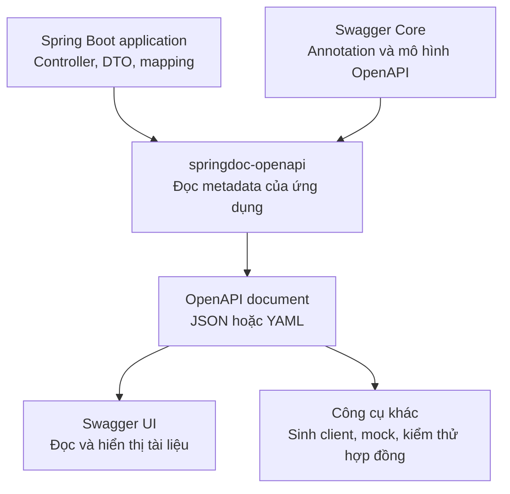

# Phân biệt đặc tả OpenAPI, Springdoc, Swagger Core và Swagger UI

Khi xây dựng API bằng Spring Boot, các tên OpenAPI, Springdoc, Swagger Core và Swagger UI thường xuất hiện cùng nhau. Chúng liên quan chặt chẽ nhưng giải quyết những phần việc khác nhau. Nếu gọi chung tất cả là “Swagger”, ta dễ nhầm giữa chuẩn mô tả hợp đồng API, thư viện tạo tài liệu từ ứng dụng và giao diện dùng để đọc hoặc thử gọi API.

Bài học này đặt bốn khái niệm vào đúng vị trí trong quy trình dùng **springdoc-openapi**: lấy thông tin từ controller và DTO của Spring Boot, tạo tài liệu theo chuẩn OpenAPI, sau đó hiển thị tài liệu trên Swagger UI.

## 1. Vì sao cần phân biệt các thành phần?

Một API có phần triển khai và phần hợp đồng. Phần triển khai gồm controller, service, DTO, quy tắc xác thực và xử lý lỗi. Phần hợp đồng mô tả những gì ứng dụng bên ngoài có thể sử dụng: endpoint nào tồn tại, dùng HTTP method nào, cần tham số gì, request và response có cấu trúc ra sao, mã trạng thái nào có thể được trả về và cơ chế bảo mật nào được áp dụng.

Nếu chỉ đọc mã nguồn, người tích hợp phải lần theo nhiều lớp để hiểu cách gọi. Nếu chỉ viết tài liệu thủ công, tài liệu có thể lệch khỏi hành vi thực tế khi controller hoặc DTO thay đổi. Quy trình tạo tài liệu tự động giúp thu thập thông tin từ ứng dụng Spring Boot, biểu diễn thông tin theo định dạng tiêu chuẩn và cung cấp giao diện thuận tiện cho người phát triển.

| Thành phần | Bản chất | Nhiệm vụ chính |
|---|---|---|
| **OpenAPI Specification (OAS)** | Đặc tả và định dạng tài liệu | Quy định cách biểu diễn hợp đồng HTTP API bằng JSON hoặc YAML |
| **springdoc-openapi** | Thư viện tích hợp Spring | Đọc cấu trúc ứng dụng Spring và tạo tài liệu OpenAPI |
| **Swagger Core** | Bộ thư viện Java | Cung cấp mô hình, annotation và công cụ xử lý tài liệu OpenAPI |
| **Swagger UI** | Ứng dụng giao diện web | Đọc tài liệu OpenAPI và hiển thị API để tra cứu, thử gọi |

Có thể ghi nhớ bằng bốn câu hỏi:

- **OpenAPI:** Tài liệu API phải được biểu diễn theo quy tắc nào?
- **Springdoc:** Làm thế nào lấy thông tin từ ứng dụng Spring Boot để tạo tài liệu đó?
- **Swagger Core:** Những mô hình và annotation Java nào hỗ trợ mô tả, xử lý tài liệu OpenAPI?
- **Swagger UI:** Làm thế nào để con người xem và thử API từ tài liệu đã tạo?

## 2. OpenAPI Specification: hợp đồng API theo một chuẩn chung

**OpenAPI Specification**, thường viết tắt là **OAS**, là một đặc tả độc lập với ngôn ngữ lập trình và framework. Nó định nghĩa cấu trúc của tài liệu mô tả HTTP API. Tài liệu OpenAPI có thể được viết bằng YAML hoặc JSON và được các công cụ khác nhau đọc mà không cần biết API được triển khai bằng Spring Boot, ASP.NET, Express hay công nghệ khác.

Một tài liệu OpenAPI thường có các nhóm thông tin:

- **openapi:** phiên bản của đặc tả OpenAPI mà tài liệu tuân theo.
- **info:** tên, phiên bản và mô tả API.
- **servers:** các địa chỉ máy chủ mà client có thể gọi.
- **paths:** đường dẫn và các thao tác HTTP như GET, POST, PUT, DELETE.
- **components:** các cấu trúc dùng chung, chẳng hạn schema, response, parameter và security scheme.
- **security:** yêu cầu bảo mật áp dụng cho toàn bộ tài liệu hoặc từng thao tác.

Ví dụ rút gọn về một tài liệu OpenAPI:

```yaml
openapi: 3.0.3
info:
  title: Product API
  version: 1.0.0
  description: API quản lý sản phẩm
servers:
  - url: https://api.example.com
paths:
  /api/products/{id}:
    get:
      summary: Lấy thông tin sản phẩm
      parameters:
        - name: id
          in: path
          required: true
          schema:
            type: integer
      responses:
        '200':
          description: Tìm thấy sản phẩm
          content:
            application/json:
              schema:
                $ref: '#/components/schemas/Product'
        '404':
          description: Không tìm thấy sản phẩm
components:
  schemas:
    Product:
      type: object
      properties:
        id:
          type: integer
          example: 42
        name:
          type: string
          example: Bàn phím cơ
```

Ví dụ cho thấy tài liệu mô tả hợp đồng mà client cần biết: gọi GET /api/products/{id}, truyền id trên URL và có thể nhận response thành công hoặc lỗi. Schema Product cho biết cấu trúc dữ liệu trả về. Tài liệu không chứa logic tìm sản phẩm trong database hay mã triển khai của controller.

OpenAPI là **chuẩn mô tả**, không phải thư viện Spring và cũng không phải giao diện web. Nhiều công cụ có thể sử dụng cùng một tài liệu OpenAPI để sinh client SDK, tạo mock server, kiểm tra hợp đồng, sinh tài liệu hoặc hỗ trợ kiểm thử.

## 3. springdoc-openapi: kết nối ứng dụng Spring Boot với OpenAPI

**springdoc-openapi** là thư viện dành cho hệ sinh thái Spring. Nó tích hợp với ứng dụng Spring Boot để phát hiện endpoint được khai báo qua Spring MVC hoặc Spring WebFlux, đọc thông tin từ kiểu dữ liệu và annotation, sau đó xây dựng tài liệu theo mô hình OpenAPI.

Thay vì tự viết toàn bộ YAML, ta có thể khai báo controller và DTO như bình thường. Springdoc thu thập thông tin mà framework và annotation cung cấp rồi xuất thành tài liệu OpenAPI. Khi cần mô tả rõ hơn, lập trình viên bổ sung annotation cho operation, parameter, schema, response hoặc security.

### 3.1. Thêm dependency

Với ứng dụng Spring Boot 3 sử dụng Spring MVC, có thể dùng starter sau trong Maven:

```xml
<dependency>
    <groupId>org.springdoc</groupId>
    <artifactId>springdoc-openapi-starter-webmvc-ui</artifactId>
    <version>${springdoc.version}</version>
</dependency>
```

Thay **${springdoc.version}** bằng phiên bản springdoc tương thích với phiên bản Spring Boot của dự án. Dòng springdoc 2.x dành cho Spring Boot 3; các dự án Spring Boot 2 sử dụng dòng springdoc 1.x và tên artifact tương ứng của dòng đó. Với ứng dụng Spring WebFlux, chọn starter WebFlux phù hợp thay cho starter WebMVC.

Starter webmvc-ui tích hợp cả khả năng tạo tài liệu và Swagger UI. Nếu dự án chỉ cần xuất tài liệu mà không cần giao diện Swagger UI đi kèm, có thể chọn starter API-docs tương ứng.

### 3.2. Các địa chỉ tài liệu thường dùng

Sau khi ứng dụng khởi động, các endpoint mặc định thường gặp là:

| Địa chỉ | Nội dung |
|---|---|
| /v3/api-docs | Tài liệu OpenAPI ở định dạng JSON |
| /v3/api-docs.yaml | Tài liệu OpenAPI ở định dạng YAML |
| /swagger-ui.html | Điểm truy cập Swagger UI; thường chuyển hướng đến giao diện Swagger UI |

Các địa chỉ này có thể được tùy chỉnh bằng cấu hình. Ví dụ:

```properties
springdoc.api-docs.path=/api-docs
springdoc.swagger-ui.path=/docs
```

Khi cấu hình trên được áp dụng, endpoint tài liệu JSON chuyển sang /api-docs và đường dẫn giao diện chuyển sang /docs. Việc thay đổi đường dẫn cần được tính đến trong cấu hình reverse proxy, gateway và tài liệu triển khai.

### 3.3. Springdoc lấy thông tin từ đâu?

Springdoc kết hợp nhiều nguồn thông tin:

1. **Spring mapping:** @RequestMapping, @GetMapping, @PostMapping và các mapping tương tự cung cấp đường dẫn, HTTP method và thông tin mapping.
2. **Tham số phương thức:** @PathVariable, @RequestParam, @RequestHeader và @RequestBody giúp xác định dữ liệu đầu vào.
3. **Kiểu dữ liệu Java:** DTO, record, kiểu nguyên thủy, collection và cấu trúc lồng nhau cung cấp thông tin để xây dựng schema.
4. **Annotation mô tả:** annotation của OpenAPI cho phép bổ sung mô tả, ví dụ, response, nhóm API và yêu cầu bảo mật.
5. **Cấu hình OpenAPI:** ứng dụng có thể khai báo metadata chung, server, security scheme và các nhóm tài liệu.

Springdoc không thể tự suy ra chính xác mọi quy tắc nghiệp vụ chỉ từ chữ ký phương thức. Chẳng hạn, kiểu trả về ProductResponse chưa nói đầy đủ khi nào API trả 404, trường nào bắt buộc theo quy tắc nghiệp vụ hoặc người gọi cần quyền gì. Những thông tin đó phải được mô tả bổ sung và đối chiếu với hành vi thực tế.

## 4. Swagger Core: mô hình và annotation cho OpenAPI trong Java

**Swagger Core** là bộ thư viện Java thuộc hệ sinh thái Swagger, cung cấp các thành phần để biểu diễn và xử lý tài liệu API. Với OpenAPI 3, thư viện có các mô hình Java cho cấu trúc tài liệu và các annotation trong package **io.swagger.v3.oas.annotations**.

Trong ứng dụng dùng springdoc, lập trình viên thường gặp các annotation như:

| Annotation | Mục đích |
|---|---|
| @Tag | Nhóm các operation có liên quan |
| @Operation | Mô tả một thao tác API |
| @Parameter | Mô tả tham số đầu vào |
| @ApiResponse, @ApiResponses | Mô tả các response có thể trả về |
| @Schema | Bổ sung metadata cho schema hoặc thuộc tính dữ liệu |
| @SecurityScheme | Khai báo cơ chế bảo mật trong tài liệu |
| @SecurityRequirement | Gắn yêu cầu bảo mật vào API hoặc tài liệu |
| @OpenAPIDefinition | Khai báo metadata tổng quát của tài liệu |

Các annotation này giúp mô tả hợp đồng sát với ý định của người viết API. Springdoc đọc metadata tương ứng và đưa chúng vào tài liệu OpenAPI được sinh ra.

Điểm cần phân biệt: Swagger Core không phải là tên khác của OpenAPI Specification. Đặc tả là quy tắc và định dạng tài liệu; Swagger Core là một cách triển khai bằng Java để làm việc với tài liệu và annotation theo đặc tả đó. Springdoc tích hợp các thành phần liên quan để phục vụ ứng dụng Spring.

Trong dự án mới dùng OpenAPI 3, hãy chú ý sử dụng annotation thuộc package io.swagger.v3.oas.annotations. Các annotation cũ thuộc Swagger 2, chẳng hạn package io.swagger.annotations, thuộc thế hệ API khác và không nên trộn tùy tiện với cấu hình OpenAPI 3.

## 5. Swagger UI: giao diện đọc và thử API

**Swagger UI** là ứng dụng giao diện web có khả năng đọc tài liệu OpenAPI và trình bày thành danh sách API có thể tương tác. Giao diện thường cho phép người dùng:

- Xem API theo tag, đường dẫn và HTTP method.
- Đọc mô tả operation, parameter, request body, response và schema.
- Xem cấu trúc JSON mẫu.
- Nhập giá trị tham số hoặc request body.
- Gửi request trực tiếp đến server bằng chức năng **Try it out**.
- Thực hiện bước xác thực theo security scheme được khai báo và được giao diện hỗ trợ.

Swagger UI tiêu thụ tài liệu OpenAPI. Nó không quét controller Spring Boot và không tự tạo ra hợp đồng API. Nếu tài liệu OpenAPI thiếu một response hoặc mô tả sai kiểu dữ liệu, Swagger UI sẽ hiển thị thông tin thiếu hoặc sai đó.

Chức năng **Try it out** cũng cần được hiểu đúng. Nó gửi HTTP request đến địa chỉ server được cấu hình trong tài liệu hoặc được người dùng chọn. Vì vậy, request chỉ hoạt động khi server có thể truy cập, đường dẫn đúng, CORS và xác thực được cấu hình phù hợp. Việc nhìn thấy nút Try it out không có nghĩa API đã được kiểm thử đầy đủ hoặc server tự động cho phép mọi người truy cập.

## 6. Đặt bốn thành phần vào cùng một luồng

Trong ứng dụng Spring Boot dùng springdoc, luồng tạo và hiển thị tài liệu có thể hình dung như sau:



Mỗi thành phần đóng góp một phần:

1. Controller và DTO thể hiện API đang được triển khai trong ứng dụng.
2. Annotation và cấu hình cung cấp mô tả bổ sung cho những gì không thể suy ra đầy đủ từ mã nguồn.
3. Springdoc thu thập thông tin và tạo tài liệu OpenAPI.
4. Tài liệu OpenAPI có thể được đọc trực tiếp hoặc được Swagger UI hiển thị.
5. Các công cụ khác cũng có thể dùng cùng tài liệu này mà không phụ thuộc vào Swagger UI.

Như vậy, OpenAPI là định dạng hợp đồng ở đầu ra; springdoc đảm nhiệm tích hợp với Spring; Swagger Core cung cấp mô hình và annotation Java; Swagger UI là một trong những cách trình bày đầu ra.

## 7. Ví dụ: mô tả một endpoint bằng Springdoc và annotation OpenAPI

Giả sử ứng dụng có endpoint lấy thông tin sản phẩm theo mã. DTO trả về như sau:

```java
import io.swagger.v3.oas.annotations.media.Schema;

@Schema(description = "Thông tin sản phẩm")
public record ProductResponse(
    @Schema(description = "Mã sản phẩm", example = "42")
    Long id,

    @Schema(description = "Tên sản phẩm", example = "Bàn phím cơ")
    String name
) {
}
```

Controller có thể khai báo:

```java
import io.swagger.v3.oas.annotations.Operation;
import io.swagger.v3.oas.annotations.Parameter;
import io.swagger.v3.oas.annotations.tags.Tag;
import io.swagger.v3.oas.annotations.responses.ApiResponse;
import io.swagger.v3.oas.annotations.responses.ApiResponses;
import org.springframework.web.bind.annotation.GetMapping;
import org.springframework.web.bind.annotation.PathVariable;
import org.springframework.web.bind.annotation.RequestMapping;
import org.springframework.web.bind.annotation.RestController;

@RestController
@RequestMapping("/api/products")
@Tag(name = "Products", description = "API quản lý sản phẩm")
public class ProductController {

    @GetMapping("/{id}")
    @Operation(
        summary = "Lấy thông tin sản phẩm",
        description = "Tìm một sản phẩm theo mã sản phẩm."
    )
    @ApiResponses({
        @ApiResponse(responseCode = "200", description = "Tìm thấy sản phẩm"),
        @ApiResponse(responseCode = "404", description = "Không tìm thấy sản phẩm")
    })
    public ProductResponse getById(
        @Parameter(description = "Mã sản phẩm", example = "42")
        @PathVariable Long id
    ) {
        // Phần xử lý nghiệp vụ được lược bỏ trong ví dụ.
        return new ProductResponse(id, "Bàn phím cơ");
    }
}
```

Trong ví dụ:

- @RestController, @RequestMapping và @GetMapping là annotation của Spring, xác định endpoint và HTTP method.
- @Tag, @Operation, @ApiResponse và @Parameter là annotation mô tả OpenAPI, cung cấp thông tin cho tài liệu.
- @Schema mô tả cấu trúc DTO và ví dụ giá trị.
- Springdoc kết hợp metadata trên để tạo operation tương ứng trong tài liệu OpenAPI.

Đoạn mã lược bỏ xử lý nghiệp vụ để tập trung vào phần mô tả. Trong ứng dụng thật, response 200 và 404 phải khớp với cách controller hoặc exception handler thực sự phản hồi. Nếu API có thêm 400, 401, 403 hoặc 500, hãy mô tả các trường hợp đó khi chúng thuộc hợp đồng công khai.

## 8. Khai báo metadata chung và chia nhóm tài liệu

### 8.1. Metadata chung

Có thể dùng @OpenAPIDefinition để khai báo thông tin chung cho tài liệu:

```java
import io.swagger.v3.oas.annotations.OpenAPIDefinition;
import io.swagger.v3.oas.annotations.info.Info;
import io.swagger.v3.oas.annotations.info.Contact;

@OpenAPIDefinition(
    info = @Info(
        title = "Product API",
        version = "1.0.0",
        description = "API quản lý sản phẩm",
        contact = @Contact(
            name = "API Team",
            email = "api-team@example.com"
        )
    )
)
public class OpenApiConfiguration {
}
```

Đây là metadata dùng để nhận diện tài liệu. Nó không tự thay đổi phiên bản ứng dụng, cũng không tự thực thi chính sách truy cập API.

### 8.2. Chia tài liệu thành các nhóm

Một ứng dụng có thể cung cấp nhiều nhóm API, ví dụ nhóm public và nhóm internal. Springdoc hỗ trợ tạo nhóm bằng GroupedOpenApi:

```java
import org.springdoc.core.models.GroupedOpenApi;
import org.springframework.context.annotation.Bean;
import org.springframework.context.annotation.Configuration;

@Configuration
public class OpenApiGroupConfiguration {

    @Bean
    GroupedOpenApi publicApi() {
        return GroupedOpenApi.builder()
            .group("public")
            .pathsToMatch("/api/public/**")
            .build();
    }

    @Bean
    GroupedOpenApi adminApi() {
        return GroupedOpenApi.builder()
            .group("admin")
            .pathsToMatch("/api/admin/**")
            .build();
    }
}
```

Với cấu hình nhóm trên, tài liệu của từng nhóm có thể được truy cập qua đường dẫn dạng /v3/api-docs/{group}, ví dụ /v3/api-docs/public và /v3/api-docs/admin. Package import và API cấu hình cần phù hợp với phiên bản springdoc đang dùng.

Chia nhóm giúp người đọc tập trung vào đúng phạm vi API. Tuy nhiên, việc ẩn một endpoint khỏi nhóm tài liệu không thay thế cho kiểm soát quyền truy cập ở tầng ứng dụng hoặc gateway.

## 9. Những nhầm lẫn thường gặp

| Nhầm lẫn | Cách hiểu chính xác |
|---|---|
| “OpenAPI và Swagger UI là một.” | OpenAPI là đặc tả/tài liệu; Swagger UI là giao diện đọc tài liệu đó. |
| “Cài Swagger UI là API tự có tài liệu.” | Swagger UI cần một tài liệu OpenAPI để hiển thị. Trong Spring Boot, springdoc thường tạo tài liệu này. |
| “Springdoc là chuẩn OpenAPI.” | Springdoc là thư viện tích hợp Spring để tạo tài liệu tuân theo chuẩn OpenAPI. |
| “Swagger Core là framework thay thế Springdoc.” | Swagger Core cung cấp mô hình và annotation Java; springdoc đảm nhiệm tích hợp chuyên biệt với Spring Boot. |
| “Có annotation thì API đã được bảo vệ.” | Annotation bảo mật mô tả yêu cầu trong tài liệu; cấu hình Spring Security hoặc cơ chế bảo vệ thực tế vẫn phải được triển khai riêng. |
| “Tài liệu sinh tự động luôn chính xác.” | Tài liệu phụ thuộc vào metadata có thể suy ra và phần mô tả do lập trình viên cung cấp; cần đối chiếu với hành vi API. |
| “Ẩn API khỏi Swagger UI là đủ an toàn.” | Ẩn khỏi tài liệu chỉ ảnh hưởng khả năng khám phá API, không ngăn request đến endpoint. |

Một lỗi phổ biến khác là mô tả response quá sơ sài. Ví dụ, method trả về ProductResponse nhưng tài liệu chỉ có response 200, trong khi ứng dụng còn trả 404 khi không tìm thấy sản phẩm. Người dùng tài liệu sẽ hiểu không đầy đủ về cách xử lý kết quả. Hãy mô tả các mã trạng thái, schema và điều kiện lỗi phù hợp với hợp đồng thực tế.

## 10. Kiểm tra tài liệu được sinh ra

Sau khi khởi động ứng dụng, có thể kiểm tra theo thứ tự:

1. Mở /v3/api-docs và xác nhận server trả về JSON hợp lệ.
2. Tìm đường dẫn /api/products/{id} trong paths, kiểm tra operation get, parameter và response.
3. Kiểm tra schema ProductResponse trong phần components.schemas nếu schema được tham chiếu hoặc tái sử dụng.
4. Mở /v3/api-docs.yaml để xác nhận đầu ra YAML.
5. Mở /swagger-ui.html, tìm nhóm Products và thử request với dữ liệu phù hợp trên môi trường được phép.

Ví dụ dùng curl để lấy tài liệu JSON:

```bash
curl -i http://localhost:8080/v3/api-docs
```

Khi kiểm tra, cần phân biệt ba loại kết quả:

- **Tài liệu không được tạo:** kiểm tra dependency, cấu hình, quá trình khởi động và endpoint API-docs.
- **Tài liệu có nhưng thiếu hoặc sai thông tin:** kiểm tra Spring mapping, kiểu dữ liệu, annotation và cấu hình OpenAPI.
- **Swagger UI không hiển thị hoặc không gọi được API:** kiểm tra đường dẫn UI, địa chỉ tài liệu mà UI đang tải, địa chỉ server, quyền truy cập và cấu hình mạng.

Không nên chỉ nhìn giao diện Swagger UI rồi kết luận hợp đồng đã đúng. Tài liệu JSON/YAML là đầu ra cần được kiểm tra trực tiếp, đặc biệt khi được dùng làm đầu vào cho sinh client, kiểm thử hợp đồng hoặc tích hợp với hệ thống khác.

## 11. Vai trò của tài liệu OpenAPI trong vòng đời API

Tài liệu OpenAPI có giá trị vượt ra ngoài trang Swagger UI. Khi được quản lý như một phần của hợp đồng API, nó có thể hỗ trợ:

- **Trao đổi giữa các nhóm:** frontend, backend, mobile và đối tác tích hợp cùng tham chiếu một định dạng.
- **Sinh mã client:** công cụ có thể dùng schema và operation để sinh lớp gọi API.
- **Mock và phát triển song song:** nhóm client có thể làm việc với tài liệu hoặc mock server trước khi backend hoàn tất.
- **Kiểm thử hợp đồng:** so sánh request/response thực tế với những gì tài liệu công bố.
- **Quản lý phiên bản:** xem xét thay đổi endpoint, schema và response để đánh giá ảnh hưởng đến client hiện hữu.
- **Phân phối tài liệu:** xuất JSON/YAML để lưu trữ, phát hành hoặc đưa vào pipeline CI/CD.

Tự động sinh tài liệu giúp giảm công việc lặp lại, nhưng không thay thế việc quản lý thay đổi hợp đồng. Khi thay đổi tên field, kiểu dữ liệu, mã trạng thái hoặc yêu cầu bảo mật, nhóm phát triển vẫn cần đánh giá khả năng tương thích ngược và cập nhật phiên bản API theo chính sách của hệ thống.

## 12. Ghi nhớ

- **OpenAPI Specification** định nghĩa cách mô tả hợp đồng HTTP API.
- **springdoc-openapi** tích hợp với Spring Boot để thu thập thông tin ứng dụng và tạo tài liệu OpenAPI.
- **Swagger Core** cung cấp mô hình và annotation Java hỗ trợ mô tả, xử lý tài liệu OpenAPI.
- **Swagger UI** đọc tài liệu OpenAPI và trình bày thành giao diện tra cứu, thử gọi API.

Trong một dự án Spring Boot, ta thường viết controller và DTO, bổ sung annotation OpenAPI ở những nơi cần mô tả rõ ràng, dùng springdoc để tạo JSON/YAML, rồi dùng Swagger UI hoặc công cụ khác để tiêu thụ tài liệu. Hiểu đúng vai trò từng thành phần giúp cấu hình dự án dễ hơn, xử lý lỗi đúng tầng và giữ hợp đồng API sát với hành vi thực tế.
