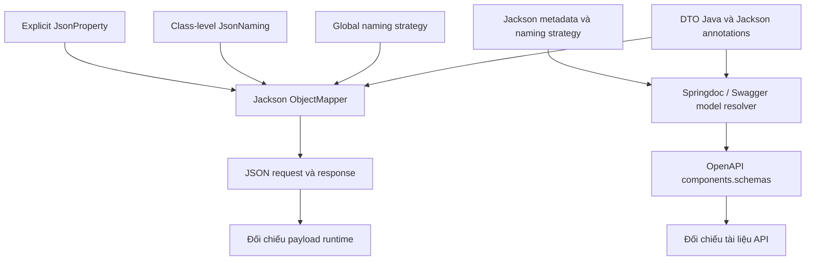

# Tên thuộc tính JSON và chiến lược đặt tên

Tên field trong Java không nhất thiết phải giống tên thuộc tính được trao đổi qua JSON. Một DTO có thể dùng `customerId` theo quy ước camelCase của Java, trong khi API công bố `customer_id` theo snake_case. Jackson quyết định tên thuộc tính khi serialize và deserialize; Springdoc dùng metadata từ kiểu Java, annotation và cơ chế phân tích model để tạo schema OpenAPI tương ứng.

Nếu cấu hình Jackson và tài liệu OpenAPI không thống nhất, client có thể gửi `customerId` trong khi server chỉ nhận `customer_id`, hoặc Swagger UI hiển thị một tên field khác với JSON thực tế. Vì vậy, cần quản lý tên thuộc tính ở một nguồn rõ ràng, hiểu phạm vi của từng chiến lược và kiểm tra cả payload runtime lẫn `components.schemas` được Springdoc sinh ra.

**Lưu ý phiên bản:** các đoạn code dùng package Jackson 2.x (`com.fasterxml.jackson.databind...`), thường gặp trong Spring Boot 3. Spring Boot 4 dùng Jackson 3 theo mặc định: các package databind chuyển sang `tools.jackson...`, trong đó `@JsonNaming` và `PropertyNamingStrategies` cần import từ `tools.jackson.databind...`; riêng `@JsonProperty` và `@JsonAlias` vẫn thuộc `com.fasterxml.jackson.annotation`. Hãy dùng import và phiên bản Springdoc tương thích với stack thực tế của dự án.

## 1. Tên Java và tên JSON là hai khái niệm khác nhau

Java thường dùng lower camelCase cho field và accessor:

```java
public record CustomerRequest(
    Long customerId,
    String fullName,
    String emailAddress
) {
}
```

Nếu dùng cấu hình mặc định của Jackson, JSON thường có dạng:

```json
{
  "customerId": 42,
  "fullName": "Nguyen An",
  "emailAddress": "an@example.com"
}
```

Một API khác có thể quy định snake_case:

```json
{
  "customer_id": 42,
  "full_name": "Nguyen An",
  "email_address": "an@example.com"
}
```

Hai representation trên có thể cùng ánh xạ đến một mô hình Java. Tên thuộc tính JSON là một phần của hợp đồng HTTP mà client nhìn thấy; tên field Java là chi tiết triển khai của ứng dụng.

## 2. Jackson quyết định tên thuộc tính khi đọc và ghi JSON

Jackson phân tích các field, getter, setter, constructor hoặc record component để xác định logical property. Tên bên ngoài (external property name) được dùng trong JSON có thể đến từ:

- Tên mặc định mà Jackson suy ra từ field/accessor/constructor parameter.
- Annotation chỉ định tên tường minh như `@JsonProperty`.
- Chiến lược đặt tên trên một lớp như `@JsonNaming`.
- Chiến lược đặt tên mặc định của `ObjectMapper`.
- Mix-in hoặc cấu hình Jackson bổ sung trong ứng dụng.

Khi Spring MVC nhận `@RequestBody`, message converter dùng Jackson để deserialize JSON thành DTO. Khi controller trả DTO, Jackson serialize DTO thành JSON response. Do đó, chiến lược đặt tên ảnh hưởng cả dữ liệu đầu vào lẫn đầu ra, trừ khi có cấu hình riêng cho một chiều.

Sơ đồ tổng quát:



Springdoc và Swagger Core có cơ chế phân tích model dựa trên Jackson metadata. Tuy nhiên, kết quả cuối vẫn phụ thuộc phiên bản thư viện, ObjectMapper được dùng và customizer của ứng dụng. Hãy kiểm tra tài liệu được sinh thay vì giả định mọi cấu hình Jackson tùy chỉnh đều tự động được phản ánh giống hệt trong OpenAPI.

## 3. Đặt tên tường minh bằng `@JsonProperty`

`@JsonProperty` chỉ định tên thuộc tính JSON chính thức cho một property. Đây là lựa chọn phù hợp khi chỉ một số field cần tên khác với quy ước chung.

```java
import com.fasterxml.jackson.annotation.JsonProperty;

public record CustomerRequest(
    @JsonProperty("customer_id")
    Long customerId,

    @JsonProperty("full_name")
    String fullName,

    @JsonProperty("email_address")
    String emailAddress
) {
}
```

Khi serialize, Jackson dùng các tên đã khai báo:

```json
{
  "customer_id": 42,
  "full_name": "Nguyen An",
  "email_address": "an@example.com"
}
```

Khi deserialize, các tên này cũng là tên property chính thức mà Jackson nhận diện. Với record, có thể đặt annotation trên record component như ví dụ; cần dùng phiên bản Jackson hỗ trợ record tương ứng với dòng Java của dự án.

`@JsonProperty` cũng có thể được đặt trên field, getter, setter hoặc tham số constructor. Khi cùng một logical property xuất hiện ở nhiều vị trí, Jackson hợp nhất metadata theo quy tắc introspection của nó. Tránh khai báo những tên khác nhau cho cùng một property trên getter và setter vì có thể tạo ra hành vi khó đoán.

### Khi nào nên dùng `@JsonProperty`?

- Một vài field có tên đặc biệt theo hợp đồng bên ngoài.
- Tên JSON cần giữ ổn định dù đổi tên field Java.
- Tích hợp API cũ có quy ước đặt tên không đồng nhất.
- Tên field chứa ký tự hoặc viết tắt cần được công bố chính xác.

Không cần thêm `@JsonProperty` cho mọi field nếu toàn bộ DTO tuân theo một quy ước đặt tên nhất quán. Dùng chiến lược chung sẽ giảm annotation lặp lại.

## 4. Dùng `@JsonAlias` để nhận tên cũ khi deserialize

Khi API cần chuyển dần từ tên JSON cũ sang tên mới, `@JsonAlias` cho phép Jackson chấp nhận thêm một hoặc nhiều tên thay thế khi đọc JSON.

```java
import com.fasterxml.jackson.annotation.JsonAlias;
import com.fasterxml.jackson.annotation.JsonProperty;

public record CustomerRequest(
    @JsonProperty("customer_id")
    @JsonAlias({"customerId", "client_id"})
    Long customerId
) {
}
```

Với cấu hình trên, Jackson dùng `customer_id` làm tên chính thức khi serialize và chấp nhận `customerId` hoặc `client_id` như alias khi deserialize.

| Nội dung | Tác dụng |
|---|---|
| `@JsonProperty("customer_id")` | Xác định tên property chính thức |
| `@JsonAlias({"customerId", "client_id"})` | Chấp nhận thêm các tên đầu vào khi deserialize |
| Serialize response | Luôn dùng tên chính thức, không xuất các alias |

Alias không phải là cách công bố nhiều tên output. OpenAPI nên mô tả tên property chính thức mà server trả về. Nếu client cũ vẫn gửi alias, ghi rõ giai đoạn tương thích trong mô tả hoặc tài liệu migration; không giả định Swagger UI hay client generator sẽ tự liệt kê tất cả alias như các property độc lập.

Nếu một request gửi cùng lúc nhiều alias của cùng property với giá trị khác nhau, kết quả có thể phụ thuộc thứ tự các field trong JSON và quy tắc gán của Jackson. Tránh khuyến khích client gửi nhiều tên cho cùng một field.

## 5. Áp dụng chiến lược đặt tên cho một DTO bằng `@JsonNaming`

Khi tất cả property trong một DTO tuân theo cùng một quy tắc, dùng `@JsonNaming` ở cấp lớp.

```java
import com.fasterxml.jackson.databind.PropertyNamingStrategies;
import com.fasterxml.jackson.databind.annotation.JsonNaming;
import io.swagger.v3.oas.annotations.media.Schema;

@JsonNaming(PropertyNamingStrategies.SnakeCaseStrategy.class)
@Schema(name = "CustomerRequest")
public record CustomerRequest(
    Long customerId,
    String fullName,
    String emailAddress
) {
}
```

Jackson chuyển tên property theo snake_case:

```json
{
  "customer_id": 42,
  "full_name": "Nguyen An",
  "email_address": "an@example.com"
}
```

`@JsonNaming` chỉ áp dụng cho lớp được gắn annotation và các property mà Jackson nhận diện trong lớp đó. Theo tài liệu Jackson, chiến lược trên lớp ghi đè chiến lược đặt tên mặc định của `ObjectMapper` đối với lớp đó. Vì vậy, có thể dùng một quy ước toàn ứng dụng rồi chọn ngoại lệ ở một số DTO.

### Kết hợp `@JsonNaming` và `@JsonProperty`

Một số field có thể cần tên cố định khác với quy tắc chung:

```java
import com.fasterxml.jackson.annotation.JsonProperty;
import com.fasterxml.jackson.databind.PropertyNamingStrategies;
import com.fasterxml.jackson.databind.annotation.JsonNaming;

@JsonNaming(PropertyNamingStrategies.SnakeCaseStrategy.class)
public record CustomerRequest(
    Long customerId,
    String fullName,
    @JsonProperty("email") String emailAddress
) {
}
```

Hai field đầu theo snake_case; field cuối dùng tên được chỉ định tường minh là `email`. Cách này hữu ích khi hợp đồng có quy ước chung nhưng tồn tại một vài tên legacy.

Với các trường hợp tên phức tạp hoặc có nhiều annotation trên getter/field/constructor, hãy kiểm tra JSON thực tế. Không nên tự suy luận tên cuối chỉ bằng cách nhìn tên biến Java.

## 6. Chiến lược đặt tên toàn ứng dụng trong Spring Boot

Nếu phần lớn API dùng cùng một quy ước, có thể cấu hình chiến lược chung cho Jackson trong `application.yml`.

Ví dụ dùng snake_case:

```yaml
spring:
  jackson:
    property-naming-strategy: SNAKE_CASE
```

Hoặc trong `application.properties`:

```properties
spring.jackson.property-naming-strategy=SNAKE_CASE
```

Spring Boot hỗ trợ các hằng số của Jackson `PropertyNamingStrategies` hoặc tên đầy đủ của một lớp triển khai `PropertyNamingStrategy`. Giá trị cụ thể cần tương thích với phiên bản Jackson được ứng dụng sử dụng.

Có thể dùng một strategy khác nếu hợp đồng yêu cầu. Không nên bật global strategy chỉ vì một endpoint cần tên khác; cấu hình toàn cục có thể đổi payload của nhiều controller và DTO đang được sử dụng.

### Chiến lược toàn cục và ngoại lệ theo lớp

| Cấu hình | Phạm vi | Cách dùng |
|---|---|---|
| `spring.jackson.property-naming-strategy` | Các POJO do ObjectMapper áp dụng cấu hình chung | Khi toàn API thống nhất một quy ước |
| `@JsonNaming(...)` | Một DTO hoặc lớp cụ thể | Khi một nhóm DTO cần quy ước riêng |
| `@JsonProperty(...)` | Một property cụ thể | Khi tên field cần được cố định hoặc ngoại lệ |
| `@JsonAlias(...)` | Tên đầu vào thay thế của một property | Khi cần tương thích với tên cũ |

Trong cấu hình thông thường, `@JsonNaming` trên lớp ghi đè global strategy cho lớp đó; `@JsonProperty` cung cấp tên property tường minh. Mix-in, custom introspector hoặc custom serializer có thể làm kết quả phức tạp hơn, vì vậy nên kiểm tra ObjectMapper cuối cùng của ứng dụng.

## 7. Các chiến lược đặt tên phổ biến

Jackson cung cấp nhiều chiến lược dựng tên JSON từ tên Java. Bảng dưới đây minh họa một số chiến lược thường gặp trong `PropertyNamingStrategies`:

| Chiến lược | Tên Java | Tên JSON ví dụ |
|---|---|---|
| `LOWER_CAMEL_CASE` | `customerId` | `customerId` |
| `SNAKE_CASE` | `customerId` | `customer_id` |
| `UPPER_CAMEL_CASE` | `customerId` | `CustomerId` |
| `KEBAB_CASE` | `customerId` | `customer-id` |
| `LOWER_CASE` | `customerId` | `customerid` |
| `UPPER_SNAKE_CASE` | `customerId` | `CUSTOMER_ID` |

Ví dụ Java:

```java
PropertyNamingStrategies.SNAKE_CASE
PropertyNamingStrategies.KEBAB_CASE
PropertyNamingStrategies.LOWER_CAMEL_CASE
```

Hoặc dùng class strategy trong `@JsonNaming`:

```java
@JsonNaming(PropertyNamingStrategies.KebabCaseStrategy.class)
public record SearchRequest(String searchText, Integer pageSize) {
}
```

JSON tương ứng:

```json
{
  "search-text": "springdoc",
  "page-size": 20
}
```

Một số tên có chữ viết tắt liên tiếp như `URLValue`, `userID` hoặc `OAuthClientId` có thể được chuyển đổi khác với điều người đọc đoán. Quy tắc tách chữ hoa phụ thuộc implementation cụ thể. Với field có tên đặc biệt hoặc là một phần quan trọng của hợp đồng, dùng `@JsonProperty` và kiểm thử kết quả thay vì dựa vào suy đoán.

`PropertyNamingStrategies` là API được giới thiệu trong Jackson 2.12. Nếu dự án dùng phiên bản Jackson cũ hơn, tên class hoặc hằng số có thể khác; kiểm tra Javadoc của đúng dependency trước khi sử dụng.

## 8. Springdoc phản ánh tên JSON trong OpenAPI Schema như thế nào?

Schema OpenAPI mô tả tên property mà client nhìn thấy trong JSON. Ví dụ DTO:

```java
@JsonNaming(PropertyNamingStrategies.SnakeCaseStrategy.class)
@Schema(name = "CustomerRequest")
public record CustomerRequest(
    Long customerId,
    String fullName,
    String emailAddress
) {
}
```

Schema tương ứng cần có các property:

```yaml
components:
  schemas:
    CustomerRequest:
      type: object
      properties:
        customer_id:
          type: integer
          format: int64
        full_name:
          type: string
        email_address:
          type: string
```

Nếu Springdoc sinh `customerId`, `fullName` trong khi Jackson runtime nhận `customer_id`, `full_name`, tài liệu và API đang không thống nhất. Client generator có thể sinh SDK gửi sai tên field; Swagger UI cũng có thể tạo example body không đúng.

Swagger Core `ModelResolver` đọc các annotation Jackson như `@JsonProperty` và `@JsonNaming` khi xây dựng model. Tuy nhiên, nếu ứng dụng tự tạo nhiều ObjectMapper, dùng mix-in, custom serializer hoặc thay đổi model resolver, cần xác nhận Springdoc đang phân tích model theo cùng quy tắc mà HTTP message converter sử dụng.

### Không nhầm tên component schema với tên property

Hai loại tên này nằm ở hai vị trí khác nhau:

```java
@Schema(name = "CustomerPayload")
@JsonNaming(PropertyNamingStrategies.SnakeCaseStrategy.class)
public record CustomerRequest(
    Long customerId,
    String fullName
) {
}
```

- `@Schema(name = "CustomerPayload")` đặt tên component trong `components.schemas`.
- `@JsonNaming(...)` đổi tên các property JSON như `customer_id`, `full_name`.

Tài liệu có thể có cấu trúc:

```yaml
components:
  schemas:
    CustomerPayload:
      type: object
      properties:
        customer_id:
          type: integer
        full_name:
          type: string
```

Đổi tên component schema không đổi tên JSON field. Đổi tên JSON field cũng không nhất thiết đổi tên component. Hai quyết định này cần được quản lý riêng.

## 9. Những thứ naming strategy không tự thay đổi

Property naming strategy chủ yếu tác động đến tên property của POJO do Jackson introspect. Không nên cho rằng nó thay đổi mọi chuỗi trong JSON.

| Thành phần | Có tự đổi theo POJO naming strategy không? | Ghi chú |
|---|---|---|
| Field/property của DTO | Có, nếu không có tên tường minh khác | Phạm vi chính của strategy |
| `@JsonProperty` | Dùng tên đã chỉ định | Tên tường minh là ngoại lệ |
| `@JsonAlias` | Không đổi tên output | Chỉ thêm tên được chấp nhận khi deserialize |
| Key của `Map<String, Object>` | Không nên giả định | Map key có cơ chế serialize riêng |
| Key động trong `JsonNode` | Không tự đổi | Là tên dữ liệu đã có trong JSON tree |
| Query parameter và path variable | Không | Thuộc HTTP mapping, ví dụ `@RequestParam` và `@PathVariable` |
| Header HTTP | Không | Tên header thuộc hợp đồng HTTP riêng |
| Enum value | Không tự đổi theo property strategy | Dùng cấu hình enum như `@JsonValue` hoặc `@JsonProperty` nếu cần |
| `components.schemas` key | Không | Dùng `@Schema(name = ...)` hoặc cơ chế đặt tên schema |

Ví dụ query parameter:

```java
@GetMapping("/customers")
List<CustomerResponse> search(
    @RequestParam("pageSize") Integer pageSize
) {
    return customerService.search(pageSize);
}
```

`spring.jackson.property-naming-strategy: SNAKE_CASE` không tự đổi query parameter `pageSize` thành `page_size`. Nếu API muốn tên query là `page_size`, khai báo tên đó trong Spring mapping và bảo đảm OpenAPI phản ánh đúng:

```java
@RequestParam("page_size") Integer pageSize
```

## 10. Tác động đến request, response và tính tương thích

Thay đổi naming strategy toàn cục có thể đổi JSON của nhiều endpoint cùng lúc. Ví dụ chuyển từ camelCase sang snake_case có thể làm:

- Client cũ gửi `customerId` nhưng server mới chỉ nhận `customer_id`.
- Response chuyển từ `emailAddress` sang `email_address`, khiến client đọc property cũ không còn dữ liệu.
- Schema OpenAPI đổi property name, tạo diff lớn và thay đổi code được sinh từ tài liệu.
- Một số tích hợp bên ngoài, message hoặc file JSON đã lưu không còn khớp với tên mới.

Trước khi đổi naming strategy trên một API đã phát hành, cần quyết định cách chuyển đổi:

1. Giữ tên JSON hiện tại và chỉ thay đổi tên Java nếu mục tiêu là refactor nội bộ.
2. Chấp nhận nhiều tên đầu vào bằng `@JsonAlias` trong giai đoạn chuyển tiếp, nhưng giữ một tên output chính thức.
3. Phát hành phiên bản API mới nếu đổi tên output làm client hiện tại không tương thích.
4. Cập nhật OpenAPI, SDK, ví dụ request/response và tài liệu migration cùng một đợt.
5. Theo dõi log hoặc telemetry để biết client còn gửi tên cũ trong thời gian chuyển đổi.

Không dùng `@JsonAlias` như một giải pháp đầy đủ cho thay đổi response, vì alias chỉ hỗ trợ đọc đầu vào; nó không khiến client cũ hiểu được tên field mới trong response.

## 11. Kiểm tra ObjectMapper thực tế

Khi cần xác nhận tên JSON, kiểm tra chính ObjectMapper được Spring MVC sử dụng thay vì tự tạo một mapper mới trong test. Ví dụ với test Spring Boot có thể inject mapper:

```java
@SpringBootTest
class CustomerJsonTest {

    @Autowired
    ObjectMapper objectMapper;

    @Test
    void serializesCustomerUsingSnakeCase() throws Exception {
        CustomerRequest request = new CustomerRequest(
            42L,
            "Nguyen An",
            "an@example.com"
        );

        String json = objectMapper.writeValueAsString(request);

        assertThat(json).contains("\"customer_id\":42");
        assertThat(json).contains("\"full_name\":\"Nguyen An\"");
    }
}
```

Để kiểm tra chiều deserialize, đọc JSON bằng cùng mapper và xác nhận giá trị Java:

```java
String json = """
    {
      "customer_id": 42,
      "full_name": "Nguyen An",
      "email_address": "an@example.com"
    }
    """;

CustomerRequest request = objectMapper.readValue(json, CustomerRequest.class);
assertThat(request.customerId()).isEqualTo(42L);
```

Nếu ứng dụng có nhiều `HttpMessageConverter` hoặc mapper riêng cho một endpoint, cần kiểm tra đúng converter đang xử lý request/response đó. Một ObjectMapper được inject trong test có thể không đại diện cho mọi converter nếu ứng dụng đã tùy biến MVC.

## 12. Kiểm tra schema OpenAPI do Springdoc sinh ra

Mở endpoint tài liệu, thường là `/v3/api-docs`, và kiểm tra schema:

```bash
curl -s http://localhost:8080/v3/api-docs \
  | jq '.components.schemas.CustomerRequest.properties | keys'
```

Nếu dùng snake_case, danh sách mong đợi gồm:

```json
[
  "customer_id",
  "email_address",
  "full_name"
]
```

Kiểm tra cả request body hoặc response của operation đang dùng schema đó:

```bash
curl -s http://localhost:8080/v3/api-docs \
  | jq '.paths["/api/customers"].post.requestBody.content["application/json"].schema'
```

Nếu operation dùng `$ref`, mở tiếp component được tham chiếu để xác nhận property name. Với nhiều group tài liệu, gọi đúng URL của từng group vì mỗi group có thể chứa tập DTO khác nhau.

### Khi JSON runtime và OpenAPI schema khác nhau

Điều tra theo thứ tự:

1. Serialize và deserialize DTO bằng ObjectMapper thực tế.
2. Kiểm tra `@JsonProperty`, `@JsonAlias`, `@JsonNaming` và Jackson mix-in.
3. Kiểm tra `spring.jackson.property-naming-strategy` và các custom ObjectMapper/HttpMessageConverter.
4. Kiểm tra phiên bản Springdoc/Swagger Core và model resolver.
5. Kiểm tra `components.schemas` cùng các `$ref` trong JSON OpenAPI.
6. Kiểm tra customizer hoặc schema annotation có thay đổi tên property sau khi resolver tạo model không.

Nếu cần sửa, hãy làm cho Jackson runtime và OpenAPI cùng mô tả một tên canonical. Sau đó chạy lại kiểm thử serialize/deserialize và kiểm tra schema.

## 13. Các lỗi thường gặp

| Hiện tượng | Nguyên nhân có thể | Cách xử lý |
|---|---|---|
| JSON response vẫn là camelCase | Global strategy chưa được áp dụng hoặc có ObjectMapper riêng | Kiểm tra mapper/converter thực tế và profile cấu hình |
| Request snake_case không bind được vào DTO | Mapper không dùng cùng naming strategy hoặc tên tường minh xung đột | Kiểm tra `@JsonProperty`, `@JsonNaming` và mapper |
| OpenAPI hiển thị camelCase nhưng JSON runtime là snake_case | Model resolver không dùng cùng cấu hình hoặc có customizer | Kiểm tra Swagger Core/Springdoc version và schema sinh ra |
| Một field không tuân theo global strategy | `@JsonProperty` đặt tên tường minh hoặc mix-in can thiệp | Kiểm tra annotation trên field, accessor và constructor |
| Tên acronym bị chuyển đổi không như dự kiến | Quy tắc tách chữ hoa của strategy | Dùng `@JsonProperty` cho tên canonical và thêm test |
| Client cũ không đọc được response sau khi đổi strategy | Tên JSON output đã thay đổi | Kế hoạch versioning hoặc migration tương thích |
| `@JsonAlias` không đổi tên response | Alias chỉ áp dụng khi deserialize | Đặt tên output bằng `@JsonProperty` hoặc strategy |
| Query/header cũng đổi theo snake_case | Nhầm Jackson naming với HTTP parameter naming | Đặt tên tường minh trong Spring mapping và OpenAPI |
| Map key không đổi theo strategy | Map key không phải POJO property | Dùng key serializer hoặc chuẩn hóa dữ liệu map riêng |

## 14. Checklist chọn chiến lược đặt tên

- [ ] Đã xác định tên JSON canonical mà API công bố.
- [ ] Đã chọn dùng `@JsonProperty`, `@JsonNaming` hay global naming strategy.
- [ ] Các ngoại lệ được khai báo tường minh và không xung đột.
- [ ] `@JsonAlias` chỉ dùng cho tên đầu vào cần tương thích.
- [ ] Đã kiểm tra cả serialize response và deserialize request bằng ObjectMapper thực tế.
- [ ] Springdoc sinh property name giống JSON runtime.
- [ ] Đã phân biệt property name với `components.schemas` name.
- [ ] Đã kiểm tra Map key, JsonNode, enum, query parameter và header theo cơ chế riêng.
- [ ] Đã đánh giá ảnh hưởng đến client hiện tại trước khi đổi naming strategy toàn cục.
- [ ] OpenAPI diff, SDK và tài liệu migration đã được cập nhật nếu hợp đồng thay đổi.

Tên Java và tên JSON có thể khác nhau, nhưng Jackson runtime và OpenAPI phải thống nhất về tên mà client sử dụng. Dùng `@JsonProperty` cho ngoại lệ, `@JsonNaming` cho từng DTO và `spring.jackson.property-naming-strategy` cho quy ước toàn ứng dụng. Kiểm tra payload thực tế cùng `components.schemas` sẽ giúp phát hiện sớm sai lệch trước khi tài liệu được phân phối cho client.

## Tài liệu tham khảo

- [Spring Boot – Common Application Properties](https://docs.spring.io/spring-boot/3.5/appendix/application-properties/index.html)
- [Jackson – `JsonNaming` Javadoc](https://javadoc.io/doc/com.fasterxml.jackson.core/jackson-databind/2.13.5/com/fasterxml/jackson/databind/annotation/JsonNaming.html)
- [Jackson – `JsonAlias` Javadoc](https://javadoc.io/doc/com.fasterxml.jackson.core/jackson-annotations/2.21/com/fasterxml/jackson/annotation/JsonAlias.html)
- [Jackson – `PropertyNamingStrategies` Javadoc](https://www.javadoc.io/doc/com.fasterxml.jackson.core/jackson-databind/2.13.3/com/fasterxml/jackson/databind/PropertyNamingStrategies.html)
- [Spring – Introducing Jackson 3 support](https://spring.io/blog/2025/10/07/introducing-jackson-3-support-in-spring/)
- [Jackson – Migrating to Jackson 3](https://github.com/FasterXML/jackson/blob/main/jackson3/MIGRATING_TO_JACKSON_3.md)
- [Swagger Core – `ModelResolver`](https://github.com/swagger-api/swagger-core/blob/master/modules/swagger-core/src/main/java/io/swagger/v3/core/jackson/ModelResolver.java)
