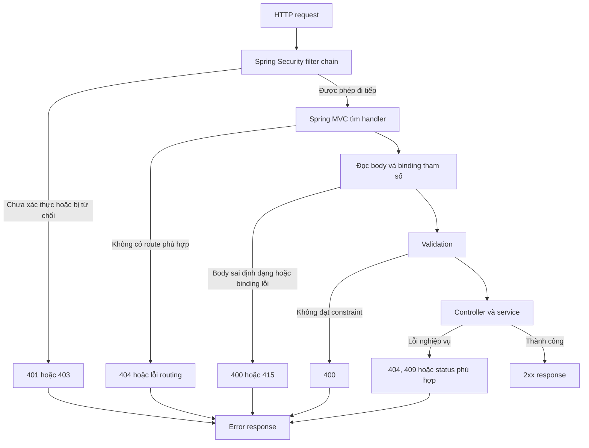

# Lỗi binding, validation, xác thực và phân quyền

Một request có thể thất bại ở nhiều giai đoạn trước khi tạo được response thành công: body không đọc được, dữ liệu không hợp lệ, người gọi chưa đăng nhập hoặc người gọi không có quyền thực hiện thao tác. Spring Boot xử lý các lỗi này ở những lớp khác nhau, còn springdoc-openapi mô tả các response lỗi để client biết điều gì có thể xảy ra. Thiết kế tốt cần chuẩn hóa định dạng lỗi, giữ đúng ngữ nghĩa HTTP và bảo đảm tài liệu OpenAPI khớp với hành vi runtime.

## 1. Nhìn lỗi theo từng giai đoạn xử lý request

Một request tới Spring Boot thường đi qua chuỗi xử lý sau:



Các giai đoạn này có cơ chế xử lý khác nhau:

- **Security filter chain:** xác thực danh tính và kiểm tra quyền trước khi request vào controller. Lỗi tại đây thường được xử lý bởi `AuthenticationEntryPoint` hoặc `AccessDeniedHandler`.
- **Handler mapping và binding:** Spring chọn controller method, đọc path/query/header/body và chuyển đổi dữ liệu. Lỗi thường được biểu diễn bằng exception của Spring MVC.
- **Validation:** Spring kiểm tra constraint trên DTO hoặc tham số method. Lỗi validation cần được chuyển thành response có thông tin trường và quy tắc bị vi phạm.
- **Nghiệp vụ:** service có thể phát hiện tài nguyên không tồn tại, xung đột trạng thái hoặc điều kiện nghiệp vụ không được đáp ứng.
- **Tài liệu OpenAPI:** springdoc mô tả những response mà API công bố. Nó không tự biết mọi exception có thể phát sinh trong runtime nếu ứng dụng không khai báo chúng.

Không nên gom mọi lỗi thành `500 Internal Server Error`. Status code cần phản ánh nguyên nhân và giúp client biết có nên sửa request, đăng nhập, xin quyền hay thử lại.

## 2. Phân biệt lỗi binding và lỗi validation

Hai nhóm lỗi thường cùng trả `400 Bad Request`, nhưng xảy ra ở hai bước khác nhau:

| Nhóm | Ý nghĩa | Ví dụ |
|---|---|---|
| Binding / deserialization | Spring không thể chuyển dữ liệu HTTP thành kiểu Java được khai báo | JSON sai cú pháp, `"abc"` không chuyển được thành số, thiếu query parameter bắt buộc |
| Validation | Dữ liệu đã được bind nhưng vi phạm quy tắc đầu vào | Tên rỗng, email sai định dạng, số lượng nhỏ hơn 1 |

Ví dụ request DTO:

```java
public record CreateProductRequest(
    @NotBlank
    @Size(max = 120)
    String name,

    @NotNull
    @DecimalMin("0.0")
    BigDecimal price,

    @NotNull
    @Min(1)
    Integer quantity
) {}
```

Controller:

```java
@PostMapping("/api/products")
@ResponseStatus(HttpStatus.CREATED)
ProductResponse create(@Valid @RequestBody CreateProductRequest request) {
    return productService.create(request);
}
```

Nếu body là JSON không hợp lệ, Jackson có thể không deserialize được và Spring phát sinh `HttpMessageNotReadableException`. Nếu JSON hợp lệ nhưng `name` là chuỗi rỗng hoặc `quantity` bằng 0, validation phát hiện lỗi và Spring thường phát sinh `MethodArgumentNotValidException`.

Hai trường hợp có thể cùng trả 400, nhưng nội dung lỗi nên khác nhau: lỗi binding nói rằng request body không thể đọc theo định dạng/kiểu mong đợi; lỗi validation nói rõ property nào vi phạm constraint.

## 3. Các exception binding thường gặp trong Spring MVC

Một số exception phổ biến và status thường được Spring ánh xạ:

| Exception | Nguyên nhân thường gặp | Status thường dùng |
|---|---|---|
| `HttpMessageNotReadableException` | JSON/XML body sai cú pháp, không thể deserialize hoặc body không phù hợp kiểu đích | `400` |
| `MethodArgumentTypeMismatchException` | Query/path parameter không chuyển được sang kiểu Java | `400` |
| `MissingServletRequestParameterException` | Thiếu `@RequestParam` bắt buộc | `400` |
| `MissingRequestHeaderException` | Thiếu `@RequestHeader` bắt buộc | `400` |
| `MethodArgumentNotValidException` | DTO có `@Valid` không đạt validation | `400` |
| `BindException` | Binding/validation của dữ liệu model hoặc form thất bại | `400` |
| `HttpMediaTypeNotSupportedException` | Request gửi media type không được endpoint hỗ trợ | `415` |
| `HttpMediaTypeNotAcceptableException` | Server không tạo được representation phù hợp với `Accept` | `406` |
| `NoHandlerFoundException` hoặc `NoResourceFoundException` | Không tìm thấy route/resource theo cấu hình Spring | `404` |

Status thực tế có thể bị thay đổi bởi exception handler hoặc cấu hình ứng dụng. Bảng này là hướng dẫn chẩn đoán, không thay thế việc kiểm tra response và log của dự án.

Ví dụ client gửi sai kiểu query parameter:

```http
GET /api/products?page=not-a-number HTTP/1.1
```

Nếu controller khai báo `@RequestParam int page`, Spring không thể chuyển chuỗi `not-a-number` thành số nguyên. Đây là lỗi binding, không phải lỗi nghiệp vụ của service.

## 4. Validation ở DTO và validation tham số method

### Validation DTO với @Valid

Với `@RequestBody`, Spring thường dùng Bean Validation để kiểm tra DTO sau khi deserialize:

```java
public record RegisterRequest(
    @NotBlank(message = "Email không được để trống")
    @Email(message = "Email không đúng định dạng")
    String email,

    @NotBlank(message = "Mật khẩu không được để trống")
    @Size(min = 12, message = "Mật khẩu phải có ít nhất 12 ký tự")
    String password
) {}
```

```java
@PostMapping("/api/accounts")
AccountResponse register(@Valid @RequestBody RegisterRequest request) {
    return accountService.register(request);
}
```

Trong Spring MVC, lỗi validation đối với một command object được đánh dấu `@Valid` hoặc `@Validated` thường được báo qua `MethodArgumentNotValidException`. Có thể lấy field errors từ `BindingResult` để tạo danh sách lỗi cho client.

### Validation query/path/header parameter

Các constraint cũng có thể đặt trực tiếp trên tham số method:

```java
@GetMapping("/api/products")
List<ProductResponse> search(
    @RequestParam @Min(0) int page,
    @RequestParam @Min(1) @Max(100) int size
) {
    return productService.search(page, size);
}
```

Với Spring Framework 6.1 trở lên, Spring MVC có cơ chế method validation tích hợp và có thể phát sinh `HandlerMethodValidationException` khi constraint trên tham số/giá trị trả về không đạt. Ở cấu hình cũ hoặc khi sử dụng method validation qua proxy AOP với `@Validated`, lỗi có thể được biểu diễn bằng `ConstraintViolationException` hoặc exception liên quan của validation provider. Cần căn cứ phiên bản Spring và cách bật method validation của dự án để xử lý đúng.

`@Valid` trên DTO và method validation không phải cùng một cơ chế. Nếu cần chuẩn hóa response cho nhiều loại validation exception, hãy xử lý riêng các exception mà phiên bản ứng dụng thực sự phát sinh và kiểm thử chúng bằng MockMvc.

## 5. Chuẩn hóa lỗi bằng ProblemDetail

Spring Framework 6 cung cấp `ProblemDetail` để biểu diễn lỗi theo Problem Details for HTTP APIs (RFC 9457). Spring Boot 3 thường hỗ trợ serialize đối tượng này thành media type `application/problem+json` khi được trả từ Spring MVC.

Một Problem Details response có các trường chuẩn:

| Trường | Ý nghĩa |
|---|---|
| `type` | URI định danh loại vấn đề; có thể dùng `about:blank` nếu không có type riêng |
| `title` | Tên ngắn gọn của loại lỗi |
| `status` | HTTP status code |
| `detail` | Giải thích cụ thể cho lần xảy ra lỗi này |
| `instance` | URI tham chiếu tới lần xảy ra lỗi |

Ứng dụng có thể bổ sung extension properties như `code`, `traceId` hoặc `errors`. Ví dụ:

```json
{
  "type": "https://api.example.test/problems/validation-error",
  "title": "Dữ liệu không hợp lệ",
  "status": 400,
  "detail": "Một hoặc nhiều trường không đáp ứng quy tắc đầu vào.",
  "instance": "/api/products",
  "code": "VALIDATION_FAILED",
  "errors": [
    {
      "field": "name",
      "code": "NotBlank",
      "message": "Tên sản phẩm không được để trống"
    }
  ]
}
```

`code` và `errors` là extension do ứng dụng quy định. Nên giữ tên và cấu trúc ổn định để client có thể xử lý theo mã lỗi thay vì phân tích câu chữ `detail`.

Không đưa giá trị nhạy cảm như mật khẩu, token, toàn bộ request body hoặc dữ liệu cá nhân vào `detail`/`errors`. Thông báo lỗi cần đủ hữu ích cho client nhưng không tiết lộ thông tin nội bộ.

## 6. Xử lý lỗi nghiệp vụ bằng @RestControllerAdvice

`@RestControllerAdvice` cho phép gom exception handler cho nhiều controller. Đây là nơi phù hợp để chuyển exception nghiệp vụ và một số exception MVC thành response thống nhất.

Ví dụ exception nghiệp vụ:

```java
public class ProductNotFoundException extends RuntimeException {
    public ProductNotFoundException(Long id) {
        super("Không tìm thấy sản phẩm " + id);
    }
}

public class DuplicateProductCodeException extends RuntimeException {
    public DuplicateProductCodeException() {
        super("Mã sản phẩm đã tồn tại");
    }
}
```

Advice tạo ProblemDetail:

```java
@RestControllerAdvice
class ApiExceptionHandler {

    @ExceptionHandler(ProductNotFoundException.class)
    ResponseEntity<ProblemDetail> handleNotFound(
        ProductNotFoundException exception,
        HttpServletRequest request
    ) {
        ProblemDetail problem = ProblemDetail.forStatusAndDetail(
            HttpStatus.NOT_FOUND,
            "Không tìm thấy tài nguyên được yêu cầu."
        );
        problem.setType(URI.create(
            "https://api.example.test/problems/product-not-found"
        ));
        problem.setTitle("Không tìm thấy sản phẩm");
        problem.setInstance(URI.create(request.getRequestURI()));
        problem.setProperty("code", "PRODUCT_NOT_FOUND");

        return ResponseEntity.status(HttpStatus.NOT_FOUND)
            .contentType(MediaType.APPLICATION_PROBLEM_JSON)
            .body(problem);
    }

    @ExceptionHandler(DuplicateProductCodeException.class)
    ResponseEntity<ProblemDetail> handleConflict(HttpServletRequest request) {
        ProblemDetail problem = ProblemDetail.forStatusAndDetail(
            HttpStatus.CONFLICT,
            "Mã sản phẩm đã được sử dụng."
        );
        problem.setTitle("Dữ liệu bị xung đột");
        problem.setInstance(URI.create(request.getRequestURI()));
        problem.setProperty("code", "PRODUCT_CODE_CONFLICT");

        return ResponseEntity.status(HttpStatus.CONFLICT)
            .contentType(MediaType.APPLICATION_PROBLEM_JSON)
            .body(problem);
    }
}
```

Ví dụ này cố ý trả `detail` ổn định và không đưa thông tin nội bộ của exception ra client. Trong hệ thống thật, có thể ghi exception cùng trace ID vào log, rồi đưa `traceId` vào extension property để đội vận hành tra cứu.

### Xử lý validation exception

Có thể bổ sung handler cho `MethodArgumentNotValidException`:

```java
@ExceptionHandler(MethodArgumentNotValidException.class)
ResponseEntity<ProblemDetail> handleInvalidBody(
    MethodArgumentNotValidException exception,
    HttpServletRequest request
) {
    ProblemDetail problem = ProblemDetail.forStatusAndDetail(
        HttpStatus.BAD_REQUEST,
        "Một hoặc nhiều trường không đáp ứng quy tắc đầu vào."
    );
    problem.setTitle("Dữ liệu không hợp lệ");
    problem.setInstance(URI.create(request.getRequestURI()));
    problem.setProperty("code", "VALIDATION_FAILED");

    List<Map<String, String>> errors = exception.getBindingResult()
        .getFieldErrors()
        .stream()
        .map(error -> Map.of(
            "field", error.getField(),
            "code", error.getCode() == null ? "INVALID" : error.getCode(),
            "message", error.getDefaultMessage() == null
                ? "Giá trị không hợp lệ"
                : error.getDefaultMessage()
        ))
        .toList();

    problem.setProperty("errors", errors);
    return ResponseEntity.badRequest()
        .contentType(MediaType.APPLICATION_PROBLEM_JSON)
        .body(problem);
}
```

Không trả `FieldError.getRejectedValue()` theo mặc định, vì giá trị bị từ chối có thể là password, token hoặc dữ liệu nhạy cảm. Nếu cần trả lỗi cho object lồng nhau, có thể dùng `getField()` để giữ đường dẫn property như `address.postalCode`.

### Xử lý lỗi body không đọc được

Với `HttpMessageNotReadableException`, nên trả thông báo chung, không đưa chi tiết parser hoặc một đoạn body không hợp lệ vào response:

```java
@ExceptionHandler(HttpMessageNotReadableException.class)
ResponseEntity<ProblemDetail> handleUnreadableBody(HttpServletRequest request) {
    ProblemDetail problem = ProblemDetail.forStatusAndDetail(
        HttpStatus.BAD_REQUEST,
        "Request body không đúng định dạng hoặc không thể chuyển đổi."
    );
    problem.setTitle("Không thể đọc request body");
    problem.setInstance(URI.create(request.getRequestURI()));
    problem.setProperty("code", "REQUEST_BODY_INVALID");

    return ResponseEntity.badRequest()
        .contentType(MediaType.APPLICATION_PROBLEM_JSON)
        .body(problem);
}
```

Với ứng dụng cần xử lý nhiều exception framework, có thể kế thừa `ResponseEntityExceptionHandler` và override các method tương ứng theo phiên bản Spring Framework đang dùng. Chữ ký override có thể thay đổi giữa các phiên bản; hãy xem Javadoc của phiên bản dependency thực tế.

Không nên tạo một `@ExceptionHandler(Exception.class)` rồi trả 400 cho mọi lỗi. Lỗi lập trình, lỗi database hoặc lỗi hệ thống chưa được phân loại phải tiếp tục là lỗi server, thường là 500, và cần được ghi log đầy đủ ở phía server.

## 7. Phân biệt xác thực 401 và phân quyền 403

Xác thực và phân quyền là hai câu hỏi khác nhau:

- **Authentication:** người gọi là ai? Nếu thiếu credential hoặc credential không hợp lệ, server không thể xác thực danh tính; status phù hợp thường là `401 Unauthorized`.
- **Authorization:** người gọi đã được xác thực có được phép thực hiện thao tác này không? Nếu danh tính hợp lệ nhưng thiếu quyền, status phù hợp là `403 Forbidden`.

| Tình huống | Kết quả thường dùng |
|---|---|
| Không gửi access token tới endpoint yêu cầu đăng nhập | `401` |
| Token hết hạn, sai chữ ký hoặc không hợp lệ | `401` |
| API key thiếu hoặc sai | `401` hoặc phản hồi theo chính sách xác thực đã công bố |
| Token hợp lệ nhưng thiếu scope/role cần thiết | `403` |
| User đã đăng nhập nhưng không sở hữu tài nguyên cần truy cập | `403`, hoặc `404` nếu chính sách cố ý che giấu sự tồn tại của tài nguyên |

Tên `Unauthorized` trong cụm `401 Unauthorized` dễ gây nhầm. Theo ngữ nghĩa HTTP, 401 là chưa xác thực thành công và response phải có ít nhất một header `WWW-Authenticate` đưa ra challenge phù hợp với cơ chế authentication. 403 cho biết server hiểu request nhưng từ chối thực hiện vì quyền không đủ.

## 8. Vì sao @RestControllerAdvice thường không bắt được lỗi Security?

Spring Security xử lý request trong filter chain trước khi Spring MVC gọi controller. Nếu filter phát hiện thiếu token hoặc access denied, request có thể kết thúc ngay tại tầng security. Khi đó, `@RestControllerAdvice` không phải nơi xử lý chính cho lỗi này.

Spring Security cung cấp hai extension point:

- `AuthenticationEntryPoint`: xử lý trường hợp cần bắt đầu hoặc yêu cầu xác thực, thường tạo response 401.
- `AccessDeniedHandler`: xử lý trường hợp đã được xác thực nhưng không có quyền, thường tạo response 403.

Ví dụ cấu hình:

```java
@Configuration
class ApiSecurityConfiguration {

    @Bean
    SecurityFilterChain apiSecurity(
        HttpSecurity http,
        AuthenticationEntryPoint problemAuthenticationEntryPoint,
        AccessDeniedHandler problemAccessDeniedHandler
    ) throws Exception {
        http
            .authorizeHttpRequests(auth -> auth
                .requestMatchers("/public/**").permitAll()
                .requestMatchers(HttpMethod.DELETE, "/api/products/**")
                    .hasAuthority("products:delete")
                .anyRequest().authenticated()
            )
            .exceptionHandling(exceptions -> exceptions
                .authenticationEntryPoint(problemAuthenticationEntryPoint)
                .accessDeniedHandler(problemAccessDeniedHandler)
            );

        return http.build();
    }
}
```

Các bean `AuthenticationEntryPoint` và `AccessDeniedHandler` có thể dùng chung một helper để tạo ProblemDetail, ghi `Content-Type: application/problem+json` và serialize bằng `ObjectMapper` do Spring quản lý.

Ví dụ helper:

```java
@Component
class SecurityProblemWriter {

    private final ObjectMapper objectMapper;

    SecurityProblemWriter(ObjectMapper objectMapper) {
        this.objectMapper = objectMapper;
    }

    void write(
        HttpServletResponse response,
        HttpStatus status,
        String code,
        String title,
        String detail,
        String authenticateChallenge
    ) throws IOException {
        ProblemDetail problem = ProblemDetail.forStatusAndDetail(status, detail);
        problem.setTitle(title);
        problem.setProperty("code", code);

        response.setStatus(status.value());
        response.setContentType(MediaType.APPLICATION_PROBLEM_JSON_VALUE);
        if (authenticateChallenge != null) {
            response.setHeader("WWW-Authenticate", authenticateChallenge);
        }
        objectMapper.writeValue(response.getOutputStream(), problem);
    }
}
```

Sau đó, `AuthenticationEntryPoint` gọi helper với `UNAUTHORIZED`, còn `AccessDeniedHandler` gọi với `FORBIDDEN`. Ví dụ:

```java
@Bean
AuthenticationEntryPoint problemAuthenticationEntryPoint(SecurityProblemWriter writer) {
    return (request, response, exception) -> writer.write(
        response,
        HttpStatus.UNAUTHORIZED,
        "AUTHENTICATION_REQUIRED",
        "Yêu cầu xác thực",
        "Thông tin xác thực còn thiếu hoặc không hợp lệ.",
        "Bearer realm=\"api\""
    );
}

@Bean
AccessDeniedHandler problemAccessDeniedHandler(SecurityProblemWriter writer) {
    return (request, response, exception) -> writer.write(
        response,
        HttpStatus.FORBIDDEN,
        "ACCESS_DENIED",
        "Không đủ quyền truy cập",
        "Danh tính hiện tại không có quyền thực hiện thao tác này.",
        null
    );
}
```

Đây là ví dụ cho API dùng Bearer authentication; challenge `Bearer realm="api"` chỉ minh họa và cần thay bằng realm/challenge phù hợp với hệ thống. Nếu dùng OAuth2 Resource Server, Basic, form login hoặc nhiều `SecurityFilterChain`, có thể cần cấu hình entry point theo cơ chế xác thực và matcher tương ứng. Với Bearer token không hợp lệ, challenge còn có thể cần tham số `error="invalid_token"`; cân nhắc giữ `BearerTokenAuthenticationEntryPoint` hoặc tích hợp với cơ chế mặc định thay vì làm mất thông tin challenge. Một số filter chuyên biệt có thể tự xử lý lỗi trước `ExceptionTranslationFilter`; hãy kiểm tra response thực tế của từng cơ chế.

Không trả access token, refresh token, chi tiết chữ ký JWT hoặc nguyên nhân xác thực nhạy cảm trong response. Với Bearer authentication, cần giữ header `WWW-Authenticate` phù hợp khi trả 401 theo giao thức và cấu hình resource server.

## 9. Chuẩn hóa mã lỗi và cấu trúc validation errors

Client nên xử lý lỗi dựa trên status và mã lỗi ổn định, không phụ thuộc câu chữ có thể thay đổi theo ngôn ngữ hoặc phiên bản.

Một quy ước đơn giản:

| Status | `code` ví dụ | Client nên làm gì? |
|---|---|---|
| `400` | `VALIDATION_FAILED` | Hiển thị lỗi ở các field và yêu cầu người dùng sửa dữ liệu |
| `400` | `REQUEST_BODY_INVALID` | Kiểm tra định dạng hoặc kiểu dữ liệu gửi lên |
| `401` | `AUTHENTICATION_REQUIRED` | Đăng nhập hoặc làm mới credential theo quy trình |
| `403` | `ACCESS_DENIED` | Hiển thị thông báo không đủ quyền; không tự lặp request |
| `404` | `PRODUCT_NOT_FOUND` | Thông báo tài nguyên không tồn tại hoặc không thể truy cập |
| `409` | `PRODUCT_CODE_CONFLICT` | Yêu cầu người dùng chọn mã khác hoặc xử lý xung đột |
| `415` | `UNSUPPORTED_MEDIA_TYPE` | Gửi body với media type được endpoint hỗ trợ |
| `500` | `INTERNAL_ERROR` | Hiển thị lỗi chung và cung cấp trace ID nếu có |

Đối với validation, cấu trúc `errors` có thể là mảng object gồm `field`, `code` và `message`. Nên giữ tên property theo JSON contract, nhất là khi Jackson dùng naming strategy khác với tên Java. Nếu client cần xác định field lồng nhau, dùng đường dẫn đầy đủ như `items[0].quantity`.

Không dùng thông điệp mặc định của validation provider như một API code. Câu chữ có thể thay đổi theo locale hoặc phiên bản thư viện. Hãy giữ `code` ổn định và xem `message` là nội dung hiển thị.

## 10. Mô tả response lỗi trong OpenAPI bằng springdoc

Springdoc có thể suy luận schema response thành công từ kiểu trả về, nhưng không thể biết đầy đủ mọi lỗi phát sinh trong binding, validation, security filter hoặc service. Cần mô tả các response lỗi quan trọng bằng Swagger annotations hoặc cấu hình OpenAPI.

Ví dụ DTO/schema lỗi dành cho tài liệu:

```java
@Schema(name = "ApiProblem", description = "Problem Details trả về khi API xử lý lỗi")
public class ApiProblemSchema {
    @Schema(format = "uri-reference")
    public String type;

    public String title;
    public Integer status;
    public String detail;

    @Schema(format = "uri-reference")
    public String instance;

    public String code;
    public List<ApiFieldError> errors;
}

public record ApiFieldError(
    String field,
    String code,
    String message
) {}
```

Schema này là mô hình tài liệu. Nếu runtime trả `ProblemDetail`, cần bảo đảm extension properties và cấu trúc JSON thực tế tương ứng; nếu không, hãy dùng một error DTO thực sự làm kiểu trả về. Không khai báo schema giả khác với payload chỉ để Swagger UI hiển thị đẹp.

Ví dụ khai báo response cho endpoint:

```java
@Operation(summary = "Tạo sản phẩm")
@ApiResponses({
    @ApiResponse(
        responseCode = "201",
        description = "Sản phẩm đã được tạo",
        content = @Content(
            mediaType = MediaType.APPLICATION_JSON_VALUE,
            schema = @Schema(implementation = ProductResponse.class)
        )
    ),
    @ApiResponse(
        responseCode = "400",
        description = "Body không đọc được hoặc dữ liệu không hợp lệ",
        content = @Content(
            mediaType = MediaType.APPLICATION_PROBLEM_JSON_VALUE,
            schema = @Schema(implementation = ApiProblemSchema.class)
        )
    ),
    @ApiResponse(
        responseCode = "401",
        description = "Thiếu hoặc không có thông tin xác thực hợp lệ",
        content = @Content(
            mediaType = MediaType.APPLICATION_PROBLEM_JSON_VALUE,
            schema = @Schema(implementation = ApiProblemSchema.class)
        )
    ),
    @ApiResponse(
        responseCode = "403",
        description = "Không đủ quyền tạo sản phẩm",
        content = @Content(
            mediaType = MediaType.APPLICATION_PROBLEM_JSON_VALUE,
            schema = @Schema(implementation = ApiProblemSchema.class)
        )
    ),
    @ApiResponse(
        responseCode = "409",
        description = "Mã sản phẩm đã tồn tại",
        content = @Content(
            mediaType = MediaType.APPLICATION_PROBLEM_JSON_VALUE,
            schema = @Schema(implementation = ApiProblemSchema.class)
        )
    )
})
@PostMapping("/api/products")
ProductResponse create(@Valid @RequestBody CreateProductRequest request) {
    return productService.create(request);
}
```

Các annotation `@ApiResponse` ở đây mô tả những kết quả mà operation có thể trả. Chúng không cấu hình `@RestControllerAdvice`, không tạo AuthenticationEntryPoint và không làm runtime tự phát sinh các status đó.

### Tái sử dụng response lỗi trong components

Nếu nhiều operation dùng chung một cấu trúc lỗi, có thể khai báo response component trong OpenAPI:

```yaml
components:
  schemas:
    ApiProblem:
      type: object
      properties:
        type:
          type: string
          format: uri-reference
        title:
          type: string
        status:
          type: integer
        detail:
          type: string
        instance:
          type: string
          format: uri-reference
        code:
          type: string
        errors:
          type: array
          items:
            $ref: '#/components/schemas/ApiFieldError'
    ApiFieldError:
      type: object
      properties:
        field:
          type: string
        code:
          type: string
        message:
          type: string
  responses:
    BadRequest:
      description: Request body hoặc tham số không hợp lệ
      content:
        application/problem+json:
          schema:
            $ref: '#/components/schemas/ApiProblem'
    Unauthorized:
      description: Thiếu hoặc không có thông tin xác thực hợp lệ
      headers:
        WWW-Authenticate:
          description: Challenge của cơ chế xác thực được endpoint hỗ trợ
          schema:
            type: string
      content:
        application/problem+json:
          schema:
            $ref: '#/components/schemas/ApiProblem'
    Forbidden:
      description: Người gọi không có quyền thực hiện thao tác
      content:
        application/problem+json:
          schema:
            $ref: '#/components/schemas/ApiProblem'
    Conflict:
      description: Request xung đột với trạng thái hiện tại
      content:
        application/problem+json:
          schema:
            $ref: '#/components/schemas/ApiProblem'
```

Operation có thể tham chiếu response chung bằng `$ref`:

```yaml
paths:
  /api/products:
    post:
      responses:
        '201':
          description: Sản phẩm đã được tạo
        '400':
          $ref: '#/components/responses/BadRequest'
        '401':
          $ref: '#/components/responses/Unauthorized'
        '403':
          $ref: '#/components/responses/Forbidden'
        '409':
          $ref: '#/components/responses/Conflict'
```

Có thể dùng `@ApiResponse(ref = "#/components/responses/BadRequest")` nếu phiên bản Swagger Core đang dùng hỗ trợ và springdoc giữ tham chiếu đó trong tài liệu; hãy kiểm tra JSON/YAML đầu ra. Nếu cần bảo đảm response chung được áp dụng cho toàn bộ operation, có thể dùng `OpenApiCustomizer` hoặc cấu hình nhóm tài liệu. Đừng giả định exception handler toàn cục tự động làm mọi operation có đầy đủ response lỗi.

## 11. Khai báo lỗi xác thực và phân quyền trong OpenAPI

Security scheme mô tả cơ chế xác thực, còn response 401/403 mô tả kết quả khi xác thực hoặc phân quyền thất bại. Hai phần này bổ sung cho nhau.

Ví dụ Bearer authentication:

```yaml
components:
  securitySchemes:
    BearerAuth:
      type: http
      scheme: bearer
      bearerFormat: JWT
```

Operation bảo vệ:

```yaml
paths:
  /api/products:
    post:
      security:
        - BearerAuth: []
      responses:
        '201':
          description: Đã tạo sản phẩm
        '401':
          $ref: '#/components/responses/Unauthorized'
        '403':
          $ref: '#/components/responses/Forbidden'
```

`security` cho biết client cần cung cấp Bearer token. Response 401/403 giải thích điều gì xảy ra nếu credential thiếu/sai hoặc quyền không đủ. Chỉ khai báo `securitySchemes` không tự bảo vệ endpoint; chỉ khai báo response 401 cũng không làm Spring Security xác thực request.

Với OAuth2, có thể mô tả scope trong Security Requirement, ví dụ `products:write`. Nếu token hợp lệ nhưng thiếu scope, runtime thường trả 403; cần công bố response đó cho operation.

## 12. Response lỗi toàn cục và phạm vi tài liệu

Một API thường có lỗi chung như 400, 401, 403, 404 và 500. Có thể áp dụng response chung bằng các cách:

- Khai báo `@ApiResponses` trực tiếp trên operation quan trọng.
- Dùng annotation tổng hợp hoặc meta-annotation của dự án nếu nhiều controller cần cùng một tập response.
- Dùng `OpenApiCustomizer` để bổ sung response theo path/method hoặc theo nhóm.
- Khai báo response component trong OpenAPI và tham chiếu bằng `$ref`.

Chọn phạm vi phù hợp. Không phải endpoint nào cũng có thể trả mọi status. Ví dụ endpoint public health có thể không có 401/403; endpoint GET không có body thường không có lỗi validation request body; endpoint upload có thể cần thêm 413 nếu ứng dụng giới hạn kích thước file.

Với `@ControllerAdvice`, springdoc có thể nhận diện một số metadata từ exception handler tùy cấu hình và phiên bản, nhưng điều đó không thay thế việc kiểm tra operation cuối cùng. Đặc biệt, lỗi phát sinh trong Security filter chain thường không đi qua MVC advice. Hãy mở `/v3/api-docs` để xác nhận response lỗi thực sự xuất hiện tại từng operation.

## 13. Kiểm thử response lỗi bằng MockMvc

Nên kiểm tra cả status code, media type và cấu trúc body. Ví dụ validation:

```java
@WebMvcTest(ProductController.class)
class ProductControllerTest {

    @Autowired
    MockMvc mockMvc;

    @MockitoBean
    ProductService productService;

    @Test
    void returnsProblemDetailsWhenNameIsBlank() throws Exception {
        mockMvc.perform(post("/api/products")
                .contentType(MediaType.APPLICATION_JSON)
                .content("""
                    {"name":"","price":12000,"quantity":1}
                    """))
            .andExpect(status().isBadRequest())
            .andExpect(content().contentTypeCompatibleWith(
                MediaType.APPLICATION_PROBLEM_JSON))
            .andExpect(jsonPath("$.code").value("VALIDATION_FAILED"))
            .andExpect(jsonPath("$.errors[0].field").value("name"));
    }
}
```

`@MockitoBean` minh họa cho các phiên bản Spring Framework mới; với dự án Spring Boot cũ hơn, dùng `@MockBean` nếu đó là annotation test đang có. Dù service không được gọi trong ca validation thất bại, controller vẫn cần dependency được cung cấp khi tạo test context.

Kiểm tra JSON sai cú pháp:

```java
mockMvc.perform(post("/api/products")
        .contentType(MediaType.APPLICATION_JSON)
        .content("{invalid-json"))
    .andExpect(status().isBadRequest())
    .andExpect(content().contentTypeCompatibleWith(
        MediaType.APPLICATION_PROBLEM_JSON))
    .andExpect(jsonPath("$.code").value("REQUEST_BODY_INVALID"));
```

Kiểm tra xác thực/phân quyền cần nạp Spring Security filter chain:

```java
@SpringBootTest
@AutoConfigureMockMvc
class ProductSecurityTest {

    @Autowired
    MockMvc mockMvc;

    @Test
    void rejectsAnonymousRequest() throws Exception {
        mockMvc.perform(delete("/api/products/101"))
            .andExpect(status().isUnauthorized());
    }

    @Test
    @WithMockUser(authorities = "products:read")
    void rejectsAuthenticatedUserWithoutDeleteAuthority() throws Exception {
        mockMvc.perform(delete("/api/products/101"))
            .andExpect(status().isForbidden());
    }
}
```

Test trên giả định security policy yêu cầu xác thực và authority `products:delete` cho DELETE, đồng thời cấu hình test không dùng CSRF theo cách làm thay đổi kết quả. Nếu CSRF đang bật cho request không an toàn, test có thể cần `.with(csrf())` để kiểm tra đúng nhánh phân quyền. Với JWT Resource Server, có thể dùng `jwt()` request postprocessor và cung cấp scope/authority tương ứng.

Ngoài status, nên xác nhận response 401 giữ `WWW-Authenticate` phù hợp với authentication scheme, response 403 không làm lộ chi tiết nội bộ và response validation không chứa rejected value nhạy cảm.

## 14. Kiểm thử tài liệu OpenAPI

Sau khi ứng dụng chạy, tải `/v3/api-docs` hoặc `/v3/api-docs.yaml` và xác nhận operation công bố đúng lỗi:

1. `400` có mô tả lỗi binding/validation và schema Problem Details.
2. `401` có response lỗi cùng header `WWW-Authenticate` khi cơ chế yêu cầu.
3. `403` mô tả trường hợp người dùng đã xác thực nhưng không đủ quyền.
4. `404`, `409`, `415` hoặc `406` xuất hiện ở operation có thể gặp các tình huống đó.
5. `security` được khai báo đúng phạm vi operation hoặc toàn tài liệu.
6. Các `$ref` trỏ tới component tồn tại và schema khớp payload runtime.

Có thể kiểm tra bằng MockMvc:

```java
mockMvc.perform(get("/v3/api-docs"))
    .andExpect(status().isOk())
    .andExpect(jsonPath(
        "$.paths['/api/products'].post.responses['400'].content['application/problem+json']"
    ).exists())
    .andExpect(jsonPath(
        "$.paths['/api/products'].post.responses['401']"
    ).exists())
    .andExpect(jsonPath(
        "$.paths['/api/products'].post.responses['403']"
    ).exists());
```

Tên path và cấu trúc JSONPath cần điều chỉnh theo context path, nhóm tài liệu và cấu hình thực tế. Nếu response lỗi được tham chiếu qua `$ref`, kiểm tra component tương ứng trong `components.responses` thay vì chỉ tìm nội dung inline.

Swagger UI giúp người dùng xem các response có thể xảy ra. Nó không kiểm tra quyền thực tế và không thay thế test bảo mật; hãy xác minh cả tài liệu lẫn request HTTP với các trạng thái anonymous, authenticated nhưng thiếu authority và authenticated có đủ authority.

## 15. Các lỗi thiết kế thường gặp

| Vấn đề | Hệ quả | Cách khắc phục |
|---|---|---|
| Trả 500 cho mọi exception | Client không biết lỗi do request hay hệ thống | Phân loại binding, validation, nghiệp vụ và lỗi nội bộ |
| Dùng 401 cho người đã đăng nhập nhưng thiếu quyền | Sai ngữ nghĩa authentication/authorization | Trả 403 cho access denied sau xác thực |
| Dùng `@RestControllerAdvice` để xử lý mọi lỗi Security | Một số lỗi xảy ra trước controller nên không đi qua advice | Cấu hình `AuthenticationEntryPoint` và `AccessDeniedHandler` |
| Trả nguyên thông điệp exception | Có thể lộ SQL, class, token hoặc dữ liệu nội bộ | Trả detail an toàn, ghi chi tiết trong log |
| Trả rejected value trong validation error | Có thể làm lộ password hoặc dữ liệu nhạy cảm | Chỉ trả field, code và message đã kiểm soát |
| OpenAPI chỉ mô tả response 2xx | Client không biết các lỗi có thể xảy ra | Khai báo response 4xx/5xx và schema lỗi |
| Chỉ khai báo security scheme mà thiếu security requirement | Swagger UI không biết operation cần credential | Gắn `security` ở cấp global hoặc operation |
| Tài liệu có 401/403 nhưng runtime không bảo vệ endpoint | Hợp đồng và bảo mật thực tế không khớp | Kiểm thử filter chain và cấu hình quyền thật |
| Dùng schema lỗi không khớp ProblemDetail JSON | Client generator tạo model sai | Đồng bộ DTO/schema với payload runtime |

## 16. Quy trình xây dựng và duy trì hợp đồng lỗi

Khi thiết kế một endpoint, hãy thực hiện theo thứ tự:

1. Liệt kê lỗi có thể phát sinh ở binding, validation, authentication, authorization và nghiệp vụ.
2. Chọn status HTTP đúng cho từng loại lỗi.
3. Chuẩn hóa payload lỗi, ưu tiên Problem Details cùng mã `code` ổn định.
4. Xử lý lỗi MVC bằng `@RestControllerAdvice` hoặc `ResponseEntityExceptionHandler`.
5. Xử lý lỗi filter chain bằng `AuthenticationEntryPoint` và `AccessDeniedHandler`.
6. Không trả dữ liệu nhạy cảm; ghi chi tiết kỹ thuật vào log có kiểm soát.
7. Mô tả response lỗi trong OpenAPI bằng `@ApiResponses` hoặc response component dùng chung.
8. Khai báo security scheme và security requirement đúng phạm vi.
9. Kiểm thử status, media type, body, header và tài liệu OpenAPI.
10. So sánh schema lỗi giữa các lần phát hành để bảo đảm client không bị thay đổi hợp đồng bất ngờ.

Lỗi binding, validation, xác thực và phân quyền thuộc những lớp khác nhau trong Spring. Khi mỗi lớp có cách xử lý phù hợp và cùng trả một định dạng lỗi ổn định, client dễ tích hợp hơn, đội vận hành dễ truy vết hơn và tài liệu OpenAPI phản ánh đúng hành vi mà ứng dụng cung cấp.

## 17. Tài liệu tham khảo

- [Spring Framework – Validation](https://docs.spring.io/spring-framework/reference/core/validation/beanvalidation.html): Bean Validation và tích hợp validation trong Spring.
- [Spring Framework – MVC Exceptions](https://docs.spring.io/spring-framework/reference/web/webmvc/mvc-controller/ann-exceptions.html): xử lý exception trong controller và `@ControllerAdvice`.
- [Spring Security – Exception Translation](https://docs.spring.io/spring-security/reference/servlet/architecture.html): vị trí của security filter chain và cơ chế xử lý exception.
- [Spring Security – Authentication](https://docs.spring.io/spring-security/reference/servlet/authentication/index.html): quy trình xác thực và `AuthenticationEntryPoint`.
- [Spring Security – Authorization](https://docs.spring.io/spring-security/reference/servlet/authorization/index.html): kiểm tra quyền và access denied.
- [RFC 9457 – Problem Details for HTTP APIs](https://www.rfc-editor.org/rfc/rfc9457.html): định dạng response lỗi chuẩn và extension properties.
- [OpenAPI Specification – Responses Object](https://spec.openapis.org/oas/latest.html#responses-object): mô tả response theo status code.
- [Springdoc OpenAPI](https://springdoc.org/): tạo và tùy chỉnh response cùng security metadata trong OpenAPI.
