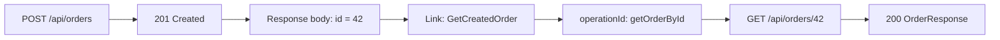

# Link Object mô tả quan hệ giữa các operation

Một API thường có nhiều operation liên kết với nhau theo luồng nghiệp vụ. Client tạo đơn hàng trước, sau đó lấy chi tiết đơn hàng bằng mã vừa nhận; tạo một tác vụ nền rồi truy vấn trạng thái; hoặc đọc một tài nguyên rồi gửi request cập nhật dựa trên dữ liệu vừa nhận. OpenAPI Link Object cho phép tài liệu mô tả những quan hệ này ngay trong response của operation nguồn.

Link Object giúp người đọc và công cụ hiểu rằng kết quả của một operation có thể cung cấp dữ liệu cần thiết để gọi operation khác. Ví dụ, response `201 Created` của `POST /orders` trả về `id`; liên kết có thể ánh xạ giá trị đó vào path parameter `orderId` của `GET /orders/{orderId}`.

Link Object là metadata trong hợp đồng OpenAPI. Nó không tự tạo endpoint, không tự gửi request, không bắt server thêm link vào JSON hoặc HTTP `Link` header, và không thay thế cơ chế điều hướng hypermedia của ứng dụng. Operation đích vẫn phải tồn tại và được bảo vệ theo chính sách runtime của chính nó.

## 1. Link Object giải quyết vấn đề gì?

Nếu chỉ đọc danh sách `paths`, người tích hợp thấy từng operation riêng lẻ nhưng có thể chưa biết cách chuyển kết quả từ operation này sang request kế tiếp. Link Object mô tả quan hệ giữa response của operation nguồn và operation đích.

Ví dụ một luồng đơn hàng:

1. Client gọi `POST /api/orders` để tạo đơn hàng.
2. Server trả `201 Created` cùng body có `id` của đơn hàng.
3. Tài liệu gắn một link tên `GetCreatedOrder` vào response 201.
4. Link tham chiếu operation `getOrderById` và ánh xạ `orderId` bằng biểu thức `$response.body#/id`.
5. Công cụ đọc OpenAPI có thể hiểu rằng client dùng giá trị `id` trong response để gọi `GET /api/orders/{orderId}`.

Sơ đồ luồng:



Link mô tả mối quan hệ có thể đi tiếp từ response. Nó đặc biệt hữu ích cho API có workflow nhiều bước, thao tác bất đồng bộ, tài nguyên con hoặc phân trang.

## 2. Cấu trúc của Link Object

OpenAPI Link Object có những trường chính sau:

| Trường | Ý nghĩa |
|---|---|
| `operationId` | Tên định danh duy nhất của operation đích trong OpenAPI document |
| `operationRef` | URI reference trỏ trực tiếp đến operation đích |
| `parameters` | Ánh xạ tên parameter của operation đích sang giá trị cố định hoặc runtime expression |
| `requestBody` | Giá trị request body cho operation đích; có thể là literal hoặc runtime expression |
| `description` | Giải thích quan hệ hoặc mục đích của link |
| `server` | Server dùng để gọi operation đích nếu cần ghi đè server được khai báo ở nơi khác |

Một Link Object phải xác định operation đích bằng `operationId` hoặc `operationRef`. Hai trường này là hai cách tham chiếu thay thế nhau; không khai báo cả hai cho cùng một link.

`operationId` phải duy nhất trong tài liệu OpenAPI. Đây là lựa chọn dễ đọc và thường thuận tiện hơn khi các operation nằm trong cùng document. `operationRef` hữu ích khi muốn trỏ bằng JSON Pointer đến operation cụ thể hoặc khi tham chiếu tài liệu khác.

`parameters` là một object map: key là tên parameter trong operation đích, value là giá trị truyền vào parameter đó. Value có thể là literal hoặc runtime expression. `requestBody` hoạt động tương tự nhưng dành cho body của operation đích.

## 3. Ví dụ OpenAPI hoàn chỉnh: tạo đơn hàng rồi lấy chi tiết

Tài liệu dưới đây khai báo hai operation và một link từ response 201 của operation tạo đơn hàng đến operation lấy đơn hàng theo mã.

```yaml
openapi: 3.0.3
info:
  title: Order API
  version: 1.0.0
paths:
  /api/orders:
    post:
      operationId: createOrder
      summary: Tạo đơn hàng
      requestBody:
        required: true
        content:
          application/json:
            schema:
              $ref: '#/components/schemas/CreateOrderRequest'
      responses:
        '201':
          description: Đơn hàng đã được tạo.
          headers:
            Location:
              description: URI của đơn hàng vừa tạo.
              schema:
                type: string
                format: uri-reference
          content:
            application/json:
              schema:
                $ref: '#/components/schemas/OrderResponse'
          links:
            GetCreatedOrder:
              operationId: getOrderById
              description: Lấy chi tiết đơn hàng vừa tạo.
              parameters:
                orderId: '$response.body#/id'
  /api/orders/{orderId}:
    get:
      operationId: getOrderById
      summary: Lấy đơn hàng theo mã
      parameters:
        - name: orderId
          in: path
          required: true
          schema:
            type: integer
            format: int64
      responses:
        '200':
          description: Chi tiết đơn hàng.
          content:
            application/json:
              schema:
                $ref: '#/components/schemas/OrderResponse'
        '404':
          description: Không tìm thấy đơn hàng.
components:
  schemas:
    CreateOrderRequest:
      type: object
      required:
        - productId
        - quantity
      properties:
        productId:
          type: integer
          format: int64
        quantity:
          type: integer
          minimum: 1
    OrderResponse:
      type: object
      properties:
        id:
          type: integer
          format: int64
        status:
          type: string
```

Trong response `201`, Link Object `GetCreatedOrder` tham chiếu `getOrderById`. Giá trị `orderId` của path parameter trong operation đích được lấy từ property `id` của response body nguồn.

Nếu server trả:

```json
{
  "id": 42,
  "status": "CREATED"
}
```

runtime expression `$response.body#/id` được đánh giá thành `42`. Công cụ có khả năng xử lý OpenAPI Link có thể dùng giá trị này để điền path parameter và giúp người tích hợp hiểu request tiếp theo.

## 4. `operationId` và `operationRef`

### Dùng `operationId`

Đây thường là cách dễ đọc:

```yaml
links:
  GetCreatedOrder:
    operationId: getOrderById
    parameters:
      orderId: '$response.body#/id'
```

Operation đích phải có cùng `operationId`:

```yaml
/api/orders/{orderId}:
  get:
    operationId: getOrderById
```

Hãy khai báo operationId rõ ràng và ổn định. Không dựa vào tên method Java nếu quy tắc sinh operationId có thể đổi theo refactor hoặc cấu hình Springdoc. Khi operationId thay đổi, mọi Link Object tham chiếu bằng tên cũ đều cần được cập nhật.

### Dùng `operationRef`

Có thể trỏ trực tiếp đến operation bằng URI reference và JSON Pointer:

```yaml
links:
  GetCreatedOrder:
    operationRef: '#/paths/~1api~1orders~1{orderId}/get'
    parameters:
      orderId: '$response.body#/id'
```

Trong JSON Pointer, dấu `/` trong khóa path được escape thành `~1`. Do đó path `/api/orders/{orderId}` được biểu diễn trong pointer bằng `~1api~1orders~1{orderId}`. Với tài liệu ngoài, `operationRef` có thể dùng URI reference trỏ đến tài liệu và operation tương ứng.

Chỉ chọn một trong hai cách tham chiếu cho mỗi Link Object. Dùng `operationId` khi muốn link dễ đọc và operation có định danh ổn định; dùng `operationRef` khi cần chỉ rõ vị trí operation bằng URI/JSON Pointer.

## 5. Runtime expressions lấy dữ liệu từ request và response

Runtime expression cho phép truyền dữ liệu từ HTTP request hoặc response hiện tại vào operation đích. Biểu thức được đánh giá khi có request/response thực tế, không phải khi Springdoc tạo tài liệu.

Một số biểu thức thường gặp:

| Expression | Giá trị được lấy |
|---|---|
| `$url` | URL request hiện tại |
| `$method` | HTTP method của request hiện tại |
| `$statusCode` | Status code của response hiện tại |
| `$request.path.orderId` | Path parameter `orderId` trong request nguồn |
| `$request.query.page` | Query parameter `page` trong request nguồn |
| `$request.header.X-Request-Id` | Header `X-Request-Id` của request nguồn |
| `$request.body#/customer/id` | Giá trị `customer.id` trong request body nguồn |
| `$response.header.Location` | Header `Location` của response nguồn |
| `$response.body#/id` | Property `id` trong response body nguồn |

Với JSON body, phần sau `#` dùng JSON Pointer. Ví dụ `$response.body#/customer/id` truy cập property `id` nằm trong object `customer`. Nếu tên property chứa ký tự `/` hoặc `~`, phải escape theo JSON Pointer: `/` thành `~1`, `~` thành `~0`.

### Lấy giá trị từ response header

Nếu operation tạo tài nguyên trả header `Location`, link có thể dùng header đó cho một parameter của operation đích:

```yaml
links:
  FollowLocation:
    operationId: getOrderById
    parameters:
      orderId: '$response.header.Location'
```

Biểu thức trên trả toàn bộ giá trị header Location. Nó chỉ phù hợp trực tiếp nếu kiểu và ý nghĩa parameter đích tương ứng với URI đó. Nếu operation đích cần một ID số nhưng Location là URI đầy đủ, cần một thiết kế phù hợp hơn: trích xuất ID ở client hoặc trả ID riêng trong response body rồi tham chiếu `$response.body#/id`.

### Gán request body cho operation đích

Trường `requestBody` có thể nhận literal hoặc runtime expression:

```yaml
links:
  SubmitPayment:
    operationId: createPayment
    requestBody: '$response.body#/paymentRequest'
```

Trong ví dụ này, object `paymentRequest` trong response nguồn được dùng làm request body cho operation `createPayment`. Kiểu dữ liệu của giá trị đó phải phù hợp với request body schema của operation đích.

## 6. Ánh xạ parameter đúng tên và đúng kiểu

Key trong `parameters` phải khớp tên parameter được khai báo ở operation đích. Ví dụ operation đích có path parameter `orderId` thì link phải dùng key `orderId`, không phải tên property nguồn hoặc tên Java field.

```yaml
parameters:
  orderId: '$response.body#/id'
  expand: details
```

Ở đây:

- `orderId` lấy giá trị động từ response body.
- `expand` truyền giá trị literal `details`.

Giá trị cuối cùng cần phù hợp kiểu dữ liệu và quy tắc của parameter đích. Nếu parameter đích là integer mà expression lấy một chuỗi URI, tài liệu có thể hợp lệ về cú pháp nhưng quan hệ không có ý nghĩa khi thực thi. Validator không phải lúc nào cũng xác minh được kiểu runtime của mọi expression; cần kiểm tra bằng test hoặc review hợp đồng.

Các path parameter bắt buộc của operation đích phải được cấp giá trị để tạo request hợp lệ. Nếu operation đích còn query/header parameter tùy chọn, link có thể ánh xạ chúng khi giá trị có sẵn hoặc để client tự cung cấp.

## 7. Tái sử dụng Link Object qua `components.links`

Khi nhiều response dùng cùng một quan hệ, có thể khai báo Link Object một lần trong `components.links`, sau đó tham chiếu bằng `$ref`.

```yaml
components:
  links:
    OrderById:
      operationId: getOrderById
      description: Lấy đơn hàng theo mã được trả về.
      parameters:
        orderId: '$response.body#/id'
```

Sau đó dùng trong response:

```yaml
paths:
  /api/orders:
    post:
      operationId: createOrder
      responses:
        '201':
          description: Đơn hàng đã được tạo.
          links:
            GetCreatedOrder:
              $ref: '#/components/links/OrderById'
```

`components.links` chỉ lưu định nghĩa có thể tái sử dụng. Nó không tự gắn link vào mọi response. Muốn sử dụng, phải tham chiếu Link Object trong `responses.<status>.links` của operation nguồn.

Tên `OrderById` là tên component; `GetCreatedOrder` là tên quan hệ trong map `links` của response. Có thể chọn tên khác, miễn là dễ hiểu và nhất quán.

## 8. Khai báo Link Object bằng Springdoc annotations

Springdoc hỗ trợ Swagger annotations để mô tả response links. Có thể đặt `operationId` cho operation đích và khai báo link ngay trong `@ApiResponse` của operation nguồn.

```java
import io.swagger.v3.oas.annotations.Operation;
import io.swagger.v3.oas.annotations.links.Link;
import io.swagger.v3.oas.annotations.links.LinkParameter;
import io.swagger.v3.oas.annotations.responses.ApiResponse;
import io.swagger.v3.oas.annotations.responses.ApiResponses;
import org.springframework.http.HttpStatus;
import org.springframework.http.ResponseEntity;
import org.springframework.web.bind.annotation.GetMapping;
import org.springframework.web.bind.annotation.PathVariable;
import org.springframework.web.bind.annotation.PostMapping;
import org.springframework.web.bind.annotation.RequestBody;
import org.springframework.web.bind.annotation.RequestMapping;
import org.springframework.web.bind.annotation.RestController;

@RestController
@RequestMapping("/api/orders")
class OrderController {

    @PostMapping
    @Operation(operationId = "createOrder", summary = "Tạo đơn hàng")
    @ApiResponses({
        @ApiResponse(
            responseCode = "201",
            description = "Đơn hàng đã được tạo.",
            links = @Link(
                name = "GetCreatedOrder",
                operationId = "getOrderById",
                description = "Lấy chi tiết đơn hàng vừa tạo.",
                parameters = @LinkParameter(
                    name = "orderId",
                    expression = "$response.body#/id"
                )
            )
        )
    })
    ResponseEntity<OrderResponse> create(@RequestBody CreateOrderRequest request) {
        OrderResponse created = orderService.create(request);
        return ResponseEntity.status(HttpStatus.CREATED).body(created);
    }

    @GetMapping("/{orderId}")
    @Operation(operationId = "getOrderById", summary = "Lấy đơn hàng theo mã")
    OrderResponse getById(@PathVariable Long orderId) {
        return orderService.getById(orderId);
    }
}
```

Trong ví dụ:

- `@Operation(operationId = "getOrderById")` đặt định danh rõ ràng cho operation đích.
- `@ApiResponse(links = @Link(...))` gắn link vào response 201 của operation tạo đơn hàng.
- `@LinkParameter` ánh xạ parameter `orderId` của operation đích từ `id` trong response body.
- Kiểu `OrderResponse` và payload thực tế phải có property `id` tương ứng.

Tên annotation và thuộc tính cần được đối chiếu với phiên bản Swagger annotations mà starter Springdoc kéo vào. Nếu dự án dùng phiên bản thư viện khác, kiểm tra Javadoc của artifact tương ứng và xác nhận JSON `/v3/api-docs` sau khi chạy ứng dụng.

### Dùng `operationRef` trong annotation

Khi không dùng operationId, có thể tham chiếu trực tiếp bằng `operationRef`:

```java
@Link(
    name = "GetCreatedOrder",
    operationRef = "#/paths/~1api~1orders~1{orderId}/get",
    parameters = @LinkParameter(
        name = "orderId",
        expression = "$response.body#/id"
    )
)
```

Không khai báo thêm `operationId` trong cùng Link Object. Đường dẫn trong `operationRef` phải trỏ đúng operation được tạo ra trong tài liệu.

## 9. Link Object không phải HTTP Link header hoặc HATEOAS body

Ba khái niệm sau dễ bị nhầm:

| Khái niệm | Nằm ở đâu? | Vai trò |
|---|---|---|
| OpenAPI Link Object | Trong tài liệu OpenAPI, tại `responses.<status>.links` | Mô tả quan hệ giữa operation nguồn và operation đích cho tooling |
| HTTP `Link` header | Trong header của HTTP response | Server thực sự gửi một hoặc nhiều URI relation trong response |
| Hypermedia link trong JSON | Trong response body, theo định dạng như HAL hoặc mô hình riêng | Server trả liên kết runtime để client điều hướng theo dữ liệu nhận được |

Khai báo OpenAPI Link Object không khiến response tự có header `Link`, field `_links` hay `links`. Nếu API dùng Spring HATEOAS và muốn gửi hypermedia links thật, cần triển khai representation tương ứng trong response body. Nếu muốn gửi HTTP Link header, controller phải tạo header đó. OpenAPI Link Object có thể mô tả quan hệ operation bổ sung cho tài liệu, nhưng không thay thế các cơ chế runtime trên.

## 10. Link Object không thay thế xác thực và phân quyền

Link chỉ mô tả cách tham số hoặc body có thể được chuyển sang operation đích. Nó không truyền quyền truy cập từ operation nguồn sang operation đích và cũng không cấp token.

Ví dụ, `POST /orders` có thể cho phép người dùng tạo đơn hàng, nhưng `GET /orders/{orderId}` vẫn phải kiểm tra người dùng có quyền đọc đơn hàng đó hay không. Operation đích có thể có `security` requirement, role hoặc scope riêng.

Khi thiết kế link:

- Không đưa access token hoặc API key vào runtime expression, parameter literal hay request body mẫu.
- Không giả định người gọi operation nguồn được phép gọi mọi operation đích.
- Mô tả lỗi `401`/`403` ở operation đích nếu phù hợp.
- Kiểm tra quyền sở hữu tài nguyên ở server, kể cả khi ID được lấy trực tiếp từ response trước đó.

## 11. Các tình huống thực tế nên dùng Link Object

| Luồng nghiệp vụ | Operation nguồn | Operation đích | Giá trị thường truyền |
|---|---|---|---|
| Tạo rồi xem chi tiết | `POST /orders` | `GET /orders/{orderId}` | `$response.body#/id` |
| Gửi tác vụ nền rồi theo dõi | `POST /exports` | `GET /exports/{jobId}` | `$response.body#/jobId` |
| Tạo đơn hàng rồi thanh toán | `POST /orders` | `POST /orders/{orderId}/payments` | `orderId` từ response và body thanh toán phù hợp |
| Đọc tài nguyên rồi cập nhật | `GET /profiles/{id}` | `PATCH /profiles/{id}` | ID từ `$request.path.id` hoặc `$response.body#/id` |
| Truy vấn trang tiếp theo | `GET /items` | `GET /items` | Giá trị cursor/next token nếu response cung cấp |

Link Object hữu ích khi quan hệ giữa các operation là một phần đáng kể của hợp đồng và có thể được mô tả bằng tham số hoặc request body. Nếu chỉ cần giải thích quy trình bằng văn bản, `description` hoặc tài liệu hướng dẫn có thể đủ; không cần tạo link cho mọi cặp operation.

## 12. Server của operation đích

Link Object có thể khai báo `server` khi operation đích cần dùng server khác với server được khai báo trên operation hoặc document. Ví dụ, một API có thể tạo tài nguyên trên endpoint chính nhưng cung cấp URL tải file ở một máy chủ lưu trữ riêng.

```yaml
links:
  DownloadExport:
    operationId: downloadExport
    parameters:
      exportId: '$response.body#/id'
    server:
      url: https://downloads.example.com
      description: Máy chủ tải file xuất dữ liệu.
```

Server này chỉ áp dụng cho việc gọi operation đích qua link. URL phải là server hợp lệ của operation đó và không nên chứa credentials hoặc thông tin bí mật. Nếu không khai báo `server` trong Link Object, operation đích sử dụng server được xác định theo tài liệu và operation của nó.

## 13. Kiểm tra Link Object trong tài liệu được Springdoc sinh ra

Sau khi chạy ứng dụng, mở `/v3/api-docs` và kiểm tra response nguồn. Ví dụ:

```bash
curl -s http://localhost:8080/v3/api-docs \
  | jq '.paths["/api/orders"].post.responses["201"].links'
```

Kết quả mong đợi có link với `operationId` và parameter expression:

```json
{
  "GetCreatedOrder": {
    "operationId": "getOrderById",
    "description": "Lấy chi tiết đơn hàng vừa tạo.",
    "parameters": {
      "orderId": "$response.body#/id"
    }
  }
}
```

Tiếp tục xác minh operation đích tồn tại:

```bash
curl -s http://localhost:8080/v3/api-docs \
  | jq '.paths["/api/orders/{orderId}"].get.operationId'
```

Kết quả phải là `getOrderById`. Đồng thời kiểm tra:

- Tên parameter trong link khớp chính xác với operation đích.
- Runtime expression trỏ đến property hoặc header có thật ở request/response nguồn.
- Kiểu dữ liệu được truyền phù hợp với parameter hoặc request body đích.
- `operationRef` trỏ đúng JSON Pointer nếu dùng cách tham chiếu này.
- Link nằm dưới đúng response status code.
- Các response status khác không vô tình nhận cùng một link khi quan hệ không áp dụng.

## 14. Lỗi thường gặp và cách xử lý

| Hiện tượng | Nguyên nhân có thể | Cách xử lý |
|---|---|---|
| Link không xuất hiện trong `/v3/api-docs` | Annotation đặt sai response hoặc phiên bản thư viện không xử lý cấu hình như dự kiến | Kiểm tra `@ApiResponse.links`, import và phiên bản Swagger annotations |
| `operationId` không được tìm thấy | Sai tên hoặc operationId bị đổi | Khai báo operationId tường minh và kiểm tra tính duy nhất |
| `operationRef` không hợp lệ | JSON Pointer encode sai path hoặc sai method | Escape dấu `/` thành `~1` và kiểm tra pointer |
| Link truyền thiếu path parameter | Thiếu key trong `parameters` hoặc tên không khớp | Đối chiếu với tên parameter của operation đích |
| Expression trả null hoặc không có giá trị | Property/header không tồn tại trong request/response nguồn | Kiểm tra payload thực tế và JSON Pointer |
| Giá trị expression không đúng kiểu | Nguồn và parameter đích không tương thích | Chọn property đúng hoặc thiết kế lại parameter |
| Swagger UI không hiển thị hành động theo link | Công cụ không hỗ trợ hoặc hỗ trợ một phần Link Object | Kiểm tra trực tiếp OpenAPI; không phụ thuộc riêng vào UI |
| Tưởng khai báo link sẽ tạo HTTP Link header | Nhầm OpenAPI metadata với runtime response | Tự triển khai header hoặc hypermedia body nếu API yêu cầu |
| Link trỏ đến operation đích nhưng nhận 403 | Operation đích có chính sách bảo mật riêng | Kiểm tra token, role, scope và quyền tài nguyên |

## 15. Checklist thiết kế Link Object

- [ ] Đã xác định quan hệ nghiệp vụ thực sự giữa operation nguồn và operation đích.
- [ ] Link được gắn vào đúng response status trong operation nguồn.
- [ ] Đã chọn `operationId` hoặc `operationRef`, không khai báo cả hai.
- [ ] `operationId` duy nhất và ổn định nếu được dùng.
- [ ] `operationRef` là URI reference/JSON Pointer hợp lệ nếu được dùng.
- [ ] Tên parameter trong `parameters` khớp operation đích.
- [ ] Runtime expression trỏ đến dữ liệu có thật trong request/response nguồn.
- [ ] Giá trị truyền phù hợp kiểu parameter hoặc request body đích.
- [ ] `components.links` được tham chiếu đúng nếu dùng định nghĩa tái sử dụng.
- [ ] `server` được khai báo chỉ khi operation đích cần server khác.
- [ ] Không nhầm OpenAPI Link Object với HTTP Link header hoặc HATEOAS body.
- [ ] Operation đích vẫn có xác thực, phân quyền và kiểm thử độc lập.
- [ ] Đã kiểm tra `/v3/api-docs` và xác minh link sau khi Springdoc sinh tài liệu.

Link Object giúp mô tả cách các operation liên kết trong một workflow, chẳng hạn lấy ID từ response tạo đơn hàng để gọi operation xem chi tiết. `operationId` hoặc `operationRef` xác định đích; `parameters` và `requestBody` truyền dữ liệu bằng literal hoặc runtime expression. Khi đặt link đúng response và xác minh operation đích, tài liệu OpenAPI trở nên hữu ích hơn cho người tích hợp và các công cụ khai thác hợp đồng API.

## Tài liệu tham khảo

- [OpenAPI Specification – Link Object](https://spec.openapis.org/oas/v3.1.1.html#link-object)
- [OpenAPI Specification – Runtime Expressions](https://spec.openapis.org/oas/v3.1.1.html#runtime-expressions)
- [OpenAPI Specification – Response Object](https://spec.openapis.org/oas/v3.1.1.html#response-object)
- [Swagger Annotations – `@Link`](https://javadoc.io/doc/io.swagger.core.v3/swagger-annotations/latest/io/swagger/v3/oas/annotations/links/Link.html)
- [Springdoc OpenAPI – Official documentation](https://springdoc.org/)
