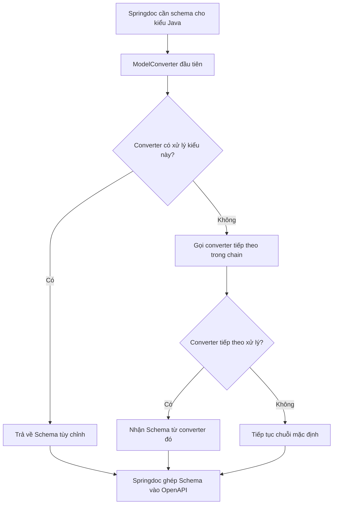

# Tùy biến schema bằng `ModelConverter` khi suy luận mặc định chưa đủ

Springdoc-openapi suy luận OpenAPI Schema từ kiểu Java, annotation, metadata của Spring và cách Jackson xử lý dữ liệu. Cách tự động này phù hợp với phần lớn DTO thông thường. Tuy nhiên, có những kiểu dữ liệu đặc biệt mà hình dạng JSON không giống cấu trúc Java: value object được serialize thành chuỗi, kiểu thư viện bên thứ ba, lớp cũ không thể thêm annotation hoặc một quy ước dữ liệu dùng lặp lại trong nhiều endpoint.

Khi cần thay đổi cách một kiểu Java được chuyển thành schema ở nhiều nơi, có thể triển khai `ModelConverter` của Swagger Core. Converter tham gia chuỗi phân giải model: nó nhận kiểu đang được xử lý, có thể trả về schema tùy chỉnh hoặc chuyển tiếp cho converter tiếp theo. Trong Spring Boot, có thể đăng ký converter dưới dạng Spring bean để springdoc đưa nó vào chuỗi xử lý model.

`ModelConverter` là một extension point ở cấp kiểu dữ liệu. Hãy dùng nó khi cùng một kiểu cần được mô tả nhất quán trên toàn tài liệu. Với một field hoặc một endpoint riêng lẻ, annotation `@Schema`, `@Parameter`, `@ApiResponse` hay `OpenApiCustomizer` thường rõ ràng và dễ bảo trì hơn.

## 1. Khi nào cần `ModelConverter`?

Ví dụ ứng dụng có value object `Money`. Trong Java, kiểu này chứa `BigDecimal`, nhưng API serialize nó thành chuỗi thập phân để giữ chính xác giá trị tiền và không bị client chuyển sang số dấu phẩy động:

```java
import com.fasterxml.jackson.annotation.JsonCreator;
import com.fasterxml.jackson.annotation.JsonValue;

import java.math.BigDecimal;
import java.math.RoundingMode;
import java.util.Objects;

public record Money(BigDecimal amount) {

    public Money {
        amount = Objects.requireNonNull(amount)
            .setScale(2, RoundingMode.UNNECESSARY);
    }

    @JsonValue
    public String toJson() {
        return amount.toPlainString();
    }

    @JsonCreator(mode = JsonCreator.Mode.DELEGATING)
    public static Money fromJson(String value) {
        return new Money(new BigDecimal(value));
    }
}
```

Wire format của `Money` là chuỗi JSON:

```json
{
  "price": "125000.00"
}
```

Nếu chỉ nhìn cấu trúc Java, công cụ suy luận có thể coi `Money` là object có thuộc tính `amount`. Nhưng client thực tế gửi và nhận một chuỗi. Schema cần mô tả đúng dạng dữ liệu trên wire:

```yaml
type: string
pattern: '^-?\d+\.\d{2}$'
example: '125000.00'
description: Giá trị tiền ở dạng chuỗi thập phân
```

Nếu `Money` xuất hiện trong request, response, DTO lồng nhau và nhiều endpoint, lặp lại `@Schema(type = "string")` ở từng field sẽ dễ thiếu sót. Một `ModelConverter` xử lý kiểu `Money` tập trung giúp schema nhất quán.

Các tình huống phù hợp khác:

- Kiểu ID đặc biệt được serialize thành chuỗi theo một định dạng riêng.
- Lớp từ thư viện bên thứ ba không thể sửa source hoặc thêm annotation.
- Một kiểu ngày giờ hoặc value object có wire format tùy chỉnh dùng xuyên suốt API.
- Một quy ước schema chung cần được áp dụng cho mọi thuộc tính có cùng kiểu Java.

Không nên viết converter chỉ để thay đổi mô tả của một field duy nhất. Khi phạm vi chỉ có một chỗ, annotation cục bộ thường làm ý định rõ hơn.

## 2. `ModelConverter` nằm ở đâu trong quá trình tạo schema?

Swagger Core cung cấp interface `io.swagger.v3.core.converter.ModelConverter`. Khi springdoc cần mô tả một kiểu Java, quá trình phân giải model sử dụng chuỗi converter. Một converter có thể:

1. Nhận `AnnotatedType` mô tả kiểu Java cùng metadata liên quan.
2. Kiểm tra kiểu có thuộc phạm vi mà converter chịu trách nhiệm hay không.
3. Trả về `Schema` nếu tự xử lý kiểu đó.
4. Gọi converter tiếp theo trong `chain` nếu không xử lý kiểu hiện tại.

Luồng khái quát:



`ModelConverter` không phải `OpenApiCustomizer`. Converter tham gia lúc phân giải kiểu dữ liệu; `OpenApiCustomizer` sửa OpenAPI document đã được tạo. Vì vậy, converter phù hợp với quy tắc ánh xạ kiểu Java sang schema, còn customizer phù hợp với việc chỉnh `paths`, `operations`, components hoặc metadata ở cấp document.

## 3. Cài đặt converter cho kiểu `Money`

Một converter đơn giản có thể nhận diện kiểu `Money` và trả về `StringSchema`. Với các kiểu khác, nó chuyển tiếp cho converter tiếp theo:

```java
import com.fasterxml.jackson.databind.JavaType;
import com.fasterxml.jackson.databind.type.TypeFactory;
import io.swagger.v3.core.converter.AnnotatedType;
import io.swagger.v3.core.converter.ModelConverter;
import io.swagger.v3.core.converter.ModelConverterContext;
import io.swagger.v3.oas.models.media.Schema;
import io.swagger.v3.oas.models.media.StringSchema;

import java.util.Iterator;

public final class MoneyModelConverter implements ModelConverter {

    @Override
    public Schema<?> resolve(
        AnnotatedType annotatedType,
        ModelConverterContext context,
        Iterator<ModelConverter> chain
    ) {
        if (annotatedType != null && annotatedType.getType() != null) {
            JavaType javaType = TypeFactory.defaultInstance()
                .constructType(annotatedType.getType());

            if (Money.class.equals(javaType.getRawClass())) {
                return new StringSchema()
                    .description("Giá trị tiền ở dạng chuỗi thập phân có hai chữ số sau dấu chấm")
                    .pattern("^-?\\d+\\.\\d{2}$")
                    .example("125000.00");
            }
        }

        if (chain != null && chain.hasNext()) {
            return chain.next().resolve(annotatedType, context, chain);
        }

        return null;
    }
}
```

Điểm cần chú ý:

- `AnnotatedType` cung cấp kiểu cần phân giải. `getType()` trả về kiểu phản chiếu Java, có thể là class hoặc kiểu generic.
- `TypeFactory` chuyển kiểu phản chiếu thành `JavaType` để lấy raw class.
- Converter chỉ xử lý chính xác `Money`; những kiểu khác được chuyển tiếp.
- `StringSchema` mô tả dữ liệu JSON dạng chuỗi, cùng pattern và ví dụ.
- Khi không có converter tiếp theo, trả `null` để báo không xử lý kiểu đó.

Không trả về một schema chung cho mọi kiểu không nhận diện được. Nếu converter chặn chuỗi và không delegate, nó có thể làm hỏng cách springdoc mô tả DTO, collection, enum hoặc các kiểu khác.

## 4. Đăng ký converter bằng Spring bean

Trong ứng dụng Spring Boot dùng springdoc, cách tích hợp tự nhiên là khai báo `ModelConverter` như một bean:

```java
@Configuration
class OpenApiModelConfiguration {

    @Bean
    ModelConverter moneyModelConverter() {
        return new MoneyModelConverter();
    }
}
```

Springdoc có cơ chế đăng ký các bean `ModelConverter` vào pipeline phân giải model. Vì vậy, converter được quản lý trong application context và được áp dụng khi springdoc tạo các schema.

Không cần gọi thêm `ModelConverters.getInstance().addConverter(...)` khi đã đăng ký converter qua Spring bean trong môi trường springdoc. Cách dùng singleton tĩnh có thể khiến converter được đăng ký toàn cục ngoài vòng đời Spring, khó kiểm soát thứ tự, gây ảnh hưởng đến các lần khởi tạo ứng dụng hoặc kiểm thử khác.

Nếu ứng dụng dùng nhiều converter, hãy giữ mỗi converter tập trung vào một kiểu hoặc một quy tắc rõ ràng. Có thể dùng `@Order` để kiểm soát thứ tự bean khi cần; thứ tự có ý nghĩa vì converter đứng trước có thể trả schema và kết thúc chuỗi. Converter nên stateless hoặc an toàn khi truy cập đồng thời vì quá trình sinh tài liệu có thể được gọi từ nhiều request.

## 5. Kết quả schema khi `Money` xuất hiện trong DTO

Giả sử DTO có hai thuộc tính `Money`:

```java
public record ProductResponse(
    UUID id,
    String name,
    Money price,
    Money shippingFee
) {}
```

Khi springdoc tạo schema cho `ProductResponse`, hai thuộc tính `price` và `shippingFee` đều được mô tả thành chuỗi theo converter:

```yaml
ProductResponse:
  type: object
  properties:
    id:
      type: string
      format: uuid
    name:
      type: string
    price:
      type: string
      pattern: '^-?\d+\.\d{2}$'
      example: '125000.00'
    shippingFee:
      type: string
      pattern: '^-?\d+\.\d{2}$'
      example: '25000.00'
```

Ví dụ trên minh họa kết quả mong muốn; tên component và thứ tự thuộc tính có thể khác theo cấu hình. Điều cần kiểm tra là các thuộc tính có kiểu `string` và không bị biểu diễn nhầm thành object `{ amount: ... }`.

Nếu `Money` cũng xuất hiện trong request DTO, converter áp dụng cùng quy tắc cho request schema. Tuy nhiên, converter chỉ thay đổi tài liệu. Jackson vẫn phải deserialize chuỗi thành `Money` và serialize `Money` thành chuỗi như ví dụ `@JsonValue`/`@JsonCreator` ở trên.

## 6. Chuyển tiếp cho converter mặc định là bắt buộc

Một lỗi phổ biến là converter trả `null` ngay khi không nhận diện được kiểu. Nếu không gọi `chain.next()`, các converter còn lại không có cơ hội xử lý. Điều này có thể làm mất hỗ trợ cho:

- DTO và nested model.
- `List<T>`, `Set<T>`, `Map<K,V>` và generic type.
- Enum, date/time và kiểu Jackson hỗ trợ.
- Polymorphism, `oneOf`, discriminator và schema tham chiếu.
- Các converter springdoc đăng ký cho file, nullable hoặc các kiểu tích hợp khác.

Quy tắc an toàn là chỉ trả schema khi converter thực sự nhận diện kiểu mà nó sở hữu; các trường hợp còn lại phải delegate:

```java
if (isSupportedCustomType(annotatedType)) {
    return buildCustomSchema();
}

return chain.hasNext()
    ? chain.next().resolve(annotatedType, context, chain)
    : null;
```

Nếu cần thay đổi một phần cách resolver mặc định xử lý model thay vì thay toàn bộ kiểu, có thể cân nhắc kế thừa `ModelResolver` và override một điểm cụ thể. `ModelResolver` là implementation mặc định dựa trên Jackson; kế thừa nó giúp giữ phần lớn logic suy luận sẵn có rồi điều chỉnh riêng metadata cần thiết. Chữ ký method được override có thể thay đổi giữa các phiên bản Swagger Core, vì vậy phải dùng đúng dependency mà nhánh springdoc đang quản lý.

## 7. Khi nào nên chọn annotation, `PropertyCustomizer` hoặc `OpenApiCustomizer`?

Không phải mọi yêu cầu tùy biến schema đều cần `ModelConverter`:

| Công cụ | Phạm vi tác động | Khi nên dùng |
| --- | --- | --- |
| `@Schema` | Một class hoặc một thuộc tính được gắn annotation | Có thể sửa DTO và chỉ cần bổ sung metadata cục bộ. |
| `PropertyCustomizer` | Một property trong quá trình springdoc tạo schema | Cần sửa thuộc tính dựa trên metadata hoặc quy tắc property cụ thể. |
| `ModelConverter` | Cách ánh xạ một kiểu Java trong pipeline model | Cùng một kiểu xuất hiện ở nhiều DTO và cần schema thống nhất. |
| `OpenApiCustomizer` | Một OpenAPI document hoặc một group | Cần sửa component, path, operation hoặc document sau khi sinh. |

Ví dụ nếu chỉ một field cần mô tả khác, dùng `@Schema` sẽ dễ đọc ngay tại DTO:

```java
public record InvoiceResponse(
    @Schema(description = "Mã hóa đơn nội bộ", example = "INV-2026-001")
    String invoiceCode
) {}
```

Nếu cần sửa một operation sau khi springdoc đã tạo schema, có thể dùng `OpenApiCustomizer`. Tuy nhiên, customizer phải quản lý đúng component và `$ref`; nếu schema được dùng ở nhiều nơi, thay đổi component chung có thể ảnh hưởng nhiều operation. Với quy tắc dựa trên kiểu Java, `ModelConverter` thường là điểm can thiệp phù hợp hơn.

## 8. Cẩn trọng với `ModelConverters.getInstance()` và schema tham chiếu

Swagger Core có API singleton `ModelConverters.getInstance()` để đăng ký converter và phân giải model độc lập. API này hữu ích trong ứng dụng Swagger Core thuần hoặc bài kiểm thử riêng, nhưng cần hiểu khác biệt khi dùng bên trong springdoc.

Springdoc đăng ký pipeline converter của chính nó để xử lý các tích hợp như polymorphism, nullability và các kiểu đặc biệt. Nếu gọi trực tiếp singleton `ModelConverters` của Swagger Core, bạn có thể bỏ qua pipeline mà springdoc đã cấu hình. Khi tự phân giải một model bằng singleton, kết quả có thể chứa các schema tham chiếu phụ (`referencedSchemas`); nếu thêm schema gốc vào `components` mà quên các schema phụ, tài liệu sẽ có `$ref` không tồn tại.

Trong customizer chạy trong Spring context, ưu tiên API tiện ích của springdoc như `SpringDocAnnotationsUtils.extractSchema(...)` khi cần tạo schema theo các converter springdoc đã đăng ký. Nếu dùng API trả về `ResolvedSchema`, hãy sao chép cả schema gốc và các schema tham chiếu vào `components.schemas` theo đúng tên. Tránh tự dựng `$ref` bằng chuỗi nếu chưa bảo đảm component đích đã được đăng ký.

## 9. Kiểm thử converter

Một converter chỉ hữu ích khi schema được sinh ra khớp dữ liệu JSON runtime. Nên kiểm tra cả hai phía:

1. **Kiểm tra nhận diện kiểu:** `Money` được xử lý thành `string`; các kiểu không liên quan vẫn đi qua resolver mặc định.
2. **Kiểm tra schema:** mở `/v3/api-docs`, tìm `ProductResponse` và xác nhận `price`, `shippingFee` là `string` với pattern và example đúng.
3. **Kiểm tra request:** gửi JSON có `"price": "125000.00"` và xác nhận Jackson tạo được `Money`.
4. **Kiểm tra response:** xác nhận server serialize `Money` thành chuỗi, không phải object có field `amount`.
5. **Kiểm tra nested model:** đặt `Money` trong DTO lồng nhau, collection và response khác để xác nhận converter hoạt động nhất quán.
6. **Kiểm tra nhóm tài liệu:** nếu ứng dụng có `GroupedOpenApi`, xác nhận converter áp dụng cho từng document cần công bố.
7. **Kiểm tra tương thích:** build bằng phiên bản springdoc/Swagger Core được quản lý trong dự án; tránh tự nâng một dependency Swagger Core riêng chỉ để có API converter mới.

Ví dụ kiểm thử converter trực tiếp có thể xác nhận schema mà nó trả về:

```java
@Test
void describesMoneyAsDecimalString() {
    MoneyModelConverter converter = new MoneyModelConverter();
    Schema<?> schema = converter.resolve(
        new AnnotatedType(Money.class),
        mock(ModelConverterContext.class),
        Collections.emptyIterator()
    );

    assertThat(schema).isInstanceOf(StringSchema.class);
    assertThat(schema.getPattern()).isEqualTo("^-?\\d+\\.\\d{2}$");
    assertThat(schema.getExample()).isEqualTo("125000.00");
}
```

Kiểm thử này tập trung vào converter riêng. Cần thêm kiểm thử tích hợp Spring Boot để xác nhận bean thực sự được springdoc đăng ký và `/v3/api-docs` phản ánh schema tùy chỉnh.

## 10. Lỗi thường gặp và cách xử lý

| Hiện tượng | Nguyên nhân có thể | Cách xử lý |
| --- | --- | --- |
| Converter không được gọi | Chưa đăng ký bean, package không được component scan hoặc cấu hình springdoc không được nạp | Khai báo `@Bean ModelConverter` trong application context và kiểm tra log/đặc tả. |
| Mọi model đều thành `string` | Converter trả schema không điều kiện hoặc không delegate | Chỉ xử lý đúng kiểu mục tiêu; gọi `chain.next()` cho các kiểu khác. |
| DTO lồng nhau mất component schema | Converter chặn quá sớm hoặc tự phân giải model nhưng bỏ qua schema tham chiếu | Delegate đúng cách và kiểm tra mọi `$ref` trong `components.schemas`. |
| Swagger mô tả `Money` là object nhưng JSON là string | Pipeline chưa áp dụng converter hoặc converter không nhận diện đúng `AnnotatedType` | Kiểm tra raw class, thứ tự converter và output `/v3/api-docs`. |
| Request body không deserialize được dù schema đúng | Jackson không có `@JsonCreator`/converter tương ứng | Đồng bộ schema với serializer/deserializer thực tế. |
| Schema khác nhau giữa các nhóm | Customizer hoặc converter chỉ được áp dụng trong một phạm vi | Đăng ký converter ở application context chung và kiểm tra từng group document. |
| Lỗi `NoSuchMethodError` sau khi thêm converter | Phiên bản `swagger-core` bị lệch với springdoc | Bỏ override tùy tiện và dùng dependency tương thích do nhánh springdoc quản lý. |
| Kết quả thay đổi sau mỗi lần khởi động | Đăng ký converter tĩnh lặp lại hoặc converter có trạng thái mutable | Ưu tiên Spring bean singleton, stateless và kiểm soát thứ tự rõ ràng. |

## 11. Nguyên tắc áp dụng

- Chỉ tạo `ModelConverter` khi một kiểu Java cần ánh xạ đặc biệt và quy tắc đó được dùng ở nhiều vị trí.
- Kiểm tra kiểu từ `AnnotatedType`; xử lý đúng phạm vi rồi delegate phần còn lại cho converter chain.
- Đăng ký converter bằng Spring bean trong ứng dụng springdoc.
- Giữ converter stateless, an toàn khi chạy đồng thời và tránh đăng ký singleton tĩnh trùng lặp.
- Cân nhắc `ModelResolver` khi chỉ muốn sửa một phần resolver mặc định.
- Chọn `@Schema`, `PropertyCustomizer` hoặc `OpenApiCustomizer` khi phạm vi thay đổi nhỏ hơn hoặc ở cấp document.
- Đồng bộ schema với Jackson serializer/deserializer và validation runtime.
- Kiểm tra `/v3/api-docs`, `$ref`, nested model, từng nhóm tài liệu và JSON thực tế.
- Không ép phiên bản Swagger Core độc lập nếu không xác minh tương thích với springdoc.

`ModelConverter` cho phép kiểm soát cách một kiểu Java được biểu diễn trong OpenAPI khi suy luận mặc định không phản ánh đúng dữ liệu trên wire. Khi converter chỉ xử lý kiểu mà nó sở hữu, chuyển tiếp các kiểu còn lại và được đăng ký trong Spring context, schema tùy chỉnh có thể được áp dụng nhất quán mà vẫn giữ các khả năng suy luận mặc định của springdoc.

## Tài liệu tham khảo

- [Swagger Core – ModelConverter và mở rộng schema](https://github.com/swagger-api/swagger-core/wiki/Swagger-2.X---Extensions)
- [Springdoc OpenAPI FAQ – tùy biến OpenAPI và xử lý schema](https://springdoc.org/faq.html)
- [Springdoc OpenAPI v2 FAQ – tích hợp và custom schema](https://springdoc.org/v2/faq.html)
- [Springdoc OpenAPI – tài liệu chính thức](https://springdoc.org/)
