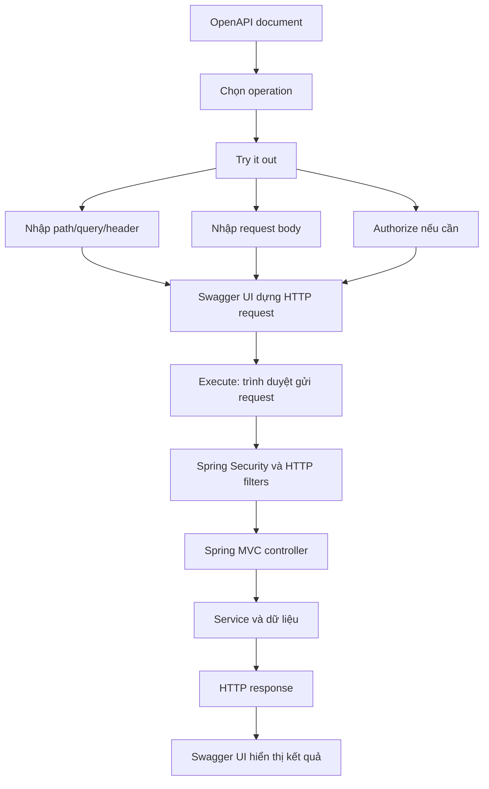

# Try it out và việc tạo yêu cầu HTTP thật

Swagger UI không chỉ hiển thị OpenAPI dưới dạng tài liệu. Tính năng **Try it out** cho phép người dùng điền parameter, request body và thông tin xác thực, sau đó gửi request HTTP thật đến server được chọn. Khi nhấn **Execute**, trình duyệt thực hiện request qua mạng; controller Spring Boot, filter, security chain, validation và service xử lý request như một client bên ngoài gọi API.

Để request chạy đúng, OpenAPI document phải mô tả chính xác method, path, server, parameter, request body, media type và security scheme. Swagger UI tạo request dựa trên các thông tin đó. Nếu tài liệu sai, giao diện có thể tạo URL, header hoặc body không khớp với endpoint runtime.

## 1. Try it out thực hiện những bước nào?

Với một operation như `POST /api/orders`, Swagger UI sử dụng OpenAPI document để xây dựng request:

1. Chọn server URL được khai báo ở cấp document, path hoặc operation.
2. Ghép server URL với path của operation.
3. Thay path parameter bằng giá trị người dùng nhập.
4. Serialize query parameter theo schema và quy tắc `style`/`explode`.
5. Thêm header parameter và cookie parameter được mô tả trong operation.
6. Chọn request body media type và serialize dữ liệu theo schema.
7. Thêm credentials từ security scheme đã được người dùng Authorize.
8. Gửi request bằng trình duyệt khi người dùng nhấn **Execute**.
9. Hiển thị request URL, response status, response headers, response body và thời gian phản hồi nếu giao diện được cấu hình hiển thị.

Sơ đồ luồng:



Try it out không gọi trực tiếp Java method và không bỏ qua mạng. Request đi qua HTTP stack thực tế, nên lỗi DNS, TLS, proxy, CORS, authentication, authorization, validation hoặc business logic đều có thể xảy ra.

## 2. Chọn đúng server trước khi Execute

OpenAPI có thể khai báo server ở nhiều cấp:

- Cấp document: `servers` ở root của OpenAPI.
- Cấp path: `servers` trong Path Item.
- Cấp operation: `servers` trong Operation.

Server ở cấp cụ thể hơn có thể ghi đè server được kế thừa từ cấp cao hơn. Swagger UI dùng server tương ứng với operation đang thử.

Ví dụ:

```yaml
servers:
  - url: https://api.example.com
    description: Production API
  - url: https://staging-api.example.com
    description: Staging API
paths:
  /api/orders:
    get:
      summary: Liệt kê đơn hàng
      responses:
        '200':
          description: Danh sách đơn hàng
```

Swagger UI có thể cho phép chọn server trong danh sách. Nếu chọn production, **Execute** sẽ gọi production thật. Nếu server URL chứa biến, người dùng cần chọn hoặc cung cấp giá trị phù hợp theo cấu hình của Swagger UI.

Server URL phải phản ánh địa chỉ client có thể truy cập. Khi ứng dụng chạy sau reverse proxy, API gateway hoặc context path, kiểm tra `servers.url` có đúng host, scheme, port và base path công khai không. Một URL nội bộ như `http://localhost:8080` có thể chạy trong môi trường phát triển nhưng không dùng được với người mở tài liệu từ máy khác.

## 3. Path parameter và query parameter

Swagger UI hiển thị ô nhập cho các parameter mà operation khai báo. Ví dụ controller:

```java
import io.swagger.v3.oas.annotations.Operation;
import io.swagger.v3.oas.annotations.Parameter;
import io.swagger.v3.oas.annotations.media.Schema;
import org.springframework.web.bind.annotation.GetMapping;
import org.springframework.web.bind.annotation.PathVariable;
import org.springframework.web.bind.annotation.RequestParam;

@GetMapping("/{orderId}")
@Operation(summary = "Lấy đơn hàng theo mã")
OrderResponse getOrder(
    @Parameter(
        description = "Mã đơn hàng cần truy vấn",
        example = "4201",
        schema = @Schema(minimum = "1")
    )
    @PathVariable Long orderId,

    @Parameter(
        description = "Có lấy các dòng chi tiết của đơn hàng không",
        example = "true"
    )
    @RequestParam(defaultValue = "false") boolean includeItems
) {
    return orderService.getOrder(orderId, includeItems);
}
```

Swagger UI hiển thị `orderId` ở phần path parameter và `includeItems` ở phần query parameter. Khi nhập `orderId=4201` và `includeItems=true`, URL được tạo có dạng:

```text
GET https://api.example.com/api/orders/4201?includeItems=true
```

Path parameter phải được khai báo `required: true` trong OpenAPI. Springdoc thường suy luận điều này từ `@PathVariable`. Với query parameter, hãy mô tả đúng default, required, minimum/maximum và ví dụ để người dùng biết giá trị nào được chấp nhận.

### Query parameter dạng mảng

OpenAPI hỗ trợ nhiều cách serialize array và object. Ví dụ query có thể lặp lại:

```text
GET /api/orders?status=NEW&status=PAID
```

Parameter tương ứng:

```yaml
- name: status
  in: query
  description: Lọc theo một hoặc nhiều trạng thái đơn hàng.
  schema:
    type: array
    items:
      type: string
      enum: [NEW, PAID, CANCELLED]
  style: form
  explode: true
```

`style` và `explode` ảnh hưởng cách Swagger UI serialize giá trị. Nếu server mong `status=NEW,PAID` nhưng OpenAPI lại mô tả `explode: true`, request do UI tạo có thể không được bind như mong muốn. Hãy đối chiếu OpenAPI schema với cách Spring MVC nhận parameter.

## 4. Header parameter và cookie parameter

Header parameter có thể được nhập trực tiếp trong phần Parameters:

```java
import java.util.List;
import io.swagger.v3.oas.annotations.Parameter;
import io.swagger.v3.oas.annotations.enums.ParameterIn;
import org.springframework.web.bind.annotation.GetMapping;
import org.springframework.web.bind.annotation.RequestHeader;

@GetMapping
List<OrderResponse> search(
    @Parameter(
        name = "X-Request-Id",
        in = ParameterIn.HEADER,
        description = "Mã tương quan của request",
        example = "req-2026-001"
    )
    @RequestHeader("X-Request-Id") String requestId
) {
    return orderService.search(requestId);
}
```

Swagger UI đưa giá trị `X-Request-Id` vào request header. Dùng cách này cho header nghiệp vụ hoặc metadata tùy chỉnh.

Không mô tả `Authorization`, `Accept` hoặc `Content-Type` như header parameter thông thường. `Authorization` phải được mô tả bằng security scheme; `Accept` và `Content-Type` được thể hiện qua response/request body media type. Với Bearer token, người dùng nhập credentials qua nút **Authorize**.

Cookie parameter có thể được mô tả trong OpenAPI bằng `in: cookie`. Tuy nhiên, hành vi gửi cookie còn phụ thuộc chính sách cookie của trình duyệt, origin, SameSite, Secure và cấu hình credentials. Cookie `HttpOnly` không thể được đọc hoặc đặt bằng JavaScript; trình duyệt tự gửi cookie khi điều kiện phù hợp.

## 5. Request body và media type

Với operation có request body, Swagger UI tạo vùng nhập JSON, XML, form hoặc dữ liệu file tùy `requestBody.content`.

Ví dụ DTO:

```java
import io.swagger.v3.oas.annotations.media.Schema;

@Schema(name = "CreateOrderRequest")
public record CreateOrderRequest(
    @Schema(description = "Mã sản phẩm", example = "501")
    Long productId,

    @Schema(description = "Số lượng đặt", minimum = "1", example = "2")
    Integer quantity,

    @Schema(description = "Ghi chú giao hàng", example = "Giao giờ hành chính")
    String note
) {
}
```

Controller:

```java
import io.swagger.v3.oas.annotations.Operation;
import io.swagger.v3.oas.annotations.media.Content;
import io.swagger.v3.oas.annotations.media.ExampleObject;
import io.swagger.v3.oas.annotations.media.Schema;
import io.swagger.v3.oas.annotations.parameters.RequestBody;
import org.springframework.http.MediaType;
import org.springframework.http.ResponseEntity;
import org.springframework.web.bind.annotation.PostMapping;
import org.springframework.web.bind.annotation.RestController;

@PostMapping(
    value = "/api/orders",
    consumes = MediaType.APPLICATION_JSON_VALUE
)
@Operation(
    summary = "Tạo đơn hàng",
    requestBody = @RequestBody(
        required = true,
        content = @Content(
            mediaType = MediaType.APPLICATION_JSON_VALUE,
            schema = @Schema(implementation = CreateOrderRequest.class),
            examples = @ExampleObject(value = """
                {
                  "productId": 501,
                  "quantity": 2,
                  "note": "Giao giờ hành chính"
                }
                """)
        )
    )
)
ResponseEntity<OrderResponse> create(
    @org.springframework.web.bind.annotation.RequestBody CreateOrderRequest request
) {
    return ResponseEntity.status(201).body(orderService.create(request));
}
```

Trong ví dụ có hai annotation cùng tên `RequestBody`: annotation Swagger mô tả request body trong OpenAPI; annotation Spring MVC bind HTTP body vào tham số controller. Viết tên đầy đủ cho annotation Spring để tránh nhầm import.

Khi schema và example được khai báo đúng, Swagger UI có thể tạo sẵn JSON mẫu để người dùng chỉnh sửa. Example là dữ liệu gợi ý; nó không tự xác thực request và cũng không thay thế validation ở runtime.

### Content-Type và Accept

`Content-Type` mô tả định dạng body client gửi. Nó thường được quyết định từ media type trong `requestBody.content` và lựa chọn của người dùng trong giao diện.

`Accept` mô tả định dạng response client mong muốn. Nó được suy ra từ các media type trong `responses.content` của operation.

Ví dụ operation nhận JSON và trả JSON:

```yaml
requestBody:
  required: true
  content:
    application/json:
      schema:
        $ref: '#/components/schemas/CreateOrderRequest'
responses:
  '201':
    description: Đã tạo đơn hàng
    content:
      application/json:
        schema:
          $ref: '#/components/schemas/OrderResponse'
```

Nếu endpoint chỉ nhận `application/json` nhưng request được gửi với `Content-Type` khác, Spring có thể trả `415 Unsupported Media Type`. Nếu client yêu cầu media type mà endpoint không cung cấp, server có thể trả `406 Not Acceptable` tùy negotiation và cấu hình.

## 6. Gửi multipart và file upload

Với endpoint upload file, OpenAPI cần mô tả `multipart/form-data` và schema của từng phần:

```yaml
requestBody:
  required: true
  content:
    multipart/form-data:
      schema:
        type: object
        required:
          - file
        properties:
          file:
            type: string
            format: binary
          description:
            type: string
```

Controller Spring MVC:

```java
import org.springframework.http.MediaType;
import org.springframework.web.bind.annotation.PostMapping;
import org.springframework.web.bind.annotation.RequestPart;
import org.springframework.web.multipart.MultipartFile;

@PostMapping(value = "/api/documents", consumes = MediaType.MULTIPART_FORM_DATA_VALUE)
DocumentResponse upload(
    @RequestPart("file") MultipartFile file,
    @RequestPart(value = "description", required = false) String description
) {
    return documentService.upload(file, description);
}
```

Swagger UI hiển thị control chọn file cho property `file` nếu schema được mô tả đúng. Trình duyệt tự tạo multipart boundary; không tự đặt header `Content-Type: multipart/form-data` thủ công khi dùng browser FormData vì boundary phải khớp với body được tạo.

## 7. Authorize và gửi credentials

Khi document khai báo `components.securitySchemes`, Swagger UI có thể hiển thị nút **Authorize**. Security requirement ở cấp document hoặc operation cho biết operation nào yêu cầu scheme đó. Với Bearer authentication, OpenAPI cần khai báo scheme và gắn nó vào operation hoặc document:

```yaml
components:
  securitySchemes:
    bearerAuth:
      type: http
      scheme: bearer
      bearerFormat: JWT
security:
  - bearerAuth: []
```

Người dùng mở **Authorize**, nhập token theo cách giao diện yêu cầu rồi xác nhận. Khi Execute operation được bảo vệ, Swagger UI thêm header:

```http
Authorization: Bearer eyJhbGciOi...
```

Token phải hợp lệ với môi trường server đã chọn. Authorize chỉ giúp Swagger UI gửi credentials; Spring Security vẫn xác thực chữ ký, issuer, audience, thời hạn và quyền truy cập.

Nếu nút Authorize không xuất hiện, kiểm tra cả hai phần:

- `components.securitySchemes` có định nghĩa scheme chưa?
- Operation có `security` requirement tham chiếu đúng tên scheme chưa?

Chỉ định nghĩa scheme mà không áp dụng requirement có thể khiến Swagger UI không biết operation cần dùng credentials. Ngược lại, requirement trỏ đến scheme không tồn tại làm document không hợp lệ.

Không đặt token thật trong `@ExampleObject`, query string, URL, source code hoặc tài liệu được chia sẻ. Dùng token thử nghiệm có quyền tối thiểu và xóa authorization state khi hoàn tất trên máy dùng chung.

## 8. Nhấn Execute và đọc request được gửi

Sau khi điền tham số và body, nhấn **Execute**. Swagger UI hiển thị thông tin request và response. Tùy phiên bản, các phần thường thấy gồm:

- **Request URL**: URL cuối cùng sau khi chọn server và thay path/query parameter.
- **Curl**: lệnh cURL tương đương để tái hiện request từ terminal.
- **Server response**: HTTP status code và reason phrase.
- **Response headers**: header server trả về.
- **Response body**: nội dung response nếu có.
- **Request duration**: thời gian gửi và nhận response nếu đã bật hiển thị.

Ví dụ request được tạo:

```bash
curl -X 'POST' \
  'https://api.example.com/api/orders' \
  -H 'accept: application/json' \
  -H 'Content-Type: application/json' \
  -H 'Authorization: Bearer <ACCESS_TOKEN>' \
  -d '{
    "productId": 501,
    "quantity": 2,
    "note": "Giao giờ hành chính"
  }'
```

Lệnh cURL minh họa cách request có thể được gửi. Thay token placeholder bằng credentials hợp lệ trong môi trường kiểm thử. Khi sao chép cURL, cần bảo vệ token, cookie và dữ liệu cá nhân trước khi lưu vào log hoặc gửi cho người khác.

Swagger UI thường hiển thị response body theo định dạng mà server trả về. Với `204 No Content`, response body trống là hành vi đúng. Với lỗi `400`, `401`, `403`, `404`, `409`, `415` hoặc `500`, đọc status và response body để xác định lớp xử lý đã từ chối request.

## 9. Cấu hình Try it out mặc định trong Springdoc

Có thể cấu hình Swagger UI để mở trạng thái Try it out mặc định:

```yaml
springdoc:
  swagger-ui:
    tryItOutEnabled: true
```

Hoặc:

```properties
springdoc.swagger-ui.tryItOutEnabled=true
```

Thuộc tính này bật trạng thái Try it out mặc định trong giao diện. Người dùng vẫn phải nhấn Execute để gửi request.

Có thể giới hạn những HTTP method được phép thử bằng `supportedSubmitMethods`:

```yaml
springdoc:
  swagger-ui:
    supportedSubmitMethods:
      - get
      - head
      - options
```

Swagger UI chỉ cho phép submit những method được liệt kê. Đặt danh sách rỗng để tắt nút Try it out cho tất cả operation:

```yaml
springdoc:
  swagger-ui:
    supportedSubmitMethods: []
```

Đây là cấu hình giao diện, không phải cơ chế bảo vệ API. Client vẫn có thể gọi endpoint bằng cURL, Postman hoặc chương trình khác. Quyền truy cập và giới hạn thao tác phải được thực thi ở server.

Một số tùy chọn hữu ích khác:

```yaml
springdoc:
  swagger-ui:
    displayRequestDuration: true
    persistAuthorization: false
```

`displayRequestDuration` hiển thị thời gian request trong giao diện. `persistAuthorization` điều khiển việc giữ trạng thái authorization khi tải lại trang theo hành vi Swagger UI được Springdoc cấu hình. Trên máy dùng chung, nên cân nhắc không lưu trạng thái credentials lâu dài.

Tên property Springdoc có phân biệt chữ hoa/thường theo quy tắc binding của cấu hình; hãy đối chiếu tài liệu của đúng phiên bản starter đang dùng nếu một tùy chọn không được nhận.

## 10. CORS khi Swagger UI và API khác origin

Nếu Swagger UI được phục vụ từ `https://docs.example.com` còn API ở `https://api.example.com`, hai địa chỉ có origin khác nhau. Trình duyệt áp dụng Same-Origin Policy và chỉ cho JavaScript gọi API cross-origin khi server trả CORS headers phù hợp.

Request có `Authorization`, header tùy chỉnh hoặc `Content-Type: application/json` thường khiến trình duyệt gửi preflight `OPTIONS` trước request chính. Server phải trả CORS response cho origin, method và header cần thiết.

Ví dụ cấu hình Spring MVC:

```java
import java.util.List;
import org.springframework.context.annotation.Bean;
import org.springframework.context.annotation.Configuration;
import org.springframework.web.cors.CorsConfiguration;
import org.springframework.web.cors.CorsConfigurationSource;
import org.springframework.web.cors.UrlBasedCorsConfigurationSource;

@Configuration
class ApiCorsConfiguration {

    @Bean
    CorsConfigurationSource corsConfigurationSource() {
        CorsConfiguration configuration = new CorsConfiguration();
        configuration.setAllowedOrigins(List.of("https://docs.example.com"));
        configuration.setAllowedMethods(List.of(
            "GET", "POST", "PUT", "PATCH", "DELETE", "OPTIONS"
        ));
        configuration.setAllowedHeaders(List.of(
            "Authorization", "Content-Type", "X-Request-Id"
        ));

        UrlBasedCorsConfigurationSource source = new UrlBasedCorsConfigurationSource();
        source.registerCorsConfiguration("/**", configuration);
        return source;
    }
}
```

Nếu ứng dụng dùng Spring Security, bật tích hợp CORS trong filter chain để preflight được xử lý đúng:

```java
import org.springframework.context.annotation.Bean;
import org.springframework.security.config.Customizer;
import org.springframework.security.config.annotation.web.builders.HttpSecurity;
import org.springframework.security.web.SecurityFilterChain;

@Bean
SecurityFilterChain securityFilterChain(HttpSecurity http) throws Exception {
    return http
        .cors(Customizer.withDefaults())
        // Thêm authorization rules của ứng dụng tại đây.
        .build();
}
```

Không mở wildcard origin tùy tiện. Nếu dùng cookie credentials cross-origin, cần cấu hình origin cụ thể, `allowCredentials` và cookie attributes phù hợp; `Access-Control-Allow-Origin: *` không được dùng cùng credentialed browser request.

CORS là chính sách trình duyệt, không phải authentication. Một request có thể chạy thành công bằng cURL nhưng bị trình duyệt chặn vì CORS; điều đó không có nghĩa endpoint không hoạt động.

## 11. CSRF và xác thực bằng session cookie

Nếu API dùng session cookie, trình duyệt có thể tự gửi cookie khi Swagger UI gọi endpoint. Với các request thay đổi trạng thái như POST, PUT, PATCH hoặc DELETE, Spring Security có thể yêu cầu CSRF token.

Khi thiếu token, server có thể trả `403 Forbidden` dù người dùng đã đăng nhập. Để Try it out hoạt động đúng, cần cung cấp CSRF token theo cơ chế ứng dụng đang dùng và mô tả header đó trong tài liệu nếu client phải gửi thủ công.

Không tắt CSRF chỉ để Swagger UI gửi được request. Hãy xác định loại authentication và cách credentials được gửi:

- Bearer token gửi trong `Authorization` theo mô hình stateless thường được xử lý khác session cookie.
- Session cookie được trình duyệt tự gửi và cần cân nhắc CSRF cho request thay đổi trạng thái.
- Cấu hình CORS và CSRF giải quyết hai vấn đề khác nhau; cho phép CORS không đồng nghĩa request đã có CSRF token hợp lệ.

## 12. Try it out có thể làm thay đổi dữ liệu thật

Execute gửi request đến server đã chọn. Nếu operation là POST tạo dữ liệu, DELETE xóa dữ liệu hoặc PATCH thay đổi trạng thái, hành động sẽ được thực hiện theo môi trường đó.

Vì vậy, nên cung cấp server phát triển hoặc staging cho người học và người tích hợp. Với operation có side effect, mô tả rõ dữ liệu thử nghiệm, quyền cần có và cách dọn dữ liệu. Đừng dựa vào việc ẩn nút Try it out để bảo vệ production; server phải có authorization và kiểm soát nghiệp vụ thực tế.

## 13. Chẩn đoán khi Try it out không gửi được request

| Hiện tượng | Nguyên nhân có thể | Cách kiểm tra |
|---|---|---|
| Request URL sai host hoặc path | `servers.url`, context path hoặc proxy config sai | Xem Request URL và gọi trực tiếp URL đó |
| Không thấy nút Try it out | `supportedSubmitMethods` loại method hoặc UI config tắt submit | Kiểm tra cấu hình Swagger UI |
| Nút Execute bị disable | Operation chưa hỗ trợ submit hoặc parameter bắt buộc chưa hợp lệ | Kiểm tra OpenAPI operation và các trường required |
| Browser báo CORS error | Preflight hoặc CORS response thiếu origin/header/method | Xem Network tab, đặc biệt request OPTIONS |
| Nhận `401 Unauthorized` | Thiếu token, token sai/hết hạn hoặc chưa Authorize | Kiểm tra scheme, header và token của đúng server |
| Nhận `403 Forbidden` | Thiếu quyền, CSRF token hoặc policy từ chối | Xem security logs và response body |
| Nhận `400 Bad Request` | JSON sai, binding hoặc validation thất bại | So sánh request body với schema và lỗi validation |
| Nhận `404 Not Found` | Path, base URL hoặc path parameter sai | Kiểm tra Request URL và mapping controller |
| Nhận `405 Method Not Allowed` | HTTP method trong tài liệu khác mapping runtime | Đối chiếu `@GetMapping`, `@PostMapping`... |
| Nhận `406 Not Acceptable` | `Accept` không khớp response media type | Kiểm tra `responses.content` và negotiation |
| Nhận `415 Unsupported Media Type` | `Content-Type` không nằm trong `consumes` | Kiểm tra requestBody media type và controller mapping |
| cURL chạy nhưng browser thất bại | CORS, cookie policy hoặc TLS/browser restriction | So sánh Network tab và response CORS headers |
| Response 204 bị coi là lỗi | Client hoặc tài liệu mong đợi body | Kiểm tra response status và OpenAPI response không có content |

## 14. Quy trình kiểm tra từ OpenAPI đến HTTP runtime

Khi request do Swagger UI tạo không đúng, đi theo trình tự sau:

1. Mở `/v3/api-docs` hoặc URL group mà Swagger UI đang tải.
2. Xác nhận `servers`, path và HTTP method.
3. Xác nhận tên, vị trí, kiểu, default và serialization của parameters.
4. Xác nhận `requestBody.content` và schema/example.
5. Xác nhận security scheme và security requirement.
6. Dùng Try it out, quan sát Request URL, cURL và header/body được tạo.
7. Mở browser Network tab để kiểm tra request thật, preflight và response.
8. Gửi cùng request bằng cURL để phân biệt lỗi trình duyệt với lỗi server.
9. Nếu request tới được server, kiểm tra Spring Security, controller binding, validation và service.
10. Sửa metadata OpenAPI hoặc runtime mapping tại nguồn gây sai lệch, sau đó thử lại.

Ví dụ kiểm tra tài liệu bằng terminal:

```bash
curl -s http://localhost:8080/v3/api-docs \
  | jq '.paths["/api/orders"].post'
```

Ví dụ gọi endpoint độc lập với Swagger UI:

```bash
curl -i -X POST http://localhost:8080/api/orders \
  -H 'Content-Type: application/json' \
  -H 'Accept: application/json' \
  -d '{"productId":501,"quantity":2}'
```

Nếu cURL và Swagger UI gửi cùng method, URL, headers và body nhưng kết quả khác, tập trung kiểm tra CORS, cookie, browser credentials, TLS và proxy. Nếu cả hai đều lỗi giống nhau, kiểm tra endpoint và cấu hình runtime.

## 15. Checklist trước khi cho phép Try it out

- [ ] `servers` trỏ đến đúng môi trường mà người dùng được phép thử.
- [ ] Method và path khớp Spring MVC mapping.
- [ ] Path/query/header/cookie parameter có tên, kiểu và serialization chính xác.
- [ ] Request body có schema, media type và example phù hợp.
- [ ] `Accept` và `Content-Type` được mô tả qua media type.
- [ ] Security scheme và requirement khớp authentication runtime.
- [ ] CORS cho phép origin tài liệu, method và header cần thiết nếu cross-origin.
- [ ] CSRF được xử lý đúng nếu API dùng session cookie.
- [ ] Response success và error phản ánh status/body thực tế.
- [ ] Đã thử request bằng Swagger UI và cURL.
- [ ] Operation có side effect được thử trên môi trường phù hợp.
- [ ] Đã giới hạn `supportedSubmitMethods` nếu giao diện không nên cho thử một số method.

Try it out biến OpenAPI thành một giao diện gửi request HTTP thực. Swagger UI dùng server, parameters, media type, schema và security requirement để dựng request; khi Execute, trình duyệt gửi request qua mạng và server xử lý như mọi client khác. Vì vậy, tài liệu phải khớp runtime, CORS/CSRF phải được cấu hình đúng theo cách xác thực và response thật cần được kiểm tra sau mỗi lần thử.

## Tài liệu tham khảo

- [Swagger UI – Configuration](https://swagger.io/docs/open-source-tools/swagger-ui/usage/configuration/)
- [Swagger UI – Supported Submit Methods](https://swagger.io/docs/open-source-tools/swagger-ui/usage/configuration/#network)
- [Springdoc OpenAPI – Official documentation](https://springdoc.org/)
- [Springdoc OpenAPI – FAQ](https://springdoc.org/faq.html)
- [OpenAPI Specification – Operation Object](https://spec.openapis.org/oas/v3.1.1.html#operation-object)
- [OpenAPI Specification – Parameter Object](https://spec.openapis.org/oas/v3.1.1.html#parameter-object)
