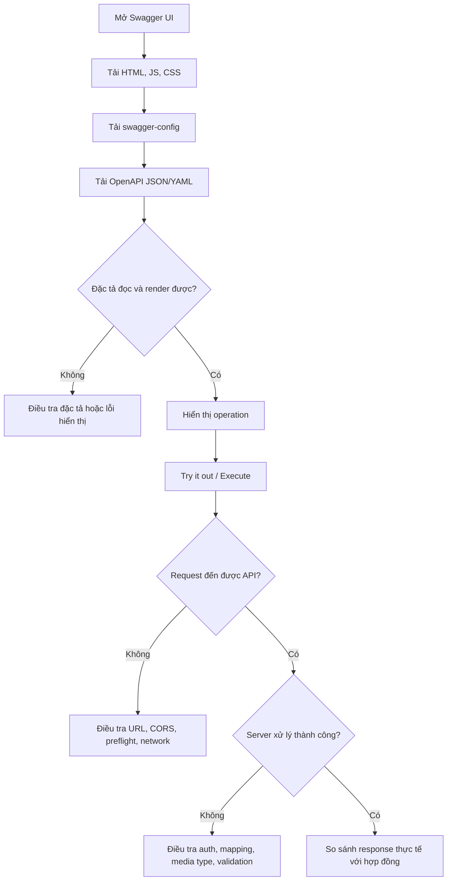

# Phân biệt lỗi đặc tả với lỗi hiển thị hoặc gửi request của trình duyệt

Khi Swagger UI không hoạt động như mong đợi, nguyên nhân có thể nằm ở ba lớp khác nhau: đặc tả OpenAPI được springdoc tạo ra, giao diện Swagger UI trong trình duyệt hoặc request HTTP mà trình duyệt gửi đến API. Ba lớp này liên quan với nhau nhưng có cách kiểm tra và cách sửa khác nhau.

Một tài liệu OpenAPI có thể hợp lệ nhưng Swagger UI không tải được do lỗi JavaScript, tài nguyên tĩnh, CORS hoặc cấu hình URL. Ngược lại, giao diện có thể hiển thị đầy đủ operation nhưng request **Try it out** thất bại vì server trả `401`, `404`, `415` hoặc lỗi validation. Vì vậy, cần xác định request nào thất bại và dữ liệu nào sai trước khi sửa annotation hoặc cấu hình.

## 1. Ba lớp cần phân biệt

| Lớp | Thành phần | Câu hỏi cần trả lời | Dấu hiệu thường gặp |
| --- | --- | --- | --- |
| Đặc tả OpenAPI | springdoc, `/v3/api-docs`, schema, paths, responses, security | Tài liệu JSON/YAML có được sinh ra và mô tả đúng hợp đồng không? | JSON lỗi, thiếu operation, `$ref` không tồn tại, schema hoặc security requirement sai. |
| Hiển thị Swagger UI | HTML, JavaScript, CSS, `swagger-config`, trình duyệt | Giao diện có tải cấu hình và đặc tả, rồi render đúng không? | Trang trắng, lỗi tải API definition, lỗi JavaScript, CSS không tải, CORS khi tải document. |
| Gửi request từ trình duyệt | Try it out, URL, headers, body, CORS, Spring Security, controller | Request thực tế có đúng và server có xử lý thành công không? | `401`, `403`, `404`, `400`, `415`, preflight thất bại hoặc response không đúng tài liệu. |

Phân loại này giúp tránh sửa sai tầng. Ví dụ, thay `@Schema` không sửa được lỗi CORS; mở quyền truy cập Swagger UI không sửa được request body sai định dạng; còn chỉnh CSS không làm endpoint trả đúng status code.

## 2. Hiểu luồng trước khi chẩn đoán

Trong cấu hình phổ biến, trình duyệt tải Swagger UI theo thứ tự sau:

1. Mở trang vào giao diện, thường là `/swagger-ui.html`.
2. Tải HTML, JavaScript và CSS từ các tài nguyên `/swagger-ui/**`.
3. Gọi `/v3/api-docs/swagger-config` để nhận cấu hình giao diện.
4. Đọc `url` hoặc `urls` trong cấu hình và tải OpenAPI document, thường là `/v3/api-docs` hoặc `/v3/api-docs/{group}`.
5. Phân tích đặc tả và hiển thị tags, operations, parameters, schemas, responses.
6. Khi người dùng chọn **Try it out** rồi **Execute**, Swagger UI tạo request theo đặc tả và gửi đến URL API.



Mỗi bước tạo ra một request riêng trong Network tab. Hãy xác định request đầu tiên thất bại thay vì chỉ nhìn thông báo tổng quát trên trang Swagger UI.

## 3. Bước đầu tiên: kiểm tra OpenAPI document trực tiếp

Mở endpoint tài liệu trong tab trình duyệt hoặc dùng curl:

```bash
curl -i http://localhost:8080/v3/api-docs
```

Với một nhóm tài liệu:

```bash
curl -i http://localhost:8080/v3/api-docs/store-v1
```

Nếu ứng dụng đổi `springdoc.api-docs.path`, dùng base path đã cấu hình. Kiểm tra các điểm sau:

- HTTP status có phải `200` không?
- `Content-Type` có phải JSON phù hợp không?
- Response có phải JSON OpenAPI hay là HTML trang đăng nhập/proxy error?
- Có trường `openapi` với phiên bản OpenAPI mà ứng dụng dự định công bố không?
- Có `paths` và operation cần thiết không?
- Các schema tham chiếu trong `$ref` có tồn tại không?

Một response `200` chưa đủ chứng minh đặc tả đúng. Ví dụ, reverse proxy có thể trả trang HTML với status `200`, hoặc JSON hợp lệ về cú pháp nhưng thiếu operation cần thiết.

Kiểm tra riêng endpoint cấu hình Swagger UI:

```bash
curl -i http://localhost:8080/v3/api-docs/swagger-config
```

`swagger-config` phải trả JSON cấu hình, thường có `url` hoặc `urls` trỏ đến OpenAPI document. Nếu endpoint này bị chặn hoặc trả sai nội dung, Swagger UI có thể báo không tải được cấu hình dù `/v3/api-docs` vẫn hoạt động khi mở trực tiếp.

## 4. Nhận diện lỗi thuộc đặc tả OpenAPI

Lỗi thuộc đặc tả khi document không được sinh ra, không hợp lệ hoặc mô tả khác với hợp đồng API mong muốn.

Các dấu hiệu thường gặp:

- `/v3/api-docs` trả `500` do exception trong quá trình phân giải model, annotation hoặc customizer.
- JSON không parse được hoặc trường bắt buộc trong OpenAPI bị thiếu.
- `paths` không chứa endpoint dù controller đã được đăng ký.
- Operation có method, path, parameter hoặc request body không đúng.
- Schema dùng sai `type`, `format`, `required`, `enum`, `additionalProperties` hoặc giới hạn.
- `$ref` trỏ đến component không tồn tại.
- `security` hoặc `securitySchemes` không phản ánh cơ chế xác thực được công bố.
- Response code, media type, header hoặc example khác với response thực tế.

Ví dụ: controller nhận `LocalDate` qua query parameter nhưng tài liệu mô tả thành chuỗi tùy ý không có `format: date`. Đây là vấn đề schema/metadata. Nếu controller nhận đúng ngày nhưng server từ chối vì ngày nằm ngoài quy tắc nghiệp vụ, đó là vấn đề runtime validation.

### Kiểm tra path và operation

Tìm path và method trong `paths`:

```yaml
paths:
  /api/orders/{id}:
    get:
      operationId: getOrder
      parameters:
        - name: id
          in: path
          required: true
          schema:
            type: string
            format: uuid
```

Nếu path không xuất hiện, kiểm tra mapping của controller, package/path filter của `GroupedOpenApi`, annotation ẩn và cấu hình nhóm. Nếu path xuất hiện nhưng method sai, kiểm tra mapping Spring MVC và cách endpoint được phát hiện.

### Kiểm tra schema và `$ref`

Ví dụ response tham chiếu schema:

```yaml
responses:
  '200':
    description: Đơn hàng được tìm thấy
    content:
      application/json:
        schema:
          $ref: '#/components/schemas/OrderResponse'
```

Đích tham chiếu cần tồn tại trong `components.schemas`. Khi tự thêm schema bằng customizer hoặc `ModelConverter`, cần bảo đảm mọi schema phụ cũng được đăng ký. `$ref` thiếu đích có thể khiến công cụ validate hoặc render không đọc được một phần document.

### Kiểm tra media type và security

Với request body, kiểm tra `requestBody.content` có media type đúng như controller nhận. Với response, kiểm tra `responses[status].content`. Nếu API yêu cầu bearer token, kiểm tra cả `components.securitySchemes` và `security` ở cấp operation hoặc document. Chỉ khai báo security scheme mà không gắn security requirement có thể khiến Swagger UI không biết operation cần token.

## 5. Nhận diện lỗi thuộc hiển thị Swagger UI

Nếu OpenAPI document mở trực tiếp và có nội dung hợp lệ nhưng Swagger UI không hiển thị đúng, tập trung vào giao diện và các request phục vụ nó:

| Request | Vai trò | Dấu hiệu lỗi |
| --- | --- | --- |
| `/swagger-ui.html` | URL vào giao diện | `404`, redirect sai hoặc bị Spring Security chặn. |
| `/swagger-ui/**` | JavaScript, CSS, font và hình ảnh | `404`, content type sai, CSP hoặc cache cũ. |
| `/v3/api-docs/swagger-config` | Cấu hình UI | `401`, `403`, `404`, JSON lỗi hoặc URL document không đúng. |
| `/v3/api-docs` hoặc group URL | OpenAPI document | Tải lỗi, trả HTML, JSON không hợp lệ hoặc CORS. |

Thông báo như *Failed to load API definition* không xác định duy nhất nguyên nhân. Nó có thể xuất hiện khi URL document sai, server trả `401`, JSON lỗi, CORS chặn việc đọc response hoặc Swagger UI không hiểu định dạng đặc tả.

Hãy mở Developer Tools:

1. Tab **Network**, bật Preserve log nếu có redirect.
2. Reload trang Swagger UI.
3. Lọc theo `swagger`, `api-docs`, `js`, `css`.
4. Xem request URL, status, response body và `Content-Type`.
5. Tab **Console** để tìm lỗi JavaScript, CSP, mixed content hoặc CORS.

Không kết luận rằng springdoc sinh sai tài liệu chỉ vì giao diện trắng. Nếu document tải trực tiếp bình thường, hãy xác định lỗi ở `swagger-config`, tài nguyên UI, cache, CSP hoặc khả năng tương thích của Swagger UI.

## 6. Lỗi khi `Try it out` gửi request

Khi operation đã hiển thị và người dùng bấm **Execute**, Swagger UI tạo một HTTP request dựa trên:

- `servers` trong OpenAPI document.
- Path và HTTP method của operation.
- Path/query/header/cookie parameters.
- Request body và media type.
- Security requirement cùng thông tin đã nhập trong **Authorize**.

Kiểm tra request thật trong Network tab hoặc phần **Curl** mà Swagger UI hiển thị. Đối chiếu URL, method, query string, request headers và body với controller. Không chỉ nhìn response summary; hãy mở request và response thô.

Một số status thường gặp:

| Status hoặc dấu hiệu | Ý nghĩa thường gặp | Nơi cần kiểm tra |
| --- | --- | --- |
| `400 Bad Request` | JSON sai, binding thất bại hoặc validation không qua | Request body, parameter, Jackson converter, Bean Validation và error handler. |
| `401 Unauthorized` | Thiếu hoặc không hợp lệ thông tin xác thực | Security scheme, nút Authorize, header `Authorization`, token và Spring Security. |
| `403 Forbidden` | Đã xác thực nhưng không đủ quyền, hoặc CSRF/policy từ chối | Role/authority, method security, CSRF và access rules. |
| `404 Not Found` | URL/path không khớp endpoint hoặc base path sai | `servers`, context path, reverse proxy, controller mapping và path variable. |
| `405 Method Not Allowed` | URL tồn tại nhưng HTTP method không được hỗ trợ | Method trong operation và mapping của controller. |
| `406 Not Acceptable` | Server không tạo được response theo `Accept` | `Accept`, `produces` và message converter. |
| `415 Unsupported Media Type` | Request `Content-Type` không được endpoint/converter hỗ trợ | `Content-Type`, `consumes`, multipart part encoding và message converter. |
| `422 Unprocessable Content` | Server hiểu request nhưng từ chối xử lý theo quy tắc nghiệp vụ | Validation hoặc business rule; cách dùng status phụ thuộc API. |
| `500 Internal Server Error` | Lỗi trong server | Log ứng dụng, exception, service và hạ tầng. |

Status là manh mối, không phải kết luận. Ví dụ `404` có thể do endpoint không tồn tại, nhưng cũng có thể do proxy rewrite sai prefix hoặc security cố ý che endpoint.

## 7. Phân biệt CORS với lỗi API

CORS là chính sách của trình duyệt đối với request cross-origin. Swagger UI có thể mở từ `https://docs.example.com` nhưng gọi API ở `https://api.example.com`; khi đó API server phải cho phép origin của trang UI.

Với request cần preflight, trình duyệt gửi `OPTIONS` trước request thật. Preflight thường xảy ra khi request dùng method không đơn giản, header như `Authorization` hoặc `Content-Type: application/json`. Nếu preflight thất bại, request nghiệp vụ có thể chưa được gửi.

Kiểm tra response `OPTIONS` có các header phù hợp, ví dụ:

```http
Access-Control-Allow-Origin: https://docs.example.com
Access-Control-Allow-Methods: GET, POST, PUT, DELETE, OPTIONS
Access-Control-Allow-Headers: Authorization, Content-Type
```

Nếu frontend cần đọc các response header tùy chỉnh như `ETag`, `Link` hoặc `X-Total-Count`, server còn cần expose chúng qua `Access-Control-Expose-Headers`.

Phân biệt ba trường hợp:

- **Preflight thất bại:** xem request `OPTIONS`; API request thật thường chưa được gửi.
- **API request đã đến server nhưng browser báo CORS:** kiểm tra response API có thiếu `Access-Control-Allow-Origin` hoặc không khớp origin. Server có thể đã xử lý request dù JavaScript không đọc được response.
- **Không có CORS:** nếu UI và API cùng origin, lỗi thường nằm ở URL, xác thực hoặc xử lý API chứ không phải CORS.

Không dùng `Access-Control-Allow-Origin: *` cùng credentials. Nếu cần cookie hoặc HTTP credentials, cấu hình origin cụ thể và bật credentials theo chính sách của ứng dụng.

## 8. Phân biệt lỗi xác thực với lỗi mô tả security

Swagger UI chỉ gửi thông tin xác thực theo security scheme và requirement trong OpenAPI cùng lựa chọn mà người dùng nhập ở **Authorize**. Ví dụ bearer JWT cần khai báo HTTP bearer scheme và gắn requirement vào operation hoặc document.

Nếu nút **Authorize** không xuất hiện, hoặc operation không có biểu tượng bảo mật như mong đợi, kiểm tra `components.securitySchemes` và `security` trong OpenAPI. Đây là lỗi mô tả hợp đồng.

Nếu UI hiển thị bảo mật đúng nhưng request trả `401` hoặc `403`, kiểm tra token, header `Authorization`, issuer/audience, thời hạn, role và Spring Security. Đây là lỗi xác thực/phân quyền runtime hoặc thông tin credential được gửi không đúng.

Ngược lại, nếu tài liệu không khai báo bảo mật nhưng server vẫn yêu cầu token, UI có thể gửi request thiếu token. Cần đồng bộ OpenAPI security requirement với cấu hình runtime; việc thêm `@SecurityRequirement` không tự bật Spring Security.

## 9. Kiểm tra URL `servers`, context path và reverse proxy

Swagger UI tạo URL request từ server URL và path operation. Nếu trường `servers` sai, request có thể gửi đến host hoặc prefix không đúng dù path trong `paths` hoàn toàn chính xác.

Ví dụ document công bố:

```yaml
servers:
  - url: https://api.example.com/service
paths:
  /orders:
    get:
      responses:
        '200':
          description: OK
```

Request được tạo sẽ dùng base URL trong `servers` kết hợp với `/orders`. Nếu reverse proxy public API dưới `/service` nhưng ứng dụng không nhận diện forwarded prefix, OpenAPI có thể sinh server URL thiếu hoặc thừa prefix.

Kiểm tra:

- `server.servlet.context-path` và servlet path.
- `springdoc.api-docs.path` và `springdoc.swagger-ui.path`.
- `Forwarded`, `X-Forwarded-Host`, `X-Forwarded-Proto`, `X-Forwarded-Prefix` do proxy gửi.
- `server.forward-headers-strategy`.
- `servers` trong document và Request URL thực tế trong Network tab.

Chỉ tin forwarded headers từ reverse proxy được kiểm soát. Không giải quyết lỗi URL bằng cách thêm prefix vào mọi controller mapping nếu nguyên nhân thực sự là proxy hoặc `servers` sai.

## 10. So sánh hợp đồng với hành vi runtime

Một OpenAPI document hợp lệ không bảo đảm endpoint thực thi đúng. Cần xác minh riêng hai phía:

| Nội dung | Kiểm tra hợp đồng OpenAPI | Kiểm tra runtime |
| --- | --- | --- |
| Path/method | `paths` có đúng path và method không? | Request URL/method có được controller nhận không? |
| Parameter | Tên, `in`, `required`, schema và example có đúng không? | Spring có bind được giá trị và áp dụng default không? |
| Request body | Media type và schema có đúng không? | Jackson/message converter có deserialize được không? |
| Validation | Constraint có được mô tả không? | Bean Validation/business rule có thực thi không? |
| Security | Scheme và requirement có được công bố không? | Spring Security có xác thực và phân quyền đúng không? |
| Response | Status, headers, media type và schema có đúng không? | Server có trả đúng status/header/body không? |

Ví dụ tài liệu công bố `201 Created` nhưng controller trả `200 OK`. Swagger UI vẫn có thể hiển thị operation và gửi request thành công; vấn đề là hợp đồng và runtime không khớp. Tương tự, `@ApiResponse(responseCode = "400")` chỉ mô tả response, không tự làm controller trả `400`.

## 11. Kiểm tra tự động trong dự án

Nên có ít nhất hai loại kiểm thử:

**Kiểm thử tài liệu:** gọi `/v3/api-docs`, parse JSON và kiểm tra những hợp đồng quan trọng như path, operation, schema, security và response code. Có thể dùng OpenAPI validator/linter trong CI để phát hiện cấu trúc không hợp lệ, `$ref` hỏng hoặc quy ước tài liệu không nhất quán.

**Kiểm thử HTTP:** dùng MockMvc hoặc WebTestClient để gửi request thực tế, kiểm tra status, header, content type và body. Bao gồm request hợp lệ, request sai định dạng, thiếu quyền và trường hợp không tìm thấy tài nguyên.

Ví dụ kiểm tra tài liệu bằng MockMvc:

```java
@SpringBootTest
@AutoConfigureMockMvc
class OpenApiDocumentTest {

    @Autowired
    MockMvc mockMvc;

    @Test
    void exposesOrdersGetOperation() throws Exception {
        mockMvc.perform(get("/v3/api-docs"))
            .andExpect(status().isOk())
            .andExpect(jsonPath("$.openapi").exists())
            .andExpect(jsonPath("$['paths']['/api/orders']['get']").exists());
    }
}
```

Test này chỉ xác nhận document được phục vụ và có operation đã chọn. Nó chưa chứng minh schema đầy đủ hoặc endpoint thực thi đúng; cần thêm assertion cho những trường hợp quan trọng và kiểm thử HTTP riêng.
Nếu endpoint tài liệu được bảo vệ bằng Spring Security, hãy cung cấp authentication phù hợp trong test hoặc dùng cấu hình kiểm thử tương ứng.

## 12. Quy trình chẩn đoán theo triệu chứng

| Triệu chứng | Bước kiểm tra đầu tiên | Lớp có khả năng liên quan |
| --- | --- | --- |
| `/v3/api-docs` trả `500` | Đọc log springdoc và exception khi resolve schema/customizer | Sinh đặc tả |
| `/v3/api-docs` trả HTML hoặc redirect | Kiểm tra Spring Security, proxy và response `Content-Type` | Endpoint tài liệu/triển khai |
| OpenAPI JSON hợp lệ nhưng thiếu operation | Kiểm tra controller mapping, group filters, `@Hidden` | Đặc tả |
| JSON tải được nhưng Swagger UI trắng | Kiểm tra `swagger-config`, JavaScript, CSS và Console | Hiển thị |
| Swagger UI báo Failed to load API definition | Xem request tải document, status, response body và CORS | Hiển thị hoặc endpoint tài liệu |
| Operation hiển thị nhưng Try it out gọi sai host/path | Kiểm tra `servers`, context path và proxy prefix | Tạo request |
| Request không có Authorization | Kiểm tra security requirement và trạng thái Authorize | Đặc tả security/UI |
| Request có token nhưng trả `401`/`403` | Kiểm tra token và Spring Security | Runtime security |
| Request trả `415` | Kiểm tra `Content-Type`, `consumes`, multipart encoding | Runtime binding |
| Request trả `400` | Kiểm tra JSON, parameter conversion và validation | Runtime binding/validation |
| Request trả `404`/`405` | So sánh URL/method với controller mapping và proxy | Routing/runtime |
| Browser báo CORS | Kiểm tra preflight `OPTIONS` và response CORS của API | Trình duyệt/network |
| Curl thành công nhưng browser thất bại | So sánh origin, preflight, credentials và header browser gửi | Trình duyệt/network |

## 13. Checklist thực hành

Khi gặp sự cố Swagger UI, thực hiện theo thứ tự:

1. Gọi trực tiếp `/v3/api-docs` hoặc group document để xác nhận đặc tả có được sinh ra.
2. Gọi `/v3/api-docs/swagger-config` để xác nhận cấu hình UI trỏ đúng document.
3. Kiểm tra trang UI và tài nguyên `/swagger-ui/**` trong Network tab.
4. Nếu UI render được, chọn một operation và kiểm tra request URL, method, headers, body trước khi Execute.
5. Nếu request cross-origin, kiểm tra preflight và CORS; nếu có token, kiểm tra security requirement và header Authorization.
6. Đọc response HTTP thô và log server để phân biệt request không đến server với request bị server từ chối.
7. So sánh response thực tế với status, header, media type và schema đã công bố.
8. Thêm kiểm thử tài liệu và kiểm thử runtime để ngăn lỗi tái diễn.

Không sửa nhiều lớp cùng lúc. Mỗi lần chỉ thay đổi cấu hình hoặc annotation liên quan đến request đã xác định, rồi kiểm tra lại cùng một bước để biết nguyên nhân đã được xử lý hay chưa.

## 14. Nguyên tắc áp dụng

- Kiểm tra OpenAPI JSON/YAML trực tiếp trước khi kết luận Swagger UI sinh sai tài liệu.
- Dùng Network và Console để xác định chính xác request UI, config, document hoặc API bị lỗi.
- Phân biệt lỗi parse/render đặc tả với lỗi tải tài nguyên tĩnh.
- Khi Try it out thất bại, đối chiếu request thực tế với `servers`, operation, parameter, body và security requirement.
- Phân loại status `400`, `401`, `403`, `404`, `405`, `406`, `415` và `500` theo tầng xử lý liên quan.
- Kiểm tra preflight `OPTIONS` trước khi sửa controller nếu trình duyệt báo CORS.
- Đồng bộ OpenAPI với Spring MVC, Jackson, validation và Spring Security.
- Duy trì kiểm thử tài liệu và kiểm thử HTTP như hai phần riêng của kiểm thử hợp đồng.

Swagger UI là công cụ đọc đặc tả và gửi request thử; nó không bảo đảm tài liệu đúng hoặc API runtime hoạt động đúng. Khi tách riêng lỗi sinh OpenAPI, lỗi render giao diện và lỗi request trình duyệt, việc chẩn đoán trở nên có bằng chứng: URL nào thất bại, response nào được trả về và hợp đồng nào không khớp. Từ đó có thể sửa đúng lớp và kiểm tra lại bằng tài liệu thô lẫn HTTP thực tế.

## Tài liệu tham khảo

- [Springdoc OpenAPI – tài liệu chính thức](https://springdoc.org/)
- [Springdoc OpenAPI FAQ – Swagger UI và OpenAPI endpoints](https://springdoc.org/faq.html)
- [Swagger UI – Configuration and usage](https://swagger.io/docs/open-source-tools/swagger-ui/usage/)
- [OpenAPI Specification](https://spec.openapis.org/oas/latest.html)
- [MDN – CORS](https://developer.mozilla.org/en-US/docs/Web/HTTP/CORS)
