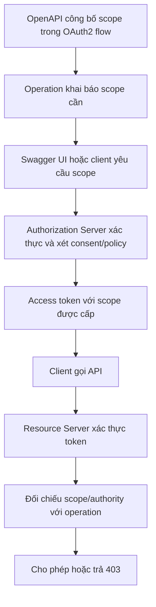

# Scope được công bố, scope được yêu cầu và scope được cấp thực tế

Khi mô tả OAuth 2.0 hoặc OpenID Connect trong OpenAPI, từ “scope” xuất hiện ở nhiều giai đoạn khác nhau. Một scope có thể được công bố trong định nghĩa OAuth2 flow, được yêu cầu cho một operation, được client xin trong authorization request và cuối cùng được authorization server cấp trong access token. Những danh sách này có liên quan nhưng không đồng nghĩa.

Với Springdoc, cần phân biệt ba lớp chính:

1. **Scope được công bố**: danh mục scope được mô tả trong `components.securitySchemes.<scheme>.flows.<flow>.scopes`.
2. **Scope được yêu cầu**: scope mà operation cần, khai báo trong `security` của OpenAPI document hoặc operation.
3. **Scope được cấp thực tế**: quyền authorization server thực sự cấp cho client và thể hiện trong access token hoặc kết quả introspection.

Ví dụ API công bố `orders:read` và `orders:write`; operation đọc đơn hàng yêu cầu `orders:read`; client xin cả hai scope nhưng authorization server chỉ cấp `orders:read`. Token đó có thể gọi operation đọc, nhưng không đủ quyền để gọi operation cập nhật. OpenAPI mô tả hợp đồng và nhu cầu của operation; authorization server và resource server quyết định scope nào được cấp và có được chấp nhận ở runtime hay không.

## 1. Ba lớp scope trong một luồng OAuth2

Hãy xem API đơn hàng có hai operation:

| Operation | Scope cần thiết |
|---|---|
| `GET /api/orders/{id}` | `orders:read` |
| `POST /api/orders` | `orders:write` |

Authorization server hỗ trợ cả hai scope. Client có thể yêu cầu một hoặc cả hai tùy tác vụ. Sau khi người dùng đăng nhập và đồng ý, authorization server cấp access token với scope được chấp thuận theo chính sách của nó.



Các lớp có thể khác nhau:

| Lớp | Ví dụ | Nơi được mô tả hoặc kiểm tra |
|---|---|---|
| Scope được công bố | `orders:read`, `orders:write` | OAuth2 Flow Object trong OpenAPI; danh mục scope của authorization server |
| Scope được yêu cầu cho operation | `orders:read` | Security Requirement của operation |
| Scope client xin | `orders:read orders:write` | Authorization request hoặc token request tùy flow |
| Scope được cấp | `orders:read` | Token response, claim của access token hoặc introspection response |
| Scope được kiểm tra | `SCOPE_orders:read` | Authorization rule của resource server, ví dụ Spring Security |

Không nên dùng một danh sách scope duy nhất cho cả năm vai trò. Danh mục công bố có thể lớn hơn scope cần của một operation; client có thể xin nhiều scope; authorization server có thể cấp ít hơn; resource server phải kiểm tra quyền thực tế trong token.

## 2. Scope được công bố trong OAuth2 Flow Object

Trong OpenAPI, OAuth2 Security Scheme mô tả một hoặc nhiều flow. Mỗi flow có map `scopes`, trong đó key là tên scope và value là mô tả cho người tích hợp.

```yaml
components:
  securitySchemes:
    ordersOAuth:
      type: oauth2
      flows:
        authorizationCode:
          authorizationUrl: https://identity.example.com/oauth2/authorize
          tokenUrl: https://identity.example.com/oauth2/token
          scopes:
            orders:read: Đọc thông tin đơn hàng
            orders:write: Tạo và cập nhật đơn hàng
            orders:cancel: Hủy đơn hàng
```

Map `scopes` là danh mục scope được tài liệu công bố cho flow đó. Nó giúp Swagger UI, client generator và người đọc biết authorization server/API có những scope nào theo hợp đồng. OpenAPI không tự truy vấn authorization server để xác nhận scope có tồn tại hoặc client hiện tại có được cấp scope đó hay không.

Tên scope thường được tổ chức theo tài nguyên và hành động, ví dụ `orders:read`, `orders:write`, `customers:read`. Dấu `:` chỉ là quy ước đặt tên; OAuth2 không bắt buộc phải dùng cú pháp này. Hãy giữ tên ổn định, phân biệt chữ hoa/chữ thường và tránh đổi tên tùy tiện vì client, authorization server và resource server đều có thể phụ thuộc vào chúng.

Mô tả scope nên nói rõ hành động hoặc dữ liệu được phép truy cập. Tránh các tên quá rộng như `admin` nếu API có thể phân chia quyền theo tài nguyên và hành động cụ thể.

## 3. Scope được yêu cầu trong Security Requirement

Danh mục scope được công bố không có nghĩa operation tự động yêu cầu tất cả scope. Operation chỉ rõ scope cần thiết bằng `security`.

```yaml
paths:
  /api/orders/{id}:
    get:
      operationId: getOrder
      security:
        - ordersOAuth:
            - orders:read
      responses:
        '200':
          description: Chi tiết đơn hàng
  /api/orders:
    post:
      operationId: createOrder
      security:
        - ordersOAuth:
            - orders:write
      responses:
        '201':
          description: Đơn hàng đã được tạo
```

Operation `getOrder` yêu cầu `orders:read`; `createOrder` yêu cầu `orders:write`. Không cần yêu cầu `orders:write` chỉ vì scope đó được công bố trong cùng flow.

Security Requirement Object tham chiếu scheme theo tên và liệt kê các scope cần cho operation. Tên scheme phải khớp với key trong `components.securitySchemes`; tên scope phải khớp với scope được khai báo trong flow. Đây là metadata hợp đồng, không phải biểu thức được Spring Security tự động đọc để cấu hình authorization.

### Nhiều scope trong cùng requirement

```yaml
security:
  - ordersOAuth:
      - orders:read
      - customers:read
```

Với cùng một OAuth2 scheme, các scope trong một Security Requirement Object đều được yêu cầu. Client cần token có cả `orders:read` và `customers:read` để đáp ứng operation này.

### Nhiều requirement object là các phương án OR

```yaml
security:
  - ordersOAuth:
      - orders:read
  - partnerOAuth:
      - partner:orders:view
```

Client có thể đáp ứng bằng một trong hai phương án: token của `ordersOAuth` có `orders:read`, hoặc token của `partnerOAuth` có `partner:orders:view`. Không yêu cầu đồng thời cả hai token.

## 4. Scope client yêu cầu trong authorization request

Với Authorization Code Flow, client chuyển hướng người dùng đến authorization endpoint. Tham số `scope` trong authorization request thể hiện các scope client xin. Ví dụ minh họa:

```http
GET /oauth2/authorize?response_type=code&client_id=orders-web&redirect_uri=https%3A%2F%2Fclient.example.com%2Fcallback&scope=orders%3Aread%20orders%3Awrite&state=abc123 HTTP/1.1
Host: identity.example.com
```

Trong request trên, client xin hai scope `orders:read` và `orders:write`. Với ứng dụng production, Authorization Code Flow nên dùng PKCE và kiểm tra `state`; URL trên chỉ minh họa vị trí của tham số `scope`, không phải mẫu đầy đủ để triển khai bảo mật.

Scope trong authorization request là yêu cầu của client gửi đến authorization server. Nó không chứng minh authorization server đã cấp tất cả scope đó. Server có thể áp dụng policy theo client, người dùng, consent, tenant hoặc resource, rồi cấp tập scope phù hợp.

Với các flow khác, vị trí gửi scope có thể khác. Ví dụ Client Credentials Flow gửi scope trong token request đến token endpoint. Hãy mô tả đúng flow được sử dụng; không áp dụng cách chuyển hướng browser của Authorization Code cho mọi flow OAuth2.

## 5. Scope được cấp thực tế trong token response

Authorization server trả access token sau khi xử lý yêu cầu. Ví dụ:

```json
{
  "access_token": "<ACCESS_TOKEN>",
  "token_type": "Bearer",
  "expires_in": 3600,
  "scope": "orders:read"
}
```

Client đã xin `orders:read orders:write`, nhưng server chỉ cấp `orders:read`. Client phải sử dụng quyền thực tế được cấp, không được giả định `orders:write` vẫn tồn tại chỉ vì đã gửi trong request.

Theo OAuth 2.0, nếu scope được cấp khác scope đã yêu cầu, token response phải có tham số `scope` để chỉ rõ scope thực tế. Nếu scope được cấp giống hệt scope yêu cầu, tham số `scope` trong token response có thể được lược bỏ. Vì vậy, việc response không có trường `scope` không nhất thiết có nghĩa token không có scope; client cần áp dụng đúng quy tắc giao thức và đặc tả của authorization server.

Nếu token response chứa scope, giá trị thường là chuỗi các scope token phân tách bằng dấu cách. Đây là cách biểu diễn trên wire của OAuth2; trong OpenAPI Security Requirement, scope được ghi thành các phần tử riêng trong mảng YAML/JSON.

Không đưa access token thật vào tài liệu, ví dụ công khai, log hoặc source control. Các token trong bài chỉ là placeholder.

## 6. Scope trong JWT Access Token và Opaque Token

Resource server cần xác định scope được cấp từ access token đã xác thực. Cách đọc phụ thuộc định dạng token và hợp đồng của identity provider.

### JWT access token

JWT có thể chứa claim scope, ví dụ:

```json
{
  "iss": "https://identity.example.com",
  "sub": "user-42",
  "aud": ["orders-api"],
  "scope": "orders:read",
  "exp": 1893456000
}
```

Một provider khác có thể dùng claim `scp` dạng mảng:

```json
{
  "sub": "user-42",
  "scp": ["orders:read", "customers:read"]
}
```

Không có một tên claim duy nhất bắt buộc cho mọi JWT access token. Resource server phải tuân theo hợp đồng token của issuer và xác thực chữ ký, issuer, audience, thời hạn cùng các điều kiện liên quan trước khi tin claim. Chỉ giải mã Base64 của JWT không chứng minh token hợp lệ.

### Opaque access token

Opaque token không tự mang các claim JWT có thể đọc cục bộ. Resource server thường xác minh token qua introspection endpoint hoặc cơ chế mà authorization server cung cấp. Introspection response có thể trả `active` và `scope` cùng các metadata khác.

Không giả định mọi access token đều là JWT. Cấu hình resource server phải khớp loại token thực tế của hệ thống.

## 7. Ánh xạ scope thành authority trong Spring Security

Với Spring Security Resource Server JWT, `JwtGrantedAuthoritiesConverter` mặc định có thể đọc scope từ claim `scope` hoặc `scp` và tạo authority có tiền tố `SCOPE_`.

Ví dụ token có:

```json
{
  "scope": "orders:read orders:write"
}
```

Các authority tương ứng thường là:

```text
SCOPE_orders:read
SCOPE_orders:write
```

Có thể bảo vệ endpoint bằng authority:

```java
import org.springframework.context.annotation.Bean;
import org.springframework.context.annotation.Configuration;
import org.springframework.http.HttpMethod;
import org.springframework.security.config.Customizer;
import org.springframework.security.config.annotation.web.builders.HttpSecurity;
import org.springframework.security.web.SecurityFilterChain;

@Configuration
class ApiSecurityConfiguration {

    @Bean
    SecurityFilterChain apiSecurity(HttpSecurity http) throws Exception {
        return http
            .authorizeHttpRequests(authorize -> authorize
                .requestMatchers(HttpMethod.GET, "/api/orders/**")
                    .hasAuthority("SCOPE_orders:read")
                .requestMatchers(HttpMethod.POST, "/api/orders")
                    .hasAuthority("SCOPE_orders:write")
                .anyRequest().authenticated()
            )
            .oauth2ResourceServer(oauth2 -> oauth2.jwt(Customizer.withDefaults()))
            .build();
    }
}
```

Ví dụ giả định ứng dụng đã cấu hình `JwtDecoder` hoặc issuer phù hợp. Nếu issuer phát hành claim tùy chỉnh như `permissions`, cần cấu hình converter để ánh xạ claim đó thành `GrantedAuthority`; không nên mặc định Spring Security tự hiểu mọi claim tùy ý.

Có thể kiểm tra scope ở method bằng `@PreAuthorize`, sau khi bật method security:

```java
import org.springframework.security.access.prepost.PreAuthorize;
import org.springframework.stereotype.Service;

@Service
class OrderQueryService {

    @PreAuthorize("hasAuthority('SCOPE_orders:read')")
    OrderResponse getOrder(Long id) {
        // Đọc đơn hàng sau khi authorization thành công.
        return loadOrder(id);
    }
}
```

Scope trong OpenAPI và authority trong Spring Security cần cùng phản ánh chính sách. Springdoc không tự đọc `@PreAuthorize` hoặc `hasAuthority(...)` để suy ra scope trong OpenAPI một cách tổng quát; hãy khai báo tài liệu rõ ràng và kiểm thử sự nhất quán.

## 8. Khai báo scope được công bố bằng Springdoc annotations

Springdoc dùng Swagger annotations để tạo OAuth2 Security Scheme. `@OAuthScope` định nghĩa từng scope trong flow.

```java
import io.swagger.v3.oas.annotations.enums.SecuritySchemeType;
import io.swagger.v3.oas.annotations.security.OAuthFlow;
import io.swagger.v3.oas.annotations.security.OAuthFlows;
import io.swagger.v3.oas.annotations.security.OAuthScope;
import io.swagger.v3.oas.annotations.security.SecurityScheme;
import org.springframework.context.annotation.Configuration;

@Configuration
@SecurityScheme(
    name = "ordersOAuth",
    type = SecuritySchemeType.OAUTH2,
    flows = @OAuthFlows(
        authorizationCode = @OAuthFlow(
            authorizationUrl = "https://identity.example.com/oauth2/authorize",
            tokenUrl = "https://identity.example.com/oauth2/token",
            scopes = {
                @OAuthScope(
                    name = "orders:read",
                    description = "Đọc thông tin đơn hàng"
                ),
                @OAuthScope(
                    name = "orders:write",
                    description = "Tạo và cập nhật đơn hàng"
                ),
                @OAuthScope(
                    name = "orders:cancel",
                    description = "Hủy đơn hàng"
                )
            }
        )
    )
)
class OAuth2OpenApiConfiguration {
}
```

Đây là danh mục scope được công bố. Annotation không cấp quyền cho client, không cấu hình client registration của authorization server và không tạo claim trong access token.

Nếu dùng nhiều flow trong cùng scheme, mỗi flow có thể công bố danh sách scope phù hợp. Hãy đối chiếu các URL authorization/token, flow và scope với identity provider thực tế. Không dùng URL ví dụ trong môi trường production.

## 9. Khai báo scope cần cho từng operation

Sau khi định nghĩa scheme, operation tham chiếu scope cần thiết bằng `@SecurityRequirement`:

```java
import io.swagger.v3.oas.annotations.Operation;
import io.swagger.v3.oas.annotations.security.SecurityRequirement;
import org.springframework.web.bind.annotation.GetMapping;
import org.springframework.web.bind.annotation.PathVariable;
import org.springframework.web.bind.annotation.PostMapping;
import org.springframework.web.bind.annotation.RestController;

@RestController
class OrderController {

    @GetMapping("/api/orders/{id}")
    @Operation(
        operationId = "getOrder",
        summary = "Lấy đơn hàng",
        security = @SecurityRequirement(
            name = "ordersOAuth",
            scopes = {"orders:read"}
        )
    )
    OrderResponse getOrder(@PathVariable Long id) {
        return orderService.getOrder(id);
    }

    @PostMapping("/api/orders")
    @Operation(
        operationId = "createOrder",
        summary = "Tạo đơn hàng",
        security = @SecurityRequirement(
            name = "ordersOAuth",
            scopes = {"orders:write"}
        )
    )
    OrderResponse createOrder() {
        return orderService.createOrder();
    }
}
```

Mỗi operation chỉ yêu cầu scope cần cho tác vụ đó. Nếu có root security requirement ở cấp document, security được khai báo riêng trên operation sẽ thay thế yêu cầu ở root cho operation đó. Hãy tránh vô tình đặt scope `orders:write` ở root nếu các endpoint chỉ đọc không cần quyền ghi.

Nếu một operation cần nhiều scope của cùng scheme, liệt kê tất cả trong `scopes`. Nếu có các phương án xác thực thay thế, dùng nhiều Security Requirement Object theo quy tắc OR và kiểm tra OpenAPI đầu ra.

## 10. Cấu hình programmatic tương đương

Khi cần tạo scope động từ cấu hình, có thể xây dựng OAuth2 scheme bằng OpenAPI model thay cho annotation:

```java
import io.swagger.v3.oas.models.Components;
import io.swagger.v3.oas.models.OpenAPI;
import io.swagger.v3.oas.models.info.Info;
import io.swagger.v3.oas.models.security.OAuthFlow;
import io.swagger.v3.oas.models.security.OAuthFlows;
import io.swagger.v3.oas.models.security.Scopes;
import io.swagger.v3.oas.models.security.SecurityScheme;
import org.springframework.context.annotation.Bean;
import org.springframework.context.annotation.Configuration;

@Configuration
class ProgrammaticOAuthConfiguration {

    @Bean
    OpenAPI ordersOpenApi() {
        Scopes scopes = new Scopes()
            .addString("orders:read", "Đọc thông tin đơn hàng")
            .addString("orders:write", "Tạo và cập nhật đơn hàng");

        SecurityScheme ordersOAuth = new SecurityScheme()
            .type(SecurityScheme.Type.OAUTH2)
            .flows(new OAuthFlows().authorizationCode(
                new OAuthFlow()
                    .authorizationUrl("https://identity.example.com/oauth2/authorize")
                    .tokenUrl("https://identity.example.com/oauth2/token")
                    .scopes(scopes)
            ));

        return new OpenAPI()
            .info(new Info().title("Orders API").version("1.0.0"))
            .components(new Components().addSecuritySchemes(
                "ordersOAuth",
                ordersOAuth
            ));
    }
}
```

Operation vẫn cần khai báo security requirement để chỉ ra scope được yêu cầu. Định nghĩa scheme chỉ công bố danh mục scope, không tự áp dụng mọi scope lên mọi operation.

Không nên khai báo cùng một scheme bằng cả annotation và bean nếu hai nguồn có thể tạo cấu hình mâu thuẫn. Chọn một nguồn cấu hình rõ ràng, sau đó kiểm tra document sinh ra.

## 11. Swagger UI và scope được yêu cầu

Khi OpenAPI document khai báo OAuth2 scheme cùng security requirement, Swagger UI có thể dùng thông tin đó trong luồng **Authorize**. Với Authorization Code Flow, giao diện chuyển hướng người dùng đến authorization server; các scope liên quan đến operation có thể được đưa vào authorization request theo cấu hình Swagger UI.

Một số cấu hình UI có thể cung cấp `clientId`, `clientSecret` (nếu client thực sự là confidential và UI được chạy trong môi trường phù hợp), `scopes` mặc định và `usePkceWithAuthorizationCodeGrant`. Ví dụ cấu hình Springdoc:

```yaml
springdoc:
  swagger-ui:
    oauth:
      clientId: orders-swagger-ui
      usePkceWithAuthorizationCodeGrant: true
```

Không nhúng client secret vào Swagger UI chạy trong trình duyệt công khai. Browser-based UI là public client; dùng PKCE và đăng ký redirect URI chính xác. `clientId` phải là client đã đăng ký ở authorization server, và redirect URI phải khớp cấu hình provider.

Trong giao diện Authorize, scope được chọn hoặc được yêu cầu không chứng minh token cuối cùng có đủ quyền. Authorization server có thể yêu cầu consent, áp dụng policy hoặc cấp scope hẹp hơn. Sau khi xác thực, hãy kiểm tra access token hoặc introspection theo cách an toàn để xác nhận quyền thực tế.

Nếu Swagger UI chỉ gửi một scope trong khi operation yêu cầu scope khác, kiểm tra OpenAPI Security Requirement, cấu hình OAuth UI và authorization request trong Network tab. Không sửa resource server để chấp nhận token thiếu quyền chỉ nhằm làm nút Try it out chạy thành công.

## 12. OIDC scopes không đồng nghĩa API authorization scopes

OpenID Connect mở rộng OAuth2 để xác thực người dùng. Scope `openid` là dấu hiệu yêu cầu một luồng OpenID Connect. Các scope chuẩn như `profile` và `email` yêu cầu thông tin về người dùng theo phạm vi OIDC.

Ví dụ:

```text
scope=openid profile email orders:read
```

Trong ví dụ, `openid`, `profile` và `email` liên quan đến yêu cầu OIDC/user claims; `orders:read` là scope nghiệp vụ mà API đơn hàng có thể dùng để kiểm soát quyền đọc dữ liệu. Việc provider cấp `profile` không có nghĩa client được phép đọc mọi đơn hàng.

Phân biệt token:

- **ID token**: chứa thông tin xác thực về người dùng dành cho client OIDC; không dùng thay access token để gọi resource server trừ khi một giao thức riêng quy định rõ.
- **Access token**: credentials mà client gửi đến API; resource server xác thực token và kiểm tra scope/authority.
- **Refresh token**: dùng để xin access token mới theo policy của authorization server; không gửi refresh token đến API nghiệp vụ.

Nếu mô tả OpenID Connect bằng `type: openIdConnect`, `openIdConnectUrl` trỏ đến discovery document của provider. Nếu cần mô tả OAuth2 API scopes cụ thể theo flow và endpoint, có thể dùng OAuth2 Security Scheme. Chọn mô hình phản ánh đúng giao thức client sử dụng và tránh coi scope OIDC về profile/email là quyền CRUD của API.

## 13. Scope được cấp có thể ít hơn scope được yêu cầu

Authorization server có quyền quyết định scope thực tế theo client, người dùng, consent, policy, tenant hoặc tài nguyên. Client không được giả định rằng mọi scope gửi trong authorization request đều được cấp.

Ví dụ:

| Giai đoạn | Scope |
|---|---|
| OpenAPI công bố | `orders:read`, `orders:write`, `orders:cancel` |
| Operation `GET /api/orders/{id}` yêu cầu | `orders:read` |
| Client xin | `orders:read orders:write` |
| Authorization server cấp | `orders:read` |
| Resource server cho phép | Đọc đơn hàng |
| Resource server từ chối | Tạo hoặc cập nhật đơn hàng |

Một token có scope rộng hơn scope tối thiểu của operation vẫn có thể gọi operation đó, nếu các điều kiện khác hợp lệ. Tuy nhiên, client nên xin quyền tối thiểu cần thiết để giảm rủi ro nếu token bị lộ.

Nếu authorization server cấp scope hẹp hơn, client nên điều chỉnh hành vi hoặc thông báo người dùng rằng thao tác không được cấp quyền. Không nên lặp lại authorization request liên tục để tìm cách có scope rộng hơn khi policy đã từ chối.

## 14. Khi scope được công bố, yêu cầu và cấp không khớp

| Sai lệch | Hậu quả | Cách xử lý |
|---|---|---|
| Operation yêu cầu scope chưa được khai báo trong flow | OpenAPI tham chiếu scope không có trong danh mục được công bố; UI/tooling có thể không mô tả hoặc xin đúng scope | Thêm scope vào flow nếu provider hỗ trợ, hoặc sửa requirement theo hợp đồng thật |
| OpenAPI công bố scope mà authorization server không hỗ trợ | Client có thể xin scope nhưng provider từ chối hoặc bỏ qua | Đồng bộ danh mục với cấu hình provider và kiểm thử authorization request |
| Client xin nhiều scope hơn server cấp | Token không có đủ quyền cho một số operation | Đọc scope thực tế, chỉ gọi operation phù hợp hoặc yêu cầu consent/policy đúng quy trình |
| Token có scope nhưng resource server không map thành authority | Request bị 403 dù claim chứa quyền | Kiểm tra claim name, converter và authority prefix |
| Resource server cho phép rộng hơn OpenAPI | Tài liệu đánh giá thấp quyền thực tế hoặc runtime thiếu kiểm soát | Review authorization rule và cập nhật hợp đồng sau khi chính sách được xác nhận |
| OpenAPI yêu cầu rộng hơn runtime | Swagger UI yêu cầu quyền không cần thiết hoặc client hiểu sai | Thu hẹp requirement theo chính sách API và xác nhận security test |
| Scope OIDC `profile` bị dùng như quyền đọc đơn hàng | Nhầm user information với resource authorization | Dùng API scope như `orders:read` cho quyền trên tài nguyên |
| Dùng ID token làm Bearer token cho API | Resource server có thể từ chối do sai audience/loại token | Gửi access token dành cho API resource server |

## 15. Kiểm tra OpenAPI document được Springdoc sinh ra

Sau khi chạy ứng dụng, mở `/v3/api-docs` hoặc document group tương ứng. Kiểm tra danh mục scope được công bố:

```bash
curl -s http://localhost:8080/v3/api-docs \
  | jq '.components.securitySchemes.ordersOAuth.flows.authorizationCode.scopes'
```

Kiểm tra scope yêu cầu của operation đọc:

```bash
curl -s http://localhost:8080/v3/api-docs \
  | jq '.paths["/api/orders/{id}"].get.security'
```

Kiểm tra operation tạo đơn:

```bash
curl -s http://localhost:8080/v3/api-docs \
  | jq '.paths["/api/orders"].post.security'
```

Đảm bảo:

- Tên scheme trong requirement tồn tại trong `components.securitySchemes`.
- Scope được yêu cầu có trong `flows.<flow>.scopes` của scheme tương ứng.
- Operation đọc không vô tình yêu cầu scope ghi.
- Operation công khai không kế thừa security requirement ngoài ý muốn.
- Từng group document có scheme và requirement phù hợp với các operation được lọc vào group.

Nếu dùng `@OpenAPIDefinition.security` ở root, operation không khai báo security riêng sẽ kế thừa requirement đó. Nếu muốn mỗi operation có scope khác nhau, có thể khai báo requirement riêng trên method hoặc dùng customizer để điều chỉnh model; kiểm tra output thay vì suy luận từ annotation source.

## 16. Kiểm tra token và authorization runtime

Tài liệu đúng chưa đủ; cần kiểm tra token thật hoặc token test do hệ thống phát hành. Với JWT, xác minh chữ ký, `iss`, `aud`, `exp` và claim scope theo hợp đồng issuer. Với opaque token, kiểm tra introspection hoặc cơ chế xác minh tương ứng.

Ma trận kiểm thử cho hai operation:

| Token | `GET /api/orders/{id}` | `POST /api/orders` |
|---|---|---|
| Không có token | `401 Unauthorized` | `401 Unauthorized` |
| Token có `orders:read` | Cho phép nếu các điều kiện khác hợp lệ | `403 Forbidden` |
| Token có `orders:write` | Tùy policy; thường thiếu quyền đọc nếu không cấp `orders:read` | Cho phép nếu các điều kiện khác hợp lệ |
| Token có cả hai scope | Cho phép | Cho phép |
| Token hết hạn/sai issuer/sai audience | Từ chối xác thực | Từ chối xác thực |

Status cụ thể còn phụ thuộc authentication entry point, authorization handler và policy ứng dụng. Thông thường thiếu hoặc token không hợp lệ dẫn đến 401; token hợp lệ nhưng thiếu authority dẫn đến 403.

Ví dụ test với Spring Security Test và JWT mock:

```java
import static org.springframework.security.test.web.servlet.request.SecurityMockMvcRequestPostProcessors.jwt;
import static org.springframework.test.web.servlet.request.MockMvcRequestBuilders.get;
import static org.springframework.test.web.servlet.result.MockMvcResultMatchers.status;
import org.springframework.security.core.authority.SimpleGrantedAuthority;

@Test
void readEndpointRejectsTokenWithoutReadScope() throws Exception {
    mockMvc.perform(get("/api/orders/42")
            .with(jwt().authorities(
                new SimpleGrantedAuthority("SCOPE_orders:write")
            )))
        .andExpect(status().isForbidden());
}
```

Test này giả lập một JWT đã được xác thực nhưng chỉ có authority ghi. Nó kiểm tra authorization rule của endpoint đọc. Cần có dependency `spring-security-test` và import `SimpleGrantedAuthority`; test runtime không thay thế kiểm tra token do authorization server thật phát hành.

## 17. Quy ước quản lý scope theo vòng đời API

Scope là một phần của hợp đồng tích hợp và có thể được client, authorization server, resource server, gateway và SDK sử dụng. Khi thay đổi scope:

1. Định nghĩa ý nghĩa và phạm vi quyền trước khi công bố tên.
2. Đồng bộ tên scope trong authorization server, OpenAPI và resource server.
3. Chỉ yêu cầu scope tối thiểu cho từng operation.
4. Kiểm tra client registration và consent/policy cấp scope.
5. Kiểm tra claim hoặc introspection thể hiện scope thực tế.
6. Cập nhật SDK, hướng dẫn tích hợp và ví dụ authorization request.
7. Nếu bỏ hoặc đổi scope đã phát hành, lập kế hoạch chuyển tiếp và thông báo client.

Không tái sử dụng tên scope cũ cho ý nghĩa rộng hơn. Một client đã được cấp scope cũ có thể đột nhiên có quyền mới nếu authorization server thay đổi ý nghĩa mà không đổi tên. Nếu quyền thay đổi đáng kể, tạo scope mới và có kế hoạch migration.

## 18. Lỗi thường gặp

| Hiện tượng | Nguyên nhân | Cách xử lý |
|---|---|---|
| Swagger UI không hiển thị scope mong muốn | Scope chưa được khai báo trong OAuth2 flow hoặc đang mở document khác | Kiểm tra `components.securitySchemes` và group URL |
| Operation yêu cầu scope không có trong danh mục | Requirement sai tên hoặc thiếu khai báo flow | Đồng bộ `security` và `flows.<flow>.scopes` |
| Client xin `orders:write` nhưng token chỉ có `orders:read` | Authorization server giới hạn theo policy/consent | Kiểm tra token response và scope được cấp thực tế |
| Token có claim scope nhưng Spring Security vẫn trả 403 | Claim không được converter đọc hoặc authority prefix khác | Kiểm tra `JwtGrantedAuthoritiesConverter` và `GrantedAuthority` |
| Token chỉ có `SCOPE_orders:read` nhưng endpoint yêu cầu `ROLE_USER` | Nhầm scope authority với role | Dùng authority phù hợp hoặc ánh xạ role riêng theo policy |
| Đã định nghĩa scope nhưng mọi operation đều yêu cầu scope đó | Đặt requirement ở root | Chuyển requirement xuống từng operation hoặc điều chỉnh root |
| Scope `profile` được dùng để đọc tài nguyên API | Nhầm OIDC user claims với API permission | Định nghĩa scope nghiệp vụ như `orders:read` |
| API nhận ID token nhưng từ chối | Gửi sai loại token hoặc audience | Gửi access token dành cho resource server |
| OpenAPI và runtime có danh sách quyền khác nhau | Tài liệu và authorization policy được quản lý độc lập | Đồng bộ thay đổi và thêm contract/security tests |

## 19. Checklist kiểm tra ba lớp scope

- [ ] Scope được công bố trong OAuth2 flow khớp với scope authorization server hỗ trợ.
- [ ] Mỗi scope có mô tả rõ quyền và tài nguyên được bảo vệ.
- [ ] Security Requirement của từng operation chỉ yêu cầu scope cần thiết.
- [ ] Tên scope trong requirement tồn tại trong danh mục scope của flow.
- [ ] Không đặt scope ghi ở root nếu phần lớn operation chỉ cần đọc.
- [ ] Client gửi scope phù hợp với flow và tác vụ.
- [ ] Client kiểm tra scope được cấp thực tế, không giả định server cấp toàn bộ scope đã xin.
- [ ] Resource server xác thực token và đọc đúng claim/introspection field.
- [ ] Scope được ánh xạ thành authority nhất quán, ví dụ `SCOPE_orders:read`.
- [ ] OIDC scopes như `openid`, `profile`, `email` không bị nhầm với API permissions.
- [ ] Access token được dùng để gọi API; ID token không bị dùng thay thế.
- [ ] Đã kiểm tra document mặc định và từng OpenAPI group.
- [ ] Đã kiểm thử token đủ scope, thiếu scope, hết hạn và sai audience.
- [ ] Có kế hoạch tương thích khi thêm, bỏ hoặc thay đổi ý nghĩa scope.

Scope được công bố là danh mục quyền mà flow mô tả có thể sử dụng; scope được yêu cầu là quyền operation cần; scope được cấp là quyền authorization server thực sự đưa vào access token. Client có thể xin nhiều scope nhưng chỉ được cấp một phần. Resource server phải xác thực token và kiểm tra authority thực tế trước khi cho phép thao tác. Khi ba lớp này được đồng bộ trong Springdoc, authorization server và Spring Security, tài liệu OpenAPI sẽ phản ánh chính xác quyền cần thiết và giúp client tránh yêu cầu quyền quá rộng.

## Tài liệu tham khảo

- [OpenAPI Specification – OAuth Flows Object](https://spec.openapis.org/oas/v3.1.1.html#oauth-flows-object)
- [OpenAPI Specification – Security Requirement Object](https://spec.openapis.org/oas/v3.1.1.html#security-requirement-object)
- [RFC 6749 – OAuth 2.0 Authorization Framework, Scope and Token Response](https://www.rfc-editor.org/rfc/rfc6749)
- [OpenID Connect Core 1.0 – Scope Values](https://openid.net/specs/openid-connect-core-1_0.html#ScopeClaims)
- [Spring Security – OAuth 2.0 Resource Server JWT](https://docs.spring.io/spring-security/reference/servlet/oauth2/resource-server/jwt.html)
- [Springdoc OpenAPI – Official documentation](https://springdoc.org/)
