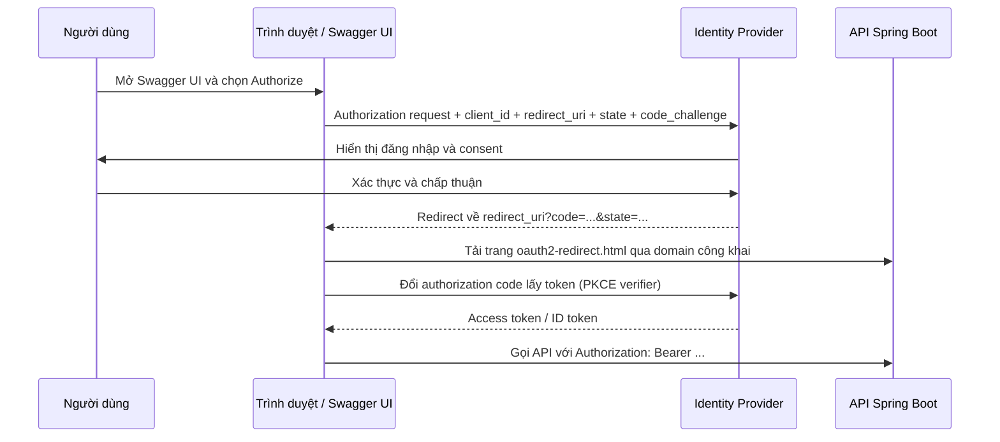

# OAuth redirect URL khi đổi domain hoặc đường dẫn ứng dụng

Swagger UI dùng một URL callback riêng để nhận kết quả sau khi người dùng đăng nhập qua OAuth 2.0 hoặc OpenID Connect. Khi đổi domain, bật HTTPS, thêm context path hoặc đặt ứng dụng sau reverse proxy, URL callback mà Swagger UI gửi tới Identity Provider (IdP) có thể không còn khớp với URL đã đăng ký. Kết quả thường là lỗi `redirect_uri_mismatch`, callback trả 404 hoặc trình duyệt quay lại giao diện nhưng không hoàn tất xác thực.

Với springdoc-openapi, thuộc tính cần chú ý là `springdoc.swagger-ui.oauth2-redirect-url`. Cần cấu hình URL công khai mà trình duyệt truy cập được, đăng ký chính xác URL đó ở IdP và bảo đảm reverse proxy chuyển request callback tới đúng tài nguyên Swagger UI.

## 1. Redirect URI nằm ở đâu trong luồng OAuth?

Khi người dùng nhấn Authorize trong Swagger UI, trình duyệt chuyển sang authorization endpoint của IdP. Request chứa tham số `redirect_uri`, cho biết IdP phải đưa trình duyệt quay về địa chỉ nào sau khi người dùng cấp quyền. Với Swagger UI, callback thường là trang `oauth2-redirect.html` đi kèm giao diện.

Luồng Authorization Code có thể hình dung như sau:



Callback URL trong luồng này là URL của trang Swagger UI xử lý kết quả OAuth. Nó không phải URL của API endpoint và cũng không nhất thiết là callback đăng nhập của Spring Security.

Ví dụ ứng dụng được public tại:

```text
https://api.example.com/store/docs/swagger-ui.html
```

URL callback có thể là:

```text
https://api.example.com/store/swagger-ui/oauth2-redirect.html
```

Đây là hai URL khác nhau. Trang Swagger UI có thể được đổi bằng `springdoc.swagger-ui.path`, còn callback OAuth được cấu hình riêng bằng `springdoc.swagger-ui.oauth2-redirect-url`.

## 2. Phân biệt các loại redirect URL dễ nhầm

Một hệ thống có thể có nhiều URL mang tên redirect hoặc callback. Cần xác định đúng client nào đang thực hiện OAuth:

| URL / thuộc tính | Dùng cho | Ví dụ |
|---|---|---|
| `springdoc.swagger-ui.oauth2-redirect-url` | Callback của OAuth trong Swagger UI chạy trên trình duyệt | `/swagger-ui/oauth2-redirect.html` |
| `springdoc.swagger-ui.path` | Trang HTML chính của Swagger UI | `/docs/swagger-ui.html` |
| `authorizationUrl` trong OpenAPI | Endpoint IdP nhận yêu cầu cấp quyền | `https://id.example.com/oauth2/authorize` |
| `tokenUrl` trong OpenAPI | Endpoint IdP nhận authorization code để cấp token | `https://id.example.com/oauth2/token` |
| `openIdConnectUrl` trong OpenAPI | Metadata discovery của OpenID Provider | `https://id.example.com/.well-known/openid-configuration` |
| `spring.security.oauth2.client.registration.*.redirect-uri` | Callback đăng nhập OAuth/OIDC do Spring Security xử lý ở backend | `{baseUrl}/login/oauth2/code/{registrationId}` |
| `post_logout_redirect_uri` | Địa chỉ IdP đưa trình duyệt về sau khi logout | `https://app.example.com/signed-out` |

Nếu Swagger UI là OAuth client, sửa `spring.security.oauth2.client.registration.*.redirect-uri` không tự thay đổi callback của Swagger UI. Ngược lại, sửa `springdoc.swagger-ui.oauth2-redirect-url` không thay đổi callback mà Spring Security dùng để xử lý đăng nhập người dùng vào ứng dụng.

`authorizationUrl`, `tokenUrl` và `openIdConnectUrl` cũng không phải redirect URI. Chúng cho biết nơi bắt đầu authorization, nơi đổi code lấy token và nơi tải metadata của OpenID Provider.

## 3. Giá trị mặc định của springdoc và Swagger UI

Trong tài liệu thuộc tính springdoc-openapi v2 dành cho Spring Boot 3.x, `springdoc.swagger-ui.oauth2RedirectUrl` có giá trị mặc định:

```text
/swagger-ui/oauth2-redirect.html
```

Tên YAML tương ứng theo relaxed binding của Spring Boot là `oauth2-redirect-url`. Có thể cấu hình như sau:

```yaml
springdoc:
  swagger-ui:
    oauth2-redirect-url: https://api.example.com/swagger-ui/oauth2-redirect.html
```

Khi dùng một domain và context path cụ thể, nên đặt URL tuyệt đối để tránh Swagger UI hoặc trình duyệt tạo callback dựa trên host, scheme hay path nội bộ không đúng.

Không nhầm thuộc tính này với `springdoc.swagger-ui.path`. Ví dụ:

```yaml
springdoc:
  swagger-ui:
    path: /docs/swagger-ui.html
    oauth2-redirect-url: https://api.example.com/store/swagger-ui/oauth2-redirect.html
```

Trang giao diện là `/docs/swagger-ui.html`, còn callback là `/store/swagger-ui/oauth2-redirect.html` trên domain công khai. Cả hai đường dẫn phải được proxy và security cấu hình đúng.

Nếu không cấu hình tường minh, springdoc v2 có giá trị mặc định là path `/swagger-ui/oauth2-redirect.html`. Khi ứng dụng có context path hoặc được public qua reverse proxy, path mặc định có thể không phản ánh URL bên ngoài mà IdP cần nhận. Sau khi đổi domain hoặc đường dẫn, hãy kiểm tra `oauth2RedirectUrl` trong cấu hình Swagger UI được trình duyệt tải và tham số `redirect_uri` trong authorization request.

## 4. Đổi domain: cập nhật URL callback và đăng ký ở IdP

Giả sử môi trường cũ dùng:

```text
http://localhost:8080/swagger-ui/oauth2-redirect.html
```

Sau khi triển khai, giao diện được public tại:

```text
https://docs.example.com/swagger-ui.html
```

Callback mới cần là:

```text
https://docs.example.com/swagger-ui/oauth2-redirect.html
```

Có hai nơi phải được cập nhật đồng bộ:

1. Cấu hình Swagger UI trong ứng dụng, bằng `springdoc.swagger-ui.oauth2-redirect-url`.
2. Danh sách Valid Redirect URIs / Allowed Callback URLs của client trong IdP.

Ví dụ cấu hình:

```yaml
springdoc:
  swagger-ui:
    oauth2-redirect-url: ${SWAGGER_UI_OAUTH2_REDIRECT_URL:https://docs.example.com/swagger-ui/oauth2-redirect.html}
```

Giá trị môi trường:

```text
SWAGGER_UI_OAUTH2_REDIRECT_URL=https://docs.example.com/swagger-ui/oauth2-redirect.html
```

Trong trang quản trị IdP, thêm đúng URL trên vào danh sách redirect URI được phép cho client Swagger UI. Nếu môi trường cũ vẫn cần hoạt động trong giai đoạn chuyển đổi, có thể đăng ký cả URL cũ và mới theo chính sách IdP, rồi loại URL cũ sau khi migration kết thúc.

### So khớp chính xác URL

Redirect URI phải khớp với giá trị đã đăng ký. Hãy kiểm tra đầy đủ:

- Scheme: `https` và `http` là hai URI khác nhau.
- Host: `api.example.com` và `docs.example.com` là hai URI khác nhau.
- Port: port tường minh và port mặc định có thể được xử lý theo quy tắc URI, nhưng không nên dựa vào cách chuẩn hóa của nhà cung cấp.
- Path: `/swagger-ui/oauth2-redirect.html` khác `/docs/oauth2-redirect.html`.
- Dấu `/` cuối: `/callback` và `/callback/` có thể không khớp.
- Chữ hoa/chữ thường và encoding: không tự giả định IdP chuẩn hóa mọi thành phần giống ứng dụng.

RFC 9700 khuyến nghị authorization server so sánh redirect URI đã đăng ký bằng exact string matching, ngoại lệ hẹp dành cho port localhost của native app. Không dùng wildcard rộng hoặc endpoint chuyển hướng tùy ý để né lỗi mismatch; điều đó làm tăng nguy cơ rò rỉ authorization code và token.

## 5. Đổi context path hoặc thêm prefix khi triển khai

Một ứng dụng có thể chạy nội bộ ở root nhưng được public dưới một prefix.

Ví dụ:

| Thành phần | URL |
|---|---|
| Địa chỉ nội bộ | `http://app:8080/swagger-ui/oauth2-redirect.html` |
| Địa chỉ công khai | `https://example.com/platform/swagger-ui/oauth2-redirect.html` |
| Trang Swagger UI công khai | `https://example.com/platform/docs/swagger-ui.html` |

Nếu reverse proxy loại bỏ `/platform` trước khi chuyển request tới ứng dụng, callback nội bộ vẫn có thể là `/swagger-ui/oauth2-redirect.html`, nhưng `redirect_uri` gửi tới IdP phải là URL công khai có prefix `/platform`.

Có hai cách triển khai thường gặp:

### Ứng dụng tự chạy dưới context path

Nếu Spring Boot trực tiếp phục vụ ứng dụng tại `/platform`, có thể cấu hình:

```yaml
server:
  servlet:
    context-path: /platform

springdoc:
  swagger-ui:
    path: /docs/swagger-ui.html
    oauth2-redirect-url: https://example.com/platform/swagger-ui/oauth2-redirect.html
```

Trong trường hợp này, context path là một phần của đường dẫn ứng dụng. Cần xác nhận endpoint callback thực sự được phục vụ tại URL công khai đó.

### Reverse proxy thêm prefix và loại bỏ trước khi forward

Nếu ứng dụng chạy root tại `http://app:8080`, proxy có thể nhận `/platform/...`, loại bỏ `/platform` và chuyển phần còn lại tới ứng dụng. Cấu hình callback vẫn phải dùng URL public:

```yaml
springdoc:
  swagger-ui:
    path: /docs/swagger-ui.html
    oauth2-redirect-url: ${SWAGGER_UI_OAUTH2_REDIRECT_URL:https://example.com/platform/swagger-ui/oauth2-redirect.html}
```

Proxy phải chuyển request callback public tới đúng resource nội bộ. Việc thêm prefix vào `redirect_uri` mà không có route tương ứng sẽ khiến IdP redirect thành công nhưng callback trả 404.

## 6. Xử lý scheme, host và prefix qua reverse proxy

Khi TLS kết thúc ở load balancer hoặc reverse proxy, request tới Spring Boot có thể là HTTP và host nội bộ, trong khi trình duyệt truy cập HTTPS bằng domain công khai. Nếu ứng dụng tự tạo URL dựa trên request mà không nhận diện forwarded headers, Swagger UI có thể sinh callback như:

```text
http://app:8080/swagger-ui/oauth2-redirect.html
```

thay vì:

```text
https://docs.example.com/platform/swagger-ui/oauth2-redirect.html
```

Proxy thường chuyển thông tin gốc bằng các header:

| Header | Thông tin |
|---|---|
| `Forwarded` | Scheme, host và thông tin client theo RFC 7239 |
| `X-Forwarded-Host` | Host mà trình duyệt dùng để truy cập |
| `X-Forwarded-Proto` | Scheme công khai, thường là `https` |
| `X-Forwarded-Port` | Port công khai nếu cần |
| `X-Forwarded-Prefix` | Prefix mà proxy đã thêm hoặc loại bỏ trước khi forward |

Với Spring Boot 3.x, có thể bật forwarded header support bằng cấu hình:

```yaml
server:
  forward-headers-strategy: framework
```

`FRAMEWORK` sử dụng `ForwardedHeaderFilter` cho Servlet stack và `ForwardedHeaderTransformer` cho reactive stack. Nếu embedded server hỗ trợ đầy đủ header mà proxy gửi, `NATIVE` có thể phù hợp hơn. Hãy chọn theo server, proxy và header thực tế.

Ví dụ Nginx khi public ứng dụng dưới prefix `/platform` và loại prefix trước khi chuyển request:

```nginx
location /platform/ {
    proxy_pass http://app:8080/;

    proxy_set_header Host $host;
    proxy_set_header X-Forwarded-Host $host;
    proxy_set_header X-Forwarded-Proto $scheme;
    proxy_set_header X-Forwarded-Port $server_port;
    proxy_set_header X-Forwarded-Prefix /platform;
}
```

Với cấu hình `proxy_pass` có dấu `/` cuối như ví dụ, Nginx loại phần prefix `/platform/` khỏi URI gửi tới upstream. Kiểm tra lại quy tắc rewrite của proxy thực tế; chỉ cần một khác biệt ở dấu `/` cuối cũng có thể làm thay đổi cách ghép path.

### Chỉ tin forwarded headers từ proxy đáng tin cậy

Forwarded headers ảnh hưởng cách ứng dụng nhận diện host, scheme và địa chỉ public. Proxy ở ranh giới tin cậy phải loại bỏ header `Forwarded`/`X-Forwarded-*` do client bên ngoài tự gửi rồi ghi lại giá trị chính xác của request đã nhận. Không cho phép request trực tiếp từ Internet tự khai báo `X-Forwarded-Host` để điều khiển URL callback mà ứng dụng sinh ra.

Nếu ứng dụng có thể được truy cập trực tiếp ngoài proxy, cần chặn đường truy cập đó hoặc giới hạn proxy được tin cậy theo cấu hình server. Không bật tin cậy tất cả proxy trong môi trường production.

### Lưu ý Spring Boot 4.x

Hãy kiểm tra đúng minor version vì namespace forwarded header đã thay đổi trong dòng Boot 4:

- Spring Boot 4.0 vẫn dùng `server.forward-headers-strategy` trong tài liệu embedded web server.
- Spring Boot 4.2 dùng `server.request.header.forwarded.strategy`, với các giá trị như `web-server`, `framework` hoặc `none`.

Ví dụ theo cấu hình Boot 4.2 khi proxy gửi `X-Forwarded-*` và đã loại prefix `/platform` trước khi forward:

```yaml
server:
  request:
    header:
      forwarded:
        strategy: web-server
        use-prefix: true
```

`use-prefix: true` bật xử lý `X-Forwarded-Prefix`; nếu không bật, header prefix có thể bị bỏ qua. Nếu web server không hỗ trợ header cần dùng, chọn `framework` để dùng `ForwardedHeaderFilter` hoặc `ForwardedHeaderTransformer`. Không sao chép property từ Boot 3.x hoặc Boot 4.0 sang Boot 4.2 mà không kiểm tra configuration metadata của phiên bản đang chạy.

## 7. Cấu hình OAuth cho Swagger UI cùng redirect URL

Một cấu hình điển hình cho Authorization Code + PKCE có thể như sau:

```yaml
springdoc:
  swagger-ui:
    path: /docs/swagger-ui.html
    oauth2-redirect-url: ${SWAGGER_UI_OAUTH2_REDIRECT_URL:https://api.example.com/platform/swagger-ui/oauth2-redirect.html}
    oauth:
      client-id: ${SWAGGER_UI_OAUTH_CLIENT_ID}
      use-pkce-with-authorization-code-grant: true
```

Trong ví dụ:

- `oauth2-redirect-url` là callback mà Swagger UI gửi trong authorization request.
- `client-id` là client ID đã đăng ký cho Swagger UI trong IdP.
- `use-pkce-with-authorization-code-grant` bật PKCE cho authorization code flow.
- URL callback phải có trong danh sách redirect URI hợp lệ của client tại IdP.

Swagger UI chạy trong trình duyệt nên được xem là public client. Không đặt client secret thực vào cấu hình production của Swagger UI. Client secret được gửi xuống trình duyệt có thể bị người dùng xem trong JavaScript hoặc network request. Dùng Authorization Code + PKCE thay vì cố giấu secret ở frontend.

RFC 9700 yêu cầu public client dùng PKCE để chống authorization code injection/misuse; phương thức `S256` được khuyến nghị vì không để lộ verifier trong authorization request. IdP phải hỗ trợ và thực thi PKCE.

## 8. Khai báo OAuth2 hoặc OIDC trong OpenAPI không thay thế callback URL

OpenAPI mô tả security scheme để Swagger UI biết authorization endpoint, token endpoint và scope. Redirect URL của Swagger UI vẫn được cấu hình riêng.

Ví dụ OAuth2 Authorization Code:

```java
@Configuration
@OpenAPIDefinition(
    info = @Info(title = "Store API", version = "1.0.0")
)
@SecurityScheme(
    name = "storeOAuth",
    type = SecuritySchemeType.OAUTH2,
    flows = @OAuthFlows(
        authorizationCode = @OAuthFlow(
            authorizationUrl = "https://id.example.com/oauth2/authorize",
            tokenUrl = "https://id.example.com/oauth2/token",
            scopes = {
                @OAuthScope(name = "openid", description = "OpenID Connect"),
                @OAuthScope(name = "profile", description = "Thông tin hồ sơ"),
                @OAuthScope(name = "products:read", description = "Đọc sản phẩm")
            }
        )
    )
)
class OpenApiSecurityConfiguration {}
```

Gắn security requirement cho operation hoặc toàn tài liệu:

```java
@Operation(
    summary = "Tìm kiếm sản phẩm",
    security = @SecurityRequirement(
        name = "storeOAuth",
        scopes = {"openid", "products:read"}
    )
)
@GetMapping("/api/products")
List<ProductResponse> search() {
    return productService.search();
}
```

Với OpenID Connect discovery scheme, có thể dùng:

```java
@SecurityScheme(
    name = "storeOidc",
    type = SecuritySchemeType.OPENIDCONNECT,
    openIdConnectUrl = "https://id.example.com/.well-known/openid-configuration"
)
```

`openIdConnectUrl` là URL metadata discovery. Tài liệu discovery thường cung cấp `authorization_endpoint`, `token_endpoint` và `jwks_uri`; nó không tự đăng ký `redirect_uri` cho Swagger UI. Vẫn cần cấu hình `springdoc.swagger-ui.oauth2-redirect-url` và đăng ký callback ở IdP.

## 9. Cấu hình riêng theo môi trường

Domain và path thường khác nhau giữa local, development, staging và production. Không nên ghi một URL production cố định trong mọi profile nếu mỗi môi trường có host khác nhau.

Có thể dùng biến môi trường:

```yaml
springdoc:
  swagger-ui:
    oauth2-redirect-url: ${SWAGGER_UI_OAUTH2_REDIRECT_URL}
    oauth:
      client-id: ${SWAGGER_UI_OAUTH_CLIENT_ID}
      use-pkce-with-authorization-code-grant: true
```

Ví dụ giá trị theo môi trường:

| Môi trường | `SWAGGER_UI_OAUTH2_REDIRECT_URL` |
|---|---|
| Local | `http://localhost:8080/swagger-ui/oauth2-redirect.html` |
| Development | `https://dev-api.example.com/swagger-ui/oauth2-redirect.html` |
| Staging | `https://staging-api.example.com/platform/swagger-ui/oauth2-redirect.html` |
| Production | `https://api.example.com/platform/swagger-ui/oauth2-redirect.html` |

Đăng ký các URL chính xác tương ứng với từng client/environment trong IdP. Có thể dùng một client riêng cho mỗi môi trường để giảm phạm vi ảnh hưởng khi xoay vòng cấu hình hoặc thu hồi quyền.

Không dùng wildcard như `https://*.example.com/**` chỉ để tránh cập nhật redirect URI khi đổi domain. Nếu IdP hỗ trợ nhiều redirect URI, đăng ký từng URL đầy đủ. Khi thay domain, có thể duy trì cả URL cũ và mới trong thời gian chuyển đổi có kiểm soát.

## 10. Phân biệt context path và springdoc Swagger UI path

Ba cấu hình có thể cùng tác động đến URL cuối cùng nhưng không có cùng ý nghĩa:

| Cấu hình | Ý nghĩa |
|---|---|
| `server.servlet.context-path` | Prefix gốc của Servlet application |
| `springdoc.swagger-ui.path` | Endpoint HTML mà người dùng mở Swagger UI |
| `springdoc.swagger-ui.oauth2-redirect-url` | URL callback được gửi trong OAuth authorization request |

Ví dụ:

```yaml
server:
  servlet:
    context-path: /store

springdoc:
  swagger-ui:
    path: /docs/swagger-ui.html
    oauth2-redirect-url: https://api.example.com/store/swagger-ui/oauth2-redirect.html
```

Trang UI công khai là:

```text
https://api.example.com/store/docs/swagger-ui.html
```

Callback công khai là:

```text
https://api.example.com/store/swagger-ui/oauth2-redirect.html
```

Đừng tự ghép `context-path` vào callback nếu property đã chứa URL tuyệt đối đầy đủ. Cũng không tự thêm `/docs` vào callback chỉ vì trang UI nằm dưới `/docs`; callback resource thường có path riêng do springdoc/Swagger UI cung cấp.

## 11. Xác minh URL thực tế mà Swagger UI gửi đi

Sau khi cấu hình, kiểm tra giá trị runtime thay vì chỉ nhìn file YAML.

### Kiểm tra swagger-config

Mở endpoint cấu hình Swagger UI, mặc định:

```text
https://api.example.com/v3/api-docs/swagger-config
```

Trong JSON, tìm thuộc tính:

```json
{
  "oauth2RedirectUrl": "https://api.example.com/platform/swagger-ui/oauth2-redirect.html"
}
```

Đường dẫn endpoint config có thể thay đổi nếu `springdoc.api-docs.path` hoặc group được tùy chỉnh. Nếu JSON vẫn chứa host nội bộ hoặc callback mặc định, kiểm tra binding property, profile active và cấu hình springdoc.

### Kiểm tra authorization request

1. Mở Swagger UI trên domain công khai.
2. Mở Developer Tools → Network.
3. Nhấn Authorize.
4. Tìm request tới authorization endpoint của IdP.
5. Xem query parameter `redirect_uri` sau khi URL decode.
6. So sánh từng ký tự với URL đã đăng ký ở IdP.

Ví dụ request đúng phải gửi:

```text
redirect_uri=https%3A%2F%2Fapi.example.com%2Fplatform%2Fswagger-ui%2Foauth2-redirect.html
```

Không chỉ kiểm tra giá trị `oauth2RedirectUrl` trong swagger-config; cần xác nhận tham số cuối cùng trong request authorization vì custom JavaScript hoặc cấu hình Swagger UI khác cũng có thể ghi đè.

### Kiểm tra callback route

Sau khi đăng nhập, IdP chuyển trình duyệt tới callback. Xác nhận:

- Domain và path trên thanh địa chỉ là URL public.
- Reverse proxy chuyển request đến đúng resource `oauth2-redirect.html`.
- Callback trả HTTP 200, không bị 301/302 sang URL nội bộ hoặc trang đăng nhập khác.
- JavaScript của Swagger UI xử lý `code` và `state` rồi hoàn tất trao đổi token.
- Token endpoint trả kết quả hợp lệ; nếu trình duyệt gọi trực tiếp token endpoint, CORS của IdP cũng phải cho phép origin của Swagger UI.

Redirect URI đúng không tự sửa CORS. Nếu callback tải được nhưng bước đổi code lấy token bị trình duyệt chặn, kiểm tra CORS policy của authorization server/token endpoint riêng.

## 12. Các lỗi thường gặp khi đổi domain hoặc path

| Triệu chứng | Nguyên nhân có thể | Cách xử lý |
|---|---|---|
| IdP báo `redirect_uri_mismatch` | Scheme, host, port, path hoặc slash cuối khác URL đã đăng ký | So sánh `redirect_uri` trong authorization request với danh sách redirect URI của client |
| Authorization request dùng `http` thay vì `https` | App chỉ thấy kết nối HTTP từ proxy, forwarded proto chưa được xử lý | Cấu hình proxy gửi `X-Forwarded-Proto`/`Forwarded` và bật forwarded header support phù hợp |
| Callback redirect tới hostname nội bộ | Host header hoặc forwarded host sai/không được tin cậy | Kiểm tra `Host`, `X-Forwarded-Host` và URL tường minh trong `oauth2-redirect-url` |
| Callback thiếu prefix `/platform` | Proxy loại prefix nhưng không truyền/ứng dụng không nhận diện forwarded prefix | Cấu hình route callback và forwarded prefix đồng bộ |
| Callback trả 404 | Proxy chỉ route trang Swagger UI mà không route callback resource | Thêm route cho `/swagger-ui/oauth2-redirect.html` dưới prefix công khai |
| UI mở được nhưng callback bị 403 | Security matcher chặn callback hoặc static resource | Cho phép callback theo chính sách tài liệu; kiểm tra filter chain và matcher |
| Callback tải xong nhưng không hoàn tất | `state` không khớp, script lỗi hoặc response không đúng asset | Kiểm tra console, query `state`, cache và tài nguyên Swagger UI |
| Token endpoint bị CORS error | Browser gọi token endpoint từ origin Swagger UI chưa được cho phép | Cấu hình CORS ở IdP/token endpoint; redirect URL không giải quyết CORS |
| Staging hoạt động nhưng production lỗi | Production domain/path chưa đăng ký hoặc profile lấy nhầm biến môi trường | Kiểm tra biến môi trường, profile và client registration của production |
| Thay `springdoc.swagger-ui.path` nhưng callback không đổi | Trang UI và callback là hai cấu hình riêng | Cấu hình `oauth2-redirect-url` độc lập |
| Spring Security login hoạt động nhưng Swagger UI OAuth lỗi | Đang sửa nhầm `registration.*.redirect-uri` của backend login | Sửa callback Swagger UI và client registration tương ứng |

## 13. Kiểm thử cấu hình qua các lớp

Không nên chỉ kiểm tra bằng cách mở trang Swagger UI. Có thể xác minh từng lớp theo thứ tự:

| Lớp | Điều cần xác minh | Bằng chứng |
|---|---|---|
| Spring configuration | Property được nạp từ đúng profile/environment | Log cấu hình đã kiểm soát hoặc Actuator env nếu được bảo vệ |
| Springdoc | `oauth2RedirectUrl` có giá trị public chính xác | JSON `/v3/api-docs/swagger-config` |
| OpenAPI | Security scheme có đúng authorization/token/discovery endpoint | `/v3/api-docs` hoặc YAML |
| Reverse proxy | Callback URL public được route tới ứng dụng | Access log proxy và response callback |
| Identity Provider | Redirect URI được đăng ký cho đúng client | Client settings trên IdP |
| Browser | Authorization request gửi đúng `redirect_uri` | Network tab |
| Token exchange | Callback xử lý code và PKCE thành công | Network tab và console, không ghi token vào log |

Ví dụ kiểm tra nhanh endpoint swagger-config bằng curl:

```bash
curl -sS https://api.example.com/v3/api-docs/swagger-config
```

Nếu tài liệu được bảo vệ bằng authentication, cung cấp credential theo chính sách môi trường và tránh ghi access token vào shell history hoặc log chia sẻ.

Có thể dùng một test tích hợp để xác nhận JSON config có callback đã định:

```java
@SpringBootTest
@AutoConfigureMockMvc
class SwaggerOAuthConfigTest {

    @Autowired
    MockMvc mockMvc;

    @Test
    void exposesPublicOAuthRedirectUrl() throws Exception {
        mockMvc.perform(get("/v3/api-docs/swagger-config"))
            .andExpect(status().isOk())
            .andExpect(jsonPath("$.oauth2RedirectUrl").value(
                "https://api.example.com/platform/swagger-ui/oauth2-redirect.html"
            ));
    }
}
```

Test này kiểm tra giá trị cấu hình được springdoc công bố. Nó không thay thế kiểm thử proxy thực tế, xác minh redirect URI ở IdP hoặc browser flow.

## 14. Bảo mật khi thay đổi redirect URL

Redirect URI là một phần quan trọng của bảo vệ authorization code và token. Khi đổi domain/path, cần giữ các nguyên tắc sau:

- Chỉ đăng ký callback HTTPS trong môi trường có TLS công khai; dùng HTTP localhost riêng cho phát triển cục bộ.
- Đăng ký URI đầy đủ và chính xác, tránh wildcard rộng.
- Không tạo endpoint nhận một URL bất kỳ từ query parameter rồi redirect tới đó. Đây có thể trở thành open redirector làm rò rỉ code/token.
- Dùng Authorization Code flow và PKCE cho Swagger UI public client; tránh Implicit flow.
- Dùng `state` transaction-specific và để Swagger UI quản lý trạng thái callback; không tự bỏ kiểm tra state.
- Không đưa client secret production xuống trình duyệt.
- Tin forwarded headers chỉ từ proxy đã xác thực; proxy phải ghi đè header do client gửi.
- Không ghi authorization code, access token, ID token hoặc query callback đầy đủ vào access log công khai.
- Sau migration, loại bỏ redirect URI cũ khi không còn client nào dùng để thu hẹp bề mặt tấn công.

Nếu cần phân biệt nhiều IdP, dùng cấu hình security scheme và client riêng có định danh rõ ràng. Không dùng một callback redirector tổng quát nhận tham số `target` để chuyển tiếp kết quả OAuth tới nhiều domain.

## 15. Checklist khi chuyển ứng dụng sang domain hoặc path mới

Trước khi đưa domain mới vào hoạt động, kiểm tra:

1. URL trang Swagger UI mới đã được xác định.
2. URL callback `oauth2-redirect.html` đã được xác định độc lập với UI path.
3. `springdoc.swagger-ui.oauth2-redirect-url` dùng URL public chính xác.
4. Biến môi trường/profile được triển khai với giá trị của đúng môi trường.
5. IdP đã đăng ký chính xác redirect URI cho client tương ứng.
6. Reverse proxy route cả trang UI, swagger-config, OpenAPI document và callback resource.
7. Forwarded host/proto/prefix được truyền đúng và chỉ tin từ proxy đáng tin cậy.
8. Callback trả HTTP 200 trên domain/path công khai.
9. Authorization request thực tế chứa đúng `redirect_uri`.
10. Authorization Code + PKCE hoàn tất; token endpoint CORS hợp lệ nếu browser gọi trực tiếp.
11. Spring Security matcher không chặn callback hoặc tài nguyên UI cần thiết.
12. Redirect URI cũ được gỡ sau khi hoàn tất giai đoạn chuyển tiếp.

Khi đổi domain hoặc đường dẫn ứng dụng, hãy cập nhật đồng thời cấu hình callback trong springdoc, route public của reverse proxy và danh sách redirect URI ở IdP. Việc xác minh `oauth2RedirectUrl` trong swagger-config cùng tham số `redirect_uri` trong Network tab giúp xác định chính xác lớp đang tạo ra URL sai.

## 16. Tài liệu tham khảo

- [Springdoc OpenAPI v2 – Swagger UI Properties](https://springdoc.org/v2/ui-properties.html): thuộc tính `springdoc.swagger-ui.oauth2RedirectUrl` và các cấu hình OAuth UI.
- [Swagger UI – OAuth 2.0 Configuration](https://swagger.io/docs/open-source-tools/swagger-ui/usage/oauth2/): cấu hình clientId, PKCE và OAuth trong Swagger UI.
- [Swagger UI – Configuration](https://swagger.io/docs/open-source-tools/swagger-ui/usage/configuration/): `oauth2RedirectUrl` và các thuộc tính mạng của giao diện.
- [Spring Boot 3.5 – Running Behind a Front-end Proxy Server](https://docs.spring.io/spring-boot/3.5/how-to/webserver.html#howto.webserver.use-behind-a-proxy-server): forwarded headers và `server.forward-headers-strategy`.
- [Spring Boot 4.0 – Embedded Web Servers](https://docs.spring.io/spring-boot/4.0/how-to/webserver.html): forwarded header configuration trong Boot 4.0.
- [Spring Boot 4.2 – Embedded Web Servers](https://docs.spring.io/spring-boot/how-to/webserver.html): `server.request.header.forwarded.*` và hỗ trợ `X-Forwarded-Prefix` trong Boot 4.2.
- [RFC 9700 – Best Current Practice for OAuth 2.0 Security](https://www.rfc-editor.org/rfc/rfc9700.html): exact redirect URI matching, Authorization Code và PKCE.
- [RFC 6749 – The OAuth 2.0 Authorization Framework](https://www.rfc-editor.org/rfc/rfc6749.html): tham số `redirect_uri` và quy tắc kiểm tra redirect URI.
