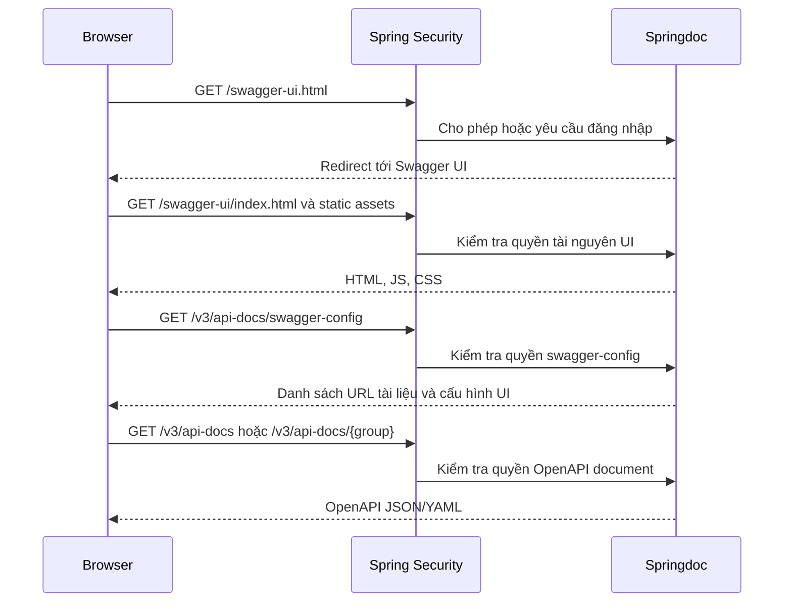

# Quy tắc truy cập cho /v3/api-docs, swagger-config và tài nguyên giao diện

Springdoc cung cấp nhiều tài nguyên để tạo và hiển thị tài liệu API. Bảo vệ riêng trang Swagger UI là chưa đủ: người dùng vẫn có thể gọi trực tiếp OpenAPI JSON/YAML, endpoint `swagger-config` hoặc tài liệu của từng group. Khi triển khai Spring Security, cần xác định đầy đủ các đường dẫn tài liệu và áp dụng chính sách truy cập nhất quán cho toàn bộ chúng.

Tài liệu có thể được công khai, yêu cầu đăng nhập hoặc giới hạn cho một nhóm như `API_DOCS`. Quyết định này độc lập với chính sách bảo vệ endpoint nghiệp vụ. Một ứng dụng có thể cho phép đọc tài liệu nhưng vẫn yêu cầu access token cho `/api/**`; hoặc chỉ cho nhân viên xem tài liệu trong khi API đối tác có cơ chế xác thực riêng.

## 1. Các endpoint và tài nguyên cần nhận diện

Với cấu hình mặc định thường gặp của Springdoc 2.x, các đường dẫn chính gồm:

| Đường dẫn | Vai trò |
| --- | --- |
| `/v3/api-docs` | OpenAPI JSON mặc định |
| `/v3/api-docs.yaml` | OpenAPI YAML mặc định |
| `/v3/api-docs/swagger-config` | Cấu hình mà Swagger UI tải để biết URL tài liệu và thiết lập giao diện |
| `/v3/api-docs/{group}` | OpenAPI JSON của một `GroupedOpenApi` |
| `/v3/api-docs/{group}.yaml` | OpenAPI YAML của một group khi được hỗ trợ/cấu hình |
| `/swagger-ui.html` | Đường dẫn giao diện thường dùng, thường chuyển hướng đến Swagger UI |
| `/swagger-ui/**` | HTML, JavaScript, CSS, icon và các tài nguyên giao diện Swagger UI |

Một số phiên bản cũ hoặc cấu hình tùy chỉnh có thể phục vụ thêm tài nguyên qua đường dẫn như `/webjars/**`. Hãy kiểm tra request thực tế của phiên bản Springdoc đang dùng trước khi thêm matcher. Không nên cho phép một đường dẫn tĩnh rộng nếu ứng dụng không cần nó.

`swagger-config` thường nằm dưới API docs path, ví dụ `/v3/api-docs/swagger-config`. Vì vậy, matcher `/v3/api-docs/**` bao phủ endpoint này cùng các group docs. Nếu chỉ cho phép `/v3/api-docs` chính xác, các request con có thể vẫn bị chặn.

## 2. Hiểu luồng tải tài liệu của Swagger UI

Khi người dùng mở Swagger UI, trình duyệt thường tải một chuỗi tài nguyên:



Nếu chỉ mở `/swagger-ui.html` mà chặn `/swagger-ui/**`, giao diện có thể hiện trang trắng hoặc lỗi tải tài nguyên. Nếu mở giao diện nhưng chặn `swagger-config` hoặc OpenAPI document, trang có thể tải được nhưng không hiển thị operation.

Ngược lại, nếu chỉ bảo vệ giao diện mà để `/v3/api-docs/**` công khai, người không có quyền vẫn có thể tải hợp đồng API bằng curl hoặc một công cụ HTTP khác. Hãy kiểm tra từng URL trực tiếp, không chỉ thử mở trang UI.

## 3. Cho phép mọi người đọc tài liệu

Nếu OpenAPI là tài liệu công khai, có thể cho phép GET đến các endpoint docs và UI trong khi yêu cầu xác thực cho API nghiệp vụ.

Ví dụ Spring Boot 3 và Spring Security 6:

```java
package com.example.config;

import org.springframework.context.annotation.Bean;
import org.springframework.context.annotation.Configuration;
import org.springframework.http.HttpMethod;
import org.springframework.security.config.Customizer;
import org.springframework.security.config.annotation.web.builders.HttpSecurity;
import org.springframework.security.web.SecurityFilterChain;

@Configuration
public class SecurityConfig {

    @Bean
    SecurityFilterChain securityFilterChain(HttpSecurity http) throws Exception {
        http.authorizeHttpRequests(auth -> auth
            .requestMatchers(
                HttpMethod.GET,
                "/swagger-ui.html",
                "/swagger-ui/**",
                "/v3/api-docs",
                "/v3/api-docs.yaml",
                "/v3/api-docs/**"
            ).permitAll()
            .anyRequest().authenticated()
        );

        http.httpBasic(Customizer.withDefaults());
        return http.build();
    }
}
```

Trong cấu hình này:

- Người dùng có thể tải Swagger UI, `swagger-config`, OpenAPI JSON/YAML và các tài liệu group bằng GET.
- Các request còn lại vẫn cần xác thực.
- `httpBasic` chỉ là ví dụ về cơ chế đăng nhập; ứng dụng có thể dùng form login, OAuth2 Resource Server hoặc SSO tùy kiến trúc.

Nếu dùng `hasRole` hoặc `hasAuthority` thay cho `permitAll`, hãy áp dụng quy tắc phù hợp với đối tượng sử dụng tài liệu như phần tiếp theo. Không mở toàn bộ `/v3/**` nếu ứng dụng có những endpoint khác dưới tiền tố này cần chính sách riêng.

## 4. Chỉ cho phép nhóm có quyền đọc tài liệu

Với tài liệu nội bộ, có thể giới hạn các endpoint docs cho role `API_DOCS`:

```java
package com.example.config;

import org.springframework.context.annotation.Bean;
import org.springframework.context.annotation.Configuration;
import org.springframework.security.config.Customizer;
import org.springframework.security.config.annotation.web.builders.HttpSecurity;
import org.springframework.security.web.SecurityFilterChain;

@Configuration
public class SecurityConfig {

    @Bean
    SecurityFilterChain securityFilterChain(HttpSecurity http) throws Exception {
        http.authorizeHttpRequests(auth -> auth
            .requestMatchers(
                "/swagger-ui.html",
                "/swagger-ui/**",
                "/v3/api-docs",
                "/v3/api-docs.yaml",
                "/v3/api-docs/**"
            ).hasRole("API_DOCS")
            .anyRequest().authenticated()
        );

        http.formLogin(Customizer.withDefaults());
        return http.build();
    }
}
```

`hasRole("API_DOCS")` kiểm tra authority `ROLE_API_DOCS`. Nếu hệ thống cấp authority không có tiền tố `ROLE_`, có thể dùng `hasAuthority("API_DOCS")` và bảo đảm dữ liệu người dùng chứa đúng authority đó.

Người chưa đăng nhập thường được chuyển đến trang đăng nhập khi dùng form login. Người đã đăng nhập nhưng không có role phù hợp sẽ nhận `403 Forbidden`. Với HTTP Basic, phản hồi chưa xác thực thường là `401 Unauthorized`.

Quy tắc docs phải đứng trước `.anyRequest()` vì Spring Security áp dụng matcher theo thứ tự. Nếu một matcher tổng quát hơn bắt request trước, quy tắc cụ thể cho Swagger UI có thể không được thực thi như mong muốn.

## 5. Bảo vệ cả UI, swagger-config và OpenAPI document

Một cấu hình đầy đủ cần xem xét ít nhất ba nhóm tài nguyên:

1. **Trang và tài nguyên UI:** `/swagger-ui.html`, `/swagger-ui/**`.
2. **Cấu hình giao diện:** mặc định `/v3/api-docs/swagger-config`.
3. **Đặc tả API:** `/v3/api-docs`, `/v3/api-docs.yaml`, `/v3/api-docs/**` và các group.

Ví dụ thiếu sót thường gặp:

```java
// Chỉ bảo vệ giao diện, nhưng JSON/YAML có thể vẫn công khai.
.requestMatchers("/swagger-ui.html", "/swagger-ui/**").hasRole("API_DOCS")
```

Người dùng không mở được UI nhưng vẫn có thể gọi trực tiếp `/v3/api-docs` nếu quy tắc khác cho phép. Nếu mục tiêu là bảo vệ tài liệu, hãy áp dụng cùng chính sách cho API docs path và config endpoint.

Ngược lại, nếu chỉ bảo vệ `/v3/api-docs` mà quên `/swagger-ui/**`, tài nguyên giao diện có thể tải nhưng các lệnh lấy cấu hình và đặc tả sẽ bị từ chối. Kết quả là UI không thể hiển thị API.

## 6. Khi dùng nhiều `GroupedOpenApi`

Springdoc có thể tạo các tài liệu riêng như `public`, `partner` hoặc `internal`. Mỗi group thường được tải qua `/v3/api-docs/{group}` và được khai báo trong `swagger-config`.

Ví dụ:

```java
@Bean
GroupedOpenApi partnerApi() {
    return GroupedOpenApi.builder()
        .group("partner")
        .pathsToMatch("/api/partner/**")
        .build();
}

@Bean
GroupedOpenApi internalApi() {
    return GroupedOpenApi.builder()
        .group("internal")
        .pathsToMatch("/api/internal/**")
        .build();
}
```

Nếu tất cả group dùng cùng một chính sách, matcher `/v3/api-docs/**` có thể bao phủ chúng. Nếu group có chính sách khác nhau, cần thiết kế URL và matcher riêng phù hợp, hoặc phục vụ các tài liệu qua endpoint/ứng dụng riêng. Không dựa vào tên group để suy ra quyền truy cập; tên `internal` không tự làm tài liệu riêng tư.

Nếu Swagger UI cấu hình nhiều URL qua `springdoc.swagger-ui.urls`, hãy kiểm tra tất cả URL mà giao diện thực sự tải. Mọi URL đó phải được bảo vệ theo đúng đối tượng sử dụng tài liệu.

## 7. Tùy chỉnh đường dẫn OpenAPI và Swagger UI

Springdoc cho phép thay đổi đường dẫn mặc định:

```yaml
springdoc:
  api-docs:
    path: /api-docs
  swagger-ui:
    path: /docs
```

Khi thay đổi path, cần cập nhật matcher Spring Security cho đúng endpoint mới. Ví dụ:

```java
.requestMatchers(
    "/docs",
    "/swagger-ui/**",
    "/api-docs",
    "/api-docs.yaml",
    "/api-docs/**"
).hasRole("API_DOCS")
```

`springdoc.api-docs.path` thay đổi base path của tài liệu OpenAPI; `springdoc.swagger-ui.path` thay đổi đường dẫn vào giao diện. Tài nguyên static UI vẫn có thể được phục vụ dưới `/swagger-ui/**`, vì vậy không nên giả định chỉ cần bảo vệ `/docs`.

Swagger UI có thể được cấu hình `config-url` riêng. Nếu endpoint cấu hình không còn ở vị trí mặc định, hãy thêm đúng URL đó vào chính sách truy cập. Tương tự, nếu cấu hình `url` hoặc `urls` trỏ đến tài liệu ở host khác, chính sách bảo vệ phải được áp dụng tại host phục vụ tài liệu đó.

## 8. Tắt Swagger UI hoặc tắt toàn bộ OpenAPI endpoint

Nếu chỉ muốn tắt giao diện nhưng vẫn giữ OpenAPI JSON/YAML cho pipeline hoặc công cụ khác:

```yaml
springdoc:
  swagger-ui:
    enabled: false
```

Nếu muốn tắt endpoint OpenAPI được Springdoc cung cấp:

```yaml
springdoc:
  api-docs:
    enabled: false
```

Nếu muốn tắt cả hai:

```yaml
springdoc:
  api-docs:
    enabled: false
  swagger-ui:
    enabled: false
```

Đây là cấu hình tắt chức năng ở Springdoc. Nó khác với việc chỉ chặn truy cập bằng Spring Security: khi bị chặn, endpoint vẫn tồn tại nhưng người dùng không đủ quyền không thể truy cập; khi bị disable, Springdoc không cung cấp endpoint/tài nguyên tương ứng theo cấu hình.

Có thể dùng profile để chỉ bật docs ở môi trường phát triển:

```yaml
spring:
  config:
    activate:
      on-profile: dev

springdoc:
  api-docs:
    enabled: true
  swagger-ui:
    enabled: true
```

Và cấu hình riêng cho production nếu chính sách yêu cầu tắt. Hãy xác minh cấu hình profile thực sự được nạp khi triển khai; không dựa vào tên file YAML mà không kiểm tra active profile.

## 9. Không dùng `WebSecurityCustomizer.ignoring()` để mở tài liệu

Không nên bỏ qua toàn bộ security filter chain cho Swagger UI hoặc `/v3/api-docs/**` chỉ để tránh lỗi tải giao diện. Ví dụ không nên dùng:

```java
// Không khuyến nghị: bỏ qua security filter chain cho docs.
web.ignoring().requestMatchers("/swagger-ui/**", "/v3/api-docs/**");
```

Khi bỏ qua filter chain, các filter bảo mật và cơ chế ghi nhận liên quan không được áp dụng cho request đó. Nếu tài liệu cần công khai, dùng `permitAll()` trong `authorizeHttpRequests`; nếu cần giới hạn, dùng `hasRole` hoặc `hasAuthority`. Cách này giữ request trong pipeline bảo mật và làm chính sách dễ kiểm soát hơn.

## 10. CSRF và nút Try it out

Các request tải Swagger UI, `swagger-config` và OpenAPI document chủ yếu là GET. CSRF protection thường không chặn những request đọc này. Tuy nhiên, nút **Try it out** có thể gửi POST, PUT, PATCH hoặc DELETE đến API nghiệp vụ.

Nếu ứng dụng dùng session/cookie authentication, các request thay đổi trạng thái vẫn phải tuân thủ CSRF protection. Swagger UI không tự bảo đảm có CSRF token. Cần cấu hình cách truyền token phù hợp nếu muốn dùng Try it out trong ứng dụng có CSRF.

Không tắt CSRF toàn cục chỉ để Swagger UI tải được. Với API stateless dùng Bearer token trong header và không dựa vào cookie tự động gửi, có thể có chính sách CSRF riêng sau khi đánh giá mô hình xác thực. Việc này thuộc bảo vệ API runtime, không phải quy tắc cho endpoint tài liệu.

Nếu môi trường chỉ cho phép đọc tài liệu và không muốn gửi request từ UI, có thể tắt các phương thức Try it out:

```yaml
springdoc:
  swagger-ui:
    supported-submit-methods: []
```

Thiết lập này chỉ ẩn/vô hiệu hóa thao tác gửi request từ giao diện. Nó không chặn client khác gọi API; Spring Security vẫn phải bảo vệ các endpoint nghiệp vụ.

## 11. CORS khi UI và OpenAPI được phục vụ từ origin khác

Nếu Swagger UI và OpenAPI document cùng origin, thường không cần CORS riêng cho việc tải tài liệu. Nếu UI được host riêng và tải `/v3/api-docs` từ domain khác, trình duyệt sẽ áp dụng CORS.

Ví dụ cấu hình CORS Spring Security cho một origin tài liệu cụ thể:

```java
@Bean
CorsConfigurationSource corsConfigurationSource() {
    CorsConfiguration configuration = new CorsConfiguration();
    configuration.setAllowedOrigins(List.of("https://docs.example.com"));
    configuration.setAllowedMethods(List.of("GET", "OPTIONS"));
    configuration.setAllowedHeaders(List.of("Authorization", "Content-Type"));
    configuration.setAllowCredentials(true);

    UrlBasedCorsConfigurationSource source = new UrlBasedCorsConfigurationSource();
    source.registerCorsConfiguration("/v3/api-docs/**", configuration);
    return source;
}
```

Và bật tích hợp CORS trong security chain:

```java
http.cors(Customizer.withDefaults());
```

Đây là ví dụ tối thiểu; import và cấu hình bean cần được bổ sung trong ứng dụng. Khi bật `allowCredentials(true)`, không dùng wildcard `*` cho allowed origins. Chỉ cho phép origin thực sự cần truy cập và các HTTP method/header cần thiết.

Nếu tài liệu yêu cầu xác thực, CORS không thay thế authentication. CORS chỉ quyết định trình duyệt có được đọc response từ origin khác hay không; người dùng vẫn phải vượt qua Spring Security.

## 12. Nhiều `SecurityFilterChain` và thứ tự matcher

Ứng dụng có thể khai báo nhiều `SecurityFilterChain`, ví dụ một chain cho actuator và một chain cho API. Khi đó, request được xử lý bởi chain đầu tiên có `securityMatcher` phù hợp. Nếu Swagger UI hoặc `/v3/api-docs/**` rơi vào chain khác với dự kiến, chính sách docs có thể không được áp dụng.

Hãy kiểm tra:

1. Chain nào khớp `/swagger-ui.html` và `/swagger-ui/**`.
2. Chain nào khớp `/v3/api-docs/**`.
3. `@Order` và `securityMatcher` có khiến chain rộng hơn bắt request trước hay không.
4. Quy tắc `requestMatchers` nằm trước `.anyRequest()` trong chain tương ứng.

Không chỉ thêm matcher vào một chain rồi mặc định rằng mọi request đều đi qua chain đó. Với nhiều chain, cần kiểm tra cấu trúc định tuyến security hoàn chỉnh.

## 13. Kiểm tra quyền truy cập bằng HTTP request

Hãy kiểm tra trực tiếp các URL, kể cả khi Swagger UI có vẻ hoạt động.

```bash
# Giao diện
curl -i http://localhost:8080/swagger-ui.html

# Tài nguyên UI
curl -i http://localhost:8080/swagger-ui/index.html

# OpenAPI JSON
curl -i http://localhost:8080/v3/api-docs

# swagger-config
curl -i http://localhost:8080/v3/api-docs/swagger-config

# Tài liệu group
curl -i http://localhost:8080/v3/api-docs/partner
```

Nếu docs được bảo vệ bằng HTTP Basic, thử request không có credential và request có user được cấp role:

```bash
curl -i -u docs-reader:REPLACE_WITH_TEST_PASSWORD \
  http://localhost:8080/v3/api-docs
```

Không ghi mật khẩu thật vào shell history hoặc tài liệu. Dùng tài khoản thử nghiệm và secret store phù hợp.

Kết quả thường mong đợi:

| Trường hợp | Kết quả điển hình |
| --- | --- |
| Endpoint public và không cần đăng nhập | `200 OK` |
| HTTP Basic yêu cầu đăng nhập, chưa gửi credential | `401 Unauthorized` |
| Form login yêu cầu đăng nhập | Có thể redirect `302` đến trang login |
| Đã đăng nhập nhưng thiếu role | `403 Forbidden` |
| Có role và URL hợp lệ | `200 OK` |
| Đường dẫn không tồn tại | `404 Not Found` |

Status cụ thể phụ thuộc authentication entry point, exception handling, proxy và cấu hình ứng dụng. Kiểm tra thêm response header, redirect location và log Spring Security khi kết quả khác dự kiến.

## 14. Kiểm tra danh sách URL mà Swagger UI thực sự tải

Mở Developer Tools của trình duyệt, tab Network, tải lại Swagger UI và lọc theo Fetch/XHR. Quan sát:

- Request lấy `swagger-config` có thành công không.
- URL OpenAPI mặc định hoặc URL group nào được tải.
- Có request nào bị `401`, `403`, `404` hoặc CORS error không.
- Tài nguyên JavaScript/CSS dưới `/swagger-ui/**` có tải thành công không.
- UI có redirect vòng lặp đến trang login hay không.

Nếu `swagger-config` trả về một URL tài liệu tùy chỉnh, hãy kiểm tra chính URL đó. Nếu UI dùng `urls` để hiển thị nhiều group, kiểm tra từng URL thay vì chỉ kiểm tra `/v3/api-docs`.

## 15. Lỗi thường gặp

| Hiện tượng | Nguyên nhân có thể | Cách xử lý |
| --- | --- | --- |
| `/swagger-ui.html` mở được nhưng trang trắng | Static assets `/swagger-ui/**` bị chặn | Bổ sung matcher cho tài nguyên UI |
| UI tải nhưng không có operation | `swagger-config` hoặc OpenAPI JSON/YAML bị chặn | Kiểm tra `/v3/api-docs/swagger-config` và document URL |
| Đã khóa UI nhưng JSON vẫn truy cập công khai | Chỉ bảo vệ `/swagger-ui/**` | Bảo vệ cả `/v3/api-docs` và `/v3/api-docs/**` |
| Group docs trả `403` dù docs mặc định hoạt động | Matcher chỉ cho phép path `/v3/api-docs` chính xác | Bao phủ `/v3/api-docs/**` và kiểm tra group URL |
| Người dùng có role vẫn bị từ chối | Sai role prefix, matcher hoặc filter chain | Kiểm tra `ROLE_`, authority và chain thực tế |
| Đổi `springdoc.api-docs.path` nhưng endpoint mới bị chặn | Security matcher vẫn dùng path mặc định | Cập nhật matcher theo path mới |
| Đổi Swagger UI path nhưng static resource lỗi | Chỉ cập nhật matcher cho path UI entry | Bảo vệ cả entry path và static resource path thực tế |
| Docs bị mở ngoài ý muốn | Dùng `permitAll` quá rộng hoặc chain khác bắt request | Thu hẹp matcher và kiểm tra nhiều SecurityFilterChain |
| Try it out nhận `403` | CSRF token thiếu hoặc API yêu cầu quyền riêng | Giữ CSRF policy phù hợp và cấu hình token/auth cho request |
| Browser báo CORS | UI và docs khác origin, origin chưa được allow | Cấu hình CORS cho đúng origin, path, method và header |
| Tắt Swagger UI nhưng OpenAPI JSON vẫn mở | Chỉ disable `swagger-ui.enabled` | Disable `api-docs.enabled` nếu muốn tắt cả document endpoint |

## 16. Checklist bảo vệ tài liệu

- [ ] Đã quyết định tài liệu công khai, yêu cầu đăng nhập hay giới hạn theo role.
- [ ] Matcher bao phủ `/swagger-ui.html` và tài nguyên `/swagger-ui/**`.
- [ ] Matcher bao phủ `/v3/api-docs`, `/v3/api-docs.yaml` và `/v3/api-docs/**` (bao gồm `swagger-config` và tài liệu group).
- [ ] `swagger-config` được bảo vệ; mặc định thường nằm dưới `/v3/api-docs/**`.
- [ ] Tài liệu của mọi `GroupedOpenApi` được áp dụng cùng chính sách phù hợp.
- [ ] URL tùy chỉnh qua `config-url`, `url` hoặc `urls` đã được kiểm tra và bảo vệ.
- [ ] Quy tắc docs đứng trước `.anyRequest()` và nằm trong đúng `SecurityFilterChain`.
- [ ] Dùng `permitAll()` hoặc role/authority matcher thay vì bỏ qua security filter chain.
- [ ] Đã phân biệt quyền xem tài liệu với quyền gọi API nghiệp vụ.
- [ ] Không tắt CSRF toàn cục chỉ để hỗ trợ Swagger UI.
- [ ] CORS chỉ cho phép origin và method cần thiết nếu UI khác origin.
- [ ] Đã kiểm tra trực tiếp UI, assets, swagger-config, JSON/YAML và group docs bằng HTTP request.
- [ ] Nếu cần tắt docs, đã cấu hình `springdoc.swagger-ui.enabled` và `springdoc.api-docs.enabled` phù hợp.

Muốn bảo vệ tài liệu Springdoc, cần kiểm soát cả giao diện, tài nguyên tĩnh, `swagger-config` và mọi OpenAPI document. Hãy áp dụng matcher theo đúng path thực tế, phân biệt quyền đọc tài liệu với quyền gọi API, rồi xác minh bằng request trực tiếp và Network tab. Khi đó, việc bảo vệ không phụ thuộc vào việc người dùng có nhìn thấy trang Swagger UI hay không.
