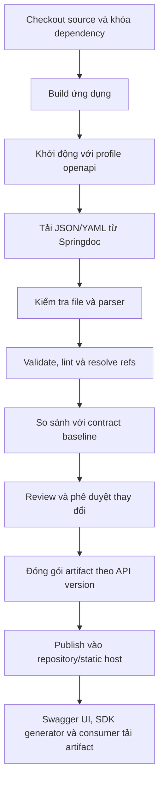

# Phân phối đặc tả tĩnh độc lập với ứng dụng chạy

Springdoc thường cung cấp OpenAPI document qua endpoint runtime như `/v3/api-docs`. Cách này thuận tiện cho Swagger UI và công cụ tích hợp, nhưng người tiêu thụ tài liệu phải truy cập được ứng dụng đang chạy. Trong nhiều quy trình, API contract cần được lưu trữ, review, phát hành hoặc dùng để sinh SDK ngay cả khi service không chạy hay không được phép công khai endpoint tài liệu.

Giải pháp là **tạo OpenAPI document thành artifact tĩnh trong quá trình build hoặc release**, sau đó phân phối file JSON/YAML qua artifact repository, static web hosting hoặc CDN. Ứng dụng có thể vẫn chạy Springdoc tạm thời để tạo file, nhưng người tiêu thụ artifact không cần gọi endpoint runtime của service nữa.

Đặc tả tĩnh trở thành một đầu ra có phiên bản của quy trình build. Nó có thể được review cùng source code, kiểm tra breaking change, lưu theo release, dùng để sinh client và phục vụ Swagger UI độc lập với vòng đời triển khai ứng dụng.

## 1. Endpoint runtime và artifact tĩnh khác nhau thế nào?

Springdoc tạo OpenAPI document từ controller, DTO, annotations, cấu hình Spring và các model converter của ứng dụng. Có hai cách phổ biến để cung cấp document:

| Cách cung cấp | Đặc điểm | Phụ thuộc ứng dụng đang chạy? |
|---|---|---:|
| Runtime endpoint `/v3/api-docs` | Request HTTP được xử lý bởi ứng dụng Spring Boot đang hoạt động | Có |
| File JSON/YAML tĩnh | Document được tạo trước, lưu thành file và phân phối từ kho artifact hoặc static host | Không, sau khi file đã được tạo |

Ví dụ endpoint runtime:

```bash
curl -fsS http://localhost:8080/v3/api-docs
```

Ví dụ đọc file đã phát hành:

```bash
curl -fsS https://contracts.example.com/orders/1.4.0/openapi.yaml
```

Ở cách thứ hai, web server/CDN chỉ cần trả file đã tạo. Nó không cần khởi động Spring Boot, quét controller hoặc tạo lại schema theo từng request.

Lưu ý: Maven/Gradle plugin của Springdoc thường khởi động ứng dụng trong một tiến trình build, gọi endpoint API Docs rồi ghi response thành file. Vì vậy, “phân phối tĩnh độc lập” nói về cách tiêu thụ và hosting artifact sau khi tạo; không có nghĩa mọi công cụ sinh file đều có thể phân tích source code mà không chạy ứng dụng.

## 2. Khi nào nên phát hành đặc tả tĩnh?

Đặc tả tĩnh hữu ích khi có một hoặc nhiều nhu cầu sau:

- Đội frontend cần contract ổn định để phát triển trước khi backend được triển khai.
- Đối tác cần tải tài liệu theo release mà không có quyền truy cập mạng nội bộ của service.
- Pipeline sinh SDK hoặc client cần một file đầu vào có thể lưu và tái sử dụng.
- Contract test cần so sánh document mới với baseline của release trước.
- Swagger UI được host riêng trên static web server.
- API Docs runtime bị tắt hoặc chỉ cho phép truy cập từ mạng nội bộ.
- Tổ chức muốn lưu lại chính xác contract đã được phát hành cùng binary/container image.

Không nhất thiết bỏ endpoint runtime. Nhiều hệ thống giữ `/v3/api-docs` cho developer và integration test, đồng thời phát hành file tĩnh cho người tiêu thụ bên ngoài. Hai đầu ra cần được tạo từ cùng source và cùng cấu hình có chủ đích.

## 3. Chọn nội dung document trước khi tạo artifact

File được xuất phản ánh cấu hình Spring Boot tại thời điểm ứng dụng được khởi động để generate. Profile, environment variables, server URL, group và feature flag có thể làm thay đổi document.

Trước khi xuất, xác định:

1. **Phiên bản OpenAPI**: ứng dụng xuất 3.0.x hay 3.1.x.
2. **API release**: giá trị `info.version` và version của artifact.
3. **Phạm vi API**: document mặc định hay một/một số `GroupedOpenApi`.
4. **Server URL**: dùng relative URL, URL public ổn định hay danh sách server theo môi trường.
5. **Thông tin nhạy cảm**: không đưa token, mật khẩu, private hostname hoặc dữ liệu thật vào example.
6. **Profile generate**: cấu hình nào được dùng để khởi động ứng dụng trong bước export.

Không dùng nhầm `info.version` làm phiên bản OpenAPI. Ví dụ `openapi: 3.1.0` xác định ngôn ngữ đặc tả, còn `info.version: 1.4.0` có thể là phiên bản contract của Orders API.

## 4. Tạo file tĩnh bằng Springdoc Maven Plugin

`springdoc-openapi-maven-plugin` lấy OpenAPI document từ endpoint của ứng dụng và ghi thành file trong Maven build. Plugin làm việc cùng `spring-boot-maven-plugin`: ứng dụng được start ở phase `pre-integration-test`, plugin generate chạy ở `integration-test`, sau đó ứng dụng được stop ở `post-integration-test`.

Ví dụ cấu hình trong `pom.xml`:

```xml
<build>
    <plugins>
        <plugin>
            <groupId>org.springframework.boot</groupId>
            <artifactId>spring-boot-maven-plugin</artifactId>
            <configuration>
                <jvmArguments>-Dspring.application.admin.enabled=true</jvmArguments>
            </configuration>
            <executions>
                <execution>
                    <id>pre-integration-test</id>
                    <goals>
                        <goal>start</goal>
                    </goals>
                </execution>
                <execution>
                    <id>post-integration-test</id>
                    <goals>
                        <goal>stop</goal>
                    </goals>
                </execution>
            </executions>
        </plugin>

        <plugin>
            <groupId>org.springdoc</groupId>
            <artifactId>springdoc-openapi-maven-plugin</artifactId>
            <version>${springdoc-openapi-maven-plugin.version}</version>
            <executions>
                <execution>
                    <id>generate-openapi</id>
                    <phase>integration-test</phase>
                    <goals>
                        <goal>generate</goal>
                    </goals>
                </execution>
            </executions>
            <configuration>
                <apiDocsUrl>http://localhost:8080/v3/api-docs</apiDocsUrl>
                <outputDir>${project.build.directory}</outputDir>
                <outputFileName>openapi.json</outputFileName>
                <attachArtifact>true</attachArtifact>
                <failOnError>true</failOnError>
            </configuration>
        </plugin>
    </plugins>
</build>
```

Đặt phiên bản plugin trong Maven property hoặc parent build để quản lý tập trung:

```xml
<properties>
    <springdoc-openapi-maven-plugin.version>1.6</springdoc-openapi-maven-plugin.version>
</properties>
```

Phiên bản trong ví dụ cần được kiểm tra với release hiện hành và môi trường Maven của dự án trước khi sử dụng. Tài liệu Springdoc v2 nêu các tham số như `apiDocsUrl`, `outputDir`, `outputFileName`, `attachArtifact`, `attachArtifactClassifier`, `headers`, `timeout`, `skip` và `failOnError`.

Chạy toàn bộ lifecycle đến `verify`:

```bash
mvn clean verify
```

Sau khi plugin chạy thành công, file mặc định trong ví dụ nằm tại:

```text
target/openapi.json
```

`attachArtifact=true` cho phép gắn tài liệu vào Maven project artifact để cài đặt hoặc deploy cùng release. Classifier mặc định được plugin tài liệu hóa là `openapi`; có thể cấu hình classifier khác nếu repository cần quy ước riêng.

Đặt `failOnError=true` trong CI để build thất bại khi không tải được document hoặc plugin không tạo được file. Nếu để mặc định `false`, một số lỗi có thể chỉ được ghi log và build vẫn tiếp tục mà không có artifact.

Lưu ý vận hành: nếu Maven build thất bại trước `post-integration-test`, Maven có thể bỏ qua goal `spring-boot:stop` và tiến trình ứng dụng được start để export vẫn còn chạy. Khi xử lý build lỗi, kiểm tra và dừng tiến trình đó trước lần chạy tiếp theo để tránh chiếm port hoặc làm sai kết quả của build sau.

## 5. Xuất YAML thay vì JSON bằng Maven Plugin

Plugin Maven có thể tải YAML từ endpoint Springdoc bằng cách đặt `apiDocsUrl` tới `/v3/api-docs.yaml` và đổi tên file:

```xml
<configuration>
    <apiDocsUrl>http://localhost:8080/v3/api-docs.yaml</apiDocsUrl>
    <outputDir>${project.build.directory}</outputDir>
    <outputFileName>openapi.yaml</outputFileName>
    <failOnError>true</failOnError>
</configuration>
```

Artifact sẽ là:

```text
target/openapi.yaml
```

Chọn JSON hoặc YAML theo công cụ tiêu thụ. Cả hai định dạng đều biểu diễn cùng OpenAPI document; khác nhau ở cách tuần tự hóa. Nếu cần review bằng diff trong Git, YAML thường dễ đọc; nếu pipeline dùng parser JSON hoặc tooling ưu tiên JSON, có thể xuất JSON.

Không đổi phần mở rộng thành `.yaml` nếu endpoint vẫn trả JSON. Định dạng nội dung phải khớp định dạng tên file và content type mà plugin nhận được.

## 6. Xác thực khi export document

Nếu endpoint API Docs yêu cầu authentication, Maven plugin hỗ trợ cấu hình request headers để tải document.

```xml
<configuration>
    <apiDocsUrl>https://localhost:8443/v3/api-docs</apiDocsUrl>
    <outputDir>${project.build.directory}</outputDir>
    <outputFileName>openapi.json</outputFileName>
    <headers>
        <Authorization>Bearer ${env.OPENAPI_READ_TOKEN}</Authorization>
    </headers>
    <failOnError>true</failOnError>
</configuration>
```

Token phải được cấp từ secret store của CI hoặc cơ chế bảo mật tương đương. Không đặt token thật trong `pom.xml`, không commit file settings chứa secret và không in request headers vào log.

Nếu endpoint dùng HTTPS với CA nội bộ, cấu hình truststore phù hợp cho JVM/plugin thay vì tắt kiểm tra TLS. Một số plugin cung cấp tham số `trustStore`/`trustStorePassword`; hãy kiểm tra đúng tài liệu phiên bản Maven plugin đang sử dụng.

Nếu tài liệu có thể được export bằng profile chuyên dụng mà không cần endpoint public, ưu tiên dùng mạng build nội bộ và credential có quyền chỉ đọc API Docs. Sau khi export, file tĩnh vẫn phải được phân phối theo chính sách truy cập của contract.

## 7. Tạo file tĩnh bằng Springdoc Gradle Plugin

`springdoc-openapi-gradle-plugin` cung cấp task `generateOpenApiDocs`. Với plugin dòng 2.x, task tự khởi động ứng dụng Spring Boot, gọi URL API Docs, ghi file vào build directory rồi dừng ứng dụng. Từ phiên bản 2.1, build phải khai báo Spring Boot Gradle plugin; plugin Springdoc không tự áp dụng plugin Spring Boot.

Ví dụ `build.gradle.kts`:

```kotlin
plugins {
    java
    id("org.springframework.boot") version "<spring-boot-version>"
    id("org.springdoc.openapi-gradle-plugin") version "<springdoc-gradle-plugin-version>"
}

dependencies {
    implementation("org.springdoc:springdoc-openapi-starter-webmvc-api:<springdoc-version>")
}

openApi {
    apiDocsUrl.set("http://localhost:8080/v3/api-docs")
    outputDir.set(layout.buildDirectory.dir("openapi"))
    outputFileName.set("openapi.json")
    customBootRun {
        args.set(listOf("--spring.profiles.active=openapi"))
    }
}
```

Chạy task:

```bash
./gradlew generateOpenApiDocs
```

File đầu ra trong ví dụ:

```text
build/openapi/openapi.json
```

Plugin Gradle v2 yêu cầu Gradle 8.0 trở lên theo tài liệu hiện hành. Hãy kiểm tra compatibility với Gradle Wrapper, Spring Boot và Java toolchain của dự án trước khi áp dụng. Các placeholder phiên bản ở ví dụ phải được thay bằng phiên bản tương thích đã khóa.

### Cấu hình xuất YAML

```kotlin
openApi {
    apiDocsUrl.set("http://localhost:8080/v3/api-docs.yaml")
    outputDir.set(layout.buildDirectory.dir("openapi"))
    outputFileName.set("openapi.yaml")
}
```

Nếu URL kết thúc bằng `.yaml`, plugin Gradle có thể ghi document YAML. Hãy kiểm tra file thực tế và không dựa vào phần mở rộng nếu endpoint đang trả định dạng khác.

### Cấu hình nhiều group

```kotlin
openApi {
    groupedApiMappings.set(
        mapOf(
            "http://localhost:8080/v3/api-docs/public" to "openapi-public.json",
            "http://localhost:8080/v3/api-docs/admin" to "openapi-admin.json"
        )
    )
}
```

Khi `groupedApiMappings` được thiết lập, plugin dùng các mapping đó thay cho `apiDocsUrl` và `outputFileName` đơn lẻ. Mỗi URL được tải thành một file tương ứng. Đảm bảo các group đã được đăng ký trong ứng dụng và cấu hình profile generate không vô tình loại bỏ controller của group.

## 8. Profile riêng cho quá trình tạo tài liệu

Ứng dụng có thể cần kết nối database, message broker, identity provider hoặc dịch vụ ngoài khi khởi động. Để tạo document ổn định trong CI, có thể dùng profile chuyên dụng như `openapi`:

```yaml
# application-openapi.yml
springdoc:
  api-docs:
    enabled: true
  swagger-ui:
    enabled: false

app:
  integrations:
    payment-provider:
      enabled: false
```

Ví dụ này giữ API Docs bật để plugin tải document, tắt UI vì không cần giao diện trong bước export, và minh họa việc tắt một integration không cần thiết cho quá trình tạo schema. Các property `app.integrations.*` là cấu hình riêng của ứng dụng; chỉ sử dụng nếu codebase thực sự hỗ trợ chúng.

Với Maven, có thể truyền profile qua `spring-boot-maven-plugin` hoặc cấu hình môi trường chạy ứng dụng trong build. Với Gradle plugin, dùng `customBootRun.args`, ví dụ:

```kotlin
openApi {
    customBootRun {
        args.set(listOf("--spring.profiles.active=openapi"))
    }
}
```

Profile generate cần tạo đúng contract sẽ phát hành. Không dùng profile mock làm thay đổi request/response schema, bỏ security requirement hoặc loại operation chỉ để ứng dụng khởi động dễ hơn. Nếu cần mock external integration, chỉ thay dependency runtime bên dưới; giữ nguyên controller, DTO, validation và OpenAPI metadata.

## 9. Xuất thủ công khi không dùng build plugin

Plugin không bắt buộc. Có thể khởi động ứng dụng bằng cấu hình generate, sau đó dùng `curl` tải file:

```bash
mkdir -p build/openapi

curl --fail --silent --show-error \
  http://localhost:8080/v3/api-docs \
  --output build/openapi/openapi.json
```

Với YAML:

```bash
curl --fail --silent --show-error \
  http://localhost:8080/v3/api-docs.yaml \
  --output build/openapi/openapi.yaml
```

Nếu endpoint được bảo vệ, dùng header từ secret environment:

```bash
curl --fail --silent --show-error \
  -H "Authorization: Bearer ${OPENAPI_READ_TOKEN}" \
  http://localhost:8080/v3/api-docs \
  --output build/openapi/openapi.json
```

Sau khi tải, cần xác minh file không rỗng, đúng JSON/YAML, có trường `openapi`, `info` và `paths`, đồng thời chạy parser/validator. `curl --fail` giúp lệnh trả mã lỗi với HTTP status 4xx/5xx; nó không thay thế việc kiểm tra body vì proxy hoặc login redirect có thể trả HTML với status thành công.

## 10. Kiểm tra artifact trước khi phát hành

Không publish file chỉ vì lệnh export kết thúc mà không báo lỗi. Một bước kiểm tra nên xác minh tối thiểu:

- File tồn tại và không rỗng.
- Nội dung parse được như JSON hoặc YAML.
- Trường `openapi` nằm trong phiên bản được dự án chấp nhận.
- `info.title`, `info.version` và `paths` có giá trị mong đợi.
- Các group cần phát hành đều có file tương ứng.
- Không có URL nội bộ, token, mật khẩu hoặc example chứa dữ liệu nhạy cảm.
- `$ref` nội bộ và external được resolve theo chính sách của dự án.
- OpenAPI validator và contract checks đạt.
- Có thể so sánh với artifact baseline để phát hiện breaking changes.

Ví dụ kiểm tra nhanh JSON bằng `jq`:

```bash
jq -e '
  (.openapi | type == "string") and
  (.info.title | type == "string" and length > 0) and
  (.info.version | type == "string" and length > 0) and
  (.paths | type == "object")
' build/openapi/openapi.json
```

Ví dụ kiểm tra file YAML bằng parser phù hợp trong Java hoặc CLI validator đã được khóa phiên bản. Không dùng `grep` để xác nhận YAML hợp lệ; cú pháp YAML và semantics OpenAPI cần được kiểm tra bằng parser.

## 11. Đặt artifact vào version control hay artifact repository?

Có hai chiến lược lưu trữ phổ biến:

### Lưu file trong Git

Phù hợp khi document nhỏ, cần review contract cùng pull request và muốn theo dõi thay đổi bằng diff.

```text
contracts/
  orders/
    1.3.0/openapi.yaml
    1.4.0/openapi.yaml
  customers/
    2.1.0/openapi.yaml
```

Có thể commit file được generate nếu team muốn review output trước khi merge. Cần có quy trình để xác định file sinh từ source nào, tránh chỉnh tay document rồi để lệch với controller/DTO.

### Publish vào artifact repository

Phù hợp khi contract là release artifact cần được tải bởi nhiều dự án hoặc đối tác. Maven plugin có tùy chọn `attachArtifact` để gắn OpenAPI file với project artifact trong quá trình install/deploy. Một repository khác có thể lưu file dưới dạng generic/raw artifact, package hoặc asset của release.

Ví dụ cấu trúc artifact:

```text
com.example:orders-api:1.4.0:openapi@yaml
```

Đây là quy ước minh họa; tọa độ/classifier/extension phải khớp repository và plugin cấu hình của tổ chức. Nếu không dùng Maven repository, có thể upload file vào object storage hoặc release asset.

Dù chọn Git hay artifact repository, hãy giữ artifact của từng release bất biến. Nếu cần cập nhật contract, phát hành version mới hoặc một revision có thể truy vết, không ghi đè âm thầm file đã được consumer sử dụng.

## 12. Version hóa đường dẫn và metadata

Một cách đơn giản để phân phối là đưa API version vào URL:

```text
https://contracts.example.com/orders/1.4.0/openapi.yaml
https://contracts.example.com/orders/1.5.0/openapi.yaml
https://contracts.example.com/customers/2.1.0/openapi.json
```

Có thể cung cấp alias `latest` hoặc `current` để thuận tiện, nhưng alias đó là mutable và có thể thay đổi theo release. Client production, SDK generator và contract test tái lập nên dùng URL version cố định.

Giữ các khái niệm riêng:

| Giá trị | Ví dụ | Ý nghĩa |
|---|---|---|
| OpenAPI version | `3.1.0` | Phiên bản ngôn ngữ đặc tả |
| `info.version` | `1.4.0` | Phiên bản API/contract do đội phát triển quản lý |
| Artifact version | `orders-api-1.4.0-openapi.yaml` | Phiên bản file được lưu và phân phối |
| Application version | `orders-service:2026.11.20` | Phiên bản binary/container được triển khai |
| Git commit | `a1b2c3d` | Nguồn code đã tạo artifact |

Các giá trị này có thể trùng quy ước nhưng không đồng nghĩa. Một binary có thể phục vụ nhiều group; một API contract có thể được đóng gói cùng nhiều service artifact; `info.version` cũng không tự tăng khi build nếu dự án không cấu hình.

Nên lưu provenance cùng artifact, chẳng hạn commit SHA, build number, thời gian tạo, Springdoc version, OpenAPI version và profile generate. Có thể lưu metadata trong manifest riêng hoặc release metadata của artifact repository.

## 13. Phân phối file tĩnh qua web server, object storage hoặc CDN

Sau khi có file, có thể host bằng:

- Nginx/Apache static file server.
- Object storage có HTTP access, ví dụ S3-compatible storage.
- Static hosting hoặc release pages.
- CDN phía trước object storage hoặc web server.
- Artifact repository có endpoint download.

Ví dụ cấu trúc object storage:

```text
contracts/orders/1.4.0/openapi.yaml
contracts/orders/1.4.0/openapi.json
contracts/orders/1.5.0/openapi.yaml
contracts/orders/latest/openapi.yaml
```

File được host tĩnh nên có content type phù hợp, chẳng hạn `application/json` cho JSON và `application/yaml` hoặc media type YAML mà hệ thống thống nhất cho YAML. Hãy kiểm tra response header và cách Swagger UI/parser tiêu thụ file.

Với URL version cố định, có thể dùng cache dài hạn và `Cache-Control: public, max-age=31536000, immutable` nếu file thực sự không thay đổi. Với alias `latest`, dùng cache ngắn hơn hoặc revalidation bằng ETag/Last-Modified để tránh consumer giữ bản cũ quá lâu.

Không dùng cache immutable cho URL có nội dung bị ghi đè. Ngược lại, không cần cache quá ngắn cho artifact release bất biến. Quy tắc cache phải đi cùng quy tắc version hóa.

## 14. Dùng Swagger UI độc lập để hiển thị file tĩnh

Swagger UI có thể chạy riêng như static site và tải OpenAPI document qua URL. Khi UI và file cùng origin, cấu hình đơn giản hơn; nếu khác origin, server cung cấp document cần cấu hình CORS cho origin của UI.

Ví dụ cấu hình Swagger UI dùng một file đã publish:

```javascript
SwaggerUIBundle({
  url: "https://contracts.example.com/orders/1.4.0/openapi.yaml",
  dom_id: "#swagger-ui"
});
```

Với nhiều API:

```javascript
SwaggerUIBundle({
  urls: [
    {
      name: "Orders 1.4.0",
      url: "https://contracts.example.com/orders/1.4.0/openapi.yaml"
    },
    {
      name: "Customers 2.1.0",
      url: "https://contracts.example.com/customers/2.1.0/openapi.json"
    }
  ],
  "urls.primaryName": "Orders 1.4.0",
  dom_id: "#swagger-ui"
});
```

Đây là cấu hình Swagger UI độc lập; không cần khởi động Springdoc chỉ để render file đã phát hành. Nếu vẫn dùng trang Swagger UI do Springdoc cung cấp, có thể cấu hình `springdoc.swagger-ui.url` hoặc `urls` để trỏ đến tài liệu khác, nhưng ứng dụng vẫn phải phục vụ UI resources. Khi muốn UI hoàn toàn độc lập, host cả Swagger UI assets và config riêng.

Nếu file được bảo vệ bằng authentication, cần đảm bảo browser của người dùng có thể lấy document bằng cơ chế phù hợp. Không nhúng token dài hạn vào JavaScript tĩnh. Với tài liệu nội bộ, có thể đặt UI và file sau cùng một reverse proxy/SSO hoặc dùng URL có quyền truy cập ngắn hạn theo chính sách.

## 15. CORS, authentication và phân loại tài liệu

Tài liệu OpenAPI có thể chứa nhiều thông tin hơn một trang hướng dẫn thông thường: đường dẫn nội bộ, tên schema, operation quản trị, security scheme, ví dụ payload và mô hình lỗi. Hãy phân loại tài liệu trước khi public.

| Loại tài liệu | Cách phân phối thường dùng |
|---|---|
| Public API contract | Static host/CDN public, URL version cố định |
| Partner API contract | Portal hoặc object storage yêu cầu đăng nhập, có audit |
| Internal API contract | Artifact repository hoặc static site trong mạng nội bộ |
| Restricted/admin API contract | Access control theo nhóm, không công bố qua bucket public |

Nếu Swagger UI ở `docs.example.com` và OpenAPI file ở `contracts.example.com`, browser thực hiện cross-origin request. Server file phải trả CORS headers cho origin được phép. CORS chỉ điều khiển browser có thể đọc response; nó không phải cơ chế xác thực và không bảo vệ file khỏi `curl` hoặc client HTTP khác.

Với tài liệu private, dùng authentication/authorization ở static host hoặc artifact repository. Không xem URL khó đoán là cơ chế bảo mật. Kiểm tra cả file JSON/YAML, file group và external `$ref` để tránh một tài liệu public tham chiếu sang nội dung private hoặc ngược lại.

Trước khi phát hành, rà soát:

- Không có API key, Bearer token, password hoặc cookie thật trong example.
- Không có hostname, IP hoặc port nội bộ nếu không dành cho người tiêu thụ nội bộ.
- `servers` không trỏ nhầm vào localhost hoặc môi trường staging riêng tư.
- Không có example chứa PII, dữ liệu khách hàng hoặc dữ liệu production.
- Không công bố operation nội bộ ngoài phạm vi contract public.
- Security schemes mô tả cơ chế auth, không chứa credential.

## 16. Quản lý `servers` khi document được tạo trong build

OpenAPI document có thể chứa `servers` để Swagger UI biết URL gọi Try it out. Nếu generate khi ứng dụng chạy trên `localhost:8080`, document tĩnh có thể lưu server URL đó. Khi publish cho đối tác, `localhost` không phải địa chỉ API của họ.

Ví dụ server URL không phù hợp cho public artifact:

```yaml
servers:
  - url: http://localhost:8080
```

Có thể dùng relative URL nếu tài liệu được host theo cấu trúc phù hợp:

```yaml
servers:
  - url: /api
```

Hoặc khai báo URL public ổn định:

```yaml
servers:
  - url: https://api.example.com/api
    description: Production API
```

Nếu nhiều môi trường có server URL khác nhau, quyết định có nên phát hành một contract với nhiều server hay tạo artifact riêng cho từng môi trường. Contract chung với `servers` nhiều entry thường dễ tái sử dụng hơn, nhưng không được đưa hostname private vào public document. Artifact riêng theo môi trường cần version và provenance rõ ràng để tránh nhầm lẫn.

Có thể cấu hình server metadata qua `@OpenAPIDefinition(servers = ...)`, `OpenAPI` bean hoặc customizer. Nếu plugin gửi forwarded headers để Springdoc tạo server URL, hãy kiểm tra URL trong file đầu ra và không phụ thuộc hostname nội bộ của build agent.

## 17. Phát hành nhiều document theo GroupedOpenApi

Ứng dụng có thể tạo nhiều group, ví dụ `public`, `partner` và `admin`. Khi phân phối tĩnh, mỗi group nên trở thành một artifact riêng nếu người tiêu thụ có phạm vi quyền khác nhau.

Ví dụ cấu trúc:

```text
openapi/
  orders-public-1.4.0.yaml
  orders-partner-1.4.0.yaml
  orders-admin-1.4.0.yaml
```

Với Maven plugin, có thể chạy một execution cho từng URL/group hoặc dùng cấu hình plugin phù hợp để tải từng document. Với Gradle plugin, `groupedApiMappings` ánh xạ URL document group sang tên file đầu ra.

Không gộp public và admin vào một file rồi public cả file nếu người dùng public không được phép xem operation admin. Phân phối artifact theo cùng ranh giới bảo mật với API contract. Mỗi file cần được kiểm tra độc lập về path, security scheme, server URL và `$ref`.

## 18. Quy trình CI/CD phát hành OpenAPI artifact

Một pipeline tham khảo:



Các bước nên được tách thành job hoặc stage có đầu ra rõ ràng:

1. **Generate**: tạo JSON/YAML từ đúng source commit và profile.
2. **Validate**: parse bằng parser tương thích phiên bản, validate OpenAPI và kiểm tra external references.
3. **Diff**: so sánh với baseline để phát hiện breaking changes.
4. **Review**: yêu cầu review khi contract thay đổi theo policy của tổ chức.
5. **Package**: đặt tên file và metadata theo API release.
6. **Publish**: upload artifact sau khi tất cả kiểm tra đạt.
7. **Consume**: SDK generator, Swagger UI và contract tests tải đúng version đã phát hành.

Không publish file nếu bước generate hoặc validate thất bại. Nếu contract có thay đổi breaking, pipeline nên dừng trước publish cho đến khi versioning/release policy được xử lý.

## 19. Ví dụ script kiểm tra và đóng gói artifact

Một script shell đơn giản có thể kiểm tra file trước khi upload:

```bash
set -euo pipefail

SPEC="build/openapi/openapi.json"
test -s "$SPEC"

jq -e '
  (.openapi | type == "string") and
  (.info.title | type == "string" and length > 0) and
  (.info.version | type == "string" and length > 0) and
  (.paths | type == "object")
' "$SPEC" >/dev/null

sha256sum "$SPEC" > "$SPEC.sha256"
```

Hash giúp xác định file có thay đổi sau khi publish hoặc tải xuống. Nó không chứng minh nguồn gốc artifact nếu hash được lưu cùng nơi có thể bị sửa; nếu cần xác minh provenance, dùng chữ ký hoặc attestation do CI phát hành và lưu trong hệ thống tin cậy.

Khi upload, dùng đường dẫn có version cố định:

```text
orders/1.4.0/openapi.json
```

Không dùng tên `latest` làm artifact duy nhất. Có thể cập nhật alias `latest` sau khi version cố định đã publish thành công.

## 20. Bảo đảm tính tái lập của artifact

Hai lần build cùng source có thể sinh document khác nhau nếu cấu hình runtime khác. Những nguyên nhân thường gặp:

- Profile khác nhau làm thay đổi controller, group hoặc conditional bean.
- Environment variable thay đổi `servers`, title, version hoặc security metadata.
- Dependency Springdoc/Swagger Core/Jackson được nâng cấp.
- Model converter hoặc customizer tạo schema không ổn định.
- Thứ tự collection hoặc thông tin được tạo động làm thay đổi serialization.
- External reference trỏ đến tài nguyên đã bị sửa.

Để artifact có thể tái lập:

- Khóa phiên bản Spring Boot, Springdoc, Swagger Core và plugin generate.
- Dùng profile generate có cấu hình được quản lý trong source.
- Không lấy thời gian hiện tại, host ngẫu nhiên hoặc dữ liệu runtime vào schema nếu không cần.
- Pin external schema theo version hoặc commit.
- Ghi lại commit SHA, build ID và phiên bản tool.
- So sánh semantic document thay vì chỉ so byte nếu thứ tự serialization có thể thay đổi.
- Lưu file đã phát hành bất biến và giữ checksum.

Nếu document có `info.version` được lấy từ build property, hãy bảo đảm property đó đến từ một nguồn xác định, ví dụ Maven/Gradle project version hoặc release tag.

## 21. Phân biệt artifact tĩnh với tài liệu được tạo thủ công

Không nên chỉnh tay file đã được Springdoc generate rồi publish như thể nó là output của source hiện tại. Nếu cần thay đổi mô tả, schema hoặc example:

1. Sửa controller, DTO, Swagger annotations, `OpenAPI` bean hoặc customizer.
2. Chạy lại bước generate.
3. Review diff của document.
4. Chạy parser, validator và compatibility checks.
5. Publish artifact mới.

Nếu có lý do bắt buộc phải post-process document sau generate, hãy biến bước đó thành script/versioned build task, lưu script trong source và chạy lại tự động. Khi đó artifact là kết quả của cả Springdoc generation lẫn transformation đã được kiểm soát.

Không để một bản file đã sửa thủ công nằm ngoài source of truth, vì lần generate tiếp theo có thể ghi đè và làm mất thay đổi.

## 22. Lỗi thường gặp

| Hiện tượng | Nguyên nhân có thể | Cách xử lý |
|---|---|---|
| File không được tạo | Ứng dụng chưa sẵn sàng hoặc endpoint API Docs sai | Kiểm tra start task, port, readiness và `apiDocsUrl` |
| Maven build vẫn thành công nhưng thiếu file | `failOnError` đang false | Đặt `failOnError=true` trong CI và kiểm tra artifact tồn tại |
| Gradle task timeout | Ứng dụng cần nhiều thời gian khởi động | Tăng `waitTimeInSeconds`, kiểm tra log boot và external dependencies |
| File `.yaml` chứa JSON | URL tải vẫn là `/v3/api-docs` | Dùng `/v3/api-docs.yaml` và tên file YAML |
| File có `servers.url` là localhost | Generate khi app chạy local mà không cấu hình server public | Cấu hình `servers` ổn định hoặc profile phù hợp |
| Document thiếu group | Group URL sai hoặc profile không tạo group đó | Kiểm tra `GroupedOpenApi` và mapping từng group |
| CI không tải được endpoint bảo vệ | Thiếu header hoặc token hết hạn | Cấp credential read-only qua secret store |
| HTTPS export lỗi certificate | JVM/plugin không trust CA | Cấu hình truststore hợp lệ, không bỏ TLS verification |
| Swagger UI độc lập không tải file | URL sai hoặc CORS chặn cross-origin request | Kiểm tra URL từ browser và CORS response headers |
| Consumer nhận bản cũ | CDN/cache alias chưa được revalidate | Dùng version URL bất biến, ETag và cache policy phù hợp |
| Artifact khác nhau giữa hai build | Profile, dependency hoặc dữ liệu động khác nhau | Khóa cấu hình và lưu provenance |
| Public file chứa operation nội bộ | Gộp nhầm group hoặc publish sai artifact | Tách group, kiểm tra security boundary trước publish |
| Runtime API Docs tắt nên export thất bại | Profile generate cũng tắt `api-docs.enabled` | Bật API Docs trong profile chỉ dùng để generate |

## 23. Checklist phát hành đặc tả tĩnh

- [ ] Đã chọn JSON hay YAML và xác nhận endpoint export trả đúng định dạng.
- [ ] Đã chọn API version và đặt `info.version` có chủ đích.
- [ ] Đã xác định OpenAPI version và parser/validator tương thích.
- [ ] Profile generate tạo đúng controller, DTO, group và security metadata.
- [ ] Maven/Gradle plugin được khóa phiên bản và tương thích build tool.
- [ ] Plugin được cấu hình fail build khi export thất bại.
- [ ] File đầu ra tồn tại, không rỗng và parse được.
- [ ] Đã validate document, `$ref`, schema và compatibility baseline.
- [ ] `servers` không chứa localhost hoặc hostname nội bộ ngoài ý muốn.
- [ ] Không có secret, token, PII hoặc example dữ liệu production.
- [ ] Các group được export và phân phối theo đúng ranh giới truy cập.
- [ ] Artifact có version path/tọa độ bất biến và provenance.
- [ ] Static host trả content type, CORS và cache headers phù hợp.
- [ ] Swagger UI độc lập trỏ đúng URL file đã publish.
- [ ] Artifact chỉ được publish sau khi validation và review đạt.
- [ ] Checksum hoặc chữ ký được lưu nếu quy trình yêu cầu xác minh nguồn gốc.
- [ ] Có quy trình phát hành version mới thay vì ghi đè âm thầm artifact cũ.

Phân phối đặc tả tĩnh bắt đầu bằng việc tạo OpenAPI JSON/YAML từ Springdoc trong build hoặc release, kiểm tra document, rồi lưu thành artifact có version. Maven plugin có thể start ứng dụng ở `pre-integration-test`, export ở `integration-test` và stop ở `post-integration-test`; Gradle plugin có task `generateOpenApiDocs` để thực hiện quy trình tương tự. Sau khi file được tạo, có thể phân phối độc lập qua Git, artifact repository, object storage, static hosting hoặc CDN. Hãy giữ artifact bất biến, kiểm tra `servers` và thông tin nhạy cảm, tách group theo quyền truy cập, đồng thời dùng parser/validator và breaking-change checks trước khi publish.

## Tài liệu tham khảo

- [Springdoc OpenAPI v2 – Maven and Gradle Plugins](https://springdoc.org/v2/plugins.html)
- [Springdoc OpenAPI Maven Plugin – README](https://github.com/springdoc/springdoc-openapi-maven-plugin)
- [Springdoc OpenAPI Gradle Plugin – README](https://github.com/springdoc/springdoc-openapi-gradle-plugin)
- [Swagger UI – Configuration](https://swagger.io/docs/open-source-tools/swagger-ui/usage/configuration/)
- [OpenAPI Specification](https://spec.openapis.org/oas/latest.html)
