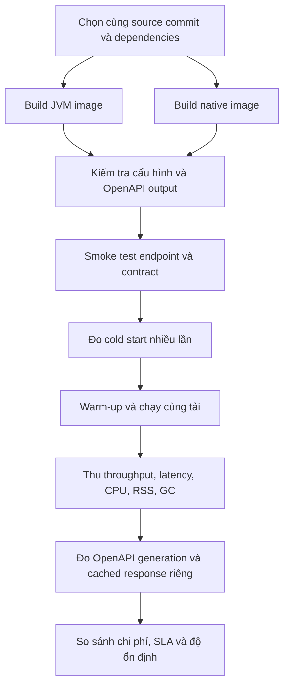

# Đối chiếu kết quả native với bản chạy trên JVM

Spring Boot có thể chạy dưới dạng ứng dụng JVM thông thường hoặc được biên dịch thành GraalVM Native Image. Hai cách triển khai có đặc điểm hiệu năng khác nhau: native image thường khởi động nhanh và dùng ít bộ nhớ hơn, còn JVM có JIT compiler tối ưu các đường chạy nóng sau một thời gian warm-up. Không có lựa chọn thắng ở mọi workload; cần đo trên chính ứng dụng, cấu hình và môi trường triển khai dự kiến.

Với ứng dụng dùng springdoc-openapi, việc so sánh cần kiểm tra cả hiệu năng của API nghiệp vụ và khả năng tạo tài liệu OpenAPI. Native image phải giữ được các endpoint `/v3/api-docs`, YAML, group và Swagger UI cần thiết. Một binary khởi động nhanh nhưng thiếu schema do reflection hint hoặc cấu hình AOT chưa đầy đủ không phải là kết quả triển khai hợp lệ.

## 1. Hai mô hình thực thi khác nhau

### JVM: bytecode và JIT

Ở cách chạy truyền thống, Spring Boot được đóng gói thành executable JAR. JVM tải class, tạo Spring ApplicationContext và thực thi bytecode. JIT compiler theo dõi các method được gọi thường xuyên, thu thập thông tin runtime rồi biên dịch những đoạn mã nóng thành machine code.

Quá trình này tạo ra giai đoạn warm-up. Khi service vừa khởi động, một số request đầu tiên có thể chậm hơn. Sau khi workload ổn định, JIT có thêm dữ liệu để tối ưu các đường code được dùng nhiều. Với service chạy liên tục và tải cao, lợi ích này có thể giúp JVM đạt throughput cao hoặc latency tốt hơn ở trạng thái ổn định.

### Native Image: AOT và closed-world analysis

GraalVM Native Image phân tích các đường code có thể truy cập từ entry point ở build time, sau đó biên dịch thành executable dành cho một hệ điều hành và kiến trúc CPU cụ thể. Runtime không cần cài một JVM riêng và không có JIT compiler để tối ưu code theo profile request trong lúc chạy.

Native Image thường có startup nhanh hơn và memory footprint thấp hơn JVM. Code đã được biên dịch trước nên có hiệu năng ngay từ những request đầu tiên. Đổi lại, quá trình build nặng hơn, binary phụ thuộc nền tảng đích và các tính năng động như reflection, resource loading, serialization hoặc dynamic proxy cần được phát hiện và khai báo metadata phù hợp.

Spring Boot bổ sung Spring AOT processing trước khi GraalVM biên dịch. Spring tạo source code, proxy bytecode và reachability hints cho các bean cùng tính năng mà nó nhận diện được. Mô hình này giả định tập bean và classpath được xác định khi build; một số thay đổi cấu trúc bean theo runtime profile hoặc conditional property bị giới hạn.

## 2. So sánh theo loại chỉ số

| Chỉ số | JVM | Native Image | Ý nghĩa khi đánh giá |
|---|---|---|---|
| Cold startup | Phải khởi động JVM, load class và tạo Spring context | Thường nhanh hơn vì code đã được biên dịch AOT | Quan trọng với scale-to-zero, job ngắn và autoscaling |
| Warm-up | Có giai đoạn JIT tối ưu code nóng | Không có JIT warm-up; vẫn có thể có cache và initialization của ứng dụng | Không so throughput JVM ngay sau startup với native đã chạy ổn định |
| Throughput ổn định | Có thể tăng sau warm-up nhờ JIT | Phụ thuộc chất lượng AOT compilation, workload và tùy chọn build | Đo bằng tải đại diện, không suy luận từ startup |
| Latency đầu tiên | Có thể cao hơn khi class loading/JIT đang diễn ra | Thường ít biến động ở giai đoạn đầu | Đo riêng first request và p95/p99 |
| Memory footprint | Bao gồm JVM, heap, metaspace, code cache và native memory | Thường nhỏ hơn, nhưng vẫn có heap và native allocations | So sánh RSS/container memory ở cùng tải |
| Build time | Build JAR thường nhanh | Native compilation thường tốn nhiều CPU/RAM và thời gian | Tính chi phí CI và thời gian phát hành |
| Artifact | JAR cần runtime Java tương thích | Executable/container phụ thuộc OS và kiến trúc | Tính kích thước image và ma trận nền tảng |
| Dynamic behavior | Reflection/classpath/proxy thường linh hoạt hơn | Cần reachability metadata; classpath đóng tại build | Chạy đầy đủ smoke test trên native binary |

Các mô tả trên là xu hướng chung, không phải số liệu cam kết. Phiên bản JDK/GraalVM, CPU, thư viện, GC, cấu hình container và loại request có thể làm thay đổi kết quả đáng kể.

## 3. Khi nào native thường có lợi?

Native Image đáng thử khi ứng dụng có một hoặc nhiều đặc điểm:

- Instance được tạo và hủy thường xuyên, nên cold startup ảnh hưởng thời gian phục vụ.
- Workload có lưu lượng thấp hoặc không liên tục, không đủ thời gian để JVM warm-up.
- Chạy function, worker ngắn hạn, job hoặc service có yêu cầu scale-to-zero.
- Giới hạn RAM của container nhỏ và footprint mỗi replica ảnh hưởng mật độ triển khai.
- Cần đạt readiness nhanh để autoscaler bổ sung replica khi tải tăng.

JVM có thể phù hợp hơn khi service chạy liên tục, có nhiều request lặp lại, cần throughput cao ở trạng thái ổn định, phụ thuộc thư viện Java động hoặc muốn tận dụng hệ sinh thái profiling/diagnostics của JVM.

Đối với springdoc-openapi, endpoint `/v3/api-docs` thường không phải hot path nghiệp vụ và mặc định document được tính một lần rồi cache. Vì vậy, tối ưu native có thể tác động mạnh đến thời gian khởi động toàn ứng dụng hơn là throughput request tài liệu sau khi cache đã được tạo. Cần đo riêng hai trường hợp này.

## 4. Build hai biến thể từ cùng một ứng dụng Springdoc

Để phép so sánh có ý nghĩa, tạo hai image từ cùng source commit và cùng dependency versions:

1. JVM image chạy executable JAR bằng JRE/JDK đã chọn.
2. Native image được tạo từ cùng project bằng Spring AOT và GraalVM Native Image.

Với Spring Boot 3 và Maven, khi project đã cấu hình Spring Boot parent cùng Native Build Tools plugin, có thể build native container bằng:

```bash
mvn -Pnative spring-boot:build-image
```

Với Gradle, áp dụng `org.graalvm.buildtools.native` cùng Spring Boot Gradle plugin, sau đó chạy:

```bash
./gradlew bootBuildImage
```

Khi Native Image plugin được áp dụng, Spring Boot Gradle plugin cấu hình các task AOT cần thiết và `bootBuildImage` tạo native image. Kiểm tra tài liệu đúng phiên bản Spring Boot, Gradle, GraalVM và Buildpacks trước khi đưa cấu hình vào CI.

Để tạo JVM image, build cùng ứng dụng nhưng không kích hoạt native profile/Native Image plugin cho image đó. Dùng cùng base OS family nếu có thể, cùng kiến trúc CPU và cùng resource limits. Nếu so sánh container, hãy ghi lại cả kích thước image và runtime memory.

Không build native trên máy ARM rồi so với JVM image chạy trên x86, hoặc ngược lại. Native executable là artifact phụ thuộc nền tảng; kiến trúc và instruction set phải phù hợp máy chạy. Nếu cần phân phối nhiều nền tảng, build riêng cho từng target.

## 5. Đảm bảo Springdoc hoạt động trong native image

Springdoc hỗ trợ GraalVM Native Image trong hệ Spring Boot 3. Tài liệu Springdoc lưu ý hai điểm thực tế:

- Các endpoint OpenAPI REST cần được build trong native profile của ứng dụng Spring Boot.
- Nếu `@OpenAPIDefinition` hoặc `@SecurityScheme` được đặt trên class không có implementation và class đó không được giữ như Spring configuration, class có thể bị loại trong native compilation. Đánh dấu class cấu hình bằng `@Configuration` để Spring nhận diện và giữ nó.

Ví dụ:

```java
import io.swagger.v3.oas.annotations.OpenAPIDefinition;
import io.swagger.v3.oas.annotations.info.Info;
import io.swagger.v3.oas.annotations.security.SecurityScheme;
import io.swagger.v3.oas.annotations.enums.SecuritySchemeType;
import org.springframework.context.annotation.Configuration;

@Configuration(proxyBeanMethods = false)
@OpenAPIDefinition(
    info = @Info(
        title = "Orders API",
        version = "1.0.0",
        description = "API quản lý đơn hàng"
    )
)
@SecurityScheme(
    name = "bearerAuth",
    type = SecuritySchemeType.HTTP,
    scheme = "bearer",
    bearerFormat = "JWT"
)
public class OpenApiConfiguration {
}
```

Nếu ứng dụng có custom model converter, serializer, DTO được phát hiện động hoặc thư viện dùng reflection, kiểm tra Spring AOT hints và reachability metadata. Spring Boot sinh nhiều hints tự động, nhưng một số thư viện bên thứ ba hoặc code tự viết có thể cần khai báo thêm `RuntimeHintsRegistrar`, `@RegisterReflectionForBinding` hoặc metadata theo hướng dẫn của thư viện.

Không thêm reflection hints một cách đại trà khi chưa xác định lỗi. Hãy chạy native smoke test, đọc thông báo reachability và chỉ bổ sung các type/resource/proxy thực sự cần thiết.

## 6. Giữ cùng cấu hình khi benchmark

Trước khi chạy, lập bảng cấu hình và cố định các biến ảnh hưởng kết quả:

| Thành phần | Cần giữ giống nhau |
|---|---|
| Source | Cùng commit, controller, DTO và OpenAPI annotations |
| Dependencies | Cùng phiên bản Spring Boot, Springdoc, Jackson, driver và thư viện nghiệp vụ |
| Application config | Cùng profile, feature flags, security và `servers` metadata |
| Data | Cùng database snapshot, seed data và trạng thái cache nghiệp vụ |
| Network | Cùng client host, TLS, proxy và network path |
| Container | Cùng CPU quota, memory limit, OS family và runtime topology |
| Workload | Cùng endpoint, payload, request rate, concurrency và thời gian test |
| Observability | Cùng logging, metrics agent và tracing sampling |

Không bật debug logging cho một biến thể và tắt cho biến thể còn lại. Nếu JVM dùng APM agent còn native không dùng được agent đó, hãy chạy hai vòng: một vòng không có agent để so runtime thuần và một vòng production-like với công cụ quan sát tương đương.

Ghi lại phiên bản JDK/GraalVM, native-image compiler, Spring Boot, Springdoc, OS kernel, CPU model, container runtime, JVM flags và Native Image build options. Các phiên bản toolchain khác nhau có thể làm thay đổi code generation và GC behavior.

## 7. Đo cold startup đúng cách

Cold startup nên đo từ lúc tạo process/container mới đến lúc ứng dụng thực sự sẵn sàng nhận traffic. Không chỉ lấy dòng log `Started ...` làm kết quả, vì sau log đó vẫn có thể còn lazy initialization, cache population hoặc tác vụ nền.

Quy trình gợi ý:

1. Pull image trước khi đo để không tính thời gian tải image.
2. Xác nhận không có container cũ đang chạy.
3. Tạo process/container mới.
4. Poll readiness endpoint bằng cùng chu kỳ cho cả hai biến thể.
5. Ghi thời điểm process bắt đầu và lần đầu readiness trả thành công.
6. Dừng container và lặp lại nhiều lần.
7. So sánh median, p95 và độ phân tán của các lần chạy.

Nếu có Spring Boot Actuator, dùng `/actuator/health/readiness` sau khi cấu hình readiness probe phù hợp. Nếu không, tạo một health endpoint nhẹ có semantics ổn định. Không dùng `/v3/api-docs` làm readiness endpoint vì nó có thể thực hiện công việc tạo document và làm thay đổi chính phép đo startup.

Ví dụ khung đo thủ công trên Linux với image đã có sẵn:

```bash
start_ns=$(date +%s%N)
container_id=$(docker run -d --rm -p 18080:8080 orders-api:native)

until curl --fail --silent http://localhost:18080/actuator/health/readiness >/dev/null; do
  sleep 0.05
done

ready_ns=$(date +%s%N)
elapsed_ms=$(( (ready_ns - start_ns) / 1000000 ))
printf 'readiness_ms=%s\n' "$elapsed_ms"

docker stop "$container_id" >/dev/null
```

Chạy lại với JVM image trên cùng port và điều kiện. Script chỉ là khung minh họa; trong benchmark thực tế cần thêm timeout, xử lý exit sớm, ghi lại exit code và bảo đảm không tính thời gian pull image. Đo bằng monotonic clock trong harness chuyên dụng sẽ chính xác hơn `date` nếu hệ thống có thể chỉnh clock trong lúc chạy.

Đo thêm **first-request latency** sau readiness. Startup readiness và request đầu tiên là hai mốc khác nhau; request đầu tiên có thể kích hoạt lazy initialization, kết nối pool hoặc cache.

## 8. Đo throughput và latency sau warm-up

Để so sánh steady-state, gửi workload đại diện cho ứng dụng thật. Với JVM, dành một giai đoạn warm-up đủ dài để JIT và các cache ổn định trước khi lấy số liệu. Không áp đặt một thời gian cố định cho mọi service; theo dõi throughput/latency theo từng khoảng và chỉ bắt đầu cửa sổ đo khi các chỉ số không còn biến động mạnh.

Native Image không có JIT warm-up, nhưng vẫn có thể có cache nghiệp vụ, connection pool, DNS cache, TLS session và các lazy initialization. Hãy chạy cùng giai đoạn chuẩn bị cho cả hai, sau đó đo trên cửa sổ có cùng thời lượng.

Ví dụ dùng `wrk` để tạo tải HTTP:

```bash
wrk -t4 -c64 -d120s --latency http://localhost:8080/api/orders
```

Các tham số phải được chọn theo giới hạn máy benchmark và workload dự kiến. Không dùng cùng lúc hai benchmark client nếu chúng cạnh tranh CPU hoặc network. Nếu API có request body hoặc auth, dùng k6/Gatling hoặc script client để tái hiện request chính xác.

Các chỉ số nên thu thập:

- Throughput: request/second hoặc transaction/second.
- Latency: p50, p90, p95, p99 và max.
- Error rate: timeout, HTTP 5xx, lỗi deserialize/serialize và lỗi kết nối.
- CPU: mức sử dụng trung bình, peak và CPU time cho mỗi request.
- Memory: RSS/container working set ở idle và dưới tải.
- GC: tần suất, pause time, allocation rate và memory sau khi tải kết thúc.
- Saturation: connection pool, thread pool, queue, database và network.

Không kết luận native nhanh hơn chỉ từ một con số requests/second. Nếu native có throughput thấp hơn nhưng p99 tốt hơn ở tải thấp, lựa chọn còn phụ thuộc SLA và chi phí. Nếu cả hai đều chờ database, khác biệt compiler có thể rất nhỏ so với bottleneck I/O.

## 9. Đo riêng endpoint OpenAPI của Springdoc

Springdoc tạo document từ Spring mapping, controller, DTO, validation annotation và Swagger metadata. Endpoint `/v3/api-docs` vì vậy có đặc tính khác với một endpoint CRUD thông thường.

Nên đo ít nhất ba luồng:

1. **Business API**: ví dụ `GET /api/orders/{id}` hoặc một request ghi có database.
2. **OpenAPI document**: `GET /v3/api-docs` và `/v3/api-docs.yaml`.
3. **Swagger UI**: entry point và static assets nếu ứng dụng có starter UI.

Đối với API Docs, tách hai tình huống:

- **Cold document generation**: request đầu tiên sau khi process vừa khởi động.
- **Cached document response**: request tiếp theo sau khi document đã được tạo.

Springdoc mặc định tính OpenAPI description một lần rồi cache. Do đó, đo liên tiếp `/v3/api-docs` thường phản ánh thời gian trả document đã cache, không phải chi phí quét controller và xây dựng schema ban đầu. Mỗi locale `Accept-Language` có thể có bản cache riêng.

Nếu muốn đo chi phí generate mỗi request, có thể tạm cấu hình:

```yaml
springdoc:
  cache:
    disabled: true
```

Không dùng cấu hình cache khác nhau giữa native và JVM. Khi benchmark production behavior, giữ cache mặc định ở cả hai. Khi benchmark riêng chi phí tạo document, tắt cache ở cả hai và ghi rõ đây là phép đo riêng, không đại diện cho cấu hình production mặc định.

Swagger UI chủ yếu phục vụ HTML/JavaScript/CSS tĩnh rồi tải OpenAPI document. Nếu muốn so hiệu năng API docs, đo request `/v3/api-docs` riêng với static assets để không trộn thời gian tải file với thời gian tạo schema.

## 10. Kiểm tra tính tương đương của OpenAPI output

Trước khi so performance, xác nhận JVM và native tạo cùng contract. Nếu native thiếu controller hoặc schema, throughput nhanh không có ý nghĩa.

Kiểm tra các endpoint cần thiết:

```bash
curl --fail --silent http://localhost:8080/v3/api-docs -o openapi-jvm.json
curl --fail --silent http://localhost:8081/v3/api-docs -o openapi-native.json

curl --fail --silent http://localhost:8080/v3/api-docs.yaml -o openapi-jvm.yaml
curl --fail --silent http://localhost:8081/v3/api-docs.yaml -o openapi-native.yaml
```

Nếu dùng groups, kiểm tra từng group:

```bash
curl --fail --silent http://localhost:8080/v3/api-docs/public
curl --fail --silent http://localhost:8081/v3/api-docs/public
```

Dùng OpenAPI parser tương thích phiên bản để parse hai file, sau đó so sánh semantic document hoặc các phần quan trọng:

- `openapi`, `info`, `servers`.
- Danh sách `paths` và HTTP methods.
- `operationId`, parameters, requestBody và response codes.
- `components.schemas`, required fields, nullable types và enum.
- Security schemes và security requirements.
- External/local `$ref` và group filtering.

Có thể có khác biệt không ảnh hưởng contract như thứ tự key hoặc metadata build. Nhưng thiếu operation, sai schema, response hoặc security là lỗi chức năng cần xử lý trước khi benchmark.

## 11. Các điểm cần kiểm tra riêng trong native image

### OpenAPI configuration class

Nếu đặt `@OpenAPIDefinition` hoặc `@SecurityScheme` trên một class chỉ chứa annotation, đánh dấu class bằng `@Configuration`. Springdoc FAQ nêu class không có implementation có thể bị loại trong native compilation nếu không được nhận diện như configuration.

### Reflection và serialization

DTO được serialize bằng Jackson, custom converter hoặc model introspection có thể cần runtime hints. Kiểm tra các trường hợp:

- DTO chỉ được tham chiếu qua reflection hoặc generic type.
- Custom serializer/deserializer và Jackson mix-in.
- Annotation nằm trên field/getter/constructor parameter.
- Schema được thêm bằng `ModelConverter` hoặc customizer.
- Class được nạp bằng tên hoặc resource được tìm theo classpath.

### GroupedOpenApi và conditional configuration

Group phải tồn tại trong native binary. Spring AOT đóng cấu trúc bean ở build time, nên không giả định có thể bật/tắt group hoặc thay đổi tập bean bằng mọi property runtime như JVM. Kiểm tra profile/build configuration thực tế.

### Swagger UI static resources

Nếu dùng starter `springdoc-openapi-starter-webmvc-ui` hoặc WebFlux UI, kiểm tra JavaScript, CSS, favicon và `swagger-config` được phục vụ đúng trong native image. Nếu chỉ cần endpoint JSON/YAML, dùng API starter phù hợp để giảm phần UI không cần thiết.

## 12. Đo memory đúng cách

Không so sánh `-Xmx` của JVM với memory native như thể hai con số cùng ý nghĩa. `-Xmx` là giới hạn heap; RSS hoặc container memory còn bao gồm metaspace, code cache, thread stacks, direct buffers, native libraries và các vùng memory khác.

Đo ít nhất:

- Idle RSS sau khi service đạt readiness và ổn định.
- Peak RSS trong cùng workload.
- Memory sau khi workload kết thúc và hệ thống đã ổn định.
- Container working set hoặc cgroup memory theo cùng giới hạn.
- Số replica có thể chạy trên một node với headroom an toàn.

Với container, có thể theo dõi:

```bash
docker stats --no-stream
```

Chụp nhiều mẫu trong cùng khoảng thời gian thay vì chỉ một thời điểm. Với JVM, ghi lại heap usage, metaspace, code cache và GC metrics. Với native, ghi lại heap/native memory theo công cụ được hỗ trợ bởi bản GraalVM đang dùng.

Một native image có RSS thấp ở idle nhưng tăng mạnh khi xử lý tải lớn vẫn có thể cần memory limit cao. Đừng đặt Kubernetes limit chỉ dựa trên startup footprint.

## 13. Tính chi phí build và vận hành

Native Image thường tăng đáng kể thời gian và tài nguyên build. Một pipeline có thể cần nhiều CPU/RAM, builder image riêng và cache build để tránh compile lại toàn bộ mỗi lần.

Đưa các chỉ số sau vào quyết định:

| Chỉ số chi phí | Cách sử dụng |
|---|---|
| Native build duration | Ảnh hưởng feedback time và thời gian release |
| CI CPU/RAM minutes | Ảnh hưởng chi phí pipeline và concurrency |
| Container image size | Ảnh hưởng registry storage và image transfer |
| Idle/peak memory | Ảnh hưởng mật độ pod và chi phí node |
| Cold start/readiness | Ảnh hưởng scale-out, scale-to-zero và recovery |
| Throughput per vCPU | Ảnh hưởng chi phí compute khi tải ổn định |
| Error rate và p99 | Xác định khả năng đáp ứng SLA |

Native có thể giảm số replica hoặc dung lượng RAM, nhưng nếu throughput/vCPU thấp hơn nhiều hoặc build cost quá cao, tổng chi phí có thể không giảm. Tính cost theo workload và thời gian sử dụng thực tế.

## 14. Tối ưu native khi kết quả chưa đạt

Nếu native khởi động tốt nhưng throughput thấp, trước tiên xác định bottleneck bằng profiler/metrics. Sau đó đánh giá:

- Optimization level của Native Image; `-O2` thường là mặc định hướng tới cân bằng giữa performance, image size và build time.
- Garbage collector và cấu hình memory phù hợp với workload.
- Profile-Guided Optimization (PGO) nếu GraalVM distribution/edition hỗ trợ và có workload profile đại diện.
- `-march` và instruction set phù hợp với máy triển khai; tránh build `native` cho CPU mới rồi chạy trên máy cũ không hỗ trợ instruction đó.
- Connection pool, serialization, database query và network trước khi kết luận compiler là nguyên nhân.

GraalVM Native Image có PGO: build bản instrumented, chạy workload đại diện để tạo profile rồi rebuild với profile đó. Tính năng và optimization level cụ thể phụ thuộc GraalVM edition; tài liệu hiện hành ghi PGO không có trong GraalVM Community Edition. Không áp dụng option chỉ vì thấy trên blog; xác minh nó có trong distribution và version đang dùng.

Nếu JVM đang warm-up chưa đủ, throughput của JVM có thể bị đánh giá thấp. Nếu native build dùng `-Os` để giảm kích thước, hiệu năng có thể thấp hơn cấu hình tối ưu performance. Ghi lại optimization flags để kết quả có thể tái lập.

## 15. Mẫu bảng ghi kết quả

Điền số đo từ môi trường benchmark thực tế; không lấy số từ một máy hoặc blog khác làm kết quả dự án.

| Chỉ số | JVM | Native | Ghi chú |
|---|---:|---:|---|
| Build duration | — | — | Ghi median hoặc tổng build time |
| Image size | — | — | Cùng base image family |
| Cold start đến readiness | — | — | Nhiều lần chạy process mới |
| First request latency | — | — | Sau readiness |
| Idle RSS | — | — | Sau thời gian ổn định |
| Peak RSS dưới tải | — | — | Cùng workload và thời lượng |
| Throughput | — | — | Request/second |
| p50 latency | — | — | ms |
| p95 latency | — | — | ms |
| p99 latency | — | — | ms |
| Error rate | — | — | % |
| CPU per request | — | — | CPU time / successful requests |
| `/v3/api-docs` first call | — | — | Sau khi process vừa start |
| `/v3/api-docs` cached call | — | — | Request tiếp theo |

Kèm theo bảng kết quả, lưu command, load profile, version toolchain, container limits, log readiness và artifact OpenAPI của hai biến thể.

## 16. Quy trình benchmark có thể lặp lại



Trình tự thực hiện:

1. Khóa commit, dependency, profile và container limits.
2. Build JVM và native image, lưu log cùng toolchain versions.
3. Chạy smoke test để xác nhận chức năng và OpenAPI contract tương đương.
4. Đo cold start bằng process/container mới, lặp đủ số lần để thấy độ phân tán.
5. Chạy workload warm-up và đo steady-state trên cùng cửa sổ thời gian.
6. Chạy riêng phép đo `/v3/api-docs` first generation và cached response.
7. Tổng hợp latency percentiles, throughput, error rate, CPU, RSS, GC và build cost.
8. Chạy lại ở mức tải đại diện production trước khi chọn biến thể triển khai.

Đổi thứ tự chạy JVM/native qua các vòng để giảm ảnh hưởng nhiệt độ CPU, background jobs hoặc tải máy. Nếu dùng một host, không chạy song song hai biến thể trong cùng lượt benchmark vì chúng sẽ cạnh tranh CPU và memory.

## 17. Những sai lầm làm kết quả sai lệch

| Sai lầm | Vì sao sai | Cách sửa |
|---|---|---|
| Đo JVM ngay sau startup rồi kết luận native throughput cao hơn | JVM chưa hoàn tất JIT warm-up | Tách cold-start và steady-state; warm-up đến khi ổn định |
| Chỉ đo dòng log `Started` | Có thể còn lazy init và chưa đạt readiness | Đo process start đến readiness và first request riêng |
| Đo native một lần, JVM một lần | Nhiễu hệ thống và biến động tải có thể đảo kết quả | Lặp nhiều vòng, so median và độ phân tán |
| So container khác CPU hoặc memory limit | Tài nguyên không tương đương | Cố định CPU, RAM, kiến trúc và OS |
| Dùng JVM flags tối ưu khác nhau không ghi lại | Kết quả không tái lập | Lưu flags và chạy cấu hình có chủ đích |
| Đo `/v3/api-docs` nhiều lần nhưng gọi đó là schema generation | Springdoc mặc định cache document | Tách first call và cached call; chỉ tắt cache khi đo riêng |
| Bỏ qua OpenAPI parity | Native có thể thiếu controller/schema mà vẫn khởi động | So sánh paths, schemas, security và groups |
| Chỉ so `-Xmx` với RSS native | Heap limit không bằng process memory | Đo RSS/cgroup memory và GC metrics |
| Dùng profile generate khác nhau | Document và bean graph có thể khác | Dùng cùng profile và environment |
| Chỉ đo endpoint đơn giản, bỏ database | Không đại diện workload thật | Thêm request có I/O và dependency thật |
| Chỉ nhìn throughput, bỏ p99/error rate | Tốc độ trung bình che giấu tail latency hoặc lỗi | Báo đầy đủ percentiles và error rate |

## 18. Checklist trước khi chọn JVM hay native

- [ ] Cùng source commit và dependency versions cho hai biến thể.
- [ ] Cùng cấu hình Spring, profile, database, security và API groups.
- [ ] Native build hoàn tất với Spring AOT và reachability metadata cần thiết.
- [ ] OpenAPI configuration class có `@Configuration` khi cần.
- [ ] `/v3/api-docs`, YAML, group endpoints và Swagger UI hoạt động trên native nếu được sử dụng.
- [ ] OpenAPI output native và JVM tương đương về paths, schemas, responses và security.
- [ ] Cold startup đo đến readiness, không chỉ dựa vào log startup.
- [ ] First request latency được ghi riêng.
- [ ] JVM có warm-up đại diện trước khi đo throughput ổn định.
- [ ] Native và JVM dùng cùng workload, duration, concurrency và client.
- [ ] Đã đo p50/p95/p99, throughput, error rate, CPU, RSS và GC.
- [ ] Springdoc first document generation được tách khỏi cached response.
- [ ] Đã ghi build time, image size và chi phí CI.
- [ ] Native executable được build cho đúng OS/CPU architecture.
- [ ] Đã thử nghiệm với tải và giới hạn tài nguyên gần production.

Đối chiếu native với JVM cần tách rõ cold startup, first request và throughput sau warm-up. Native Image thường có lợi về startup và memory footprint nhờ Spring AOT cùng GraalVM AOT compilation; JVM có thể tận dụng JIT để tối ưu đường chạy nóng khi service hoạt động liên tục. Với Springdoc, cần xác nhận native image vẫn cung cấp đầy đủ OpenAPI endpoints, group, schema và Swagger UI, đồng thời đo riêng lần tạo document đầu tiên với response đã cache. Chọn phương án dựa trên workload, SLA, memory, throughput, chi phí build và độ ổn định đã đo trên cùng môi trường.

## Tài liệu tham khảo

- [Spring Boot – Introducing GraalVM Native Images](https://docs.spring.io/spring-boot/reference/packaging/native-image/introducing-graalvm-native-images.html)
- [Spring Boot – Developing Your First Native Application](https://docs.spring.io/spring-boot/3.4/how-to/native-image/developing-your-first-application.html)
- [Spring Boot – Advanced Native Image Topics](https://docs.spring.io/spring-boot/reference/packaging/native-image/advanced-topics.html)
- [Springdoc OpenAPI – FAQ: GraalVM support and native configuration](https://springdoc.org/faq.html)
- [Springdoc OpenAPI – FAQ: OpenAPI document cache](https://springdoc.org/faq.html)
- [GraalVM – Native Image Optimizations and Performance](https://www.graalvm.org/dev/reference-manual/native-image/optimizations-and-performance/)
- [Spring – Runtime Efficiency with Spring](https://spring.io/blog/2023/10/16/runtime-efficiency-with-spring/)
