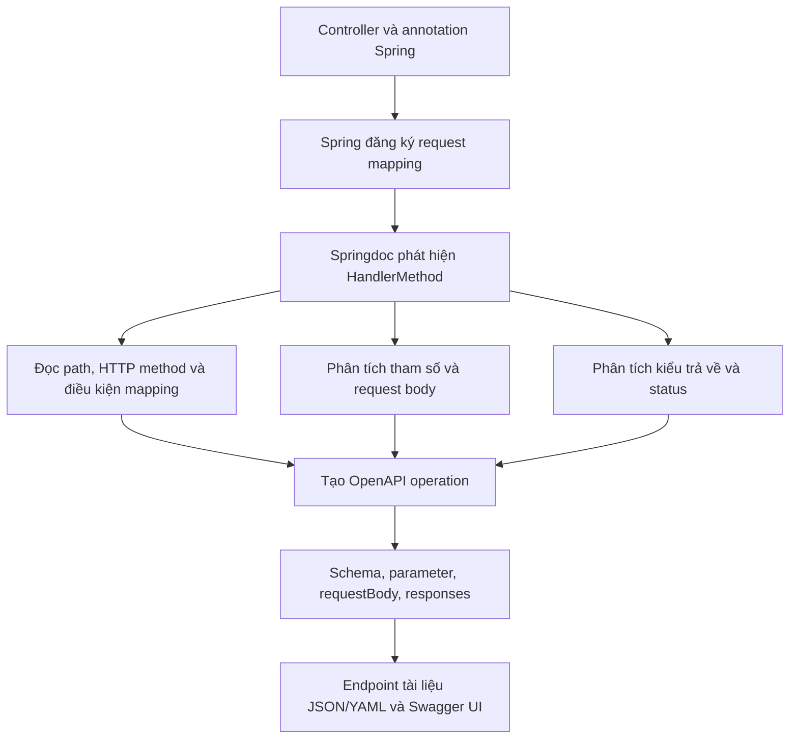

# Suy luận từ mapping, chữ ký phương thức và kiểu trả về

Springdoc-openapi có thể tạo phần lớn hợp đồng OpenAPI từ controller Spring Boot mà không cần viết thủ công từng operation. Thư viện đọc các mapping Spring MVC/WebFlux, phân tích tham số của phương thức và xác định kiểu dữ liệu trả về để xây dựng đường dẫn, HTTP method, parameter, request body, response cùng schema. Hiểu được quá trình suy luận này giúp ta dự đoán tài liệu sẽ được tạo ra như thế nào và biết vị trí cần bổ sung annotation khi thông tin trong mã nguồn chưa đủ rõ.

## 1. Springdoc lấy thông tin từ đâu?

Trong ứng dụng Spring MVC, Spring Boot đăng ký các controller và mapping thông qua cơ chế request mapping của Spring. Mỗi mapping gắn một đường dẫn và một HTTP method với một phương thức xử lý cụ thể. Springdoc đọc các handler đã được Spring phát hiện, sau đó kết hợp metadata của mapping với chữ ký phương thức và các annotation liên quan để tạo mô hình OpenAPI.

Quá trình này có thể hình dung theo chuỗi:



Springdoc chủ yếu mô tả những gì có thể xác định từ cấu trúc endpoint. Nó không thực thi logic nghiệp vụ để biết một nhánh `if` sẽ trả mã lỗi nào, không suy ra ý nghĩa của từng trường chỉ từ tên biến và không thể biết mọi giá trị thực tế mà service trả về. Những thông tin đó cần được thể hiện qua kiểu dữ liệu, annotation hoặc cấu hình tài liệu rõ ràng.

## 2. Mapping quyết định đường dẫn và operation

Spring MVC cung cấp `@RequestMapping` cùng các annotation rút gọn như `@GetMapping`, `@PostMapping`, `@PutMapping`, `@PatchMapping` và `@DeleteMapping`. Springdoc sử dụng mapping đã đăng ký để xác định:

- Đường dẫn API, bao gồm phần path ở cấp controller và phần path ở cấp phương thức.
- HTTP method tương ứng với operation.
- Các điều kiện mapping như `consumes` và `produces`.
- Những thông tin routing liên quan được Spring công bố cho handler.

Ví dụ:

```java
@RestController
@RequestMapping("/api/products")
class ProductController {

    @GetMapping("/{productId}")
    ProductResponse findById(@PathVariable UUID productId) {
        return productService.findById(productId);
    }

    @PostMapping(consumes = MediaType.APPLICATION_JSON_VALUE)
    @ResponseStatus(HttpStatus.CREATED)
    ProductResponse create(@RequestBody CreateProductRequest request) {
        return productService.create(request);
    }
}
```

Mapping tạo ra hai operation có dạng:

| Phương thức Java | Operation OpenAPI |
|---|---|
| `findById` | `GET /api/products/{productId}` |
| `create` | `POST /api/products` |

`@RequestMapping("/api/products")` ở cấp lớp cung cấp tiền tố chung. `@GetMapping("/{productId}")` bổ sung phần đường dẫn ở cấp phương thức. Vì vậy, đường dẫn được mô tả là `/api/products/{productId}`.

Các thuộc tính `consumes` và `produces` cũng ảnh hưởng đến mô tả media type của request body và response. Ví dụ, `consumes = application/json` cho biết operation nhận body JSON; `produces = application/json` cho biết operation có thể trả JSON. Cơ chế này liên kết trực tiếp với `Content-Type`, `Accept` và nội dung `content` trong OpenAPI.

Các điều kiện như `params` và `headers` có thể tham gia chọn handler ở runtime. Tuy nhiên, không nên giả định mọi biểu thức điều kiện routing đều được biểu diễn thành một parameter OpenAPI đầy đủ. Nếu client cần gửi một query parameter hoặc header cụ thể, hãy khai báo rõ bằng `@RequestParam`, `@RequestHeader` và bổ sung mô tả khi cần.

## 3. Chữ ký phương thức quyết định cách mô tả tham số

Springdoc đọc các annotation trên tham số để xác định vị trí dữ liệu mà client phải gửi. Các annotation Spring thường gặp được ánh xạ như sau:

| Annotation Spring | Vị trí trong HTTP | Cách biểu diễn thường gặp trong OpenAPI |
|---|---|---|
| `@PathVariable` | Thành phần của URL path | `parameters` với `in: path`; luôn bắt buộc |
| `@RequestParam` | Query string hoặc form parameter theo ngữ cảnh | `parameters` với `in: query` hoặc thông tin form tương ứng |
| `@RequestHeader` | HTTP request header | `parameters` với `in: header` |
| `@CookieValue` | Cookie request | Parameter với `in: cookie` khi được hỗ trợ trong mô hình tài liệu |
| `@RequestBody` | Nội dung body của request | `requestBody.content` cùng schema |
| `@RequestPart` | Một phần trong multipart request | Schema của từng phần trong multipart content |
| `@ModelAttribute` | Object được bind từ các field request | Thường được phân rã thành các parameter tương ứng |

Ví dụ một phương thức có path parameter, query parameter và header:

```java
@GetMapping("/{productId}")
ProductResponse find(
    @PathVariable UUID productId,
    @RequestParam(defaultValue = "false") boolean includeInventory,
    @RequestHeader(name = "X-Request-Id", required = false) String requestId
) {
    return productService.find(productId, includeInventory, requestId);
}
```

Springdoc có thể mô tả các dữ liệu đầu vào này thành ba parameter độc lập:

```yaml
parameters:
  - name: productId
    in: path
    required: true
    schema:
      type: string
      format: uuid
  - name: includeInventory
    in: query
    required: false
    schema:
      type: boolean
      default: false
  - name: X-Request-Id
    in: header
    required: false
    schema:
      type: string
```

Tên parameter thường được lấy từ tên trong annotation hoặc metadata tên tham số. Để tài liệu ổn định khi biên dịch, hãy khai báo tên tường minh trong annotation, ví dụ `@PathVariable("productId")` hoặc `@RequestParam(name = "page")`, nhất là khi build không lưu tên tham số Java.

Kiểu Java của tham số cũng góp phần quyết định schema. Ví dụ:

| Kiểu Java | Schema OpenAPI thường gặp |
|---|---|
| `String` | `type: string` |
| `boolean` / `Boolean` | `type: boolean` |
| `int`, `Integer`, `long`, `Long` | `type: integer` với định dạng phù hợp |
| `double`, `Double`, `BigDecimal` | `type: number` với định dạng phù hợp |
| `UUID` | `type: string`, thường có `format: uuid` |
| `LocalDate` | `type: string`, thường có `format: date` |
| `LocalDateTime` / `OffsetDateTime` | `type: string` với format ngày giờ tương ứng |
| Enum | `type: string` cùng danh sách `enum` nếu các giá trị được nhận diện |
| `List<T>` | `type: array` với `items` mô tả kiểu `T` |

Kiểu dữ liệu cụ thể và các annotation Jackson/Jakarta Validation có thể bổ sung thêm thông tin schema. Ví dụ `@NotNull`, `@NotBlank`, `@Size` hoặc `@Min` có thể giúp mô tả yêu cầu dữ liệu nếu thư viện và cấu hình tích hợp nhận diện được chúng.

## 4. @RequestBody và DTO tạo request schema

Khi tham số phương thức có `@RequestBody`, Spring đọc body thông qua `HttpMessageConverter` và chuyển thành kiểu Java được khai báo. Springdoc dùng kiểu đó để tạo schema cho `requestBody`.

Ví dụ DTO:

```java
public record CreateProductRequest(
    @NotBlank
    @Schema(description = "Tên sản phẩm", example = "Bút bi")
    String name,

    @NotNull
    @DecimalMin("0.0")
    @Schema(description = "Giá bán", example = "12000")
    BigDecimal price,

    @Size(max = 500)
    @Schema(description = "Mô tả sản phẩm")
    String description
) {}
```

Controller sử dụng DTO:

```java
@PostMapping(
    consumes = MediaType.APPLICATION_JSON_VALUE,
    produces = MediaType.APPLICATION_JSON_VALUE
)
@ResponseStatus(HttpStatus.CREATED)
ProductResponse create(@Valid @RequestBody CreateProductRequest request) {
    return productService.create(request);
}
```

Từ kiểu DTO, springdoc có thể xây dựng schema object gồm các thuộc tính `name`, `price` và `description`. Annotation `@Schema` bổ sung mô tả và ví dụ; annotation validation có thể ảnh hưởng đến danh sách trường bắt buộc và giới hạn dữ liệu.

Một phần tài liệu được sinh ra có thể tương tự:

```yaml
requestBody:
  required: true
  content:
    application/json:
      schema:
        $ref: '#/components/schemas/CreateProductRequest'
```

Và schema thành phần:

```yaml
CreateProductRequest:
  type: object
  required:
    - name
    - price
  properties:
    name:
      type: string
      description: Tên sản phẩm
      example: Bút bi
    price:
      type: number
      description: Giá bán
      example: 12000
    description:
      type: string
      maxLength: 500
```

Đây là hình dạng minh họa. Schema thực tế phụ thuộc phiên bản thư viện, cấu hình Jackson, annotation validation, kiểu dữ liệu và cách xử lý nullable của dự án. Hãy kiểm tra `/v3/api-docs` thay vì giả định mọi annotation đều được chuyển đổi giống nhau ở mọi cấu hình.

## 5. Kiểu trả về quyết định response schema

Springdoc phân tích kiểu trả về của phương thức để tạo schema response. Với kiểu DTO cụ thể, schema thường tham chiếu đến component tương ứng:

```java
@GetMapping("/{productId}")
ProductResponse findById(@PathVariable UUID productId) {
    return productService.findById(productId);
}
```

Nếu `ProductResponse` là một DTO, tài liệu sẽ mô tả response body theo cấu trúc của DTO đó. Các kiểu phổ biến được suy luận như sau:

| Kiểu trả về | Cách mô tả response thường gặp |
|---|---|
| `ProductResponse` | Object schema của `ProductResponse` |
| `List<ProductResponse>` | Array có `items` là `ProductResponse` |
| `ProductResponse[]` | Array có phần tử là `ProductResponse` |
| `Page<ProductResponse>` | Schema trang kết quả; cấu trúc cụ thể tùy cấu hình hỗ trợ |
| `ResponseEntity<ProductResponse>` | Body schema là `ProductResponse`; status cần được xác định hoặc mô tả thêm |
| `ResponseEntity<Void>` | Response không có body schema |
| `ApiEnvelope<ProductResponse>` | Schema wrapper có tham số kiểu được phân giải nếu generic được khai báo đầy đủ |
| `Map<String, Object>` hoặc `Object` | Schema tổng quát, ít chi tiết hơn DTO cụ thể |

Ví dụ với generic wrapper:

```java
public record ApiEnvelope<T>(
    boolean success,
    T data,
    String message
) {}

@GetMapping("/{productId}")
ApiEnvelope<ProductResponse> find(@PathVariable UUID productId) {
    return new ApiEnvelope<>(true, productService.findById(productId), null);
}
```

Việc khai báo `ApiEnvelope<ProductResponse>` cho phép công cụ phân tích kiểu `T` là `ProductResponse`, từ đó tạo schema có cấu trúc cụ thể hơn so với raw type `ApiEnvelope`.

Nếu phương thức chỉ trả `Object`, raw generic hoặc một kiểu wrapper không thể phân giải, tài liệu có thể trở nên quá tổng quát. Hãy ưu tiên kiểu trả về cụ thể hoặc dùng `@ApiResponse` và `@Schema(implementation = ...)` để mô tả payload mong muốn.

## 6. ResponseEntity, status code và response rỗng

`ResponseEntity<T>` cho phép controller quyết định status code, header và body tại runtime. Springdoc có thể dùng `T` để suy ra schema body, nhưng không thể biết mọi status code có thể xuất hiện nếu chúng được quyết định bởi logic nghiệp vụ trong từng nhánh.

Ví dụ:

```java
@PostMapping
ResponseEntity<ProductResponse> create(@RequestBody CreateProductRequest request) {
    ProductResponse created = productService.create(request);
    return ResponseEntity.status(HttpStatus.CREATED).body(created);
}
```

Kiểu trả về cho biết body là `ProductResponse`, nhưng status `201` được quyết định trong biểu thức runtime. Để hợp đồng rõ ràng, hãy khai báo response tường minh:

```java
@Operation(summary = "Tạo sản phẩm")
@ApiResponses({
    @ApiResponse(
        responseCode = "201",
        description = "Sản phẩm đã được tạo",
        content = @Content(
            mediaType = MediaType.APPLICATION_JSON_VALUE,
            schema = @Schema(implementation = ProductResponse.class)
        )
    ),
    @ApiResponse(responseCode = "400", description = "Dữ liệu không hợp lệ"),
    @ApiResponse(responseCode = "409", description = "Sản phẩm đã tồn tại")
})
@PostMapping
ResponseEntity<ProductResponse> create(@Valid @RequestBody CreateProductRequest request) {
    // ...
}
```

Nếu endpoint trả `ResponseEntity<Void>` hoặc `void`, response thường không có body. Nếu dùng `@ResponseStatus(HttpStatus.NO_CONTENT)` hoặc annotation response tương ứng, status `204` có thể được phản ánh trong tài liệu. Với endpoint có nhiều status, nên mô tả đầy đủ bằng `@ApiResponse` hoặc `@ApiResponses` để client biết các kết quả có thể xảy ra.

Không nên dựa vào suy luận kiểu trả về để mô tả lỗi nghiệp vụ. Ví dụ, một service có thể ném `ProductNotFoundException`, nhưng springdoc không thể tự biết exception đó được xử lý thành `404` hay `500` nếu quy tắc xử lý không được công bố rõ.

## 7. Kiểu bất đồng bộ và reactive

Trong ứng dụng dùng Spring MVC, phương thức có thể trả về các kiểu bất đồng bộ như `CompletableFuture<T>` hoặc `CompletionStage<T>`. Với Spring WebFlux, controller có thể trả về `Mono<T>` hoặc `Flux<T>`. Springdoc hỗ trợ nhận diện nhiều wrapper phổ biến và suy ra kiểu dữ liệu bên trong thay vì chỉ công bố tên wrapper Java.

Ví dụ:

```java
@GetMapping("/{productId}")
Mono<ProductResponse> find(@PathVariable UUID productId) {
    return productService.findById(productId);
}

@GetMapping
Flux<ProductResponse> findAll() {
    return productService.findAll();
}
```

`Mono<ProductResponse>` thể hiện một kết quả bất đồng bộ có kiểu dữ liệu `ProductResponse`. `Flux<ProductResponse>` thể hiện nhiều phần tử; cách biểu diễn cụ thể trong OpenAPI còn phụ thuộc media type và cách endpoint phát dữ liệu, chẳng hạn JSON array hoặc dạng stream. Hãy kiểm tra tài liệu sinh ra với đúng phiên bản springdoc và web stack đang dùng.

Với các kiểu wrapper do dự án tự định nghĩa, công cụ có thể không biết lớp nào là payload thực. Khi đó, cân nhắc cấu hình kiểu generic, sử dụng annotation `@Schema` hoặc mô tả response bằng `@ApiResponse`.

## 8. Annotation bổ sung khi suy luận chưa đủ

Mã nguồn cung cấp cấu trúc kỹ thuật, nhưng thường thiếu mô tả cho người dùng API. Các annotation OpenAPI giúp bổ sung thông tin mà tên phương thức hoặc kiểu Java không thể diễn đạt:

| Annotation | Vai trò |
|---|---|
| `@Operation` | Mô tả operation, summary, description, operationId và tags |
| `@Tag` | Nhóm operation và mô tả nhóm API |
| `@Parameter` | Bổ sung tên hiển thị, mô tả, ví dụ hoặc schema cho parameter |
| `@Parameters` | Nhóm nhiều `@Parameter` trên một operation |
| `@ApiResponse` | Mô tả một status code và nội dung response |
| `@ApiResponses` | Nhóm các response có thể xảy ra |
| `@RequestBody` của Swagger | Tùy chỉnh mô tả request body trong tài liệu |
| `@Content` | Khai báo media type và schema của nội dung |
| `@Schema` | Mô tả object, property, kiểu dữ liệu, ví dụ và ràng buộc |
| `@Hidden` | Ẩn operation hoặc phần tử khỏi tài liệu được sinh |

Ví dụ bổ sung mô tả cho parameter:

```java
@Operation(
    summary = "Tìm sản phẩm",
    description = "Tìm một sản phẩm theo mã định danh."
)
@GetMapping("/{productId}")
ProductResponse find(
    @Parameter(
        description = "UUID của sản phẩm",
        example = "550e8400-e29b-41d4-a716-446655440000"
    )
    @PathVariable UUID productId
) {
    return productService.findById(productId);
}
```

Annotation nên bổ sung phần ý nghĩa mà mã Java chưa diễn đạt, chẳng hạn điều kiện nghiệp vụ, trường hợp lỗi, ví dụ thực tế và quy tắc phân trang. Tránh mô tả một kiểu trả về khác với kiểu controller thực sự tạo ra; tài liệu sai có thể khiến client sinh mã không tương thích.

## 9. Một ví dụ tổng hợp từ controller đến OpenAPI

Controller sau kết hợp mapping, parameter, request DTO, response DTO và mô tả response:

```java
@RestController
@RequestMapping("/api/products")
@Tag(name = "Products", description = "Quản lý sản phẩm")
class ProductController {

    @Operation(summary = "Lấy sản phẩm theo ID")
    @ApiResponses({
        @ApiResponse(
            responseCode = "200",
            description = "Tìm thấy sản phẩm",
            content = @Content(
                mediaType = MediaType.APPLICATION_JSON_VALUE,
                schema = @Schema(implementation = ProductResponse.class)
            )
        ),
        @ApiResponse(responseCode = "404", description = "Không tìm thấy sản phẩm")
    })
    @GetMapping("/{id}")
    ProductResponse findById(@PathVariable("id") UUID id) {
        return productService.findById(id);
    }

    @Operation(summary = "Tạo sản phẩm mới")
    @ApiResponses({
        @ApiResponse(
            responseCode = "201",
            description = "Đã tạo sản phẩm",
            content = @Content(
                mediaType = MediaType.APPLICATION_JSON_VALUE,
                schema = @Schema(implementation = ProductResponse.class)
            )
        ),
        @ApiResponse(responseCode = "400", description = "Dữ liệu không hợp lệ")
    })
    @PostMapping(consumes = MediaType.APPLICATION_JSON_VALUE)
    @ResponseStatus(HttpStatus.CREATED)
    ProductResponse create(@Valid @RequestBody CreateProductRequest request) {
        return productService.create(request);
    }
}
```

OpenAPI được tạo ra sẽ có cấu trúc khái quát như sau:

```yaml
tags:
  - name: Products
    description: Quản lý sản phẩm
paths:
  /api/products/{id}:
    get:
      summary: Lấy sản phẩm theo ID
      operationId: findById
      parameters:
        - name: id
          in: path
          required: true
          schema:
            type: string
            format: uuid
      responses:
        '200':
          description: Tìm thấy sản phẩm
          content:
            application/json:
              schema:
                $ref: '#/components/schemas/ProductResponse'
        '404':
          description: Không tìm thấy sản phẩm
  /api/products:
    post:
      summary: Tạo sản phẩm mới
      requestBody:
        required: true
        content:
          application/json:
            schema:
              $ref: '#/components/schemas/CreateProductRequest'
      responses:
        '201':
          description: Đã tạo sản phẩm
          content:
            application/json:
              schema:
                $ref: '#/components/schemas/ProductResponse'
        '400':
          description: Dữ liệu không hợp lệ
```

Đoạn YAML chỉ minh họa cấu trúc các phần liên quan; tài liệu thực tế còn có thể bao gồm `info`, `servers`, `components`, schema property, security và các metadata khác. `operationId` mặc định có thể thay đổi theo tên phương thức, cách đặt tên và cấu hình. Nếu client generator hoặc hệ thống khác phụ thuộc vào operationId, hãy gán giá trị ổn định bằng `@Operation(operationId = "...")`.

## 10. Giới hạn của suy luận tự động

Suy luận tự động giúp tạo tài liệu nhanh, nhưng có những trường hợp mã nguồn không cung cấp đủ thông tin:

| Tình huống | Kết quả có thể gặp | Cách xử lý |
|---|---|---|
| Trả về `Object`, raw generic hoặc `Map<String, Object>` | Schema tổng quát, không thể hiện rõ cấu trúc | Dùng DTO cụ thể hoặc `@Schema`/`@ApiResponse` |
| Trả `ResponseEntity<?>` với nhiều nhánh status | Không thể biết toàn bộ status và body runtime | Khai báo từng response bằng `@ApiResponses` |
| Dùng custom wrapper hoặc kiểu reactive đặc thù | Không phân giải được payload bên trong | Kiểm tra hỗ trợ của phiên bản, cấu hình generic hoặc mô tả thủ công |
| Mapping có điều kiện `params`/`headers` phức tạp | Một phần điều kiện routing có thể không thành parameter dễ dùng cho client | Khai báo parameter và mô tả điều kiện rõ ràng |
| Dùng nhiều handler cùng path và HTTP method, chỉ khác điều kiện | Có thể khó hợp nhất thành một operation OpenAPI duy nhất | Thiết kế representation trong cùng operation hoặc tách đường dẫn/method phù hợp |
| DTO có field kế thừa, generic lồng nhau hoặc annotation Jackson tùy chỉnh | Schema có thể khác mong đợi | Kiểm tra schema thực tế và bổ sung `@Schema` |
| Response được thay đổi bởi `ResponseBodyAdvice` hoặc exception handler | Kiểu trả về controller có thể không phản ánh body cuối cùng | Mô tả response thực tế và kiểm tra tài liệu sau các lớp xử lý chung |

Đặc tả OpenAPI có một operation cho mỗi cặp path và HTTP method. Nếu Spring đăng ký nhiều handler cùng cặp đó với các điều kiện riêng, tài liệu cần hợp nhất các media type hoặc biểu diễn rõ một hợp đồng duy nhất. Không nên kỳ vọng mỗi handler runtime sẽ tự tạo thành một operation riêng biệt trong cùng một path và method.

## 11. Kiểm tra tài liệu được sinh ra

Sau khi ứng dụng khởi động, tải JSON tại `/v3/api-docs` hoặc YAML tại `/v3/api-docs.yaml`. Chọn một controller đại diện và đối chiếu từng phần với mã nguồn:

1. **Path và method:** đường dẫn cuối cùng có kết hợp đúng mapping cấp lớp và cấp phương thức không?
2. **Parameters:** path, query, header và cookie có đúng tên, kiểu và tính bắt buộc không?
3. **Request body:** schema có đúng DTO, media type và trạng thái bắt buộc không?
4. **Responses:** kiểu body, media type và status code có khớp với kết quả thực tế không?
5. **Components:** schema có đủ thuộc tính, required, enum, format, validation và mô tả cần thiết không?
6. **Operation metadata:** summary, description, tags và operationId có ổn định, dễ hiểu không?

Khi Swagger UI hiển thị thiếu hoặc sai thông tin, hãy xem JSON/YAML gốc trước. Nếu OpenAPI đã sai, kiểm tra mapping và annotation. Nếu OpenAPI đúng nhưng giao diện hiển thị không như mong đợi, kiểm tra cấu hình Swagger UI và khả năng hỗ trợ của phiên bản giao diện.

Có thể dùng `@Hidden` để loại một endpoint nội bộ khỏi tài liệu công khai, hoặc cấu hình nhóm tài liệu để chỉ công bố một tập controller. Việc ẩn endpoint khỏi OpenAPI không thay thế bảo mật ở tầng ứng dụng; endpoint vẫn có thể được gọi nếu không có cơ chế phân quyền phù hợp.

## 12. Quy trình thiết kế controller để tài liệu dễ suy luận

Để springdoc tạo hợp đồng rõ ràng và ổn định, nên áp dụng các nguyên tắc sau:

1. Dùng annotation mapping tường minh cho HTTP method và path.
2. Đặt tên rõ ràng và khai báo tên trong `@PathVariable`, `@RequestParam`, `@RequestHeader` khi cần.
3. Dùng DTO cụ thể cho request và response; tránh raw type hoặc `Object` nếu biết cấu trúc dữ liệu.
4. Khai báo `consumes` và `produces` khi endpoint có yêu cầu media type rõ ràng hoặc hỗ trợ nhiều representation.
5. Dùng `@ResponseStatus` khi status cố định; dùng `@ApiResponses` để mô tả các kết quả thành công và lỗi.
6. Bổ sung `@Operation`, `@Parameter`, `@Schema` cho mô tả nghiệp vụ, ví dụ và ràng buộc.
7. Kiểm tra `/v3/api-docs` sau khi thay đổi chữ ký phương thức hoặc DTO, vì thay đổi nhỏ trong mã Java có thể làm thay đổi hợp đồng.
8. So sánh tài liệu OpenAPI giữa các phiên bản phát hành để phát hiện thay đổi không tương thích trước khi công bố.

Springdoc phát huy hiệu quả khi controller thể hiện hợp đồng HTTP rõ ràng: mapping chỉ ra cách định tuyến, chữ ký phương thức chỉ ra dữ liệu đầu vào, kiểu trả về chỉ ra cấu trúc response và annotation bổ sung ý nghĩa mà mã nguồn chưa thể hiện. Tài liệu được sinh ra cần được xem như một phần của hợp đồng API và cần được kiểm tra cùng với hành vi runtime.

## 13. Tài liệu tham khảo

- [Springdoc OpenAPI](https://springdoc.org/): cách tích hợp springdoc với Spring Boot và tùy chỉnh tài liệu được sinh ra.
- [Spring Framework: Mapping Requests](https://docs.spring.io/spring-framework/reference/web/webmvc/mvc-controller/ann-requestmapping.html): các annotation mapping, path và điều kiện request.
- [Spring Framework: Method Arguments](https://docs.spring.io/spring-framework/reference/web/webmvc/mvc-controller/ann-methods/arguments.html): cách Spring phân giải tham số của handler method.
- [Spring Framework: Return Values](https://docs.spring.io/spring-framework/reference/web/webmvc/mvc-controller/ann-methods/return-types.html): các kiểu trả về được Spring MVC hỗ trợ.
- [OpenAPI Specification](https://spec.openapis.org/oas/latest.html): mô hình path, operation, parameter, request body, response và schema.
- [Swagger Core Annotations](https://github.com/swagger-api/swagger-core/wiki/Swagger-2.X---Annotations): annotation dùng để bổ sung metadata cho OpenAPI.
