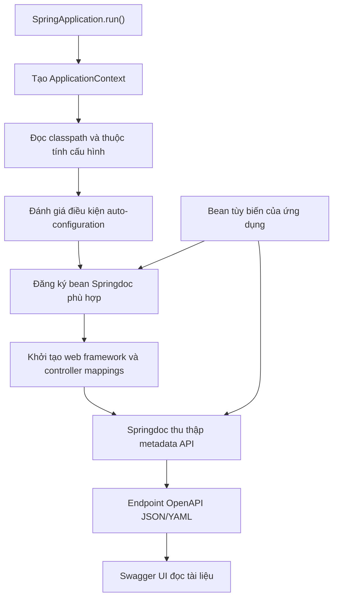

# Vai trò của cấu hình tự động và các bean tùy biến

Khi thêm springdoc-openapi vào ứng dụng Spring Boot, tài liệu OpenAPI và Swagger UI thường hoạt động sau khi ứng dụng khởi động mà không cần tự tạo controller riêng cho chúng. Điều này đến từ **Spring Boot auto-configuration**: Spring Boot phát hiện các thư viện có trên classpath, kiểm tra điều kiện môi trường và đăng ký những bean phù hợp. Springdoc sử dụng cơ chế tích hợp đó để kết nối với Spring MVC hoặc WebFlux, thu thập thông tin endpoint và cung cấp các điểm truy cập tài liệu.

Khi yêu cầu mặc định chưa đáp ứng nhu cầu của dự án, lập trình viên có thể khai báo bean để bổ sung metadata, chia nhóm tài liệu hoặc tùy biến operation và schema. Hiểu cách auto-configuration và bean tùy biến phối hợp giúp cấu hình springdoc đúng vòng đời, tránh đăng ký trùng thành phần và giữ tài liệu sát với API đang chạy.

## 1. Spring Boot auto-configuration là gì?

Spring Boot auto-configuration là cơ chế tự động cấu hình ứng dụng dựa trên những gì có trong môi trường chạy. Spring Boot xem xét classpath, loại ứng dụng, các thuộc tính cấu hình và những bean đã được đăng ký trong ApplicationContext để quyết định cấu hình nào phù hợp.

Ví dụ, khi một dự án thêm starter cho Spring MVC, Spring Boot có thể cấu hình các thành phần web như DispatcherServlet, message converter và các cơ chế tích hợp liên quan. Khi thêm starter springdoc phù hợp, thư viện springdoc có thể đăng ký những thành phần cần thiết để tạo tài liệu OpenAPI và cung cấp Swagger UI.

Auto-configuration thường dựa trên các điều kiện như:

- **Classpath:** một class hoặc thư viện cần thiết có tồn tại hay không.
- **Loại ứng dụng:** ứng dụng đang chạy theo mô hình servlet, reactive hay non-web.
- **Bean hiện có:** ứng dụng đã tự đăng ký bean tương ứng chưa.
- **Thuộc tính cấu hình:** tính năng có được bật hoặc tắt trong application.yml hoặc application.properties không.

Các điều kiện này được biểu diễn bằng những annotation như `@ConditionalOnClass`, `@ConditionalOnMissingBean`, `@ConditionalOnProperty` và `@ConditionalOnWebApplication`. Không cần tự gắn các annotation này lên mọi cấu hình của ứng dụng; chúng chủ yếu được dùng bên trong các lớp auto-configuration của Spring Boot và thư viện tích hợp.

## 2. Springdoc tham gia vào vòng đời khởi động như thế nào?

Với một ứng dụng Spring Boot dùng springdoc-openapi, có thể hình dung quá trình theo các bước:

1. Spring Boot đọc cấu hình ứng dụng, khởi tạo môi trường và tạo ApplicationContext.
2. Cơ chế auto-configuration kiểm tra dependency, điều kiện web và các thuộc tính springdoc để đăng ký những bean cần thiết.
3. Spring MVC hoặc WebFlux khởi tạo hạ tầng xử lý request và phát hiện các mapping của controller.
4. Các thành phần springdoc tích hợp với môi trường Spring để thu thập mapping, kiểu dữ liệu và metadata OpenAPI.
5. Khi client truy cập endpoint tài liệu, springdoc cung cấp đặc tả OpenAPI tương ứng. Swagger UI tải tài liệu đó để hiển thị.

Sơ đồ khái quát:



Sơ đồ thể hiện luồng khái niệm. Thứ tự chi tiết của từng bean phụ thuộc phiên bản Spring Boot, springdoc và loại ứng dụng. Điểm quan trọng là các bean cấu hình được đăng ký trong ApplicationContext, còn tài liệu được tạo từ metadata mà springdoc có thể quan sát trong ứng dụng.

### 2.1. Vì sao chỉ thêm starter đã có tài liệu?

Starter springdoc gom các dependency cần thiết cho một kiểu ứng dụng. Với Spring MVC, dự án Spring Boot 3 thường dùng starter `springdoc-openapi-starter-webmvc-ui` nếu cần cả API docs và Swagger UI. Starter API tương ứng có thể được chọn nếu chỉ cần endpoint tài liệu. Với WebFlux, chọn starter WebFlux phù hợp.

Ví dụ Maven:

```xml
<dependency>
    <groupId>org.springdoc</groupId>
    <artifactId>springdoc-openapi-starter-webmvc-ui</artifactId>
    <version>${springdoc.version}</version>
</dependency>
```

Sau khi dependency tương thích được thêm và ứng dụng khởi động, springdoc tích hợp với Spring để cung cấp endpoint tài liệu mặc định như `/v3/api-docs`. Starter có thành phần UI còn cung cấp Swagger UI, thường được truy cập qua `/swagger-ui.html`.

Không nên thêm đồng thời nhiều starter UI và API cho cùng một ứng dụng nếu không có lý do rõ ràng. Hãy chọn starter theo mô hình web và nhu cầu thực tế. Phiên bản springdoc phải tương thích với phiên bản Spring Boot của dự án.

## 3. Phân biệt auto-configuration, component scan và bean do ứng dụng khai báo

Ba cơ chế này cùng góp phần tạo ApplicationContext nhưng có mục đích khác nhau:

| Cơ chế | Cách hoạt động | Ví dụ trong dự án |
|---|---|---|
| Auto-configuration | Đăng ký cấu hình dựa trên điều kiện classpath, thuộc tính và bean hiện có | Starter springdoc kích hoạt tích hợp tài liệu |
| Component scan | Tìm các class được đánh dấu stereotype trong phạm vi package quét | Phát hiện `@RestController`, `@Service`, `@Configuration` |
| Bean tùy biến | Ứng dụng chủ động khai báo đối tượng bằng `@Bean` hoặc stereotype | Khai báo `OpenAPI`, `GroupedOpenApi`, customizer |

`@SpringBootApplication` thường bao gồm `@EnableAutoConfiguration` và `@ComponentScan` cùng `@SpringBootConfiguration`. Vì vậy, một ứng dụng Spring Boot thông thường vừa quét component trong phạm vi package, vừa kích hoạt auto-configuration.

Bean tùy biến có thể được khai báo trong một lớp `@Configuration` nằm trong phạm vi component scan:

```java
@SpringBootApplication
public class Application {
    public static void main(String[] args) {
        SpringApplication.run(Application.class, args);
    }
}

@Configuration
public class ApiDocumentationConfiguration {
    // Các phương thức @Bean được đăng ký trong ApplicationContext.
}
```

Nếu lớp cấu hình nằm ngoài package được quét, Spring sẽ không tự phát hiện nó chỉ vì file Java tồn tại. Khi đó cần đặt lớp cấu hình vào phạm vi phù hợp hoặc chủ động import bằng `@Import`.

## 4. Cấu hình tính năng springdoc bằng application.yml

Không phải mọi thay đổi đều cần tạo bean. Nhiều tùy chọn phổ biến có thể được khai báo qua application.yml hoặc application.properties. Ví dụ:

```yaml
springdoc:
  api-docs:
    enabled: true
    path: /v3/api-docs
  swagger-ui:
    enabled: true
    path: /swagger-ui.html
  packages-to-scan:
    - com.example.product.api
  paths-to-match:
    - /api/**
  paths-to-exclude:
    - /api/internal/**
```

Ý nghĩa:

- `api-docs.enabled` bật hoặc tắt endpoint tạo tài liệu.
- `api-docs.path` đổi đường dẫn tài liệu OpenAPI.
- `swagger-ui.enabled` bật hoặc tắt Swagger UI.
- `swagger-ui.path` cấu hình đường dẫn truy cập giao diện.
- `packages-to-scan` giới hạn package chứa controller được xem xét.
- `paths-to-match` chọn các path cần đưa vào tài liệu.
- `paths-to-exclude` loại trừ các path khỏi tài liệu.

Các thuộc tính này điều chỉnh hành vi springdoc thông qua cơ chế cấu hình của Spring Boot. Cần kiểm tra tên thuộc tính theo phiên bản springdoc đang sử dụng nếu dự án chạy phiên bản cũ hoặc dùng starter khác.

### 4.1. Khi nào dùng thuộc tính, khi nào dùng bean?

Nên dùng thuộc tính cấu hình khi mục tiêu là bật/tắt tính năng, thay đổi endpoint docs/UI, giới hạn package hoặc lọc path. Dùng bean khi cần tạo metadata có cấu trúc, chia nhóm tài liệu hoặc thực hiện logic tùy biến bằng Java.

Ví dụ, chỉ muốn bỏ qua endpoint nội bộ khỏi tài liệu thì `paths-to-exclude` thường đủ. Nếu cần thêm metadata phụ thuộc vào logic của ứng dụng hoặc thay đổi mô hình OpenAPI sau khi thu thập endpoint, customizer phù hợp hơn.

Không nên khai báo đồng thời một thuộc tính và một customizer cùng sửa một nội dung mà không có quy ước rõ ràng. Khi nhiều nguồn cùng tác động, kết quả cuối phụ thuộc thứ tự và cách hợp nhất cấu hình.

## 5. Khai báo bean OpenAPI để bổ sung metadata chung

Springdoc hỗ trợ dùng bean `OpenAPI` để khai báo thông tin cấp tài liệu, chẳng hạn tên API, phiên bản, mô tả, server và các thành phần bảo mật. Ví dụ:

```java
import io.swagger.v3.oas.models.OpenAPI;
import io.swagger.v3.oas.models.info.Info;
import io.swagger.v3.oas.models.servers.Server;
import org.springframework.context.annotation.Bean;
import org.springframework.context.annotation.Configuration;

import java.util.List;

@Configuration
public class OpenApiConfiguration {

    @Bean
    public OpenAPI productOpenAPI() {
        return new OpenAPI()
            .info(new Info()
                .title("Product API")
                .version("1.0.0")
                .description("API quản lý sản phẩm"))
            .servers(List.of(
                new Server()
                    .url("https://api.example.com")
                    .description("Production")
            ));
    }
}
```

Bean này cung cấp metadata chung cho tài liệu. Springdoc vẫn chịu trách nhiệm thu thập các operation từ controller. Ta không cần tự viết lại toàn bộ paths chỉ để đặt title, version hoặc description.

Có thể khai báo metadata tương tự bằng `@OpenAPIDefinition` và các annotation liên quan. Trong một dự án, nên chọn cách khai báo làm nguồn chính cho metadata chung để người bảo trì dễ tìm và tránh nhiều cấu hình cạnh tranh.

`Info.version` là phiên bản của tài liệu/API được công bố. Nó không tự động thay đổi phiên bản dependency springdoc hoặc phiên bản ứng dụng Spring Boot.

## 6. Tùy biến tài liệu bằng OpenApiCustomizer

`OpenApiCustomizer` cho phép sửa mô hình OpenAPI sau khi springdoc xây dựng tài liệu. Cách này phù hợp khi cần bổ sung tag, extension, metadata hoặc điều chỉnh thành phần chung của tài liệu.

Ví dụ thêm một tag dùng chung:

```java
import io.swagger.v3.oas.models.tags.Tag;
import org.springdoc.core.customizers.OpenApiCustomizer;
import org.springframework.context.annotation.Bean;
import org.springframework.context.annotation.Configuration;

@Configuration
public class OpenApiCustomizerConfiguration {

    @Bean
    public OpenApiCustomizer platformTagCustomizer() {
        return openApi -> openApi.addTagsItem(
            new Tag()
                .name("Platform")
                .description("Các chức năng dùng chung của nền tảng")
        );
    }
}
```

Customizer nhận mô hình OpenAPI và có thể thay đổi nó trước khi trả tài liệu cho client. Hãy viết logic có thể chạy an toàn với tài liệu có hoặc không có một thành phần cụ thể. Ví dụ, nếu chỉnh info.description, cần kiểm tra openApi.getInfo() có khác null trước khi gọi setter.

Phạm vi áp dụng phụ thuộc cách đăng ký và loại customizer. Với tài liệu mặc định, có thể dùng bean OpenApiCustomizer. Với các nhóm tài liệu, hãy xem xét customizer toàn cục hoặc gắn customizer trực tiếp vào cấu hình GroupedOpenApi để bảo đảm thay đổi được áp dụng đúng nhóm.

## 7. Tạo bean GroupedOpenApi để chia tài liệu

Khi ứng dụng có nhiều nhóm API, chẳng hạn public và admin, có thể khai báo mỗi nhóm bằng một bean GroupedOpenApi.

```java
import org.springdoc.core.models.GroupedOpenApi;
import org.springframework.context.annotation.Bean;
import org.springframework.context.annotation.Configuration;

@Configuration
public class OpenApiGroupsConfiguration {

    @Bean
    public GroupedOpenApi publicApi() {
        return GroupedOpenApi.builder()
            .group("public")
            .pathsToMatch("/api/public/**")
            .build();
    }

    @Bean
    public GroupedOpenApi adminApi() {
        return GroupedOpenApi.builder()
            .group("admin")
            .pathsToMatch("/api/admin/**")
            .build();
    }
}
```

Với cấu hình trên, tài liệu từng nhóm thường được truy cập theo dạng `/v3/api-docs/{group}`, ví dụ:

- `/v3/api-docs/public`
- `/v3/api-docs/admin`

Có thể gắn customizer riêng vào group:

```java
@Bean
public GroupedOpenApi publicApi() {
    return GroupedOpenApi.builder()
        .group("public")
        .pathsToMatch("/api/public/**")
        .addOpenApiCustomizer(openApi ->
            openApi.getInfo().setTitle("Public Product API")
        )
        .build();
}
```

Ví dụ giả định bean OpenAPI đã cung cấp đối tượng Info. Nếu không có metadata đó, cần khởi tạo Info trước khi gọi setTitle. API builder có thể thay đổi theo phiên bản springdoc; kiểm tra import và phương thức được cung cấp bởi phiên bản dự án.

Tên group cần duy nhất trong ứng dụng. Bộ lọc pathsToMatch và packagesToScan cần phản ánh đúng phạm vi controller mong muốn. Nếu không có endpoint nào xuất hiện trong group, hãy kiểm tra cả package scan, path match và path exclude.

## 8. Tùy biến operation bằng OperationCustomizer

`OperationCustomizer` làm việc ở cấp từng operation. Nó nhận mô hình Operation và thông tin HandlerMethod của Spring, vì vậy có thể điều chỉnh operation dựa trên method Java đang xử lý endpoint.

Ví dụ, thêm summary mặc định từ tên method nếu operation chưa có summary:

```java
import org.springdoc.core.customizers.OperationCustomizer;
import org.springframework.context.annotation.Bean;
import org.springframework.context.annotation.Configuration;

@Configuration
public class OperationCustomizerConfiguration {

    @Bean
    public OperationCustomizer operationSummaryFallback() {
        return (operation, handlerMethod) -> {
            if (operation.getSummary() == null
                    || operation.getSummary().isBlank()) {
                operation.setSummary(
                    handlerMethod.getMethod().getName()
                );
            }
            return operation;
        };
    }
}
```

Đây là phương án dự phòng cho những operation chưa có mô tả. Với API công khai, summary nên được viết thành câu ngắn, dễ hiểu với người sử dụng API. Tên method Java thường phù hợp để hỗ trợ kỹ thuật nhưng chưa chắc là nội dung tài liệu tốt nhất.

OperationCustomizer cũng có thể dùng để thêm extension, điều chỉnh tag hoặc áp dụng quy tắc mô tả dựa trên annotation tùy biến. Không nên dùng nó để che giấu lỗi thiết kế route hoặc thay thế việc mô tả request/response rõ ràng.

## 9. Auto-configuration và bean tùy biến phối hợp với nhau

Một nguyên tắc quan trọng của Spring Boot auto-configuration là cấu hình tự động thường được thiết kế để lùi lại khi ứng dụng đã cung cấp một bean phù hợp. Cơ chế này thường được thực hiện bằng điều kiện như `@ConditionalOnMissingBean`.

Tuy nhiên, không nên giả định mọi bean của springdoc đều có thể thay thế bằng cách khai báo một bean bất kỳ cùng tên hoặc cùng package. Điều kiện back-off cụ thể phụ thuộc từng loại cấu hình và phiên bản thư viện. Cách an toàn là sử dụng các điểm mở rộng được springdoc công bố, như OpenAPI, GroupedOpenApi, OpenApiCustomizer và OperationCustomizer.

Có thể hiểu mối quan hệ như sau:

| Nhu cầu | Cách cấu hình phù hợp |
|---|---|
| Bật/tắt endpoint tài liệu | `springdoc.api-docs.enabled` |
| Bật/tắt giao diện Swagger UI | `springdoc.swagger-ui.enabled` |
| Đổi đường dẫn tài liệu hoặc UI | Thuộc tính `springdoc.*.path` |
| Đặt tên, mô tả, phiên bản API | Bean OpenAPI hoặc `@OpenAPIDefinition` |
| Chia tài liệu thành public/admin | Các bean GroupedOpenApi |
| Chỉnh mô hình OpenAPI sau khi tạo | OpenApiCustomizer |
| Chỉnh từng operation theo handler method | OperationCustomizer |

Không cần tự tạo lại các bean nội bộ của springdoc nếu chỉ muốn thay đổi metadata hoặc lọc API. Việc thay thế bean nội bộ có thể làm mất tích hợp với web framework hoặc gây xung đột giữa các cấu hình.

## 10. Thứ tự cấu hình và lỗi đăng ký bean

Spring quản lý bean trong ApplicationContext. Khi ứng dụng khởi động, các lớp cấu hình được xử lý để đăng ký bean; các bean phụ thuộc được tạo theo quan hệ dependency. Một số lỗi thường gặp:

### 10.1. Không tìm thấy bean cấu hình

Nếu không thấy tài liệu tùy biến, kiểm tra:

- Lớp cấu hình có annotation `@Configuration` hoặc được khai báo bằng cách khác không?
- Package của lớp cấu hình có nằm trong phạm vi component scan không?
- Profile đang chạy có loại trừ bean đó không?
- Điều kiện `@ConditionalOnProperty` hoặc điều kiện khác có làm bean không được đăng ký không?

### 10.2. Bean bị trùng hoặc xung đột

Nếu hai phương thức `@Bean` tạo cùng tên bean, Spring có thể báo lỗi đăng ký trùng tùy cấu hình ứng dụng. Nếu nhiều bean cùng kiểu được inject vào một điểm mà không xác định rõ, có thể gặp lỗi không tìm được bean duy nhất.

Đặt tên bean có ý nghĩa, tránh sao chép cấu hình cũ và chỉ dùng `@Primary` hoặc `@Qualifier` khi thực sự cần chọn một bean trong nhiều ứng viên. Không bật bean definition overriding chỉ để che một lỗi cấu hình trùng lặp.

### 10.3. Tạo vòng phụ thuộc

Một customizer không nên phụ thuộc ngược vào service vốn lại cần tài liệu OpenAPI hoặc customizer đó. Vòng phụ thuộc có thể khiến ApplicationContext không khởi tạo được. Hãy giữ bean cấu hình tài liệu đơn giản, chỉ inject những thành phần cần thiết và không tạo phụ thuộc vòng giữa hạ tầng tài liệu với nghiệp vụ.

### 10.4. Tùy biến sai thời điểm

Không nên truy cập controller hoặc gọi service nghiệp vụ để lấy dữ liệu động trong lúc khởi tạo bean cấu hình tài liệu nếu điều đó gây phụ thuộc vào database hoặc dịch vụ bên ngoài. Metadata tài liệu thường nên ổn định và có thể tạo trong quá trình khởi động. Nếu cần thông tin môi trường, sử dụng thuộc tính cấu hình hoặc bean cấu hình phù hợp.

## 11. Phân biệt cấu hình tài liệu và bảo vệ endpoint

Các thuộc tính như `springdoc.api-docs.enabled` hoặc `springdoc.swagger-ui.enabled` điều khiển việc cung cấp tài liệu. Chúng không thay thế Spring Security.

Ví dụ, ẩn một path khỏi tài liệu bằng `paths-to-exclude` không ngăn client gửi request trực tiếp đến controller. Tương tự, Swagger UI bị tắt không đồng nghĩa endpoint API nghiệp vụ được bảo vệ.

Nếu tài liệu chỉ dành cho nội bộ, hãy cấu hình quyền truy cập endpoint docs và UI bằng Spring Security hoặc lớp bảo vệ phù hợp với kiến trúc. Nếu API sử dụng JWT hoặc OAuth2, mô tả security scheme trong OpenAPI giúp Swagger UI hiểu cách xác thực, nhưng việc xác minh token vẫn do backend thực hiện.

## 12. Kiểm tra auto-configuration và bean tùy biến

Sau khi thay đổi dependency hoặc cấu hình, nên kiểm tra theo các bước:

1. Khởi động ứng dụng và xác nhận ApplicationContext hoàn tất.
2. Kiểm tra log để tìm lỗi điều kiện auto-configuration, bean trùng hoặc bean không tìm thấy.
3. Truy cập endpoint tài liệu JSON, thường là `/v3/api-docs`.
4. Kiểm tra `info.title`, `info.version`, `servers`, `paths` và các tag trong tài liệu.
5. Nếu có nhóm, truy cập `/v3/api-docs/{group}` và kiểm tra các path thuộc đúng phạm vi.
6. Mở Swagger UI và xác nhận giao diện đang tải đúng URL tài liệu.
7. Thử request đại diện để bảo đảm tài liệu mô tả đúng mapping và hành vi ứng dụng.

Spring Boot hỗ trợ chế độ debug để hiển thị báo cáo điều kiện auto-configuration:

```bash
java -jar application.jar --debug
```

Báo cáo điều kiện giúp xem auto-configuration nào được áp dụng, bị loại trừ và lý do. Nếu ứng dụng có Spring Boot Actuator, endpoint conditions cũng có thể hỗ trợ kiểm tra cấu hình tự động; cần bật và bảo vệ endpoint quản trị theo chính sách vận hành.

Trong kiểm thử tích hợp, có thể dùng `@SpringBootTest` và `MockMvc` để xác minh endpoint docs:

```java
@SpringBootTest
@AutoConfigureMockMvc
class OpenApiDocumentationTest {

    @Autowired
    MockMvc mockMvc;

    @Test
    void shouldExposeOpenApiDocument() throws Exception {
        mockMvc.perform(get("/v3/api-docs"))
            .andExpect(status().isOk())
            .andExpect(jsonPath("$.openapi").exists())
            .andExpect(jsonPath("$.info.title").value("Product API"));
    }
}
```

Ví dụ giả định ứng dụng dùng Spring MVC, đã cấu hình bean OpenAPI có title là Product API, và các static import cần thiết đã được khai báo. Với WebFlux, dùng bộ công cụ kiểm thử reactive phù hợp. Khi đổi đường dẫn API docs hoặc tên API, cập nhật assertion theo cấu hình thực tế.

## 13. Quy trình tổ chức cấu hình trong dự án

Một cấu trúc gọn giúp người phát triển tìm được điểm tùy biến:

```text
com.example.product
├── Application.java
├── api
│   ├── ProductController.java
│   └── AdminController.java
└── config
    ├── OpenApiConfiguration.java
    ├── OpenApiGroupsConfiguration.java
    └── OpenApiCustomizerConfiguration.java
```

Nên phân chia trách nhiệm:

- application.yml giữ các thuộc tính bật/tắt, endpoint và bộ lọc chung.
- OpenApiConfiguration giữ metadata chung của tài liệu.
- OpenApiGroupsConfiguration định nghĩa các nhóm tài liệu khi cần.
- Các customizer giữ logic chỉnh mô hình hoặc operation.
- Controller và DTO giữ annotation mô tả sát với endpoint và dữ liệu mà chúng triển khai.

Không nhất thiết phải tạo tất cả các lớp trên cho ứng dụng nhỏ. Chỉ tách cấu hình khi số lượng bean hoặc nhóm API đủ lớn để việc phân chia giúp bảo trì dễ hơn.

## 14. Ghi nhớ

- Spring Boot auto-configuration dựa trên classpath, loại ứng dụng, thuộc tính và bean hiện có để đăng ký cấu hình phù hợp.
- Starter springdoc tích hợp tài liệu OpenAPI với Spring MVC hoặc WebFlux; starter UI còn cung cấp Swagger UI.
- Component scan phát hiện cấu hình và controller trong phạm vi package; bean tùy biến được đăng ký trong ApplicationContext.
- Thuộc tính springdoc.* phù hợp với các tùy chọn bật/tắt, đường dẫn và bộ lọc.
- Bean OpenAPI khai báo metadata chung; GroupedOpenApi chia tài liệu; customizer điều chỉnh mô hình OpenAPI hoặc operation.
- Bean tùy biến cần nằm trong phạm vi Spring quản lý và không tạo xung đột hoặc vòng phụ thuộc.
- Cấu hình tài liệu không thay thế cơ chế bảo vệ API; quyền truy cập docs/UI cần được quản lý riêng.

Khi mở rộng springdoc-openapi, hãy để Spring Boot và starter đảm nhiệm phần tích hợp tự động, sau đó bổ sung các bean tại những điểm mở rộng phù hợp. Kiểm tra tài liệu JSON/YAML sau mỗi thay đổi giúp xác nhận cấu hình thực sự tạo ra hợp đồng mà nhóm phát triển muốn công bố.
