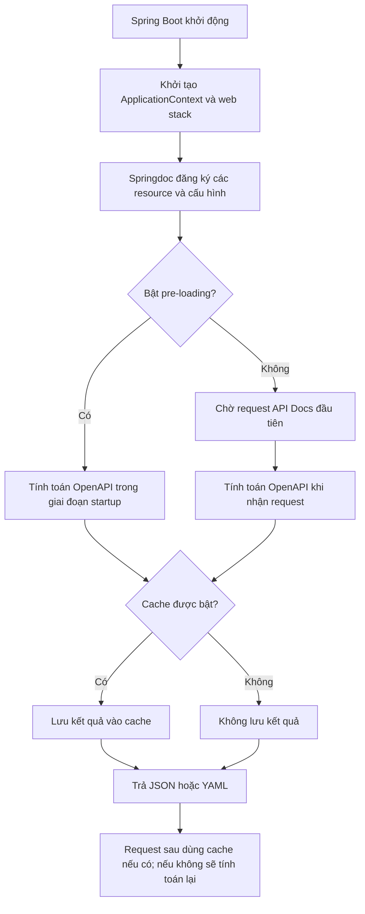

# Thời điểm xây dựng tài liệu, bộ nhớ đệm và nạp trước

Springdoc không nhất thiết phải xây dựng toàn bộ đặc tả OpenAPI ngay khi Spring Boot bắt đầu chạy. Theo cấu hình thông thường, ứng dụng chuẩn bị các thành phần cần thiết trong quá trình khởi động, sau đó tài liệu được tính toán khi có request đến endpoint API Docs. Kết quả đã tính toán được lưu trong cache để những request tiếp theo không phải lặp lại toàn bộ công việc.

Springdoc cũng hỗ trợ nạp trước tài liệu khi ứng dụng khởi động. Tùy chọn này chuyển phần chi phí tạo OpenAPI sang giai đoạn startup, giúp request đầu tiên sau khi ứng dụng sẵn sàng tránh được độ trễ tạo tài liệu. Việc chọn thời điểm tạo, bật cache và nạp trước ảnh hưởng đến thời gian khởi động, độ trễ request đầu tiên, mức sử dụng bộ nhớ và khả năng phản ánh thay đổi runtime.

## 1. Tài liệu được xây dựng vào thời điểm nào?

Để tạo đặc tả, Springdoc cần thông tin từ Spring ApplicationContext và web stack đang chạy. Các thông tin thường được sử dụng gồm:

- Controller và các mapping đã đăng ký trong Spring MVC hoặc WebFlux.
- Kiểu tham số, kiểu trả về, DTO, generic type và các schema liên quan.
- Annotation Spring, Swagger/OpenAPI và các ràng buộc validation.
- Cấu hình OpenAPI, bean `OpenAPI`, customizer và các nhóm tài liệu.
- Thông tin môi trường như server URL, locale và cấu hình tích hợp.

Vì vậy, cần phân biệt hai thời điểm: Spring Boot khởi tạo ứng dụng và Springdoc tính toán nội dung OpenAPI. Springdoc có thể đăng ký resource, bean và cấu hình trong lúc startup mà chưa cần tuần tự hóa toàn bộ tài liệu ngay tại thời điểm đó.

Với cấu hình mặc định, `springdoc.pre-loading-enabled` là `false`. Tài liệu thường được tạo khi client lần đầu gọi endpoint API Docs, ví dụ:

```text
GET /v3/api-docs
GET /v3/api-docs.yaml
```

Nếu người dùng mở Swagger UI trước, trình duyệt sẽ tải trang giao diện rồi gọi endpoint tài liệu để hiển thị các operation. Request của Swagger UI vì vậy có thể là request đầu tiên kích hoạt việc xây dựng OpenAPI. Nếu một công cụ CI, health check hoặc client khác gọi API Docs trước, request đó có thể trở thành request đầu tiên.

Quy trình khái quát:



Sơ đồ thể hiện luồng khái quát. Thứ tự chi tiết của các bean và sự kiện lifecycle có thể khác giữa các phiên bản Springdoc, nhưng hai chế độ vận hành cần nhớ là tạo khi được yêu cầu và tạo trước trong lúc ứng dụng khởi động.

## 2. Những công việc diễn ra khi tạo OpenAPI

Lần tính toán đầu tiên có thể tốn thời gian hơn những request sau vì Springdoc cần tổng hợp nhiều nguồn metadata. Công việc thường bao gồm:

1. Xác định các endpoint nằm trong phạm vi quét hoặc phạm vi của group đang được yêu cầu.
2. Đọc HTTP method, path, parameter, request body và response từ handler method.
3. Phân tích kiểu dữ liệu, annotation và cấu hình chuyển đổi để tạo schema.
4. Xử lý tham chiếu giữa schema, generic type, enum, validation và các cấu trúc lồng nhau.
5. Kết hợp thông tin từ annotation, bean `OpenAPI`, customizer, security và cấu hình Springdoc.
6. Tạo mô hình OpenAPI và tuần tự hóa mô hình thành JSON hoặc YAML để trả về client.

Ứng dụng có nhiều controller, DTO phức tạp, quan hệ generic sâu, nhiều group hoặc nhiều locale có thể cần nhiều thời gian và bộ nhớ hơn. Độ phức tạp của schema và customizer cũng có thể ảnh hưởng đáng kể đến thời gian tạo tài liệu.

Không nên đánh đồng thời gian tạo OpenAPI với thời gian xử lý request nghiệp vụ. Request `/v3/api-docs` chủ yếu phục vụ việc mô tả API; nó không cần gọi lần lượt mọi endpoint được mô tả. Tuy nhiên, nếu customizer tự truy vấn cơ sở dữ liệu hoặc gọi dịch vụ bên ngoài, phần mã tùy biến đó có thể làm tăng thời gian và tạo thêm phụ thuộc runtime.

## 3. Cache OpenAPI phía server

Springdoc mặc định bật cache cho đặc tả đã tính toán. Thuộc tính `springdoc.cache.disabled` có giá trị mặc định là `false`, nghĩa là cache không bị tắt. Khi tài liệu đã được tạo, những request phù hợp tiếp theo có thể sử dụng kết quả đã lưu thay vì phân tích lại controller và schema.

Ví dụ cấu hình mặc định được thể hiện tường minh:

```yaml
springdoc:
  cache:
    disabled: false
```

Cache này là cache kết quả OpenAPI do Springdoc quản lý ở phía server. Nó không đồng nghĩa với HTTP cache của trình duyệt, CDN hoặc reverse proxy; cũng không phải là cấu hình cache nghiệp vụ của Spring Cache. Các lớp cache khác có thể tồn tại độc lập.

### Vì sao cache có ích?

- Giảm chi phí phân tích controller, DTO và annotation sau lần tạo đầu tiên.
- Giảm độ trễ của các request tải tài liệu lặp lại.
- Tránh thực hiện lại customizer hoặc logic tạo schema trên mỗi request khi tài liệu không đổi.
- Giúp endpoint tài liệu ổn định hơn khi nhiều người hoặc công cụ cùng truy cập.

### Giới hạn cần hiểu

Cache phù hợp khi hợp đồng API ổn định trong suốt vòng đời của một phiên bản ứng dụng. Nếu nội dung OpenAPI phụ thuộc vào dữ liệu thay đổi trong runtime, chẳng hạn danh sách tenant, quyền người dùng, feature flag hoặc trạng thái lấy từ database, kết quả đã cache có thể không phản ánh thay đổi đó ở các request sau.

Đặc tả API thường nên mô tả hợp đồng của ứng dụng, không nên thay đổi tùy ý theo từng người gọi. Nếu cần tài liệu khác nhau theo tenant hoặc nhóm người dùng, hãy thiết kế group, endpoint hay tài liệu riêng có phạm vi rõ ràng và kiểm soát truy cập tương ứng. Không nên dựa vào cache toàn cục để tạo hợp đồng riêng tư theo từng request.

## 4. Tùy chỉnh cache và số lượng bản lưu

Để tắt cache OpenAPI, cấu hình:

```yaml
springdoc:
  cache:
    disabled: true
```

Khi cache bị tắt, Springdoc có thể phải tính toán lại tài liệu cho các request tiếp theo. Cách này hữu ích khi đang phát triển hoặc kiểm tra một customizer có kết quả thay đổi theo trạng thái runtime. Đổi lại, endpoint tài liệu có thể tiêu tốn CPU nhiều hơn và tăng độ trễ, đặc biệt khi có nhiều client cùng tải tài liệu.

Trong tài liệu cấu hình Springdoc v2, `springdoc.cache.max-entries` đặt giới hạn số OpenAPI description được giữ trong cache. Giá trị mặc định được tài liệu v2 công bố là `100`. Mỗi locale được yêu cầu qua header `Accept-Language` có một entry; khi vượt giới hạn, entry cũ nhất bị loại bỏ theo cơ chế LRU.

Ví dụ:

```yaml
springdoc:
  cache:
    disabled: false
    max-entries: 100
```

Chỉ điều chỉnh `max-entries` khi ứng dụng thực sự phục vụ nhiều locale hoặc nhiều biến thể tài liệu làm số entry tăng đáng kể. Tăng giới hạn có thể làm tăng lượng bộ nhớ giữ lại; giảm quá thấp có thể khiến tài liệu phải tính toán lại thường xuyên khi các locale luân phiên được yêu cầu. Kiểm tra tài liệu của đúng dòng Springdoc đang dùng vì tập thuộc tính và cách triển khai cache có thể thay đổi giữa các phiên bản.

### Cache và locale

Nếu ứng dụng có mô tả đa ngôn ngữ, Springdoc có thể tạo nội dung khác nhau theo locale được client yêu cầu. Header `Accept-Language` là một đầu vào quan trọng để chọn locale. Ví dụ:

```bash
curl -H "Accept-Language: vi" http://localhost:8080/v3/api-docs
curl -H "Accept-Language: en" http://localhost:8080/v3/api-docs
```

Hai request có thể nhận mô tả khác nhau nếu ứng dụng đã cấu hình nội dung quốc tế hóa. Cache theo locale giúp không dùng nhầm nội dung của một ngôn ngữ cho request của ngôn ngữ khác. Nếu ứng dụng không dùng nội dung đa ngôn ngữ, không cần tăng cache chỉ vì có nhiều người dùng.

## 5. Nạp trước tài liệu khi khởi động

Springdoc hỗ trợ pre-loading để xây dựng OpenAPI trong giai đoạn khởi động ứng dụng. Thuộc tính chính là `springdoc.pre-loading-enabled`, mặc định `false` trong tài liệu cấu hình Springdoc v2.

Để bật nạp trước:

```yaml
springdoc:
  pre-loading-enabled: true
```

Khi bật, Springdoc chủ động tính toán tài liệu trong startup thay vì chờ request API Docs đầu tiên. Nếu cache được bật, kết quả đã tạo có thể được dùng cho những request tiếp theo.

### Khi nào nên bật?

- Muốn tránh độ trễ tạo tài liệu ở request đầu tiên sau khi ứng dụng sẵn sàng.
- Muốn phát hiện sớm lỗi liên quan đến schema, annotation hoặc customizer trong giai đoạn khởi động.
- Có công cụ hoặc thành phần khác cần tài liệu OpenAPI ngay sau khi ứng dụng khởi động.
- Dùng tài liệu OpenAPI để đăng ký hoặc khởi tạo một tích hợp phụ thuộc vào hợp đồng API.

### Đánh đổi khi bật pre-loading

Pre-loading chuyển chi phí tính toán vào giai đoạn startup. Ứng dụng có thể khởi động lâu hơn, sử dụng CPU và bộ nhớ sớm hơn. Với tài liệu lớn hoặc nhiều locale, thời gian tăng thêm có thể đáng kể. Trong môi trường autoscaling hoặc triển khai nhiều replica, mỗi instance có thể thực hiện công việc nạp trước của riêng nó.

Nạp trước không làm cho mọi endpoint nghiệp vụ sẵn sàng sớm hơn và cũng không thay thế health check. Nó chỉ chuẩn bị tài liệu OpenAPI. Hãy đo thời gian startup và request API Docs trong môi trường gần với production trước khi bật mặc định cho mọi môi trường.

## 6. Nạp trước theo locale

Nếu ứng dụng hỗ trợ mô tả đa ngôn ngữ, có thể chỉ định những locale cần nạp trước bằng `springdoc.pre-loading-locales`. Theo tài liệu Springdoc v2, nếu không khai báo danh sách này, Springdoc nạp trước theo `Locale` mặc định của ứng dụng.

Ví dụ cấu hình YAML:

```yaml
springdoc:
  pre-loading-enabled: true
  pre-loading-locales:
    - vi
    - en
```

Có thể cấu hình cùng ý nghĩa bằng `application.properties`:

```properties
springdoc.pre-loading-enabled=true
springdoc.pre-loading-locales=vi,en
```

Hãy chọn locale trùng với những giá trị ứng dụng thực sự hỗ trợ. Nếu khai báo nhiều locale, startup sẽ phải chuẩn bị thêm các bản tài liệu tương ứng và cache có thể giữ nhiều entry hơn. Cần tính đến giới hạn cache, bộ nhớ và thời gian khởi động.

Nếu nội dung dịch đến từ message bundle, kiểm tra các file message đã được đóng gói đúng và locale fallback hoạt động như mong đợi. Pre-loading không tự dịch nội dung annotation hoặc tự tạo bản dịch còn thiếu; nó chỉ yêu cầu Springdoc xây dựng tài liệu theo locale đã cấu hình.

## 7. Kết hợp cache, pre-loading và group tài liệu

Một ứng dụng có thể tạo nhiều OpenAPI document thông qua `GroupedOpenApi` hoặc cấu hình group. Mỗi group có phạm vi endpoint và hợp đồng riêng, chẳng hạn `public`, `admin` hoặc `internal`. Request đến URL tài liệu của group sẽ yêu cầu Springdoc xây dựng tài liệu tương ứng.

Khi kết hợp group với locale, cần xem xét tổng số biến thể tài liệu mà ứng dụng phục vụ. Ví dụ, một dịch vụ có nhiều group và nhiều ngôn ngữ có thể phải chuẩn bị và lưu nhiều bản OpenAPI. Cấu hình pre-loading, cache và phạm vi group cần được kiểm tra cùng nhau trong phiên bản Springdoc cụ thể; không giả định một request tải tài liệu mặc định đã kiểm tra hết mọi group.

Ví dụ khai báo group:

```java
@Configuration
class OpenApiGroups {

    @Bean
    GroupedOpenApi publicApi() {
        return GroupedOpenApi.builder()
            .group("public")
            .pathsToMatch("/api/public/**")
            .build();
    }

    @Bean
    GroupedOpenApi adminApi() {
        return GroupedOpenApi.builder()
            .group("admin")
            .pathsToMatch("/api/admin/**")
            .build();
    }
}
```

Các URL tài liệu tương ứng thường có dạng:

```text
/v3/api-docs/public
/v3/api-docs/admin
```

Nếu ứng dụng cần đảm bảo mọi group đều được tạo thành công trước khi nhận traffic, hãy kiểm tra cách phiên bản Springdoc đang dùng thực hiện pre-loading cho group và xây dựng kiểm tra khởi động phù hợp. Không suy luận rằng `pre-loading-enabled=true` trong mọi phiên bản đều tương đương với một bài kiểm thử đầy đủ cho mọi URL tài liệu tùy biến.

## 8. Cấu hình mẫu theo môi trường

Không phải môi trường nào cũng cần cùng một chiến lược. Ví dụ sau minh họa cách bật cache và pre-loading cho môi trường production:

```yaml
springdoc:
  cache:
    disabled: false
    max-entries: 100
  pre-loading-enabled: true
  pre-loading-locales:
    - vi
    - en
```

Trong môi trường phát triển, có thể giữ pre-loading tắt để startup nhanh hơn khi thường xuyên thay đổi controller và DTO:

```yaml
springdoc:
  cache:
    disabled: true
  pre-loading-enabled: false
```

Đây là hai cấu hình tham khảo, không phải giá trị bắt buộc. Với ứng dụng có hợp đồng ổn định, cache thường hữu ích ở cả development và production. Tắt cache trong development chỉ phù hợp khi cần quan sát kết quả được tạo lại sau thay đổi runtime hoặc khi debug customizer. Thay đổi mã nguồn thông thường vẫn cần build/restart theo quy trình phát triển; tắt cache không phải cơ chế hot reload controller.

Có thể đặt các giá trị này trong những file profile riêng. Ví dụ, `application-dev.yml`:

```yaml
springdoc:
  pre-loading-enabled: false
```

Và `application-prod.yml`:

```yaml
springdoc:
  cache:
    disabled: false
  pre-loading-enabled: true
```

Khi sử dụng profile, hãy xác nhận profile đang hoạt động và giá trị cấu hình cuối cùng mà Spring Boot đã nạp. Environment variable, command-line argument hoặc cấu hình ngoài có thể ghi đè file YAML.

## 9. Đo và kiểm tra hành vi tạo tài liệu

Có thể dùng `curl` để gọi endpoint tài liệu nhiều lần và so sánh thời gian phản hồi:

```bash
curl -s -o /dev/null -w "first: %{time_total}s\n" http://localhost:8080/v3/api-docs
curl -s -o /dev/null -w "next: %{time_total}s\n" http://localhost:8080/v3/api-docs
```

Lệnh đầu có thể bao gồm chi phí tạo tài liệu nếu chưa có cache; lệnh sau có thể nhanh hơn khi cache đã được khởi tạo. Kết quả đo còn chịu ảnh hưởng của JVM warm-up, network, reverse proxy, serialization và tải hệ thống. Vì vậy, hai lần gọi chỉ là phép kiểm tra sơ bộ, không thay thế benchmark có kiểm soát.

Để đánh giá pre-loading:

1. Chạy ứng dụng với `pre-loading-enabled=false` và ghi nhận thời gian startup.
2. Gọi API Docs lần đầu, ghi nhận thời gian phản hồi và log liên quan.
3. Gọi lại nhiều lần để quan sát độ trễ khi cache đã có kết quả.
4. Bật `pre-loading-enabled=true`, khởi động lại và ghi nhận thời gian startup.
5. Gọi API Docs ngay sau khi ứng dụng sẵn sàng để so sánh request đầu tiên.
6. Lặp lại với các group và locale mà ứng dụng thực sự sử dụng.

Khi benchmark, dùng cùng cấu hình JVM, dữ liệu, tài nguyên máy và số lượng endpoint. Theo dõi cả thời gian startup, CPU, heap và độ trễ request thay vì chỉ so sánh một con số.

## 10. Sự cố thường gặp và cách chẩn đoán

| Hiện tượng | Nguyên nhân có thể | Cách kiểm tra |
|---|---|---|
| Ứng dụng khởi động nhanh nhưng request API Docs đầu tiên chậm | Tài liệu được tạo theo yêu cầu và chưa có cache | So sánh request đầu với request tiếp theo; cân nhắc pre-loading |
| Bật pre-loading làm startup lâu hơn | Tài liệu lớn, nhiều schema, group hoặc locale | Đo từng cấu hình; giảm phạm vi hoặc locale không cần thiết |
| Thay đổi dữ liệu runtime nhưng tài liệu vẫn giữ nội dung cũ | OpenAPI đã được cache | Xác định dữ liệu đó có nên thuộc hợp đồng; kiểm tra `springdoc.cache.disabled` và thiết kế tài liệu |
| Tắt cache khiến API Docs chậm khi có nhiều request | Mỗi request phải tính toán lại OpenAPI | Bật lại cache nếu tài liệu ổn định; giảm customizer tốn kém |
| Tài liệu tiếng Việt không được nạp trước | Locale chưa nằm trong danh sách hoặc message bundle thiếu | Kiểm tra `pre-loading-locales`, `Accept-Language` và file message |
| Một group lỗi dù tài liệu mặc định hoạt động | Group có phạm vi scan, customizer hoặc schema khác | Gọi trực tiếp URL của group và kiểm tra log tương ứng |
| Startup thành công nhưng request đầu vẫn chậm | Pre-loading chưa bật, không áp dụng cho biến thể đang gọi hoặc còn công việc khác | Kiểm tra cấu hình thực tế, locale, group và thời gian serialization |

Khi điều tra, nên xác định request nào đã kích hoạt việc tạo tài liệu, cache có bật không, request sử dụng locale nào và URL thuộc group nào. Các yếu tố này giúp phân biệt chi phí tạo OpenAPI với lỗi mạng hoặc lỗi Swagger UI.

## 11. Khuyến nghị vận hành

- Giữ cache bật khi hợp đồng API ổn định và không cần tạo tài liệu riêng theo từng request.
- Cân nhắc pre-loading khi độ trễ của request đầu tiên ảnh hưởng đến công cụ tích hợp hoặc người dùng.
- Đo tác động lên startup trước khi bật pre-loading cho tất cả replica.
- Chỉ nạp trước những locale thực sự được hỗ trợ và sử dụng.
- Kiểm tra riêng các group quan trọng; không dựa vào URL tài liệu mặc định để kết luận mọi group đều hợp lệ.
- Tránh customizer thực hiện truy vấn hoặc gọi dịch vụ ngoài không cần thiết trong quá trình tạo tài liệu.
- Không dùng việc tắt cache như một giải pháp thay thế cho thiết kế hợp đồng ổn định.
- Đối chiếu tên thuộc tính, giá trị mặc định và hành vi cache với tài liệu của đúng phiên bản Springdoc trong dự án.

## 12. Checklist trước khi triển khai

- [ ] Đã xác định tài liệu được tạo theo request đầu tiên hay được nạp trước khi startup hoàn tất.
- [ ] Đã xác nhận giá trị `springdoc.cache.disabled` theo môi trường.
- [ ] Nếu dùng `cache.max-entries`, đã kiểm tra hỗ trợ của phiên bản Springdoc và số locale thực tế.
- [ ] Nếu bật pre-loading, đã đo ảnh hưởng đến thời gian khởi động và bộ nhớ.
- [ ] Danh sách `pre-loading-locales` chỉ gồm locale được hỗ trợ.
- [ ] Các group API quan trọng đã được gọi và xác minh độc lập.
- [ ] Customizer không tạo phụ thuộc runtime hoặc chi phí không cần thiết.
- [ ] Đã kiểm tra cấu hình cuối cùng sau khi profile và biến môi trường được áp dụng.
- [ ] Đã đo request API Docs đầu tiên và các request tiếp theo.

Tài liệu OpenAPI có thể được xây dựng khi client yêu cầu hoặc được nạp trước trong giai đoạn startup. Cache giúp tái sử dụng kết quả đã tính toán, còn pre-loading chuyển công việc tạo tài liệu sang lúc khởi động. Chọn kết hợp phù hợp với kích thước hợp đồng, số group, số locale và yêu cầu độ trễ sẽ giúp springdoc phục vụ tài liệu ổn định mà vẫn kiểm soát được thời gian khởi động và tài nguyên ứng dụng.

## Tài liệu tham khảo

- [Springdoc OpenAPI v2 – Configuration Properties](https://springdoc.org/v2/properties.html)
- [Springdoc OpenAPI – Configuration Properties](https://springdoc.org/properties.html)
- [Springdoc OpenAPI – GitHub repository](https://github.com/springdoc/springdoc-openapi)
