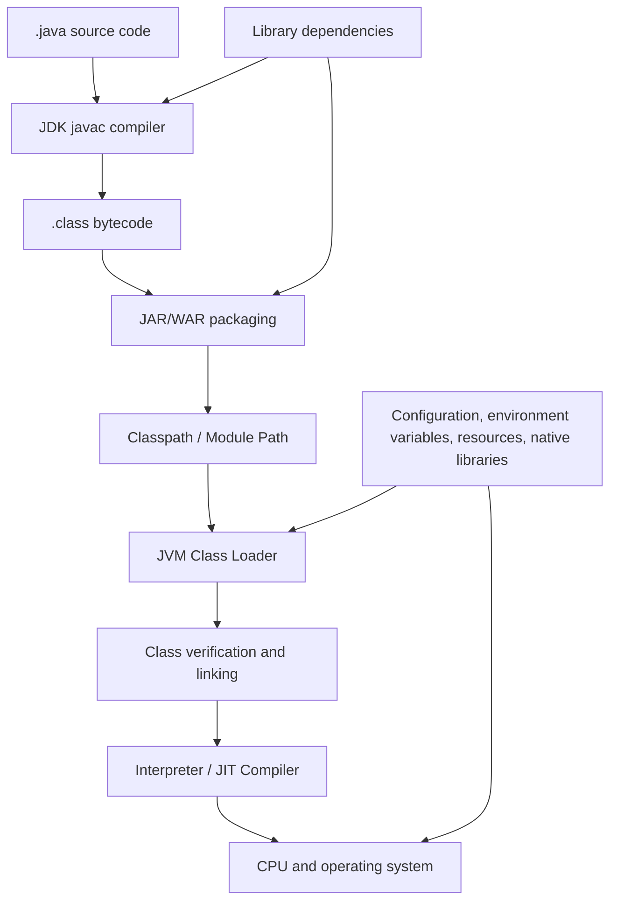


# Relationship between source code, bytecode, libraries, JVM, and deployment environment

A Java application only runs stably when multiple layers are compatible with one another. Source code must be compiled correctly for the intended Java version; bytecode must be within the range that the JVM can read; libraries must provide the exact classes and methods that the application needs; the JVM must support the class file version and APIs used; finally, the operating system and deployment environment must meet the requirements for architecture, resources, configuration, and native libraries.

Therefore, when upgrading Java or moving an application to a new server, container, or platform, you cannot just look at a single number like “Java 17” or “Java 21”. It is necessary to identify the version at each layer and verify the relationships between them.

## 1. The big picture

The process from writing code to running the program can be visualized as follows:



Each component has its own responsibility:

| Component | Role | Compatibility question to answer |
|---|---|---|
| Source code | Describes logic in Java or a language running on the JVM | Does the compiler understand the syntax and features being used? |
| JDK/compiler | Compiles source code, processes annotations, and performs packaging | Does the build tool have an appropriate version? |
| Bytecode | Intermediate representation in `.class` files | Can the target JVM read this class file? |
| Libraries | Provide APIs and reusable implementations | Is the right library version present at compile time and runtime? |
| JVM | Loads, verifies, and executes bytecode | Does the JVM support the required bytecode, APIs, and runtime options? |
| Deployment environment | Provides OS, CPU, resources, configuration, and services | Do the application's assumptions hold true in the actual environment? |

These layers are interconnected, yet they are not identical. For example, a project can be compiled with JDK 21, produce Java 17 bytecode, use libraries that only run on Java 17 or higher, and be deployed on JVM 17. That configuration can be valid. Conversely, if a library in the application requires Java 21, setting the application code's bytecode level to Java 17 will still not allow the entire application to run on JVM 17.

## 2. Source code and JDK: what is allowed to be written and compiled?

Java source code typically resides in `.java` files. The `javac` compiler reads the source code, checks syntax, data types, access permissions, annotations, and language rules, and then generates bytecode in `.class` files.

The JDK (Java Development Kit) is the development toolkit. A JDK typically provides:

- The `javac` compiler.
- Packaging and inspection tools such as `jar`, `javap`, `javadoc`.
- A runtime to run Java applications.
- Tools for debugging, observation, and diagnostics.

You can check the version of the tools being invoked with:

```bash
java -version
javac -version
```

The two commands can point to two different installations if `PATH` or the environment configuration is inconsistent. In that case, the output of `java -version` is not enough to conclude which version the compiler is using. With Gradle or Maven, you must also check the JDK used by the build process.

### Language version and JDK version

The JDK version determines what capabilities the compiler and tools have. However, a newer compiler can generate bytecode compatible with an older Java version if the source code and APIs are appropriately restricted.

For example, using JDK 21 to compile source code targeting Java 17:

```bash
javac --release 17 -d out src/com/example/App.java
```

The `--release 17` option simultaneously constrains:

1. The Java language rules allowed to be used.
2. The set of Java SE APIs that the source code is allowed to reference.
3. The output bytecode version corresponding to Java 17.

This helps avoid cases where source code accidentally calls an API that only exists from Java 21 onward, yet is packaged with Java 17 as the target.

Three common options have different meanings:

| Option | Meaning |
|---|---|
| `--source` | Restricts the accepted syntax/language version |
| `--target` | Selects the output class file version |
| `--release` | Combines language, class file, and Java SE API restrictions according to the target version |

Using only `-source` and `-target` does not automatically guarantee that the source code only calls APIs present in the target Java version. With modern JDKs, `--release` is usually the clearer choice when you need to maintain the ability to run on a specific Java version.

### Build toolchain and deployment runtime

You should distinguish at least two versions:

- **Build JDK:** The JDK that runs Gradle/Maven, the compiler, plugins, and annotation processors.
- **Java Runtime:** The JVM that actually runs the application in the deployment environment.

They can differ. For example, CI uses JDK 21 to build, while the application is compiled with `--release 17` and runs on a Java 17 runtime. This configuration is only valid when all bytecode and runtime libraries are compatible with Java 17.

In addition, Gradle/Maven and build plugins also have their own JDK requirements. An application may target Java 17 while a Gradle version or plugin requires JDK 21 to run the build process. Therefore, “the application supports Java 17” does not mean “all build tools can run on JDK 17”.

## 3. Bytecode: the contract between the compiler and the JVM

Bytecode is an intermediate instruction format stored in `.class` files. The JVM does not execute `.java` source code directly; the JVM loads bytecode, verifies structure and types, links necessary references, and then executes it.

A `.class` file contains class file version information, commonly referred to as the *major version*. Some common milestones:

| Java version | Major version |
|---|---:|
| Java 8 | 52 |
| Java 11 | 55 |
| Java 17 | 61 |
| Java 21 | 65 |

When the JVM encounters a class file with a higher version than it supports, the program can terminate with the error:

```text
java.lang.UnsupportedClassVersionError
```

For example: a library compiled with JDK 21 has class file major version 65. If the application runs on JVM 17, JVM 17 cannot load that class, even if the main application's source code was compiled with `--release 17`.

This shows that the version requirement of the entire application is governed by the component with the highest requirement in the set of bytecode that is actually loaded. That component can be:

- Classes compiled by the project itself.
- Third-party libraries.
- Internal modules packaged as JARs.
- Code automatically generated during the build process.
- Plugins or extensions loaded at runtime.

Bytecode does not come only from `javac`. Kotlin, Scala, Groovy, and many other languages can also produce class files that run on the JVM. When the same application uses multiple JVM languages, you need to check the target bytecode configuration of each compiler.

### Does old bytecode always run on a newer JVM?

Normally, a newer JVM is designed to preserve the ability to run most older bytecode according to Java's specification and compatibility policy. However, you should not conclude that every older application will definitely run identically on a newer JVM.

An application can still be affected by:

- APIs that have been removed or changed.
- Behavioral changes in the standard library.
- Stricter module access and reflection rules.
- Changes in security, TLS, certificates, or cryptographic algorithms.
- Changes in defaults for GC, encoding, locale, or JVM options.
- Third-party libraries that do not support the newer JVM.

Compatibility in bytecode format is only a necessary condition, not the full set of runtime compatibility conditions.

## 4. Libraries: classes and methods that the application depends on

Java libraries are typically distributed as JARs. A JAR can contain multiple `.class` files, resources, metadata, service providers, and other configuration files.

At compile time, the compiler needs to find the classes referenced by the source code. At runtime, the JVM and class loader must also find those classes. Therefore, a dependency can exist at compile time yet be missing at runtime, or be present at both times but in different versions.

### Compile-time and runtime dependencies

For example, the source code calls a class from the `example-client` library:

```java
import com.example.client.ApiClient;

public class App {
    public static void main(String[] args) {
        ApiClient client = new ApiClient();
        client.connect();
    }
}
```

The compiler needs the JAR containing `ApiClient` to check types and methods. At runtime, the JVM still needs the corresponding JAR to load the class and execute it.

If the JAR is only declared in the compile configuration but not included on the runtime classpath, the program can encounter:

```text
java.lang.NoClassDefFoundError
```

If the class exists, but the version running no longer has the method that the bytecode referenced, you can encounter:

```text
java.lang.NoSuchMethodError
```

These are two different errors:

- `NoClassDefFoundError`: The JVM cannot find or define the required class during linking/loading.
- `NoSuchMethodError`: The class was found, but the runtime API structure does not match the previously compiled reference.

### Dependency graph and transitive dependencies

An application usually does not depend on just one JAR. Library A may depend on B, and B may depend on C. Dependencies pulled in through another library are called *transitive dependencies*.

Therefore, looking only at the list of direct dependencies is not enough. You need to know the final version selected for each module, whether there are version conflicts, and which dependencies actually appear at runtime.

Some common risks:

- Two libraries require two different versions of the same dependency.
- A dependency is excluded or not packaged into the artifact.
- A library is compiled with a JDK newer than the runtime.
- The application loads the wrong JAR version because the classpath order is not as expected.
- The same class appears in multiple JARs, leading to class loader-dependent behavior.
- A library uses internal JDK APIs or relies on unguaranteed behavior.

### Binary compatibility and API compatibility

A compiled application can contain references to specific class names, method names, and descriptors. When replacing a library with a new version, those references need to remain valid.

For example, the old library version has:

```java
public String findUser(long id)
```

If the new version deletes the method or changes the return type/parameters in a way that alters the binary descriptor, an application compiled against the old version may fail to link when running with the new library.

Conversely, a change that preserves the signature can alter behavior, data validation rules, exceptions, or return values. In that case, the program may load and run, but the business results will no longer be correct as before.

### Multi-release JAR

Some JARs contain multiple versions of classes for different Java versions. This is the *multi-release JAR* mechanism. The JVM can select the class matching the running runtime version if the JAR is packaged and declared with the proper structure.

This allows a library to provide an optimized implementation for a newer JVM while keeping a baseline implementation for an older JVM. However, you should not assume every JAR supports this mechanism; you need to inspect the metadata and actual JAR structure.

## 5. JVM: where bytecode is loaded and executed

The JVM (Java Virtual Machine) is the virtual machine that executes bytecode according to the JVM specification. A specific Java distribution provides a JVM implementation along with related libraries and tools.

The JVM handles multiple responsibilities:

1. **Class loading:** finding and loading class definitions from the classpath, module path, or configured sources.
2. **Verification:** checking bytecode validity and structural safety.
3. **Linking:** preparing classes, resolving references, and performing necessary initialization.
4. **Execution:** interpreting bytecode or compiling frequently executed code segments into machine code using JIT.
5. **Memory management:** managing the heap, stack, metadata, and garbage collection.
6. **Runtime services:** providing threads, synchronization, exceptions, reflection, the module system, and other services.

### Specification and implementation

The JVM specification describes the behavior that a compliant JVM must satisfy. Different Java distributions can provide different implementations, management tools, security patches, and support policies.

When investigating an error, you should record:

- The full Java version, including the update release.
- The Java vendor/distribution.
- The operating system and CPU architecture.
- The JVM parameters currently in use.
- The library and application versions.

Two machines may both report Java 21 yet differ in update version, vendor, GC parameters, memory configuration, system certificates, or native libraries. Those differences can cause operational results to differ.

### The JVM and Java APIs

The JVM executes bytecode, while most of the APIs that an application uses come from the Java platform libraries, such as `java.base`, `java.sql`, or other Java SE modules. An application can have valid bytecode yet call an API that does not exist on the target runtime.

Beyond Java SE, an application can also depend on APIs from external frameworks or libraries. When upgrading the runtime, you need to check both groups: platform APIs and APIs provided by dependencies.

### Module system and access permissions

Since Java 9, the Java Platform Module System has introduced modules and stronger access boundaries. Older applications or older libraries may rely on reflection to access internal JDK components. On newer Java versions, such accesses can be restricted and cause errors such as:

```text
java.lang.reflect.InaccessibleObjectException
```

Adding options to open modules should not be treated as the default fix for every error. You should identify which library is accessing which component, find a version that already supports the target Java version, and only open access when there is a clear technical reason.

## 6. Deployment environment: things outside bytecode

Even when all class files and libraries are compatible with the JVM, the application can still fail because the deployment environment does not satisfy the program's assumptions.

### Operating system and CPU architecture

Pure Java applications are usually highly portable, but real-world applications can depend on:

- JNI or native libraries.
- Executables invoked via `ProcessBuilder`.
- File paths and case-sensitivity rules.
- File permissions, user/group, and OS security mechanisms.
- x86-64, ARM64, or other architectures.
- System libraries that native binaries need to link against.

A native library built for Linux x86-64 cannot automatically be used on Windows or Linux ARM64. Changing the container base image can also remove system libraries that the application previously relied on.

### Encoding, locale, and timezone

Environment defaults can affect reading/writing files, date and time formatting, and text processing.

For example:

- A file read using the default encoding may display Vietnamese characters incorrectly.
- The date `03/04/2026` can be interpreted differently depending on the locale.
- Business logic relying on the default timezone can shift dates when moving servers.
- Comparing file names can yield different results between case-sensitive and case-insensitive filesystems.

If encoding or timezone is part of the data contract, it should be declared explicitly instead of relying on the machine default.

Example of explicitly reading a UTF-8 file:

```java
try (var reader = java.nio.file.Files.newBufferedReader(
        java.nio.file.Path.of("data.txt"),
        java.nio.charset.StandardCharsets.UTF_8)) {
    // Read file contents
}
```

### Resources and operational configuration

An application may run fine on a development machine but fail in production due to:

- RAM or heap limits being too low.
- The container having a CPU quota or memory limit.
- Limits on the number of file descriptors or threads.
- Missing environment variables, secrets, or configuration files.
- Different DNS, proxy, firewall, or database connectivity.
- Incomplete TLS certificates or truststore.
- Log directories, temporary directories, or volumes lacking write permissions.
- Health checks, timeouts, or restart policies of the deployment platform.

These factors are not necessarily Java compatibility bugs, but they are part of the conditions required for a Java application to function properly in the target environment.

### Containers do not automatically guarantee compatibility

Containers help package the runtime and part of the environment, but they do not eliminate all differences. An image still has a base operating system, CPU architecture, native libraries, user configuration, and resource limits.

When switching from a JDK image to a JRE image or a minimal image, check:

- Does the application need runtime tools such as `keytool` or diagnostic tools?
- Are the native libraries still sufficient?
- Are the truststore and timezone database provided?
- Does the user running the application have the required read/write permissions?
- Does the image match the CPU architecture of the deployment environment?

You should pin the image version and, for release processes requiring high reproducibility, consider pinning the image digest as well.

## 7. Types of compatibility to evaluate separately

From the layers above, compatibility can be divided into groups for systematic verification:

| Compatibility group | Description | Example errors or risks |
|---|---|---|
| Source compatibility | Source code can be compiled with the target compiler and language rules | Unsupported syntax or APIs |
| Bytecode compatibility | Target JVM can read the class files | `UnsupportedClassVersionError` |
| Binary compatibility | Class/method/field references can still be linked | `NoSuchMethodError`, `NoSuchFieldError` |
| API compatibility | Required platform APIs and library APIs still exist | `NoClassDefFoundError`, compilation errors |
| Behavioral compatibility | The program still exhibits correct behavior after upgrading | Wrong date formatting, changed defaults, different business results |
| Runtime compatibility | The JVM and dependencies work together | Blocked reflection, initialization errors, class loader errors |
| Environment compatibility | OS, CPU, native libraries, resources, and configuration meet requirements | `UnsatisfiedLinkError`, file permission errors, insufficient RAM |
| Operational compatibility | Building, packaging, monitoring, and operations fit the new platform | Health check failures, timeouts, missing logs or secrets |

You should not use a single check to conclude that all groups pass. A successful build mainly proves part of source/API compatibility. A successful startup additionally proves part of runtime compatibility. Functional testing and deployment in a production-like environment are required to evaluate behavior and operational conditions.

## 8. Example: building with JDK 21 but deploying on Java 17

Suppose the development team wants to use JDK 21 for the build tools, while the production server is still running Java 17.

An intentional configuration might use Gradle as follows:

```groovy
java {
    toolchain {
        languageVersion = JavaLanguageVersion.of(21)
    }
}

tasks.withType(JavaCompile).configureEach {
    options.release = 17
}
```

Meaning:

- Gradle selects JDK 21 as the compilation toolchain.
- `--release 17` restricts source code, Java SE APIs, and output bytecode to the Java 17 level.
- The artifact is expected to run on Java 17 if all other dependencies and runtime components also meet that requirement.

This is not yet sufficient proof that the artifact runs on Java 17. The team still needs to verify:

1. Every runtime dependency has Java 17-compatible bytecode.
2. No library calls APIs available only in Java 18 or later.
3. Plugins, code generators, and annotation processors produce appropriate output.
4. Dynamically loaded components are also compatible.
5. The test suite is executed on an actual JVM 17.
6. The production container or server has the required native libraries, certificates, configuration, and resources.

If the goal is to move both the build and runtime to Java 21, you need to update the toolchain, `options.release`, runtime image, CI, and deployment environment in sync. Afterward, you still must run regression tests to detect behavioral changes or incompatible dependencies.

### Illustrative version matrix

| Component | Example configuration | What to confirm |
|---|---|---|
| JDK running Gradle | 21 | Gradle and plugins support JDK 21 |
| Compiler target | 17 | Uses `--release 17` |
| Application bytecode | Java 17 / major 61 | Inspect actual class files |
| Dependency A | Java 11 | Can run on Java 17 if other requirements match |
| Dependency B | Java 21 | Incompatible with JVM 17 if runtime loads Java 21 classes |
| Production JVM | 17 | Supports bytecode and APIs of the entire application |
| OS/container | Linux ARM64 | Native libraries and image must support ARM64 |

The Dependency B row causes the overall configuration to fail, even though the main source code is compiled with `--release 17`. In that case, you need to pick a dependency version that supports Java 17, replace the library, or upgrade the production runtime to Java 21.

## 9. Verification workflow when upgrading or migrating environments

A workflow can be carried out in the following order:

### Step 1: Record the current state

Collect:

- The JDK used to run the build.
- Compiler version and target bytecode.
- Java version in the runtime environment.
- List of direct and transitive dependencies.
- Operating system, CPU architecture, and base image.
- JVM parameters, environment variables, and deployment configuration.

Do not just record “Java 17”. Save the full version and installation source so the environment can be reproduced.

### Step 2: Define the target Java version

Clarify whether the goal is:

- Changing only the JDK used for building.
- Keeping the old runtime while upgrading the compiler.
- Upgrading both the compiler and runtime simultaneously.
- Moving to a new OS, CPU, or container image.
- Upgrading both Java and dependent frameworks/libraries.

Each goal produces a different verification matrix.

### Step 3: Check dependencies

Identify which dependency imposes the highest minimum Java version. Review the library's release notes and metadata, and inspect the actual dependency graph resolved by the build tool.

If a dependency uses deep reflection, internal JDK APIs, or JNI, focused tests are needed for those parts.

### Step 4: Configure the build explicitly

Declare the toolchain, source/API target version, and plugin configuration. Avoid relying on whatever JDK happens to be installed on a developer's machine.

You can use Gradle Wrapper or Maven Wrapper to standardize the build tool version, but the wrapper does not automatically select the right JDK for every environment; you still need to configure and verify the JDK running the build.

### Step 5: Inspect the artifact

Inspect the JAR contents, class file versions, and packaged dependencies. For multi-module applications, inspect the final artifact and dynamically loaded modules, not just a single representative class.

### Step 6: Run tests on the target runtime

Run unit tests, integration tests, and startup tests using the exact JVM version intended for deployment. Tests requiring a database, message broker, TLS, filesystem, or native library should run in a production-equivalent environment.

### Step 7: Operational testing

Perform a trial deployment to the target container or server, then verify:

- The application starts up and passes health checks.
- Connections to external services work.
- Data reading/writing uses the correct encoding and timezone.
- Logs, metrics, tracing, and shutdown work.
- Memory, CPU, threads, and GC stay within limits.
- The rollback mechanism can restore the previous version.

### Step 8: Record the verified matrix

Save the build JDK version, target bytecode, Java runtime, key dependencies, OS/architecture, and test results. This matrix becomes the baseline for investigating future issues and prevents development, CI, and production environments from silently drifting apart.

## 10. Useful diagnostic tools

| Tool/command | Purpose |
|---|---|
| `java -version` | View the Java runtime being invoked |
| `javac -version` | View the compiler being invoked |
| `./gradlew -version` | View the Gradle version and the JVM running Gradle |
| `jar tf app.jar` | List the contents of a JAR |
| `javap -verbose SomeClass` | View class metadata, including the major version |
| `jdeps --recursive app.jar` | Analyze dependencies at the class/package level |
| `jcmd` | Observe and diagnose a running JVM process |

Example of inspecting a class file:

```bash
javap -verbose -classpath app.jar com.example.App
```

In the output, look for the `major version` line. If the class resides inside a package or nested JAR, you need to extract the exact class or inspect the artifact in a way appropriate for the packaging structure.

Some common errors and investigation directions:

| Error | Common meaning | What to check |
|---|---|---|
| `UnsupportedClassVersionError` | The JVM does not support the class's major version | Check the offending class and actual Java runtime |
| `NoClassDefFoundError` | Unable to load/define a required class | Check runtime classpath, dependencies, and prior initialization errors |
| `NoSuchMethodError` | Binary API at runtime does not match compile time | Check actual JAR versions and transitive dependencies |
| `NoSuchFieldError` | Referenced field does not exist in the runtime class | Check library version conflicts or changes |
| `InaccessibleObjectException` | Reflection access is restricted | Identify the library and module component being accessed |
| `UnsatisfiedLinkError` | Unable to load native library or symbol | Check OS, CPU architecture, paths, and native dependencies |

The error message usually indicates where the failure surfaced, but the root cause may lie in dependency configuration or environment setup established earlier. You should inspect the full stack trace, classpath, runtime version, and actual artifact.

## 11. Checklist before concluding the application is compatible

- [ ] Identified the JDK actually used to run the build.
- [ ] Identified the compiler version and Java/API target.
- [ ] Checked the bytecode major version in the artifact.
- [ ] All runtime dependencies support the target JVM version.
- [ ] Transitive dependencies and version conflicts have been checked.
- [ ] Plugins, annotation processors, and code generators have been checked.
- [ ] No unsupported dependencies on internal JDK APIs remain.
- [ ] Native libraries match the OS and CPU architecture.
- [ ] Encoding, locale, timezone, filesystem, and access permissions have been confirmed.
- [ ] The container/server has the required certificates, configuration, resources, and connectivity.
- [ ] Tests have been run on the exact target runtime and deployment environment.
- [ ] Versions and results have been recorded to reproduce the configuration.

## Conclusion

The compatibility of a Java application is the result of coordination among source code, the compiler/JDK, bytecode, libraries, the JVM, and the deployment environment. Each layer has its own contract, and one incompatible layer can cause the entire application to fail even if the remaining layers appear correct.

When upgrading or migrating an application, build a version matrix for the entire chain, inspect actual dependencies and artifacts, and run tests on the exact JVM and intended deployment environment. A layer-by-layer approach helps pinpoint the failing boundary and make well-founded upgrade decisions.
