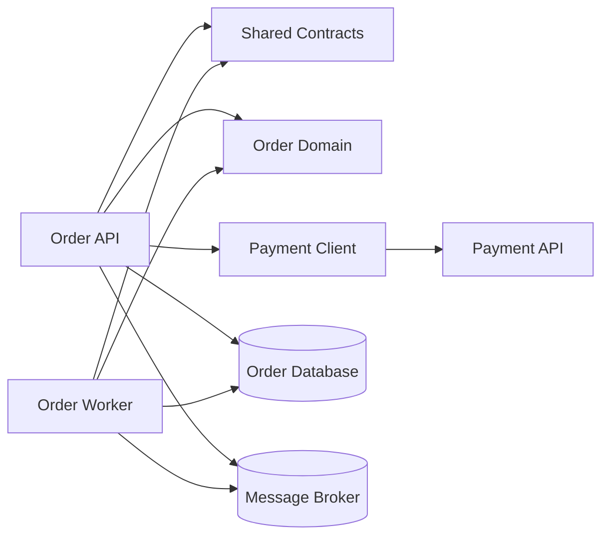

# Inventorying modules, services, and cross-component dependencies

Before upgrading Java, frameworks, or foundational libraries, it is necessary to know which parts currently make up the system and how they relate to one another. An enterprise application may consist of multiple Gradle/Maven modules, multiple independently running services, shared libraries, databases, message queues, and external systems. If the development team looks only at the single module targeted for upgrade, it can easily overlook another consumer that still depends on old APIs, Java versions, or behaviors.

**Inventorying modules, services, and cross-component dependencies** is the process of systematically collecting, verifying, and describing an application's components along with the relationships among them. The output is a map usable for scoping migration, assessing impact, choosing upgrade order, planning tests, and tracking compatibility risks.

## 1. Why inventory before migration?

In a long-lived system, the actual structure often differs from the initial architecture diagram. A library may be used by multiple modules; a service may call another service over HTTP; a batch job may read the same database table as a web application; an infrequently mentioned module may still be packaged and deployed in its own separate process.

Without an inventory, a seemingly local change can cause effects elsewhere:

- Upgrading a module's JDK while an internal library it uses still supports only older JDK bytecode or APIs.
- Changing data types in a shared DTO breaks multiple REST clients or message consumers.
- Upgrading the Spring version in one service while a starter or internal library pulls a different Spring version in another service.
- Changing an interface in a shared module prevents modules implementing that interface from compiling.
- Moving a service to a new data schema while a legacy batch job still writes under the previous schema.
- Removing an API thought to be unused when another application still invokes it via configuration, reflection, or external integration.

Inventorying helps answer foundational questions:

1. Which build modules, libraries, applications, and services exist in the system?
2. Which components are built, tested, released, and deployed together?
3. Which component calls, imports, extends, implements, or exchanges data with which component?
4. Does that relationship exist at compile time, runtime, deployment time, or only in operational workflows?
5. Which component owns the API, data, or contract that another component is using?
6. If a component changes Java or dependencies, which components must be re-tested?

The goal is not merely producing a list of module names. Relationships, evidence, versions, owners, and confidence levels of the information must also be recorded.

## 2. Distinguishing modules, libraries, services, and integration components

These concepts can overlap in some systems, yet should not be used interchangeably.

| Concept | Meaning | Example |
|---|---|---|
| Build module | Unit recognized and configured by Gradle or Maven for building | `:order-api`, `:order-service`, Maven child module `order-domain` |
| Library | Component providing code or resources for other components to use | JAR containing DTOs, utilities, domain models, or clients |
| Application | Artifact runnable as a program | Spring Boot executable JAR, command-line application |
| Service | Functional unit operated and communicating with consumers via a contract | Order Service, Payment Service |
| Integration component | Mechanism connecting to another system or process | REST client, Kafka producer, JDBC adapter, file exchange |
| Shared infrastructure | Platform used jointly by multiple components | Database, message broker, cache, object storage, identity provider |

A build module does not necessarily correspond to a service. Multiple modules can be packaged into a single application; a single repository can also hold multiple independent applications. A library can be used across multiple services. Therefore, cataloging is needed from both perspectives: build structure and deployment/runtime structure.

For example, a system might have the following build structure:

```text
commerce-build
├── shared-contracts       # Shared DTOs and API contracts
├── shared-security        # Authentication/authorization library
├── order-domain           # Order business domain
├── order-application      # Use cases and orchestration
├── order-web              # REST adapter
├── payment-client         # Client calling payment service
├── order-worker           # Event-processing consumer
└── reporting-job          # Data aggregation batch job
```

Yet the runtime structure might be:

```text
Deployment: order-api
  ├── order-web
  ├── order-application
  ├── order-domain
  ├── shared-contracts
  ├── shared-security
  └── payment-client

Deployment: order-worker
  ├── order-worker
  ├── order-application
  ├── order-domain
  └── shared-contracts

Deployment: reporting-job
  ├── reporting-job
  └── shared-contracts
```

If you inventory only by Gradle/Maven, you may miss deployment boundaries. If you inventory only by running services, you may miss shared modules and compile-time relationships. Both perspectives need linking through artifacts and build information.

## 3. Defining scope and inventory units

Before collecting, clearly define the scope of the migration effort. Scope may be a repository, a group of services, a product, a Java platform, or the entire relevant system.

### 3.1. Scope by repository and build

Record:

- Repository and branch/commit used as baseline.
- Build root and any independent builds or included builds.
- Gradle subprojects, Maven modules, and separately built projects.
- Modules with Java, Kotlin, Groovy, or other JVM language sources.
- Modules containing only configurations, documentation, migration scripts, or resources.
- Modules built in CI versus modules built only manually.

Do not assume every subdirectory is a build module. Verify via settings/build files, Maven aggregator POMs, or actual configuration.

### 3.2. Scope by application and service

For each application or service, record:

- Functional name and business purpose.
- Produced artifact and how it is launched.
- Deployment environment: local, test, staging, production, or other environments.
- Replicas, worker processes, schedulers, and batch jobs if any.
- Technical owning team or individual.
- Primary consumers and providers.
- Communication mechanisms and published contracts.

One service may have multiple processes or deployment profiles. For instance, the same codebase may run in HTTP API mode and message consumer mode. Record each execution mode if they have different dependencies or configurations.

### 3.3. Scope by data and external systems

Do not restrict inventorying to Java code. Record components that can affect migration:

- Shared databases, schemas, tables, or views.
- Message brokers, topics, queues, exchanges, and message schemas.
- Caches, distributed locks, and key formats.
- Object storage, filesystems, and exchange file formats.
- Identity providers, API gateways, and authentication systems.
- Third-party services, SOAP/REST endpoints, or native libraries.
- Build scripts, container images, runtime images, and deployment pipelines.

An external component does not need to be brought into the same code scope to become a dependency worth tracking. For example, a backward-compatible message schema may allow upgrading consumers before producers; if a schema change is incompatible, deployment order must be explicitly planned.

## 4. Cataloging modules and components

Every component needs a stable identifier so it can be referenced in dependency tables, diagrams, and migration reports. Directory names can change; identifiers should follow a stable organizational or build convention.

### 4.1. Information fields to collect

| Field | Content to record |
|---|---|
| ID | Stable identifier, unique within the inventory scope |
| Name | Name of module, library, application, or service |
| Type | Build module, library, application, service, job, database, external system... |
| Location | Repository, source path, or configuration management location |
| Role | Primary technical/business function |
| Build | Gradle/Maven, build root, and corresponding task/module |
| Java | JDK used to build, release/source target, and required runtime |
| Framework | Spring Boot, Spring Framework, or other framework with version |
| Artifact | Group, artifact, version, artifact type, and publication location |
| Deployment | Deployment, container/image, environment, or run schedule |
| Owner | Technically responsible team |
| Status | Active, legacy, deprecated/discontinued, test-only... |
| Evidence | Config file, build output, manifest, or confirmation from owner |

Not every field is meaningful for every component type. For instance, a database has no Java release; a library has no independent deployment. Fields may be left blank or marked `N/A`, but values should not be guessed.

### 4.2. Example inventory record

The YAML example below illustrates how to store the catalog. Values are illustrative only:

```yaml
components:
  - id: order-domain
    name: Order Domain
    kind: library
    repository: commerce-build
    path: order-domain
    build:
      system: gradle
      project: ":order-domain"
    java:
      compileRelease: 17
      runtimeRequired: false
    artifact:
      group: com.example.commerce
      name: order-domain
      version: 2.4.0
    owner: commerce-team
    status: active
    evidence:
      - order-domain/build.gradle
      - settings.gradle

  - id: order-api
    name: Order API
    kind: service
    repository: commerce-build
    build:
      system: gradle
      project: ":order-web"
    java:
      compileRelease: 17
      runtimeRequired: 17
    deployment:
      artifact: order-api.jar
      runtimeImage: eclipse-temurin:17
    owner: commerce-team
    status: active
```

Separating `components` from `dependencies` ensures a component is defined only once. Relationship tables can reference `id`, avoiding repeating names, versions, and owners in multiple places.

## 5. Inventorying dependencies at build time

Build dependencies are relationships Gradle or Maven needs to compile, test, package, or execute build tasks. This is a critical data source when upgrading Java and libraries.

### 5.1. Classifying dependencies

Distinguish:

- **Compile dependency:** needed to compile a module's source.
- **Runtime dependency:** needed when running the application, though not necessarily required for compilation.
- **Test dependency:** serves only test sources or test runtime.
- **Annotation processor/compiler plugin:** participates in compilation or code generation.
- **Build plugin:** alters build, packaging, verification, or artifact creation behavior.
- **Internal project dependency:** relationship to another module in the same build or an internal build.
- **External dependency:** artifact resolved from a Maven repository or another source.
- **Transitive dependency:** dependency pulled in via another dependency.

This classification helps determine exact scope. A library present only on the test classpath may not affect production runtime, yet can still block migration if the test compiler is incompatible with a new JDK.

### 5.2. Collecting information from Gradle

List projects in the build:

```bash
./gradlew projects
```

Inspect dependencies of a specific module and configuration:

```bash
./gradlew :order-service:dependencies --configuration compileClasspath
./gradlew :order-service:dependencies --configuration runtimeClasspath
./gradlew :order-service:dependencies --configuration testRuntimeClasspath
```

Find why a dependency was chosen or which version is being resolved:

```bash
./gradlew :order-service:dependencyInsight \
  --dependency spring-core \
  --configuration runtimeClasspath
```

Configuration names vary depending on plugins and module types. If a configuration does not exist, inspect the configurations the module actually creates rather than assuming every module has `runtimeClasspath`.

In multi-project builds, a dependency like `project(":shared-contracts")` represents a relationship between internal modules. A dependency like `group:artifact:version` is typically an external artifact. Included builds and composite builds can introduce additional boundaries requiring inventory.

### 5.3. Collecting information from Maven

View the dependency tree:

```bash
mvn -pl order-service dependency:tree
mvn -pl order-service dependency:tree -Dscope=compile
mvn -pl order-service dependency:tree -Dscope=runtime
```

In a multi-module Maven reactor, `-pl` selects the project to process; it can be combined with `-am` to also build required upstream dependent projects:

```bash
mvn -pl order-service -am test
```

This command is useful for checking the chain of modules that must build together. Verify selected modules and active Maven profiles in the CI environment, because results may differ from local.

### 5.4. Recording resolved versions

Do not save only the versions declared in build files. Record the final selected versions after applying:

- Version constraints, BOMs, and dependency management.
- Conflict resolution or dependency substitution.
- Gradle resolution strategy and version catalogs.
- Maven dependencyManagement, parent POMs, and active profiles.
- Internal repositories, caches, and snapshot artifacts.

For example, two modules may declare the same library yet resolve to two different versions. This can produce runtime errors such as `NoSuchMethodError`, `ClassNotFoundException`, or type conflicts when classes with the same name are loaded from different versions.

### 5.5. Inventorying Java toolchains and compiler plugins

For each module, collect at a minimum:

- Actual JDK running Gradle/Maven in CI.
- Selected Java toolchain, if any.
- `sourceCompatibility`, `targetCompatibility`, or `options.release`.
- Maven Compiler Plugin and `release` configuration.
- Annotation processors and their versions.
- Kotlin/Scala compiler plugins if the module contains corresponding sources.
- Bytecode checking, coverage, test, and packaging plugins.

The JDK running the build, compiler toolchain, Java release, and JDK running the application are distinct facts. Do not collapse them into a single `javaVersion` field if the system has multiple differing levels.

## 6. Inventorying dependencies between modules and services

Dependencies in the build reflect only part of the relationships. Services also depend on one another via network protocols, messages, data, configuration, and operations.

### 6.1. Relationship types to map

| Relationship | Example | Collectibles as evidence |
|---|---|---|
| Build/module | `order-service` depends on `shared-contracts` | Gradle project dependency, Maven module/dependency |
| Java API | Class A calls a method on class B | Imports, call sites, type hierarchy, bytecode |
| REST/HTTP | Order API calls Payment API | OpenAPI, Feign client, WebClient, RestClient, URL config |
| RPC | Service calls gRPC endpoint | `.proto`, generated stubs, channel configuration |
| Messaging | Producer emits `OrderCreated`, consumer receives message | Kafka/RabbitMQ config, topic/queue, schema |
| Database | Multiple services access the same schema | JDBC/JPA config, migration scripts, queries, and DB permissions |
| Cache/lock | Applications share keys or distributed locks | Cache name, key builder, Redis config |
| File/object | Job exports file for another process to import | Bucket/path, file format, schedule, and naming convention |
| Security/identity | Multiple services rely on the same issuer or token contract | OAuth/OIDC config, certificates, claim mapping |
| Deployment | Service needs database or broker before starting | Helm, Compose, Kubernetes manifests, pipelines |

For each relationship, record provider, consumer, protocol, contract, data direction, call frequency or conditions if known, along with confirming evidence.

### 6.2. Distinguishing direct and indirect dependencies

A service may not import another service's library yet still depend on it via REST or messaging. Conversely, two modules may both import the same library without communicating directly with each other at runtime.

For example:

```text
Build time:
order-web ──project dependency──> order-domain
order-web ──external dependency─> payment-client
payment-client ──external dependency─> http-client-library

Runtime:
order-api ──HTTP──> payment-api
order-worker ──Kafka consume──> order-events
reporting-job ──SQL read────────> order_database
```

In this example, `payment-client` may be a library packaged inside the `order-api` artifact; it is not an independent service. `payment-api` is the runtime service that `order-api` calls over HTTP. Distinguishing the two relationships avoids confusing a JAR dependency with an operational dependency.

### 6.3. Finding relationships in source code and configuration

Points to inspect include:

- Imports and calls into packages of internal modules.
- Implemented interfaces or extended classes.
- Constructor injection, field injection, and factories/providers.
- Feign clients, `RestTemplate`, `WebClient`, `RestClient`, and URLs in configuration.
- Kafka listeners, producer templates, Rabbit listeners, and queue/topic names.
- JPA entities, repositories, JDBC URLs, schemas, and native queries.
- `ServiceLoader`, reflection, and class names configured as strings.
- Spring component scan, auto-configuration, conditional beans, and plugin registries.
- Environment variables, secret names, service DNS, and endpoints in manifests.
- Cron jobs, schedulers, batch inputs/outputs, and file exchanges.

Text search across the repository can uncover many traces, yet does not prove all relationships. URLs may be constructed from multiple config variables; beans may be registered conditionally; reflection may reference classes not visible to import scans. Cross-check source, environment configurations, build outputs, and runtime info when possible.

## 7. Building a dependency matrix

Once a component catalog exists, represent relationships in a filterable and updatable format.

### 7.1. Consumer/provider matrix

Simple example matrix:

| Consumer / Provider | Shared Contracts | Order Domain | Payment API | Order DB | Kafka |
|---|---:|---:|---:|---:|---:|
| Order API | Build + API | Build + API | HTTP | SQL read/write | Produce |
| Order Worker | Build + API | Build + API | — | SQL read/write | Consume |
| Reporting Job | Build + API | — | — | SQL read | — |

The matrix shows which providers each consumer depends on and in what manner. The `—` mark should only be used once checked within the defined scope; if unclear, write `Unknown` or `Not assessed` to avoid misunderstanding it as no relationship.

### 7.2. Detailed relationship table

For large systems, a matrix can become too wide. Store each relationship as a separate record:

| Field | Example |
|---|---|
| Consumer | `order-api` |
| Provider | `payment-api` |
| Relation type | `HTTP` |
| Contract | `POST /payments` |
| Direction | Request/response |
| Version | API v2 |
| Criticality | High |
| Evidence | Feign client and OpenAPI document |
| Confidence | Verified |
| Owner | Payment team |
| Migration note | Check DTO and authentication when upgrading client |

Maintain evidence statuses such as `Verified`, `Inferred`, `Owner-confirmed`, and `Unknown`. A relationship inferred from a class name or old config should not be presented as a relationship verified in production.

## 8. Analyzing the dependency graph

When representing components as nodes and relationships as edges, the system becomes a directed graph. The provider is typically the node the consumer depends on; edge direction should remain consistent across documentation and tooling.

Mermaid example:



### 8.1. Fan-in and fan-out

- **Fan-in** is the number of components depending on a provider. High fan-in usually indicates a component with broad impact.
- **Fan-out** is the number of providers a consumer depends on. High fan-out can increase complexity in building, deploying, and testing.

A library with high fan-in must be thoroughly checked when changing APIs or Java releases, because one change can affect many consumers. A service with high fan-out must review the contracts and dependency versions of all its providers.

Fan-in/fan-out are indicators for prioritizing investigation, not a complete measure of risk. A rarely invoked dependency sitting on the payment flow can be more critical than many common yet non-essential dependencies.

### 8.2. Detecting dependency cycles

In build modules, cycles can make structure hard to understand, make builds order-dependent, or force splitting APIs from implementations. For example:

```text
order-domain -> customer-domain
customer-domain -> order-domain
```

A cycle between two domain modules is often a sign of unclear responsibility boundaries. It may require extracting contracts or moving an abstraction into an independent module. Do not delete a dependency merely to make the graph acyclic without determining which code owns the business concept.

With runtime services, HTTP call cycles must also be examined. For example, A calls B to process, yet B synchronously calls A within the same request path. Such cycles can create logical deadlocks, increase latency, or propagate failures. However, bidirectional event-driven relationships are not necessarily errors; examine semantics and how event loops are prevented.

### 8.3. Identifying high-impact components

The following components typically warrant priority inspection during migration:

- Contract or DTO libraries shared by multiple services.
- Modules containing base classes, interfaces, annotations, or framework extensions.
- Platform/BOM dependencies managing versions across multiple modules.
- Shared security, logging, persistence, or serialization libraries.
- Services on critical business paths or having many consumers.
- Database schemas or message schemas accessed by multiple applications.

Combine consumer count, business criticality, usage frequency, error detectability, and rollback difficulty when ranking. Do not rely solely on edge count.

## 9. Checking hidden dependencies and dynamic relationships

Some relationships do not appear in a standard dependency graph.

### 9.1. Reflection and class names in configuration

An application may load classes by string name, for example:

```java
String implementation = properties.getProperty("processor.class");
Class<?> type = Class.forName(implementation);
Object instance = type.getDeclaredConstructor().newInstance();
```

If a tool analyzes only imports and static call graphs, relationships to configured classes can be missed. Search for `Class.forName`, reflection APIs, registries, plugin configurations, and class names in properties/YAML/XML files.

### 9.2. Service Provider Interface

Java `ServiceLoader` discovers implementations through provider declarations. A module can depend on an implementation without importing the concrete class in source:

```java
ServiceLoader<PaymentGateway> gateways =
        ServiceLoader.load(PaymentGateway.class);

for (PaymentGateway gateway : gateways) {
    gateway.authorize(request);
}
```

With this mechanism, inspect the interface, provider registration, and `META-INF/services` resources or corresponding module declarations. When changing JDKs or packaging modules, confirm the provider is still discovered.

### 9.3. Spring auto-configuration and component scanning

In Spring applications, relationships can be established by component scanning, auto-configuration, conditional beans, starters, and configuration imports. A module not directly called in source can still contribute beans into the ApplicationContext.

The inventory needs to examine:

- `@ComponentScan`, `@Import`, and auto-configuration registrations.
- `@ConditionalOnClass`, `@ConditionalOnProperty`, and similar conditions.
- Bean names, qualifiers, primary beans, and injection points.
- Starter dependencies and auto-configuration exclusion settings.
- Profile configurations or properties present only in production environments.

During Spring migration, a small change in an auto-configuration condition can cause a bean to disappear or create multiple beans of the same type. Obtain evidence from the application context or test context under realistic configurations.

### 9.4. Shared databases and schemas

A service may only read a table yet still depend on column names, data types, indexes, constraints, and data semantics. If multiple services access the same database, a module-level dependency graph cannot fully capture that relationship.

Record at least:

- Which services/jobs read or write which schemas/tables.
- Schema owner and migration workflow.
- Related Flyway/Liquibase changelogs or SQL scripts.
- Views, stored procedures, triggers, and native queries.
- Compatibility rules between old and new schemas.
- Readers/writers that may run concurrently during rollout.

### 9.5. Messaging and event schemas

Producers and consumers can be released independently. When changing an event, identify:

- Topic/queue and event name.
- Producer, consumer groups, and active consumer count.
- Schema or serialization format.
- Required fields, optional fields, defaults, and enum values.
- Versioning rules and schema compatibility.
- Behavior with old messages still remaining in the broker.

A new consumer may have to read messages generated by an old producer for hours or days. Therefore, testing with only new messages is not enough to confirm a safe migration.

## 10. Verifying the catalog across multiple evidence sources

No single tool sees every dependency. Combine multiple sources and record which source proves what.

| Source | What it can verify | Limitations |
|---|---|---|
| Gradle/Maven model | Modules, build dependencies, configurations, resolved versions | Does not fully describe HTTP, DB, or runtime messaging |
| Source scan | Imports, call sites, annotations, clients, and static configs | Can miss reflection, generated code, or dynamically composed URLs |
| Bytecode analysis (`jdeps`) | Compiled class/package relationships, JDK dependencies | Does not see all runtime relationships or unloaded code |
| OpenAPI/AsyncAPI/proto | Published communication contracts | May be outdated or not reflect actual endpoints |
| Deployment manifests | Declared artifacts, images, env, services, ports, and infrastructure | May differ from deployed state |
| Runtime telemetry/logs/traces | Relationships observed within the observation window | Does not prove a rarely executed relationship does not exist |
| Database audit/schema | Readers/writers, objects, and schema changes | Access permissions do not guarantee code actually uses them |
| CI/CD pipelines | Build, test, release, and deployment dependencies | Manual workflows outside the pipeline may exist |
| Owner confirmation | Operational context and relationships scarcely documented in code | Must record confirming person and confirmation timestamp |

### 10.1. Using `jdeps` to examine bytecode

`jdeps` is a JDK tool for analyzing dependencies at class/package level. For example:

```bash
jdeps --recursive --summary application.jar
```

To inspect dependencies on JDK internal APIs:

```bash
jdeps --jdk-internals application.jar
```

For multi-release JARs or when needing to select a specific release, consult the `--multi-release` option appropriate for the JDK in use. `jdeps` analyzes existing bytecode; it does not replace checking source code, configurations, reflection, service discovery, or over-the-network service relationships.

### 10.2. Cross-checking against real runtime

If tracing, logs, or service mesh telemetry exist, use them to confirm calls that occurred over a representative period. Note:

- Seasonal or scheduled business flows may not appear in a short observation window.
- An endpoint may only be called during incidents or administrative tasks.
- Log sampling or missing trace propagation can hide relationships.
- Test environments may lack the same consumers/providers as production.

Thus, runtime evidence supplements static evidence. It does not prove a relationship does not exist simply because traffic has not yet been seen.

## 11. Impact assessment for Java Compatibility Migration

Once a dependency map exists, shift from “what exists?” to “if this component is upgraded, what is affected?”.

### 11.1. Compatibility dimensions to evaluate

For each component or relationship, identify risks across dimensions:

- **Source compatibility:** do consumers recompile against the new API?
- **Binary compatibility:** does old bytecode link with the new library?
- **Runtime compatibility:** do dependencies and classloaders operate in the target runtime?
- **Behavioral compatibility:** do results, exceptions, serialization, and defaults change?
- **Protocol/schema compatibility:** are APIs, messages, and data compatible between old/new versions?
- **Operational compatibility:** do health checks, configs, startup, metrics, and deployments continue to work?

Not every relationship needs evaluation on every dimension. For instance, changing a compile-only annotation processor primarily affects builds; changing a message schema affects producers/consumers; upgrading a service's JDK also impacts runtime images and native libraries.

### 11.2. Listing affected consumers

When a provider changes, gather all direct consumers and trace indirect relationships. For example, if `shared-contracts` changes a DTO:

```text
shared-contracts
  ├── order-api
  ├── order-worker
  ├── reporting-job
  └── partner-adapter
```

Do not build only the provider. Compile and test the relevant consumers, including independently released consumers. If the dependency is a runtime contract via REST or messaging, also test against consumer versions that have not yet been upgraded.

### 11.3. Prioritizing by risk

A simple assessment method is scoring across dimensions:

| Criterion | Guiding question |
|---|---|
| Impact breadth | How many direct/indirect consumers are there? |
| Criticality | Is it on a critical business flow? |
| Compatibility sensitivity | Does it use internal APIs, reflection, serialization, or shared schemas? |
| Detectability | Are automated tests, traces, and alerts sufficient to catch errors? |
| Rollback capability | Can we revert to the old version without losing data or breaking schemas? |
| Uncertainty level | Is the relationship verified or merely guessed? |

A 1–5 scale can be used per criterion, provided each level's meaning is defined so teams score consistently. Total scores only help order investigation; migration decisions must still rest on concrete contracts and evidence.

### 11.4. Determining migration order

Upgrade order depends on relationship type:

- For internal build modules, typically build providers before consumers to verify new APIs.
- For shared libraries, a forward-compatible version can be released before upgrading all consumers.
- For REST services, maintain compatibility between providers and consumers during parallel rollout.
- For message schemas, deploying consumers supporting both old and new schemas may be needed before producers emit new messages.
- For databases, an expand-and-contract strategy may be needed: add compatible schema, switch readers/writers, and only then remove old structures.

No single order applies to every system. Use the dependency graph and rollout plan to determine a safe sequence per group.

## 12. Recommended inventory workflow

A practical workflow can be broken into the following steps.

### Step 1: Lock baseline and scope

Record repositories, commits, build environments, runtime environments, and component groups to assess. If multiple repositories exist, record the relationships among them.

### Step 2: Collect the build module list

List Gradle projects, Maven modules, included builds, and artifacts. Cross-check against source directories, CI pipelines, and config files to distinguish active modules from legacy or unbuilt modules.

### Step 3: Collect Java and dependency information

For each module, capture compile/runtime/test dependency graphs, resolved versions, compiler release, toolchains, plugins, and annotation processors. Save outputs with timestamps and the baseline commit for later comparison.

### Step 4: List runtime applications and services

Map artifacts to container images, manifests, deployments, and job schedules. Identify which module produces which artifact and where each artifact runs.

### Step 5: Assess communication and data

Find REST/RPC clients, producers/consumers, database accesses, caches, file exchanges, and external systems. Record both synchronous and asynchronous dependencies.

### Step 6: Verify hidden relationships

Check reflection, ServiceLoader, Spring auto-configuration, generated code, plugin registries, and per-environment configurations. Ask owners about manual workflows or rarely executed flows.

### Step 7: Standardize IDs and build the matrix

Enter components into the catalog, normalize provider/consumer IDs, classify relation types, and record evidence. Avoid creating multiple names for the same artifact or service.

### Step 8: Draw the graph and identify risk hotspots

Find high fan-in/fan-out, module cycles, shared schemas, shared runtime libraries, and API concentration points. Identify areas requiring close testing during upgrades.

### Step 9: Confirm with owners

Send component and relationship lists to owning groups to confirm scope, versions, operational schedules, and unrecorded consumers. Record confirming person and timestamp.

### Step 10: Freeze the inventory baseline

Tag the catalog version, collection date, commit, and items still marked `Unknown`. This is the input for comparing changes and building the migration plan. As the system evolves, update the catalog rather than treating the inventory as an immutable document.

## 13. Common mistakes when inventorying

### Relying only on source directories

A directory may no longer be built; a module may reside in an included build or another repository. Always reconcile with the build model and pipeline.

### Treating modules as services

A module is an organizational/build unit; a service is a functional/runtime unit. A one-to-one mapping holds only in some architectures.

### Capturing only direct dependencies

Transitive dependencies can bring a different library version into runtime. Inspect the resolved graph and actual configurations.

### Looking only at imports

Reflection, dependency injection, service discovery, generated code, and dynamic configuration can create relationships not reflected in imports.

### Treating zero traffic as zero dependency

Low-frequency flows, scheduled jobs, or incident handling paths might not show up in observational data. Combine multiple evidence sources.

### Not recording confidence levels

A relationship inferred from a variable name does not carry the same weight as one verified in production. Record confidence status and evidence sources.

### Omitting owner and version

Without an owner, confirming or fixing discovered issues is difficult. Without versions/baselines, reproducing and comparing migration results is difficult.

### Drawing diagrams without machine-readable data

Diagrams are helpful for discussion, yet hard to filter and automatically diff. Maintain the catalog and relation table as primary data, and generate diagrams from them if possible.

## 14. Inventory output template

An inventory package sufficient for migration typically contains:

1. **Component catalog:** list of modules, libraries, applications, services, and related systems.
2. **Build dependency inventory:** compile/runtime/test graphs and resolved versions.
3. **Java/toolchain matrix:** build JDK, release, runtime JDK, framework, and compiler plugins per module.
4. **Runtime service map:** deployments, endpoints, producers/consumers, databases, and external integrations.
5. **Dependency relation table:** consumer, provider, relation type, contract, owner, and evidence.
6. **Architecture graph:** module/build diagram and service/runtime diagram when two separate views are needed.
7. **Risk and impact register:** high-impact components, affected consumers, risk level, and required actions.
8. **Unknowns and decisions:** unverified relationships, questions for owners, and decisions needing alignment.

Checklist to confirm the inventory provides sufficient inputs for migration:

- [ ] Locked repository, commit, and system scope.
- [ ] Listed modules from the build model and verified against CI.
- [ ] Distinguished build modules, libraries, applications, and runtime services.
- [ ] Recorded build JDK, Java release, runtime JDK, and framework versions.
- [ ] Collected resolved compile, runtime, test, and transitive dependencies.
- [ ] Recorded internal project dependencies and external artifacts.
- [ ] Listed REST/RPC, messaging, database, cache, and file integrations.
- [ ] Assessed reflection, ServiceLoader, auto-configuration, and generated code.
- [ ] Recorded owners, statuses, and evidence for key components/relationships.
- [ ] Identified high fan-in/fan-out, cycles, and shared contracts/schemas.
- [ ] Identified affected consumers and items still unclear.
- [ ] Saved a baseline catalog comparable across subsequent migration phases.

## 15. Conclusion

Inventorying modules, services, and cross-component dependencies produces a realistic picture of the system's build, runtime, and integration structure. The component catalog reveals what the system contains; the dependency matrix and graph reveal how they connect; evidence and owners show which information has been verified and who can confirm missing parts.

In Java Compatibility Migration, the inventory is the foundation for defining upgrade scope, finding affected consumers, identifying shared libraries, choosing build/deploy order, and designing compatibility tests. Maintain it as a versioned baseline with evidence sources and verification statuses so migration decisions can be audited and updated as the system changes.
