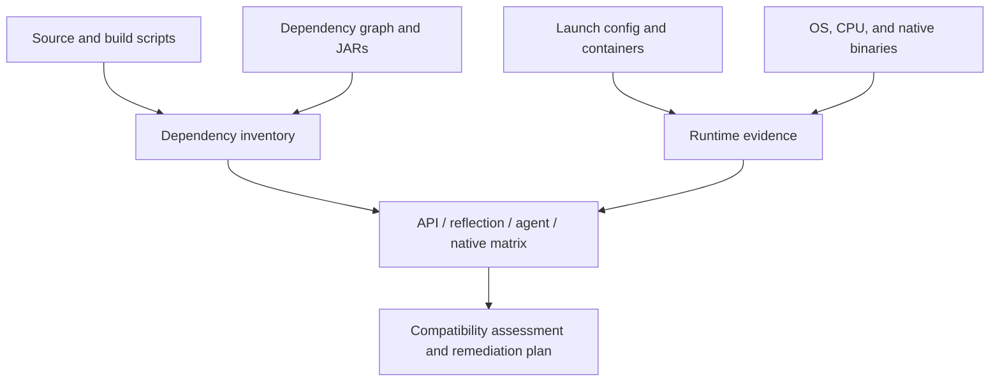

# Finding Internal APIs, Reflection, Agents, and Native Code

When inventorying a Java system for a JDK version upgrade or moving to a new deployment environment, you need to locate components that may depend on JVM implementation details, deep access mechanisms, bytecode transformation capabilities, or code running outside the JVM. These components often do not show up clearly in business processing flows, yet they can determine whether the application starts up and operates properly after migration.

The four categories to survey are:

- **Internal APIs:** APIs not belonging to the supported Java SE contract, or internal APIs provided by the application/framework itself.
- **Reflection:** mechanisms for finding classes, reading metadata, and invoking members at runtime, including non-public members.
- **Java agents:** components attached to the JVM to observe or transform bytecode when classes are loaded or at runtime.
- **Native code:** machine libraries or functions running outside JVM bytecode, commonly called via JNI, JNA, or the Foreign Function and Memory API.

The goal of the survey is to identify which components are in use, where they are called, what runtime conditions they require, and what replacement or upgrade options exist. Simply searching for strings in source code is not enough, because some behaviors are triggered through dependencies, configuration, annotations, service loaders, or launch arguments.

## 1. Distinguishing the Categories to Search For

The phrase “internal API” can refer to several different things. Categorize them before assessing risk.

| Category | Example | Migration risk |
|---|---|---|
| JDK internal API | `sun.*`, `com.sun.*`, `jdk.internal.*` | Not part of the guaranteed Java SE API; may be module-encapsulated or changed |
| Application internal API | Implementation packages intended only for other modules in the same system | Changing modules, packages, or versions can break consumers |
| Reflection on private APIs | `setAccessible(true)`, `trySetAccessible()` | Module encapsulation and access permissions may block the operation |
| Java agent | `-javaagent`, `premain`, `agentmain` | Agent may be incompatible with the JDK, bytecode, or attach mechanism |
| Native integration | JNI, JNA, `System.loadLibrary()` | Depends on OS, CPU, ABI, linker, and system libraries |
| Runtime-generated code | Proxies, bytecode generation, custom class loaders | May generate incompatible bytecode or perform incompatible internal access |

A non-public API does not automatically mean the application is using a JDK internal API. For example, package `com.example.internal` may just be a naming convention inside the project. Conversely, a library might contain no `sun.` string in application code yet still use reflection or an agent to access JDK internals.

Therefore, the survey report should clearly document the dependency type, owner, and actual usage instead of lumping everything under a single “internal API” label.

## 2. Finding JDK Internal APIs and Implementation APIs

### 2.1. What Is a JDK Internal API?

Java provides Java SE APIs described in public documentation and specifications. Alongside them, the JDK contains packages serving internal implementation, tooling, or vendor-specific features. Those packages do not form a Java SE compatibility contract.

Several namespaces commonly worth noting:

- `sun.*`
- `com.sun.*`
- `jdk.internal.*`
- Other internal packages discovered via module descriptors or documentation of a specific JDK.

Do not draw conclusions based solely on package prefixes. Some APIs in the `com.sun.*` namespace may be documented for specific purposes, and some APIs without an easily recognizable prefix can still be vendor-specific APIs. Verify each class against the target JDK version's documentation.

Since Java 9, the module system clarifies the boundary between exported and non-exported packages. The fact that an application could previously access a class does not mean that package will remain open to every module in later releases. Java 16 and Java 17 further tightened encapsulation for many internal APIs; consequently, legacy systems can encounter errors when moving to a new runtime.

### 2.2. Searching in Source Code

You can start with static searches for common packages and API names. For example, with ripgrep:

```bash
rg -n -F -e "sun." -e "com.sun." -e "jdk.internal." .
rg -n -F -e "Unsafe" -e "ReflectionFactory" -e "SharedSecrets" .
rg -n -F -e "jdk.internal." -e "com.sun." --glob "*.{java,kt,groovy,scala}" .
```

Search patterns are only a starting point. Open each match to determine:

- Which class is being referenced?
- Is the reference in production code, tests, build logic, or developer tools?
- Are there version conditions or platform-specific branches?
- Is that class called directly or merely referenced in an unused adapter?
- Is there a Java SE or supported API alternative?

If the project has multiple modules, search across all source sets and internal modules. Do not search only in `src/main/java`; code can live in `src/test`, `buildSrc`, convention plugins, source generators, or directories containing auto-generated code.

### 2.3. Analyzing Dependencies and Bytecode

Application source code may be clean while a dependency still calls internal APIs. The `jdeps` tool can analyze references from class files and JARs:

```bash
jdeps --jdk-internals --recursive path/to/application.jar
```

The output helps identify certain bytecode references to JDK internal APIs and may suggest replacement APIs. Read warnings according to the exact JDK version being used.

Several important limitations:

- `jdeps` primarily analyzes static relationships in bytecode.
- Class names constructed from strings, configuration, or dynamic concatenation may not be detected.
- Reflection and native code can obscure access points.
- A JAR nested inside an executable JAR may need to be extracted or analyzed separately depending on packaging structure.
- Results do not prove whether an API is invoked on every execution path.

With Gradle, you can inspect the runtime dependency graph:

```bash
./gradlew dependencies --configuration runtimeClasspath
./gradlew dependencyInsight --dependency artifact-name --configuration runtimeClasspath
```

With Maven:

```bash
mvn dependency:tree -Dscope=runtime
```

Once a notable JAR is identified, you can use `jar tf` to inspect its contents and `javap -verbose` to inspect references, descriptors, or metadata of specific classes.

### 2.4. Evaluating Remediation Options

When a JDK internal API is found, prioritize in order:

1. Replace with a Java SE API or supported public API.
2. Upgrade the dependency to a version that removed the internal dependency.
3. Replace the library if the project no longer has compatible releases.
4. Isolate the dependent part behind an interface/adapter to limit blast radius.
5. Consider module-opening options only as a controlled transitional measure, if immediate replacement is impossible and the exact package to open is understood.

For example, `--add-exports` can export a module's package for another module to use public APIs in that package:

```bash
java --add-exports java.base/some.internal.package=ALL-UNNAMED -jar app.jar
```

The `--add-opens` option permits deep reflection into the specified package at runtime:

```bash
java --add-opens java.base/some.internal.package=ALL-UNNAMED -jar app.jar
```

The module and package names in the examples above are illustrative only; actual values must come from the error and target JDK structure. `ALL-UNNAMED` applies to components on the classpath that do not belong to a named module.

The two options serve different purposes. `--add-exports` does not automatically grant deep reflection permissions; `--add-opens` also does not turn an internal API into a guaranteed Java SE API. They are scoped compatibility configurations, not proof that the dependency has become long-term stable.

## 3. Finding and Evaluating Reflection

### 3.1. How Does Reflection Work?

Reflection allows a program to inspect and interact with class structures at runtime. An application can look up a class by name, retrieve constructors or methods, read fields, instantiate objects, and invoke methods without direct source-code references at compile time.

Example:

```java
Class<?> type = Class.forName("com.example.plugin.ReportPlugin");
Object plugin = type.getDeclaredConstructor().newInstance();

var method = type.getMethod("generate");
Object result = method.invoke(plugin);
```

This is a common way to build plugins or integrate frameworks. Reflection by itself is not an internal API and is not always dangerous. Risk increases when an application accesses private members, relies on implementation structure, or uses reflection to bypass module boundaries.

### 3.2. Code Patterns to Search For

Search for common reflection APIs:

```bash
rg -n -F -e "Class.forName" -e "loadClass" -e "getDeclaredMethod" -e "getDeclaredField" .
rg -n -F -e "setAccessible" -e "trySetAccessible" -e "canAccess" -e "privateLookupIn" .
rg -n -F -e "MethodHandles" -e "MethodHandle" -e "Proxy.newProxyInstance" .
rg -n -F -e "getDeclaredMethods" -e "getDeclaredFields" .
```

Distinguish these cases:

| Usage pattern | Meaning to investigate |
|---|---|
| `Class.forName(name)` | Class may be selected by configuration or runtime name |
| `ClassLoader.loadClass(name)` | May depend on a class loader or plugin |
| `getMethod()` | Looks up a public method by name and parameter types |
| `getDeclaredMethod()` | Looks up a directly declared method, including non-public |
| `getDeclaredField()` | May access internal state of a class |
| `setAccessible(true)` | Requests bypassing certain access checks; may be blocked by the module system |
| `MethodHandles.privateLookupIn()` | Creates a lookup with deep access permissions when module conditions allow |
| `Proxy.newProxyInstance()` | Creates a runtime proxy; must check interfaces and class loader |

Searching for API strings is not enough. For example, a framework may read a class name from YAML or annotations and then perform reflection inside the library. In that case, application source contains no direct reflection call.

### 3.3. Indirect Sources of Reflection

Check the following mechanisms:

- Dependency injection and IoC containers scanning the classpath, constructors, fields, or annotations.
- ORMs mapping entities, reading fields, and invoking constructors.
- JSON/XML serializers instantiating objects and setting properties.
- Validation frameworks finding annotations and methods.
- Plugin systems loading classes by configured name.
- Test frameworks discovering tests and calling lifecycle methods.
- Logging, metrics, tracing, or security frameworks inspecting classes and methods.
- Proxy frameworks generating subclasses or interface proxies.
- Serialization/deserialization restoring objects from metadata.
- Mapping libraries, object copiers, or expression engines.

For each framework, record its version, configuration, and which packages require access. If the framework provides JDK migration documentation, cross-check it against the application's actual configuration.

### 3.4. Reflection and the Java Platform Module System

Since Java 9, modules can export packages for normal access or open packages for deep reflection. The two concepts are not the same:

- **exports:** allows other modules to access public types in the exported package, according to module rules.
- **opens:** allows deep reflection into the package, including non-public members within the specified scope.

A reflection call may fail with:

```text
java.lang.reflect.InaccessibleObjectException
```

The error usually indicates the source module, the package that needs opening, and the target module. Use that information to identify the dependency or framework performing deep access.

Example of a diagnostic configuration:

```bash
java --add-opens java.base/java.lang=ALL-UNNAMED -jar app.jar
```

This is a syntax example only. Do not copy-paste batches of `--add-opens` from online articles. Every expanded permission weakens module encapsulation and can hide outdated dependencies. Only keep an option when its reason, scope, owner, and removal plan have been recorded.

### 3.5. Dynamic Reflection Hard to Detect via Static Search

Some class or member names are constructed from:

- YAML, properties, XML, or JSON files.
- Environment variables and command-line arguments.
- Plugin names stored in the database.
- Annotations processed by a framework.
- Class names assembled from package and suffix.
- Service providers registered in `META-INF/services` or module descriptors.

Therefore, combine source searches with configuration checks, dependency checks, and runtime observation. For rarely triggered flows, you can add integration tests exercising plugins, serializers, ORM mappings, or related administrative features.

## 4. Finding Java Agents and Instrumentation Mechanisms

### 4.1. What Is a Java Agent?

A Java agent is a component loaded by the JVM to observe or modify class-loading and bytecode behavior. Agents are commonly used for:

- APM and distributed tracing.
- Profiling and performance monitoring.
- Code coverage.
- Test instrumentation.
- Security monitoring or anomaly detection.
- Bytecode transformation for frameworks or runtime enhancement.

An agent can run before the `main` method starts or attach to a running JVM, depending on packaging and runtime capabilities.

Java agents typically use the `java.lang.instrument.Instrumentation` API and bytecode manipulation libraries such as ASM or Byte Buddy. Native agents can use JVMTI.

### 4.2. Finding Agents in Launch Configuration

Search for the following arguments and APIs in scripts, Dockerfiles, manifests, CI/CD configurations, and launch commands:

```bash
rg -n --hidden --glob "!**/.git/**" -F -e "-javaagent" -e "-agentlib" -e "-agentpath" -e "VirtualMachine.attach" .
rg -n --hidden --glob "!**/.git/**" -F -e "Premain-Class" -e "Agent-Class" -e "Can-Retransform-Classes" -e "Can-Redefine-Classes" .
```

Key arguments:

| Argument | Purpose |
|---|---|
| `-javaagent:path/to/agent.jar` | Loads a Java agent at JVM startup |
| `-agentlib:name` | Loads a native agent by library name |
| `-agentpath:path` | Loads a native agent by path |
| `-D...` | Passes a system property; often used to configure agents or related libraries |

Not every `-D...` is an agent configuration. Cross-check property names against dependency documentation or startup scripts.

### 4.3. Checking Manifests and Entry Points

A Java agent JAR typically declares metadata in `META-INF/MANIFEST.MF`. Two common entries:

- `Premain-Class`: the class providing the `premain` method for an agent loaded at startup.
- `Agent-Class`: the class providing the `agentmain` method for an agent attached to a running JVM.

You can inspect the manifest using:

```bash
jar tf agent.jar
jar xf agent.jar META-INF/MANIFEST.MF
```

Illustrative entry-point example:

```java
public final class ExampleAgent {
    public static void premain(
            String agentArgs,
            java.lang.instrument.Instrumentation instrumentation) {
        // Register ClassFileTransformer or observe runtime
    }

    public static void agentmain(
            String agentArgs,
            java.lang.instrument.Instrumentation instrumentation) {
        // Initialize when the agent is attached
    }
}
```

An agent may implement only one of the two entry points. Having a manifest entry does not by itself prove the agent is actually loaded in production; check launch commands or runtime evidence.

### 4.4. Checking Transformers and Transformed Bytecode

An agent can register a `ClassFileTransformer` to alter bytecode before the JVM defines a class. Some agents also support retransformation or redefinition of already-loaded classes, depending on declared capabilities and JVM limits.

During the survey, find:

- Where class transformers are registered.
- Which packages/classes are transformed.
- Whether the agent depends on load order relative to other agents.
- Whether ASM, Byte Buddy, or any bytecode library is used.
- Whether there are assumptions about bytecode structure, method descriptors, or class loaders.
- Which target Java versions the agent supports.
- Whether the agent needs the Attach API or special OS permissions.

Multiple agents transforming the same class can create order-dependent bugs. An old agent may also fail to understand a new class file version or assume a bytecode structure that no longer holds after upgrading the compiler.

### 4.5. Attach API and Dynamic Agent Loading

Some tools use the Attach API to connect to a running JVM process and load an agent. This behavior depends on the JDK version, runtime configuration, user permissions, container environment, and security policies.

Search for call sites such as:

```java
com.sun.tools.attach.VirtualMachine.attach(processId);
```

Determine:

- Which component performs the attach.
- Whether the target JVM permits attach.
- Whether the calling process and target process have the same user/appropriate permissions.
- Whether this mechanism works inside containers or the production environment.
- Whether the JDK runtime includes the required module/tools.
- Whether the system has a policy disabling dynamic loading or restricting attach.

Do not assume that a profiler working on a developer machine will certainly attach in production. Verify on the exact image, user, and JVM flags of the target environment.

## 5. Finding Native Code and the JVM–OS Boundary

### 5.1. What Is Native Code?

Native code is machine code compiled for a specific platform. Java can invoke native code to use drivers, system libraries, optimized algorithms, or existing components written in C/C++ and other languages.

Common integration paths:

- JNI (Java Native Interface).
- JNA (Java Native Access).
- Foreign Function and Memory API.
- Native agents using JVMTI.
- External processes invoked via `ProcessBuilder` or shell.

An application might have no C/C++ files in its repository yet still depend on native code through JARs containing `.dll`, `.so`, or `.dylib` files.

### 5.2. Finding JNI in Source

Search for the native method keyword and library loading calls:

```bash
rg -n -F -e "native " -e "System.loadLibrary" -e "System.load(" .
rg -n -F -e "JNIEXPORT" -e "JNIEnv" -e "Java_" --glob "*.{c,cc,cpp,h,hpp}" .
```

Java example declaring a native method:

```java
public final class NativeCodec {
    static {
        System.loadLibrary("nativecodec");
    }

    public native byte[] encode(byte[] input);
}
```

The native implementation must provide a function matching the JNI name and convention, or register the native method via the corresponding mechanism. When surveying, connect all three points: the Java declaration, the loaded library, and the actual native function.

### 5.3. Finding JNA and the Foreign Function and Memory API

Not every native integration uses the `native` keyword in Java. JNA typically uses interfaces mapping native functions and loads libraries by name. Search for indicators:

```bash
rg -n -F -e "com.sun.jna" -e "Native.load" -e "Pointer" -e "Structure" .
rg -n -F -e "java.lang.foreign" -e "Linker" -e "MemorySegment" -e "SymbolLookup" .
```

The Foreign Function and Memory API's status and usage changed across JDK versions; some releases prior to finalization may require a preview flag. When evaluating, match the exact JDK source level, compiler flags, and runtime flags used by the project. Do not treat an FFM snippet running on one JDK as automatically compatible with every other JDK.

### 5.4. Checking Binaries and Platforms

Native libraries commonly depend simultaneously on:

- Operating system: Windows, Linux, macOS, or other platforms.
- CPU architecture: x86-64, ARM64, or corresponding architecture.
- ABI and calling conventions.
- C/C++ runtime and system libraries.
- libc version or compatibility environment.
- Symbol names and dynamic dependencies.
- File permissions and library loading paths.

A native file built for Linux x86-64 cannot be used directly on Linux ARM64. Similarly, a library built for glibc may fail to run in a musl-based image without a proper compatibility layer.

Several inspection tools by platform:

| Platform | Common tools | Purpose |
|---|---|---|
| Linux | `file`, `ldd`, `readelf`, `nm` | Inspect architecture, dynamic dependencies, ELF, and symbols |
| macOS | `file`, `otool -L`, `nm` | Inspect architecture, dynamic libraries, and symbols |
| Windows | `dumpbin /DEPENDENTS`, `dumpbin /HEADERS` | Inspect dependencies and PE/COFF information |

Tools and syntax differ by OS; do not run commands from one platform on another and treat missing results as proof of no dependency.

For JARs, list and inspect packaged binaries inside:

```bash
jar tf dependency.jar
```

Look for paths such as `META-INF/native`, `.dll`, `.so`, or `.dylib` filenames, and inspect the dependency's library-loading code and platform binary-selection rules.

### 5.5. Common Errors at the Native Boundary

| Error | Possible cause | What to check |
|---|---|---|
| `UnsatisfiedLinkError: no ... in java.library.path` | JVM cannot find the library | Path, filename, environment variables, and packaging |
| `UnsatisfiedLinkError: ... wrong ELF class` | Binary has wrong architecture or word size | JVM architecture and binary |
| `UnsatisfiedLinkError: undefined symbol` | Missing symbol or mismatched binary dependency | Symbol table, linker, and library version |
| `NoClassDefFoundError` around binding class | Missing Java wrapper JAR | Runtime dependencies |
| JVM crash or process termination | Native code may access invalid memory or trigger faults outside bytecode checks | hs_err logs, core dumps, native stacks, and binary version |

Unlike ordinary Java exceptions, memory errors in native code can crash the JVM process. Inspect crash logs, core dumps, and binary details; you cannot rely solely on Java stack traces.

## 6. Multi-Layer Surveying to Avoid Missing Anything

A reliable survey should combine the following sources of evidence:



### Layer 1: Source and Build Logic

Look for internal packages, reflection, agents, native loading, proxies, and bytecode generation in:

- Production source.
- Test and integration test source.
- Build scripts, convention plugins, and annotation processors.
- Startup scripts, Dockerfiles, and configuration files.
- Auto-generated code if committed in the repository.

Record the file, code line, module, and relevant call path.

### Layer 2: Dependency Graph

List direct and transitive runtime dependencies. For each notable dependency:

- Record group, artifact, version, and distribution source.
- Identify the minimum JDK supported by the publisher.
- Check release notes related to the target Java version.
- Look for internal APIs, reflection, agents, and native binaries inside the JAR.
- Determine whether the dependency is packaged into the final artifact.

Pay special attention to dynamically loaded dependencies, custom plugins, or libraries appearing only in a specific deployment profile.

### Layer 3: Final Artifact

Inspect the built JAR/WAR or image, because artifact contents can differ from the dependency graph seen in source.

Identify:

- Which JARs are packaged or copied into the image.
- Whether any native binaries are embedded.
- Whether agent manifests appear.
- How service providers and module descriptors are packaged.
- Whether duplicate class names or multiple versions of a library coexist.

### Layer 4: Configuration and Runtime

Check the actual configuration used at runtime:

- `-javaagent`, `-agentlib`, and `-agentpath` arguments.
- `--add-exports` and `--add-opens` options.
- `java.library.path` and related environment variables.
- Classpath, module path, and plugin configuration.
- User running the JVM, attach permissions, and file permissions.
- OS, CPU, base image, and system libraries.

Runtime arguments can be gathered from scripts or approved deployment configs. If process observation access is available, use JVM diagnostic tools to confirm active configuration instead of relying solely on config files that might not be deployed.

### Layer 5: Path-Based Testing

Exercise features likely to trigger the discovered mechanisms:

- Initialize the full Spring/application context or equivalent framework.
- Scan entities, serializers, validators, and dependency injection.
- Load configured plugins.
- Run features using reflection on private members.
- Initialize agents and confirm transformers execute.
- Invoke features using JNI/JNA/FFM.
- Run tests on the exact target OS/CPU and runtime image.

A component may only load when a rarely used feature is invoked. Therefore, “the application starts successfully” is not enough to conclude the entire system has no remaining dependencies to handle.

## 7. Documenting Findings and Assessing Risk

Each finding should carry enough information for the migration team to act without starting over from scratch.

| Field | Information to record |
|---|---|
| ID | Unique finding identifier |
| Component | Module, dependency, or image containing the dependency |
| Type | JDK internal API, app internal API, reflection, agent, JNI/JNA/FFM |
| Location | File, class, method, configuration, or launch argument |
| Trigger path | Startup, request, scheduled job, plugin, or specific feature |
| Current version | JDK, dependency, agent, or native binary |
| Target version | Expected runtime and dependency version |
| Evidence | Search results, stack trace, jdeps, manifest, or runtime logs |
| Impact | Startup failure, broken functionality, performance, security, or portability |
| Plan | Replace API, upgrade dependency, transitional config, rebuild native, or remove |
| Owner | Responsible team/module |
| Status | Unhandled, in progress, verified |

Priority levels can be categorized as follows:

- **High:** dependency already causes errors on the target runtime, native binary targets the wrong platform, or an agent fails to start.
- **Medium:** uses internal APIs/deep reflection, yet a replacement path or temporary workaround has been identified.
- **Low:** signs exist in code but are not triggered, reside only in tests/tooling, or already have a verified compatible branch.

Priority must be grounded in evidence and likelihood of occurrence in production. Do not mark every search hit as a blocker; equally, do not ignore a dependency simply because it has not appeared in logs during a short run.

## 8. Example: Surveying a Dependency with Multiple Special Mechanisms

Suppose an application uses the `legacy-monitor` library. During the survey it is found that:

1. The JAR contains a call to a JDK internal API.
2. The library uses reflection to access a private field of a platform class.
3. The production startup script includes `-javaagent:legacy-monitor.jar`.
4. The JAR contains `libmonitor.so` for Linux x86-64.

Do not treat the four findings as a single bug. Separate them into distinct contracts:

| Finding | Verification question | Handling approach |
|---|---|---|
| JDK internal API | Does a newer version offer a public API alternative? | Upgrade/replace library or switch to a supported API |
| Deep reflection | Which module/package is accessed and is there a compatible library release? | Upgrade dependency; only open package temporarily if justified |
| Java agent | Does the agent support the target JDK and new class files? | Upgrade agent, check load order and transformers |
| Native binary | Is there a binary for the new OS/CPU/base image? | Obtain platform-matched release or rebuild from source |

After upgrading the library, re-check all four points. The publisher may fix reflection yet still package an old native binary; or a new agent may support the target JDK while an internal runtime dependency remains incompatible.

A proper test must run on the exact runtime and image planned for deployment, start the agent, activate monitoring features, and invoke branches using native code. If you only run unit tests on a developer machine, most of those risks may remain unverified.

## 9. Remediation Principles During Migration

Once the findings catalog is ready, handle them following these principles:

**Prioritize public contracts.** Replace JDK internal APIs with Java SE APIs or vendor-supported APIs. This reduces reliance on implementation structure.

**Upgrade dependencies before writing workarounds.** Newer frameworks or libraries may have already solved reflection, module access, agent instrumentation, and native packaging. Check release notes and the publisher's JDK support matrix.

**Limit access permissions.** If `--add-opens` or `--add-exports` is needed for transition, open only the necessary package to the exact target module, document the reason, and set a removal plan.

**Manage agents as runtime components.** Agents need to be versioned, tested alongside the JVM, documented with load order, and placed in controlled deployment configuration.

**Build native code per platform matrix.** Each binary must specify OS, CPU, ABI, and system dependencies. Do not reuse a binary merely because the filename matches.

**Isolate dependency points.** Place special integrations behind interfaces or adapters so that swapping a library does not spread into business logic.

**Test real behavior.** Verify startup, requests, plugins, serialization, agents, native calls, shutdown, and rarely used features. Save logs and artifacts so results can be reproduced.

## 10. Survey Checklist

### Internal APIs

- [ ] Searched for namespaces and classes indicating JDK internal APIs.
- [ ] Distinguished JDK internal APIs from application internal packages.
- [ ] Checked source, dependency graph, and bytecode/JARs.
- [ ] Ran `jdeps --jdk-internals` on relevant artifacts.
- [ ] Identified replacement APIs or transitional plans for each finding.

### Reflection

- [ ] Searched for `Class.forName`, class loaders, and `getDeclared*` APIs.
- [ ] Searched for `setAccessible`, `trySetAccessible`, and MethodHandles.
- [ ] Checked frameworks scanning annotations, ORMs, serializers, DI, and plugins.
- [ ] Checked class names or member names read from configuration.
- [ ] Documented packages needing opening and target modules where deep reflection occurs.

### Agents

- [ ] Searched for `-javaagent`, `-agentlib`, and `-agentpath` arguments.
- [ ] Checked agent manifests and entry points.
- [ ] Identified transformers, bytecode libraries, and related class loaders.
- [ ] Checked Attach API, runtime permissions, and dynamic loading policies.
- [ ] Confirmed the agent version supports the target JDK.

### Native Code

- [ ] Searched for native methods, `System.loadLibrary`, and `System.load`.
- [ ] Searched for JNA, FFM, and native libraries inside JARs.
- [ ] Checked OS, CPU, ABI, and dynamic dependencies of binaries.
- [ ] Checked native agents/JVMTI if present.
- [ ] Ran native tests on the actual deployment image and architecture.

### Evidence and Conclusions

- [ ] Each finding has a location, trigger path, and evidence.
- [ ] Impact levels are classified against the target environment.
- [ ] Responsible modules or teams are assigned.
- [ ] Remediation plans and completion verification criteria are defined.
- [ ] Critical paths are tested on the target runtime.

## Conclusion

Internal APIs, reflection, Java agents, and native code are dependencies commonly missed during Java compatibility surveys. They can reside in application code, transitive dependencies, launch configs, artifacts, or deployment images.

To assess accurately, combine source searching, dependency and bytecode analysis, runtime config checks, native binary inspection, and running relevant features in the target environment. Each finding must be linked to concrete evidence, trigger paths, and a specific remediation plan. With such an inventory, the team can prioritize risks properly and verify migration component by component.
