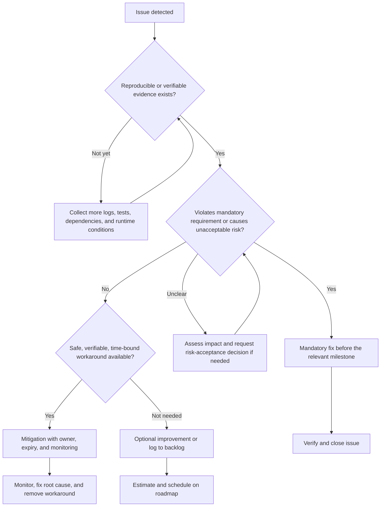

# Classifying Mandatory Fixes, Temporary Mitigations, and Optional Improvements

## 1. Why Classify Issues When Inventorying a System?

During a survey to prepare for a Java upgrade, the development team often finds many kinds of issues at the same time: a library that does not run on the target JDK, an outdated build plugin, a deprecated API, a security warning, an unstable test, or a piece of code that could be redesigned for maintainability. If everything goes into a single “must fix before migration” list, scope balloons and completion criteria become unclear. Conversely, if every issue is treated as a later improvement, the team may overlook bugs that prevent the application from building, starting up, or handling data accurately on the new platform.

Therefore, after collecting evidence, classify each finding by mandatory status and appropriate handling:

1. **Mandatory fix:** an issue that must be resolved before moving to a defined migration or release milestone, because it violates technical, safety, data, operational, or compatibility contract requirements.
2. **Temporary mitigation:** a bounded control allowing the system to keep operating or the migration to proceed while the root cause is not yet fully resolved. This measure must have an owner, usage boundaries, monitoring, and an exit condition.
3. **Optional improvement:** work beneficial for quality, maintainability, performance, or subsequent upgrades, yet not a prerequisite to meet the current migration goal.

These three categories describe **handling decisions**, not three fixed importance levels for every issue. A small improvement can become mandatory if it is required to meet a security or SLA requirement. An issue that initially looks severe can be controlled via a temporary mitigation for a short period, provided its blast radius is proven and proper risk approval is obtained.

In the context of Java Advance Compatibility Migration, the goal of classification is keeping the upgrade scope right-sized: resolving what is needed to build, test, run, and communicate safely across the target version set; controlling time-bound exceptions; and recording valuable improvements so the team can schedule them separately.

## 2. Definitions and Criteria for Each Category

### 2.1. Mandatory Fixes

A finding belongs to mandatory fixes if leaving it unresolved prevents the system from meeting a defined migration requirement or creates unacceptable risk. Common indicators:

- Source code fails to compile with the target compiler or language level.
- An artifact contains bytecode the target JVM cannot load, or a required dependency requires a higher JDK than the committed runtime level.
- The application fails to start, suffers class/method linkage errors, or a critical business flow fails to run on the target runtime.
- A framework, library, plugin, or build tool falls outside the required support matrix and causes reproducible errors.
- Behavioral changes corrupt business outcomes, write wrong or lost data, break API/message contracts, or prevent existing consumers from continuing to operate.
- Security vulnerabilities, weak configurations, or default changes cause the system to violate security policies or compliance requirements.
- Critical tests cannot execute or no longer provide sufficiently reliable evidence to permit release.
- There is no repeatable way to build/release on the target toolchain, leaving release artifacts unverifiable or non-reproducible.

“Mandatory fix” must be tied to a clear milestone. For example: must be fixed before bumping the JDK on the migration branch, before deploying to staging, or before shipping the Java 21 release to production. Do not apply this label without stating which requirement is violated and which milestone is blocked.

### 2.2. Temporary Mitigations

A temporary mitigation reduces impact or bounds an issue's scope for a defined period. It helps the team continue surveying, testing, or rolling out in stages while a permanent fix awaits a dependency, vendor, release schedule, or major architectural change.

A mitigation is only considered acceptable when it meets these conditions:

- The root cause or at least the error scope is understood well enough to predict impact.
- The mitigation's effectiveness has been verified by appropriate tests or runtime observation.
- It does not mask unacceptable risks to security, data, integrity, or external contracts.
- It has a concrete scope of application: environment, module, version, traffic, or user group.
- It has an owner, a review/removal deadline, and criteria confirming complete resolution.
- Logs, metrics, alerts, or checks exist to detect when the workaround stops working.
- There is a plan to roll back or disable the mitigation if operational conditions change.

Mitigation does not automatically turn a bug into “fixed”. The underlying issue must still be tracked with its own status and closed only when the root cause is resolved or a formal risk acceptance decision is approved under organizational policy.

### 2.3. Optional Improvements

Optional improvements make the system easier to understand, maintain, observe, or more efficient, yet are not prerequisites for meeting current migration goals. Examples:

- Refactoring a long class that does not cause compatibility errors or block testing.
- Standardizing naming conventions, internal packages, or code formatting.
- Replacing a deprecated yet still supported API with a new API when the old API is not yet removed and poses no significant risk in the current release scope.
- Optimizing a code path that does not violate committed latency, throughput, or resource thresholds.
- Adding tests for low-impact edge cases while critical contracts already have sufficient evidence.
- Upgrading an independent library solely for version alignment when the current version remains supported and compatible with the target toolchain.
- Improving documentation, logging, or module structure without affecting release readiness.

Optional does not mean unimportant or never done. It means the work can be prioritized by budget, roadmap, and value after mandatory conditions are met. An optional improvement can be bundled into the migration if cost and risk are low and value is clear, yet that decision must be recorded instead of silently expanding scope.

## 3. Distinguishing Impact Severity from Handling Category

Severity, priority, and handling category (mandatory/mitigation/optional) are related yet not synonymous.

- **Severity** describes the consequence if the issue occurs: data loss, service outage, performance degradation, failure of a secondary feature, or merely a warning.
- **Priority** describes handling order based on impact, likelihood, scope, deadlines, and cost of delay.
- **Handling category** defines what the team will do: fix before milestone, apply a time-bound workaround, or put into the improvement backlog.

For example, an issue with high severity that occurs only on a rare path can still carry a different priority than an issue breaking every build. However, if a rare bug involves data corruption or a security exploit, the severity of consequences can make it a blocker despite low probability.

Do not use a single severity number to automatically pick the handling category. Record evidence, triggering conditions, impact, and affected milestones first, then choose the handling approach.

### 3.1. Assessment Dimensions

When classifying a finding, evaluate at least these dimensions:

| Assessment dimension | Questions to ask | Example evidence |
| --- | --- | --- |
| Likelihood | Does the error reproduce reliably? Under what conditions does it appear? | Build logs, repeated tests, startup logs, reproduction steps. |
| Blast radius | One module, one feature, the whole service, or multiple consumers? | Dependency graph, service list, API consumers, deployment topology. |
| Impact | Does it cause outage, data corruption, security violation, or mere inconvenience? | Error rate, data reconciliation, security findings, SLO/SLA. |
| Exposure | Is the error path called in production or triggerable externally? | Traffic, feature usage, endpoint exposure, production config. |
| Detectability | If it occurs, will the team notice in time? | Alerts, metrics, logs, health checks, reconciliation. |
| Recoverability | Can we safely roll back, retry, replay, or restore data? | Runbooks, backup/restore tests, rollback rehearsals. |
| Compatibility | Must old and new components coexist during transition? | Producer/consumer versions, schemas, binary/API contracts. |
| Cost of delay | If left unhandled, are next steps blocked or do fix costs rise? | Release dependencies, vendor support, end-of-life dates, migration sequence. |

Complex scoring is unnecessary for every issue. For small findings, brief descriptions of relevant dimensions suffice. For issues spanning multiple modules or carrying data/security risk, perform deep analysis and preserve evidence so approvers can evaluate independently.

### 3.2. Classification Decision Tree

Use the following sequence to make consistent decisions:



When evidence is insufficient, do not rush to label an issue optional merely because it could not yet be reproduced. Keep its status as “under investigation” or “undetermined”, specifying missing data and who must supply it. Reclassify once new evidence arrives.

## 4. When Must an Issue Be Treated as a Blocker?

In a Java migration, a finding is usually a blocker when it directly prevents passing a defined control gate or violates a non-waivable requirement. Typical cases:

### 4.1. Unable to Build or Produce Valid Artifacts

If source fails to compile with the target compiler, a required plugin fails to start, or the build cannot produce a verifiable artifact, this is a mandatory fix before the corresponding build/release milestone.

Example: an annotation processor not yet supporting JDK 21 causes the compile task to fail. A workaround may be upgrading the processor to a supported version or switching to a verified compatible processor version. Simply disabling annotation processing to make the build green while losing generated code is not a safe mitigation.

### 4.2. Runtime Cannot Load or Execute a Mandatory Component

`UnsupportedClassVersionError` indicates the running JVM does not support a class's class-file version. `NoSuchMethodError` or `NoSuchFieldError` may indicate the runtime classpath contains a library version mismatched against compiled bytecode. If this occurs on a mandatory flow, it must be fixed before releasing on that runtime.

Do not check only application classes. Transitive dependencies, runtime plugins, drivers, and dynamically loaded libraries can also require different Java levels.

### 4.3. Incorrect Behavior or Contract Incompatibility

If a version change corrupts business results, fails to read old data, emits messages existing consumers do not understand, or alters authentication/security rules, it is a mandatory fix before expanding rollout.

Example: the new version renames a JSON field or changes a type from number to string, preventing old consumers from parsing responses. Phased compatibility can be implemented by supporting both formats for a period, yet requires contract tests and a removal plan for the old format.

### 4.4. Security or Compliance Violations

A JDK change may expose certificates, TLS protocols, or algorithms that no longer satisfy policy. If current configuration violates the organization's security standards, keeping it unchanged for migration convenience is not the default option.

Only use a temporary exception when an authorized person explicitly approves scope, duration, and compensating controls. Without an exception approval mechanism, the issue remains a blocker.

### 4.5. Insufficient Evidence for Safe Release

A disabled critical test, an unrunnable integration test, or a staging environment unable to simulate the target runtime can eliminate the basis for concluding the migration is safe. This can be a release-gate blocker even before a concrete runtime bug is proven.

Distinguish unrelated tests from tests protecting critical contracts. Not every flaky test or coverage gap needs to become a system-wide blocker; assess the protected feature, whether alternative evidence can substitute, and blast radius.

## 5. When Can Temporary Mitigations Be Used?

Mitigation fits when the team understands the risk sufficiently, can bound impact, and needs a bridge during transition. Common patterns:

### 5.1. Pinning a Verified Dependency Version

If the latest library version has a regression yet an earlier version still supports the target JDK and contains no unacceptable vulnerabilities, you can pin to the verified version short-term.

The mitigation must record the pinned version, reason, upstream issue, tests proving compatibility, and reassessment date. Do not pin a version just because the build passes without checking security advisories and related dependencies.

### 5.2. JVM Flags to Maintain Transitional Compatibility

Some legacy libraries may need flags such as `--add-opens` to keep using reflection while awaiting upgrade. Such flags can be a mitigation if the opened packages/modules are scoped strictly to what is needed, applied environments are controlled, and a removal plan exists.

Do not open dozens of internal packages indiscriminately just to silence warnings. Identify which library requests access, which code path uses it, and which version fixes the root cause. If a flag weakens security boundaries or fails policy, it is not an acceptable workaround.

### 5.3. Compatibility Adapters or Feature Flags

When internal APIs change, an adapter can translate between old and new contracts so modules upgrade incrementally. Feature flags can restrict activating new code paths by traffic segment or environment.

Adapters and flags must have owners, usage metrics, safe defaults, and removal plans. Keeping two code paths indefinitely raises maintenance costs and the risk of executing the wrong branch.

### 5.4. Expand–Migrate–Contract for Schemas and Messages

When database schemas or message schemas must change, roll out in three phases:

1. **Expand:** add new fields/tables/columns or support the new schema while the old version keeps working.
2. **Migrate:** deploy compatible producers/consumers, backfill data, and shift traffic under monitoring.
3. **Contract:** remove old structures only once confirmed no consumer or version needs them anymore.

This is a transition strategy, not a reason to skip data testing. Verify read/write compatibility across versions and rollback procedures at each phase.

### 5.5. Limiting Deployment Scope

Canaries, instance-group rollouts, or temporarily disabling a non-essential feature can reduce blast radius while gathering evidence. This measure needs clear stop thresholds, dashboards, and on-call monitoring. Never treat a small traffic percentage as proof that data or security errors are acceptable.

## 6. When Should Something Go Into Optional Improvements?

A finding can usually move to optional once it is confirmed that:

- It does not block builds, tests, packaging, startup, or business flows in migration scope.
- It does not violate source/binary/API/data/protocol compatibility that must be preserved.
- It does not introduce security, compliance, or operational risks exceeding acceptance thresholds.
- Evidence shows the system remains supported across the target version set.
- Deferring it does not significantly increase costs or create a dependency blocking another migration step.

For example, a deprecated API that still exists and is supported in the target JDK version may be optional if no removal is required before release. However, if that API has been removed or a library using it fails on the new JDK, replacing it becomes mandatory.

A large refactoring to adopt a new module architecture may bring long-term value, yet if the migration only needs a JDK and framework upgrade, separate the refactoring into its own workstream unless current architecture actively blocks verification or deployment.

Optional items need sufficient description of value and cost for scheduling. Avoid backlogs reading merely “cleanup”, “upgrade dependency”, or “refactor later” without stating desired outcomes.

## 7. Classification Matrix for Common Java Scenarios

The following table gives initial classification guidance. Final decisions still depend on runtime targets, consumer scope, and system policies.

| Finding | Common classification | Condition or action |
| --- | --- | --- |
| Application throws `UnsupportedClassVersionError` on target JVM | Mandatory fix | Align bytecode/dependencies with supported JVM or upgrade runtime per product decision. |
| `NoSuchMethodError` on main business flow after upgrading library | Mandatory fix | Locate the actual loaded JAR, fix dependency alignment, and run integration tests. |
| Build plugin fails to run on JDK used in CI | Mandatory fix | Upgrade/replace plugin or select supported toolchain before release gate. |
| `javax.*` API moved to `jakarta.*` per target framework | Mandatory fix | Align APIs, implementations, imports, tests, and containers within the same namespace generation. |
| `--add-opens` needed for a legacy library during transition | Conditional mitigation | Open only the required package, verify policy, monitor, and set removal deadline. |
| Pin dependency to verified version because new version has a regression | Conditional mitigation | Confirm JDK/security support, owner, and reassessment date. |
| Adapter supporting old and new payloads during schema rollout | Conditional mitigation | Add contract tests, metrics, deadline, and adapter removal plan. |
| API is deprecated yet not removed and still supported | Optional or scheduled plan | Promote to mandatory if target release removes the API or policy requires it. |
| Changing formatter or standardizing internal packages | Optional | Perform when beneficial without increasing migration risk. |
| Tuning GC for a minor difference while still within SLO | Optional or monitor | Mandatory only when violating operational thresholds or creating capacity risk. |
| Unit test flaky in one environment yet not protecting critical flows | Investigate, then potentially optional | Identify root cause and replace with reliable evidence if needed. |
| Critical contract test cannot run after framework upgrade | Mandatory evidence restoration | Fix the test or provide equivalent verification before release gate. |
| Logs contain new warnings without affecting behavior and not a security finding | Optional or monitor | Record warning source; avoid ignoring if warning announces imminent API removal. |
| Base image lacks target JRE | Mandatory fix | Select supported image; check certificates, timezone, native libraries, and runtime. |
| Developer onboarding docs not yet updated for new JDK | Mandatory if causing build errors; otherwise optional | Prioritize updating before rolling out broadly to development teams. |

Do not apply the table as a rigid rulebook. For example, a warning can be a critical security finding; a deprecated API can be a blocker if the target framework removed it; a flaky test can block release if it is the sole evidence for data integrity.

## 8. Workflow for Handling a Finding From Logging to Closure

### Step 1: Record a Verifiable Finding

Each issue needs a short title, affected component, current and target versions, environment where it occurs, reproduction steps, relevant logs/tests, and discovery source. Also record conditions where the error does not occur if they help narrow scope.

Do not record conclusions like “JDK 21 incompatible” without pointing out which component is incompatible. A good issue describes conditions and evidence, for example: “Gradle wrapper version X fails to start on JDK 21 in Linux CI; error occurs before project configuration”.

### Step 2: Identify Affected Contracts or Requirements

Cross-check the finding against migration targets: source level, class-file target, JVM runtime, framework support, APIs/schemas, security policy, SLOs, and release gates. State clearly which requirement is violated or at risk of violation.

If supported consumers or environments are not yet identified, flag the missing information and find the contract owner. Never assume every consumer can upgrade simultaneously.

### Step 3: Choose Handling Category and Completion Milestone

Choose one of the three categories. For mandatory fixes, specify the blocked gate and completion criteria. For mitigations, specify the underlying issue, measure, scope, expiry, and removal criteria. For optional items, specify value, estimate, and conditions to re-enter the roadmap.

If a decision cannot yet be made, leave the status as investigating instead of forcing the issue into a category. Unclear risk does not mean low risk.

### Step 4: Assign Owner and Priority

An issue needs one coordinating owner even when fixing spans multiple teams. For errors involving frameworks, build tools, or shared dependencies, identify owners of both the platform and consumer modules. For schemas/APIs, owners from both producer and consumer sides are needed.

Prioritize based on blockers, impact level, support deadlines, dependency relationships, and cost of delay. Issues blocking the same gate can be grouped into one workstream while retaining links to individual evidence and outcomes.

### Step 5: Implement and Verify

Mandatory fixes must have tests or evidence matching the failure type. For example, fixing `NoSuchMethodError` requires checking the dependency graph and running the failed integration path; fixing schemas requires contract tests and data checks; changing a JDK image requires running the artifact inside that exact image.

Mitigations must be verified within their intended scope. If a workaround only works locally and is unconfirmed in CI/staging, there is insufficient basis to use it in production.

Optional improvements also require testing proportional to change risk, yet should not turn every improvement into a migration prerequisite without justification.

### Step 6: Update Status and Closure Decisions

When a mandatory fix completes, record the commit/build/test or deployment evidence. When a mitigation is applied, the underlying issue stays open or in “mitigated” status with a review date and owner. When an optional item is accepted for deferral, move it to the backlog with a proper description and priority.

Close the underlying issue only when the defined criteria are met. If new findings alter scope, reclassify and update the plan rather than keeping an old label merely because the issue entered a sprint.

## 9. Managing Exceptions and Mitigation Deadlines

Workarounds tend to live longer than expected if no termination mechanism exists. Each mitigation should have a record containing:

| Field | Information to record |
| --- | --- |
| Underlying issue | Description of the error and link to evidence/reproduction. |
| Mitigation | Config, flag, pinned version, adapter, or rollout limit currently applied. |
| Scope | Modules, environments, versions, endpoints, or traffic segments covered. |
| Residual risk | Impacts that can still occur and triggering conditions. |
| Compensating controls | Monitoring, alerts, manual review, backups, or permission limits. |
| Owner | Person responsible for tracking and coordinating removal. |
| Expiry/review date | Expiration date or mandatory reassessment date. |
| Exit criteria | Technical conditions to drop the workaround and close the underlying issue. |
| Rollback | How to disable the mitigation or return to a safe state. |
| Approval | Person/process accepting the risk, if required by policy. |

The review date is not an automatic configuration deletion date. When due, the owner must reassess: is a fix available yet, is the workaround still needed, has scope changed, has risk grown? If removal is not yet possible, a justified extension and re-approval under policy are required.

If a mitigation lacks an owner, failure detection, or exit criteria, revisit its validity. An uncontrolled workaround can create greater operational risk than the original bug.

## 10. Practical Example: Classifying Issues in a Java 17 to Java 21 Migration

Suppose a Java 17 service is being upgraded to Java 21. During the survey, the team discovers these items:

| Finding | Evidence | Suggested classification | Reason and action |
| --- | --- | --- | --- |
| Build plugin fails to start on JDK 21 | CI log shows error immediately upon plugin initialization | Mandatory | Upgrade plugin or wrapper to supported version; run clean build in CI. |
| A library uses deep reflection and throws `InaccessibleObjectException` | Integration test reproduces on JDK 21 | Mandatory if on required path; mitigation only during transition | Prioritize upgrading library; if `--add-opens` needed, restrict package, set expiry, and check policy. |
| An old API is deprecated yet still exists on Java 21 | Compiler warning; tests and runtime all work | Optional | Log replacement to backlog before API removal; do not block migration absent other requirements. |
| New dependency causes `NoSuchMethodError` at startup | Runtime classpath picks mismatched version | Mandatory | Align dependencies/BOM and inspect actual loaded classes. |
| JSON endpoint renames field causing old consumer parsing failure | Contract test with old consumer version fails | Mandatory | Keep alias or transitional schema support; implement expand–migrate–contract. |
| GC config can be tuned yet latency stays within SLO | Benchmark shows small difference without affecting capacity | Optional | Save baseline and consider in a separate performance workstream. |
| Unit test unstable due to system clock dependency | Test reproduces flakiness yet unrelated to new JDK | Investigate, potentially optional | Fix test clock if affecting release gate reliability; do not misattribute to migration. |

In this example, the team does not need to refactor the entire codebase just because an upgrade started. However, bugs preventing builds/runtime/contracts from meeting targets must be fixed. A reflection workaround can aid transitional testing yet must be tracked until the library is upgraded.

### 10.1. Suggested Handling Order

A sensible order might be:

1. Restore build capability on JDK 21 using a supported wrapper and plugins.
2. Align dependencies to eliminate class/method linkage errors.
3. Resolve mandatory runtime errors; use temporary flags only with proper assessment and approval.
4. Restore contracts between new APIs and old consumers before concurrent deployment.
5. Run integration/contract tests and test inside the target production image.
6. Put deprecation cleanup, GC tuning, and independent refactors into a prioritized backlog.

The order can change according to real dependency relationships. For example, if the new framework mandates the Jakarta namespace, upgrading the framework and migrating packages may need to happen in the same workstream.

## 11. Template for Recording Issues and Classification Decisions

You can use the following template in an issue tracker or survey document. Fields can be adjusted to the team's workflow, yet enough detail must remain for others to understand the classification rationale.

```yaml
id: JAVA-MIG-001
title: "Build plugin không khởi động trên JDK mục tiêu"
component: "build / code-generation"
currentVersion: "JDK 17, plugin version X"
targetVersion: "JDK 21, plugin version Y"
environment: "CI Linux"
evidence:
  - "CI job link hoặc log định danh"
  - "Bước tái hiện tối thiểu"
affectedContract: "Build phải chạy được trên toolchain mục tiêu"
impact: "Không tạo được artifact"
handling: "MANDATORY_FIX"
blockedMilestone: "Java 21 CI build"
owner: "Build platform team"
acceptanceCriteria:
  - "Clean build hoàn tất trên JDK 21"
  - "Generated sources và test task chạy đúng"
mitigation:
  enabled: false
  description: ""
  expiry: ""
optionalFollowUps: []
status: "OPEN"
```

The example above is an illustrative structure, not a mandatory schema. Do not put secrets, tokens, connection strings, or sensitive production data into issue logs.

A classification decision should be readable standalone. Reviewers need to see: what the finding is, what evidence supports the conclusion, which requirement is affected, why mandatory/mitigation/optional was chosen, and what closes the item.

## 12. Common Mistakes When Classifying

### 12.1. Labeling Every Warning Mandatory

Warnings can signal real problems, yet not every warning blocks migration. Identify whether warnings come from the compiler, framework, dependencies, security scanners, or runtime; check whether APIs remain supported and whether any risk exceeds thresholds.

Treating every warning as a blocker causes the team to lose focus on errors directly affecting release. Conversely, do not ignore warnings merely because the application currently runs: warnings about imminent API removal or weak security algorithms may require action by clear milestones.

### 12.2. Calling a Workaround a Complete Fix

Adding `--add-opens`, pinning a dependency, disabling a feature, or keeping legacy config may make an error vanish in one environment. That does not prove the root cause is fixed. Keep links to the underlying issue, expiration date, and workaround removal criteria.

### 12.3. Downgrading Issues Because They Have Not Been Reproduced Yet

A rare production error can be hard to reproduce locally. Lack of reproduction is not proof the bug does not exist. Gather logs, traces, versions, traffic patterns, and configurations; if needed, add observation in staging or canary before reclassifying.

### 12.4. Expanding Migration Scope to Do Everything at Once

Upgrades can look like a good occasion to refactor, swap libraries, or redesign modules. However, bundling unrelated changes makes root-cause attribution hard when failures occur and complicates rollbacks. Bundle only when real technical dependencies exist or benefits have been weighed.

### 12.5. Failing to Record Owners and Closure Conditions

Issues without owners often roll across sprints with no progress. Mitigations without expiry risk becoming permanent configs. Optional items without value descriptions are often forgotten or prioritized arbitrarily. Each category needs appropriate closure criteria.

### 12.6. Confusing “Does Not Block Migration” with “Zero Risk”

An optional improvement can still carry long-term risk. Record the impact of deferring, especially for deprecated APIs, libraries nearing end of support, or low test coverage. Classification helps decide when to act, without erasing tracking responsibility.

## 13. Control Gates Before Advancing Stages

Before marking a migration milestone complete, the team should review the issue list by each gate:

| Control gate | Conditions to meet |
| --- | --- |
| Build | No mandatory errors remain failing clean builds on the target toolchain. |
| Dependencies | Dependency graph checked; no known runtime conflicts remain on mandatory paths. |
| Tests | Critical unit/integration/contract tests run and provide reliable evidence. |
| Runtime | Artifact starts up and executes core flows on the target JVM/image. |
| Data/API | Data, message, and API contracts are preserved or have a verified transition plan. |
| Security | No unhandled mandatory findings or unapproved exceptions remain. |
| Operations | Monitoring, rollback, and runbooks suffice to detect and handle migration incidents. |
| Mitigations | Each remaining workaround has an owner, scope, expiry, monitoring, and exit criteria. |
| Optional work | Improvements are logged to the backlog and prioritized; not mixed into release conditions. |

A gate can accept an exception if organizational process allows and an authorized approver signs off. Exceptions must be recorded alongside scope, residual risk, and deadline. Never label an issue optional merely to make a dashboard show “green”.

## 14. Decision-Making Principles for Migration Teams

For consistent classification across multiple modules and development teams, agree on several principles:

1. **Start from requirements and evidence.** Do not classify based on gut feel or technology names.
2. **State the affected milestone clearly.** An issue may block builds yet not block surveying; or block production yet not block experiments on a dedicated branch.
3. **Prioritize integrity and safety.** Do not use workarounds to mask risks of data loss, authentication failures, or security policy violations.
4. **Keep the underlying issue open when applying mitigations.** Clearly record mitigated status, owner, and deadline for permanent resolution.
5. **Separate optional work from release gates.** Pull it into the migration only with accepted justification, estimate, and scope.
6. **Reclassify when new data arrives.** Initial decisions are hypotheses based on available evidence, not immutable labels.
7. **Record traceable decisions.** Reviewers must understand why an issue was fixed immediately, temporarily mitigated, or deferred.

When disagreements arise, clarify whether the difference lies in data, requirements, or risk appetite. If the issue involves security, data, or cross-system contracts, involve the right owners and risk-accepting authorities in the decision.

## 15. Conclusion

Issue classification is the step that turns survey findings into an actionable migration plan. Mandatory fixes must be tied to specific requirements and release gates; temporary mitigations must have scope, verification, owners, monitoring, and deadlines; optional improvements must carry clear value to be scheduled appropriately.

When a finding is described with evidence, affected contracts, handling approach, and closure criteria, the team can prioritize work consistently while keeping migration scope intact. This approach avoids both extremes: shipping with critical bugs and delaying upgrades over unnecessary improvements.
