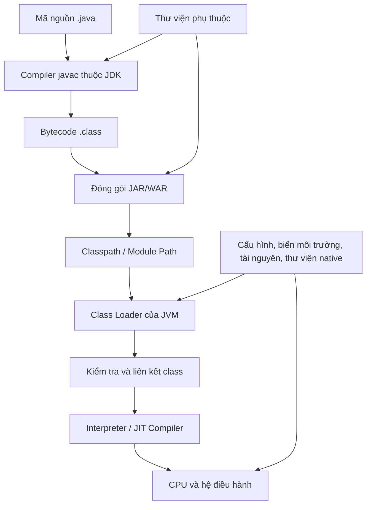


# Quan hệ giữa mã nguồn, bytecode, thư viện, JVM và môi trường triển khai

Một ứng dụng Java chỉ chạy ổn định khi nhiều lớp tương thích với nhau. Mã nguồn phải được biên dịch đúng với phiên bản Java dự kiến; bytecode phải nằm trong phạm vi mà JVM có thể đọc; các thư viện phải cung cấp đúng lớp và phương thức mà ứng dụng cần; JVM phải hỗ trợ phiên bản class file và API được sử dụng; cuối cùng, hệ điều hành và môi trường triển khai phải đáp ứng các yêu cầu về kiến trúc, tài nguyên, cấu hình và thư viện native.

Vì vậy, khi nâng cấp Java hoặc chuyển ứng dụng sang máy chủ, container hay nền tảng mới, không thể chỉ nhìn vào một con số như “Java 17” hoặc “Java 21”. Cần xác định phiên bản ở từng lớp và kiểm tra các mối quan hệ giữa chúng.

## 1. Bức tranh tổng thể

Quá trình từ lúc viết mã đến lúc chương trình chạy có thể hình dung như sau:



Mỗi thành phần có một trách nhiệm riêng:

| Thành phần | Vai trò | Câu hỏi tương thích cần trả lời |
|---|---|---|
| Mã nguồn | Mô tả logic bằng Java hoặc ngôn ngữ chạy trên JVM | Compiler có hiểu cú pháp và tính năng đang dùng không? |
| JDK/compiler | Biên dịch mã nguồn, xử lý annotation và đóng gói | Công cụ build có phiên bản phù hợp không? |
| Bytecode | Biểu diễn trung gian trong các file `.class` | JVM đích có đọc được class file này không? |
| Thư viện | Cung cấp API và phần triển khai dùng lại | Đúng phiên bản thư viện có mặt lúc compile và runtime không? |
| JVM | Nạp, kiểm tra và thực thi bytecode | JVM có hỗ trợ bytecode, API và tùy chọn runtime cần thiết không? |
| Môi trường triển khai | Cung cấp OS, CPU, tài nguyên, cấu hình và dịch vụ | Các giả định của ứng dụng có đúng trên môi trường thực tế không? |

Các lớp này liên kết với nhau nhưng không đồng nhất. Ví dụ, một dự án có thể được biên dịch bằng JDK 21, tạo ra bytecode Java 17, sử dụng thư viện chỉ chạy được từ Java 17 trở lên và được triển khai trên JVM 17. Cấu hình đó có thể hợp lệ. Ngược lại, nếu một thư viện trong ứng dụng yêu cầu Java 21 thì việc đặt bytecode của mã ứng dụng ở mức Java 17 cũng không làm toàn bộ ứng dụng chạy được trên JVM 17.

## 2. Mã nguồn và JDK: điều gì được phép viết và biên dịch?

Mã nguồn Java thường nằm trong các file `.java`. Compiler `javac` đọc mã nguồn, kiểm tra cú pháp, kiểu dữ liệu, quyền truy cập, annotation và các quy tắc ngôn ngữ, sau đó tạo ra bytecode trong file `.class`.

JDK (Java Development Kit) là bộ công cụ phát triển. Một JDK thường cung cấp:

- Compiler `javac`.
- Công cụ đóng gói và kiểm tra như `jar`, `javap`, `javadoc`.
- Runtime để chạy ứng dụng Java.
- Các công cụ phục vụ debug, quan sát và chẩn đoán.

Có thể kiểm tra phiên bản công cụ đang được gọi bằng:

```bash
java -version
javac -version
```

Hai lệnh có thể trỏ đến hai bản cài đặt khác nhau nếu `PATH` hoặc cấu hình môi trường không nhất quán. Khi đó, kết quả của `java -version` không đủ để kết luận compiler đang dùng phiên bản nào. Với Gradle hoặc Maven, cần kiểm tra cả JDK mà tiến trình build sử dụng.

### Phiên bản ngôn ngữ và phiên bản JDK

Phiên bản JDK quyết định compiler và các công cụ có khả năng gì. Tuy nhiên, compiler mới có thể tạo bytecode tương thích với một phiên bản Java cũ hơn nếu mã nguồn và API được giới hạn phù hợp.

Ví dụ, dùng JDK 21 để biên dịch mã nguồn nhắm đến Java 17:

```bash
javac --release 17 -d out src/com/example/App.java
```

Tùy chọn `--release 17` ràng buộc đồng thời:

1. Các quy tắc ngôn ngữ Java được phép sử dụng.
2. Tập API Java SE mà mã nguồn được phép tham chiếu.
3. Phiên bản bytecode đầu ra tương ứng với Java 17.

Điều này giúp tránh trường hợp mã nguồn vô tình gọi một API chỉ xuất hiện từ Java 21 nhưng lại được đóng gói với mục tiêu Java 17.

Ba tùy chọn thường gặp có ý nghĩa khác nhau:

| Tùy chọn | Ý nghĩa |
|---|---|
| `--source` | Giới hạn phiên bản cú pháp/ngôn ngữ được chấp nhận |
| `--target` | Chọn phiên bản class file đầu ra |
| `--release` | Kết hợp giới hạn ngôn ngữ, class file và API Java SE theo phiên bản đích |

Chỉ dùng `-source` và `-target` không tự bảo đảm mã nguồn chỉ gọi những API có trong phiên bản Java đích. Với các JDK hiện đại, `--release` thường là lựa chọn rõ ràng hơn khi cần duy trì khả năng chạy trên một phiên bản Java cụ thể.

### Toolchain build và runtime triển khai

Cần phân biệt ít nhất hai phiên bản:

- **Build JDK:** JDK chạy Gradle/Maven, compiler, plugin và annotation processor.
- **Runtime Java:** JVM thực sự chạy ứng dụng ở môi trường triển khai.

Chúng có thể khác nhau. Ví dụ, CI dùng JDK 21 để build, nhưng ứng dụng được biên dịch với `--release 17` và chạy trên runtime Java 17. Cấu hình này chỉ đúng khi toàn bộ bytecode và thư viện runtime đều tương thích Java 17.

Ngoài ra, Gradle/Maven và các plugin build cũng có yêu cầu JDK riêng. Một ứng dụng có thể nhắm đến Java 17 nhưng phiên bản Gradle hoặc plugin lại yêu cầu JDK 21 để chạy quá trình build. Vì vậy, “ứng dụng hỗ trợ Java 17” không đồng nghĩa “mọi công cụ build đều chạy được trên JDK 17”.

## 3. Bytecode: hợp đồng giữa compiler và JVM

Bytecode là dạng lệnh trung gian được lưu trong file `.class`. JVM không chạy trực tiếp mã nguồn `.java`; JVM nạp bytecode, kiểm tra cấu trúc và kiểu, liên kết các tham chiếu cần thiết rồi thực thi.

Một file `.class` có thông tin phiên bản class file, thường được gọi là *major version*. Một số mốc phổ biến:

| Phiên bản Java | Major version |
|---|---:|
| Java 8 | 52 |
| Java 11 | 55 |
| Java 17 | 61 |
| Java 21 | 65 |

Khi JVM gặp class file có phiên bản cao hơn mức nó hỗ trợ, chương trình có thể dừng với lỗi:

```text
java.lang.UnsupportedClassVersionError
```

Ví dụ: một thư viện được biên dịch bằng JDK 21 có class file major version 65. Nếu ứng dụng chạy trên JVM 17, JVM 17 không thể nạp class đó, kể cả khi mã nguồn của ứng dụng chính được biên dịch bằng `--release 17`.

Điều này cho thấy yêu cầu phiên bản của toàn bộ ứng dụng bị chi phối bởi thành phần có yêu cầu cao nhất trong tập bytecode thực sự được nạp. Thành phần đó có thể là:

- Class do dự án tự biên dịch.
- Thư viện bên thứ ba.
- Module nội bộ được đóng gói thành JAR.
- Code được sinh tự động trong quá trình build.
- Plugin hoặc thành phần mở rộng được nạp trong runtime.

Bytecode không chỉ xuất phát từ `javac`. Kotlin, Scala, Groovy và nhiều ngôn ngữ khác cũng có thể tạo class file chạy trên JVM. Khi cùng một ứng dụng sử dụng nhiều ngôn ngữ JVM, cần kiểm tra cấu hình target bytecode của từng compiler.

### Bytecode cũ có luôn chạy trên JVM mới không?

Thông thường, JVM mới được thiết kế để duy trì khả năng chạy phần lớn bytecode cũ theo đặc tả và chính sách tương thích của Java. Tuy nhiên, không nên suy ra rằng mọi ứng dụng cũ đều chắc chắn chạy giống hệt trên JVM mới.

Ứng dụng vẫn có thể bị ảnh hưởng bởi:

- API đã bị loại bỏ hoặc thay đổi.
- Thay đổi hành vi của thư viện chuẩn.
- Quy tắc truy cập module và phản chiếu chặt chẽ hơn.
- Thay đổi bảo mật, TLS, chứng chỉ hoặc thuật toán mật mã.
- Thay đổi mặc định của GC, encoding, locale hoặc tùy chọn JVM.
- Thư viện bên thứ ba không hỗ trợ JVM mới.

Tương thích về định dạng bytecode chỉ là một điều kiện cần, không phải toàn bộ điều kiện tương thích runtime.

## 4. Thư viện: lớp và phương thức mà ứng dụng phụ thuộc

Thư viện Java thường được phân phối dưới dạng JAR. Một JAR có thể chứa nhiều file `.class`, tài nguyên, metadata, service provider và các file cấu hình khác.

Khi biên dịch, compiler cần tìm thấy các lớp mà mã nguồn tham chiếu. Khi chạy, JVM và class loader cũng phải tìm thấy các lớp đó. Vì vậy, một dependency có thể tồn tại ở compile time nhưng lại thiếu ở runtime, hoặc có mặt ở cả hai thời điểm nhưng khác phiên bản.

### Compile-time và runtime dependency

Ví dụ, mã nguồn gọi một lớp từ thư viện `example-client`:

```java
import com.example.client.ApiClient;

public class App {
    public static void main(String[] args) {
        ApiClient client = new ApiClient();
        client.connect();
    }
}
```

Compiler cần JAR chứa `ApiClient` để kiểm tra kiểu và phương thức. Khi chạy, JVM tiếp tục cần JAR tương ứng để nạp lớp và thực thi.

Nếu JAR chỉ được khai báo trong cấu hình compile nhưng không được đưa vào runtime classpath, chương trình có thể gặp:

```text
java.lang.NoClassDefFoundError
```

Nếu class tồn tại nhưng phiên bản đang chạy không còn phương thức mà bytecode đã tham chiếu, có thể gặp:

```text
java.lang.NoSuchMethodError
```

Đây là hai lỗi khác nhau:

- `NoClassDefFoundError`: JVM không thể tìm hoặc định nghĩa lớp cần thiết trong lúc liên kết/nạp.
- `NoSuchMethodError`: lớp đã được tìm thấy nhưng cấu trúc API runtime không khớp với tham chiếu được biên dịch trước đó.

### Dependency graph và dependency bắc cầu

Một ứng dụng thường không chỉ phụ thuộc vào một JAR. Thư viện A có thể phụ thuộc vào B, còn B phụ thuộc vào C. Những dependency được kéo vào thông qua thư viện khác được gọi là dependency bắc cầu (*transitive dependency*).

Do đó, chỉ xem danh sách dependency trực tiếp là chưa đủ. Cần biết phiên bản cuối cùng được chọn cho từng module, có xung đột phiên bản hay không và dependency nào thực sự xuất hiện trong runtime.

Một số rủi ro thường gặp:

- Hai thư viện yêu cầu hai phiên bản khác nhau của cùng một dependency.
- Dependency bị loại trừ hoặc không được đóng gói vào artifact.
- Một thư viện được compile bằng JDK mới hơn runtime.
- Ứng dụng nạp nhầm phiên bản JAR do classpath có thứ tự không như dự kiến.
- Cùng một class xuất hiện trong nhiều JAR, dẫn đến hành vi phụ thuộc class loader.
- Thư viện sử dụng API nội bộ của JDK hoặc dựa vào hành vi không được bảo đảm.

### Binary compatibility và API compatibility

Một ứng dụng đã biên dịch có thể chứa tham chiếu đến tên lớp, tên phương thức và descriptor cụ thể. Khi thay thư viện bằng phiên bản mới, những tham chiếu đó cần tiếp tục hợp lệ.

Ví dụ, phiên bản thư viện cũ có:

```java
public String findUser(long id)
```

Nếu phiên bản mới xóa phương thức hoặc đổi kiểu trả về/tham số theo cách làm thay đổi descriptor nhị phân, ứng dụng đã biên dịch với phiên bản cũ có thể không liên kết được khi chạy cùng thư viện mới.

Ngược lại, một thay đổi vẫn giữ nguyên chữ ký có thể làm thay đổi hành vi, quy tắc kiểm tra dữ liệu, ngoại lệ hoặc kết quả trả về. Khi đó, chương trình có thể nạp và chạy nhưng kết quả nghiệp vụ không còn đúng như trước.

### Multi-release JAR

Một số JAR chứa nhiều phiên bản class cho các phiên bản Java khác nhau. Đây là cơ chế *multi-release JAR*. JVM có thể chọn class phù hợp với phiên bản runtime đang chạy nếu JAR được đóng gói và khai báo đúng cấu trúc.

Điều này giúp thư viện cung cấp phần triển khai tối ưu cho JVM mới trong khi vẫn giữ phần triển khai nền cho JVM cũ. Tuy nhiên, không nên mặc định mọi JAR đều hỗ trợ cơ chế này; cần kiểm tra metadata và cấu trúc JAR thực tế.

## 5. JVM: nơi bytecode được nạp và thực thi

JVM (Java Virtual Machine) là máy ảo thực thi bytecode theo đặc tả JVM. Một bản phân phối Java cụ thể cung cấp cách triển khai JVM cùng các thư viện và công cụ liên quan.

JVM đảm nhiệm nhiều công việc:

1. **Class loading:** tìm và nạp định nghĩa lớp từ classpath, module path hoặc các nguồn được cấu hình.
2. **Verification:** kiểm tra tính hợp lệ và an toàn cấu trúc bytecode.
3. **Linking:** chuẩn bị lớp, giải quyết tham chiếu và thực hiện khởi tạo cần thiết.
4. **Execution:** diễn giải bytecode hoặc biên dịch các đoạn mã thường chạy sang mã máy bằng JIT.
5. **Memory management:** quản lý heap, stack, metadata và thu gom rác.
6. **Runtime services:** cung cấp thread, synchronization, exception, reflection, module system và các dịch vụ khác.

### Đặc tả và bản triển khai

Đặc tả JVM mô tả hành vi mà một JVM tương thích phải đáp ứng. Các bản phân phối Java khác nhau có thể cung cấp những triển khai, công cụ quản trị, bản vá bảo mật và chính sách hỗ trợ khác nhau.

Khi điều tra lỗi, nên ghi nhận:

- Phiên bản Java đầy đủ, bao gồm bản cập nhật.
- Nhà cung cấp/bản phân phối Java.
- Hệ điều hành và kiến trúc CPU.
- Các tham số JVM đang sử dụng.
- Phiên bản thư viện và ứng dụng.

Hai máy đều báo Java 21 nhưng có thể khác bản cập nhật, nhà cung cấp, tham số GC, cấu hình bộ nhớ, chứng chỉ hệ thống hoặc thư viện native. Các khác biệt đó có thể làm kết quả vận hành khác nhau.

### JVM và Java API

JVM thực thi bytecode, còn phần lớn API mà ứng dụng sử dụng đến từ Java platform libraries, chẳng hạn `java.base`, `java.sql` hoặc các module Java SE khác. Một ứng dụng có thể có bytecode hợp lệ nhưng gọi API không tồn tại trên runtime đích.

Ngoài Java SE, ứng dụng còn có thể phụ thuộc vào API của framework hoặc thư viện bên ngoài. Khi nâng cấp runtime, cần kiểm tra cả hai nhóm: API nền tảng và API do dependency cung cấp.

### Module system và quyền truy cập

Từ Java 9, Java Platform Module System đưa vào cơ chế module và ranh giới truy cập mạnh hơn. Ứng dụng cũ hoặc thư viện cũ có thể dựa vào reflection để truy cập thành phần nội bộ của JDK. Trên các phiên bản Java mới, những truy cập như vậy có thể bị hạn chế và gây lỗi như:

```text
java.lang.reflect.InaccessibleObjectException
```

Không nên coi việc thêm các tùy chọn mở module là cách sửa mặc định cho mọi lỗi. Cần xác định thư viện nào đang truy cập thành phần nào, tìm phiên bản đã hỗ trợ Java đích và chỉ mở quyền truy cập khi có lý do kỹ thuật rõ ràng.

## 6. Môi trường triển khai: những điều nằm ngoài bytecode

Ngay cả khi tất cả class file và thư viện đều tương thích với JVM, ứng dụng vẫn có thể thất bại vì môi trường triển khai không đáp ứng giả định của chương trình.

### Hệ điều hành và kiến trúc CPU

Ứng dụng Java thuần thường có tính di động cao, nhưng ứng dụng thực tế có thể phụ thuộc vào:

- JNI hoặc thư viện native.
- Executable được gọi qua `ProcessBuilder`.
- Đường dẫn file và quy tắc phân biệt chữ hoa/chữ thường.
- Quyền truy cập file, user/group và cơ chế bảo mật của OS.
- Kiến trúc x86-64, ARM64 hoặc kiến trúc khác.
- Thư viện hệ thống mà native binary cần để liên kết.

Một native library build cho Linux x86-64 không thể mặc nhiên sử dụng trên Windows hoặc Linux ARM64. Việc đổi base image container cũng có thể làm mất thư viện hệ thống mà ứng dụng trước đó dựa vào.

### Encoding, locale và timezone

Các giá trị mặc định của môi trường có thể ảnh hưởng đến việc đọc/ghi file, định dạng ngày giờ và xử lý văn bản.

Ví dụ:

- File được đọc theo encoding mặc định có thể hiển thị sai ký tự tiếng Việt.
- Ngày `03/04/2026` có thể được hiểu khác nhau tùy locale.
- Logic nghiệp vụ dựa trên timezone mặc định có thể lệch ngày khi chuyển máy chủ.
- So sánh tên file có thể cho kết quả khác nhau giữa filesystem phân biệt và không phân biệt hoa thường.

Nếu encoding hoặc timezone là một phần của hợp đồng dữ liệu, nên khai báo rõ ràng thay vì dựa vào mặc định của máy.

Ví dụ đọc file UTF-8 một cách tường minh:

```java
try (var reader = java.nio.file.Files.newBufferedReader(
        java.nio.file.Path.of("data.txt"),
        java.nio.charset.StandardCharsets.UTF_8)) {
    // Đọc nội dung file
}
```

### Tài nguyên và cấu hình vận hành

Một ứng dụng có thể chạy tốt trên máy phát triển nhưng lỗi trên production do:

- Giới hạn RAM hoặc heap quá thấp.
- Container có CPU quota hoặc memory limit.
- Số lượng file descriptor hoặc thread bị giới hạn.
- Biến môi trường, secret hoặc file cấu hình bị thiếu.
- DNS, proxy, firewall hoặc kết nối database khác nhau.
- Chứng chỉ TLS hoặc truststore không đầy đủ.
- Thư mục ghi log, thư mục tạm hoặc volume không có quyền ghi.
- Health check, timeout hoặc chính sách restart của nền tảng triển khai.

Các yếu tố này không nhất thiết là lỗi tương thích Java, nhưng chúng thuộc điều kiện để ứng dụng Java hoạt động đúng trong môi trường đích.

### Container không tự động bảo đảm tương thích

Container giúp đóng gói runtime và một phần môi trường, nhưng không xóa bỏ mọi khác biệt. Image vẫn có hệ điều hành nền, kiến trúc CPU, thư viện native, cấu hình người dùng và giới hạn tài nguyên.

Khi chuyển từ một image JDK sang image JRE hoặc image tối giản, cần kiểm tra:

- Ứng dụng có cần công cụ runtime như `keytool` hoặc công cụ chẩn đoán không?
- Các thư viện native có còn đủ không?
- Truststore và timezone database có được cung cấp không?
- User chạy ứng dụng có quyền đọc/ghi cần thiết không?
- Image có đúng kiến trúc CPU của môi trường triển khai không?

Nên cố định phiên bản image và, với quy trình phát hành cần độ tái lập cao, cân nhắc cố định cả digest của image.

## 7. Các loại tương thích cần đánh giá riêng

Từ những lớp trên, có thể chia tương thích thành các nhóm để kiểm tra có hệ thống:

| Nhóm tương thích | Nội dung | Ví dụ lỗi hoặc rủi ro |
|---|---|---|
| Source compatibility | Mã nguồn có thể biên dịch với compiler và quy tắc ngôn ngữ đích | Cú pháp hoặc API không được hỗ trợ |
| Bytecode compatibility | JVM đích đọc được class file | `UnsupportedClassVersionError` |
| Binary compatibility | Các tham chiếu lớp/phương thức/field vẫn liên kết được | `NoSuchMethodError`, `NoSuchFieldError` |
| API compatibility | API nền tảng và API thư viện cần thiết còn tồn tại | `NoClassDefFoundError`, lỗi biên dịch |
| Behavioral compatibility | Chương trình vẫn cho hành vi đúng sau khi nâng cấp | Sai định dạng ngày, thay đổi mặc định, kết quả nghiệp vụ khác |
| Runtime compatibility | JVM và dependency hoạt động cùng nhau | Reflection bị chặn, lỗi khởi tạo, lỗi class loader |
| Environment compatibility | OS, CPU, native library, tài nguyên và cấu hình đáp ứng yêu cầu | `UnsatisfiedLinkError`, lỗi quyền file, thiếu RAM |
| Operational compatibility | Cách build, đóng gói, giám sát và vận hành phù hợp nền tảng mới | Health check thất bại, timeout, thiếu log hoặc secret |

Không nên dùng một bài kiểm tra duy nhất để kết luận tất cả nhóm đều đạt. Build thành công chủ yếu chứng minh một phần source/API compatibility. Khởi động thành công chứng minh thêm một phần runtime compatibility. Cần kiểm thử chức năng và triển khai trong môi trường gần production để đánh giá hành vi và điều kiện vận hành.

## 8. Ví dụ: build bằng JDK 21 nhưng triển khai trên Java 17

Giả sử nhóm phát triển muốn dùng JDK 21 cho công cụ build, nhưng máy chủ production vẫn đang chạy Java 17.

Một cấu hình có chủ đích có thể dùng Gradle như sau:

```groovy
java {
    toolchain {
        languageVersion = JavaLanguageVersion.of(21)
    }
}

tasks.withType(JavaCompile).configureEach {
    options.release = 17
}
```

Ý nghĩa:

- Gradle chọn JDK 21 làm toolchain biên dịch.
- `--release 17` giới hạn mã nguồn, API Java SE và bytecode đầu ra ở mức Java 17.
- Artifact được kỳ vọng chạy trên Java 17 nếu tất cả dependency và thành phần runtime khác cũng đáp ứng yêu cầu đó.

Đây chưa phải bằng chứng đầy đủ rằng artifact chạy được trên Java 17. Nhóm vẫn phải kiểm tra:

1. Mọi dependency runtime có bytecode tương thích Java 17.
2. Không có thư viện gọi API chỉ có từ Java 18 trở lên.
3. Các plugin, code generator và annotation processor tạo ra output phù hợp.
4. Các thành phần được nạp động cũng tương thích.
5. Bộ kiểm thử được chạy trên JVM 17 thực tế.
6. Container hoặc máy chủ production có đủ native library, chứng chỉ, cấu hình và tài nguyên.

Nếu mục tiêu là chuyển cả build và runtime lên Java 21, cần thay đổi đồng bộ toolchain, `options.release`, runtime image, CI và môi trường triển khai. Sau đó vẫn phải chạy regression test để phát hiện thay đổi hành vi hoặc dependency chưa tương thích.

### Ma trận phiên bản minh họa

| Thành phần | Cấu hình ví dụ | Điều cần xác nhận |
|---|---|---|
| JDK chạy Gradle | 21 | Gradle và plugin hỗ trợ JDK 21 |
| Compiler target | 17 | Dùng `--release 17` |
| Bytecode ứng dụng | Java 17 / major 61 | Kiểm tra class file thực tế |
| Dependency A | Java 11 | Có thể chạy trên Java 17 nếu các yêu cầu khác phù hợp |
| Dependency B | Java 21 | Không tương thích với JVM 17 nếu runtime nạp class Java 21 |
| JVM production | 17 | Hỗ trợ bytecode và API của toàn bộ ứng dụng |
| OS/container | Linux ARM64 | Native library và image phải hỗ trợ ARM64 |

Dòng dependency B làm cấu hình tổng thể không đạt, dù mã nguồn chính được biên dịch với `--release 17`. Khi đó cần chọn phiên bản dependency hỗ trợ Java 17, thay thế thư viện hoặc nâng runtime production lên Java 21.

## 9. Quy trình kiểm tra khi nâng cấp hoặc chuyển môi trường

Một quy trình có thể thực hiện theo thứ tự sau:

### Bước 1: Ghi nhận trạng thái hiện tại

Thu thập:

- JDK dùng để chạy build.
- Phiên bản compiler và target bytecode.
- Phiên bản Java ở môi trường chạy.
- Danh sách dependency trực tiếp và bắc cầu.
- Hệ điều hành, kiến trúc CPU và base image.
- Tham số JVM, biến môi trường và cấu hình triển khai.

Đừng chỉ ghi “Java 17”. Hãy lưu phiên bản đầy đủ và nguồn cài đặt để có thể tái hiện môi trường.

### Bước 2: Xác định phiên bản Java mục tiêu

Làm rõ mục tiêu là:

- Chỉ đổi JDK dùng để build.
- Giữ runtime cũ nhưng nâng compiler.
- Nâng đồng thời compiler và runtime.
- Chuyển sang OS, CPU hoặc container image mới.
- Nâng cả Java và framework/thư viện phụ thuộc.

Mỗi mục tiêu tạo ra một ma trận kiểm tra khác nhau.

### Bước 3: Kiểm tra dependency

Xác định dependency nào đặt ra mức Java tối thiểu cao nhất. Kiểm tra release note và metadata của thư viện, đồng thời xem dependency graph thực tế mà build tool giải quyết.

Nếu dependency dùng reflection sâu, API nội bộ JDK hoặc JNI, cần có kiểm thử tập trung cho các phần đó.

### Bước 4: Cấu hình build rõ ràng

Khai báo toolchain, phiên bản source/API target và cấu hình plugin. Tránh phụ thuộc vào JDK được cài ngẫu nhiên trên máy lập trình viên.

Có thể dùng Gradle Wrapper hoặc Maven Wrapper để thống nhất phiên bản build tool, nhưng wrapper không tự chọn đúng JDK cho mọi môi trường; vẫn cần cấu hình và xác minh JDK chạy build.

### Bước 5: Kiểm tra artifact

Kiểm tra nội dung JAR, phiên bản class file và các dependency được đóng gói. Với ứng dụng có nhiều module, cần kiểm tra artifact cuối cùng và các module được nạp động, không chỉ một class đại diện.

### Bước 6: Chạy test trên runtime đích

Chạy unit test, integration test và kiểm thử khởi động bằng đúng phiên bản JVM dự kiến triển khai. Những test cần database, message broker, TLS, filesystem hoặc native library nên chạy trong môi trường tương đương production.

### Bước 7: Kiểm thử vận hành

Triển khai thử vào container hoặc máy chủ mục tiêu, sau đó kiểm tra:

- Ứng dụng khởi động và health check thành công.
- Kết nối dịch vụ ngoài hoạt động.
- Đọc/ghi dữ liệu đúng encoding và timezone.
- Log, metrics, tracing và shutdown hoạt động.
- Bộ nhớ, CPU, thread và GC nằm trong giới hạn.
- Cơ chế rollback có thể khôi phục phiên bản trước.

### Bước 8: Ghi lại ma trận đã xác nhận

Lưu phiên bản build JDK, target bytecode, runtime Java, dependency chính, OS/architecture và kết quả test. Ma trận này trở thành cơ sở để điều tra lỗi về sau và tránh việc các môi trường phát triển, CI và production âm thầm lệch nhau.

## 10. Công cụ chẩn đoán hữu ích

| Công cụ/lệnh | Mục đích |
|---|---|
| `java -version` | Xem runtime Java đang được gọi |
| `javac -version` | Xem compiler đang được gọi |
| `./gradlew -version` | Xem phiên bản Gradle và JVM chạy Gradle |
| `jar tf app.jar` | Liệt kê nội dung JAR |
| `javap -verbose SomeClass` | Xem metadata class, bao gồm major version |
| `jdeps --recursive app.jar` | Phân tích dependency ở mức class/package |
| `jcmd` | Quan sát và chẩn đoán tiến trình JVM đang chạy |

Ví dụ kiểm tra class file:

```bash
javap -verbose -classpath app.jar com.example.App
```

Trong kết quả, tìm dòng `major version`. Nếu class nằm trong một package hoặc JAR lồng nhau, cần trích xuất đúng class hoặc kiểm tra artifact theo cách phù hợp với cấu trúc đóng gói.

Một số lỗi thường gặp và hướng điều tra:

| Lỗi | Ý nghĩa thường gặp | Hướng kiểm tra |
|---|---|---|
| `UnsupportedClassVersionError` | JVM không hỗ trợ major version của class | Kiểm tra class gây lỗi và runtime Java thực tế |
| `NoClassDefFoundError` | Không nạp/định nghĩa được class cần thiết | Kiểm tra runtime classpath, dependency và lỗi khởi tạo trước đó |
| `NoSuchMethodError` | API nhị phân lúc chạy không khớp lúc biên dịch | Kiểm tra phiên bản JAR thực tế và dependency bắc cầu |
| `NoSuchFieldError` | Field được tham chiếu không có trong class runtime | Kiểm tra xung đột hoặc thay đổi phiên bản thư viện |
| `InaccessibleObjectException` | Truy cập reflection bị giới hạn | Xác định thư viện và thành phần module đang bị truy cập |
| `UnsatisfiedLinkError` | Không nạp được native library hoặc symbol | Kiểm tra OS, kiến trúc CPU, đường dẫn và dependency native |

Thông báo lỗi thường chỉ ra nơi sự cố xuất hiện, nhưng nguyên nhân có thể nằm ở cấu hình dependency hoặc môi trường được thiết lập trước đó. Cần xem cả stack trace, classpath, phiên bản runtime và artifact thực tế.

## 11. Checklist trước khi kết luận ứng dụng tương thích

- [ ] Đã xác định JDK thực sự dùng để chạy build.
- [ ] Đã xác định phiên bản compiler và target Java/API.
- [ ] Đã kiểm tra major version của bytecode trong artifact.
- [ ] Tất cả dependency runtime hỗ trợ phiên bản JVM mục tiêu.
- [ ] Dependency bắc cầu và xung đột phiên bản đã được kiểm tra.
- [ ] Các plugin, annotation processor và code generator đã được kiểm tra.
- [ ] Không còn phụ thuộc không được hỗ trợ vào API nội bộ JDK.
- [ ] Native library phù hợp OS và kiến trúc CPU.
- [ ] Encoding, locale, timezone, filesystem và quyền truy cập đã được xác nhận.
- [ ] Container/máy chủ có đủ chứng chỉ, cấu hình, tài nguyên và kết nối cần thiết.
- [ ] Test đã chạy trên đúng runtime và môi trường triển khai mục tiêu.
- [ ] Có ghi nhận phiên bản và kết quả để tái hiện cấu hình.

## Kết luận

Khả năng tương thích của ứng dụng Java là kết quả của sự phối hợp giữa mã nguồn, compiler/JDK, bytecode, thư viện, JVM và môi trường triển khai. Mỗi lớp có hợp đồng riêng, và một lớp không tương thích có thể làm toàn bộ ứng dụng thất bại dù những lớp còn lại có vẻ đúng.

Khi nâng cấp hoặc di chuyển ứng dụng, hãy lập ma trận phiên bản cho toàn bộ chuỗi, kiểm tra dependency và artifact thực tế, rồi chạy kiểm thử trên đúng JVM cùng môi trường dự kiến triển khai. Cách tiếp cận theo từng lớp giúp xác định chính xác ranh giới gây lỗi và đưa ra quyết định nâng cấp có căn cứ.

