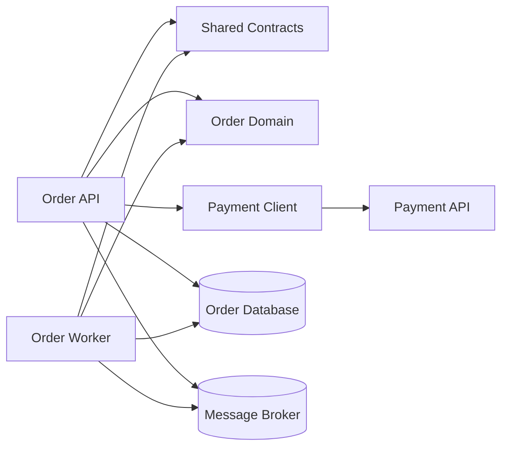

# Kiểm kê module, dịch vụ và các thành phần phụ thuộc chéo

Trước khi nâng cấp Java, framework hoặc các thư viện nền tảng, cần biết hệ thống hiện có những phần nào và chúng liên hệ với nhau ra sao. Một ứng dụng doanh nghiệp có thể gồm nhiều Gradle/Maven module, nhiều dịch vụ chạy độc lập, thư viện dùng chung, cơ sở dữ liệu, hàng đợi thông điệp và hệ thống bên ngoài. Nếu chỉ nhìn vào một module đang cần nâng cấp, nhóm phát triển dễ bỏ sót một consumer khác vẫn phụ thuộc vào API, phiên bản Java hoặc hành vi cũ.

**Kiểm kê module, dịch vụ và các thành phần phụ thuộc chéo** là quá trình thu thập, xác minh và mô tả có hệ thống các thành phần của một ứng dụng cùng những quan hệ giữa chúng. Kết quả là một bản đồ có thể dùng để xác định phạm vi migration, đánh giá tác động, chọn thứ tự nâng cấp, lập kế hoạch kiểm thử và theo dõi các rủi ro tương thích.

## 1. Vì sao phải kiểm kê trước khi migration?

Trong một hệ thống lâu năm, cấu trúc thực tế thường khác với sơ đồ kiến trúc ban đầu. Một thư viện có thể được nhiều module sử dụng; một dịch vụ có thể gọi thêm dịch vụ khác qua HTTP; một batch job có thể đọc chung bảng dữ liệu với ứng dụng web; một module ít được nhắc đến vẫn có thể được đóng gói và triển khai trong một quy trình riêng.

Nếu không kiểm kê, một thay đổi có vẻ cục bộ có thể gây ảnh hưởng ở nơi khác:

- Nâng JDK của một module nhưng thư viện nội bộ mà nó dùng vẫn chỉ hỗ trợ bytecode hoặc API của JDK cũ.
- Thay đổi kiểu dữ liệu trong DTO dùng chung làm hỏng nhiều REST client hoặc consumer của message.
- Nâng phiên bản Spring trong một dịch vụ nhưng starter hoặc thư viện nội bộ kéo theo phiên bản Spring khác ở dịch vụ khác.
- Đổi một interface trong module dùng chung khiến các module triển khai interface đó không biên dịch được.
- Chuyển một dịch vụ sang schema dữ liệu mới trong khi batch job cũ vẫn ghi theo schema trước.
- Xóa một API tưởng không còn dùng nhưng một ứng dụng khác vẫn gọi qua cấu hình, reflection hoặc tích hợp bên ngoài.

Kiểm kê giúp trả lời các câu hỏi nền tảng:

1. Hệ thống có những module build, thư viện, ứng dụng và dịch vụ nào?
2. Thành phần nào được build, kiểm thử, phát hành và triển khai cùng nhau?
3. Thành phần nào gọi, import, kế thừa, triển khai hoặc trao đổi dữ liệu với thành phần nào?
4. Quan hệ đó tồn tại ở compile time, runtime, deployment time hay chỉ trong quy trình vận hành?
5. Thành phần nào sở hữu API, dữ liệu hoặc hợp đồng mà thành phần khác đang sử dụng?
6. Nếu một thành phần thay đổi Java hoặc dependency, những thành phần nào phải được kiểm tra lại?

Mục tiêu không chỉ là tạo một danh sách tên module. Cần ghi nhận cả quan hệ, bằng chứng, phiên bản, chủ sở hữu và mức độ chắc chắn của thông tin.

## 2. Phân biệt module, thư viện, dịch vụ và thành phần tích hợp

Các khái niệm này có thể trùng nhau trong một số hệ thống nhưng không nên dùng thay thế cho nhau.

| Khái niệm | Ý nghĩa | Ví dụ |
|---|---|---|
| Module build | Đơn vị được Gradle hoặc Maven nhận diện và cấu hình để build | `:order-api`, `:order-service`, Maven child module `order-domain` |
| Thư viện | Thành phần cung cấp code hoặc tài nguyên để thành phần khác sử dụng | JAR chứa DTO, utility, domain model hoặc client |
| Ứng dụng | Artifact có thể chạy như một chương trình | Spring Boot executable JAR, command-line application |
| Dịch vụ | Đơn vị chức năng được vận hành và giao tiếp với consumer qua một hợp đồng | Order Service, Payment Service |
| Thành phần tích hợp | Cơ chế kết nối với hệ thống hoặc tiến trình khác | REST client, Kafka producer, JDBC adapter, file exchange |
| Hạ tầng dùng chung | Nền tảng mà nhiều thành phần cùng sử dụng | Database, message broker, cache, object storage, identity provider |

Một module build không nhất thiết tương ứng với một dịch vụ. Nhiều module có thể được đóng gói thành một ứng dụng duy nhất; một repository cũng có thể chứa nhiều ứng dụng độc lập. Một thư viện có thể được dùng trong nhiều dịch vụ. Vì vậy, cần lập danh mục ở cả hai góc nhìn: cấu trúc build và cấu trúc triển khai/runtime.

Ví dụ, một hệ thống có thể có cấu trúc build như sau:

```text
commerce-build
├── shared-contracts       # DTO và API contract dùng chung
├── shared-security        # thư viện xác thực/ủy quyền
├── order-domain           # nghiệp vụ đơn hàng
├── order-application      # use case và điều phối
├── order-web              # REST adapter
├── payment-client         # client gọi dịch vụ thanh toán
├── order-worker           # consumer xử lý sự kiện
└── reporting-job          # batch tổng hợp dữ liệu
```

Nhưng cấu trúc runtime có thể là:

```text
Deployment: order-api
  ├── order-web
  ├── order-application
  ├── order-domain
  ├── shared-contracts
  ├── shared-security
  └── payment-client

Deployment: order-worker
  ├── order-worker
  ├── order-application
  ├── order-domain
  └── shared-contracts

Deployment: reporting-job
  ├── reporting-job
  └── shared-contracts
```

Nếu chỉ kiểm kê theo Gradle/Maven, ta có thể bỏ sót ranh giới deployment. Nếu chỉ kiểm kê theo dịch vụ đang chạy, ta có thể bỏ sót module dùng chung và quan hệ compile time. Hai góc nhìn cần được liên kết bằng artifact và thông tin build.

## 3. Xác định phạm vi và đơn vị kiểm kê

Trước khi thu thập, hãy xác định rõ phạm vi của đợt migration. Phạm vi có thể là một repository, một nhóm dịch vụ, một sản phẩm, một nền tảng Java hoặc toàn bộ hệ thống có liên quan.

### 3.1. Phạm vi theo repository và build

Ghi nhận:

- Repository và nhánh/commit được dùng làm baseline.
- Build root và các build độc lập hoặc included build.
- Gradle subproject, Maven module và các dự án build riêng.
- Module có source Java, Kotlin, Groovy hoặc ngôn ngữ JVM khác.
- Module chỉ chứa cấu hình, tài liệu, migration script hoặc tài nguyên.
- Module được build trong CI và module chỉ được build thủ công.

Không mặc định mọi thư mục con đều là module build. Hãy xác minh bằng settings/build file, Maven aggregator POM hoặc cấu hình thực tế.

### 3.2. Phạm vi theo ứng dụng và dịch vụ

Với mỗi ứng dụng hoặc dịch vụ, ghi nhận:

- Tên chức năng và mục đích nghiệp vụ.
- Artifact được tạo ra và cách khởi chạy.
- Môi trường triển khai: local, test, staging, production hoặc môi trường khác.
- Replicas, tiến trình worker, scheduler và batch job nếu có.
- Nhóm hoặc cá nhân sở hữu kỹ thuật.
- Consumer và provider chính.
- Cơ chế giao tiếp và hợp đồng được công bố.

Một dịch vụ có thể có nhiều tiến trình hoặc deployment profile. Ví dụ, cùng một codebase có thể chạy ở chế độ HTTP API và chế độ message consumer. Cần ghi nhận từng kiểu chạy nếu chúng có dependency hoặc cấu hình khác nhau.

### 3.3. Phạm vi theo dữ liệu và hệ thống bên ngoài

Đừng giới hạn kiểm kê ở Java code. Ghi nhận những thành phần có thể ảnh hưởng đến migration:

- Database, schema, bảng hoặc view được dùng chung.
- Message broker, topic, queue, exchange và schema message.
- Cache, distributed lock và key format.
- Object storage, filesystem và định dạng file trao đổi.
- Identity provider, API gateway và hệ thống xác thực.
- Dịch vụ bên thứ ba, SOAP/REST endpoint hoặc thư viện native.
- Script build, container image, runtime image và pipeline triển khai.

Một thành phần bên ngoài không cần được đưa vào cùng phạm vi code để trở thành dependency cần theo dõi. Ví dụ, một message schema tương thích ngược có thể cho phép nâng consumer trước producer; nếu schema thay đổi không tương thích, thứ tự triển khai cần được lập kế hoạch rõ ràng.

## 4. Lập danh mục module và thành phần

Mỗi thành phần cần có một định danh ổn định để có thể tham chiếu trong bảng phụ thuộc, sơ đồ và báo cáo migration. Tên thư mục có thể đổi; định danh nên dựa trên một quy ước ổn định của tổ chức hoặc build.

### 4.1. Các trường thông tin nên thu thập

| Trường | Nội dung cần ghi |
|---|---|
| ID | Định danh ổn định, duy nhất trong phạm vi kiểm kê |
| Tên | Tên module, thư viện, ứng dụng hoặc dịch vụ |
| Loại | Build module, library, application, service, job, database, external system... |
| Vị trí | Repository, đường dẫn source hoặc nơi quản lý cấu hình |
| Vai trò | Chức năng kỹ thuật/nghiệp vụ chính |
| Build | Gradle/Maven, build root và task/module tương ứng |
| Java | JDK dùng build, release/source target và runtime yêu cầu |
| Framework | Spring Boot, Spring Framework hoặc framework khác cùng phiên bản |
| Artifact | Group, artifact, version, loại artifact và nơi phát hành |
| Triển khai | Deployment, container/image, môi trường hoặc lịch chạy |
| Owner | Nhóm chịu trách nhiệm kỹ thuật |
| Trạng thái | Đang hoạt động, legacy, ngừng phát triển, chỉ dùng trong test... |
| Bằng chứng | File cấu hình, build output, manifest hoặc xác nhận từ owner |

Không phải trường nào cũng có ý nghĩa với mọi loại thành phần. Ví dụ, database không có Java release; thư viện không có deployment độc lập. Có thể để trống hoặc ghi `N/A`, nhưng không nên tự suy đoán giá trị.

### 4.2. Ví dụ bản ghi kiểm kê

Ví dụ YAML dưới đây minh họa cách lưu danh mục. Giá trị chỉ mang tính minh họa:

```yaml
components:
  - id: order-domain
    name: Order Domain
    kind: library
    repository: commerce-build
    path: order-domain
    build:
      system: gradle
      project: ":order-domain"
    java:
      compileRelease: 17
      runtimeRequired: false
    artifact:
      group: com.example.commerce
      name: order-domain
      version: 2.4.0
    owner: commerce-team
    status: active
    evidence:
      - order-domain/build.gradle
      - settings.gradle

  - id: order-api
    name: Order API
    kind: service
    repository: commerce-build
    build:
      system: gradle
      project: ":order-web"
    java:
      compileRelease: 17
      runtimeRequired: 17
    deployment:
      artifact: order-api.jar
      runtimeImage: eclipse-temurin:17
    owner: commerce-team
    status: active
```

Tách `components` khỏi `dependencies` giúp một thành phần chỉ được định nghĩa một lần. Các bảng quan hệ có thể tham chiếu `id`, tránh lặp lại tên, phiên bản và owner ở nhiều nơi.

## 5. Kiểm kê dependency ở build time

Build dependency là quan hệ mà Gradle hoặc Maven cần để biên dịch, kiểm thử, đóng gói hoặc thực thi tác vụ build. Đây là nguồn dữ liệu quan trọng khi nâng cấp Java và thư viện.

### 5.1. Phân loại dependency

Nên phân biệt:

- **Compile dependency:** cần để biên dịch source của module.
- **Runtime dependency:** cần khi chạy ứng dụng nhưng không nhất thiết cần cho compile.
- **Test dependency:** chỉ phục vụ test source hoặc test runtime.
- **Annotation processor/compiler plugin:** tham gia quá trình biên dịch hoặc sinh mã.
- **Build plugin:** thay đổi hành vi build, đóng gói, kiểm tra hoặc tạo artifact.
- **Internal project dependency:** quan hệ tới module khác trong cùng build hoặc một build nội bộ.
- **External dependency:** artifact được resolve từ Maven repository hoặc nguồn khác.
- **Transitive dependency:** dependency được kéo vào thông qua một dependency khác.

Phân loại này giúp xác định đúng phạm vi. Một thư viện chỉ có trong test classpath có thể không ảnh hưởng đến runtime production, nhưng vẫn có thể chặn migration nếu test compiler không tương thích với JDK mới.

### 5.2. Thu thập thông tin từ Gradle

Liệt kê project trong build:

```bash
./gradlew projects
```

Xem dependency của một module và configuration cụ thể:

```bash
./gradlew :order-service:dependencies --configuration compileClasspath
./gradlew :order-service:dependencies --configuration runtimeClasspath
./gradlew :order-service:dependencies --configuration testRuntimeClasspath
```

Tìm lý do một dependency được chọn hoặc phiên bản nào đang được resolve:

```bash
./gradlew :order-service:dependencyInsight \
  --dependency spring-core \
  --configuration runtimeClasspath
```

Các configuration có tên khác nhau tùy plugin và loại module. Nếu một configuration không tồn tại, hãy xem cấu hình mà module thực sự tạo ra thay vì giả định mọi module đều có `runtimeClasspath`.

Với multi-project build, dependency dạng `project(":shared-contracts")` là quan hệ giữa các module nội bộ. Dependency dạng `group:artifact:version` thường là artifact bên ngoài. Included build và composite build có thể tạo thêm ranh giới cần kiểm kê.

### 5.3. Thu thập thông tin từ Maven

Xem cây dependency:

```bash
mvn -pl order-service dependency:tree
mvn -pl order-service dependency:tree -Dscope=compile
mvn -pl order-service dependency:tree -Dscope=runtime
```

Với Maven reactor nhiều module, `-pl` chọn project cần xử lý; có thể kết hợp `-am` để build thêm các project phụ thuộc cần thiết:

```bash
mvn -pl order-service -am test
```

Lệnh này hữu ích để kiểm tra chuỗi module cần build cùng nhau. Cần xác minh module được chọn và profile Maven đang bật trong môi trường CI, vì kết quả có thể khác local.

### 5.4. Ghi lại phiên bản đã resolve

Không chỉ lưu phiên bản khai báo trong file build. Cần ghi lại phiên bản cuối cùng được chọn sau khi áp dụng:

- Version constraint, BOM và dependency management.
- Conflict resolution hoặc dependency substitution.
- Gradle resolution strategy và version catalog.
- Maven dependencyManagement, parent POM và active profile.
- Repository nội bộ, cache và artifact snapshot.

Ví dụ, hai module có thể khai báo cùng một thư viện nhưng resolve ra hai phiên bản khác nhau. Điều này có thể tạo lỗi runtime như `NoSuchMethodError`, `ClassNotFoundException` hoặc xung đột kiểu khi các class cùng tên được nạp từ những phiên bản khác nhau.

### 5.5. Kiểm kê Java toolchain và compiler plugin

Với mỗi module, thu thập tối thiểu:

- JDK thực tế chạy Gradle/Maven trong CI.
- Java toolchain được chọn, nếu có.
- `sourceCompatibility`, `targetCompatibility` hoặc `options.release`.
- Maven Compiler Plugin và cấu hình `release`.
- Annotation processor và phiên bản của chúng.
- Kotlin/Scala compiler plugin nếu module có source tương ứng.
- Các plugin kiểm tra bytecode, coverage, test và đóng gói.

JDK chạy build, compiler toolchain, Java release và JDK chạy ứng dụng là những thông tin khác nhau. Không gộp chúng thành một trường `javaVersion` duy nhất nếu hệ thống có nhiều mức khác nhau.

## 6. Kiểm kê dependency giữa các module và dịch vụ

Dependency trong build chỉ phản ánh một phần quan hệ. Các dịch vụ còn phụ thuộc nhau qua giao thức mạng, message, dữ liệu, cấu hình và vận hành.

### 6.1. Các loại quan hệ cần lập bản đồ

| Quan hệ | Ví dụ | Bằng chứng có thể thu thập |
|---|---|---|
| Build/module | `order-service` phụ thuộc `shared-contracts` | Gradle project dependency, Maven module/dependency |
| Java API | Class A gọi phương thức của class B | Import, call site, type hierarchy, bytecode |
| REST/HTTP | Order API gọi Payment API | OpenAPI, Feign client, WebClient, RestClient, URL config |
| RPC | Service gọi gRPC endpoint | `.proto`, generated stub, channel configuration |
| Messaging | Producer phát `OrderCreated`, consumer nhận message | Kafka/RabbitMQ config, topic/queue, schema |
| Database | Nhiều dịch vụ truy cập cùng schema | JDBC/JPA config, migration script, query và quyền DB |
| Cache/lock | Các ứng dụng dùng chung key hoặc distributed lock | Cache name, key builder, Redis config |
| File/object | Job xuất file cho tiến trình khác nhập | Bucket/path, file format, schedule và naming convention |
| Security/identity | Nhiều service dựa vào cùng issuer hoặc token contract | OAuth/OIDC config, certificate, claim mapping |
| Deployment | Dịch vụ cần database hoặc broker trước khi khởi động | Helm, Compose, Kubernetes manifest, pipeline |

Với mỗi quan hệ, ghi rõ provider, consumer, giao thức, hợp đồng, chiều dữ liệu, tần suất hoặc điều kiện gọi nếu biết, cùng bằng chứng xác nhận.

### 6.2. Phân biệt dependency trực tiếp và gián tiếp

Một service có thể không import thư viện của service khác nhưng vẫn phụ thuộc vào nó qua REST hoặc message. Ngược lại, hai module có thể cùng import một thư viện mà không giao tiếp trực tiếp với nhau khi chạy.

Ví dụ:

```text
Build time:
order-web ──project dependency──> order-domain
order-web ──external dependency─> payment-client
payment-client ──external dependency─> http-client-library

Runtime:
order-api ──HTTP──> payment-api
order-worker ──Kafka consume──> order-events
reporting-job ──SQL read────────> order_database
```

Trong ví dụ này, `payment-client` có thể là thư viện nằm trong artifact của `order-api`; nó không phải một dịch vụ độc lập. `payment-api` mới là dịch vụ runtime mà `order-api` gọi qua HTTP. Phân biệt hai quan hệ tránh nhầm dependency JAR với dependency vận hành.

### 6.3. Tìm quan hệ trong mã nguồn và cấu hình

Các điểm cần kiểm tra gồm:

- Import và lời gọi tới package của module nội bộ.
- Interface được implement hoặc class được extend.
- Constructor injection, field injection và factory/provider.
- Feign client, `RestTemplate`, `WebClient`, `RestClient` và URL trong cấu hình.
- Kafka listener, producer template, Rabbit listener, queue/topic name.
- JPA entity, repository, JDBC URL, schema và query native.
- `ServiceLoader`, reflection, class name được cấu hình bằng chuỗi.
- Spring component scan, auto-configuration, conditional bean và plugin registry.
- Environment variable, secret name, service DNS và endpoint trong manifest.
- Cron job, scheduler, batch input/output và file exchange.

Tìm kiếm văn bản trong repository có thể phát hiện nhiều dấu vết, nhưng không chứng minh được toàn bộ quan hệ. URL có thể được tạo từ nhiều biến cấu hình; bean có thể được đăng ký có điều kiện; reflection có thể tham chiếu class mà import scan không thấy. Cần đối chiếu source, cấu hình môi trường, build output và thông tin runtime khi có thể.

## 7. Lập ma trận dependency

Sau khi có danh mục thành phần, hãy biểu diễn quan hệ theo một định dạng có thể lọc và cập nhật.

### 7.1. Ma trận consumer/provider

Ví dụ ma trận đơn giản:

| Consumer / Provider | Shared Contracts | Order Domain | Payment API | Order DB | Kafka |
|---|---:|---:|---:|---:|---:|
| Order API | Build + API | Build + API | HTTP | SQL read/write | Produce |
| Order Worker | Build + API | Build + API | — | SQL read/write | Consume |
| Reporting Job | Build + API | — | — | SQL read | — |

Ma trận cho biết mỗi consumer phụ thuộc vào provider nào và theo cách nào. Dấu `—` chỉ nên dùng khi đã kiểm tra trong phạm vi xác định; nếu chưa rõ, ghi `Unknown` hoặc `Not assessed` để tránh hiểu nhầm là không có quan hệ.

### 7.2. Bảng quan hệ chi tiết

Với hệ thống lớn, ma trận có thể quá rộng. Hãy lưu mỗi quan hệ thành một bản ghi riêng:

| Trường | Ví dụ |
|---|---|
| Consumer | `order-api` |
| Provider | `payment-api` |
| Relation type | `HTTP` |
| Contract | `POST /payments` |
| Direction | Request/response |
| Version | API v2 |
| Criticality | High |
| Evidence | Feign client và OpenAPI document |
| Confidence | Verified |
| Owner | Payment team |
| Migration note | Kiểm tra DTO và authentication khi nâng client |

Nên có các trạng thái bằng chứng như `Verified`, `Inferred`, `Owner-confirmed` và `Unknown`. Một quan hệ suy ra từ tên class hoặc cấu hình cũ không nên được trình bày như một quan hệ đã xác nhận trong production.

## 8. Phân tích đồ thị phụ thuộc

Khi biểu diễn thành phần là node và quan hệ là edge, hệ thống trở thành một đồ thị có hướng. Provider thường là node mà consumer phụ thuộc vào; chiều edge cần được thống nhất trong tài liệu và công cụ.

Ví dụ Mermaid:



### 8.1. Fan-in và fan-out

- **Fan-in** là số thành phần phụ thuộc vào một provider. Fan-in cao thường cho thấy thành phần có ảnh hưởng rộng.
- **Fan-out** là số provider mà một consumer phụ thuộc vào. Fan-out cao có thể làm tăng độ phức tạp khi build, triển khai và kiểm thử.

Một thư viện có fan-in cao cần được kiểm tra kỹ khi đổi API hoặc Java release, vì một thay đổi có thể tác động đến nhiều consumer. Một dịch vụ có fan-out cao cần xem xét các hợp đồng và phiên bản dependency của tất cả provider.

Fan-in/fan-out là chỉ báo để ưu tiên điều tra, không phải phép đo đầy đủ về rủi ro. Một dependency hiếm khi được gọi nhưng nằm trên luồng thanh toán có thể quan trọng hơn nhiều dependency phổ biến nhưng không thiết yếu.

### 8.2. Phát hiện chu trình phụ thuộc

Trong module build, chu trình có thể khiến cấu trúc khó hiểu, làm build phụ thuộc vào thứ tự hoặc buộc phải tách API khỏi implementation. Ví dụ:

```text
order-domain -> customer-domain
customer-domain -> order-domain
```

Chu trình giữa hai domain module thường là dấu hiệu ranh giới trách nhiệm chưa rõ. Có thể cần tách contract hoặc chuyển một abstraction sang module độc lập. Không nên xóa dependency chỉ để làm đồ thị hết chu trình mà chưa xác định code nào sở hữu khái niệm nghiệp vụ.

Với dịch vụ runtime, chu trình gọi HTTP cũng cần được xem xét. Ví dụ A gọi B để xử lý, nhưng B lại gọi A đồng bộ trong cùng request path. Chu trình này có thể tạo deadlock logic, tăng latency hoặc làm sự cố lan truyền. Tuy nhiên, quan hệ event-driven hai chiều không nhất thiết là lỗi; cần xem xét semantics và cách tránh vòng lặp sự kiện.

### 8.3. Xác định thành phần có ảnh hưởng rộng

Các thành phần sau thường cần được ưu tiên kiểm tra trong migration:

- Thư viện contract hoặc DTO được nhiều service dùng chung.
- Module chứa base class, interface, annotation hoặc framework extension.
- Dependency platform/BOM quản lý phiên bản cho nhiều module.
- Shared security, logging, persistence hoặc serialization library.
- Service nằm trên luồng nghiệp vụ trọng yếu hoặc có nhiều consumer.
- Database schema hoặc message schema được nhiều ứng dụng truy cập.

Hãy kết hợp số lượng consumer, mức độ quan trọng nghiệp vụ, tần suất sử dụng, khả năng phát hiện lỗi và độ khó rollback để xếp hạng. Không nên chỉ dựa vào số lượng edge.

## 9. Kiểm tra dependency ẩn và quan hệ động

Một số quan hệ không xuất hiện trong dependency graph tiêu chuẩn.

### 9.1. Reflection và tên class trong cấu hình

Ứng dụng có thể nạp class theo tên chuỗi, ví dụ:

```java
String implementation = properties.getProperty("processor.class");
Class<?> type = Class.forName(implementation);
Object instance = type.getDeclaredConstructor().newInstance();
```

Nếu công cụ chỉ phân tích import và call graph tĩnh, quan hệ tới class được cấu hình có thể bị bỏ sót. Cần tìm `Class.forName`, reflection API, registry, plugin configuration và tên class trong file properties/YAML/XML.

### 9.2. Service Provider Interface

Java `ServiceLoader` tìm implementation thông qua khai báo provider. Một module có thể phụ thuộc vào implementation mà không import class cụ thể trong source:

```java
ServiceLoader<PaymentGateway> gateways =
        ServiceLoader.load(PaymentGateway.class);

for (PaymentGateway gateway : gateways) {
    gateway.authorize(request);
}
```

Với cơ chế này, cần kiểm tra interface, provider registration và resource `META-INF/services` hoặc khai báo module tương ứng. Khi đổi JDK hoặc đóng gói module, hãy xác nhận provider vẫn được phát hiện.

### 9.3. Spring auto-configuration và component scanning

Trong ứng dụng Spring, quan hệ có thể được tạo bởi component scan, auto-configuration, conditional bean, starter và import cấu hình. Một module không được gọi trực tiếp trong source vẫn có thể đóng góp bean vào ApplicationContext.

Kiểm kê cần xem:

- `@ComponentScan`, `@Import` và auto-configuration registration.
- `@ConditionalOnClass`, `@ConditionalOnProperty` và các điều kiện tương tự.
- Bean name, qualifier, primary bean và injection point.
- Starter dependency và cấu hình loại trừ auto-configuration.
- Cấu hình profile hoặc property chỉ có trong môi trường production.

Khi migration Spring, một thay đổi nhỏ trong điều kiện auto-configuration có thể làm bean biến mất hoặc tạo nhiều bean cùng loại. Cần có bằng chứng từ application context hoặc test context ở cấu hình thực tế.

### 9.4. Database và schema dùng chung

Một dịch vụ có thể chỉ đọc một bảng nhưng vẫn phụ thuộc vào tên cột, kiểu dữ liệu, index, constraint và ý nghĩa dữ liệu. Nếu nhiều dịch vụ cùng truy cập database, dependency graph ở mức module không thể thể hiện đầy đủ quan hệ đó.

Ghi nhận ít nhất:

- Dịch vụ/job nào đọc hoặc ghi schema/table nào.
- Chủ sở hữu schema và quy trình migration.
- Flyway/Liquibase changelog hoặc script SQL liên quan.
- View, stored procedure, trigger và query native.
- Quy tắc tương thích giữa schema cũ và mới.
- Các reader/writer có thể chạy song song trong thời gian rollout.

### 9.5. Messaging và event schema

Producer và consumer có thể được phát hành độc lập. Khi thay đổi event, cần xác định:

- Topic/queue và tên event.
- Producer, consumer group và số consumer đang hoạt động.
- Schema hoặc serialization format.
- Field bắt buộc, field tùy chọn, default và enum value.
- Quy tắc versioning và schema compatibility.
- Hành vi với message cũ còn tồn trong broker.

Một consumer mới có thể phải đọc message được producer cũ tạo ra trong nhiều giờ hoặc nhiều ngày. Vì vậy, kiểm thử chỉ với message mới chưa đủ để xác nhận migration an toàn.

## 10. Xác minh danh mục bằng nhiều nguồn bằng chứng

Không có một công cụ duy nhất nhìn thấy toàn bộ dependency. Nên kết hợp nhiều nguồn và ghi rõ nguồn nào chứng minh điều gì.

| Nguồn | Có thể xác minh | Giới hạn |
|---|---|---|
| Gradle/Maven model | Module, build dependency, configuration, phiên bản resolve | Không mô tả đầy đủ HTTP, DB hoặc message runtime |
| Source scan | Import, call site, annotation, client và cấu hình tĩnh | Có thể bỏ sót reflection, generated code hoặc URL được ghép động |
| Bytecode analysis (`jdeps`) | Quan hệ class/package đã được biên dịch, dependency JDK | Không thấy mọi quan hệ runtime hoặc code chưa được tải |
| OpenAPI/AsyncAPI/proto | Hợp đồng giao tiếp đã công bố | Có thể cũ hoặc không phản ánh endpoint thực tế |
| Deployment manifest | Artifact, image, env, service, port và hạ tầng được khai báo | Có thể khác trạng thái đã triển khai |
| Runtime telemetry/log/trace | Quan hệ đã xảy ra trong khoảng quan sát | Không chứng minh một quan hệ hiếm khi chạy không tồn tại |
| Database audit/schema | Reader/writer, object và thay đổi schema | Quyền truy cập không đồng nghĩa code thực sự sử dụng |
| CI/CD pipeline | Build, test, release và deployment dependency | Có thể có quy trình thủ công ngoài pipeline |
| Xác nhận từ owner | Bối cảnh vận hành và quan hệ ít được ghi trong code | Cần lưu người xác nhận và thời điểm xác nhận |

### 10.1. Dùng `jdeps` để khảo sát bytecode

`jdeps` là công cụ JDK giúp phân tích dependency ở mức class/package. Ví dụ:

```bash
jdeps --recursive --summary application.jar
```

Để kiểm tra dependency tới API nội bộ của JDK:

```bash
jdeps --jdk-internals application.jar
```

Với JAR đa phiên bản hoặc khi cần chọn release cụ thể, xem tùy chọn `--multi-release` phù hợp với JDK đang dùng. `jdeps` phân tích bytecode hiện có; nó không thay thế việc kiểm tra source, cấu hình, reflection, service discovery hoặc quan hệ dịch vụ qua mạng.

### 10.2. Đối chiếu runtime thực tế

Nếu có tracing, log hoặc service mesh telemetry, hãy dùng chúng để xác nhận những lời gọi đã xảy ra trong một khoảng thời gian đại diện. Cần lưu ý:

- Luồng nghiệp vụ theo mùa hoặc theo lịch có thể không xuất hiện trong khoảng quan sát ngắn.
- Một endpoint có thể chỉ được gọi khi có sự cố hoặc tác vụ quản trị.
- Log bị sampling hoặc thiếu trace propagation có thể làm mất quan hệ.
- Môi trường test có thể không có cùng consumer/provider như production.

Do đó, runtime evidence bổ sung cho static evidence. Nó không chứng minh rằng quan hệ không tồn tại chỉ vì chưa thấy traffic.

## 11. Đánh giá tác động đối với Java Compatibility Migration

Sau khi có bản đồ phụ thuộc, có thể chuyển từ câu hỏi “có những gì?” sang “nếu nâng cấp thành phần này thì điều gì bị ảnh hưởng?”.

### 11.1. Các chiều tương thích cần đánh giá

Với mỗi thành phần hoặc quan hệ, xác định rủi ro theo các chiều:

- **Source compatibility:** consumer có biên dịch lại với API mới không?
- **Binary compatibility:** bytecode cũ có liên kết với thư viện mới không?
- **Runtime compatibility:** dependency và classloader có hoạt động trong runtime mục tiêu không?
- **Behavioral compatibility:** kết quả, exception, serialization và mặc định có thay đổi không?
- **Protocol/schema compatibility:** API, message và dữ liệu có tương thích giữa phiên bản cũ/mới không?
- **Operational compatibility:** health check, config, startup, metrics và deployment có tiếp tục hoạt động không?

Không phải mọi quan hệ đều cần đánh giá mọi chiều. Ví dụ, thay đổi compile-only annotation processor chủ yếu ảnh hưởng build; thay đổi message schema ảnh hưởng producer/consumer; nâng JDK của service còn tác động tới runtime image và native library.

### 11.2. Lập danh sách consumer bị ảnh hưởng

Khi một provider thay đổi, lấy toàn bộ consumer trực tiếp và lần theo quan hệ gián tiếp. Ví dụ, nếu `shared-contracts` thay đổi DTO:

```text
shared-contracts
  ├── order-api
  ├── order-worker
  ├── reporting-job
  └── partner-adapter
```

Không chỉ build provider. Cần biên dịch và kiểm thử các consumer phù hợp, bao gồm các consumer được phát hành riêng. Nếu dependency là contract runtime qua REST hoặc message, kiểm tra cả phiên bản consumer chưa được nâng cấp.

### 11.3. Ưu tiên theo rủi ro

Một cách đánh giá đơn giản là cho điểm theo các chiều:

| Tiêu chí | Câu hỏi gợi ý |
|---|---|
| Mức ảnh hưởng | Có bao nhiêu consumer trực tiếp/gián tiếp? |
| Mức quan trọng | Có nằm trên luồng nghiệp vụ trọng yếu không? |
| Độ nhạy tương thích | Có dùng API nội bộ, reflection, serialization hoặc shared schema không? |
| Khả năng phát hiện | Có test tự động, trace và alert đủ để phát hiện lỗi không? |
| Khả năng rollback | Có thể quay lại phiên bản cũ mà không mất dữ liệu hoặc phá schema không? |
| Mức độ không chắc chắn | Quan hệ đã được xác minh hay chỉ suy đoán? |

Có thể dùng thang điểm 1–5 cho từng tiêu chí, nhưng cần định nghĩa ý nghĩa từng mức để các nhóm chấm nhất quán. Điểm tổng chỉ giúp sắp thứ tự khảo sát; quyết định migration vẫn phải dựa trên hợp đồng và bằng chứng cụ thể.

### 11.4. Xác định thứ tự migration

Thứ tự nâng cấp phụ thuộc vào kiểu quan hệ:

- Với module build nội bộ, thường cần build provider trước consumer để kiểm tra API mới.
- Với thư viện dùng chung, có thể phát hành phiên bản tương thích chuyển tiếp trước khi nâng tất cả consumer.
- Với REST service, cần duy trì khả năng tương thích giữa provider và consumer trong giai đoạn rollout song song.
- Với message schema, có thể cần triển khai consumer hỗ trợ cả schema cũ và mới trước khi producer phát message mới.
- Với database, có thể cần chiến lược expand-and-contract: thêm schema tương thích, chuyển reader/writer, rồi mới loại bỏ cấu trúc cũ.

Không có một thứ tự duy nhất áp dụng cho mọi hệ thống. Dùng đồ thị phụ thuộc và kế hoạch rollout để xác định trình tự an toàn cho từng nhóm.

## 12. Quy trình kiểm kê đề xuất

Một quy trình thực tế có thể chia thành các bước sau.

### Bước 1: Chốt baseline và phạm vi

Ghi lại repository, commit, build environment, môi trường runtime và nhóm thành phần cần khảo sát. Nếu có nhiều repository, ghi rõ mối liên hệ giữa chúng.

### Bước 2: Thu thập danh sách build module

Liệt kê Gradle project, Maven module, included build và artifact. Đối chiếu với source folder, CI pipeline và file cấu hình để phân biệt module đang dùng với module cũ hoặc không còn được build.

### Bước 3: Thu thập thông tin Java và dependency

Với từng module, lấy compile/runtime/test dependency graph, phiên bản đã resolve, compiler release, toolchain, plugin và annotation processor. Lưu output có timestamp và commit baseline để có thể so sánh sau này.

### Bước 4: Lập danh sách ứng dụng và dịch vụ runtime

Đối chiếu artifact với container image, manifest, deployment và job schedule. Xác định module nào tạo ra artifact nào và artifact được chạy ở đâu.

### Bước 5: Khảo sát giao tiếp và dữ liệu

Tìm REST/RPC client, producer/consumer, database access, cache, file exchange và hệ thống bên ngoài. Ghi cả dependency đồng bộ và bất đồng bộ.

### Bước 6: Xác minh quan hệ ẩn

Kiểm tra reflection, ServiceLoader, Spring auto-configuration, generated code, plugin registry và cấu hình theo môi trường. Hỏi owner về các quy trình thủ công hoặc luồng hiếm khi chạy.

### Bước 7: Chuẩn hóa ID và tạo ma trận

Đưa thành phần vào catalog, chuẩn hóa provider/consumer ID, phân loại relation type và ghi bằng chứng. Tránh tạo nhiều tên cho cùng một artifact hoặc service.

### Bước 8: Vẽ đồ thị và phát hiện điểm rủi ro

Tìm fan-in/fan-out cao, chu trình module, shared schema, shared runtime library và các điểm tập trung của API. Xác định nơi cần kiểm tra kỹ khi nâng cấp.

### Bước 9: Xác nhận với owner

Gửi danh sách thành phần và quan hệ cho nhóm sở hữu để xác nhận phạm vi, phiên bản, lịch vận hành và consumer chưa được ghi nhận. Lưu người xác nhận và thời điểm.

### Bước 10: Đóng băng baseline kiểm kê

Đánh dấu phiên bản catalog, ngày thu thập, commit và các mục còn `Unknown`. Đây là đầu vào để so sánh thay đổi và xây dựng kế hoạch migration. Khi hệ thống thay đổi, catalog cần được cập nhật thay vì coi bản kiểm kê là tài liệu bất biến.

## 13. Các lỗi thường gặp khi kiểm kê

### Chỉ dựa vào thư mục source

Thư mục có thể không còn được build; một module có thể nằm trong included build hoặc repository khác. Luôn đối chiếu với build model và pipeline.

### Coi module là service

Module là đơn vị tổ chức/build; service là đơn vị chức năng/runtime. Ánh xạ một-một chỉ đúng trong một số kiến trúc.

### Chỉ lấy dependency trực tiếp

Dependency bắc cầu có thể đưa một phiên bản thư viện khác vào runtime. Cần xem graph đã resolve và configuration thực tế.

### Chỉ nhìn vào import

Reflection, dependency injection, service discovery, generated code và cấu hình động có thể tạo quan hệ không thể hiện qua import.

### Coi không có traffic là không có dependency

Luồng ít chạy, job theo lịch hoặc đường xử lý sự cố có thể không xuất hiện trong dữ liệu quan sát. Cần kết hợp nhiều nguồn bằng chứng.

### Không ghi mức độ chắc chắn

Một quan hệ được suy ra từ tên biến không có giá trị như một quan hệ đã xác nhận trong production. Hãy ghi trạng thái và nguồn bằng chứng.

### Không ghi owner và phiên bản

Không có owner thì khó xác nhận hoặc xử lý khi phát hiện vấn đề. Không có version/baseline thì khó tái hiện và so sánh kết quả migration.

### Vẽ sơ đồ nhưng không có dữ liệu máy đọc được

Sơ đồ hữu ích cho trao đổi, nhưng khó lọc và tự động phát hiện thay đổi. Hãy duy trì catalog và relation table làm dữ liệu gốc, rồi sinh sơ đồ từ đó nếu có thể.

## 14. Mẫu đầu ra kiểm kê

Một gói kiểm kê đủ dùng cho migration thường gồm:

1. **Component catalog:** danh sách module, thư viện, ứng dụng, dịch vụ và hệ thống liên quan.
2. **Build dependency inventory:** compile/runtime/test graph và phiên bản đã resolve.
3. **Java/toolchain matrix:** JDK build, release, runtime JDK, framework và compiler plugin theo module.
4. **Runtime service map:** deployment, endpoint, producer/consumer, database và external integration.
5. **Dependency relation table:** consumer, provider, loại quan hệ, contract, owner và bằng chứng.
6. **Architecture graph:** sơ đồ module/build và sơ đồ service/runtime khi cần hai góc nhìn riêng.
7. **Risk and impact register:** thành phần có ảnh hưởng rộng, consumer bị ảnh hưởng, mức độ rủi ro và hành động cần làm.
8. **Unknowns and decisions:** quan hệ chưa xác minh, câu hỏi cho owner và quyết định cần thống nhất.

Checklist để xác nhận việc kiểm kê đã đủ đầu vào cho migration:

- [ ] Đã chốt repository, commit và phạm vi hệ thống.
- [ ] Đã liệt kê module từ build model và xác minh với CI.
- [ ] Đã phân biệt build module, library, application và runtime service.
- [ ] Đã ghi JDK build, Java release, runtime JDK và framework version.
- [ ] Đã thu thập compile, runtime, test và transitive dependency đã resolve.
- [ ] Đã ghi nhận internal project dependency và external artifact.
- [ ] Đã lập danh sách REST/RPC, message, database, cache và file integration.
- [ ] Đã khảo sát reflection, ServiceLoader, auto-configuration và generated code.
- [ ] Đã có owner, trạng thái và bằng chứng cho thành phần/quan hệ quan trọng.
- [ ] Đã phát hiện fan-in/fan-out cao, chu trình và shared contract/schema.
- [ ] Đã xác định consumer bị ảnh hưởng và các mục còn chưa rõ.
- [ ] Đã lưu catalog baseline có thể so sánh trong các giai đoạn migration tiếp theo.

## 15. Kết luận

Kiểm kê module, dịch vụ và các thành phần phụ thuộc chéo tạo ra bức tranh thực tế về cấu trúc build, runtime và tích hợp của hệ thống. Danh mục thành phần cho biết hệ thống có những gì; dependency matrix và đồ thị cho biết chúng liên hệ với nhau ra sao; bằng chứng và owner cho biết thông tin nào đã được xác minh và ai có thể xác nhận phần còn thiếu.

Trong Java Compatibility Migration, bản kiểm kê là cơ sở để xác định phạm vi nâng cấp, tìm consumer bị ảnh hưởng, phát hiện thư viện dùng chung, chọn thứ tự build/deploy và thiết kế kiểm thử tương thích. Hãy duy trì nó như một baseline có phiên bản, có nguồn bằng chứng và có trạng thái xác minh để các quyết định migration có thể được kiểm tra và cập nhật theo thay đổi của hệ thống.
