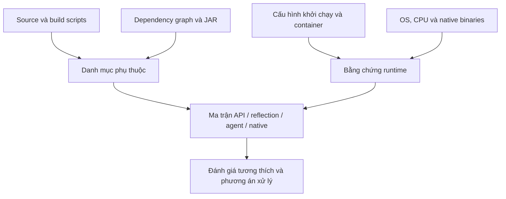

# Tìm API nội bộ, reflection, agent và mã native

Khi khảo sát một hệ thống Java để nâng cấp phiên bản JDK hoặc chuyển sang môi trường triển khai mới, cần tìm những thành phần có thể phụ thuộc vào chi tiết triển khai của JVM, cơ chế truy cập sâu, khả năng biến đổi bytecode hoặc mã chạy bên ngoài JVM. Các thành phần này thường không xuất hiện rõ trong luồng xử lý nghiệp vụ, nhưng có thể quyết định ứng dụng có khởi động và hoạt động đúng sau migration hay không.

Bốn nhóm cần khảo sát là:

- **API nội bộ:** các API không thuộc hợp đồng Java SE được hỗ trợ, hoặc các API nội bộ do ứng dụng/framework tự cung cấp.
- **Reflection:** cơ chế tìm lớp, đọc metadata và gọi thành viên trong runtime, kể cả thành viên không public.
- **Java agent:** thành phần gắn vào JVM để quan sát hoặc biến đổi bytecode khi lớp được nạp hay trong lúc chạy.
- **Mã native:** thư viện hoặc hàm máy chạy ngoài bytecode JVM, thường được gọi qua JNI, JNA hoặc Foreign Function and Memory API.

Mục tiêu của khảo sát là xác định thành phần nào đang được sử dụng, được gọi ở đâu, cần điều kiện runtime nào và có phương án thay thế hoặc nâng cấp nào. Chỉ tìm chuỗi trong mã nguồn là chưa đủ, vì một số hành vi được kích hoạt qua dependency, cấu hình, annotation, service loader hoặc tham số khởi chạy.

## 1. Phân biệt các nhóm cần tìm

Cụm từ “API nội bộ” có thể chỉ nhiều loại khác nhau. Cần phân loại trước khi đánh giá rủi ro.

| Nhóm | Ví dụ | Rủi ro khi migration |
|---|---|---|
| JDK internal API | `sun.*`, `com.sun.*`, `jdk.internal.*` | Không thuộc API Java SE được bảo đảm; có thể bị đóng gói module hoặc thay đổi |
| API nội bộ của ứng dụng | Package implementation chỉ dành cho module khác trong cùng hệ thống | Thay đổi module, package hoặc phiên bản có thể phá vỡ consumer |
| Reflection vào API private | `setAccessible(true)`, `trySetAccessible()` | Module encapsulation và quyền truy cập có thể chặn thao tác |
| Java agent | `-javaagent`, `premain`, `agentmain` | Agent có thể không tương thích JDK, bytecode hoặc cơ chế attach |
| Native integration | JNI, JNA, `System.loadLibrary()` | Phụ thuộc OS, CPU, ABI, linker và thư viện hệ thống |
| Runtime-generated code | Proxy, bytecode generation, class loader tùy chỉnh | Có thể tạo bytecode hoặc truy cập nội bộ không tương thích |

Một API không public không tự động có nghĩa là ứng dụng đang sử dụng JDK internal API. Ví dụ, package `com.example.internal` có thể chỉ là quy ước đặt tên trong dự án. Ngược lại, một thư viện có thể không chứa chuỗi `sun.` trong mã ứng dụng nhưng vẫn dùng reflection hoặc agent để truy cập các thành phần bên trong JDK.

Vì vậy, báo cáo khảo sát cần ghi rõ loại phụ thuộc, chủ sở hữu và cách sử dụng thực tế thay vì gộp tất cả vào một nhãn “API nội bộ”.

## 2. Tìm JDK internal API và API implementation

### 2.1. JDK internal API là gì?

Java cung cấp các API Java SE được mô tả trong tài liệu và đặc tả công khai. Bên cạnh đó, JDK có các package phục vụ triển khai nội bộ, công cụ hoặc tính năng riêng của nhà cung cấp. Những package này không tạo thành hợp đồng tương thích Java SE.

Một số namespace thường đáng chú ý:

- `sun.*`
- `com.sun.*`
- `jdk.internal.*`
- Các package nội bộ khác được phát hiện qua module descriptor hoặc tài liệu của JDK cụ thể.

Không nên kết luận chỉ dựa trên tiền tố package. Một số API trong namespace `com.sun.*` có thể được tài liệu hóa cho mục đích cụ thể, và một số API không có tiền tố dễ nhận biết vẫn có thể là API riêng của nhà cung cấp. Hãy xác minh từng lớp bằng tài liệu của phiên bản JDK mục tiêu.

Từ Java 9, hệ thống module làm rõ ranh giới giữa package được export và package không được export. Việc ứng dụng trước đây truy cập được một lớp không có nghĩa package đó sẽ tiếp tục mở cho mọi module ở các phiên bản sau. Java 16 và Java 17 tiếp tục siết chặt cơ chế encapsulation đối với nhiều API nội bộ; do đó, hệ thống cũ có thể phát sinh lỗi khi chuyển sang runtime mới.

### 2.2. Tìm trong mã nguồn

Có thể bắt đầu bằng tìm kiếm tĩnh các package và tên API thường gặp. Ví dụ với ripgrep:

```bash
rg -n -F -e "sun." -e "com.sun." -e "jdk.internal." .
rg -n -F -e "Unsafe" -e "ReflectionFactory" -e "SharedSecrets" .
rg -n -F -e "jdk.internal." -e "com.sun." --glob "*.{java,kt,groovy,scala}" .
```

Mẫu tìm kiếm chỉ là điểm khởi đầu. Cần mở từng kết quả để xác định:

- Lớp nào đang được tham chiếu?
- Reference nằm trong code sản phẩm, test, build logic hay công cụ phát triển?
- Có điều kiện phiên bản hoặc nhánh platform riêng không?
- Lớp đó được gọi trực tiếp hay chỉ được tham chiếu trong một adapter không còn dùng?
- Có phương án Java SE hoặc API được hỗ trợ thay thế không?

Nếu dự án có nhiều module, hãy tìm trên toàn bộ source set và các module nội bộ. Không chỉ tìm trong thư mục `src/main/java`; mã có thể nằm trong `src/test`, `buildSrc`, convention plugin, source generator hoặc thư mục chứa mã được sinh tự động.

### 2.3. Phân tích dependency và bytecode

Mã nguồn ứng dụng có thể sạch nhưng một dependency vẫn gọi API nội bộ. Công cụ `jdeps` có thể phân tích tham chiếu từ class file và JAR:

```bash
jdeps --jdk-internals --recursive path/to/application.jar
```

Kết quả giúp nhận diện một số tham chiếu bytecode đến JDK internal API và có thể gợi ý API thay thế. Cần đọc cảnh báo theo đúng phiên bản JDK đang dùng.

Một số giới hạn quan trọng:

- `jdeps` chủ yếu phân tích quan hệ tĩnh trong bytecode.
- Tên lớp được tạo từ chuỗi, cấu hình hoặc ghép động có thể không được phát hiện.
- Reflection và native code có thể che giấu điểm truy cập.
- Một JAR lồng trong executable JAR có thể cần được trích xuất hoặc phân tích riêng tùy cấu trúc đóng gói.
- Kết quả không chứng minh một API có được gọi trên mọi đường chạy hay không.

Với Gradle, có thể xem dependency graph của runtime:

```bash
./gradlew dependencies --configuration runtimeClasspath
./gradlew dependencyInsight --dependency artifact-name --configuration runtimeClasspath
```

Với Maven:

```bash
mvn dependency:tree -Dscope=runtime
```

Sau khi xác định JAR đáng chú ý, có thể dùng `jar tf` để xem nội dung và `javap -verbose` để xem tham chiếu, descriptor hoặc metadata của class cụ thể.

### 2.4. Đánh giá cách xử lý

Khi tìm thấy JDK internal API, hãy ưu tiên theo thứ tự:

1. Thay bằng API Java SE hoặc API công khai được hỗ trợ.
2. Nâng dependency lên phiên bản đã loại bỏ phụ thuộc nội bộ.
3. Thay thư viện nếu dự án không còn bản phát hành tương thích.
4. Cô lập phần phụ thuộc sau một interface/adapter để giới hạn phạm vi ảnh hưởng.
5. Chỉ cân nhắc tùy chọn mở module như một biện pháp chuyển tiếp có kiểm soát, nếu chưa thể thay thế ngay và đã hiểu chính xác package cần mở.

Ví dụ, `--add-exports` có thể export một package của module cho module khác sử dụng API public trong package đó:

```bash
java --add-exports java.base/some.internal.package=ALL-UNNAMED -jar app.jar
```

Tùy chọn `--add-opens` cho phép deep reflection vào package được chỉ định ở runtime:

```bash
java --add-opens java.base/some.internal.package=ALL-UNNAMED -jar app.jar
```

Tên module và package ở ví dụ trên chỉ mang tính minh họa; phải lấy giá trị thực tế từ lỗi và cấu trúc JDK mục tiêu. `ALL-UNNAMED` áp dụng cho các thành phần trên classpath không thuộc named module.

Hai tùy chọn có mục đích khác nhau. `--add-exports` không tự cấp quyền deep reflection; `--add-opens` cũng không biến API nội bộ thành API Java SE được bảo đảm. Chúng là cấu hình tương thích có phạm vi, không phải lời khẳng định rằng dependency đã trở nên ổn định lâu dài.

## 3. Tìm và đánh giá reflection

### 3.1. Reflection hoạt động như thế nào?

Reflection cho phép chương trình kiểm tra và tương tác với cấu trúc lớp trong runtime. Ứng dụng có thể tìm lớp theo tên, lấy constructor hoặc method, đọc field, tạo instance và gọi method mà không cần tham chiếu trực tiếp ở mã nguồn tại thời điểm compile.

Ví dụ:

```java
Class<?> type = Class.forName("com.example.plugin.ReportPlugin");
Object plugin = type.getDeclaredConstructor().newInstance();

var method = type.getMethod("generate");
Object result = method.invoke(plugin);
```

Đây là cách phổ biến để xây dựng plugin hoặc tích hợp framework. Reflection tự thân không phải API nội bộ và không phải lúc nào cũng nguy hiểm. Rủi ro tăng lên khi ứng dụng truy cập thành viên private, dựa vào cấu trúc implementation hoặc dùng reflection để vượt qua ranh giới module.

### 3.2. Những mẫu code nên tìm

Tìm các API reflection phổ biến:

```bash
rg -n -F -e "Class.forName" -e "loadClass" -e "getDeclaredMethod" -e "getDeclaredField" .
rg -n -F -e "setAccessible" -e "trySetAccessible" -e "canAccess" -e "privateLookupIn" .
rg -n -F -e "MethodHandles" -e "MethodHandle" -e "Proxy.newProxyInstance" .
rg -n -F -e "getDeclaredMethods" -e "getDeclaredFields" .
```

Cần phân biệt các trường hợp:

| Mẫu sử dụng | Ý nghĩa cần khảo sát |
|---|---|
| `Class.forName(name)` | Lớp có thể được chọn bằng cấu hình hoặc tên runtime |
| `ClassLoader.loadClass(name)` | Có thể phụ thuộc class loader hoặc plugin |
| `getMethod()` | Tìm method public theo tên và kiểu tham số |
| `getDeclaredMethod()` | Tìm method được khai báo trực tiếp, kể cả non-public |
| `getDeclaredField()` | Có thể truy cập trạng thái nội bộ của class |
| `setAccessible(true)` | Yêu cầu bỏ qua một số kiểm tra truy cập; có thể bị module system chặn |
| `MethodHandles.privateLookupIn()` | Tạo lookup có quyền truy cập sâu khi điều kiện module cho phép |
| `Proxy.newProxyInstance()` | Tạo proxy runtime; cần kiểm tra interface và class loader |

Tìm chuỗi API chưa đủ. Ví dụ, một framework có thể nhận tên class từ YAML hoặc annotation rồi thực hiện reflection bên trong thư viện. Khi đó, source ứng dụng không chứa lời gọi reflection trực tiếp.

### 3.3. Các nguồn reflection gián tiếp

Hãy kiểm tra những cơ chế sau:

- Dependency injection và IoC container quét classpath, constructor, field hoặc annotation.
- ORM ánh xạ entity, đọc field và gọi constructor.
- JSON/XML serializer tạo object và gán thuộc tính.
- Validation framework tìm annotation và method.
- Plugin system nạp class theo tên cấu hình.
- Test framework phát hiện test và gọi lifecycle method.
- Logging, metrics, tracing hoặc security framework kiểm tra class và method.
- Framework proxy tạo subclass hoặc proxy interface.
- Serialization/deserialization khôi phục object theo metadata.
- Thư viện mapping, object copier hoặc expression engine.

Đối với từng framework, ghi lại phiên bản, cách cấu hình và những package cần được truy cập. Nếu framework có tài liệu migration theo JDK, hãy đối chiếu với cấu hình thực tế của ứng dụng.

### 3.4. Reflection và Java Platform Module System

Từ Java 9, module có thể export package cho truy cập thông thường hoặc open package cho deep reflection. Hai khái niệm không giống nhau:

- **exports:** cho phép module khác truy cập các kiểu public trong package được export, theo quy tắc module.
- **opens:** cho phép deep reflection vào package, bao gồm những thành viên không public trong phạm vi quy định.

Một lời gọi reflection có thể thất bại với:

```text
java.lang.reflect.InaccessibleObjectException
```

Lỗi thường cho biết module nguồn, package cần mở và module đích. Dùng thông tin đó để xác định dependency hoặc framework đang truy cập sâu.

Ví dụ một cấu hình chẩn đoán có dạng:

```bash
java --add-opens java.base/java.lang=ALL-UNNAMED -jar app.jar
```

Đây chỉ là ví dụ cú pháp. Không nên thêm hàng loạt `--add-opens` theo các bài viết trên mạng. Mỗi quyền mở rộng làm giảm tính đóng gói của module và có thể che khuất dependency lỗi thời. Chỉ giữ tùy chọn khi đã ghi nhận lý do, phạm vi, chủ sở hữu và kế hoạch loại bỏ.

### 3.5. Reflection động khó phát hiện bằng tìm kiếm tĩnh

Một số tên class hoặc member được tạo từ:

- File YAML, properties, XML hoặc JSON.
- Biến môi trường và tham số dòng lệnh.
- Tên plugin được lưu trong database.
- Annotation được framework xử lý.
- Tên class được ghép từ package và hậu tố.
- Service provider được đăng ký trong `META-INF/services` hoặc module descriptor.

Vì vậy, cần kết hợp tìm kiếm source với kiểm tra cấu hình, dependency và quan sát runtime. Với các luồng ít được kích hoạt, có thể bổ sung integration test để chạy plugin, serializer, ORM mapping hoặc chức năng quản trị liên quan.

## 4. Tìm Java agent và cơ chế instrumentation

### 4.1. Java agent là gì?

Java agent là thành phần được JVM nạp để quan sát hoặc thay đổi hành vi class loading và bytecode. Agent thường được dùng cho:

- APM và distributed tracing.
- Profiling và giám sát hiệu năng.
- Code coverage.
- Instrumentation cho test.
- Theo dõi bảo mật hoặc phát hiện hành vi bất thường.
- Biến đổi bytecode phục vụ framework hoặc runtime enhancement.

Một agent có thể chạy trước khi hàm `main` bắt đầu hoặc được attach vào một JVM đang chạy, tùy cách đóng gói và khả năng của runtime.

Agent Java thường sử dụng API `java.lang.instrument.Instrumentation` và thư viện thao tác bytecode như ASM hoặc Byte Buddy. Agent native có thể sử dụng JVMTI.

### 4.2. Tìm agent trong cấu hình khởi chạy

Tìm các tham số và API sau trong script, Dockerfile, manifest, cấu hình CI/CD và lệnh chạy:

```bash
rg -n --hidden --glob "!**/.git/**" -F -e "-javaagent" -e "-agentlib" -e "-agentpath" -e "VirtualMachine.attach" .
rg -n --hidden --glob "!**/.git/**" -F -e "Premain-Class" -e "Agent-Class" -e "Can-Retransform-Classes" -e "Can-Redefine-Classes" .
```

Các tham số quan trọng:

| Tham số | Công dụng |
|---|---|
| `-javaagent:path/to/agent.jar` | Nạp Java agent lúc JVM khởi động |
| `-agentlib:name` | Nạp native agent theo tên thư viện |
| `-agentpath:path` | Nạp native agent theo đường dẫn |
| `-D...` | Truyền system property; thường dùng để cấu hình agent hoặc thư viện liên quan |

Không phải mọi `-D...` đều là cấu hình agent. Hãy đối chiếu tên property với tài liệu của dependency hoặc script khởi chạy.

### 4.3. Kiểm tra manifest và entry point

JAR của Java agent thường khai báo metadata trong `META-INF/MANIFEST.MF`. Hai entry thường gặp:

- `Premain-Class`: lớp cung cấp phương thức `premain` cho agent được nạp lúc khởi động.
- `Agent-Class`: lớp cung cấp phương thức `agentmain` cho agent được attach vào JVM đang chạy.

Có thể kiểm tra manifest bằng:

```bash
jar tf agent.jar
jar xf agent.jar META-INF/MANIFEST.MF
```

Ví dụ entry point minh họa:

```java
public final class ExampleAgent {
    public static void premain(
            String agentArgs,
            java.lang.instrument.Instrumentation instrumentation) {
        // Đăng ký ClassFileTransformer hoặc quan sát runtime
    }

    public static void agentmain(
            String agentArgs,
            java.lang.instrument.Instrumentation instrumentation) {
        // Khởi tạo khi agent được attach
    }
}
```

Một agent có thể chỉ triển khai một trong hai entry point. Việc có manifest entry không tự chứng minh agent thực sự được nạp trong production; cần kiểm tra lệnh chạy hoặc bằng chứng runtime.

### 4.4. Kiểm tra transformer và bytecode được biến đổi

Agent có thể đăng ký `ClassFileTransformer` để thay đổi bytecode trước khi JVM định nghĩa class. Một số agent còn hỗ trợ retransformation hoặc redefinition đối với class đã nạp, tùy khả năng được khai báo và giới hạn JVM.

Khi khảo sát, cần tìm:

- Class transformer được đăng ký ở đâu.
- Những package/class nào bị biến đổi.
- Agent có phụ thuộc vào thứ tự nạp với agent khác không.
- Có dùng ASM, Byte Buddy hoặc thư viện bytecode nào không.
- Có giả định về cấu trúc bytecode, method descriptor hoặc class loader không.
- Agent hỗ trợ phiên bản Java mục tiêu nào.
- Agent có cần attach API hoặc quyền hệ điều hành đặc biệt không.

Nhiều agent cùng biến đổi một class có thể tạo ra lỗi phụ thuộc thứ tự. Một agent cũ cũng có thể không hiểu class file version mới hoặc giả định cấu trúc bytecode không còn đúng sau khi nâng compiler.

### 4.5. Attach API và dynamic agent loading

Một số công cụ dùng Attach API để kết nối vào tiến trình JVM đang chạy rồi nạp agent. Hành vi này phụ thuộc phiên bản JDK, cấu hình runtime, quyền của user, môi trường container và chính sách bảo mật.

Tìm các điểm gọi như:

```java
com.sun.tools.attach.VirtualMachine.attach(processId);
```

Cần xác định:

- Thành phần nào thực hiện attach.
- JVM đích có cho phép attach không.
- Tiến trình gọi và tiến trình đích có cùng user/quyền phù hợp không.
- Cơ chế này có hoạt động trong container hoặc môi trường production không.
- JDK runtime có chứa module/công cụ cần thiết không.
- Hệ thống có chính sách tắt dynamic loading hoặc giới hạn attach không.

Không nên giả định rằng một profiler chạy được trên máy phát triển thì chắc chắn attach được trong production. Hãy kiểm tra đúng image, user và tham số JVM của môi trường đích.

## 5. Tìm mã native và ranh giới giữa JVM với hệ điều hành

### 5.1. Mã native là gì?

Mã native là mã máy được biên dịch cho một nền tảng cụ thể. Java có thể gọi mã native để sử dụng driver, thư viện hệ thống, thuật toán tối ưu hoặc thành phần đã tồn tại bằng C/C++ và ngôn ngữ khác.

Các đường tích hợp thường gặp:

- JNI (Java Native Interface).
- JNA (Java Native Access).
- Foreign Function and Memory API.
- Native agent sử dụng JVMTI.
- Tiến trình ngoài được gọi bằng `ProcessBuilder` hoặc shell.

Một ứng dụng có thể không có file C/C++ trong repository nhưng vẫn phụ thuộc native code thông qua JAR chứa file `.dll`, `.so` hoặc `.dylib`.

### 5.2. Tìm JNI trong source

Tìm từ khóa native method và thao tác nạp thư viện:

```bash
rg -n -F -e "native " -e "System.loadLibrary" -e "System.load(" .
rg -n -F -e "JNIEXPORT" -e "JNIEnv" -e "Java_" --glob "*.{c,cc,cpp,h,hpp}" .
```

Ví dụ Java khai báo native method:

```java
public final class NativeCodec {
    static {
        System.loadLibrary("nativecodec");
    }

    public native byte[] encode(byte[] input);
}
```

Phần triển khai native phải cung cấp hàm phù hợp với tên và quy ước JNI, hoặc đăng ký native method bằng cơ chế tương ứng. Khi khảo sát, hãy nối được ba điểm: khai báo Java, thư viện được nạp và hàm native thực tế.

### 5.3. Tìm JNA và Foreign Function and Memory API

Không phải tích hợp native nào cũng có từ khóa `native` trong Java. JNA thường sử dụng interface ánh xạ hàm native và tải thư viện theo tên. Có thể tìm các dấu hiệu:

```bash
rg -n -F -e "com.sun.jna" -e "Native.load" -e "Pointer" -e "Structure" .
rg -n -F -e "java.lang.foreign" -e "Linker" -e "MemorySegment" -e "SymbolLookup" .
```

Foreign Function and Memory API có trạng thái và cách sử dụng thay đổi theo phiên bản JDK; một số phiên bản trước khi hoàn thiện có thể yêu cầu preview flag. Khi đánh giá, phải đối chiếu đúng JDK source level, compiler flag và runtime flag mà dự án đang dùng. Không được coi một đoạn code FFM chạy trên một JDK là tự động tương thích với mọi JDK khác.

### 5.4. Kiểm tra binary và nền tảng

Thư viện native thường phụ thuộc đồng thời vào:

- Hệ điều hành: Windows, Linux, macOS hoặc nền tảng khác.
- Kiến trúc CPU: x86-64, ARM64 hoặc kiến trúc tương ứng.
- ABI và convention gọi hàm.
- Runtime C/C++ và thư viện hệ thống.
- Phiên bản libc hoặc môi trường tương thích.
- Tên symbol và dependency động.
- Quyền truy cập file và đường dẫn nạp thư viện.

Một file native build cho Linux x86-64 không thể dùng trực tiếp trên Linux ARM64. Tương tự, một thư viện build cho glibc có thể không chạy trong image sử dụng musl nếu không có lớp tương thích phù hợp.

Một số công cụ kiểm tra theo nền tảng:

| Nền tảng | Công cụ thường dùng | Mục đích |
|---|---|---|
| Linux | `file`, `ldd`, `readelf`, `nm` | Xem kiến trúc, dependency động, ELF và symbol |
| macOS | `file`, `otool -L`, `nm` | Xem kiến trúc, dynamic library và symbol |
| Windows | `dumpbin /DEPENDENTS`, `dumpbin /HEADERS` | Xem dependency và thông tin PE/COFF |

Các công cụ và cú pháp khác nhau theo hệ điều hành; không chạy lệnh của nền tảng này trên nền tảng khác rồi xem kết quả thiếu là bằng chứng không có dependency.

Với JAR, hãy liệt kê và kiểm tra các binary đóng gói bên trong:

```bash
jar tf dependency.jar
```

Tìm các đường dẫn như `META-INF/native`, tên file `.dll`, `.so` hoặc `.dylib`, đồng thời kiểm tra mã nạp thư viện và quy tắc chọn binary theo platform của dependency.

### 5.5. Lỗi thường gặp ở ranh giới native

| Lỗi | Nguyên nhân có thể gặp | Hướng kiểm tra |
|---|---|---|
| `UnsatisfiedLinkError: no ... in java.library.path` | JVM không tìm thấy thư viện | Đường dẫn, tên file, biến môi trường và cách đóng gói |
| `UnsatisfiedLinkError: ... wrong ELF class` | Binary sai kiến trúc hoặc word size | Kiến trúc JVM và binary |
| `UnsatisfiedLinkError: undefined symbol` | Thiếu symbol hoặc binary dependency không khớp | Symbol table, linker và phiên bản thư viện |
| `NoClassDefFoundError` quanh lớp binding | Thiếu JAR Java wrapper | Runtime dependency |
| JVM crash hoặc process bị dừng | Native code có thể truy cập bộ nhớ sai hoặc gây lỗi ngoài phạm vi kiểm tra bytecode | hs_err log, core dump, native stack và phiên bản binary |

Khác với exception Java thông thường, lỗi bộ nhớ trong native code có thể làm hỏng tiến trình JVM. Cần xem crash log, core dump và thông tin binary; không thể chỉ dựa vào stack trace Java.

## 6. Khảo sát theo nhiều lớp để tránh bỏ sót

Một cuộc khảo sát đáng tin cậy nên kết hợp các nguồn bằng chứng sau:



### Lớp 1: Source và build logic

Tìm package nội bộ, reflection, agent, native loading, proxy và bytecode generation trong:

- Source sản phẩm.
- Source test và integration test.
- Build script, convention plugin và annotation processor.
- Script khởi chạy, Dockerfile và file cấu hình.
- Mã được sinh tự động nếu nó được lưu trong repository.

Ghi lại file, dòng code, module và đường gọi liên quan.

### Lớp 2: Dependency graph

Liệt kê dependency runtime trực tiếp và bắc cầu. Với mỗi dependency đáng chú ý:

- Ghi group, artifact, version và nguồn phân phối.
- Xác định JDK tối thiểu được nhà phát hành hỗ trợ.
- Kiểm tra release note liên quan đến Java target.
- Tìm internal API, reflection, agent và native binary trong JAR.
- Xác định dependency có được đóng gói vào artifact cuối cùng không.

Đặc biệt chú ý các dependency được nạp động, plugin riêng hoặc thư viện chỉ xuất hiện trong một profile triển khai.

### Lớp 3: Artifact cuối cùng

Kiểm tra JAR/WAR hoặc image đã build, bởi nội dung artifact có thể khác với dependency graph mà người khảo sát nhìn thấy ở source.

Xác định:

- JAR nào được đóng gói hoặc copy vào image.
- Có native binary nào được nhúng không.
- Manifest của agent có xuất hiện không.
- Service provider và module descriptor được đóng gói thế nào.
- Có class trùng tên hoặc nhiều phiên bản thư viện cùng tồn tại không.

### Lớp 4: Cấu hình và runtime

Kiểm tra cấu hình thực tế được dùng khi chạy:

- Tham số `-javaagent`, `-agentlib` và `-agentpath`.
- Các tùy chọn `--add-exports` và `--add-opens`.
- `java.library.path` và biến môi trường liên quan.
- Classpath, module path và cấu hình plugin.
- User chạy JVM, quyền attach và quyền truy cập file.
- OS, CPU, base image và thư viện hệ thống.

Có thể ghi nhận tham số runtime từ script hoặc cấu hình triển khai đã được phê duyệt. Nếu có quyền quan sát tiến trình, dùng công cụ chẩn đoán JVM để xác nhận cấu hình đang hoạt động thay vì chỉ dựa vào file cấu hình có thể chưa được triển khai.

### Lớp 5: Kiểm thử theo đường chạy

Chạy những chức năng có khả năng kích hoạt các cơ chế đã tìm thấy:

- Khởi tạo toàn bộ Spring/application context hoặc framework tương ứng.
- Quét entity, serializer, validator và dependency injection.
- Nạp plugin theo cấu hình.
- Chạy chức năng dùng reflection vào private member.
- Khởi tạo agent và xác nhận transformer hoạt động.
- Gọi các chức năng dùng JNI/JNA/FFM.
- Chạy test trên đúng OS/CPU và runtime image mục tiêu.

Một thành phần có thể chỉ được nạp khi một chức năng hiếm dùng được gọi. Vì vậy, “ứng dụng khởi động thành công” chưa đủ để kết luận toàn bộ hệ thống không còn phụ thuộc cần xử lý.

## 7. Lập hồ sơ phát hiện và đánh giá rủi ro

Mỗi phát hiện nên có thông tin đủ để nhóm migration xử lý mà không phải tìm lại từ đầu.

| Trường | Nội dung cần ghi |
|---|---|
| ID | Mã phát hiện duy nhất |
| Thành phần | Module, dependency hoặc image chứa phụ thuộc |
| Loại | JDK internal API, app internal API, reflection, agent, JNI/JNA/FFM |
| Vị trí | File, class, method, cấu hình hoặc tham số khởi chạy |
| Đường kích hoạt | Startup, request, scheduled job, plugin hoặc chức năng cụ thể |
| Phiên bản hiện tại | JDK, dependency, agent hoặc native binary |
| Phiên bản mục tiêu | Runtime và phiên bản dependency dự kiến |
| Bằng chứng | Kết quả tìm kiếm, stack trace, jdeps, manifest hoặc runtime log |
| Tác động | Startup failure, chức năng lỗi, hiệu năng, bảo mật hoặc portability |
| Phương án | Thay API, nâng dependency, cấu hình chuyển tiếp, rebuild native hoặc loại bỏ |
| Chủ sở hữu | Team/module chịu trách nhiệm |
| Trạng thái | Chưa xử lý, đang xử lý, đã kiểm chứng |

Có thể phân loại mức độ ưu tiên như sau:

- **Cao:** phụ thuộc đã gây lỗi trên runtime mục tiêu, native binary sai nền tảng, hoặc agent không thể khởi động.
- **Trung bình:** có sử dụng internal API/deep reflection nhưng đã xác định được đường thay thế hoặc workaround tạm thời.
- **Thấp:** có dấu hiệu trong code nhưng chưa được kích hoạt, chỉ nằm trong test/tooling hoặc đã có nhánh tương thích được kiểm chứng.

Mức ưu tiên cần dựa trên bằng chứng và khả năng xảy ra trong production. Không nên đánh dấu mọi kết quả tìm kiếm là blocker; cũng không nên bỏ qua một dependency chỉ vì chưa xuất hiện trong log của lần chạy ngắn.

## 8. Ví dụ khảo sát một dependency có nhiều cơ chế đặc biệt

Giả sử ứng dụng dùng thư viện `legacy-monitor`. Trong quá trình khảo sát phát hiện:

1. JAR chứa lời gọi đến một JDK internal API.
2. Thư viện dùng reflection để truy cập field private của một class nền tảng.
3. Script khởi chạy production có `-javaagent:legacy-monitor.jar`.
4. JAR chứa file `libmonitor.so` cho Linux x86-64.

Không nên xử lý bốn phát hiện như một lỗi duy nhất. Cần tách chúng thành các hợp đồng khác nhau:

| Phát hiện | Câu hỏi xác minh | Hướng xử lý |
|---|---|---|
| JDK internal API | Phiên bản mới có API công khai thay thế không? | Nâng/thay thư viện hoặc chuyển sang API được hỗ trợ |
| Deep reflection | Module/package nào bị truy cập và có bản thư viện tương thích không? | Nâng dependency; chỉ mở package tạm thời nếu có căn cứ |
| Java agent | Agent hỗ trợ JDK mục tiêu và class file mới không? | Nâng agent, kiểm tra thứ tự nạp và transformer |
| Native binary | Có binary cho OS/CPU/base image mới không? | Lấy bản phát hành đúng nền tảng hoặc build lại từ source |

Sau khi nâng thư viện, cần kiểm tra lại toàn bộ bốn điểm. Nhà phát hành có thể sửa reflection nhưng vẫn đóng gói native binary cũ; hoặc agent mới có thể hỗ trợ JDK mục tiêu nhưng dependency runtime bên trong vẫn chưa tương thích.

Một kiểm thử phù hợp phải chạy trên đúng runtime và image dự kiến triển khai, khởi động agent, kích hoạt chức năng giám sát và gọi nhánh dùng native code. Nếu chỉ chạy unit test trên máy phát triển, phần lớn rủi ro trên có thể chưa được kiểm chứng.

## 9. Nguyên tắc xử lý khi migration

Khi đã có danh mục phát hiện, nên xử lý theo các nguyên tắc sau:

**Ưu tiên hợp đồng công khai.** Thay JDK internal API bằng API Java SE hoặc API được nhà phát hành hỗ trợ. Điều này giảm phụ thuộc vào cấu trúc implementation.

**Nâng dependency trước khi viết workaround.** Framework hoặc thư viện mới có thể đã giải quyết reflection, module access, agent instrumentation và native packaging. Kiểm tra release note và ma trận hỗ trợ JDK của nhà phát hành.

**Giới hạn quyền truy cập.** Nếu cần `--add-opens` hoặc `--add-exports` để chuyển tiếp, chỉ mở package cần thiết cho đúng module đích, ghi nhận lý do và đặt kế hoạch loại bỏ.

**Quản lý agent như một thành phần runtime.** Agent cần được version hóa, kiểm thử cùng JVM, ghi rõ thứ tự nạp và đưa vào cấu hình triển khai có kiểm soát.

**Build native theo ma trận nền tảng.** Mỗi binary cần xác định OS, CPU, ABI và dependency hệ thống. Không tái sử dụng binary chỉ vì tên file giống nhau.

**Cô lập điểm phụ thuộc.** Đặt tích hợp đặc biệt sau interface hoặc adapter để việc thay thư viện không lan rộng vào logic nghiệp vụ.

**Kiểm thử hành vi thực tế.** Kiểm tra startup, request, plugin, serialization, agent, native call, shutdown và các chức năng ít được sử dụng. Lưu log và artifact để có thể tái hiện kết quả.

## 10. Checklist khảo sát

### API nội bộ

- [ ] Đã tìm các namespace và class có dấu hiệu là JDK internal API.
- [ ] Đã phân biệt JDK internal API với package internal của ứng dụng.
- [ ] Đã kiểm tra source, dependency graph và bytecode/JAR.
- [ ] Đã chạy `jdeps --jdk-internals` trên artifact phù hợp.
- [ ] Đã xác định API thay thế hoặc phương án chuyển tiếp cho từng phát hiện.

### Reflection

- [ ] Đã tìm `Class.forName`, class loader và các API `getDeclared*`.
- [ ] Đã tìm `setAccessible`, `trySetAccessible` và MethodHandles.
- [ ] Đã kiểm tra framework quét annotation, ORM, serializer, DI và plugin.
- [ ] Đã kiểm tra class name hoặc member name lấy từ cấu hình.
- [ ] Đã ghi nhận package cần mở và module đích nếu có deep reflection.

### Agent

- [ ] Đã tìm tham số `-javaagent`, `-agentlib` và `-agentpath`.
- [ ] Đã kiểm tra manifest và entry point của agent.
- [ ] Đã xác định transformer, thư viện bytecode và class loader liên quan.
- [ ] Đã kiểm tra attach API, quyền runtime và chính sách dynamic loading.
- [ ] Đã xác nhận phiên bản agent hỗ trợ JDK mục tiêu.

### Native code

- [ ] Đã tìm native method, `System.loadLibrary` và `System.load`.
- [ ] Đã tìm JNA, FFM và thư viện native nằm trong JAR.
- [ ] Đã kiểm tra OS, CPU, ABI và dependency động của binary.
- [ ] Đã kiểm tra native agent/JVMTI nếu có.
- [ ] Đã chạy kiểm thử native trên image và kiến trúc triển khai thực tế.

### Bằng chứng và kết luận

- [ ] Mỗi phát hiện có vị trí, đường kích hoạt và bằng chứng.
- [ ] Đã phân loại mức độ ảnh hưởng theo môi trường mục tiêu.
- [ ] Đã gán module hoặc team chịu trách nhiệm.
- [ ] Đã xác định phương án xử lý và điều kiện xác nhận hoàn tất.
- [ ] Đã kiểm thử các đường chạy quan trọng trên runtime mục tiêu.

## Kết luận

API nội bộ, reflection, Java agent và mã native là những điểm phụ thuộc thường bị bỏ sót khi khảo sát tương thích Java. Chúng có thể nằm trong mã ứng dụng, dependency bắc cầu, cấu hình khởi chạy, artifact hoặc image triển khai.

Muốn đánh giá chính xác, cần kết hợp tìm kiếm source, phân tích dependency và bytecode, kiểm tra cấu hình runtime, kiểm tra binary native và chạy các chức năng có liên quan trên môi trường đích. Mỗi phát hiện phải gắn với bằng chứng, đường kích hoạt và phương án xử lý cụ thể. Khi có được danh mục như vậy, nhóm có thể ưu tiên đúng rủi ro và kiểm chứng migration theo từng thành phần.

