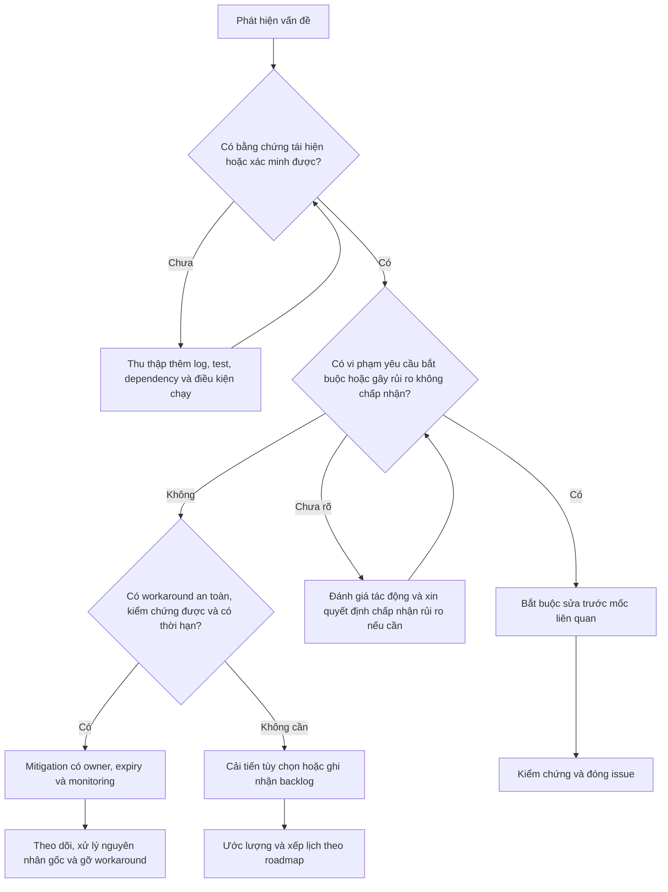

# Phân loại vấn đề bắt buộc sửa, biện pháp tạm thời và cải tiến tùy chọn

## 1. Vì sao cần phân loại vấn đề khi khảo sát hệ thống?

Trong một đợt khảo sát để chuẩn bị nâng cấp Java, nhóm phát triển thường tìm thấy nhiều loại vấn đề cùng lúc: một thư viện không chạy trên JDK mục tiêu, một plugin build đã cũ, một API deprecated, một cảnh báo bảo mật, một bài test không ổn định, hoặc một đoạn mã có thể được thiết kế lại cho dễ bảo trì. Nếu đưa tất cả vào cùng một danh sách “cần sửa trước khi migration”, phạm vi công việc sẽ phình to và khó xác định điều kiện hoàn thành. Ngược lại, nếu coi mọi vấn đề là việc cải tiến về sau, nhóm có thể bỏ sót lỗi khiến ứng dụng không build, không khởi động hoặc làm sai dữ liệu trên nền tảng mới.

Vì vậy, sau khi thu thập bằng chứng, cần phân loại từng phát hiện theo mức độ bắt buộc và cách xử lý phù hợp:

1. **Bắt buộc sửa (mandatory fix):** vấn đề phải được xử lý trước khi chuyển sang mốc migration hoặc phát hành đã xác định, vì nó làm vi phạm yêu cầu kỹ thuật, an toàn, dữ liệu, vận hành hoặc hợp đồng tương thích.
2. **Biện pháp tạm thời (temporary mitigation):** cách kiểm soát có giới hạn để hệ thống tiếp tục hoạt động hoặc để migration có thể đi tiếp trong khi nguyên nhân gốc chưa được xử lý hoàn toàn. Biện pháp này phải có người chịu trách nhiệm, giới hạn sử dụng, cách theo dõi và điều kiện kết thúc.
3. **Cải tiến tùy chọn (optional improvement):** công việc có ích cho chất lượng, khả năng bảo trì, hiệu năng hoặc các lần nâng cấp sau, nhưng chưa phải điều kiện để đạt mục tiêu migration hiện tại.

Ba nhóm này mô tả **quyết định xử lý**, không phải ba mức độ quan trọng cố định của mọi vấn đề. Một cải tiến nhỏ có thể trở thành bắt buộc nếu nó là điều kiện để đáp ứng yêu cầu bảo mật hoặc SLA. Một lỗi ban đầu có vẻ nghiêm trọng có thể được kiểm soát bằng biện pháp tạm thời trong một giai đoạn ngắn, nếu đã chứng minh được phạm vi ảnh hưởng và có chấp thuận rủi ro phù hợp.

Trong ngữ cảnh Java Advance Compatibility Migration, mục tiêu của phân loại là giữ đúng phạm vi nâng cấp: giải quyết những gì cần thiết để build, test, chạy và giao tiếp an toàn trên tập phiên bản mục tiêu; kiểm soát các ngoại lệ có thời hạn; đồng thời ghi nhận các cải tiến có giá trị để nhóm có thể lập kế hoạch riêng.

## 2. Định nghĩa và tiêu chí của từng nhóm

### 2.1. Vấn đề bắt buộc sửa

Một phát hiện thuộc nhóm bắt buộc sửa khi nếu để nguyên, hệ thống không thể đáp ứng một điều kiện đã xác định của migration hoặc tạo ra rủi ro không thể chấp nhận. Các dấu hiệu thường gặp:

- Mã nguồn không biên dịch được bằng compiler hoặc mức ngôn ngữ mục tiêu.
- Artifact có bytecode mà JVM mục tiêu không thể nạp, hoặc một dependency bắt buộc yêu cầu JDK cao hơn mức runtime đã cam kết.
- Ứng dụng không khởi động, lỗi liên kết class/method, hoặc một luồng nghiệp vụ quan trọng không chạy được trên runtime mục tiêu.
- Framework, thư viện, plugin hoặc build tool nằm ngoài ma trận hỗ trợ cần thiết và gây lỗi có thể tái hiện.
- Hành vi thay đổi làm sai kết quả nghiệp vụ, ghi sai hoặc mất dữ liệu, phá vỡ hợp đồng API/message, hoặc làm consumer hiện hữu không thể tiếp tục hoạt động.
- Lỗ hổng bảo mật, cấu hình yếu hoặc thay đổi mặc định khiến hệ thống vi phạm chính sách bảo mật hay yêu cầu tuân thủ.
- Kiểm thử quan trọng không thể chạy hoặc không còn cung cấp bằng chứng đủ tin cậy để cho phép phát hành.
- Không có cách build/release lặp lại được trên toolchain mục tiêu, khiến artifact phát hành không thể xác minh hoặc tái tạo.

“Bắt buộc sửa” cần gắn với một mốc rõ ràng. Ví dụ: phải sửa trước khi nâng JDK trên nhánh migration, trước khi triển khai staging, hoặc trước khi đưa bản Java 21 lên production. Không nên dùng nhãn này mà không nói rõ điều kiện nào đang bị vi phạm và mốc nào bị chặn.

### 2.2. Biện pháp tạm thời

Biện pháp tạm thời là cách giảm thiểu tác động hoặc giới hạn phạm vi lỗi trong một khoảng thời gian xác định. Nó có thể giúp nhóm tiếp tục khảo sát, kiểm thử hoặc triển khai từng giai đoạn trong khi việc sửa triệt để đang chờ dependency, nhà cung cấp, lịch phát hành hoặc một thay đổi kiến trúc lớn.

Một mitigation chỉ được xem là có thể chấp nhận khi đáp ứng các điều kiện sau:

- Nguyên nhân hoặc ít nhất phạm vi lỗi đã được hiểu đủ để dự đoán tác động.
- Biện pháp có hiệu quả đã được kiểm chứng bằng test hoặc quan sát runtime phù hợp.
- Không che giấu rủi ro không thể chấp nhận về bảo mật, dữ liệu, tính toàn vẹn hoặc hợp đồng bên ngoài.
- Có phạm vi áp dụng cụ thể: môi trường, module, phiên bản, traffic hoặc nhóm người dùng.
- Có người chịu trách nhiệm, thời hạn xem xét/xóa bỏ và tiêu chí xác nhận đã xử lý xong.
- Có log, metric, cảnh báo hoặc cách kiểm tra để phát hiện khi workaround không còn hiệu quả.
- Có phương án rollback hoặc tắt mitigation khi điều kiện vận hành thay đổi.

Mitigation không tự động biến một lỗi thành “đã sửa”. Issue gốc vẫn phải được theo dõi, có trạng thái riêng và được đóng chỉ khi nguyên nhân gốc đã được giải quyết hoặc quyết định chấp nhận rủi ro được phê duyệt theo quy trình của tổ chức.

### 2.3. Cải tiến tùy chọn

Cải tiến tùy chọn làm hệ thống dễ hiểu, dễ bảo trì, dễ quan sát hoặc hiệu quả hơn nhưng không phải điều kiện để đáp ứng mục tiêu migration hiện tại. Ví dụ:

- Refactor một lớp dài nhưng chưa gây lỗi tương thích hoặc cản trở kiểm thử.
- Chuẩn hóa cách đặt tên, package nội bộ hoặc format code.
- Thay một API deprecated vẫn còn được hỗ trợ bằng API mới, khi API cũ chưa bị loại bỏ và không tạo rủi ro đáng kể trong phạm vi release hiện tại.
- Tối ưu một đường chạy chưa vi phạm ngưỡng latency, throughput hoặc resource đã cam kết.
- Bổ sung test cho trường hợp ít ảnh hưởng, trong khi các hợp đồng quan trọng đã có bằng chứng đầy đủ.
- Nâng một thư viện độc lập chỉ để đồng bộ phiên bản, khi phiên bản hiện tại vẫn được hỗ trợ và tương thích với toolchain mục tiêu.
- Cải thiện tài liệu, logging hoặc cấu trúc module mà không ảnh hưởng đến khả năng phát hành.

Optional không có nghĩa là không quan trọng hoặc không bao giờ làm. Nó có nghĩa công việc đó có thể được ưu tiên theo ngân sách, roadmap và lợi ích sau khi các điều kiện bắt buộc đã được đáp ứng. Một cải tiến tùy chọn có thể được đưa vào cùng migration nếu chi phí thấp, rủi ro thấp và có lợi ích rõ ràng, nhưng cần ghi nhận quyết định đó thay vì âm thầm mở rộng phạm vi.

## 3. Phân biệt mức độ ảnh hưởng với cách xử lý

Mức độ nghiêm trọng (severity), độ ưu tiên (priority) và loại xử lý (mandatory/mitigation/optional) có liên quan nhưng không đồng nghĩa.

- **Severity** mô tả hậu quả nếu vấn đề xảy ra: mất dữ liệu, ngừng dịch vụ, suy giảm hiệu năng, lỗi một chức năng phụ hay chỉ là cảnh báo.
- **Priority** mô tả thứ tự cần xử lý dựa trên tác động, khả năng xảy ra, phạm vi, thời hạn và chi phí trì hoãn.
- **Handling category** xác định nhóm sẽ làm gì: sửa trước mốc, áp dụng workaround có thời hạn, hoặc đưa vào backlog cải tiến.

Ví dụ, một lỗi có severity cao nhưng chỉ xảy ra trên một đường đi hiếm gặp vẫn có thể có priority khác với lỗi làm mọi lần build thất bại. Tuy nhiên, nếu lỗi hiếm gặp liên quan đến sai dữ liệu hoặc khai thác bảo mật, mức độ hậu quả có thể khiến nó trở thành blocker dù xác suất thấp.

Không nên dùng một con số severity duy nhất để tự động quyết định nhóm xử lý. Hãy ghi rõ bằng chứng, điều kiện xảy ra, tác động và mốc bị ảnh hưởng rồi mới chọn cách xử lý.

### 3.1. Các chiều đánh giá

Khi phân loại một phát hiện, đánh giá tối thiểu các chiều sau:

| Chiều đánh giá | Câu hỏi cần đặt ra | Ví dụ bằng chứng |
| --- | --- | --- |
| Khả năng xảy ra | Lỗi có tái hiện ổn định không? Chỉ xuất hiện ở điều kiện nào? | Build log, test lặp lại, startup log, reproduction steps. |
| Phạm vi ảnh hưởng | Một module, một chức năng, toàn bộ dịch vụ hay nhiều consumer? | Dependency graph, danh sách service, API consumer, deployment topology. |
| Tác động | Có gây dừng dịch vụ, sai dữ liệu, vi phạm bảo mật hay chỉ gây bất tiện? | Error rate, dữ liệu đối chiếu, security finding, SLO/SLA. |
| Mức độ phơi nhiễm | Đường lỗi có được gọi trong production hoặc có thể bị người ngoài kích hoạt không? | Traffic, feature usage, endpoint exposure, cấu hình production. |
| Khả năng phát hiện | Nếu xảy ra, nhóm có nhận biết kịp thời không? | Alert, metric, log, health check, reconciliation. |
| Khả năng phục hồi | Có rollback, retry, replay hoặc khôi phục dữ liệu an toàn không? | Runbook, backup/restore test, rollback rehearsal. |
| Khả năng tương thích | Thành phần cũ và mới có phải cùng tồn tại trong giai đoạn chuyển tiếp không? | Producer/consumer versions, schema, binary/API contract. |
| Chi phí trì hoãn | Nếu chưa xử lý, các bước tiếp theo có bị chặn hoặc chi phí sửa tăng không? | Release dependency, vendor support, end-of-life date, migration sequence. |

Không cần chấm điểm phức tạp cho mọi issue. Với phát hiện nhỏ, mô tả ngắn các chiều liên quan là đủ. Với issue ảnh hưởng nhiều module hoặc có rủi ro dữ liệu/bảo mật, cần phân tích sâu và lưu bằng chứng để người phê duyệt có thể đánh giá độc lập.

### 3.2. Cây quyết định phân loại

Có thể dùng trình tự sau để đưa ra quyết định nhất quán:



Nếu chưa có đủ bằng chứng, không nên vội gắn nhãn optional chỉ vì chưa tái hiện được. Hãy giữ trạng thái “đang điều tra” hoặc “chưa xác định”, chỉ rõ dữ liệu còn thiếu và người cần cung cấp dữ liệu. Khi có bằng chứng mới, phân loại lại.

## 4. Khi nào một vấn đề phải được xem là blocker?

Trong migration Java, một phát hiện thường là blocker khi nó trực tiếp ngăn cản một cổng kiểm soát đã định nghĩa hoặc vi phạm yêu cầu không thể miễn trừ. Một số trường hợp điển hình:

### 4.1. Không thể build hoặc tạo artifact hợp lệ

Nếu source không biên dịch bằng compiler mục tiêu, plugin bắt buộc không khởi động được, hoặc build không thể tạo artifact có thể xác minh, đây là vấn đề bắt buộc sửa trước mốc build/release tương ứng.

Ví dụ: annotation processor chưa hỗ trợ JDK 21 khiến compile task thất bại. Workaround có thể là nâng processor lên phiên bản được hỗ trợ hoặc chuyển sang một phiên bản processor tương thích đã được kiểm chứng. Nếu chỉ tắt annotation processing để build xanh nhưng làm mất mã được sinh ra, đó không phải mitigation an toàn.

### 4.2. Runtime không thể nạp hoặc chạy thành phần bắt buộc

`UnsupportedClassVersionError` cho thấy JVM đang chạy không hỗ trợ class-file version của một lớp. `NoSuchMethodError` hoặc `NoSuchFieldError` có thể cho thấy runtime classpath chứa phiên bản thư viện không khớp với bytecode đã biên dịch. Nếu xảy ra trên luồng bắt buộc, phải sửa trước khi phát hành trên runtime đó.

Không nên chỉ kiểm tra class của ứng dụng. Dependency bắc cầu, plugin runtime, driver và thư viện được nạp động cũng có thể yêu cầu mức Java khác nhau.

### 4.3. Sai hành vi hoặc mất tương thích hợp đồng

Nếu thay đổi phiên bản làm sai kết quả nghiệp vụ, không đọc được dữ liệu cũ, phát message mà consumer hiện hữu không hiểu, hoặc thay đổi quy tắc xác thực/bảo mật, đây là vấn đề bắt buộc sửa trước khi mở rộng rollout.

Ví dụ: phiên bản mới đổi tên trường JSON hoặc thay kiểu từ số sang chuỗi, khiến consumer cũ không đọc được response. Có thể triển khai tương thích theo giai đoạn bằng cách hỗ trợ cả hai dạng trong một khoảng thời gian, nhưng phải có contract test và kế hoạch loại bỏ dạng cũ.

### 4.4. Vi phạm yêu cầu bảo mật hoặc tuân thủ

Một thay đổi JDK có thể làm lộ certificate, TLS protocol hoặc thuật toán không còn đáp ứng policy. Nếu cấu hình hiện tại vi phạm tiêu chuẩn bảo mật của tổ chức, việc giữ nguyên để thuận tiện migration không phải lựa chọn mặc định.

Chỉ sử dụng ngoại lệ tạm thời khi người có thẩm quyền chấp nhận rõ phạm vi, thời hạn và biện pháp bù trừ. Nếu không có cơ chế phê duyệt ngoại lệ, issue vẫn là blocker.

### 4.5. Không đủ bằng chứng để phát hành an toàn

Một test quan trọng bị vô hiệu hóa, test integration không chạy được, hoặc môi trường staging không thể mô phỏng runtime mục tiêu có thể làm mất cơ sở để kết luận migration an toàn. Đây có thể là blocker của release gate ngay cả khi chưa chứng minh được một lỗi runtime cụ thể.

Phải phân biệt test không liên quan với test bảo vệ hợp đồng quan trọng. Không cần biến mọi test flaky hoặc thiếu coverage thành blocker toàn hệ thống; cần đánh giá chức năng được bảo vệ, khả năng thay thế bằng bằng chứng khác và phạm vi ảnh hưởng.

## 5. Khi nào có thể dùng biện pháp tạm thời?

Mitigation phù hợp khi nhóm đã hiểu đủ rủi ro, có thể giới hạn tác động và cần một cầu nối trong thời gian chuyển đổi. Một số mẫu thường gặp:

### 5.1. Pin phiên bản dependency đã được xác minh

Nếu phiên bản mới nhất của một thư viện có regression, nhưng một phiên bản trước đó vẫn hỗ trợ JDK mục tiêu và không chứa lỗ hổng không thể chấp nhận, có thể pin về phiên bản đã kiểm chứng trong thời gian ngắn.

Mitigation cần ghi rõ phiên bản đang pin, lý do, issue upstream, test chứng minh tương thích và thời điểm đánh giá lại. Không pin một phiên bản chỉ vì build xanh nếu chưa kiểm tra security advisory và các dependency liên quan.

### 5.2. Cờ JVM để duy trì tương thích chuyển tiếp

Một số thư viện cũ có thể cần cờ như `--add-opens` để tiếp tục dùng reflection trong khi chờ nâng cấp. Cờ này có thể là mitigation nếu package/module được mở đúng phạm vi cần thiết, môi trường áp dụng được kiểm soát và có kế hoạch gỡ bỏ.

Không mở rộng hàng loạt nhiều package nội bộ chỉ để che warning. Cần xác định thư viện nào yêu cầu quyền truy cập, đường chạy nào dùng nó và phiên bản nào khắc phục được nguyên nhân. Nếu cờ làm suy yếu ranh giới bảo mật hoặc không đáp ứng policy, không được coi là workaround chấp nhận được.

### 5.3. Compatibility adapter hoặc feature flag

Khi API nội bộ đổi, adapter có thể chuyển đổi giữa hợp đồng cũ và mới để các module được nâng cấp theo từng bước. Feature flag có thể giới hạn việc kích hoạt đường xử lý mới theo nhóm traffic hoặc môi trường.

Adapter và flag phải có owner, metric sử dụng, cấu hình mặc định an toàn và kế hoạch xóa. Nếu giữ hai đường code vô thời hạn, chi phí bảo trì và nguy cơ chạy nhầm nhánh sẽ tăng.

### 5.4. Expand–migrate–contract cho schema và message

Khi cần đổi database schema hoặc message schema, có thể triển khai theo ba pha:

1. **Expand:** thêm trường/bảng/cột hoặc hỗ trợ schema mới mà phiên bản cũ vẫn hoạt động.
2. **Migrate:** triển khai producer/consumer tương thích, backfill dữ liệu và chuyển traffic theo dõi được.
3. **Contract:** chỉ xóa cấu trúc cũ khi xác nhận không còn consumer hoặc phiên bản nào cần nó.

Đây là một chiến lược chuyển tiếp, không phải lý do để bỏ qua kiểm thử dữ liệu. Phải xác nhận khả năng đọc/ghi giữa các phiên bản và cách rollback ở từng pha.

### 5.5. Giới hạn phạm vi triển khai

Canary, rollout theo nhóm instance hoặc tắt tạm một tính năng không thiết yếu có thể giảm phạm vi tác động trong lúc thu thập bằng chứng. Biện pháp này cần có ngưỡng dừng rõ ràng, dashboard và người trực theo dõi. Không được xem tỷ lệ traffic nhỏ là bằng chứng rằng lỗi dữ liệu hoặc bảo mật có thể chấp nhận.

## 6. Khi nào nên đưa vào nhóm cải tiến tùy chọn?

Một phát hiện thường có thể chuyển sang optional khi đã xác nhận rằng:

- Nó không ngăn build, test, packaging, startup hoặc các luồng nghiệp vụ thuộc phạm vi migration.
- Nó không làm vi phạm source/binary/API/data/protocol compatibility cần giữ.
- Nó không tạo rủi ro bảo mật, tuân thủ hoặc vận hành vượt ngưỡng chấp nhận.
- Có bằng chứng cho thấy hệ thống vẫn được hỗ trợ trên tập phiên bản mục tiêu.
- Việc trì hoãn không làm tăng đáng kể chi phí hoặc tạo phụ thuộc chặn một bước migration khác.

Ví dụ, một API bị deprecated nhưng vẫn tồn tại và được hỗ trợ trong phiên bản JDK mục tiêu có thể là optional nếu không có yêu cầu loại bỏ trước ngày phát hành. Tuy nhiên, nếu API đó đã bị loại bỏ, hoặc thư viện sử dụng nó không chạy trên JDK mới, việc thay thế trở thành mandatory.

Một refactor lớn để chuyển sang kiến trúc module mới có thể có giá trị lâu dài, nhưng nếu migration chỉ cần nâng JDK và framework, hãy tách refactor thành workstream riêng trừ khi kiến trúc hiện tại thực sự cản trở việc kiểm chứng hoặc triển khai.

Optional cần có mô tả giá trị và chi phí đủ để nhóm xếp lịch. Tránh backlog chỉ ghi “cleanup”, “upgrade dependency” hoặc “refactor later” mà không nêu kết quả mong muốn.

## 7. Ma trận phân loại các tình huống Java thường gặp

Bảng sau đưa ra hướng phân loại ban đầu. Quyết định cuối cùng vẫn phụ thuộc vào mục tiêu runtime, phạm vi consumer và policy của hệ thống.

| Phát hiện | Phân loại thường gặp | Điều kiện hoặc hành động |
| --- | --- | --- |
| Ứng dụng ném `UnsupportedClassVersionError` trên JVM mục tiêu | Bắt buộc sửa | Đồng bộ bytecode/dependency với JVM được hỗ trợ hoặc nâng runtime theo quyết định sản phẩm. |
| `NoSuchMethodError` trên luồng nghiệp vụ chính sau khi nâng thư viện | Bắt buộc sửa | Tìm đúng JAR được nạp, sửa dependency alignment và kiểm thử integration. |
| Plugin build không chạy trên JDK dùng trong CI | Bắt buộc sửa | Nâng/thay plugin hoặc chọn toolchain được hỗ trợ trước release gate. |
| API `javax.*` đã chuyển sang `jakarta.*` theo framework mục tiêu | Bắt buộc sửa | Đồng bộ API, implementation, import, test và container trong cùng thế hệ namespace. |
| Cần `--add-opens` cho một thư viện cũ trong giai đoạn chuyển tiếp | Mitigation có điều kiện | Chỉ mở đúng package cần thiết, kiểm tra policy, theo dõi và đặt hạn gỡ bỏ. |
| Pin dependency về bản đã xác minh vì bản mới có regression | Mitigation có điều kiện | Xác nhận JDK/security support, owner và ngày đánh giá lại. |
| Adapter hỗ trợ payload cũ và mới khi rollout schema | Mitigation có điều kiện | Có contract test, metric, thời hạn và kế hoạch xóa adapter. |
| API còn deprecated nhưng chưa bị loại bỏ và vẫn được hỗ trợ | Optional hoặc kế hoạch định kỳ | Chuyển thành mandatory nếu release mục tiêu loại bỏ API hoặc policy yêu cầu. |
| Đổi formatter hoặc chuẩn hóa package nội bộ | Optional | Thực hiện khi có lợi ích và không làm tăng rủi ro migration. |
| Tối ưu GC vì có chênh lệch nhỏ nhưng vẫn trong SLO | Optional hoặc theo dõi | Chỉ bắt buộc khi vi phạm ngưỡng vận hành hoặc gây rủi ro năng lực. |
| Unit test flaky trên một môi trường nhưng không bảo vệ luồng trọng yếu | Điều tra, sau đó có thể optional | Xác định nguyên nhân và thay bằng bằng chứng đáng tin cậy nếu cần. |
| Test contract quan trọng không thể chạy sau khi nâng framework | Bắt buộc khôi phục bằng chứng | Sửa test hoặc cung cấp kiểm chứng tương đương trước release gate. |
| Log có warning mới nhưng không ảnh hưởng hành vi và không phải security finding | Optional hoặc theo dõi | Ghi nhận nguồn warning, tránh bỏ qua nếu warning báo API sắp bị loại bỏ. |
| Image base chưa có JRE mục tiêu | Bắt buộc sửa | Chọn image được hỗ trợ, kiểm tra certificate, timezone, native library và runtime. |
| Tài liệu hướng dẫn developer chưa cập nhật JDK mới | Bắt buộc nếu gây build sai; nếu không thì optional | Ưu tiên cập nhật trước khi mở rộng rollout cho nhóm phát triển. |

Không nên áp dụng bảng như một bộ luật máy móc. Ví dụ, warning có thể là security finding nghiêm trọng; một API deprecated có thể là blocker nếu framework mục tiêu đã xóa nó; một test flaky có thể chặn release nếu đó là bằng chứng duy nhất cho tính toàn vẹn dữ liệu.

## 8. Quy trình xử lý một phát hiện từ lúc ghi nhận đến khi đóng

### Bước 1: Ghi nhận phát hiện có thể kiểm chứng

Mỗi issue cần có tên ngắn, thành phần bị ảnh hưởng, phiên bản hiện tại và mục tiêu, môi trường xảy ra, bước tái hiện, log/test liên quan và nguồn phát hiện. Ghi lại cả điều kiện không xảy ra lỗi nếu chúng giúp thu hẹp phạm vi.

Không ghi kết luận như “JDK 21 không tương thích” nếu chưa chỉ ra thành phần nào không tương thích. Một issue tốt mô tả được điều kiện và bằng chứng, ví dụ: “Gradle wrapper phiên bản X không khởi động trên JDK 21 trong CI Linux; lỗi xuất hiện trước khi cấu hình project”.

### Bước 2: Xác định hợp đồng hoặc yêu cầu bị ảnh hưởng

Đối chiếu phát hiện với mục tiêu migration: source level, class-file target, JVM runtime, framework support, API/schema, security policy, SLO và release gate. Nêu rõ yêu cầu nào bị vi phạm hoặc có nguy cơ bị vi phạm.

Nếu chưa xác định được consumer hoặc môi trường nào cần hỗ trợ, đánh dấu thông tin còn thiếu và tìm chủ sở hữu hợp đồng. Không tự giả định rằng mọi consumer có thể nâng cấp đồng thời.

### Bước 3: Chọn loại xử lý và mốc hoàn thành

Chọn một trong ba nhóm. Với mandatory, ghi rõ gate bị chặn và tiêu chí hoàn tất. Với mitigation, ghi rõ issue gốc, biện pháp, phạm vi, expiry và tiêu chí gỡ. Với optional, ghi rõ giá trị, ước lượng và điều kiện đưa lại vào roadmap.

Nếu chưa thể quyết định, để trạng thái điều tra thay vì ép issue vào một nhóm. Việc chưa rõ rủi ro không đồng nghĩa với rủi ro thấp.

### Bước 4: Gán owner và thứ tự ưu tiên

Một issue cần có người chịu trách nhiệm điều phối, kể cả khi việc sửa được chia cho nhiều nhóm. Với lỗi liên quan framework, build tool hoặc dependency dùng chung, xác định owner của nền tảng và các module consumer. Với schema/API, cần có owner từ cả phía producer và consumer.

Ưu tiên dựa trên blocker, mức độ ảnh hưởng, thời hạn hỗ trợ, quan hệ phụ thuộc và chi phí trì hoãn. Các issue cùng chặn một gate có thể được gom thành một workstream, nhưng vẫn giữ liên kết tới bằng chứng và kết quả riêng.

### Bước 5: Thực hiện và kiểm chứng

Mandatory fix phải có kiểm thử hoặc bằng chứng tương ứng với loại lỗi. Ví dụ, sửa `NoSuchMethodError` cần kiểm tra dependency graph và chạy integration path đã lỗi; sửa schema cần contract test và kiểm tra dữ liệu; thay image JDK cần chạy artifact bằng đúng image đó.

Mitigation phải được kiểm chứng trong đúng phạm vi dự kiến. Nếu workaround chỉ chạy trên local nhưng không được xác nhận trên CI/staging, chưa đủ cơ sở để dùng cho production.

Optional improvement cũng cần kiểm thử theo mức rủi ro của thay đổi, nhưng không cần biến mọi cải tiến thành điều kiện của migration nếu không có lý do.

### Bước 6: Cập nhật trạng thái và quyết định đóng

Khi mandatory fix hoàn tất, ghi lại commit/build/test hoặc bằng chứng triển khai. Khi mitigation được áp dụng, issue gốc vẫn mở hoặc ở trạng thái “mitigated”, có ngày xem xét và owner. Khi optional được chấp nhận hoãn, đưa vào backlog có mô tả và mức ưu tiên phù hợp.

Chỉ đóng issue gốc khi tiêu chí đã định được đáp ứng. Nếu phát hiện mới làm thay đổi phạm vi, phân loại lại và cập nhật kế hoạch; không giữ nhãn cũ chỉ vì issue đã được đưa vào sprint.

## 9. Quản lý ngoại lệ và thời hạn của mitigation

Workaround có xu hướng tồn tại lâu hơn dự kiến nếu không có cơ chế kết thúc. Mỗi mitigation nên có một bản ghi gồm:

| Trường | Nội dung cần ghi |
| --- | --- |
| Issue gốc | Mô tả lỗi và liên kết tới bằng chứng/reproduction. |
| Mitigation | Cấu hình, flag, pin version, adapter hoặc giới hạn rollout đang áp dụng. |
| Phạm vi | Module, môi trường, phiên bản, endpoint hoặc nhóm traffic được áp dụng. |
| Rủi ro còn lại | Tác động vẫn có thể xảy ra và điều kiện kích hoạt. |
| Biện pháp bù trừ | Monitoring, alert, manual review, backup hoặc giới hạn quyền. |
| Owner | Người chịu trách nhiệm theo dõi và điều phối việc gỡ bỏ. |
| Expiry/review date | Ngày hết hạn hoặc ngày bắt buộc đánh giá lại. |
| Exit criteria | Điều kiện kỹ thuật để bỏ workaround và đóng issue gốc. |
| Rollback | Cách tắt mitigation hoặc quay về trạng thái an toàn. |
| Approval | Người/quy trình chấp nhận rủi ro, nếu policy yêu cầu. |

Ngày review không phải ngày tự động xóa cấu hình. Đến hạn, owner phải đánh giá lại: đã có bản sửa chưa, workaround còn cần không, phạm vi có thay đổi không, rủi ro có tăng không. Nếu chưa thể gỡ, cần gia hạn có lý do và chấp thuận lại theo policy.

Nếu mitigation không có owner, không có cách phát hiện thất bại hoặc không có tiêu chí kết thúc, cần xem lại tính hợp lệ của nó. Một workaround không kiểm soát có thể tạo ra rủi ro vận hành lớn hơn lỗi ban đầu.

## 10. Ví dụ thực tế: phân loại vấn đề trong migration Java 17 lên Java 21

Giả sử một dịch vụ Java 17 được nâng lên Java 21. Trong quá trình khảo sát, nhóm phát hiện các mục sau:

| Phát hiện | Bằng chứng | Phân loại đề xuất | Lý do và hành động |
| --- | --- | --- | --- |
| Build plugin không khởi động trên JDK 21 | CI log cho thấy lỗi ngay khi khởi tạo plugin | Mandatory | Nâng plugin hoặc wrapper lên phiên bản hỗ trợ; chạy clean build trong CI. |
| Một thư viện dùng reflection sâu và ném `InaccessibleObjectException` | Integration test tái hiện trên JDK 21 | Mandatory nếu đường chạy bắt buộc; mitigation chỉ trong giai đoạn chuyển tiếp | Ưu tiên nâng thư viện; nếu cần `--add-opens`, giới hạn package, ghi expiry và kiểm tra policy. |
| Một API cũ đã deprecated nhưng vẫn tồn tại trên Java 21 | Compiler warning, test và runtime đều hoạt động | Optional | Ghi backlog thay thế trước khi API bị loại bỏ; không chặn migration nếu không có yêu cầu khác. |
| Dependency mới gây `NoSuchMethodError` khi khởi động | Runtime classpath chọn phiên bản không khớp | Mandatory | Căn chỉnh dependency/BOM và kiểm tra class thực tế được nạp. |
| Endpoint JSON đổi tên trường khiến consumer cũ parse thất bại | Contract test với consumer phiên bản cũ bị fail | Mandatory | Giữ alias hoặc hỗ trợ schema chuyển tiếp; triển khai expand–migrate–contract. |
| Có thể tối ưu cấu hình GC nhưng latency vẫn trong SLO | Benchmark cho thấy chênh lệch nhỏ, không ảnh hưởng năng lực | Optional | Lưu baseline và cân nhắc ở workstream hiệu năng riêng. |
| Test unit không ổn định do phụ thuộc đồng hồ hệ thống | Test tái hiện flaky nhưng không liên quan đến JDK mới | Điều tra, có thể optional | Sửa test clock nếu ảnh hưởng độ tin cậy release gate; không quy nhầm cho migration. |

Trong ví dụ này, nhóm không cần refactor toàn bộ mã nguồn chỉ vì đã mở một đợt nâng cấp. Tuy nhiên, các lỗi làm build/runtime/contract không đáp ứng mục tiêu phải được xử lý. Workaround cho reflection có thể giúp kiểm thử chuyển tiếp nhưng phải được theo dõi đến khi thư viện được nâng cấp.

### 10.1. Thứ tự xử lý gợi ý

Một thứ tự hợp lý có thể là:

1. Khôi phục khả năng build trên JDK 21 bằng wrapper và plugin được hỗ trợ.
2. Căn chỉnh dependency để loại bỏ lỗi liên kết class/method.
3. Xử lý các lỗi runtime bắt buộc; chỉ dùng cờ tạm thời khi có đánh giá và chấp thuận cần thiết.
4. Khôi phục contract giữa API mới và consumer cũ trước khi triển khai đồng thời.
5. Chạy integration/contract test và kiểm thử bằng image production mục tiêu.
6. Đưa deprecation cleanup, GC tuning và refactor độc lập vào backlog có ưu tiên.

Thứ tự có thể thay đổi theo quan hệ phụ thuộc thực tế. Ví dụ, nếu framework mới bắt buộc namespace Jakarta, việc nâng framework và chuyển package có thể phải được thực hiện cùng một workstream.

## 11. Mẫu ghi nhận issue và quyết định phân loại

Có thể dùng mẫu sau trong issue tracker hoặc tài liệu khảo sát. Các trường có thể điều chỉnh theo quy trình của nhóm, nhưng cần giữ đủ thông tin để người khác hiểu lý do phân loại.

```yaml
id: JAVA-MIG-001
title: "Build plugin không khởi động trên JDK mục tiêu"
component: "build / code-generation"
currentVersion: "JDK 17, plugin version X"
targetVersion: "JDK 21, plugin version Y"
environment: "CI Linux"
evidence:
  - "CI job link hoặc log định danh"
  - "Bước tái hiện tối thiểu"
affectedContract: "Build phải chạy được trên toolchain mục tiêu"
impact: "Không tạo được artifact"
handling: "MANDATORY_FIX"
blockedMilestone: "Java 21 CI build"
owner: "Build platform team"
acceptanceCriteria:
  - "Clean build hoàn tất trên JDK 21"
  - "Generated sources và test task chạy đúng"
mitigation:
  enabled: false
  description: ""
  expiry: ""
optionalFollowUps: []
status: "OPEN"
```

Ví dụ trên là cấu trúc minh họa, không phải schema bắt buộc. Không đưa thông tin bí mật, token, connection string hoặc dữ liệu production nhạy cảm vào issue log.

Một quyết định phân loại nên có thể được đọc độc lập. Người review cần thấy: phát hiện là gì, bằng chứng nào hỗ trợ kết luận, yêu cầu nào bị ảnh hưởng, vì sao chọn mandatory/mitigation/optional và điều kiện để đóng.

## 12. Các lỗi thường gặp khi phân loại

### 12.1. Gắn nhãn mandatory cho mọi warning

Warning có thể báo vấn đề thật, nhưng không phải mọi warning đều chặn migration. Cần xác định warning đến từ compiler, framework, dependency, security scanner hay runtime; kiểm tra API còn được hỗ trợ không và có rủi ro nào vượt ngưỡng không.

Nếu coi mọi warning là blocker, nhóm sẽ mất khả năng tập trung vào lỗi ảnh hưởng trực tiếp đến release. Ngược lại, không nên bỏ qua warning chỉ vì ứng dụng hiện vẫn chạy: warning về API sắp bị loại bỏ hoặc thuật toán bảo mật yếu có thể cần xử lý theo mốc rõ ràng.

### 12.2. Gọi một workaround là fix hoàn chỉnh

Thêm `--add-opens`, pin dependency, tắt một tính năng hoặc giữ một cấu hình legacy có thể làm lỗi biến mất trong một môi trường. Điều đó chưa chứng minh nguyên nhân gốc đã được xử lý. Hãy giữ liên kết tới issue gốc, ngày hết hạn và tiêu chí gỡ workaround.

### 12.3. Hạ mức vấn đề vì chưa tái hiện được

Một lỗi production hiếm gặp có thể khó tái hiện trong local. Thiếu reproduction không phải bằng chứng rằng lỗi không tồn tại. Thu thập log, trace, version, traffic pattern và cấu hình; nếu cần, thêm quan sát ở staging hoặc canary trước khi phân loại lại.

### 12.4. Mở rộng migration để tiện làm một lần

Nâng cấp có thể là dịp tốt để refactor, đổi thư viện hoặc thiết kế lại module. Tuy nhiên, gộp nhiều thay đổi độc lập làm khó truy nguyên nguyên nhân khi lỗi xảy ra và khiến rollback phức tạp. Chỉ gộp khi có phụ thuộc kỹ thuật thực sự hoặc lợi ích đã được cân nhắc.

### 12.5. Không ghi nhận người chịu trách nhiệm và điều kiện đóng

Issue không có owner thường bị chuyển qua nhiều sprint mà không tiến triển. Mitigation không có expiry có thể trở thành cấu hình vĩnh viễn. Optional không có mô tả giá trị thường bị lãng quên hoặc được ưu tiên tùy tiện. Mỗi nhóm cần có tiêu chí đóng phù hợp.

### 12.6. Nhầm “không chặn migration” với “không có rủi ro”

Một cải tiến optional vẫn có thể có rủi ro dài hạn. Hãy ghi nhận tác động nếu trì hoãn, đặc biệt với API deprecated, thư viện sắp hết hỗ trợ hoặc test coverage thấp. Phân loại giúp quyết định thời điểm xử lý, không xóa bỏ trách nhiệm theo dõi.

## 13. Cổng kiểm soát trước khi chuyển giai đoạn

Trước khi đánh dấu một mốc migration hoàn thành, nhóm nên xem lại danh sách vấn đề theo từng cổng:

| Cổng kiểm soát | Điều kiện cần đạt |
| --- | --- |
| Build | Không còn lỗi mandatory làm thất bại clean build trên toolchain mục tiêu. |
| Dependency | Dependency graph được kiểm tra; không còn xung đột runtime đã biết trên luồng bắt buộc. |
| Test | Unit/integration/contract test quan trọng có thể chạy và cho bằng chứng đáng tin cậy. |
| Runtime | Artifact khởi động và thực hiện được luồng chính trên JVM/image mục tiêu. |
| Data/API | Hợp đồng dữ liệu, message và API được giữ hoặc có kế hoạch chuyển tiếp đã kiểm chứng. |
| Security | Không còn finding bắt buộc chưa được xử lý hoặc ngoại lệ chưa được phê duyệt. |
| Operations | Monitoring, rollback và runbook đủ để phát hiện và xử lý sự cố migration. |
| Mitigations | Mỗi workaround còn tồn tại có owner, phạm vi, expiry, monitoring và exit criteria. |
| Optional work | Cải tiến đã được ghi backlog và có quyết định ưu tiên; không bị trộn vào điều kiện release. |

Một cổng có thể chấp nhận ngoại lệ nếu quy trình tổ chức cho phép và người có thẩm quyền phê duyệt. Ngoại lệ phải được ghi lại cùng phạm vi, rủi ro còn lại và thời hạn. Không được tự coi issue là optional chỉ để làm cho dashboard hiển thị “xanh”.

## 14. Nguyên tắc ra quyết định trong nhóm migration

Để phân loại nhất quán giữa nhiều module và nhóm phát triển, nên thống nhất một số nguyên tắc:

1. **Bắt đầu từ yêu cầu và bằng chứng.** Không phân loại dựa trên cảm giác hoặc tên công nghệ.
2. **Nêu rõ mốc bị ảnh hưởng.** Một issue có thể chặn build nhưng không chặn khảo sát; hoặc chặn production nhưng không chặn thử nghiệm trên nhánh riêng.
3. **Ưu tiên tính toàn vẹn và an toàn.** Không dùng workaround để che giấu nguy cơ mất dữ liệu, lỗi xác thực hoặc vi phạm security policy.
4. **Giữ issue gốc khi áp dụng mitigation.** Ghi rõ trạng thái mitigated, owner và hạn xử lý triệt để.
5. **Tách optional work khỏi release gate.** Chỉ kéo vào migration khi có lý do, ước lượng và phạm vi được chấp nhận.
6. **Phân loại lại khi có dữ liệu mới.** Quyết định ban đầu là giả thuyết dựa trên bằng chứng hiện có, không phải nhãn bất biến.
7. **Lưu quyết định có thể truy vết.** Người review cần hiểu tại sao vấn đề được sửa ngay, tạm kiểm soát hoặc hoãn lại.

Khi có bất đồng, hãy làm rõ sự khác nhau nằm ở dữ liệu, yêu cầu hay mức chấp nhận rủi ro. Nếu vấn đề liên quan bảo mật, dữ liệu hoặc hợp đồng giữa nhiều hệ thống, cần mời đúng owner và người có quyền chấp nhận rủi ro tham gia quyết định.

## 15. Kết luận

Phân loại vấn đề là bước biến kết quả khảo sát thành kế hoạch migration có thể thực hiện. Vấn đề bắt buộc sửa phải gắn với yêu cầu và release gate cụ thể; biện pháp tạm thời phải có phạm vi, kiểm chứng, owner, monitoring và thời hạn; cải tiến tùy chọn phải có giá trị rõ ràng để được xếp lịch phù hợp.

Khi một phát hiện được mô tả bằng bằng chứng, hợp đồng bị ảnh hưởng, cách xử lý và tiêu chí đóng, nhóm có thể ưu tiên công việc nhất quán mà vẫn giữ được phạm vi migration. Cách làm này giúp tránh hai thái cực: phát hành khi còn lỗi quan trọng và trì hoãn nâng cấp vì những cải tiến chưa cần thiết.
