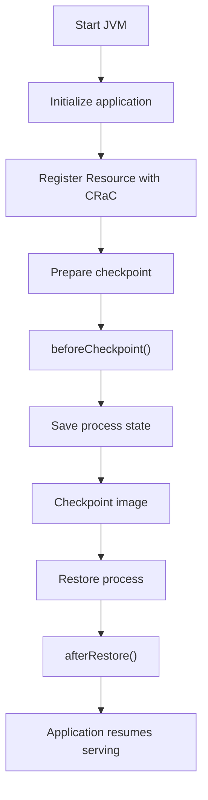

# What is CRaC: Coordinated Restore at Checkpoint

CRaC stands for **Coordinated Restore at Checkpoint**. It is a technique that helps a Java application start quickly by saving the process state after the application has initialized, and then restoring the process from that saved state on subsequent runs.

Instead of having to create a new JVM, load classes, initialize frameworks, read configuration, and prepare shared components on every startup, the application can be restored from a previously created **checkpoint**. The JVM continues running with most of its state already prepared.

The important keyword in the name CRaC is *Coordinated*. Before capturing the state, the application needs to prepare external resources such as database connections, sockets, background threads, and schedulers. After restoring, the application needs to verify or recreate those resources so they match the current environment.

## 1. Why does Java need CRaC?

A Java application typically performs many tasks before it can accept its first request:

1. Initialize the JVM and runtime components.
2. Load, link, and initialize required classes.
3. Read configuration, environment variables, and resource files.
4. Initialize frameworks, the dependency injection container, and application components.
5. Create connection pools, HTTP clients, caches, and shared services.
6. Run long enough for some hot execution paths to be optimized by the JIT compiler.

For small applications, this time may be negligible. For Spring Boot applications or services with many dependencies, startup can take noticeably longer. That affects scaling instance counts, deploying new versions, recovering from failures, and running short-lived workloads.

CRaC aims to reduce that repetitive work. The application is started and prepared once in a checkpoint-creation environment. Process state at an appropriate point is saved. Subsequent runs can restore from the checkpoint instead of executing the entire startup process again.

For example, a service might take several seconds to load a framework and build the application structure. If a checkpoint is created after these steps complete, each new instance can start from the initialized state. Actual restore time still depends on checkpoint size, the OS environment, resources requiring reconnection, and deployment configuration.

## 2. How do checkpoint and restore work?

A **Checkpoint** is a snapshot of a process's state at a point in time. In a CRaC environment, this state can include the Java heap, thread states, stacks, memory regions, and process information needed to resume execution.

**Restore** is the process of reconstructing the process from a checkpoint so the application continues operating. When restore succeeds, the program resumes from the saved state after registered resource recovery callbacks have executed.

The overall lifecycle can be visualized as follows:



The steps above describe the general idea. The checkpoint creation command, image storage location, and how the initial process exits or pauses depend on the CRaC JDK and deployment tooling in use.

### 2.1. Initialization phase

The application is run using a Java environment that supports CRaC. The JVM and application start as usual. Required classes, frameworks, configuration, and data structures are initialized.

During this phase, the application also registers objects that need to participate in the checkpoint/restore lifecycle. Those objects typically represent resources that may need to be closed, refreshed, or recreated.

### 2.2. Pre-checkpoint phase

Right before the system captures the state, CRaC invokes the `beforeCheckpoint()` callback of registered resources.

The application uses this phase to bring its state to a safe point, for example:

- Complete or roll back open transactions according to application policy.
- Flush pending data to persistent storage.
- Pause schedulers and background tasks.
- Close network connections or release resources that cannot be reused after restore.
- Bring connection pools and clients into a re-initializable state.

The goal is to avoid saving a process holding expired resources or in the middle of an incomplete operation.

### 2.3. Saving the checkpoint

After the application finishes preparing, the checkpoint mechanism saves the process state into an image that can be used for restore.

In many Linux environments, CRaC relies on CRIU (*Checkpoint/Restore In Userspace*) along with JDK integration to save and restore the process. CRIU handles process state at the OS level; the CRaC JDK coordinates with the JVM and application so the process can be carried out more safely.

A checkpoint is not a Java object file produced by ordinary serialization. It is a process state image, dependent on a compatible JVM, OS, and runtime environment.

### 2.4. Restore phase

When the process is restored, CRaC invokes the `afterRestore()` callback of registered resources. The application uses this callback to re-establish resources that were closed or need refreshing before the checkpoint.

For example:

- Recreate database connections.
- Reinitialize HTTP clients or sockets.
- Refresh expired credentials and tokens.
- Restart schedulers or worker threads.
- Verify resources that depend on IP address, hostname, or current time.

After the necessary recovery steps complete, the application resumes from the checkpointed state and can begin accepting requests.

## 3. The CRaC API in Java

CRaC provides an API for the application to declare resources needing handling at two points: before checkpoint and after restore. The API is commonly used via the `org.crac` package.

The two core components are:

- `Resource`: the interface an object implements to receive lifecycle callbacks.
- `Core`: the entry point to the global context and CRaC operations provided by the runtime.

A resource implements two methods:

```java
void beforeCheckpoint(Context<? extends Resource> context)
        throws Exception;

void afterRestore(Context<? extends Resource> context)
        throws Exception;
```

`beforeCheckpoint()` runs before the process state is saved. `afterRestore()` runs once the process has been restored. The `context` parameter provides the resource management context within the CRaC lifecycle.

### 3.1. Registering a Resource

The following example illustrates a client connecting to an external service. The old client is closed before checkpoint and recreated after restore.

```java
import org.crac.Context;
import org.crac.Core;
import org.crac.Resource;

public final class RemoteClientResource implements Resource {

    private RemoteClient client;

    public RemoteClientResource() throws Exception {
        this.client = connect();

        // Register this object so CRaC invokes the callbacks.
        Core.getGlobalContext().register(this);
    }

    private RemoteClient connect() throws Exception {
        // Replace with the application's actual client creation logic.
        return RemoteClient.create();
    }

    @Override
    public void beforeCheckpoint(
            Context<? extends Resource> context) throws Exception {

        if (client != null) {
            client.close();
            client = null;
        }
    }

    @Override
    public void afterRestore(
            Context<? extends Resource> context) throws Exception {

        client = connect();
    }

    public RemoteClient getClient() {
        return client;
    }
}
```

`RemoteClient` in the example is an illustrative type for the application's client; it is not a class from the CRaC API. In a real project, replace it with the HTTP client, database client, or connection component the application uses.

The resource object must be created and registered during application initialization, before the checkpoint point. If the object is not registered with the appropriate context, CRaC will not know to invoke its callbacks.

### 3.2. Why are both callbacks required?

The two callbacks address two points in time with different requirements:

| Callback | Timing | Typical tasks |
|---|---|---|
| `beforeCheckpoint()` | Before saving state | Close, pause, flush, or bring resources to a safe state |
| `afterRestore()` | After restoring state | Recreate connections, refresh tokens, restart tasks, and verify resources |

Do not treat these two callbacks as places to run all application startup logic. They should only handle the work required to transition safely between pre-checkpoint and post-restore states.

### 3.3. Triggering a checkpoint from the application

Some CRaC environments allow the application to request a checkpoint via the `Core.checkpointRestore()` API. Illustrative example:

```java
import org.crac.Core;

public class Application {

    public static void main(String[] args) throws Exception {
        initializeApplication();

        // Runtime performs the checkpoint and resumes here
        // when the process is restored.
        Core.checkpointRestore();

        startServingRequests();
    }

    private static void initializeApplication() {
        // Read configuration, create beans, load required data...
    }

    private static void startServingRequests() {
        // Start accepting requests.
    }
}
```

In the example flow, the application is initialized before the checkpoint call. When the process is restored, the call returns and resumes, and the application performs the subsequent work. Ways to trigger a checkpoint may also be provided by command-line tools or deployment platforms. Use the method supported by the documentation of the chosen CRaC JDK.

## 4. Resources that require careful handling

CRaC saves process state, yet that does not guarantee all external resources remain valid when the process is restored. A Java reference can still exist on the heap while the resource it points to has expired or no longer matches the current environment.

### 4.1. Database connections

An open JDBC connection can be closed by the database server while checkpointed. If the application restores and reuses the old connection, query operations can fail.

Common handling approach:

1. Before checkpoint, stop accepting new work and finish or handle active transactions per application policy.
2. Close connections or place the connection pool into a safe state.
3. After restore, verify the pool and recreate needed connections.
4. Only allow the application to accept requests once connections are ready.

Do not simply leave a connection object in the heap and assume the server still maintains that session.

### 4.2. Sockets and network connections

Sockets can be bound to IP addresses, ports, TCP states, and OS resources. This information may no longer be valid after restore, especially when the process runs in a container or a different network environment.

For HTTP clients, message broker clients, or connections to other services, the application should have a way to close and recreate connections. Clearly identify which component owns the socket and where responsibility lies for reopening it.

### 4.3. Tokens and credentials

Tokens have expiration times. A checkpoint may be created while a token is still valid, yet restored after the token has expired.

After restore, the application should check expiration and refresh credentials when needed. Also note that a checkpoint can contain tokens, passwords, or sensitive data in the heap. Therefore, a checkpoint must be protected like an artifact containing sensitive data.

### 4.4. Threads and background tasks

A thread might be performing work at the moment of checkpoint. If that work depends on external resources or is midway through an operation, restoration can produce an unpredictable state.

The application should coordinate with executors, schedulers, and worker threads to:

- Stop accepting new work during the checkpoint preparation window.
- Wait for necessary operations to complete or bring them to a resumable state.
- Avoid checkpointing while a transaction or data write is in an inconsistent state.
- Restart required background tasks after restore.

Specific handling depends on the application's libraries and concurrency model.

### 4.5. Time and schedules

A checkpoint may be created long before it is restored. During that interval, wall clocks, token expirations, cache TTLs, schedules, and external system states continue to change.

Do not assume that every time value stored on the heap still reflects the current time. After restore, the application needs to update real-time-dependent data, check timeouts, and recalculate schedules for appropriate tasks.

### 4.6. Files and OS resources

File descriptors, open files, locks, mount paths, and OS resources can depend on the environment where the checkpoint was created. Whether they can be restored depends on the platform and configuration.

If the application requires a specific file, device, or mount, verify that resource after restore. Do not assume paths or access permissions will be identical across every deployment environment.

## 5. Workflow for using CRaC in deployment

A typical deployment workflow can be organized into the following steps:

1. **Choose a CRaC-supported JDK.** Check the JDK vendor documentation for versions, operating systems, architectures, and runtime requirements.
2. **Prepare the application.** Identify resources that must be closed, paused, or reinitialized. Register them with CRaC.
3. **Start the application in the checkpoint-creation environment.** Use configuration matching the environment where it will restore.
4. **Bring the application to a ready state.** Load classes, initialize frameworks, and prepare required data.
5. **Create the checkpoint.** Use the API or tooling supported by the CRaC JDK to save process state.
6. **Store the checkpoint securely.** Manage versions, access permissions, and artifact lifecycle.
7. **Restore in the target environment.** Ensure matching JDK, OS, architecture, and compatibility conditions.
8. **Verify post-restore state.** Confirm callbacks have completed, connections are ready, and the application can process requests.
9. **Monitor in operation.** Measure restore time, connection errors, memory, and background task behavior.

Exact commands for creating and restoring checkpoints vary by CRaC distribution, application packaging, and runtime environment. Do not copy a command from another environment without confirming it fits the JDK and OS in use.

## 6. Compatibility requirements and limitations

CRaC requires support across multiple layers: the JVM, OS, checkpoint/restore mechanism, and deployment environment. Therefore, not every Java application can create a checkpoint on one machine and restore arbitrarily on any other machine.

Factors to verify include:

- **JDK:** must be a distribution and version that supports CRaC.
- **OS and kernel:** must meet the requirements of the checkpoint/restore mechanism used by the CRaC build.
- **CPU architecture and native libraries:** the process can depend on the architecture, libraries, and environment that created the checkpoint.
- **Containers and system privileges:** namespaces, capabilities, security configurations, mounts, and container limits can affect checkpoint/restore.
- **External resources:** databases, message brokers, caches, and network services must be able to reconnect.
- **Application configuration:** environment variables, secrets, paths, and per-instance settings must be evaluated when restoring in a different environment.

A checkpoint should be treated as an artifact bound to a specific compatible environment. If the JDK, OS, native libraries, or runtime configuration changes, create and test a new checkpoint following the deployment workflow.

CRaC also has costs. Creating a checkpoint consumes time and resources; checkpoint images can take significant storage; the application needs additional resource lifecycle management logic. For a program that already starts very quickly, the benefit may not outweigh this complexity.

## 7. How does CRaC differ from serialization and other startup-speedup techniques?

### 7.1. CRaC vs. Java serialization

Java serialization converts a selected object graph into data that can be written or transmitted, then reconstructs objects from that data. The application must decide which objects are serialized and how to restore them.

CRaC saves process state at the runtime and OS level. It can preserve much of the live state in the process, including the heap and execution state, rather than requiring the application to serialize individual objects.

| Criterion | Java serialization | CRaC |
|---|---|---|
| Scope | Selected object graph | Process state |
| Restoration mechanism | Read data and reconstruct objects | Restore process from checkpoint |
| Application integration | Choose and manage objects to serialize | Coordinate resources via callbacks |
| Environment dependency | Depends on format and classes | Depends on compatible JDK, OS, and environment |
| Typical purpose | Store or transmit object data | Reduce application startup work |

The two techniques solve different problems and do not directly replace one another.

### 7.2. CRaC vs. Class Data Sharing (CDS)

CDS helps the JVM share prepared class data to reduce part of class loading and startup cost. CDS focuses on class data.

CRaC aims to restore a running process's state, which can include both application and runtime state at the checkpoint time. Thus, the two techniques differ in scope of impact. Depending on the JDK and implementation, they can be considered together or evaluated separately.

### 7.3. CRaC vs. conventional application optimization

Optimizing configuration, reducing dependency counts, minimizing synchronous initialization work, and improving lazy loading remain valuable. CRaC does not automatically fix an application with an inefficient startup process or flawed initialization logic.

Before adopting it, measure current startup time and identify the portion of cost reducible by checkpointing. Then compare normal startup time against restore time under the same deployment conditions.

## 8. When should CRaC be considered?

CRaC is worth evaluating when:

- The application has a long startup time due to JVM initialization, frameworks, or many shared components.
- The system needs to spin up new instances quickly when load spikes.
- The platform frequently deploys new versions or restarts workloads.
- The runtime environment can be controlled to create and restore compatible checkpoints.
- The development team can manage the lifecycle of connections, threads, tokens, and external resources.

CRaC may be unsuitable when:

- The application already starts fast and has no requirement to reduce startup time.
- The runtime environment changes frequently or fails compatibility requirements.
- The application depends heavily on network or OS resources that cannot be safely reinitialized.
- Securing, storing, and distributing checkpoints creates excessive operational overhead.
- The application has no way to bring active tasks to a safe state before checkpointing.

Decisions should be based on measurements of real workloads, not solely on restore time in a single isolated example.

## 9. Production readiness checklist for CRaC

### Application

- [ ] Network connections, database clients, files, and OS resources requiring handling have been identified.
- [ ] Required resources are registered with the CRaC context.
- [ ] `beforeCheckpoint()` handles in-flight work and does not leave data in an inconsistent state.
- [ ] `afterRestore()` recreates or verifies environment-dependent resources.
- [ ] Schedulers, executors, and worker threads have clear stop and restart procedures.
- [ ] Tokens, cache TTLs, and time-dependent data are refreshed when necessary.

### Environment

- [ ] JDK and OS support CRaC in the exact deployment configuration.
- [ ] Checkpoint-creation and restore environments meet compatibility requirements.
- [ ] System permissions, containers, mounts, and native libraries have been verified.
- [ ] Secrets and data inside checkpoints are appropriately protected.
- [ ] A process exists to regenerate checkpoints when the JDK or runtime environment changes.

### Operations

- [ ] Normal startup time and restore time have been measured and compared.
- [ ] Restoring after a sufficiently long interval has been tested to catch expired tokens or connections.
- [ ] Health checks ensure traffic is accepted only after the application and essential resources are ready.
- [ ] Failure handling exists for failed checkpoints or restores.
- [ ] Policies exist for storing, controlling access to, and deleting old checkpoints.

## 10. Frequently asked questions

### Is CRaC whole-application serialization?

No. Serialization operates on a selected object graph. CRaC saves process state at the JVM and OS level so the process can be restored in a compatible environment.

### Does application source code need to be modified to use CRaC?

The extent of changes depends on the application. Applications with external resources requiring closing or refreshing typically need to implement and register resource callbacks. The more an application relies on network connections, databases, schedulers, and environment state, the more important coordination becomes.

### After restore, will database connections work automatically?

Do not assume so. Connections may have expired or been closed during checkpointing. The application needs to close or prepare connection pools before checkpoint and verify or recreate connections after restore.

### Can a checkpoint be restored on any machine?

No. Restorability depends on the JDK, OS, kernel, architecture, and runtime conditions. Follow the compatibility requirements of the CRaC distribution in use.

### Does CRaC make the application process individual requests faster?

CRaC's primary goal is reducing the time to bring an instance into a ready state. Per-request processing speed once running depends on application logic, resources, and configuration; checkpointing does not automatically optimize those factors.

## Conclusion

CRaC helps Java reduce startup time by saving process state after the application is prepared and restoring that state when new instances need to run. The core principle is coordinating the resource lifecycle: closing or pausing what needs handling before checkpoint, then verifying and recreating what is needed after restore.

To use CRaC safely, choose a matching JDK and compatible environment, implement callbacks for critical resources, protect checkpoints like sensitive data, and test restores under near-production conditions.