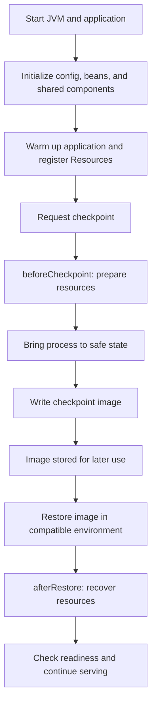

# Checkpoint, state image, and restore: core concepts

A Java application typically needs to perform many tasks before it can serve its first request: initializing a Spring context, reading configuration, scanning the classpath, creating beans, loading native libraries, establishing database connections, loading shared data, and warming up critical execution paths. For large applications, this startup phase can account for a significant share of the total time to bring a service into a ready state.

CRaC (Coordinated Restore at Checkpoint) allows saving the state of a Java process after it has completed necessary initialization, and then restoring a process from that state on subsequent runs. As a result, the application can continue from an already prepared state instead of repeating the entire startup sequence.

To understand CRaC, three closely related concepts must be distinguished: **checkpoint** is the operation of capturing process state at a point in time; **checkpoint image** is the dataset storing the captured state; **restore** is the process of recovering the process from that dataset to resume execution. This is a coordinated mechanism across the JVM, the application, and the OS, not merely writing a few Java objects to disk.

## 1. What problem does CRaC solve?

In a conventional startup, each new process goes through a nearly identical sequence of tasks:

1. The OS creates the process and launches the JVM.
2. The JVM initializes its runtime, loads required classes, and prepares memory.
3. Application code runs, reads configuration, and creates internal components.
4. The application connects to external services such as databases, caches, or message brokers.
5. The application performs required warm-up steps before reporting ready for traffic.

A considerable portion of the work above repeats every time a process is created, even though the initialization result is fundamentally the same. CRaC aims to reuse that result.

The application is launched with a CRaC-supporting JDK. Once the application reaches a suitable state, a checkpoint request is sent to the JVM. The JVM coordinates with the application to prepare resources, and then the OS checkpoint mechanism saves the process state into an image. When the application needs to run, the process is restored from the image and continues from the saved state.

CRaC is especially useful when startup cost is high and a shared baseline state can be prepared in advance, such as a service that needs to instantiate many beans, load many libraries, or warm up frequently used paths. It does not automatically make every application start faster in all circumstances. Image creation cost, restore environment constraints, and resource management must still be factored in.

## 2. Three core concepts

### 2.1. Checkpoint — capturing process state

A checkpoint is both a point in time and a controlled operation at which the process is brought to a saveable state. Before the state is written out, the application must handle resources that may no longer be valid when the process is restored at another time or in another environment.

You can think of a checkpoint as pausing a program at a prepared execution boundary, saving the state needed for the program to resume later. However, this pause and save must be coordinated with the JVM and OS. A plain OS process pause command cannot replace the CRaC checkpoint workflow.

A good checkpoint is typically created after:

- Configuration has been read and validated.
- Essential application components have been initialized.
- Important classes and processing paths have been loaded or warmed up if beneficial.
- Background tasks have reached a safe boundary or have a pause mechanism.
- In-flight transactions have completed or been handled according to an explicit policy.
- External resources have been prepared to be closed, kept, or recreated appropriately for the restore environment.

A checkpoint should not be taken arbitrarily in the middle of an incomplete business operation. If the process is captured while internal data is in an intermediate state, the application may resume from an inconsistent state or repeat side effects after restore.

### 2.2. Checkpoint image — the state snapshot

A checkpoint image is the dataset produced by the checkpoint mechanism to describe process state at capture time. Depending on the JDK, OS, and tooling used, an image may consist of multiple files and metadata; do not assume it is always a single file.

Conceptually, an image can contain process state components such as:

- Process memory pages, including the heap and live Java objects.
- Execution state of threads, such as stacks and execution points needed to resume.
- JVM runtime state and associated native memory.
- Process metadata and OS resources that the checkpoint mechanism supports saving and restoring.

The exact scope depends on the implementation. Do not treat the list above as a guarantee that every resource kind of every application is saved and restored intact.

An image is also not a snapshot of the entire system outside the process. Records in a database, message broker state, remote cache contents, cloud resources, or changes made by another service are not automatically packaged into the image. Those systems continue to exist and can change while the process is stored.

Because an image can contain the heap, in-memory business data, tokens, or credentials, it must be protected as a sensitive artifact. Image read permissions, storage location, lifetime, and deletion of old images are all part of operating CRaC.

### 2.3. Restore — recovering and resuming execution

Restore uses a checkpoint image to reconstruct the saved process. Instead of starting a fresh process and re-running all startup code from scratch, the restore mechanism recovers the captured state so the process can continue executing.

This means objects that existed in memory at checkpoint time can continue existing after restore. Thread states and execution positions are also restored within the capabilities of the mechanism used. Normal startup code, such as `main`, is not re-executed as in a fresh startup simply because the process was restored.

After restore, the application still needs to perform post-recovery work. Some connections may have been closed prior to checkpoint; some credentials, network addresses, leases, or cache entries may have expired; some resources must be recreated. CRaC provides callbacks so the application can run pre-checkpoint preparation and post-restore recovery.

Restore also carries compatibility conditions. An image is not a portable application package that can run arbitrarily on any machine. JDK, CPU architecture, OS, kernel configuration, file paths, native libraries, process privileges, and other factors can affect restorability. The image-creation environment and the restore environment must meet the requirements of the CRaC build in use.

## 3. Lifecycle from startup to restore

A typical CRaC lifecycle can be depicted as follows:



The workflow can be divided into four phases:

**Initialization phase.** The application runs like a normal Java application. It reads configuration, creates required components, loads shared data, and prepares processing paths meant for reuse. This is the right phase for doing time-consuming work that has little dependence on a specific instance.

**Checkpoint preparation phase.** Upon receiving a checkpoint request, the JVM invokes registered resource callbacks. The application can stop accepting new work, wait for running tasks to finish, flush data, close connections, or pause schedulers. The goal is ensuring the saved state contains no resources that will break or become invalid after restore.

**Image creation phase.** Once preparation completes, the checkpoint mechanism saves the process state. The process enters the checkpointed state and the image becomes usable for a later restore. Creating images and storing images are two operational tasks that must be managed explicitly.

**Restore phase.** The restore mechanism reconstructs the process. Post-restore callbacks are invoked so the application recreates or refreshes resources. Only after required components are ready should the new instance begin accepting traffic or background work.

## 4. Coordinating with the application via the CRaC API

The JVM and OS can save process state, yet only the application understands the meaning of the business resources it uses. For example, the application knows which connections must close, which schedulers must pause, and which clients must be recreated. Therefore, CRaC provides an API for the application to register objects that perform work before checkpoint and after restore.

The Java API is typically used via the `org.crac` package. A resource implements `org.crac.Resource` and provides two callbacks:

- `beforeCheckpoint(...)`: invoked before the checkpoint occurs so the resource prepares its state.
- `afterRestore(...)`: invoked after the process is restored so the resource recovers required state.

The example below illustrates a resource managing a single JDBC connection:

```java
import org.crac.Context;
import org.crac.Core;
import org.crac.Resource;

import javax.sql.DataSource;
import java.sql.Connection;
import java.sql.SQLException;

public final class DatabaseConnectionResource implements Resource {

    private final DataSource dataSource;
    private Connection connection;

    public DatabaseConnectionResource(DataSource dataSource)
            throws SQLException {
        this.dataSource = dataSource;
        this.connection = dataSource.getConnection();
    }

    @Override
    public void beforeCheckpoint(Context<? extends Resource> context)
            throws Exception {
        if (connection != null) {
            connection.close();
            connection = null;
        }
    }

    @Override
    public void afterRestore(Context<? extends Resource> context)
            throws Exception {
        connection = dataSource.getConnection();
    }

    public Connection getConnection() {
        return connection;
    }
}
```

The resource must be registered with a CRaC context so the JVM knows to invoke its callbacks:

```java
DatabaseConnectionResource resource =
        new DatabaseConnectionResource(dataSource);

Core.getGlobalContext().register(resource);
```

This is a minimal example for a single connection. Real applications typically use a connection pool. In that case, manage the entire pool's lifecycle using the pool library's API: close or transition the pool to a safe state before checkpoint, then initialize a new pool after restore. Closing only one connection borrowed from a pool may not release the pool's internal sockets and threads.

The two callbacks have distinct responsibilities. `beforeCheckpoint` prepares resources so state can be saved; `afterRestore` brings resources back into operation in the new environment. Do not put entire business logic or application startup work into these two callbacks. They should focus on the lifecycle of the resources owned by the Resource.

If pre-checkpoint preparation fails, the application must not continue treating that state as a valid checkpoint. Similarly, if a post-restore callback cannot recreate a mandatory resource, the instance must not yet be marked ready. Error reporting and follow-up handling must be designed appropriately for the CRaC version and deployment mechanism.

## 5. Why must resources be managed before and after checkpoint?

A Java object residing on the heap does not mean every resource referenced by that object remains usable after restore. A `Connection` object may still exist in memory while its underlying socket was closed or the database session state expired. Likewise, an HTTP client may hold connection pools, selectors, timers, or threads tied to network state at checkpoint time.

Therefore, the application must classify resources by lifecycle handling strategy:

| Resource group | Pre-checkpoint considerations | Post-restore actions |
|---|---|---|
| Database connections | Complete transactions, close connections or pools per library guidance | Recreate connections or pools and verify connectivity |
| HTTP clients and sockets | Stop new requests, drain active requests, close non-reusable connections | Recreate connections and refresh required network state |
| Message brokers | Finish or stop consuming messages per policy; avoid mid-flight processing state | Recreate consumers/producers, re-register subscriptions, and confirm state |
| Schedulers and background tasks | Pause schedules or wait for tasks to reach safe boundaries | Restart schedules aligned with current wall time |
| Files and buffers | Flush pending writes, determine which descriptors can remain in use | Reopen files or verify descriptors per platform requirements |
| Caches and time-limited data | Identify which entries may have gone stale | Refresh or revalidate expired data |
| Tokens, sessions, and leases | Avoid capturing short-lived state without a refresh plan | Check expiration, renew, or obtain fresh credentials |

Not every resource must be closed. Some resources can be preserved by the checkpoint mechanism; some libraries have built-in CRaC integration; some resources must be recreated completely. Decisions must be grounded in the documentation of the JDK, libraries, and OS in use.

Several situations require special attention:

- **In-flight requests:** if a checkpoint occurs when a request has partially written data to an external system, restore may resume from in-memory state while the external system already recorded side effects. Drain requests or design operations to be idempotent.
- **Database transactions:** do not leave transactions in an indeterminate state across a checkpoint boundary. Commit, roll back, or handle them via the application's transaction mechanism before saving.
- **Schedulers:** a schedule restored from stale state may fire late, fire repeatedly, or miss expected windows. After restore, schedules must be reconciled against current time and business rules.
- **Credentials:** tokens or certificates can expire while an image is stored. Do not assume credentials on the heap stay valid after a long interval.
- **Threads and background tasks:** determine which threads can continue safely and which must be paused or restarted. Never let a task hold locks or external resources in an intermediate state during checkpointing.

## 6. Which state is saved and which state sits outside the image?

The most critical boundary is between **in-process state** and **external system state**.

| State | Relationship to checkpoint image |
|---|---|
| Java objects on the heap | Part of process state and can be saved in the image |
| Thread stacks and execution state | Saved by the checkpoint mechanism per implementation capabilities |
| Runtime state and native memory | May be saved as part of process state; depends on JDK and platform |
| File descriptors, sockets, and OS resources | Restored only within supported mechanism and resource scope; requires application coordination |
| Records in a database | Not inside the image; the database continues managing its own data |
| Messages sitting in a broker | Not inside the image; the broker continues managing messages and delivery state |
| Cache data on a remote service | Not inside the image; may change while the process is stored |
| Configuration or state in cloud control planes | Not automatically saved by the process image |

For example, an application has an `OrderService` object holding an `Order` in the heap. That object can be restored along with the process. Yet if `OrderService` already sent an order-creation request to the database or payment service, the outcome of that external operation is not rolled back just because the process is restored. Upon resuming, the application must know whether that operation completed to avoid creating a duplicate order or payment.

This shows that a checkpoint image is not a system-wide transactional snapshot. If business logic requires consistency between memory and external services, the application must still use transactions, outbox patterns, idempotency keys, message acknowledgments, or suitable consistency mechanisms.

## 7. Distinguishing CRaC from easily confused mechanisms

| Mechanism | What is saved | How continuation works |
|---|---|---|
| Java serialization | Selected serializable objects | Application reads data and reconstructs objects manually |
| Heap dump | Heap information for analysis | Used by diagnostic tools; does not directly resume a running process |
| Container image | Filesystem, application, and image configuration | Creates a container and launches a new process |
| Normal restart | No prior execution state saved | JVM restarts and application initializes from scratch |
| CRaC checkpoint image | Process state supported for saving by CRaC | Restores the process to continue from the checkpointed state |

**CRaC is not Java serialization.** Serialization saves only selected objects conforming to serialization rules. CRaC targets the state of the whole process, including runtime and OS aspects that serialization cannot represent.

**CRaC is not a heap dump.** Heap dumps primarily serve memory investigation. They lack the full thread and process state needed to resume execution.

**CRaC does not replace container images.** A container image describes the filesystem environment and components required to spin up a container. A checkpoint image describes the state of an already-running process. Both artifact types can be used together while serving distinct purposes.

**CRaC is not a fast restart that skips startup steps.** Restore resumes from a saved state. Hence, normal startup logic does not automatically re-run; the application must use callbacks and readiness mechanisms to perform post-restore actions.

## 8. Compatibility requirements and operational limits

Checkpoint/restore capability depends on a CRaC-supporting JDK and OS mechanisms. CRaC implementations on Linux typically coordinate with CRIU (Checkpoint/Restore In Userspace), yet specific requirements for kernel, permissions, namespaces, cgroups, and system configuration depend on platform version.

When creating images and restoring, check at least these groups of conditions:

1. **JDK:** use a JDK distribution and version supporting CRaC; do not assume any arbitrary JDK can restore that image.
2. **Architecture and OS:** the image must be created and restored on environments meeting the compatibility requirements of the mechanism used.
3. **Native libraries:** native libraries, agents, JNI, and system-dependent components can introduce dedicated constraints.
4. **Filesystem:** paths, mount points, access permissions, and files used by the process must match in the restore environment.
5. **Networking:** IP addresses, ports, sockets, DNS, and connections to external services may change or become invalid.
6. **System privileges:** checkpoint/restore may require privileges or kernel settings not granted by default in standard runtime environments.
7. **Application version:** images must be managed alongside matching code versions, configuration, and dependencies to avoid restoring an outdated state.

Therefore, do not build an image on one machine and assume it restores on every machine or container. Explicitly define the image-creation environment, target environment, compatibility constraints, and how restore is tested in the deployment pipeline.

An image also has a lifecycle. When application code, configuration, JDK, or dependencies change, an old image may no longer apply. Build and release pipelines should create, validate, version, and replace images in step with application releases.

## 9. Designing applications for safe restoration

CRaC works best when the application clearly separates reusable shared data from state bound to a single instance or specific point in time.

**Should be prepared before checkpoint:** validated configuration, rarely changing metadata, reusable shared data, loaded classes, and beneficial warm-up steps. These tasks ensure the image contains a state close to ready.

**Should be created after restore:** instance-unique identifiers, network connections, connection pools, short-lived tokens, subscriptions, leases, and runtime-environment-dependent resources. These values usually need to be newly created or revalidated.

When multiple instances are spawned from the same image, pay special attention to identifying data. If an image already contains a UUID, node name, port, or unique service registration info, restored instances could accidentally share that same value. Generate or refresh values requiring uniqueness after restore.

The application also needs a clear readiness boundary. Just because the process restored successfully at the OS level does not mean all application dependencies are ready. Health checks or readiness checks should succeed only after mandatory callbacks finish, needed connections are established, and critical state is verified.

A practical approach is:

1. Inventory time-consuming startup steps and identify which ones are reusable.
2. Inventory external resources held by the application, along with how to close or recover each type.
3. Register `Resource` instances in an appropriate lifecycle manager, avoiding duplicate registration when components reinitialize.
4. Choose the checkpoint moment once initialization is complete and no business operations sit in intermediate states.
5. Test restoration in an environment close to real production deployment.
6. Measure image creation time, restore time, and restore-to-readiness time.
7. Test scenarios with stale images, disconnected dependencies, expired tokens, and failed recovery callbacks.

## 10. Common design mistakes

**Keeping network connections open just because Java objects still exist.** An object can remain on the heap while the underlying socket or external session is no longer valid. Manage resources by lifecycle and recreate them as needed.

**Checkpointing mid-request or mid-transaction.** The process can restore with incomplete internal data while external systems already recorded partial side effects. Drain requests, complete transactions, or use suitable idempotency mechanisms.

**Treating the image as a durable data backup.** An image does not replace database backups or business data recovery mechanisms. It is a point-in-time process state and can become stale.

**Not refreshing time-dependent information.** Tokens, certificates, leases, caches, and schedules can expire while the image is stored. Revalidate after restore.

**Baking single-instance data into a shared image.** Instances restored from the same image may collide on identifiers or share stale state. Generate per-instance values after restore.

**Marking ready immediately upon process restore.** Process-level restore and application-level readiness are two distinct conditions. Accept traffic only after mandatory resources recover successfully.

**Failing to test in the actual deployment environment.** An image working on the build machine is not guaranteed to restore in another container or node. Testing must include the expected JDK, kernel, permissions, filesystem, and runtime configuration.

## 11. Self-check questions

1. **How does checkpoint differ from restore?** Checkpoint saves process state at a point in time; restore uses the saved state to reconstruct and continue the process.
2. **Does a checkpoint image save a remote database?** No. The image saves process state within supported scope; the database continues managing its own data.
3. **Why are both `beforeCheckpoint` and `afterRestore` needed?** The application must prepare resources before saving and recover resources that cannot continue being used once the process is restored.
4. **Does restore re-run `main` like a fresh startup?** No. The goal of restore is continuing from the checkpointed state; normal startup does not re-run like a brand-new process.
5. **Can an image be restored on any machine?** No. Restorability depends on JDK, OS, architecture, libraries, privileges, and other compatibility conditions.
6. **If an instance is restored from a shared image, when should unique identifiers be generated?** Usually generated or refreshed after restore so each instance has its own distinct identifier.

## Conclusion

Checkpoint is the operation of saving process state; checkpoint image is the data describing the saved state; restore is the process of recovering the process to continue execution. CRaC combines the platform's checkpoint/restore capabilities with application callbacks so the application can reuse expensive initialization work and proactively manage external resources.

When designing for CRaC, always clearly identify which state belongs to the process, which state belongs to external systems, which resources must be closed or recreated, and which conditions must be met before an instance accepts work. Mastering the three concepts of checkpoint, image, and restore is the foundation for deploying CRaC safely and operating it reliably over the long term.