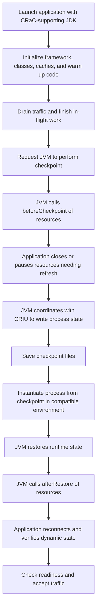

# Roles of the application, JVM, and image-creation mechanism

CRaC (Coordinated Restore at Checkpoint) helps a Java application start quickly by saving the state of a running process and then restoring that state to produce a pre-initialized process. Instead of every deployment having to boot the JVM, load classes, initialize frameworks, populate caches, and wait for hot code to be JIT-compiled, the system can prepare this work once and create a checkpoint.

For CRaC to function properly, three layers must coordinate together:

- **The application** understands business state and the resources it uses. The application decides what must finish before checkpointing, which resources must close, and how to reconnect after restore.
- **The JVM** understands the internals of the Java process. The JVM orchestrates runtime state, invokes CRaC callbacks, and coordinates with the OS checkpoint mechanism.
- **The OS and checkpoint/restore tooling** save and restore process state at the OS level. On Linux, CRIU (Checkpoint/Restore In Userspace) is the tool commonly used in this architecture.

No single component can carry out the entire job alone. The application should not copy the JVM heap itself; the JVM cannot deduce on its own whether a business transaction is safe; and CRIU does not understand the semantics of a database connection or background task inside a Java application.

## 1. Viewing CRaC through three layers of responsibility

| Component | What does it understand? | Primary responsibilities |
| --- | --- | --- |
| Java application | Business flows, data, transactions, and resource lifecycles | Bring application to a consistent state; close or pause resources that cannot cross a checkpoint; recover resources and refresh dynamic data after restore |
| CRaC-supporting JVM | Heap, threads, class metadata, JIT code, garbage collector, and runtime state | Coordinate checkpoint at a safe point; execute callbacks; prepare and restore virtual machine state |
| OS and CRIU | Processes, memory, threads, memory mappings, and file descriptors | Write process state to checkpoint files and reconstruct the process from those files |
| Deployment platform | Instance lifecycle, runtime environment, and traffic | Create checkpoints in a compatible environment, distribute checkpoints, restore instances, and route traffic only when ready |

The key point is that **a checkpoint saves the state of a running process**, not merely source code or application configuration. A checkpoint can hold substantial state built during startup: Java objects on the heap, loaded classes, runtime structures, threads, and machine code compiled by JIT. Consequently, a restored instance can resume from an initialized state instead of executing the entire startup process again.

## 2. Role of the Java application

The application is responsible for the correctness of business state. The JVM and checkpoint tool can save memory state, yet they do not know whether that state is suitable for continuing to process requests.

For instance, at checkpoint creation time, the application might be:

- processing an HTTP request without yet committing the transaction result to the database;
- holding a JDBC connection inside a connection pool;
- receiving a message from a message broker without yet acknowledging it;
- running a periodic task or background job;
- holding tokens, credentials, or time-limited configuration data;
- caching query results or cache entries that may change while the checkpoint is stored.

If memory were simply captured right at that moment, the restored process could resume with stale or invalid state. Thus, the application must coordinate to establish a meaningful restore point.

### 2.1. Bringing the application to a consistent state

Before checkpointing, the application or deployment platform must control traffic and active work. The goal is preventing a checkpoint from starting while the application is performing an operation whose continuation after restore could cause inconsistencies.

A preparation procedure typically includes these tasks:

1. Mark the instance as not accepting new requests or instruct the load balancer to stop sending traffic to the instance.
2. Wait for in-flight requests to complete within a configured timeout.
3. Finish or transition transactions to a safe state; flush buffered data needing durable writes.
4. Pause consumers, schedulers, or background work that could produce external side effects during checkpointing.
5. Close connections and resources that must be recreated after restore.
6. Request the JVM checkpoint only once the application is ready.

Not every application needs every step above. Preparation depends on application type, frameworks, data sources, and deployment approach. Nevertheless, business consistency always remains the responsibility of the application and its operational process.

Traffic draining should be coordinated at the deployment layer or through the application's readiness mechanism. Do not assume that the `beforeCheckpoint` callback automatically guarantees the load balancer has stopped sending new requests. A callback is a lifecycle integration point; it does not replace overall traffic orchestration.

### 2.2. Managing resources via CRaC callbacks

CRaC provides an API for applications to register resources needing participation in the checkpoint and restore lifecycle. A resource typically implements two callbacks:

- `beforeCheckpoint(...)`: called before process state is recorded. The application can flush data, stop related activity, and close resources that should not be retained in the checkpoint.
- `afterRestore(...)`: called after the process is restored. The application can recreate connections, restart consumers, or reload dynamic data.

The example below illustrates a resource managing a connection pool. Pool creation is simplified to focus on the two lifecycle milestones:

```java
import org.crac.Context;
import org.crac.Core;
import org.crac.Resource;

public final class DatabasePoolResource implements Resource {

    private HikariDataSource dataSource;

    public DatabasePoolResource() {
        Core.getGlobalContext().register(this);
        this.dataSource = createDataSource();
    }

    @Override
    public void beforeCheckpoint(Context<? extends Resource> context)
            throws Exception {
        if (dataSource != null && !dataSource.isClosed()) {
            dataSource.close();
        }
    }

    @Override
    public void afterRestore(Context<? extends Resource> context)
            throws Exception {
        dataSource = createDataSource();
    }

    private HikariDataSource createDataSource() {
        // Create connection pool from the application's current configuration.
        return new HikariDataSource();
    }
}
```

This is an integration structure example, not a complete connection pool configuration. In a real application, pass connection settings, handle initialization errors, ensure the resource is registered exactly once, and ensure no open transactions remain when closing the pool.

The two callbacks represent two distinct responsibilities:

| Milestone | Question the application must answer | Example with connection pool |
| --- | --- | --- |
| Before checkpoint | Is the current resource safe to keep intact inside the process image? | Wait for transactions to finish, close pool, and release connections |
| After restore | How does the resource need to be recreated or refreshed? | Create a new pool and establish connections to the current database |

A resource can manage sockets, message broker clients, schedulers, file handles, or other external resources. Clearly define who owns each resource's lifecycle. If a framework or library already integrates CRaC and manages a resource itself, the application should use that built-in integration instead of registering another resource that closes and reopens the same resource. Duplicate management can lead to out-of-order closing or unexpected duplicate connections.

Callbacks should have deterministic behavior, controllable error handling, and safety when invoked under the runtime's lifecycle rules. Do not put lengthy business logic or unbounded tasks inside callbacks. If a mandatory preparation step fails, the application should propagate the error so the checkpoint process halts rather than producing an unreliable image.

### 2.3. Distinguishing in-memory state from external state

A checkpoint can preserve a Java object on the heap, yet that does not mean all data represented by that object is frozen as well.

For example, a cache object may remain intact on the heap after restore while the corresponding database record has been updated by another system. Similarly, an object holding an access token remains in memory even after the token expires. A Java client may still hold a socket reference while the TCP connection on the remote side was closed while the checkpoint was stored.

Therefore, the application needs to classify state:

- **Retainable state:** initialized structures, immutable data, or caches that can be reused if still valid.
- **State requiring verification:** data mutable in external systems, time-limited information, authorization state, or environment-dependent metadata.
- **State requiring recreation:** network connections, connection pools, consumers, leases, locks, or resources tied to a specific session.
- **State that must complete before checkpoint:** open transactions, incomplete writes, or received messages lacking a safe acknowledgment strategy.

Do not use the continued existence of an object on the heap as proof that its external state remains valid.

### 2.4. Handling time, identity, and background tasks

A checkpoint may be restored after a substantial interval. A new instance must therefore examine time-dependent values and instance identity.

- **Expirations:** re-check tokens, certificates, TTL caches, leases, and deadlines after restore.
- **Instance identity:** if each instance needs a unique ID, generate or verify a new ID after restore. Do not assume a value already baked into a checkpoint can be shared across multiple restored instances.
- **Random number generation:** consider reseeding random sources according to security requirements and avoid having multiple restored instances share the same random sequence state.
- **Schedulers and timers:** decide which tasks should resume, which need schedule recalculation, and which must be guaranteed to run only once.
- **Leaders, locks, and leases:** re-verify ownership with the coordination system or data store after restore; do not rely on a stale in-memory lock to conclude the instance is still leader.

If the same checkpoint is used to spawn multiple instances, any state copied from the checkpoint can appear across multiple restores. Tasks producing external effects need deduplication, appropriate instance identification, or centralized coordination.

## 3. Role of the JVM

The JVM is the component that understands the internal state of a Java program. A Java process does not consist solely of business objects. It also contains the heap, thread stacks, class metadata, JIT-generated machine code, garbage collector structures, synchronization state, and many other runtime memory areas.

Simply copying part of the heap via ordinary mechanisms will not allow the program to resume running as a complete Java process. The JVM must coordinate so runtime state can be recorded and restored alongside OS-level process state.

### 3.1. Orchestrating virtual machine state

When receiving a checkpoint request, the CRaC JVM coordinates runtime components to prepare the process. Conceptually, the work includes:

1. Coordinating registered resources and invoking `beforeCheckpoint` callbacks.
2. Bringing the runtime to a safely checkpointable state, coordinating thread activity and internal VM components.
3. Coordinating with the OS-level checkpoint mechanism to write out process state.
4. Upon restore, resuming runtime restoration and calling `afterRestore` callbacks so the application repairs environment-dependent resources.

The JVM knows how to interpret its own Java state. This is why CRaC requires a JDK distribution with CRaC support; a standard JVM does not inherently support checkpointing and restoring processes this way.

### 3.2. Preserving expensive initialization work

One benefit of CRaC is saving state prepared prior to checkpointing. For instance, before the checkpoint the application may have already:

- loaded required classes;
- initialized the Spring context and beans;
- parsed configuration and built shared data structures;
- executed representative paths so JIT compiles hot methods;
- populated initial caches and prepared frequently used components.

These states can reside in process memory and be preserved in the checkpoint. When restore succeeds, the application can start from that initialized state. This is a key difference from merely optimizing class-loading order or reducing dependency counts at startup.

However, do not assume every restore has zero startup time. Restoring still requires time to reconstruct the process, execute callbacks, connect external resources, pass health checks, and satisfy runtime environment requirements. Actual effectiveness depends on image size, OS, hardware, application preparation, and post-restore work.

### 3.3. The JVM does not decide data validity on the application's behalf

The JVM can preserve a Java object and its in-memory references. The JVM cannot determine on its own:

- whether a database transaction has committed;
- whether a message has been acknowledged by a broker;
- whether an access token is still valid;
- whether a cache needs resynchronization with the source system;
- whether a background task is allowed to run concurrently across multiple restored instances.

That is why the CRaC resource API exists. The JVM provides lifecycle milestones; the application uses those milestones to perform actions meaningful to its system.

## 4. Role of the OS and CRIU

CRaC needs a mechanism that can record and reconstruct a process at the OS level. In Linux environments supporting CRaC, CRIU typically handles this checkpoint/restore part.

CRIU operates on OS concepts such as process address space, mapped memory regions, threads, CPU state, and file descriptors. It does not interpret the semantics of Java objects. The JVM and application must prepare an appropriate state before CRIU performs the process-level work.

The division of labor can be pictured as follows:

- The JVM knows which memory regions belong to the Java runtime and coordinates checkpoint timing.
- CRIU records and restores OS-managed process state within the scope of supported resource types and environment conditions.
- The application handles external or session-dependent resources whose validity cannot be guaranteed by process-level restoration.

Restorability of file descriptors, sockets, devices, and OS resources depends on resource type, tool version, kernel, and deployment environment. Therefore, application design should proactively close and reopen critical external connections when needed, rather than assuming all connections remain usable after restore.

## 5. Checkpoint creation and restore workflow

A CRaC lifecycle typically has two major stages: **prepare and create the checkpoint**, then **restore and bring the instance back into service**.



### 5.1. Launching and preparing the application

The application runs on a CRaC-supporting JDK in an environment compatible with the target restore environment. After launch, the system can perform warm-up work:

- loading frequently used classes;
- initializing frameworks and the dependency injection container;
- parsing configuration and building shared data structures;
- running representative processing paths to give JIT a chance to compile hot code;
- pre-populating safe, reusable caches.

Do not warm up using operations that create real business effects if they cause unintended writes, messages, or transactions. Pre-checkpoint prepared data must be chosen so it is safe when multiple instances restore from one image.

### 5.2. Requesting a checkpoint

Once the application is ready, the operational workflow sends a checkpoint request to the JVM. How the request is sent and where the image is stored depend on the CRaC JDK distribution as well as deployment configuration.

The example below illustrates a common configuration style in CRaC JDK builds supporting the corresponding options:

```bash
# Launch application and specify checkpoint storage location
java -XX:CRaCCheckpointTo=/var/lib/my-app/checkpoint -jar app.jar

# Request JVM to create a checkpoint for the running process
jcmd <pid> JDK.checkpoint

# Launch/restore application from the saved checkpoint
java -XX:CRaCRestoreFrom=/var/lib/my-app/checkpoint
```

Options and control commands may vary by JDK distribution, CRaC version, and environment packaging. Consult the documentation of the exact deployed JDK before placing commands into operational scripts. The commands above illustrate workflow steps, not a universal configuration for every system.

### 5.3. JVM invokes pre-checkpoint callbacks

The JVM calls `beforeCheckpoint` on registered resources. At this moment, the application executes its preparation responsibilities, such as closing connection pools, releasing sockets, flushing buffers, or stopping consumers.

If a mandatory resource fails to complete its preparation step, the workflow should receive an error to abort the checkpoint. Taking an image while resources are not in a safe state can cause every subsequent restore to repeat the same error or continue from inconsistent state.

### 5.4. JVM and CRIU write process state

Once preparation finishes, the JVM coordinates with the OS checkpoint mechanism. CRIU writes process state into a set of files. This set of files is the Java process checkpoint.

The image can include memory state and process components needed to reconstruct it. This is not an object dump in JSON, Java serialization format, or a new JAR file. Nor is it a native image compiled from Java code.

The checkpoint must be stored as an artifact with controlled lifecycle and access permissions. Successful checkpoint creation also does not mean that image can restore on every machine or every JDK version.

### 5.5. Restoring and completing initialization

When a new instance is needed, the deployment environment uses the matching restore mechanism to reconstruct the process from the checkpoint. The JVM resumes the recorded runtime state and calls `afterRestore` so the application handles resources needing reconnection.

After callbacks, the application may need to:

- create a new connection pool and verify database connectivity;
- recreate message broker clients or consumers;
- reload secrets, tokens, or configuration that may have changed;
- verify caches, leases, locks, and authorization state;
- recalculate scheduler run times;
- generate an instance identifier suitable for the current restored instance.

Only after mandatory steps complete and readiness checks pass should the instance accept traffic. A process that restored technically yet cannot connect to the database is not yet an instance ready to serve.

## 6. What does a checkpoint image contain, and what does it not guarantee?

A checkpoint is an image of a process in a specific environment. It can preserve much of the state created while running, yet it is not a synchronized copy of the entire distributed system.

| State group | Interpretation when using CRaC |
| --- | --- |
| Java objects on the heap | Can be preserved along with process reference state |
| Class metadata and runtime state | Part of JVM state that must be restored with the process |
| JIT-compiled code | Can be preserved in process state, helping reduce re-warm-up work |
| Thread stacks and thread state | Part of process state; restoration depends on JVM, CRIU, and environment support |
| File descriptors and sockets | Depends on resource kind and environment restore capability; applications usually must close and recreate external connections |
| Databases, message brokers, and external services | Not frozen along with the checkpoint; their state continues changing independently |
| Secrets, tokens, and time-limited data on the heap | May still appear in the image, yet may have expired or require refresh on restore |
| Business side effects already sent externally | Cannot be undone or synchronized simply by restoring process memory |

Point to remember: **a checkpoint records process state, not a consistent snapshot across every system the application connects to**. If the application uses databases, caches, brokers, object storage, and HTTP services, each system retains its own independent lifecycle.

### 6.1. A checkpoint is not a container image

A container image normally holds the filesystem, application, libraries, and configuration needed to create a new container. A checkpoint holds the state of an already-running process.

Both artifact types can be used together: the container image supplies the environment and required components, while the checkpoint supplies the process state to restore. Exact integration depends on the deployment platform.

### 6.2. A checkpoint is not GraalVM Native Image

Native Image builds a native executable from a Java application via ahead-of-time compilation. CRaC saves the state of a running Java process via checkpoint/restore.

| Criterion | CRaC checkpoint | Native Image |
| --- | --- | --- |
| Primary input | Running Java process on a CRaC-supporting JDK | Application code and dependencies compiled into a native executable |
| Preparation timing | Launch, initialize, and warm up prior to checkpoint | Static analysis and compilation before runtime |
| Reused state | Runtime state of the checkpointed process | Compiled native program and initialization data per native image model |
| Operational conditions | Compatible JDK, JVM, OS, and restore tooling | Native runtime and native image build constraints |

The two approaches solve the startup problem along different paths. Choosing between them depends on compatibility requirements, build workflow, application characteristics, and operational environment.

## 7. Conditions that must be controlled during deployment

### 7.1. Environment compatibility

A checkpoint is not a portable format freely transferable across arbitrary machines. Restorability depends on JDK distribution and version, CPU architecture, kernel, system libraries, process configuration, and CRIU support. Create and restore checkpoints in a verified compatible environment.

If the JDK, native libraries, OS configuration, or container platform changes, re-evaluate restorability. Do not assume an old checkpoint remains compatible with a new runtime simply because the application JAR did not change.

### 7.2. Network resources and external services

TCP connections, TLS sessions, connection pools, and external service clients may no longer be valid upon restore. Design resources to close before checkpoint and recreate after restore if the resource depends on a specific connection session.

After reconnecting, the application must handle timeouts, authentication, DNS, endpoint changes, and service errors just as on a fresh connection. Do not merely check that a Java reference is non-`null` and conclude the connection is active.

### 7.3. Repeatability and multiple restored instances

One checkpoint can be used to create multiple instances. Those instances can start from identical in-memory state while external systems have continued changing. This affects IDs, schedulers, consumers, locks, leases, counters, and write operations.

The application needs appropriate strategies such as generating new instance IDs, verifying ownership with coordination systems, using idempotent processing, and controlling consumers. If a task must run only once system-wide, do not rely solely on thread or scheduler state preserved in the checkpoint to guarantee that.

### 7.4. Checkpoint security

Because a checkpoint can hold the heap and process state, it can contain secrets, tokens, credentials, user data, and sensitive business data. The checkpoint artifact must be protected like a copy of application memory:

- restrict read and write permissions;
- protect transport channels and storage locations;
- apply encryption according to system security requirements;
- define retention periods and deletion procedures;
- avoid placing checkpoints into public artifact repositories or build logs;
- evaluate refreshing or clearing credentials prior to creating an image.

### 7.5. Measuring effectiveness accurately

CRaC aims to reduce the time from needing an instance until that instance can serve. When evaluating, measure these intervals separately:

- launching and warming up to create the checkpoint;
- time to create and save the checkpoint;
- process restore time;
- `afterRestore` callback execution time;
- time to reconnect services and reach readiness;
- time from first request until steady-state processing.

Measuring only JVM restore time while omitting database connections, readiness checks, and consumer startup time may fail to reflect the real time required to bring an instance into service.

## 8. How to analyze an application before adopting CRaC

When evaluating a Java application, answer the following questions in turn:

1. **Which startup parts take time?** Identify time spent on class loading, framework initialization, cache creation, JIT compilation, and service connections.
2. **Which state can be retained?** Separate immutable structures and safe initialization from dynamic or environment-dependent data.
3. **Which resources must close before checkpoint?** Inventory sockets, connection pools, consumers, file handles, and resources with lifecycles outside the process.
4. **Which work must complete before checkpoint?** Identify transactions, requests, messages, and background tasks needing draining or synchronization.
5. **What must happen after restore?** Identify reconnections, credential refreshes, cache verification, obtaining new IDs, and resuming schedulers.
6. **How many instances can one checkpoint spawn?** Evaluate the impact of duplicated state and operations that might execute multiple times.
7. **Is the restore environment compatible?** Verify the CRaC JDK, CRIU, kernel, CPU architecture, and native libraries.
8. **Is the checkpoint protected?** Define access permissions, encryption, retention period, and artifact deletion procedures.

These answers help separate the application's work, the JVM's work, and the deployment platform's work. They also pinpoint what must be tested before using checkpoints in real production environments.

## 9. Conclusion

CRaC works through coordination among the application, the JVM, and the OS checkpoint/restore mechanism. The application is responsible for business consistency and resource lifecycles; the JVM coordinates Java runtime state and callbacks; CRIU together with the OS writes and recovers process state.

Checkpointing helps reuse prior initialization work, yet it does not freeze external services and does not automatically guarantee existing connections remain valid. The quality of a CRaC deployment depends on accurate state classification, preparing the application before checkpoint, recovering resources after restore, and verifying the instance is ready before accepting traffic.