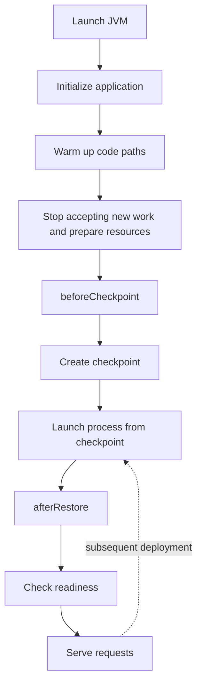

# Overall Lifecycle: Startup, Warm-up, Checkpoint, and Restore

CRaC stands for **Coordinated Restore at Checkpoint**. It is a mechanism that lets you save the state of an already-initialized Java process into a checkpoint, and then restore the process from that state. The common goal is to reduce startup time and latency on subsequent deployments: the application can perform costly work up front such as loading classes, creating the Spring Application Context, initializing libraries, and warming up critical execution paths; later runs continue from the prepared state.

To understand CRaC, you need to look at the entire lifecycle rather than only the checkpoint creation or loading operation. A typical lifecycle consists of the following stages:

1. **Startup:** the JVM runs and the application performs its normal initialization process.
2. **Warm-up:** the application executes representative paths to prepare compiled code, caches, and required structures.
3. **Checkpoint preparation:** the application brings resources and running work to a safe state for capturing.
4. **Checkpoint:** the runtime records the process state at a point in time.
5. **Restore:** the runtime restores the process from the checkpoint.
6. **Post-restore completion:** the application reconnects external resources, refreshes dynamic data, and only then becomes ready to accept traffic.



The diagram illustrates the conceptual flow. Deployment tooling may decide when to capture the checkpoint, where to store the checkpoint, and how many restored instances to launch. The key part for the application is preparing the right state before capturing and recovering the right resources after loading.

## 1. How Does CRaC Change the Starting Point of a Run?

In traditional Java startup, each new process typically goes through a similar sequence of work: creating the JVM, loading classes, running static initializers, creating objects, building the dependency injection container, reading configuration, creating clients, and initializing caches. If the application uses Spring Boot, this also includes building the `ApplicationContext`, creating beans, and executing startup callbacks.

With CRaC, you can perform most of that work in a preparation process. Once the application is in a suitable state, the runtime creates a checkpoint. Subsequent runs can restore the saved state instead of repeating the entire startup process from scratch.

This does not mean CRaC turns the application into a set of objects written to a file via Java Serialization. A checkpoint is a snapshot of process state supported by the runtime and the environment's checkpoint/restore mechanism. It may include memory state, loaded classes, thread execution state, and whichever parts of process state that mechanism supports. Restorability also depends on the CRaC JDK, operating system, kernel, machine architecture, and deployment setup.

One point to distinguish is that **application initialization** and **application restore** are two different phases. When restore succeeds, the process continues from the checkpointed state; the application does not automatically re-run all of `main()` like a cold start. If the program calls the checkpoint API directly, execution flow resumes after the call site when the process is restored. If an external tool requests the checkpoint, the runtime coordinates pausing and restoring according to the distribution being used.

Therefore, a CRaC application typically has two groups of tasks:

- Tasks that should be done before checkpoint because their results can be reused, such as loading classes, building application structure, and warming up stable paths.
- Tasks that must be re-executed after restore because they depend on the current environment, such as opening network connections, re-authenticating with external services, refreshing tokens, or starting schedulers.

Good design clearly identifies which tasks belong to which group, rather than assuming all in-memory state remains valid after restore.

## 2. Startup Stage: Building the Application's Baseline State

The first stage is still normal Java startup on a CRaC-supporting runtime. The JVM is created, the classpath is configured, and the application's initialization code runs. For a Spring Boot application, typical activities include:

- Reading configuration and determining the environment profile.
- Loading classes, creating objects, and running static initializers.
- Creating the Spring `ApplicationContext`, registering beans, and injecting dependencies.
- Initializing shared data structures, converters, serializers, and internal caches.
- Registering resources that need to be notified before checkpoint and after restore.
- Preparing components for serving requests, background tasks, and observability.

The goal of this stage is to bring the application to a state where it can be warmed up in a controlled manner. Do not equate "process is running" with "application is ready to receive requests". An application may have finished creating beans yet still not have populated caches, checked connections, or completed necessary preparation steps.

When designing startup, classify data by its lifecycle:

| State Kind | Example | Typically Appropriate Handling |
|---|---|---|
| Stable and reusable | Immutable metadata, parser structures, static lookup tables | Can be created before checkpoint and retained after restore |
| May vary by environment | Endpoints, feature flags, deployment configuration | Determine whether it needs to be re-read after restore |
| Depends on external sessions | TCP connections, database connections, message consumers | Prepare to close or pause before checkpoint; recreate after restore |
| Time-limited | Access tokens, leases, cached data with TTL | Check expiration and refresh after restore |
| Tied to a specific instance | Instance ID, leader lease, exclusive run schedule | Re-establish per instance after restore |

For example, creating a `DataSource` may fit the startup stage, yet physical connections inside the connection pool must be handled according to the CRaC guidance of the driver and pool in use. A Java object still residing on the heap does not guarantee that an OS-level socket or session remains usable after restore.

## 3. Warm-up Stage: Preparing Execution Paths Before Capture

Warm-up is the stage where the application proactively executes representative workloads before checkpoint. The goal is to reduce remaining work when serving real requests.

In the JVM, some methods are only optimized-compiled after being executed enough times. Libraries may also initialize internal structures lazily on first use. The application may also need to populate caches or pre-build expensive structures. If the checkpoint is created after this stage, suitable state can be preserved and reused on restore.

A warm-up plan typically includes:

1. Choosing representative business flows, such as reading data, transforming data, handling a common request, or rendering a response template.
2. Executing those flows with safe, reasonably sized data that causes no unintended side effects.
3. Waiting for required asynchronous initialization tasks to complete.
4. Verifying caches and internal components have reached the desired state.
5. Transitioning to the checkpoint preparation stage.

Warm-up must be designed intentionally. If you invoke endpoints that create orders, send emails, charge money, or publish real messages merely to warm up, checkpoint preparation can cause side effects just like normal business processing. Use test data, appropriate stubs, or side-effect-free warm-up paths. If side effects cannot be avoided, there must be isolation mechanisms and clear rollback procedures.

Not every resource created during warm-up should be kept as-is. For example:

- Internal caches holding immutable data can be retained.
- Caches read from external services need to be evaluated for TTL and freshness.
- Connections to databases or HTTP servers must comply with the checkpoint capabilities of the driver, client, and environment. A common safe approach is to close or put them into a restorable state before checkpoint, then reconnect after restore.
- Schedulers and consumers may need to be paused so they do not process the same work while preparing the snapshot or produce duplicate effects when multiple restored instances run simultaneously.

The more thorough the warm-up, the closer the checkpoint state is to real serving state, yet warm-up also consumes CPU, memory, and preparation time. Choose paths that noticeably affect readiness time or request latency; there is no need to execute every rare branch.

## 4. Checkpoint Preparation: Bringing the Application to a Safe State

This is the most critical coordination step in the CRaC lifecycle. Before the runtime captures process state, the application must handle resources that cannot stay open across a checkpoint or activities that could make the snapshot inconsistent.

A preparation sequence typically includes the following tasks:

1. Stop accepting new work or remove the instance from the load balancer.
2. Wait for in-flight requests to complete within a bounded timeout.
3. Pause schedulers, consumers, and background threads that could produce side effects.
4. Flush buffered data if that data needs to be preserved.
5. Close or re-prepare sockets, database connections, file handles, and OS-bound resources as required by the respective libraries.
6. Release locks or leases that need to be re-acquired after restore.
7. Record necessary internal state so execution can resume safely after restore.
8. Allow the checkpoint once all components confirm ready state.

CRaC provides an API for the application to register objects that need to receive callbacks at two points: before checkpoint and after restore. A resource implementing `org.crac.Resource` can define `beforeCheckpoint` and `afterRestore`.

```java
import org.crac.Context;
import org.crac.Core;
import org.crac.Resource;

public final class RemoteClientResource implements Resource {

    private RemoteClient client;

    public RemoteClientResource() {
        this.client = RemoteClient.connect();
    }

    @Override
    public void beforeCheckpoint(Context<? extends Resource> context)
            throws Exception {
        // Stop using the client before closing the connection.
        if (client != null) {
            client.close();
            client = null;
        }
    }

    @Override
    public void afterRestore(Context<? extends Resource> context)
            throws Exception {
        // Create a new connection in the post-restore environment.
        client = RemoteClient.connect();
    }

    public static void register() {
        Core.getGlobalContext().register(new RemoteClientResource());
    }
}
```

`RemoteClient` in the example is an illustrative class representing an external client; a real application must substitute the library actually in use and follow that library's CRaC guidelines. Register the resource once during initialization. In a real application, closing the client must be coordinated with threads currently using it to avoid failing an in-flight request mid-execution.

The two callbacks have distinct responsibilities:

| Callback | Timing | Typical Responsibilities |
|---|---|---|
| `beforeCheckpoint` | Before the runtime captures state | Stop related activity, flush data, close or prepare external resources |
| `afterRestore` | After the process is restored | Recreate connections, refresh expired info, restart paused components |

Do not place core business logic such as creating orders, publishing messages, or writing business data inside these two callbacks. Callbacks serve resource lifecycle state transitions. They must have clear, observable behavior and fail safely if a step fails.

### Managing In-Flight Operations

Closing a connection alone is not enough if threads are still using that connection. Before checkpoint, the application needs a coordination mechanism to stop accepting new work, wait for or cancel in-flight work according to policy, and only then close resources.

For example, an HTTP server may need to be taken out of the load balancer first, then wait for in-flight requests to finish. A message consumer may need to stop pulling new messages and acknowledge already-processed messages. A scheduler may need to pause to prevent the same job from running concurrently in the original process and restored processes.

Preparation steps should have timeouts. If a resource cannot transition to a safe state, checkpointing must fail explicitly rather than creating a snapshot from which the application cannot recover reliably. Log enough information to identify which resource failed to complete, while avoiding logging secrets or sensitive data.

## 5. Checkpoint: Recording Process State

Once the application finishes preparing, an actor can request the runtime to create a checkpoint. That actor may be a deployment tool, an operations script, or the application itself via an API supported by the runtime.

With some CRaC distributions, the operational sequence takes the following illustrative form:

```bash
# Launch with a CRaC-enabled JDK and specify where to store the checkpoint.
java -XX:CRaCCheckpointTo=/checkpoints/my-app -jar app.jar

# After the application finishes initializing and warming up, request a checkpoint.
jcmd <pid> JDK.checkpoint

# Launch a new process from the saved checkpoint.
java -XX:CRaCRestoreFrom=/checkpoints/my-app
```

Option names, management commands, OS permissions, and directory layouts can differ across JDK/runtime distributions. This is an example sequence, not commands applicable verbatim to every environment. Use the exact documentation of the CRaC JDK distribution being deployed.

Conceptually, the runtime coordinates the registered preparation callbacks, captures process state when conditions permit, and saves the checkpoint as configured. If a critical preparation step fails, the system must report checkpoint failure for operators to handle. You should not treat the creation of a checkpoint directory or file as sole proof that the snapshot can restore successfully.

A checkpoint must be managed as a deployment artifact. It is tied to a compatible environment in terms of JDK, operating system, kernel, architecture, and relevant runtime conditions. You should not assume you can create a checkpoint on one machine and restore it on any arbitrary machine. A snapshot may also contain data that was in memory, including configuration or sensitive information; its access permissions, storage, and lifecycle must be controlled just like an artifact holding important data.

## 6. Restore: Continuing from the Saved State

On restore, the runtime creates a process from the checkpoint and restores the captured state. Prepared classes and objects may already be ready in memory; the application does not have to repeat all cold-start steps. However, restored memory state does not mean all external resources remain valid.

In the time between checkpoint and restore, the environment may have changed:

- TCP or database connections may have been closed on the server side or are no longer valid in the restored process.
- Tokens, certificates, DNS records, leases, or sessions may have expired or changed.
- A file, mount, secret, or endpoint may have been replaced in a new deployment.
- The system clock has moved forward; cached data with TTLs or schedules must be re-evaluated.
- Multiple restored instances may start simultaneously, so tasks permitted to run on only one instance need a re-authorization/leadership mechanism.

Therefore, `afterRestore` is typically used to reconnect external services, re-authenticate, read dynamic configuration, start background threads, and restore paused components. Checkpointed state should only be reused when the application can prove that state remains valid.

### Post-Restore Readiness Order

A restored process should not immediately accept traffic just because the JVM is running. A safer sequence is:

1. The runtime restores process state.
2. Resources execute `afterRestore` callbacks.
3. The application refreshes environment-dependent information and restarts background jobs.
4. The application checks mandatory dependencies, such as the database or services required to handle requests.
5. Readiness transitions to ready.
6. The load balancer or deployment platform begins sending traffic.

If a mandatory connection cannot recover, the application should keep readiness in the not-ready state and report a diagnosable error. Serving requests while dependencies remain broken turns a detectable restore failure into a hard-to-trace business error.

For systems with multiple replicas, each restored instance must establish its own identity and resource ownership. Do not assume the snapshot contains an instance ID, leader lease, or scheduler state that remains exclusive. Re-register leases, rejoin consumer groups, or run leader election according to system design.

## 7. Viewing the Full Lifecycle Through a Spring Boot Application

Suppose a Spring Boot service needs to connect to a database and an external HTTP service. One way to organize the lifecycle could be:

| Stage | Application Activity | Desired State |
|---|---|---|
| Startup | Build `ApplicationContext`, create beans, read configuration, register CRaC resources | Internal components are created |
| Warm-up | Invoke representative processing flows, populate stable caches, warm hot code | Critical paths are prepared |
| Checkpoint preparation | Stop accepting requests, drain in-flight requests, stop consumers/schedulers, handle connection pools and HTTP clients | No remaining activity that could make the snapshot inconsistent |
| Checkpoint | Runtime captures process state | Compatible checkpoint ready for deployment |
| Restore | Runtime restores captured process | Memory state is recovered |
| Post-restore | Reopen pools/clients, refresh tokens, register leases, and start background tasks | External dependencies and resources are valid |
| Readiness | Run required checks and report ready | Able to accept traffic |

An important design point is separating components clearly by lifecycle. Beans managing internal caches can retain state across checkpoints. Beans managing connections need to know how to close and recreate connections. Beans managing schedulers need to know how to pause and restart. If all this logic is scattered across unrelated initialization sites, ensuring the application restores correctly is much harder.

In Spring, CRaC resources can be organized into beans and registered during application initialization. However, the fact that a bean was created by Spring does not automatically guarantee the resource the bean owns is checkpoint-compatible. The resource owner must explicitly define callbacks and coordinate with the lifecycle of the underlying library. Check the CRaC documentation of your Spring version, connection pool, JDBC driver, HTTP client, messaging client, and underlying libraries.

## 8. Common Mistakes When Misunderstanding the Lifecycle

### Keeping Every Connection Because the Object Remains on the Heap

A Java object may still exist after restore while the socket or session on the external service side has already become invalid. The application continues using the stale object and fails on the first request. Handle resources according to each library's support, typically closing or preparing before checkpoint and recreating after restore.

### Warming Up Using Real Business Actions

Warm-up may run multiple times in the checkpoint-creation environment, test environments, or when regenerating a checkpoint. If it sends real emails, writes data, or publishes real messages, side effects can repeat. Use safe data and design warm-up paths that create no unintended business effects.

### Putting an Instance Into Service Before `afterRestore` Completes

A restored JVM does not mean connections and dependencies are ready. If readiness flips on too early, requests can arrive before clients are recreated. Readiness must reflect the actual state of mandatory dependencies.

### Letting Schedulers or Consumers Run Uncontrolled

A snapshot may preserve thread and scheduler state. When multiple restored instances become active, a job may run multiple times or multiple instances may think they own an exclusive task. Stop and re-register jobs using an appropriate coordination mechanism.

### Treating a Checkpoint as a Universal Artifact Usable Everywhere

Checkpoints depend on the supporting runtime and environment. Differences in JDK, OS, kernel, architecture, or system resources can cause restore to fail. Create and test checkpoints in a compatible deployment environment, and manage checkpoint versions alongside application versions.

### Measuring Only Startup Time While Ignoring the First Request

Restore may be fast yet the first request remains slow if paths were not warmed up, caches are not ready, or clients have not reconnected. Measure restore time, time to readiness, and latency of the first requests after readiness.

## 9. Principles for Designing a Stable CRaC Lifecycle

- **Classify state:** identify which data can be kept and which data must be refreshed after restore.
- **Register the right owner:** the component creating and managing a resource should be responsible for that resource's callbacks.
- **Coordinate stopping work:** stop accepting new work, handle in-flight work, and close resources only once no threads are using them.
- **Keep callbacks focused:** callbacks should perform explainable lifecycle work without containing business logic.
- **Make operations observable:** log when resources begin, complete, or fail; use timeouts to avoid hanging checkpoint preparation indefinitely.
- **Recover dynamic data:** verify tokens, leases, TTLs, configuration, and endpoints upon restore.
- **Gate readiness:** accept traffic only after callbacks and mandatory checks complete.
- **Test both paths:** test cold start and restore, including broken connections, expired tokens, callback failures, and launching multiple replicas simultaneously.
- **Protect checkpoints:** restrict read/write permissions and do not store checkpoints in uncontrolled locations.

To evaluate effectiveness, measure at least cold startup time, warm-up time, checkpoint creation time, restore time, time from restore to readiness, and latency of the first requests. These measurements help identify which stage CRaC shortens and whether warm-up/checkpoint costs justify the deployment benefits.

## 10. Conclusion

The CRaC lifecycle is a coordinated sequence of state transitions: the application starts up, warms up, prepares resources, creates a checkpoint, restores, and completes recovery before serving traffic. CRaC's value comes from reusing costly initialization state while still properly handling resources and data that depend on the current environment.

When designing a CRaC application, start by listing the resources the application owns. For each resource, determine whether it can survive across a checkpoint, what must be done in `beforeCheckpoint`, what must be re-initialized in `afterRestore`, and which conditions allow enabling readiness. When these responsibilities are clear, checkpointing becomes a controllable deployment step rather than a risky state-capture operation.