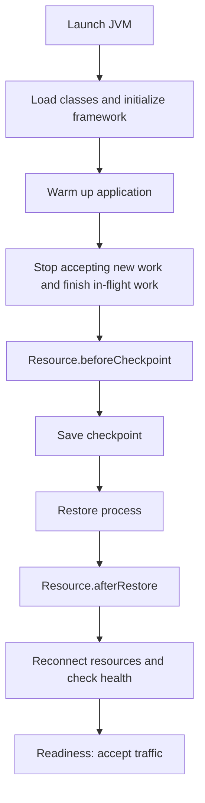

# Use Cases: Rapid Scale-Out, Restarts, and Low-Traffic Services

CRaC (Coordinated Restore at Checkpoint) enables a Java application to resume running from a pre-prepared JVM state. Instead of each new process having to load classes, initialize frameworks, populate caches, and warm up frequently used paths from scratch, you can create a **checkpoint** after the startup stage, save the process state, and **restore** that state when a new process is needed.

This capability is especially useful in three scenarios: needing to create additional instances quickly when load spikes, needing to restart a service with minimal wait time, and having low-traffic services that want to reduce cold start time. CRaC shortens the application initialization phase; it does not by itself increase per-request throughput, does not replace persistent data storage, and does not eliminate managing resources outside the JVM.

## 1. How Does CRaC Change the Startup Process?

A typical Java startup normally goes through these steps:

1. The JVM initializes and loads required classes.
2. The framework builds the application context, beans, and configuration.
3. The application connects to databases, message brokers, external services, and other resources.
4. Caches are populated; critical code paths may need extra time for the JIT to compile and optimize.
5. The application transitions to a state ready to accept traffic.

With CRaC, you prepare the application to a suitable state, ask the JVM to coordinate with registered resources to prepare for checkpointing, and save a process state image. On restore, the runtime recovers the process from that image and invokes resource recovery callbacks. Initialization work already captured in the checkpoint can be skipped or shortened significantly.



A checkpoint is a process state snapshot, not a copy of business data in a database. Nor is it like serializing a few Java objects: runtime state and native process resources can be involved in recovery. The actual mechanism relies on the JVM distribution and platform checkpoint/restore support, typically combined with OS capabilities such as CRIU on Linux. Therefore, check the JDK version, operating system, CPU architecture, container runtime, and deployment environment constraints.

## 2. Rapid Scale-Out When Load Increases

### Problems with Conventional Scale-Out

Suppose a Spring Boot service is running stably with two instances. When traffic surges suddenly, the orchestrator needs to spin up more instances. If every instance must start completely from scratch, the time spent loading classes, creating the application context, initializing clients, and warming up the JIT can make serving capacity grow slower than traffic growth.

This easily creates a negative feedback loop:

- Increasing traffic increases queues and response times.
- The orchestrator requests additional instances.
- New instances take time to start up and cannot accept requests yet.
- Existing instances continue absorbing heavy load while waiting for new instances to become ready.

### Using a Checkpoint as a Template Startup State

You can prepare a checkpoint from the exact application version to be deployed:

1. Launch the application in an environment compatible with the restore environment.
2. Complete framework, configuration, and shared component initialization.
3. Warm up critical execution paths using safe test data that contains no state tied to a single user or instance.
4. Stop accepting new requests, wait for in-flight requests to finish, and prepare resources for checkpointing.
5. Create the checkpoint and store the image tagged with the corresponding application version, JDK, and environment.
6. When scale-out is needed, spawn multiple instances from that checkpoint.
7. Each instance executes `afterRestore`, recreates its own connections, and transitions to readiness only after passing checks.

```text
                 ┌──────────────────────────────┐
                 │  Initialized, warmed-up app  │
                 └──────────────┬───────────────┘
                                │ checkpoint
                                ▼
                       ┌─────────────────┐
                       │  Checkpoint v42 │
                       └───┬─────┬─────┬─┘
                           │     │     │ restore
                           ▼     ▼     ▼
                         App A App B App C
                           │     │     │
                           └─────┴─────┘
                    accept traffic independently
```

The main benefit is that new instances can start from an already class-loaded and warmed-up state. This reduces scale-out latency when application initialization cost is high. Actual speed still depends on checkpoint size, image read speed, machine resources, restore time, and reconnection steps.

### What State Should Not Be Shared Across Replicas?

Each replica must have its own identity and resources. A cloned checkpoint can cause multiple processes to begin with identical in-memory data. Proactively refresh or re-issue the following after restore:

- **Instance identity:** logical hostname, instance ID, service discovery registration info, and metadata used to distinguish replicas.
- **Connections:** connection pools, sockets, client sessions, broker channels, and file descriptors tied to the old process or machine.
- **Leases and distributed locks:** prevent multiple replicas from restoring the same leader state, lease, or job ownership.
- **Short-lived credentials:** tokens, temporary credentials, and expiring signatures must be checked or re-issued.
- **Random state:** do not copy random number generator state in a way that causes replicas to produce identical sequences; use entropy mechanisms appropriate to the runtime and platform.
- **Time- or instance-dependent caches:** check TTLs, stale data, and caches holding private data.

Do not include real request data, user sessions, or in-progress transactions in a checkpoint shared across multiple replicas. Use generic warm-up data that is reproducible and safe to replicate.

## 3. Faster Service Restarts

### Restarting After Deployment or Maintenance

During a conventional restart, the new process must repeat the entire initialization process. With CRaC, a checkpoint prepared from the same application version can help the new process recover faster.

A deployment workflow might include:

1. Build the application and prepare a compatible runtime environment.
2. Run the new application, completing initialization and warm-up.
3. Create a checkpoint for the new version and verify restorability before wide rollout.
4. Shift traffic to the new process once readiness succeeds.
5. Let the old process drain requests, then shut it down per deployment policy.

When an instance of the same version needs to restart, the system can restore from the verified checkpoint instead of performing a cold start. When upgrading the JDK, changing native libraries, altering OS configuration, or changing incompatible components, create a new checkpoint in the target environment. Do not assume an old checkpoint can restore on any machine or runtime version.

### CRaC Does Not Replace Crash Recovery

A checkpoint only represents the state at the moment it was created. If the application crashes afterward, restoring from the checkpoint reverts to the state in the image, which may be older than the current state of external systems.

For example: a checkpoint is created at 10:00. Afterward the application processes additional orders and writes them to the database. If the process fails at 10:30 and restores the 10:00 checkpoint, application memory can revert to the older state while the database still retains changes committed after 10:00. Therefore:

- Critical business data must reside in durable storage systems.
- Message queue consumers need appropriate acknowledgment, retry, and idempotency mechanisms.
- Do not checkpoint while requests or transactions are in a half-finished state.
- Before checkpointing, stop accepting new work, drain in-flight work, and flush required data.
- After restore, resynchronize state from authoritative data sources and verify scheduled tasks.

CRaC shortens the time to bring up a process again. Data correctness after a failure still depends on transactions, databases, queues, and application recovery design.

### Handling Time-Dependent Tasks

A restored process may continue with objects and threads that already existed at checkpoint time. Therefore, review all logic that depends on wall-clock time:

- Timers or schedulers may have missed their scheduled run times.
- Cache TTLs and tokens may have expired while the process was not running.
- Heartbeats, leases, or health signals may need re-registration.
- Periodic jobs need to recompute their next run time instead of trusting an in-memory counter.
- DNS or external service addresses may have changed.

After restore, recompute deadlines from the current time and durable data when business rules require it. Do not treat an in-memory timer as the source of truth for important schedules or deadlines.

## 4. Low-Traffic Services and Reducing Cold Starts

Some services have low or sporadic request volume: internal admin pages, reporting endpoints, rare webhooks, operational tools, or batch-triggered workers. Keeping a JVM always running can waste resources when there is no work most of the time. However, scaling to zero and starting a JVM from scratch when a request arrives can make the first user wait a long time.

CRaC opens up an option: prepare a checkpoint after the application has warmed up, allow the running process to stop, and restore from the checkpoint when the service needs to operate again.

A typical workflow:

1. During deployment, create and verify a checkpoint of the service.
2. When there is no traffic, the platform can scale the process down to zero while keeping the checkpoint accessible.
3. When a request or trigger event arrives, the platform launches a process from the checkpoint.
4. The application recovers connections, refreshes dynamic configuration, and checks readiness.
5. After processing finishes or a keep-warm window expires, the platform can scale down according to operational policy.

The benefit is reduced initialization time compared to a full cold start. However, the first request may still wait for loading the checkpoint, restoring, connecting to the database, and passing readiness probes. If latency requirements are very strict, you may need to keep at least one instance active or pre-warm an instance before traffic arrives.

CRaC also does not by itself reduce the RAM footprint of an actively running process. Resource savings only appear when the platform actually stops processes or scales to zero; checkpoints still require storage capacity and version-management procedures.

## 5. Managing Resources with the `org.crac` API

The application must inform CRaC which resources must be prepared before checkpoint and recovered after restore. The `org.crac` API provides the `Resource` interface with two callbacks:

| Callback | Timing | Typical Work |
|---|---|---|
| `beforeCheckpoint(...)` | Before capturing state | Stop accepting work, close or release resources that cannot survive across restore, flush required data |
| `afterRestore(...)` | After the process is restored | Recreate pools, reopen clients/sockets, register heartbeats, refresh credentials and dynamic configuration |

The following example illustrates closing a connection pool before checkpoint and creating a new pool after restore. `AutoCloseable` keeps the example independent of a specific pool library; in a real application, the factory creates a pool matching the service's configuration.

```java
import java.util.function.Supplier;

import org.crac.Context;
import org.crac.Core;
import org.crac.Resource;

final class PoolResource implements Resource {
    private final Supplier<? extends AutoCloseable> poolFactory;
    private AutoCloseable pool;

    PoolResource(Supplier<? extends AutoCloseable> poolFactory) {
        this.poolFactory = poolFactory;
        this.pool = poolFactory.get();
    }

    @Override
    public void beforeCheckpoint(Context<? extends Resource> context)
            throws Exception {
        if (pool != null) {
            pool.close();
            pool = null;
        }
    }

    @Override
    public void afterRestore(Context<? extends Resource> context)
            throws Exception {
        pool = poolFactory.get();
    }
}

// Register the resource during the application initialization stage.
Core.getGlobalContext().register(
        new PoolResource(this::createConnectionPool)
);
```

In the example, `createConnectionPool()` is an application method returning an object implementing `AutoCloseable`. Replace the illustrative pool with real application pool management and ensure components using the pool have stopped before closing it.

Some principles when implementing callbacks:

- Register resources during initialization, before requesting a checkpoint.
- `beforeCheckpoint` must finish preparation work before the process is captured. If a resource cannot be released safely, let the checkpoint fail and handle the error explicitly.
- `afterRestore` must recreate resources tied to the current process. Do not keep using a socket or connection just because the Java object still exists on the heap.
- Do not swallow exceptions when restoring pools, clients, or essential resources. If the application is not ready, it must not accept traffic.
- Optional resources may recover asynchronously, yet readiness must accurately reflect the minimum components needed to serve requests.
- Verify that native libraries, custom threads, and agents in use are compatible with the JDK and platform's checkpoint/restore mechanism.

In a Spring Boot application, resource registration can live in an application lifecycle manager component. The key is that callbacks must coordinate related beans: stop accepting requests, drain executors, close pools, and recreate clients in the proper order. Do not let multiple beans independently close the same resource without a single clear owner.

## 6. Choosing the Right Scenario

| Scenario | How Can CRaC Help? | What to Check |
|---|---|---|
| Scale-out during traffic spikes | Spawn more replicas from an initialized and warmed-up state | Restore time, image size, replica identity, per-instance connections, and state replicability |
| Restart after deploy or maintenance | Recover a same-version process faster than a cold start | Compatibility of JDK/OS/native libraries, request draining, and verifying new checkpoints |
| Low-traffic service | Scale processes low or to zero, then restore on demand | Checkpoint storage location, first-request latency, readiness, and keep-warm policy |
| Application heavily reliant on native resources | May require more integration steps for safe recovery | Compatibility of drivers, sockets, file descriptors, threads, and native libraries |

CRaC is usually worth trying when startup or warm-up time represents a significant portion of the time to bring an instance into service. If the application already starts quickly, the checkpoint is large, the environment does not support restore, or resources cannot be safely recreated, operational overhead may outweigh the benefits.

## 7. Operational Checklist

Before introducing checkpoints into the deployment pipeline, confirm the following points:

- [ ] The checkpoint is created from the exact application version, JDK, native libraries, and compatible environment.
- [ ] The application has completed initialization and warm-up of required execution paths.
- [ ] No requests, transactions, or jobs remain mid-processing at checkpoint time.
- [ ] All critical resources have registered callbacks or equivalent recovery procedures.
- [ ] Database pools, broker clients, sockets, and file handles are verified after restore.
- [ ] Instance IDs, leases, credentials, random state, and time-dependent caches are refreshed appropriately.
- [ ] Business data has durable storage; restore does not cause the application to double-write or treat stale state as latest data.
- [ ] Readiness succeeds only after mandatory components have recovered.
- [ ] Checkpoints are protected as sensitive artifacts since process images may contain in-memory data and secrets.
- [ ] Procedures exist to generate new checkpoints, test restore, roll back, and clean up old images.
- [ ] Cold start, restore time, readiness time, image size, and first-request latency have been measured in a near-production environment.

JVM option names, checkpoint commands, and orchestrator integration depend on the CRaC/JDK distribution and deployment platform. Use the documentation of the exact runtime being operated to configure commands and system permissions; do not copy a command from another distribution and assume it works identically.

## 8. Conclusion

CRaC fits when a Java application spends substantial time initializing or warming up and the system needs to bring instances into service quickly. For scale-out, checkpoints help replicate prepared state; for restarts, they help recover a same-version process; for low-traffic services, they can reduce cold starts when processes scale to zero.

CRaC's value depends on preparing the checkpoint at a safe moment and properly recovering every resource after restore. Treat a checkpoint as the startup state of a process, while databases, queues, and durable storage systems remain the source of truth for business data.