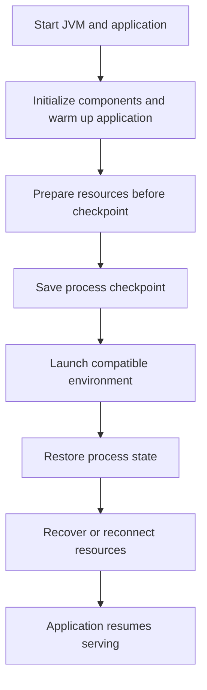

# Prerequisites and Recommended Learning Path for CRaC

CRaC (Coordinated Restore at Checkpoint) is a mechanism that lets a Java application save process state at a prepared moment and later restore the process from that state. As a result, the application can resume operating without repeating the entire costly startup and initialization process.

To learn CRaC effectively, you need to understand three areas together: the JVM and Java application lifecycle, OS processes and resources, and how the application coordinates before checkpoint and after restore. This lesson identifies the prerequisite knowledge and a progressive path from simple examples to real-world applications.

## 1. What Problem Does CRaC Solve?

A Java application typically has to perform many tasks before it is ready to serve requests:

- Initializing the JVM, loading classes, and running static initializers.
- Creating the Spring Application Context or equivalent application structure.
- Creating beans, configuring dependencies, reading configuration, and loading initial data.
- Initializing connection pools, HTTP clients, caches, schedulers, and shared components.
- Having the JIT compile frequently executed code to improve performance.

These steps can make startup time long, especially for applications with many components or many resources to initialize. CRaC allows the application to complete part or all of the preparation process, create a checkpoint, and then launch subsequent instances by restoring that checkpoint.

The overall flow can be pictured as follows:

A checkpoint contains process state at the JVM and operating system levels. Therefore, CRaC is not merely serializing Java objects and reading them back. A process also has threads, memory regions, file descriptors, sockets, runtime state, and links to external resources. These components must be considered when saving and restoring.

Nor is CRaC synonymous with packaging an application into a container or compiling to a native image. Containers provide the deployment environment; native image changes how an application is compiled and executed; CRaC saves and restores the state of a compatible process. These technologies can appear together in an architecture, yet solve different problems.

## 2. Prerequisites to Prepare

You do not need to become a JVM or Linux expert before starting. However, you should understand the following concepts well enough to explain what exists inside the process and what can change after restore.

### 2.1. Java Fundamentals and Application Lifecycle

This is the mandatory knowledge group. You need to understand:

- Structure of a Java application: classes, objects, static fields, classpath or module path, libraries, and runtime configuration.
- Startup lifecycle: from when the JVM is created, classes are loaded, and initialization code runs until the application begins accepting requests.
- Threads and concurrency: where threads are created, how executors operate, how background tasks are scheduled, and how shared state is protected.
- Java resources: streams, files, sockets, connection pools, executors, timers, and lifecycle-managed objects that need closing or recreating.
- Error handling and shutdown: how the application stops resources, how initialization failures are handled, and which component is responsible for releasing resources.

In particular, distinguish state residing in Java memory from resources outside the JVM. An object may still exist in the checkpoint's heap, yet the socket that object references may no longer be usable after restore.

### 2.2. Basic JVM Knowledge

You should understand the main regions and activities of the JVM:

| Concept | Why It Relates to CRaC |
|---|---|
| Heap | Holds objects and application state that can be preserved in the checkpoint. |
| Java stack | Tied to threads and execution state at checkpoint time. |
| Metaspace | Stores metadata of already-loaded classes. |
| Class loading | Helps determine which components were loaded before checkpoint. |
| Garbage Collection | Affects memory state and pressure during execution. |
| JIT compilation | Warming up the application before checkpoint can help preserve benefits of completed optimizations. |
| Threads and monitors | May involve running tasks, locks, and synchronization state at checkpoint time. |

There is no need to study GC algorithms or JIT machine-code internals deeply from the start. The goal is to understand that a checkpoint saves the state of a running JVM process, so checkpoint timing and thread states matter.

### 2.3. Operating System and Process Knowledge

CRaC operates at the process level, so basic Linux concepts are needed:

- Processes and PIDs: how an active program is managed by the operating system.
- Process address space and memory regions: heap, stack, memory mappings, and libraries mapped into memory.
- File descriptors: how a process references files, pipes, sockets, and I/O resources.
- Sockets and network connections: TCP connection state, listening ports, and connections to external services.
- Signals and permissions: how a process receives signals, which user it runs under, and which permission restrictions apply.
- Namespaces, cgroups, and containers at a conceptual level: how the runtime environment constrains or isolates the process.

JDK distributions supporting CRaC typically pair the JVM with OS-level checkpoint/restore mechanisms; on Linux, CRIU (Checkpoint/Restore In Userspace) is a common component. Practical usability depends on the JDK, OS version, kernel, permissions, and environment configuration. Therefore, do not assume every machine running Java can checkpoint/restore identically.

### 2.4. External Resources and Networking

This knowledge group is very important when moving from small examples to real applications. Distinguish:

- **In-process resources:** objects, data structures, in-memory caches, and Java state that can be preserved in the checkpoint.
- **OS-managed resources:** file descriptors, open files, sockets, threads, and related runtime objects.
- **Resources on external services:** database connections, message brokers, Redis, HTTP services, authentication services, or other systems.

A connection open before checkpoint is not automatically valid after restore. The remote peer may have closed the connection, timed out, or changed state. Similarly, listening ports, sockets, files, and locks can depend on the runtime environment. You must know how to create, check, close, and reopen these resources.

### 2.5. Frameworks and Deployment Environment

If the application uses Spring Boot, you should know:

- How the Spring Application Context is created and refreshed.
- At which stage eager/lazy beans are initialized.
- How Spring lifecycle callbacks, listeners, and events work.
- Where connection pools, HTTP servers, schedulers, and background tasks are created.
- How profile-based configuration, environment variables, secrets, volumes, and health checks are provided at deployment time.

This knowledge is essential when applying CRaC to a Spring Boot application; someone learning CRaC with a small Java application does not need to learn all of Spring beforehand.

## 3. CRaC Concepts to Distinguish

Before diving into the API, master the following terms:

| Term | Meaning |
|---|---|
| Checkpoint | The moment and operation of recording process state so it can be restored later. |
| Checkpoint image | The data produced to serve restoration; format and storage depend on deployment tooling. |
| Restore | Recovering the process from a checkpoint so the application resumes operating. |
| Resource | An application component that needs coordinated handling before checkpoint or after restore. |
| `beforeCheckpoint` | Callback for the application to prepare resources before process state is saved. |
| `afterRestore` | Callback for the application to check, reopen, or complete resource recovery after the process is restored. |
| CRIU | Userspace process checkpoint/restore tool on Linux, commonly used in CRaC implementations. |

The CRaC API provides a way to register objects implementing `org.crac.Resource` with a context. A resource can perform necessary work in `beforeCheckpoint(...)` and `afterRestore(...)`. For example, the application can pause background tasks or close a connection that cannot survive restore, then recreate the connection when restored.

These two callbacks do not automatically make every third-party library compatible with CRaC. Developers must identify which resources require handling, use built-in library integration APIs if available, or manage resource lifecycles themselves. Specific implementation details must follow the CRaC JDK and library versions in use.

## 4. Recommended CRaC Learning Sequence

Learn in order from the process model to practical resource handling. Each stage should have an observable outcome confirming understanding.

### Step 1: Measure and Understand Java Application Startup

Pick a small standalone Java application. Observe the time from launch until the application is ready to accept requests. Record the work happening during startup: loading classes, creating objects, loading configuration, establishing connections, and warming up the application.

**Target outcome:** be able to explain which stage the application spends time in and which state would be beneficial if preserved.

### Step 2: Review the JVM and Process Model

Review heap, stack, class loading, threads, file descriptors, sockets, and the process lifecycle. Use process inspection tools to distinguish in-memory state from external resources.

**Target outcome:** be able to describe what kinds of state a running Java application consists of and why saving Java objects alone is not equivalent to process checkpointing.

### Step 3: Learn About Supported CRaC Environments

Identify a JDK distribution supporting CRaC, Java version, Linux OS, kernel, and checkpoint/restore tool requirements. Check installation and execution instructions for the exact JDK distribution being used. If running inside a container, study required container permissions, configuration, and limits.

**Target outcome:** have a sample environment meeting the requirements of the chosen CRaC distribution and know how to diagnose basic environment errors.

### Step 4: Perform Checkpoint and Restore with a Minimal Application

Start with an application that has few dependencies, such as a simple HTTP server or a program holding an in-memory counter. Run the application, bring it to the desired state, create a checkpoint, and then restore according to the instructions of the corresponding JDK and tooling.

Observe logs, startup time, in-memory state, and ability to accept requests after restore. Repeat multiple times to clearly understand the workflow and environmental conditions.

**Target outcome:** distinguish a fresh startup from a restore, and confirm that the application truly resumes from the checkpoint.

### Step 5: Learn the Resource API and Callback Lifecycle

Study `org.crac.Resource`, the resource registration context, and the two callbacks `beforeCheckpoint(...)`, `afterRestore(...)`. Try registering a simple resource, logging in both callbacks, and observing when they are invoked.

Then add preparation logic before checkpoint and recovery logic after restore. Keep callbacks clear, safely repeatable, and equipped with proper error handling. Do not put heavy work or external service dependencies inside callbacks without understanding their impact on restore time and reliability.

**Target outcome:** explain what the application must do before checkpoint and after restore, as well as where resources are registered.

### Step 6: Handle Real Resources

Expand the example one resource category at a time rather than adding everything at once:

1. Files and streams: determine which file descriptors are kept, closed, or reopened.
2. Databases: inspect connection pools, borrowed connections, and ability to create new connections.
3. HTTP clients and sockets: inspect open connections, timeouts, and reconnection behavior.
4. Thread pools and schedulers: stop or pause tasks appropriately, avoiding duplicate task execution after restore.
5. Caches and out-of-process data: determine which data is kept in memory and which data needs resynchronization.

For each category, test both success cases and cases where external resources changed while the process was inactive.

**Target outcome:** have an inventory of application resources, pre-checkpoint handling, post-restore recovery, and test evidence.

### Step 7: Integrate Frameworks and Containers

Once plain Java examples work, move to a real application such as Spring Boot. Identify beans, listeners, servers, pools, and background tasks whose lifecycles relate to checkpointing. Check compatibility across the JDK, framework, and libraries; prefer official integration documentation for the exact versions in use.

Next, put the application into a deployment environment close to production. Check container configuration, required permissions, checkpoint storage volumes, environment variables, secrets, health checks, and how processes launch after restore.

**Target outcome:** the application can restore in the target deployment environment and critical resources function normally.

### Step 8: Evaluate Performance and Operations

Compare cold start against restore time under identical test conditions. Besides time to readiness, check:

- Whether the application accepts and processes requests accurately after restore.
- Whether database, broker, and HTTP connections recover reliably.
- Whether background tasks run twice, get skipped, or execute with stale state.
- Whether logs, metrics, tracing, and health checks accurately reflect state after restore.
- Whether the checkpoint matches the exact JDK, libraries, OS, and deployment configuration.
- Whether a fallback plan to cold start exists when a checkpoint is unusable.

Checkpoints may contain sensitive data that was residing in process memory. Read permissions, storage locations, retention periods, and checkpoint sharing must be controlled like managing a sensitive artifact.

**Target outcome:** have benchmark comparisons, a post-restore test suite, and operational runbooks for when restore succeeds or fails.

## 5. Progressive Practice Exercises

A small practice sequence connects these concepts into a complete workflow:

| Practice | Content | Completion Evidence |
|---|---|---|
| 1 | Run a minimal Java application and measure cold start. | Logs showing start time and ready time. |
| 2 | Create in-memory state, checkpoint, and restore. | State value remains intact after restore. |
| 3 | Register a Resource and log inside both callbacks. | Logs demonstrating preparation and recovery order. |
| 4 | Add a database or HTTP client. | Application connects and handles requests after restore. |
| 5 | Add a thread pool or periodic task. | No duplicate task execution or use of stale state. |
| 6 | Run in a container close to the target environment. | Can create and restore checkpoints using the documented deployment procedure. |

Add only one resource group at a time. When errors occur, this approach helps pinpoint whether the issue comes from the checkpoint environment, callbacks, or the newly added resource itself.

## 6. Common Misconceptions for Beginners

**“CRaC only saves the Java heap.”** Incorrect. Checkpoints involve process and OS state; the heap is only one part of that state.

**“After restore, all old connections are definitely usable.”** You cannot assume that. External services may have closed connections or changed state. The application must inspect and recover resources appropriately.

**“Create a checkpoint once and it runs on every machine.”** Checkpoints depend on a compatible environment. JDK, OS, architecture, libraries, and deployment configuration can all affect restorability.

**“Using Spring Boot means the framework handles all resources automatically.”** Do not assume this. Support level depends on framework version, JDK, and individual libraries. Check integration documentation and test the real application.

**“Fast restore means the application is already ready.”** The process may have restored yet still need to finish callbacks, reconnect services, update state, and pass health checks before accepting traffic.

## 7. Checklist Before Moving to Advanced CRaC Topics

- [ ] Can explain the basic startup lifecycle of a Java application.
- [ ] Can distinguish heap, stack, threads, and OS-managed resources.
- [ ] Can explain processes, file descriptors, sockets, and connections to external services.
- [ ] Can distinguish checkpoints from object serialization and from container images.
- [ ] Have identified a JDK and runtime environment that support CRaC.
- [ ] Have performed checkpoint and restore for a minimal application.
- [ ] Can explain the roles of `beforeCheckpoint(...)` and `afterRestore(...)`.
- [ ] Can identify resources that need closing, pausing, checking, or recreating.
- [ ] Have tested the application after restore, including connections and background tasks.

If you have not completed the full checklist, go back to the specific missing knowledge area. Do not delay running your first CRaC example until you understand every detail of the JVM or Linux; you can learn advanced parts as soon as hands-on exercises show they are needed.

## 8. Key Terminology

- **CRaC:** Coordinated Restore at Checkpoint, a coordinated mechanism between a Java application and the runtime to checkpoint/restore a process.
- **Checkpoint:** saved process state so that it can be restored.
- **Restore:** the operation of recovering a process from a checkpoint.
- **CRIU:** Checkpoint/Restore In Userspace, a Linux userspace process checkpoint/restore tool.
- **Resource:** an application component needing coordinated lifecycle handling during checkpoint and restore.
- **Cold start:** starting an application from scratch without using an existing checkpoint.
- **Warm-up:** a stage where the application is executed to load and prepare components, potentially including JIT compilation.

A suitable path is starting with a small Java application, understanding process state, performing basic checkpoint/restore, and then incrementally adding the Resource API, external connections, frameworks, and deployment environments. This learning approach ties each CRaC concept to an observable and verifiable behavior.