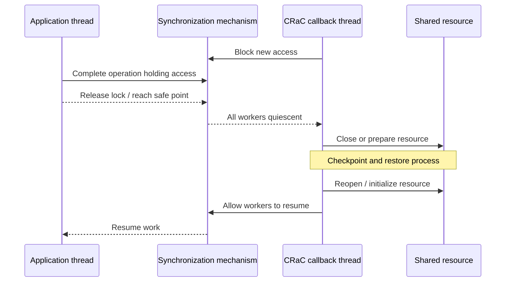

# Coordinating Application Threads with Callback Execution Threads

A Java application typically has multiple threads sharing connection pools, files, caches, schedulers, or shared components. When CRaC prepares a checkpoint, the `beforeCheckpoint(...)` callback must put those resources into a saveable state. After restore, the `afterRestore(...)` callback restores the resources so the application can continue operating.

Callbacks do not automatically make every application thread stop at a safe point. While a resource is transitioning into a paused state, another worker might still try to access the resource, handle a new request, or run a periodic task. Therefore, the application must coordinate between the thread executing the callback and the threads using the resource: block new access, wait for in-flight operations to finish, bring workers to a safe point, and allow them to resume only after the resource is ready.

CRaC does not impose a single concurrency model. Coordination depends on the number of workers, how they receive work, event loops, executors, and how checkpointing is triggered. This article presents common synchronization patterns, frequent deadlocks, and how to design controllable recovery flows.

## 1. Callbacks and application threads have different roles

The two callbacks of `org.crac.Resource` coordinate the resource lifecycle:

- `beforeCheckpoint(Context<? extends Resource> context)`: prepares the resource before the JVM and process are checkpointed.
- `afterRestore(Context<? extends Resource> context)`: restores or reopens the resource after the process is restored.

Callbacks are invoked by the CRaC runtime through `Context`. They are not an automatic broadcast command telling all workers to finish their work. The application must design a mechanism so threads accessing the resource know when to stop, wait, or resume.

The thread executing the callback is also not necessarily a worker using the resource. For example, CRaC documentation describes the case where a checkpoint is triggered with `jcmd <pid> JDK.checkpoint`: the callback is invoked from a thread different from the periodic thread writing a file. When checkpointing is called via `Core.checkpointRestore()`, the call runs on the thread of code that requested the checkpoint. Because the trigger source can vary, do not assume the callback always runs on the main thread, a worker thread, or an event-loop thread.

An important principle is that the callback acts as a coordinator. It needs to coordinate with workers via locks, barriers, signals, or a task submitted to an event loop. Do not rely on "the JVM will automatically stop all workers at the right moment" to protect an application data structure or resource.

## 2. Lifecycle of a resource in a multithreaded environment

Before CRaC, many components often had a simple lifecycle:

```text
CREATED → ACTIVE → CLOSED
```

With CRaC, some components need additional suspending and resuming states:

```text
CREATED → ACTIVE → SUSPENDING → SUSPENDED
                                  ↓
                               RESTORING
                                  ↓
                                ACTIVE
```

In `SUSPENDING`, the application stops granting new access and waits for operations currently using the resource to complete. In `SUSPENDED`, the resource has been closed or put into a state suitable for checkpointing. After restore, the callback restores the resource; workers are allowed to continue only when the resource is ready.



The `SUSPENDED` state does not mean all application threads have vanished. Workers may be waiting at a barrier or blocked on a lock. They must not be allowed to access the resource during the period when the resource is not yet ready.

## 3. Identifying safe points for each kind of worker

A safe point is a position in the processing flow where a worker can pause without corrupting the work in progress. A safe point usually lies between two units of work, after the worker has completed or persisted the state of the current operation.

Examples:

| Worker type | Appropriate safe point | What must complete before waiting |
|---|---|---|
| Queue consumer worker | After finishing processing one message, before fetching the next message. | Commit/rollback, acknowledge, or save offset per broker semantics. |
| File writer worker | After finishing writing a chunk and flushing required data. | Finish buffer, close handle if needed. |
| HTTP request worker | After the response has been read/closed or the request is canceled in a controlled way. | Release connection and update request state. |
| Scheduled task | Between two executions. | Cancel old schedule or prevent new execution from starting. |
| Event loop | After finishing processing the current event, before fetching the next event. | Finish current callback and put loop into waiting state. |

Do not ask a worker to stop in the middle of a data write, transaction, or multi-step state update without a clear rollback or resume mechanism.

A worker blocked indefinitely in `take()`, `read()`, or network I/O may never reach a safe point. Use timeout polling, cancellation, interrupts, or appropriate shutdown APIs to wake the worker. Do not assume calling `interrupt()` will cancel every kind of I/O or every library.

## 4. General pattern: using `ReadWriteLock` when the number of accessing threads is not fixed

When you do not know in advance which threads will access a resource and when, `ReadWriteLock` is a direct coordination approach:

- Each operation using the resource acquires the read lock.
- `beforeCheckpoint(...)` acquires the write lock. The write lock is granted only once current readers have released the lock, while blocking new readers.
- The callback prepares or closes the resource while holding the write lock.
- `afterRestore(...)` reopens the resource and then releases the write lock so workers can resume.

Condensed example:

```java
import org.crac.Context;
import org.crac.Core;
import org.crac.Resource;

import java.util.concurrent.locks.Lock;
import java.util.concurrent.locks.ReadWriteLock;
import java.util.concurrent.locks.ReentrantReadWriteLock;
import java.util.concurrent.TimeUnit;
import java.util.function.Function;

public final class SharedConnectionPool implements Resource {

    private final ReadWriteLock lifecycle = new ReentrantReadWriteLock();
    private final Lock useLock = lifecycle.readLock();
    private final Lock checkpointLock = lifecycle.writeLock();

    private volatile ConnectionPool pool;
    private volatile boolean failed;
    private volatile boolean checkpointLockHeld;
    private volatile boolean poolPreparedForCheckpoint;

    public SharedConnectionPool() {
        pool = createPool();
        Core.getGlobalContext().register(this);
    }

    public <T> T withConnection(Function<Connection, T> operation) {
        useLock.lock();
        try {
            if (failed || pool == null) {
                throw new IllegalStateException("Pool is unavailable");
            }
            // Hold the read lock for the entire duration of the operation using the connection.
            return pool.withConnection(operation);
        } finally {
            useLock.unlock();
        }
    }

    @Override
    public void beforeCheckpoint(Context<? extends Resource> context)
            throws Exception {
        // Wait for all operations currently using the pool to finish and block new readers.
        if (!checkpointLock.tryLock(10, TimeUnit.SECONDS)) {
            throw new IllegalStateException(
                    "Timed out waiting for active pool users");
        }
        checkpointLockHeld = true;

        // Hold the write lock across checkpoint so workers remain blocked.
        poolPreparedForCheckpoint = true;
        closePool();
        pool = null;
    }

    @Override
    public void afterRestore(Context<? extends Resource> context)
            throws Exception {
        try {
            if (poolPreparedForCheckpoint) {
                // If closing before checkpoint failed, attempt to close any remaining resource.
                if (pool != null) {
                    pool.close();
                    pool = null;
                }
                pool = createPool();
                failed = false;
                poolPreparedForCheckpoint = false;
            }
        } catch (Exception e) {
            failed = true;
            throw e;
        } finally {
            // Workers are woken up, but will see failed if the pool cannot be reopened.
            if (checkpointLockHeld) {
                checkpointLockHeld = false;
                checkpointLock.unlock();
            }
        }
    }

    private void closePool() throws Exception {
        if (pool != null) {
            pool.close();
        }
    }

    private ConnectionPool createPool() {
        return new ConnectionPool();
    }
}
```

`ConnectionPool` and `Connection` in the example are illustrative types, not CRaC classes. `withConnection(...)` holds the read lock for the entire duration of the operation using the connection; if it only locked while acquiring the connection and returned the connection to the caller to use after releasing the lock, the callback could still close the pool while the caller was using the connection. Real code must use the lease/return API of the pool library in use and hold the synchronization mechanism for the entire lease lifecycle.

### 4.1. Why can a write lock keep workers in a safe state?

When the callback acquires the write lock, it must wait for all operations holding the read lock to finish. Once the write lock is granted:

- No operations remain running inside the protected region.
- New workers wanting access must wait.
- The callback can close the pool or change resource state without concurrent operations interfering.
- After restore, the callback recreates the pool and releases the lock; new workers can proceed.

CRaC best practices documentation uses this exact pattern for connection pools. The documentation also notes that a read lock has overhead on frequent paths because locking can require atomic operations. For very hot code, measure overhead and consider a more suitable synchronization pattern.

### 4.2. Notes on lock ownership and callback errors

`ReentrantReadWriteLock` is a thread-owned lock. You must not acquire a write lock on one worker and expect another callback thread to release the lock on that worker's behalf. The CRaC pattern above acquires the write lock in the `beforeCheckpoint(...)` callback and releases it in `afterRestore(...)`; follow the execution contract of the deployed CRaC runtime and test the actual checkpoint/restore path.

If `beforeCheckpoint(...)` throws an exception after acquiring the write lock, some CRaC implementations enter a resource recovery path and invoke `afterRestore(...)` to undo prepared state. CRaC best practices documentation illustrates this approach in examples. Do not arbitrarily release the lock inside `catch` and proceed with checkpointing if the resource state has not been recovered. Design a rollback path and test it with your specific JDK/runtime.

In `afterRestore(...)`, if reopening the pool fails, workers must not be allowed to use the pool. The example sets `failed = true` before releasing the lock; all subsequent operations check the state and reject access. The application needs to combine this with its readiness/fail-stop policy.

## 5. Pattern for a known number of workers: using `Phaser`

If the application has a fixed or known number of workers, and the workers regularly pass through a check point, `Phaser` can synchronize with the callback without acquiring a read lock on every access.

The idea uses two barriers:

1. Before checkpoint, the callback creates a `Phaser` with `N + 1` parties: N workers and the callback. The callback waits until all workers reach the safe point.
2. After restore, the callback reopens the resource, then joins the second barrier to release the waiting workers.

Illustrative example with two workers:

```java
import org.crac.Context;
import org.crac.Core;
import org.crac.Resource;

import java.util.concurrent.Phaser;
import java.util.concurrent.TimeUnit;

public final class FileWriterResource implements Resource {

    private static final int WORKER_COUNT = 2;
    private volatile Phaser checkpointPhaser;
    private volatile boolean fileClosed;

    public FileWriterResource() {
        Core.getGlobalContext().register(this);
    }

    public void workerLoop() throws Exception {
        while (!Thread.currentThread().isInterrupted()) {
            awaitCheckpointIfNeeded();
            writeNextChunk();
        }
    }

    private void awaitCheckpointIfNeeded() throws Exception {
        Phaser current = checkpointPhaser;
        if (current == null) {
            return;
        }

        // Barrier 1: worker signals it has reached the safe point.
        if (current.arriveAndAwaitAdvance() < 0) {
            throw new IllegalStateException("Checkpoint barrier terminated");
        }

        // Barrier 2: worker waits for callback to reopen resource after restore.
        if (current.arriveAndAwaitAdvance() < 0) {
            throw new IllegalStateException("Restore barrier terminated");
        }
    }

    @Override
    public void beforeCheckpoint(Context<? extends Resource> context)
            throws Exception {
        Phaser phaser = new Phaser(WORKER_COUNT + 1);
        checkpointPhaser = phaser;

        // Callback is the (N+1)th party and waits for all workers.
        int phase = phaser.arrive();
        if (phase < 0) {
            throw new IllegalStateException("Workers did not reach safe point");
        }
        try {
            phaser.awaitAdvanceInterruptibly(phase, 10, TimeUnit.SECONDS);
            closeFile();
            fileClosed = true;
        } catch (Exception e) {
            checkpointPhaser = null;
            phaser.forceTermination();
            throw e;
        }
    }

    @Override
    public void afterRestore(Context<? extends Resource> context)
            throws Exception {
        Phaser phaser = checkpointPhaser;
        try {
            if (fileClosed) {
                reopenFile();
                fileClosed = false;
            }
            checkpointPhaser = null;
        } catch (Exception e) {
            if (phaser != null) {
                phaser.forceTermination();
            }
            throw e;
        }

        if (phaser != null && phaser.arriveAndAwaitAdvance() < 0) {
            throw new IllegalStateException("Workers could not resume");
        }
    }

    private void writeNextChunk() throws Exception {
        // Process one unit of work and return to the safe point.
    }

    private void closeFile() throws Exception {
        // Flush and close file before checkpoint.
    }

    private void reopenFile() throws Exception {
        // Open new file or verify file after restore.
    }
}
```

This example is suitable only when exactly `WORKER_COUNT` workers participate in the barrier. In a real application, you must handle stopped workers, dynamically added/removed workers, errors during writing, and cases where a worker never reaches the safe point. If worker count changes dynamically, manage party registration/deregistration or choose an appropriate `ReadWriteLock`/coordinator.

### 5.1. Avoiding indefinite waits at the barrier

If a worker is waiting on a queue indefinitely, stuck in I/O, or running an overly long task, the callback will wait forever. You can:

- Use `poll(timeout)` instead of unbounded `take()`.
- Set timeouts for I/O and requests.
- Send a signal or interrupt to wake the worker if the operation supports it.
- Split long work into pausable chunks.
- Set a deadline for the quiesce phase; if it expires, fail the checkpoint rather than proceeding in an unsafe state.

When a worker leaves the system, update the party count accordingly. A `Phaser` waiting on a vanished party will not automatically know that the worker is no longer participating.

## 6. Event Loop pattern: submitting the pause command onto the right processing thread

Some applications use a single-threaded event loop. All operations on the resource are performed by the same thread, such as a single-threaded scheduler or an event loop managing heartbeats and I/O.

In this case, the callback should not directly modify the resource while the event loop is still processing events. An appropriate approach is:

1. `beforeCheckpoint(...)` submits a pause command to the event loop.
2. The event loop finishes the current event, transitions to the suspended state, and notifies the callback.
3. The callback waits for confirmation, then closes or prepares the resource.
4. After restore, the callback reopens the resource and emits a resume signal.
5. The event loop wakes up and resumes fetching new events.

Conceptual pattern:

```java
import org.crac.Context;
import org.crac.Core;
import org.crac.Resource;

import java.util.concurrent.CountDownLatch;
import java.util.concurrent.ExecutorService;
import java.util.concurrent.TimeUnit;

public final class EventLoopResource implements Resource {

    private final ExecutorService eventLoop;
    private final Object monitor = new Object();
    private boolean suspended;

    public EventLoopResource(ExecutorService eventLoop) {
        this.eventLoop = eventLoop;
        Core.getGlobalContext().register(this);
    }

    @Override
    public void beforeCheckpoint(Context<? extends Resource> context)
            throws Exception {
        CountDownLatch paused = new CountDownLatch(1);

        eventLoop.execute(() -> {
            synchronized (monitor) {
                suspended = true;
                paused.countDown();
                while (suspended) {
                    try {
                        monitor.wait();
                    } catch (InterruptedException e) {
                        Thread.currentThread().interrupt();
                        return;
                    }
                }
            }
        });

        if (!paused.await(10, TimeUnit.SECONDS)) {
            throw new IllegalStateException("Event loop did not pause");
        }

        closeEventLoopResource();
    }

    @Override
    public void afterRestore(Context<? extends Resource> context)
            throws Exception {
        reopenEventLoopResource();
        synchronized (monitor) {
            suspended = false;
            monitor.notifyAll();
        }
    }

    private void closeEventLoopResource() throws Exception { /* ... */ }
    private void reopenEventLoopResource() throws Exception { /* ... */ }
}
```

This is an illustrative skeleton; the resource handling methods must be replaced with the application's implementation, and the executor lifecycle needs a clear owner. The event-loop task submitted from the callback runs after the current event finishes. That task waits on the monitor until the `afterRestore(...)` callback wakes it.

In real code, if `paused.await(...)` times out, you must cancel the pending pause request or send a rollback signal capable of handling the case where the task has not started yet. Otherwise, the pause task might run belatedly after the callback has already failed and leave the event loop stuck in the suspended state. Similarly, `closeFile()` should have clear rollback behavior if it only closed partially before throwing an error.

Do not invoke checkpoint directly from the event loop's sole thread itself if `beforeCheckpoint(...)` needs to submit another task onto the same loop and wait for that task. In that situation, the loop thread is occupied by the checkpoint call, so the pause task cannot run. Have a coordinator outside the event loop trigger the checkpoint, or use a pause protocol designed specifically for the loop.

### 6.1. Deadlock when sharing one event loop

If multiple Resources share one single-thread executor, do not let each callback submit a pause task and wait for that task to complete independently. The first Resource may block the event loop, causing the next Resource's pause task to never execute.

With a shared executor, create one coordinator responsible for pausing and resuming the entire executor, or consolidate related operations into a single Resource representing the executor. CRaC documentation explicitly warns that the simple event-loop pattern does not apply as-is when a single-thread executor is shared across multiple components.

## 7. Coordinating with `ExecutorService` and periodic tasks

A thread pool typically has multiple workers, a work queue, and running tasks. Before checkpointing, clearly decide:

- Should new task admission be stopped?
- Are running tasks allowed to finish or must they be canceled?
- Are queued tasks retained, discarded, or persisted?
- Is the executor kept across checkpoint or shut down and recreated after restore?
- Who is responsible for reopening admission and rescheduling tasks?

It is not always necessary to shut down the entire executor. If the thread pool only handles pure Java work and its state can safely continue, workers can be coordinated to a barrier. If the executor owns native resources, sockets, or libraries that do not support restore, shut it down and reinitialize according to the library's API.

### 7.1. `scheduleAtFixedRate` tasks

A common pitfall is leaving `ScheduledExecutorService.scheduleAtFixedRate(...)` holding its old schedule. If the process stays checkpointed for a long time, after restore the scheduler may try to execute missed runs to catch up with the schedule. This can cause a burst of tasks, send too many heartbeats, or rerun work over elapsed time.

For tasks that should not catch up:

1. Cancel the scheduled future in `beforeCheckpoint(...)`.
2. Record the schedule configuration without assuming missed runs must execute.
3. Create a new schedule in `afterRestore(...)` with an appropriate timestamp.
4. Ensure only one schedule is active, avoiding duplicate rescheduling.

If business logic requires catch-up runs, explicitly calculate the number of catch-up executions needed and apply rate limits, rather than letting the scheduler emit an uncontrolled burst of runs.

### 7.2. Distinguishing shutdown from pause

`ExecutorService.shutdown()` typically transitions the executor to a state that rejects new tasks and lets already-submitted tasks finish. This is a terminal state, not a pause for reuse. If you shut down an executor before checkpoint, after restore you typically must create a new executor rather than expecting to reopen the old one.

If you want to keep workers alive while paused, build a custom pause/resume mechanism using locks, conditions, semaphores, or barriers. Choose the mechanism based on the threading model and ensure workers do not continue using closed resources.

## 8. Callback order and dependency relationships between Resources

An application may register multiple Resources: database pool, HTTP client, scheduler, file manager, and server. If they depend on one another, the preparation and restoration order must be designed deliberately.

According to Azul's CRaC integration documentation, Resources have `beforeCheckpoint(...)` invoked in registration order; `afterRestore(...)` is invoked in reverse order. This allows registering dependent components before/after so restoration happens in the reverse direction of preparation.

Example:

| Registration order | Resource | Pre-checkpoint preparation | Post-restore recovery |
|---:|---|---|---|
| 1 | Database pool | Stop issuing connections and close pool. | Open pool first. |
| 2 | Repository | Stop accessing repository. | Resume after pool is ready. |
| 3 | Background worker | Stop accepting tasks and wait for safe point. | Resume after repository is ready. |

In this example, registration order must be chosen according to actual dependencies. If callback ordering is insufficient to express complex relationships, use a coordinator Resource to invoke steps in an explicit order. Do not let two Resources co-own and close the same executor or pool, as that can cause double-close or race conditions.

## 9. Common deadlocks and race conditions

### 9.1. Callback waits on worker while worker waits on callback

Example: the callback acquires a lock and waits for a worker to finish. The worker needs that same lock to finish its work. Both wait on each other.

**How to avoid:** define a lock ordering beforehand, do not wait on workers while holding a lock the worker needs to exit, and keep critical sections short. If a write lock must be held across checkpoint, ensure workers do not hold the read lock while waiting for an event that only the callback can emit.

### 9.2. Calling checkpoint while holding a read lock

If a worker invokes `Core.checkpointRestore()` directly inside a region where it holds the read lock, the `beforeCheckpoint(...)` callback may need the write lock to wait for all readers to exit. Yet the caller holds the read lock and cannot exit the checkpoint call until the callback finishes. This is a self-deadlock scenario.

**How to avoid:** request checkpoint from a coordinator outside resource-protected regions. If checkpoint is triggered via `jcmd`, still ensure every worker can release locks and reach a safe point.

### 9.3. Callback waits for a task on an executor the callback is occupying

If a callback runs on a single-thread executor and submits another task to the same executor and waits on `Future.get()`, the new task cannot run because the sole thread is occupied by the callback.

**How to avoid:** do not block the executor needed to run the confirmation task. Use a separate coordinator thread, or design the callback to submit commands and wait via a mechanism that does not occupy the event loop.

### 9.4. Worker blocked in unbounded I/O

The callback acquires a write lock or waits at a barrier, but a worker is stuck in I/O. The callback cannot proceed.

**How to avoid:** set timeouts on I/O, use cancellation APIs, timeout-based polling, and an overall deadline for the quiesce step. If a worker cannot be brought to a safe state, fail the checkpoint.

### 9.5. Opening a resource before workers are released

If the callback wakes workers before the pool, file, or client has finished reopening, workers may use an unready resource.

**How to avoid:** the order must be create/open resource, verify valid state, update readiness, and only then release the barrier or unlock.

### 9.6. Duplicate Resource registration

A component might be initialized multiple times or multiple modules might register callbacks managing the same executor. This causes callbacks to run multiple times and repeatedly shut down/resume.

**How to avoid:** designate one owner per shared resource, keep a strong reference to handlers when needed, and register exactly once per component lifecycle.

## 10. Error handling during synchronization

Thread coordination needs error-handling paths for both phases.

### 10.1. `beforeCheckpoint(...)` cannot bring workers to a safe point

If a worker does not release a lock or reach a barrier within the deadline, do not proceed with checkpointing while the resource is still being accessed. The callback can throw an exception to signal that preparation failed. The application should clearly log which worker did not become quiescent and observable causes.

Do not ignore the timeout and close the resource while workers are still using it. That creates a race condition and can result in a checkpoint containing inconsistent state.

### 10.2. `afterRestore(...)` cannot restore the resource

If a file cannot be reopened, a pool cannot be created, or an event loop cannot resume, workers must not keep running with a broken resource. You can mark a failed state, block the related capability, and throw an exception per the callback contract. The ultimate policy is bounded retries, degraded mode, or fail-stop depending on how critical the resource is.

When using `Phaser`, if restoration fails you can call `forceTermination()` so waiting workers recognize that the barrier is broken instead of waiting forever. With locks, after unlocking, maintain an error state so workers do not access an uninitialized resource.

### 10.3. Do not use sleep as a synchronization mechanism

`Thread.sleep(...)` only delays one thread for a duration; it does not prove other workers have finished their work. Do not use patterns like "sleep 2 seconds then close the pool" as a substitute for barriers, locks, or acknowledgements. Use an explicit confirmation signal showing workers have reached the safe point.

## 11. Process for designing and testing thread coordination

For each resource, follow this sequence:

1. List every thread that can read, write, or close the resource.
2. Identify safe points for each thread type.
3. Choose an appropriate synchronization mechanism: read/write lock, phaser, event loop, or coordinator.
4. Define states while suspended and while restore is not yet complete.
5. Set timeouts on all waits for workers, I/O, and executors.
6. Determine the order for closing and reopening resources by dependency.
7. Handle cases where a worker vanishes, a task fails, or a callback fails.
8. Test by triggering checkpoints while workers are idle, processing, waiting on a queue, and performing I/O.

Suggested test matrix:

| State when checkpoint starts | What to verify |
|---|---|
| No worker using the resource | Callback completes and resource restores properly. |
| One worker in a critical section | Callback waits for worker to release lock before closing resource. |
| Multiple workers accessing concurrently | All required readers/parties reach safe points. |
| Worker blocked in I/O | Timeout or cancellation brings worker to a handleable state. |
| Worker terminates abnormally | Barrier/party count is handled without hanging indefinitely. |
| Preparation callback fails | No checkpoint is created from an unsafe resource state. |
| Resource restore fails | Workers do not use broken resource; application keeps readiness false or stops. |
| Scheduler misses multiple periods | No unintended catch-up runs after restore. |
| Multiple Resources share an executor | No deadlock occurs from multiple callbacks waiting on one event loop. |

Observe event logs, thread dumps, wait durations, and resource state. One successful checkpoint is not enough if workers keep processing on an already closed connection or file.

## 12. Which synchronization pattern to choose?

| Threading model | Suitable pattern | Points to watch |
|---|---|---|
| Unknown number of threads, arbitrary access | `ReadWriteLock` | Protect all access paths; measure read lock cost on hot paths. |
| Fixed number of workers, regularly passing safe points | `Phaser` or barrier | Party count must be accurate; handle departing workers and timeouts. |
| Single-threaded event loop | Submit pause command to event loop and wait for acknowledgement | Do not block event loop before pause task runs; avoid multiple callbacks waiting on same executor. |
| Scheduled tasks | Cancel/reschedule or stateful pause/resume | Avoid catch-up runs or duplicate schedules. |
| Multiple executors and dependencies | Lifecycle coordinator | Clear dependency order and single owner for shared resources. |

There is no single best pattern for every application. Start from how workers actually use the resource, then choose the smallest synchronization mechanism that can guarantee safe points and be tested.

## 13. Checklist for coordinating application threads with callbacks

- [ ] List every thread and executor that can access the resource.
- [ ] Determine whether callbacks are triggered via `Core.checkpointRestore()` or external tools.
- [ ] Do not assume the callback always runs on the main thread or a worker thread.
- [ ] Identify safe points for each kind of worker.
- [ ] Block new access before closing the resource.
- [ ] Wait for in-flight operations to complete via lock/barrier/acknowledgement.
- [ ] Do not invoke checkpoint while holding a lock that the callback needs to acquire.
- [ ] Do not wait for a task on an executor that the callback is occupying.
- [ ] Set timeouts for I/O and all worker-waiting steps.
- [ ] Reopen the resource before releasing workers after restore.
- [ ] Maintain a failed state so workers do not use the resource if restore fails.
- [ ] Properly manage the party count of `Phaser` or barriers.
- [ ] Pause and reschedule periodic tasks according to policy.
- [ ] Determine Resource registration order based on dependencies.
- [ ] Test for deadlocks, vanished workers, callback failures, and restore failures on a real CRaC runtime.

## 14. Terms to remember

- **Callback thread:** the thread executing `beforeCheckpoint(...)` or `afterRestore(...)` according to the CRaC runtime's invocation mechanism.
- **Worker thread:** an application thread processing requests, messages, or background work.
- **Safe point:** a position where a worker can pause without corrupting the unit of work being processed.
- **Quiescence:** the state where no operations are still using the resource being checkpointed.
- **Read/write lock:** a mechanism allowing multiple concurrent readers while requiring exclusive ownership for a writer.
- **Barrier:** a synchronization point where multiple threads must arrive together before continuing.
- **`Phaser`:** a synchronization utility coordinating multiple parties across phases, suited for known worker groups.
- **Event loop:** a single-thread model sequentially processing events or tasks.
- **Drain:** stopping acceptance of new work and waiting for in-progress work to finish.
- **Deadlock:** a situation where threads wait for resources or events that they themselves are preventing one another from producing.
- **Lock ordering:** a rule on the order of acquiring multiple locks to avoid deadlocks.

Coordinating threads with CRaC callbacks is part of resource lifecycle design. Callbacks merely signal that a checkpoint or restore is taking place; the application must synchronize workers to safe points itself, keep them away from suspended resources, and allow continuation only after restoration is complete. Choose `ReadWriteLock`, `Phaser`, event-loop coordination, or a coordinator according to the actual threading model, always with timeouts and error-handling paths so checkpointing does not hang or proceed with unsafe state.

## References

- [CRaC — Best practices](https://crac.org/reference/best-practices/): `ReadWriteLock`, `Phaser`, event loop patterns, and notes on scheduled tasks.
- [Azul — Application Lifecycle with CRaC](https://docs.azul.com/crac/usage/application-lifecycle): component lifecycle, synchronizing workers with callbacks, and event-loop examples.
- [Azul — Integrating CRaC in your Application](https://docs.azul.com/crac/usage/integrating-crac): Resource registration and pre-checkpoint/post-restore callback ordering.