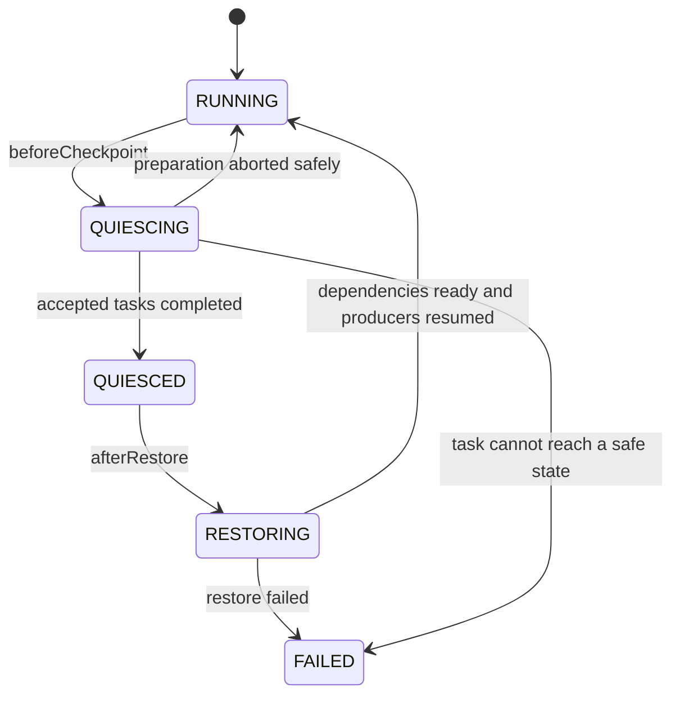
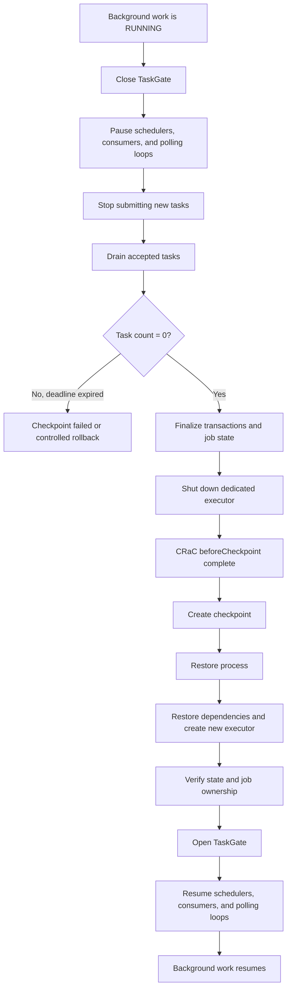

# In-Flight Tasks and Bringing the System to a Quiescent State

In CRaC (Coordinated Restore at Checkpoint), an application must bring its process to a state that can be saved and safely resumed after restore. For applications with threads and background tasks, this work is more complex than just waiting for HTTP requests to finish. An application may simultaneously run scheduled jobs, executor tasks, message consumers, polling loops, asynchronous tasks, or long-running processing workflows.

If checkpointing begins while those tasks are still performing side effects, the application could be restored in the middle of a business workflow. For example, a task may have written data to the database without acknowledging the message; a scheduler may have started the next run; or a task may be holding a connection to an external service that was closed while the checkpoint was stored.

The goal is to bring the system to a **quiescent** state: no source continues generating new work, no tasks remain performing operations that need protection, and pending work has an explicit handling policy. After restore, the application recreates the necessary executors, schedulers, and consumers, verifies dependencies, and only then resumes accepting work.

## 1. What is a quiescent state?

A system with background tasks is considered quiescent when the following conditions have been met:

1. All sources generating new work have been paused or have had admission closed.
2. No new tasks are admitted into the processing region while the system is draining.
3. Accepted tasks have completed, or have been stopped under a safe and resumable policy.
4. In-memory queues have been handled according to the chosen policy; no tasks remain in an ambiguous execution state.
5. Transactions, message acknowledgments, and external side effects have reached a well-defined business boundary.
6. Resources used by tasks have been closed or prepared according to CRaC callbacks.

Quiescent does not mean the JVM has no remaining threads. A Java process may still have management threads, runtime threads, or waiting threads. What matters is that no application work remains using resources or capable of producing business effects while checkpointing takes place.

The CRaC JVM coordinates runtime and thread state at the virtual-machine level. However, the JVM does not know whether a job has committed its data, whether a message has been acknowledged, or whether a scheduled run needs to execute again. The application must bring business activities to a clear state before checkpointing.

### 1.1. Distinguishing kinds of background work

| Work type | Work source | Checkpoint concerns |
| --- | --- | --- |
| Scheduled task | `ScheduledExecutorService`, cron, scheduler framework | Schedules may trigger additional tasks; the next run may be delayed or duplicated after restore |
| Executor task | `ExecutorService`, thread pool | Running tasks, queued tasks, or rejected tasks must be handled explicitly |
| Message consumer | Kafka, RabbitMQ, or other brokers | Received messages that have not completed or been acked may be redelivered |
| Polling loop | Loops reading files, databases, or endpoints | Threads may be waiting, holding sockets, or processing an incomplete batch |
| Async task | `CompletableFuture`, callbacks, reactive pipelines | Tasks may continue after the method that created the task has returned |
| Background workflow | Long multi-step jobs | Must know which steps completed and which steps can be retried |

Not every kind of work shares the same policy. Scheduled triggers may be canceled and recreated after restore; tasks already accepted into an executor may need to finish; unprocessed messages may be returned to the broker; long workflows need durable progress persisted to resume from the last committed step.

## 2. Lifecycle model for background tasks

A task coordinator can use the following states:

| State | Meaning | Accepts new tasks? |
| --- | --- | --- |
| `RUNNING` | The system is accepting and executing tasks | Yes |
| `QUIESCING` | Stopped accepting new tasks; waiting for accepted tasks to finish | No |
| `QUIESCED` | No tracked tasks remain running or waiting to execute | No |
| `RESTORING` | Recreating executors, schedulers, and dependencies | No |
| `FAILED` | Unable to guarantee safe task or dependency state | No |

Basic state transition flow:



The key point is closing admission before waiting. If you only check the running task count while still letting schedulers or consumers submit new tasks, the count may never reach 0. After transitioning to `QUIESCING`, new tasks must be rejected or kept in a durable queue for later processing.

## 3. Identifying sources of new work

Before draining, list all sources that can create tasks. Stopping only the thread pool is insufficient if a scheduler, consumer, or callback keeps submitting work.

### 3.1. Schedulers and timers

With `ScheduledExecutorService`, triggering of periodic runs must be stopped. `ScheduledFuture.cancel(false)` prevents future executions under the future's contract and does not request interrupting the currently running task. The current task must still be tracked and awaited to completion.

If the scheduler owns multiple schedules, store the list of futures or a schedule registry to cancel them in a controlled manner. With `ScheduledThreadPoolExecutor`, you can configure shutdown policies so delayed tasks and periodic tasks do not continue unexpectedly:

```java
ScheduledThreadPoolExecutor scheduler =
        new ScheduledThreadPoolExecutor(2);

scheduler.setRemoveOnCancelPolicy(true);
scheduler.setExecuteExistingDelayedTasksAfterShutdownPolicy(false);
scheduler.setContinueExistingPeriodicTasksAfterShutdownPolicy(false);
```

Pending one-shot tasks need their own policy. If a task has business significance, persist its state or schedule in durable storage so it can be rescheduled. Do not cancel a critical task merely because it is sitting in the scheduler's queue.

### 3.2. Message consumers

Consumers must stop receiving new messages before closing channels or clients. Then wait for in-flight messages to reach a safe business state.

Example with a consumer processing messages:

1. Pause fetching/polling or pause partitions/queues.
2. Do not begin processing new messages.
3. Wait for in-flight messages to finish.
4. Commit offsets or acknowledge strictly according to broker and business semantics.
5. Close the consumer or let the corresponding resource perform that step.

If a message has not finished, it is usually best to let the broker redeliver it after the consumer is recreated. Do not acknowledge a message just to make the task counter reach 0. Conversely, if business state committed yet the ack was not sent, the message may be redelivered; the handler must be idempotent so it does not produce duplicate side effects.

### 3.3. Polling loops and self-managed workers

With loops like `while (running)`, an observable stop signal is needed. The loop must check the signal at safe boundaries, finish or return in-progress work, and then exit.

```java
while (running) {
    WorkItem item = source.poll(pollTimeout);
    if (item == null) {
        continue;
    }

    processAtSafeBoundary(item);
}
```

In real implementations, `running` should be thread-safe state, `poll` needs a timeout or wake-up capability, and `processAtSafeBoundary` must have a commit/retry policy. Do not use a lone boolean flag if there is a race between checking the flag and starting side effects.

## 4. Tracking accepted tasks

To know when the system is quiescent, count tasks that have been accepted into the system. The counter should include both running tasks and tasks already accepted yet still sitting in the executor queue.

One approach is to issue a lease for each task right at submission time. The lease is closed when the task completes, fails, or is canceled and handled according to policy. That way, once admission closes, the task coordinator can wait for all issued leases to be released.

### 4.1. TaskGate

The example below illustrates a gate counting accepted tasks:

```java
import java.time.Duration;
import java.util.concurrent.TimeoutException;
import java.util.concurrent.atomic.AtomicBoolean;
import java.util.concurrent.locks.Condition;
import java.util.concurrent.locks.ReentrantLock;

public final class TaskGate {

    public enum State {
        RUNNING,
        QUIESCING,
        QUIESCED,
        RESTORING,
        FAILED
    }

    private final ReentrantLock lock = new ReentrantLock();
    private final Condition idle = lock.newCondition();
    private State state = State.RUNNING;
    private int acceptedTasks;

    public TaskLease tryAccept() {
        lock.lock();
        try {
            if (state != State.RUNNING) {
                return null;
            }

            acceptedTasks++;
            return new TaskLease(this);
        } finally {
            lock.unlock();
        }
    }

    private void completeOne() {
        lock.lock();
        try {
            if (acceptedTasks <= 0) {
                throw new IllegalStateException("Unbalanced task lease");
            }

            acceptedTasks--;
            if (acceptedTasks == 0) {
                if (state == State.QUIESCING) {
                    state = State.QUIESCED;
                }
                idle.signalAll();
            }
        } finally {
            lock.unlock();
        }
    }

    public void stopAccepting() {
        lock.lock();
        try {
            if (state != State.RUNNING) {
                throw new IllegalStateException(
                        "Cannot quiesce from state " + state);
            }

            state = acceptedTasks == 0 ? State.QUIESCED : State.QUIESCING;
            idle.signalAll();
        } finally {
            lock.unlock();
        }
    }

    public void awaitQuiesced(Duration timeout)
            throws InterruptedException, TimeoutException {
        long remaining = timeout.toNanos();

        lock.lock();
        try {
            if (state != State.QUIESCING && state != State.QUIESCED) {
                throw new IllegalStateException(
                        "Cannot wait for quiescence from state " + state);
            }

            while (acceptedTasks > 0) {
                if (remaining <= 0) {
                    throw new TimeoutException(
                            "Timed out waiting for accepted background tasks");
                }
                remaining = idle.awaitNanos(remaining);
            }

            state = State.QUIESCED;
        } catch (InterruptedException ex) {
            Thread.currentThread().interrupt();
            throw ex;
        } finally {
            lock.unlock();
        }
    }

    public void cancelQuiesce() {
        lock.lock();
        try {
            if (state != State.QUIESCING && state != State.QUIESCED) {
                throw new IllegalStateException(
                        "Cannot cancel quiesce from state " + state);
            }
            state = State.RUNNING;
            idle.signalAll();
        } finally {
            lock.unlock();
        }
    }

    public void beginRestore() {
        lock.lock();
        try {
            if (state != State.QUIESCED) {
                throw new IllegalStateException(
                        "Cannot restore from state " + state);
            }
            state = State.RESTORING;
        } finally {
            lock.unlock();
        }
    }

    public void resume() {
        lock.lock();
        try {
            if (state != State.RESTORING) {
                throw new IllegalStateException(
                        "Cannot resume from state " + state);
            }
            state = State.RUNNING;
            idle.signalAll();
        } finally {
            lock.unlock();
        }
    }

    public void fail() {
        lock.lock();
        try {
            state = State.FAILED;
            idle.signalAll();
        } finally {
            lock.unlock();
        }
    }

    public int acceptedTaskCount() {
        lock.lock();
        try {
            return acceptedTasks;
        } finally {
            lock.unlock();
        }
    }

    public static final class TaskLease implements AutoCloseable {
        private final TaskGate owner;
        private final AtomicBoolean closed = new AtomicBoolean();

        private TaskLease(TaskGate owner) {
            this.owner = owner;
        }

        @Override
        public void close() {
            if (closed.compareAndSet(false, true)) {
                owner.completeOne();
            }
        }
    }
}
```

`tryAccept()` checks state and increments the counter within the same critical section. Therefore, a task cannot be accepted after `stopAccepting()` has closed the gate. `TaskLease` is idempotent to avoid decrementing the counter twice if multiple cleanup branches call `close()`.

### 4.2. Issuing leases immediately upon submission

If the counter is incremented only when the worker thread starts running, tasks sitting in the queue will not be counted. The callback might wrongly conclude no work remains while the queue still holds accepted tasks.

Issue the lease before submission and hold the lease until the task genuinely finishes:

```java
import java.util.concurrent.ExecutorService;
import java.util.concurrent.RejectedExecutionException;

public final class TrackedTaskSubmitter {

    private final TaskGate gate;
    private final ExecutorService executor;

    public TrackedTaskSubmitter(TaskGate gate, ExecutorService executor) {
        this.gate = gate;
        this.executor = executor;
    }

    public void submit(Runnable task) {
        TaskGate.TaskLease lease = gate.tryAccept();
        if (lease == null) {
            throw new RejectedExecutionException(
                    "Background task admission is closed");
        }

        try {
            executor.execute(() -> {
                try (lease) {
                    task.run();
                }
            });
        } catch (RuntimeException ex) {
            lease.close();
            throw ex;
        }
    }
}
```

The task is counted from the moment admission accepts it, even while still waiting in the queue. If the executor rejects submission, the lease is released immediately. If the task runs and throws an exception, `try-with-resources` still closes the lease. The example does not return a `Future` for callers to arbitrarily cancel the wrapper while the task sits in the queue; if the application needs to cancel accepted tasks, the cancellation mechanism must simultaneously release the lease and record/requeue the work exactly once.

Callers must handle `RejectedExecutionException` according to work semantics. For a retryable job, return the job to a durable queue or record a retry status. Do not silently drop tasks simply because the gate is closed.

## 5. Draining executors and schedulers

Executors and schedulers must be managed according to ownership. A resource should only call `shutdown()` on an executor it actually owns. If an executor is shared by multiple subsystems, one component must not unilaterally shut down the entire pool; instead, close admission for tasks in its own scope and wait for those tasks to finish.

### 5.1. Dedicated executors

For an executor dedicated to a group of background tasks, the typical flow is:

1. Close `TaskGate` so no new tasks are accepted.
2. Pause producers: schedulers, consumers, and polling loops.
3. Call `shutdown()` so the executor rejects new submissions and processes queued tasks per its policy.
4. Wait for `awaitTermination(timeout)`.
5. Confirm the task counter has reached 0.
6. Only then allow CRaC to proceed with checkpointing.

Example:

```java
executor.shutdown();

if (!executor.awaitTermination(30, TimeUnit.SECONDS)) {
    throw new TimeoutException("Background executor did not terminate");
}

gate.awaitQuiesced(Duration.ofSeconds(5));
```

`shutdown()` does not interrupt running tasks; it lets already-submitted tasks continue according to the executor's behavior. `awaitTermination()` waits for the executor to finish. If it times out, the callback must report an error and the checkpoint must not be considered successfully prepared.

Do not use `shutdownNow()` as the default operation. This method requests interrupting running tasks and returns tasks still in the queue. Use it only when tasks are designed for safe cancellation and all returned tasks are properly persisted or redelivered.

After restore, an executor that was shut down cannot be reused. Its owning resource must create a new executor from current configuration.

### 5.2. Shared executors

If an executor is shared across multiple components, do not call `shutdown()` merely to checkpoint one task group. Instead:

- close the gate for tasks in that group;
- stop the group's producers;
- track leases of accepted tasks;
- wait for tasks in the group to finish;
- let the higher-level owner manage the thread pool lifecycle.

Whether the executor is kept alive or recreated after restore depends on how the runtime manages threads and CRaC integration. Either way, do not let the group's tasks continue being submitted during draining.

### 5.3. ScheduledExecutorService

For periodic tasks, cancel futures to prevent the next trigger. `cancel(false)` does not interrupt an in-progress run; the current task must be counted in `TaskGate` and awaited to completion.

```java
for (ScheduledFuture<?> future : periodicJobs) {
    future.cancel(false);
}

scheduler.shutdown();
if (!scheduler.awaitTermination(30, TimeUnit.SECONDS)) {
    throw new TimeoutException("Scheduler did not stop in time");
}
```

For delayed one-shot tasks, decide whether they will run before checkpoint, be canceled and rescheduled, or have their state saved to a durable store. Do not rely on a `ScheduledFuture` object remaining in the heap to assume schedules will continue accurately after restore.

## 6. Handling running tasks and pending tasks

Not every task can finish immediately. Determine which stage a task is in and pick an appropriate policy.

| Task state | Common handling |
| --- | --- |
| Not yet accepted | Do not submit new tasks once the gate is closed |
| Accepted but still in queue | Let run to completion, or cancel and record for retry per policy |
| Executing, no side effects yet | Can stop at a safe point and move to retry state |
| Executing a transaction | Complete commit/rollback; do not cut off arbitrarily |
| Committed but message not yet acked | May be redelivered; handler must be idempotent or reconcile committed state |
| Calling an external service | Wait for result within deadline or save retry state with idempotency key |
| Long multi-step task | Save its own business checkpoint at durable step boundaries |

### 6.1. Safe points inside tasks

For a long task, split the work into small steps and check the quiesce signal only at safe boundaries. For example, a job processing a list of 10,000 records can finish a batch, persist durable progress, and only then stop.

```java
for (Batch batch : batches) {
    if (stopRequested.get()) {
        persistProgress(batch.previousCheckpoint());
        return;
    }

    processBatch(batch);
    persistProgress(batch.id());
}
```

This example assumes `persistProgress` only records a completed batch. In practice, ensure business data and progress are committed consistently. If progress is recorded before the batch completes, a rerun may skip data; if recorded afterward without idempotency, a batch may be processed twice.

### 6.2. Do not use interrupts instead of a quiesce procedure

An interrupt is merely a signal requesting a thread to stop or cancel a waiting operation. It does not automatically undo side effects that already occurred and does not guarantee the task exits safely.

Do not send interrupts to all workers just to make `awaitTermination()` return quickly. Tasks need an explicit cancellation contract: where they can stop, how transactions are rolled back, how messages are acked or requeued, and where progress is recorded.

If a task cannot stop safely before the deadline, the checkpoint should fail or the task must transition to a durable resumable state. Do not create an image as though the system were quiescent while tasks are still producing side effects.

## 7. In-memory queues and durable queues

An in-memory queue is part of process state. Checkpointing may preserve objects in the queue, yet it does not automatically create exactly-once delivery semantics. After restore, a task might execute again while side effects from the previous run already happened on external systems.

For critical business tasks, use a durable queue or store job state in a database. Each job can have states such as:

```text
PENDING -> CLAIMED -> RUNNING -> COMPLETED
                 \-> RETRY
                 \-> FAILED
```

When preparing a checkpoint:

- stop claiming new jobs;
- finish running jobs or return the lease/claim to a retryable state;
- record progress at durable business boundaries;
- leave unstarted jobs in `PENDING` or `RETRY` state in the durable store.

After restore:

- reconnect to the durable queue;
- obtain a new claim/lease from the coordination system;
- resume the job from committed state;
- use idempotency keys or unique constraints to prevent duplicate side effects.

Do not arbitrarily serialize an executor queue and treat it as a work-recovery mechanism. Task objects may hold references to sockets, transactions, thread-locals, or data no longer valid after restore.

## 8. Integration with CRaC Resource

A resource can coordinate a group of background tasks. It registers with the global context and handles stopping task-producing sources, draining accepted tasks, and recreating executors/schedulers after restore.

Structural example:

```java
import java.time.Duration;
import java.util.concurrent.ExecutorService;
import java.util.concurrent.TimeUnit;
import java.util.concurrent.TimeoutException;

import org.crac.Context;
import org.crac.Core;
import org.crac.Resource;

public final class BackgroundWorkResource implements Resource {

    private final TaskGate gate;
    private final TaskProducers producers;
    private ExecutorService executor;

    public BackgroundWorkResource(
            TaskGate gate,
            TaskProducers producers) {
        this.gate = gate;
        this.producers = producers;
        this.executor = createExecutor();
        Core.getGlobalContext().register(this);
    }

    @Override
    public void beforeCheckpoint(Context<? extends Resource> context)
            throws Exception {
        gate.stopAccepting();
        producers.pauseAndCancelTriggers();

        executor.shutdown();
        if (!executor.awaitTermination(30, TimeUnit.SECONDS)) {
            throw new TimeoutException(
                    "Background tasks did not finish before checkpoint");
        }

        gate.awaitQuiesced(Duration.ofSeconds(5));
        producers.verifyNoActiveWork();
    }

    @Override
    public void afterRestore(Context<? extends Resource> context)
            throws Exception {
        gate.beginRestore();
        executor = createExecutor();
        producers.restoreDependencies();
        producers.verifyReady();
        gate.resume();
        producers.resumeTriggers();
    }

    private ExecutorService createExecutor() {
        return java.util.concurrent.Executors.newFixedThreadPool(4);
    }
}
```

`TaskProducers` is an illustrative internal interface representing schedulers, consumers, and polling loops owned by this resource. `pauseAndCancelTriggers()` must stop generating new tasks; `verifyNoActiveWork()` confirms sources outside the executor have also drained; `restoreDependencies()` recreates required clients and connections.

The example assumes the resource owns the dedicated executor and producers. If the executor is shared, do not shut down that executor here. If schedulers or consumers are managed by another CRaC resource, do not stop or start them again inside `TaskProducers`; establish a single owner for each lifecycle.

### 8.1. Restore order

After restore, the executor may be recreated before business dependencies are ready. Therefore, do not reopen task admission or resume producers too early.

A typical appropriate order is:

1. Restore database pools, broker clients, and required dependencies.
2. Create new executors and schedulers.
3. Verify connections, configuration, credentials, and coordination state.
4. Transition the task gate to `RUNNING`.
5. Restart schedulers, consumers, and polling loops.
6. Switch application readiness to ready.

If multiple resources' callbacks are coordinated separately, ensure dependency ordering follows the CRaC contract and framework in use. A shared coordinator can simplify ordering when steps need tight coordination.

### 8.2. If checkpoint preparation fails

If `beforeCheckpoint` fails, do not assume `afterRestore` will be called. `afterRestore` is for a process restored from a checkpoint. When a checkpoint is aborted and the current process keeps running, the lifecycle manager needs a separate rollback path to:

- recreate the executor if the executor was shut down;
- reopen the gate if no resource was closed yet;
- restart schedulers or consumers according to current state;
- verify dependencies before returning the instance to ready.

If part of the resources were closed and cannot be safely rolled back, keep the instance in an unready state and use a recovery or restart procedure. Do not open the gate merely out of desire to continue serving before confirming resources are operational.

## 9. Periodic tasks and time after restore

A checkpoint may be stored for some duration before being restored. Schedules must be re-evaluated against actual wall-clock time, because a scheduled task may have missed multiple cycles during that period.

For example, a report that runs every minute. If a checkpoint is created at 10:00 and restored at 10:20, the application needs to decide:

- run only once immediately after restore;
- skip missed cycles and wait for the next scheduled time;
- run catch-up for each missed cycle;
- recalculate the schedule from restore time.

No single policy fits every task. A snapshot-generating job might only need to run once; a data-sync job might need catch-up; a notification job might not be allowed to run a burst of catch-up batches.

Persist schedule state or business watermarks in durable storage if missed cycles affect correctness. Upon restore, create new schedules from persisted state instead of trusting heap timers to reflect external real time accurately.

## 10. Side effects, transactions, and deduplication

Background tasks often interact with external systems. Checkpointing cannot undo a sent email, a published message, or a committed record. Therefore, tasks need clear completion boundaries.

Example with a consumer:

1. Receive message and check message id.
2. Begin transaction.
3. Write business outcome.
4. Commit transaction.
5. Acknowledge message or commit offset.

If a checkpoint occurs after step 4 yet before step 5, the broker may redeliver the message. The handler must check the message id or idempotency key to recognize the work already completed. If acking before step 4, the message may be lost when the process stops.

Principles to apply:

- Commit or roll back transactions before a task is counted as complete.
- Ack/commit offsets only after required side effects are durable.
- Use idempotency keys, unique constraints, or the inbox/outbox pattern to handle redelivery.
- Persist progress of long jobs at committed step boundaries.
- Do not hold transactions or connections across the checkpoint duration.
- Do not treat thread termination as proof that side effects were durably written.

CRaC helps reuse process state. It does not automatically provide exactly-once processing for messages or background jobs.

## 11. Timeouts and handling tasks that do not finish

Draining must have a deadline. A task may hang on an HTTP call, database query, lock, or I/O operation. If waiting indefinitely, checkpointing will never complete.

| Situation | Appropriate action |
| --- | --- |
| All tasks finish within deadline | Mark quiesced and proceed with checkpoint |
| Task still running but can stop at safe point | Request stop, wait for task to record progress and exit |
| Task waiting on external service | Use client timeout; after deadline save retry state if possible |
| Task cannot finish safely | Report checkpoint failure; do not create image as if system were quiescent |
| Task submitted but executor rejects it | Release lease and return task to durable queue or fail caller/producer |
| Task canceled while in queue | Explicitly record that task was requeued or canceled per policy |
| Executor does not terminate on time | Keep instance unready; roll back or restart per lifecycle manager |

Task wait times must be smaller than the overall deadline allocated for checkpointing. Leave extra headroom for resource-closing callbacks, JVM/CRIU image writing, and deployment platform operations.

Do not call `shutdownNow()` and ignore the returned task list. Those tasks were already accepted but have not run; if not persisted or requeued, the system can lose work. For running tasks, interrupting is safe only when the task is designed to handle interruption and roll back side effects properly.

## 12. Multiple instances restored from the same checkpoint

One checkpoint can be used to launch multiple instances. If each instance simultaneously starts a scheduler or claims the same job, the system may execute duplicate work.

Common measures:

- Generate a new instance identity after restore if the system needs distinct identifiers.
- Use an external distributed lock or lease to determine which instance exclusively owns a job.
- Use broker consumer groups or partitioning mechanisms to distribute messages.
- Use idempotency keys and unique constraints for side effects that may be re-sent.
- Allow only one scheduler leader to create global schedules if business rules require it.
- Verify leases/locks have expired or been reissued; do not rely on an object lock in the heap to conclude an instance still owns a resource.

TaskGate only controls tasks within a single process. It does not replace distributed coordination across multiple restored instances.

## 13. Observing task state and the quiesce process

To identify why the system is not yet quiescent, record task state and task-producing sources.

Useful metrics:

- accepted task count;
- running task count;
- tasks waiting in executor queue;
- tasks rejected while gate is closed;
- canceled or requeued tasks;
- runtime of the longest-running task;
- overall drain duration;
- drain timeout count;
- executor shutdown and reinitialization duration;
- timestamps of scheduler/consumer pause and resume;
- time from restore until task processing becomes active again.

Logs should include job id, task type, before/after state, and correlation id. Do not log tokens, sensitive payloads, or connection credentials just to diagnose draining.

### 13.1. Scenarios to test

| Scenario | Expected outcome |
| --- | --- |
| Task running when gate closes | Task is allowed to finish; callback waits for lease release |
| Producer submits new task after gate closes | Task is rejected or kept in durable queue |
| Task queued before gate closes | Drained or requeued according to chosen policy |
| Periodic scheduled task | Future is canceled; current run completes |
| Message being processed | Completed/acked in proper order or safely redelivered |
| Task throws exception | Lease is released and error state is recorded |
| Task does not finish before timeout | Checkpoint fails; do not assume task completed |
| Restore succeeds | New executor/scheduler created; dependencies ready before resume |
| Multiple instances restored | No duplicate side effects thanks to leases, idempotency, or job distribution |

A smoke test should create a task running long enough, trigger quiesce while the task is active, try submitting another task, and verify the new task is rejected while the old task drains. Then create a checkpoint and restore in a compatible CRaC environment, verifying the new executor runs and schedulers do not run duplicates.

## 14. Reference workflow from preparation to post-restore



The diagram is a high-level sequence. In a real application, the executor may be shared, the scheduler may be owned by a framework, and the consumer may be a separate CRaC resource. In that case, coordinate according to true ownership and avoid stopping/starting the same component multiple times.

## 15. Conclusion

Bringing a system with background tasks to a quiescent state requires stopping all sources of new work, tracking accepted tasks, handling queues according to explicit policies, and waiting for side effects to reach safe business boundaries. Scheduled tasks, executor tasks, message consumers, and long workflows require different drain approaches; you cannot merely stop a thread pool and consider the system ready for checkpointing.

In CRaC, `beforeCheckpoint` is where resources coordinate stopping producers and draining tasks; `afterRestore` is where required executors, schedulers, and connections are recreated. Resume tasks only once dependencies are ready. For critical work, durable state, idempotency, and distributed leases ensure the system continues properly even when tasks are redelivered or a checkpoint is used to launch multiple instances.