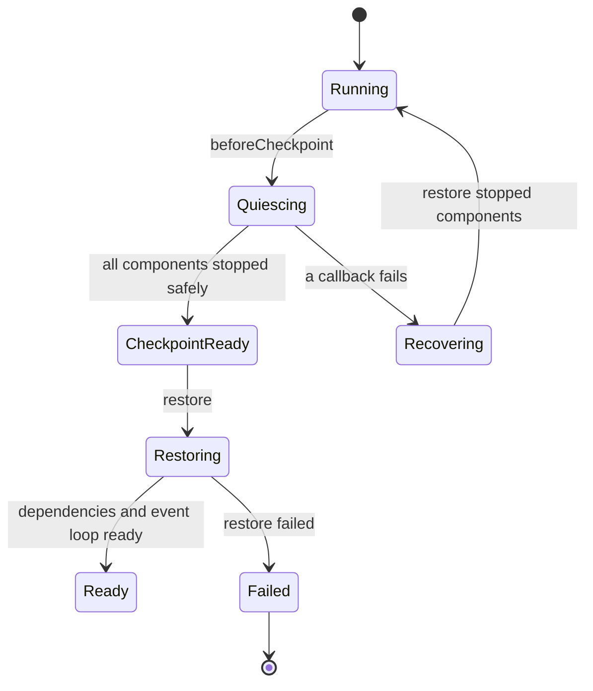

# Event Loops and Pause Ordering for Shared Components

A Java application often has one or more event loops to receive events, enqueue work, and dispatch callbacks across processing threads. An event loop may share a connection pool, cache, scheduler, registry, message client, or business state. When creating a CRaC checkpoint, these components must be paused in a controlled order so that no new work enters while dependencies are already closed.

The restore order is just as important as the pause order. Foundational components must be ready before the event loop; the event loop must be ready before ingress, consumers, or schedulers resume generating work. If producers start too early, they may submit tasks to an event loop that is not yet running or access a connection pool that has not yet been recreated.

A safe flow typically follows the direction: **stop accepting new work → close admission → drain in-flight work → pause the event loop → close or flush shared components → checkpoint**. After restore, perform the reverse direction: **restore shared components → start the event loop → open admission → restart producers and accept traffic**.

## 1. Event Loops and Shared Components

An event loop is a work-dispatching loop. It typically waits for events from sockets, timers, queues, or another event source, and then invokes the corresponding handler. In an application, there may be multiple event loops per subsystem or one shared event loop for many kinds of work.

Some components commonly used by event loops and handlers:

| Component | Role | Risk if stopped in the wrong order |
|---|---|---|
| Ingress or producer | Receives external requests, messages, timers, or events | Continues submitting work while the system is quiescing |
| Event loop | Receives and dispatches tasks to handlers | New tasks enter while dependencies are closing or the loop is not ready |
| Executor/worker pool | Runs work dispatched by the event loop | Running tasks are interrupted or workers access closed resources |
| Connection pool | Provides database or service connections | In-flight handlers use connections that are no longer valid |
| Cache/registry | Holds shared in-memory state | Data is not flushed or not refreshed on restore |
| Scheduler | Generates scheduled tasks | Timers fire while the application has not yet recovered |
| Queue | Stores pending tasks | Tasks are lost, processed twice, or left in an unclear state after checkpoint |

Not every component must be closed. A pure-Java cache can be kept in the checkpoint if its data remains valid. A connection pool usually needs to be closed or refreshed according to the library's CRaC guidance. A queue may need to be flushed, drained, or preserved depending on semantics. The key is to identify the dependency relationships and the state that needs to be preserved for each component.

## 2. Why Must Components Be Paused in Order?

Suppose an HTTP listener receives a request, submits a task to an event loop, and the handler reads a cache and accesses a database through a connection pool. If you close the connection pool before the listener stops accepting requests and the event loop drains tasks, in-flight handlers can fail because the pool is already closed.

Conversely, after restore, if the listener opens before the pool and event loop are ready, new requests can arrive at a system unable to process them yet. The result can be connection errors, rejected tasks, or inconsistent business state.

Ordering by dependency relationships solves both directions:

- Before checkpoint, consumers stop before providers. Components that generate work stop before the event loop; the event loop drains before the dependencies it uses are closed.
- After restore, providers become ready before consumers. Caches, pools, and registries are restored before the event loop; ingress and producers run only after the event loop can accept tasks.

Example ordering:

```mermaid
flowchart TD
    subgraph CP[Before checkpoint]
      A[Stop ingress and producers] --> B[Close event loop admission]
      B --> C[Drain tasks and in-flight handlers]
      C --> D[Pause event loop and workers]
      D --> E[Flush or close shared resources]
      E --> F[Create checkpoint]
    end
    subgraph RS[After restore]
      G[Restore shared resources] --> H[Start event loop and workers]
      H --> I[Open admission]
      I --> J[Start producers and ingress]
      J --> K[Serve work]
    end
```



This is the logical order. The concrete implementation depends on the framework, the number of event loops, queues, and how resources are registered with CRaC.

## 3. Defining Quiesce Phases

Quiesce is the process of bringing the application to a state where there is no new work and no ongoing operation using resources about to be closed. Simply setting a flag `paused = true` is usually insufficient, because producers may be submitting a task at the exact moment the flag changes or queues may still hold pending tasks.

A quiesce procedure needs the following phases.

### 3.1. Stopping Work-Generating Sources

First, stop or pause task-producing sources:

- Stop accepting new requests at the HTTP listener or gateway.
- Pause message consumers or reduce the number of messages polled.
- Stop schedulers from generating timer tasks.
- Stop reading new events from sockets, file watchers, or brokers.
- Pause internal jobs and periodic callbacks.

Stopping producers requires confirmation. For example, a message consumer should only be considered stopped when the poll loop is no longer dispatching new messages. An HTTP listener may need to stop accepting connections or return an unavailable status while quiescing.

### 3.2. Closing the Admission Gate

Once producers have stopped, the event loop needs to reject new tasks from any remaining call paths. An admission gate synchronizes between task submission and the moment quiescing begins.

When the gate is closed, every new submission must receive a clear outcome: be rejected, held in an external durable queue, or routed to the caller's retry mechanism. Do not silently drop tasks.

### 3.3. Draining Accepted Work

Tasks accepted before the gate closed may still sit in a queue or be running. Wait for them to complete within a finite deadline. Draining should include:

- Tasks waiting in the event loop queue.
- Handlers currently executing on the event loop thread.
- Work already dispatched to a worker pool.
- Callbacks or continuations that will return to the event loop.
- Transactions or write operations needing commit/rollback.

If work cannot finish within the allotted time, have a clear policy: cancel safely, persist state to a durable queue, or fail the checkpoint. Never close shared resources while handlers may still use them.

### 3.4. Flushing and Pausing Shared Components

Once the event loop and workers have drained, each shared resource can flush data, close connections, or persist state that needs to be preserved. For example, caches flush dirty data to storage, producers commit offsets, transactions finish, and connection pools close their connections.

Not every flush operation is necessary. A cache may be rebuildable from the primary data source; a durable queue can retain unprocessed messages on its own. Base decisions on component semantics rather than flushing everything mechanically.

## 4. Closing Admission Safely Before Draining

A common race condition occurs when one thread sees the gate open while another thread closes the gate and begins draining. The first thread can submit a task after the drain process has checked that the queue is empty.

To avoid this race, checking the gate and recording an accepted task must have an atomic synchronization point. The example below uses `ReentrantLock` and `Condition` to manage the number of tasks currently accepted or executing.

```java
import java.time.Duration;
import java.util.concurrent.TimeUnit;
import java.util.concurrent.locks.Condition;
import java.util.concurrent.locks.ReentrantLock;

public final class AdmissionGate {
    private final ReentrantLock lock = new ReentrantLock();
    private final Condition idle = lock.newCondition();
    private boolean accepting = true;
    private int inFlight;

    public boolean tryEnter() {
        lock.lock();
        try {
            if (!accepting) {
                return false;
            }
            inFlight++;
            return true;
        } finally {
            lock.unlock();
        }
    }

    public void leave() {
        lock.lock();
        try {
            if (inFlight <= 0) {
                throw new IllegalStateException("Unbalanced leave()");
            }
            inFlight--;
            if (inFlight == 0) {
                idle.signalAll();
            }
        } finally {
            lock.unlock();
        }
    }

    public void closeAdmission() {
        lock.lock();
        try {
            accepting = false;
        } finally {
            lock.unlock();
        }
    }

    public boolean awaitIdle(Duration timeout) throws InterruptedException {
        long remaining = timeout.toNanos();
        lock.lockInterruptibly();
        try {
            while (inFlight != 0) {
                if (remaining <= 0) {
                    return false;
                }
                remaining = idle.awaitNanos(remaining);
            }
            return true;
        } finally {
            lock.unlock();
        }
    }

    public void openAdmission() {
        lock.lock();
        try {
            if (inFlight != 0) {
                throw new IllegalStateException(
                        "Cannot open admission while old work is in flight");
            }
            accepting = true;
        } finally {
            lock.unlock();
        }
    }
}
```

Each task must call `tryEnter()` before being accepted and call `leave()` exactly once when finished or canceled. Use `try/finally` around execution so the counter never leaks:

```java
if (!gate.tryEnter()) {
    rejectOrDefer(task);
    return;
}

eventLoop.execute(() -> {
    try {
        handle(task);
    } finally {
        gate.leave();
    }
});
```

This snippet assumes `execute()` does not reject the task after the gate accepted it. In a real implementation, if `execute()` throws `RejectedExecutionException` or enqueueing fails, the caller must call `leave()` to undo the counter. Also ensure `leave()` is called if a task is canceled before starting.

`inFlight` in the example represents all accepted work, not only currently running handlers. If a handler dispatches to another worker or creates an asynchronous continuation, the admission scope must extend until the entire chain of work finishes. If you decrement the counter immediately when a handler enqueues to a worker, drain can report idle while the worker is still using shared resources.

## 5. Distinguishing an Empty Queue from an Idle System

An empty queue does not mean the system is idle. There may be tasks running, tasks dispatched to a worker pool, callbacks waiting on I/O completion, or timers that have fired but not yet been enqueued.

A reliable quiesce condition needs to combine:

1. Producers are no longer generating new tasks.
2. The admission gate is closed.
3. Internal queues have no pending tasks.
4. The count of accepted-but-incomplete tasks is 0.
5. Workers and event loops are no longer executing handlers that can access shared resources.
6. Transactions or write operations have committed, rolled back, or been safely saved.

For an event loop with multiple queues, drain each queue. For a reactive system, one callback can spawn another callback; account for both continuations and subscriptions. For the actor model, determine which mailboxes must drain and which messages can remain in durable mailboxes.

## 6. Registering Resources in the Right Dependency Order

CRaC dispatches callbacks in context registration order. With the global context, `beforeCheckpoint` is called in reverse registration order; `afterRestore` is called in registration order. This rule lets you establish the pause and restore ordering by registering providers before consumers.

Suppose an application has:

- `SharedServicesResource`: manages caches, connection pools, and registries.
- `EventLoopResource`: manages the event loop and admission gate.
- `IngressResource`: manages listeners, message consumers, and schedulers.

Register in this order:

```java
var global = Core.getGlobalContext();

global.register(sharedServicesResource); // Provider
global.register(eventLoopResource);      // Consumer of shared services
global.register(ingressResource);        // Producer submitting tasks to the event loop
```

Result:

| Phase | Callback order | Reason |
|---|---|---|
| `beforeCheckpoint` | Ingress → Event loop → Shared services | Stop producers, drain consumers, and only then close providers |
| `afterRestore` | Shared services → Event loop → Ingress | Restore providers, start consumers, and finally accept work |

If a subsystem has multiple dependent resources, child `Context`s can be used to group by subsystem boundaries. Ensure registration order inside each child context also reflects the dependency direction. Do not register the same resource in both a parent context and a child context because it may receive callbacks multiple times.

## 7. Implementing EventLoopResource

Event loop management depends on the framework. An event loop may be paused/resumed, or worker threads and selectors may need to be closed and recreated. Use lifecycle APIs supported by the framework; do not arbitrarily stop threads with `Thread.stop()` or abandon threads currently processing callbacks.

An adapter helps separate CRaC policy from the specific framework:

```java
import java.time.Duration;

public interface EventLoopController {
    void closeAdmission();

    boolean drain(Duration timeout) throws InterruptedException;

    void pauseOrStop() throws Exception;

    void startOrResume(Duration timeout) throws Exception;

    void openAdmission();
}
```

Resource coordinating the adapter:

```java
import java.time.Duration;

import org.crac.Context;
import org.crac.Resource;

public final class EventLoopResource implements Resource {
    private final EventLoopController controller;
    private final Duration drainTimeout;
    private final Duration startTimeout;

    public EventLoopResource(
            EventLoopController controller,
            Duration drainTimeout,
            Duration startTimeout) {
        this.controller = controller;
        this.drainTimeout = drainTimeout;
        this.startTimeout = startTimeout;
    }

    @Override
    public void beforeCheckpoint(Context<? extends Resource> context)
            throws Exception {
        controller.closeAdmission();

        if (!controller.drain(drainTimeout)) {
            throw new IllegalStateException(
                    "Event loop did not become idle before checkpoint");
        }

        controller.pauseOrStop();
    }

    @Override
    public void afterRestore(Context<? extends Resource> context)
            throws Exception {
        controller.startOrResume(startTimeout);
        controller.openAdmission();
    }
}
```

This resource assumes ingress has stopped before the callback runs and shared services have been restored before `afterRestore`. That is guaranteed by the registration order in the context. If `drain()` times out, the callback throws an error and the checkpoint should not proceed with the event loop still using resources. If `startOrResume()` fails, the application must not open admission.

A real adapter must ensure `drain()` counts both tasks on the event loop and work dispatched to workers. If the framework already provides a dedicated quiesce/drain API, prefer using that API instead of building a parallel counter out of sync with the real queue.

## 8. Managing Shared Resources

Shared resources should have their own lifecycle. For example, a resource managing a connection pool and cache can be implemented as:

```java
import org.crac.Context;
import org.crac.Resource;

public final class SharedServicesResource implements Resource {
    private final SharedServices services;

    public SharedServicesResource(SharedServices services) {
        this.services = services;
    }

    @Override
    public void beforeCheckpoint(Context<? extends Resource> context)
            throws Exception {
        services.flushRequiredState();
        services.closeExternalConnections();
    }

    @Override
    public void afterRestore(Context<? extends Resource> context)
            throws Exception {
        services.reopenExternalConnections();
        services.refreshEnvironmentDependentState();
    }
}
```

`SharedServices` is an application abstraction. Ordering inside callbacks must also follow dependencies: flush caches before closing the storage that caches write to; refresh configuration before creating connection pools; validate registries before the event loop accepts tasks.

Do not close every shared object in an arbitrary list. Splitting into smaller resources according to lifecycle and dependency relationships makes failures easier to pinpoint. However, avoid splitting so finely that multiple resources jointly manage a single pool or a single cache.

## 9. Managing Ingress, Consumers, and Schedulers

IngressResource is the outermost layer in the dependency chain because it generates tasks for the event loop. Before checkpoint, it must stop generating sources before the event loop drains. After restore, it may only restart once the event loop and shared services are ready.

```java
import java.time.Duration;

import org.crac.Context;
import org.crac.Resource;

public final class IngressResource implements Resource {
    private final IngressController ingress;
    private final Duration stopTimeout;
    private final Duration startTimeout;

    public IngressResource(
            IngressController ingress,
            Duration stopTimeout,
            Duration startTimeout) {
        this.ingress = ingress;
        this.stopTimeout = stopTimeout;
        this.startTimeout = startTimeout;
    }

    @Override
    public void beforeCheckpoint(Context<? extends Resource> context)
            throws Exception {
        ingress.stopAcceptingNewWork(stopTimeout);
    }

    @Override
    public void afterRestore(Context<? extends Resource> context)
            throws Exception {
        ingress.startAcceptingNewWork(startTimeout);
    }
}
```

`stopAcceptingNewWork()` must also stop active sources such as schedulers and message consumers. Closing only the HTTP port is not enough if a scheduled task still enqueues work. For message brokers, determine acknowledgment and offset semantics: received-but-unfinished messages must be processed, persisted, or left for broker redelivery in a way that causes neither data loss nor business duplication.

Schedulers need to be paused and pending timers managed. After restore, avoid running a burst of all missed periodic tasks at once if that creates a heavy load spike. Choose a skip, coalesce, or catch-up policy according to each job's semantics.

## 10. Queues: Drain, Retain, or Persist Durably?

Not every queue should drain to empty. How to handle a queue depends on the queue type:

| Queue type | Typically suitable handling |
|---|---|
| Internal queue holding only short tasks | Stop producers and drain to empty within the deadline |
| Queue with long-running tasks | Let tasks finish if enough time remains; otherwise fail the checkpoint or save continuation state |
| External durable queue | Stop consumers and commit offsets/acks per semantics; unacknowledged messages can be redelivered |
| Non-durable in-memory queue | Drain or serialize state in a controlled manner; do not assume tasks are safe without verifying their state |
| Timer queue | Pause the scheduler and define a policy for missed timers |

If tasks remain in the queue when the deadline expires, do not clear the queue to make the system appear idle. Choose one of the clear policies: fail the checkpoint, write tasks to durable storage, or return tasks to the originating source for reprocessing after restore.

For tasks with side effects, idempotency is needed. If a checkpoint happens after a task has written to a database yet before acknowledgment is committed, the task may be replayed after restore. Use transactions, idempotency keys, or the outbox/inbox pattern to avoid executing business logic twice.

## 11. Avoiding Deadlocks and Race Conditions During Quiesce

### Do Not Wait on the Event Loop from the Event Loop Thread Itself

If a `beforeCheckpoint` callback runs on an event loop thread and then waits for that very loop to drain, the loop cannot continue running to finish tasks. Waiting can deadlock. Perform coordination from a management thread outside the event loop or use a quiesce API supported by the framework.

### Do Not Hold Application Locks While Waiting for Workers

If the checkpoint thread holds a monitor or lock that a handler needs to complete, `drain()` can wait on the handler forever. Hold locks only during brief state-transition operations; never hold coordination locks while waiting on I/O or joining workers.

### Block Indirect Enqueue Paths Too

A handler can create callbacks or submit new tasks to the same event loop. The admission gate must apply to all submission paths, not just external ingress. While draining, clearly decide which internal continuations are allowed to complete and prevent unbounded self-spawning new work.

### Handle Rejected Tasks

When admission is closed, callers need to know the task was rejected. You can return a transient error, hold it in a durable queue, or retry after the service is ready. Do not silently drop tasks or leave callers waiting indefinitely.

### Use a Deadline for the Entire Quiesce

Time spent stopping ingress, draining queues, stopping workers, and flushing shared services should fit within an overall budget. If each phase has an overly large independent timeout, total checkpoint time can exceed orchestration limits.

## 12. Error Handling and State Recovery When Checkpoint Fails

A callback can fail after part of the system has already paused. For example, ingress stopped and the event loop drained, yet cache flushing failed. The application needs a rollback path to return to its original serving state if the runtime does not complete the checkpoint.

A state machine can consist of:



Resources should perform safely repeatable operations when appropriate. For example, `close()` can be designed to be idempotent; `start()` should check that the loop is not already running; `resume()` should not spawn two workers for the same queue. When a callback fails, record which resources completed and which did not so you can roll back in the appropriate order.

The CRaC runtime manages the checkpoint/restore workflow at the process level, yet the application remains responsible for resource state and side effects. Do not assume all before-checkpoint callbacks succeeded simply because the first callback ran. If a resource cannot recover a consistent state, report an error instead of opening traffic.

## 13. Observing Event Loop State

Logs and metrics should be in place to see why quiescing or restoring is slow:

- Number of pending tasks in each queue.
- Number of accepted-but-incomplete tasks.
- Number of running handlers and longest execution time.
- Time taken to stop ingress.
- Time taken to drain the event loop and worker pool.
- Time taken to flush/close shared resources.
- Time taken to start the event loop after restore.
- Number of tasks rejected while admission was closed.
- Final state of each resource: ready, paused, failed, or timed out.

Logs should record the subsystem name and phase (`beforeCheckpoint` or `afterRestore`) along with start/end timestamps. Avoid logging sensitive payloads or full message contents. Metrics should use low-cardinality labels; do not use task IDs or request IDs as labels.

If quiescing frequently exceeds the deadline, look for long-running handlers, unbounded queues, unstopped producers, or circular callback dependencies. If restore is slow, measure shared services recovery time, event loop start time, and ingress resume time separately.

## 14. Sample Implementation Workflow

A sequence applicable to an application with a listener, event loop, cache, and database pool:

1. Create separate CRaC `Resource` instances for database/cache, event loop, and ingress.
2. Register in dependency order: shared services first, event loop next, ingress last.
3. Before checkpoint, ingress stops accepting requests and stops message consumers/schedulers.
4. The event loop closes admission, drains queues, and waits for all handlers/workers to finish.
5. Shared services flush state that must be preserved, close connection pools, and clean up out-of-process resources.
6. When all callbacks succeed, the runtime creates the checkpoint.
7. After restore, shared services read current configuration, recreate pools, and refresh necessary caches.
8. The event loop starts or resumes, confirms workers are ready, and then opens admission.
9. Ingress and producers restart, readiness is enabled, and traffic is accepted.
10. Monitor queues, rejected tasks, connection errors, and recovery times during the initial cycles.

For frameworks such as Netty, Vert.x, Akka, or another reactive runtime, check the framework's CRaC guide and lifecycle. Frameworks may have selectors, event loop threads, timer wheels, or internal queues that need to be handled via specific APIs. The adapter illustrated in this lesson only shows the coordination order and does not replace framework integration.

## 15. Testing the Event Loop Across Checkpoint–Restore

Both normal states and race scenarios should be tested:

1. Send continuous load and start quiescing; verify ingress stops first and no new tasks are accepted after admission closes.
2. Submit long-running tasks to the worker pool; verify drain waits for workers to finish or times out per policy.
3. Have a handler enqueue a continuation; verify admission and counters cover the entire processing chain.
4. Make a shared resource flush fail; verify the application rolls back paused components or reports a clear error state.
5. Create a successful checkpoint; restore and verify shared services are ready before the event loop.
6. Verify ingress does not accept requests until the event loop opens admission.
7. Test non-empty queues, unacknowledged messages, and missed timers to verify no business data loss or duplication.
8. Run multiple checkpoint/restore cycles to detect duplicated event loop threads, leaked workers, or listeners not restarted.
9. Test when threads are interrupted or callbacks exceed the deadline.

Use barriers, latches, or test hooks to reproduce races deterministically instead of relying solely on random stress tests. For each cycle, log the callback order to verify the dependency relationships are correct.

## 16. Design Checklist

- [ ] Listed all producers, event loops, worker pools, queues, and shared resources.
- [ ] Identified dependencies among components.
- [ ] Producers and ingress stop accepting new work before the event loop drains.
- [ ] Admission gate closes atomically and applies to all submission paths.
- [ ] Drain accounts for pending tasks, running tasks, workers, and continuations.
- [ ] Shared resources flush/close only after consumers are idle.
- [ ] Every phase has timeouts and an overall budget.
- [ ] Resources are registered in provider-before-consumer order.
- [ ] `beforeCheckpoint` stops ingress, then the event loop, then shared resources.
- [ ] `afterRestore` restores shared resources, then the event loop, then ingress.
- [ ] Failed callbacks have a clear rollback or fail policy.
- [ ] Queues and messages have semantics guaranteeing no loss or duplicate processing.
- [ ] Readiness is enabled only when the event loop and required dependencies are ready.
- [ ] Tested races, long tasks, callback failures, and multiple restore cycles.

## 17. References

- [CRaC API — `Resource`](https://javadoc.io/doc/org.crac/crac/latest/org/crac/Resource.html): callbacks to manage resources before checkpoint and after restore.
- [CRaC API — `Context`](https://javadoc.io/doc/org.crac/crac/latest/org/crac/Context.html): registering and coordinating resources within a context.
- [Java `ExecutorService`](https://docs.oracle.com/en/java/javase/21/docs/api/java.base/java/util/concurrent/ExecutorService.html): managing executor lifecycle, shutdown, and awaiting task completion.
- [Java `Condition`](https://docs.oracle.com/en/java/javase/21/docs/api/java.base/java/util/concurrent/locks/Condition.html): coordinating threads waiting on conditions and signaling when state changes.

Event loops and shared resources need to be coordinated as a group with an ordered lifecycle. Stop producers first, close admission, drain all accepted work, and only then pause the event loop and close shared dependencies. After restore, restore dependencies first, start the event loop, and open ingress only once the system is ready. Registering `Resource` instances in provider-before-consumer order makes CRaC run checkpoint callbacks in reverse order and restore callbacks in dependency-recovery order.