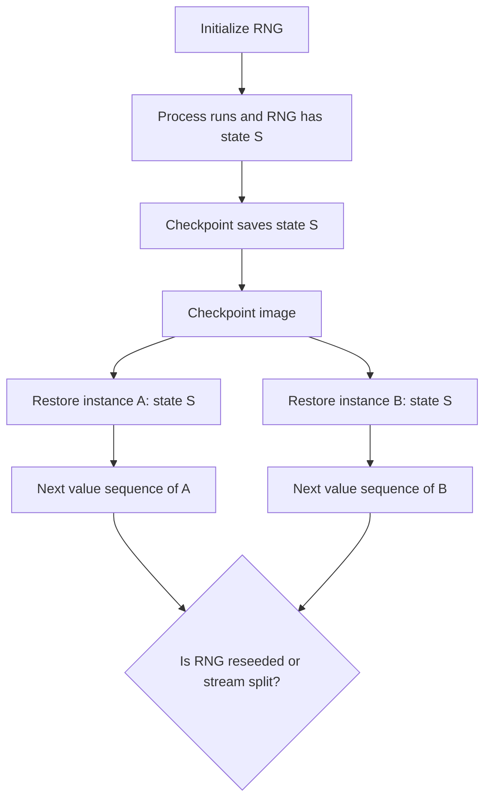

# Random, SecureRandom, and evaluating uniqueness per runtime

Java applications often generate random numbers to produce identifiers, tokens, temporary keys, simulation values, or to distribute work. During normal execution, random number generators (RNGs) maintain internal state to produce the next sequence of values. With CRaC, that state can reside in the process memory and be saved with the checkpoint image.

This creates a situation requiring attention: if the same image is restored into multiple processes, the processes can start from the same RNG state. If the generator is not reseeded or its state partitioned appropriately, they can produce the same sequence of values. This is especially dangerous when that sequence is used as IDs, nonces, tokens, or data requiring uniqueness.

When designing for CRaC, distinguish three different goals: **randomness** of a sequence, **unpredictability** against an adversary, and **uniqueness** of a value within a system scope. `Random`, `SecureRandom`, and identifier APIs solve different goals; no random number generator by itself replaces a system-level uniqueness guarantee mechanism.

## 1. RNG state can be saved in the checkpoint image

A pseudo-random number generator (PRNG) typically uses an internal state and a deterministic algorithm to produce a sequence of values. When initialized with the same seed, the same algorithm, and the same number of calls, it produces the same sequence of results.

Example with `java.util.Random`:

```java
Random first = new Random(12345L);
Random second = new Random(12345L);

System.out.println(first.nextInt());
System.out.println(second.nextInt()); // Same result as the first call on first
```

A checkpoint can capture the RNG object along with its internal state. Suppose the application created `Random`, called `nextInt()` several times, and then checkpointed. If that image is restored into two processes, both replicas can continue from the same captured state and produce the same subsequent values.



If both processes continue from the same deterministic state, their output sequences can collide. This is not a bug of the random mechanism; it is a consequence of copying process state.

With `SecureRandom`, the result depends on the algorithm, provider, entropy source, and how the CRaC runtime integrates. Some implementations may have a reseed mechanism or special handling after restore; do not assume all JDKs/providers automatically do this. The exact runtime must be identified and actual behavior verified.

## 2. Distinguishing randomness, unpredictability, and uniqueness

Three properties that are often confused:

| Property | Question to answer | Example |
|---|---|---|
| Randomness | Are the values distributed appropriately for the goal? | Simulation data requiring uniform distribution |
| Unpredictability | Can an observer predict the next value? | Session token, reset token, security nonce |
| Uniqueness | Can non-duplication be guaranteed within the required scope? | Order ID, record key, instance ID |

A seemingly random sequence can still collide. A cryptographic generator can make values hard to predict but does not provide an absolute guarantee that two generations will differ. Conversely, a sequence from a database can be unique within the database scope even though it is neither random nor unpredictable.

Therefore, choose the mechanism according to the requirement:

- Simulation or algorithm requiring reproducible results: PRNG with a controlled seed.
- Security token or nonce: appropriate CSPRNG, such as `SecureRandom`.
- IDs needing uniqueness across multiple instances: sequence/database constraint, ID service, or distributed ID algorithm with clear node/sequence allocation rules.
- IDs needing both unpredictability and extremely low collision probability: use a CSPRNG with a sufficiently large value space, while still handling collisions at the storage layer.

## 3. `java.util.Random`

`Random` is a general-purpose PRNG, suitable for simulations, algorithms, and tasks that do not require cryptographic unpredictability. It has deterministic state; the seed determines the output sequence.

```java
import java.util.Random;

Random random = new Random();
int value = random.nextInt(100);
double ratio = random.nextDouble();
```

If no seed is passed, the constructor obtains a seed according to the implementation's mechanism. However, that does not turn `Random` into a secure generator. After the object has been created and used, the PRNG state resides in the process and can be checkpointed along with other objects.

### 3.1. Why does `Random` easily produce duplicate sequences after restore?

`Random` uses internal state updated every time a value is generated. If two processes start from the same state, the same algorithm will generate the same sequence of results. This is a useful property for reproducible testing, but can cause collisions when each instance uses that sequence to generate IDs.

Example illustrating the issue:

```java
public final class IdGenerator {
    private final Random random = new Random();

    public synchronized long nextId() {
        return random.nextLong();
    }
}
```

If the image is created after `random` has been initialized, multiple instances restored from the same image may have the same state of `random`. Calling `nextId()` across instances can return duplicate results. `synchronized` only serializes threads within a single process; it does not coordinate independent restored processes.

Do not fix this by calling `new Random(System.currentTimeMillis())` right after restore. Clocks have finite resolution, multiple instances can initialize within the same time unit, and timestamps are not a reliable entropy source. If a PRNG is needed for simulation, allocate a unique seed or stream ID from an external coordinator.

## 4. `SecureRandom`

`SecureRandom` is the Java API for cryptographically strong random number generators. It is provided by a security provider, which may use a DRBG algorithm or another mechanism appropriate for the provider. This API is commonly used to generate tokens, nonces, salts, and sensitive values.

Basic example:

```java
import java.security.SecureRandom;
import java.util.HexFormat;

SecureRandom secureRandom = new SecureRandom();
byte[] tokenBytes = new byte[32];
secureRandom.nextBytes(tokenBytes);

String token = HexFormat.of().formatHex(tokenBytes);
```

`SecureRandom` is a more appropriate choice than `Random` for data requiring unpredictability. However, actual quality and behavior depend on the provider, algorithm, operating system configuration, and runtime. `SecureRandom` does not equate to a promise that every restore from every checkpoint image automatically has independent RNG state.

### 4.1. Seed and reseed

A seed is data that initializes or supplements RNG state. Reseeding is the process of feeding additional entropy into the generator to update its internal state. A `SecureRandom` may be seeded automatically at initialization or on first use, depending on the provider.

On Java 17 and later, the `SecureRandom` API has a `reseed()` method to request the generator to reseed. Capability and implementation still depend on the provider; if the provider does not support it, the operation may throw `UnsupportedOperationException`. Therefore, do not call `reseed()` and assume every runtime has succeeded in updating entropy.

```java
SecureRandom secureRandom = new SecureRandom();

try {
    secureRandom.reseed();
} catch (UnsupportedOperationException unsupported) {
    // Another strategy suitable for the provider/runtime is needed.
}
```

Do not use a timestamp, PID, hostname, or predictable value as the sole seed for `SecureRandom`. Those values can help distinguish instances at the application layer, but do not replace cryptographic entropy.

### 4.2. `setSeed()` is not a way to reset state to a new seed

`setSeed()` supplements seed data into the generator per the provider contract. Do not treat it as an operation that resets the generator to a new state guaranteed to be independent. In particular, do not call:

```java
secureRandom.setSeed(System.currentTimeMillis());
```

to "refresh" security after restore. Timestamps are predictable and do not provide sufficiently strong entropy. Use `reseed()` if the provider supports it or create a new instance from the provider's entropy source according to runtime guidelines.

### 4.3. `getInstanceStrong()` and the entropy-blocking issue

`SecureRandom.getInstanceStrong()` requests the algorithm/provider configured as strong according to the runtime's security properties. Depending on the operating system and provider, obtaining entropy can block under some conditions. For server applications needing predictable readiness time, understand the provider and entropy source rather than automatically replacing every `new SecureRandom()` with `getInstanceStrong()`.

Do not lower security quality by switching to `Random` just to avoid latency. Choose an appropriate provider/algorithm, initialize according to deployment policy, and measure initialization time in the target environment.

## 5. `ThreadLocalRandom` and `SplittableRandom`

### 5.1. `ThreadLocalRandom`

`ThreadLocalRandom` provides a generator bound to each thread, suitable for parallel tasks requiring random numbers without cryptographic requirements. It helps reduce contention when multiple threads generate values concurrently.

```java
int bucket = ThreadLocalRandom.current().nextInt(16);
```

`setSeed()` cannot be called to manually set a seed for `ThreadLocalRandom`; the API does not allow controlling the seed that way. Thread-bound generator state still needs to be considered in the context of checkpointing. If a runtime snapshots thread and generator state and restores multiple replicas, do not infer that streams have been split independently unless runtime documentation confirms it.

`ThreadLocalRandom` is not a CSPRNG and is not used for tokens, password reset codes, or security data.

### 5.2. `SplittableRandom`

`SplittableRandom` is designed for parallel computation and allows creating child generators via `split()`. It is useful when separated random streams are needed in an algorithm, especially with a controlled seed.

```java
SplittableRandom root = new SplittableRandom(2026L);
SplittableRandom workerA = root.split();
SplittableRandom workerB = root.split();

long sampleA = workerA.nextLong();
long sampleB = workerB.nextLong();
```

However, if checkpoint occurs after `root` and the child generators have been created, their state can be copied along with the image. Restoring multiple instances from the same image can copy stream state as well. `split()` only splits streams within the running state; it does not automatically create a unique instance identifier across multiple restores.

## 6. `UUID.randomUUID()` and probabilistic uniqueness

`UUID.randomUUID()` creates a version 4 UUID using the runtime's cryptographically strong pseudo-random number generator. A v4 UUID has 122 random bits because several bits are reserved for version and variant.

```java
import java.util.UUID;

UUID requestId = UUID.randomUUID();
```

The large value space makes collision probability very low at normal usage scales, but does not turn UUID into an absolute uniqueness guarantee mechanism. If generator state is copied across a checkpoint and the provider/runtime does not reseed or separate state after restore, processes can risk generating the same UUID.

For `n` independently generated v4 UUIDs, the approximate collision probability by the birthday bound is:

\[
P(\text{collision}) \approx \frac{n(n-1)}{2^{123}}
\]

This is an approximation when the probability is still small and values are truly independent with an appropriate distribution. If generators have duplicate state due to restore, the independence assumption no longer holds; the formula above cannot be used to evaluate that situation.

If IDs are stored in a database, define a unique constraint or primary key. When a collision occurs, the storage layer must reject the duplicate value and the application can regenerate the ID under a safe policy. Constraints are the final layer of protection against probabilistic errors, generator bugs, or restoring multiple instances.

## 7. Evaluating uniqueness per CRaC runtime

There is no single general answer for every JDK. Post-restore RNG behavior depends on multiple layers:

1. **JDK distribution:** the vendor may integrate a custom CRaC mechanism for certain APIs or runtime state.
2. **JDK version/build:** reseed mechanisms or RNG state handling can change across builds.
3. **Security provider:** which provider supplies `SecureRandom`, what algorithm, and how reseed is supported.
4. **Entropy source:** whether the provider obtains entropy from the OS, an internal DRBG, or another mechanism.
5. **Initialization timing:** whether the RNG was already initialized and used before checkpoint or only created after restore.
6. **Restore pattern:** whether one image is restored once or used as the source for multiple independent instances.
7. **How the application uses the RNG:** whether the generator is shared across threads, recreated after restore, or its state is kept in a singleton/static field.

Therefore, record the exact tested environment: JDK vendor, full version, build, OS/kernel, provider, SecureRandom algorithm, and how images are created/restored. Merely noting "Java 21" is not enough to conclude how uniqueness is handled.

### 7.1. Checking the actual provider and algorithm

The selected provider and algorithm can be recorded:

```java
SecureRandom secureRandom = new SecureRandom();

System.out.println("Algorithm: " + secureRandom.getAlgorithm());
System.out.println("Provider: " + secureRandom.getProvider().getName());
System.out.println("Provider version: " +
        secureRandom.getProvider().getVersionStr());
```

Available APIs depend on the Java version. On older JDKs, provider version information may need to be retrieved using another API. Do not log seeds, tokens, or sensitive random data for diagnostics.

### 7.2. Checking reseed behavior

On Java 17+, `reseed()` can be tried on the active provider and whether it is supported can be recorded. However, a call that does not throw an exception only indicates that the provider accepts the request; it is not sufficient proof that every restored instance has independent entropy or meets security standards.

Combine:

- Release notes documentation of the CRaC JDK and provider.
- Actual security provider configuration.
- Testing `reseed()` or generator recreation mechanisms as supported.
- Testing multiple restores from the same image.
- Verifying unique constraints at the storage layer.

## 8. Reseeding or recreating SecureRandom after restore

If the runtime does not automatically handle SecureRandom state in a verified manner, the application can register a CRaC Resource to proactively request reseeding or recreate the generator after restore. The exact approach depends on the Java version and provider.

The following example illustrates a holder that allows replacing the SecureRandom instance:

```java
import org.crac.Context;
import org.crac.Resource;

import java.security.SecureRandom;
import java.util.concurrent.atomic.AtomicReference;

public final class SecureRandomHolder implements Resource {
    private final AtomicReference<SecureRandom> current =
            new AtomicReference<>(new SecureRandom());

    public byte[] nextBytes(int length) {
        if (length <= 0) {
            throw new IllegalArgumentException("length must be positive");
        }

        byte[] bytes = new byte[length];
        current.get().nextBytes(bytes);
        return bytes;
    }

    @Override
    public void beforeCheckpoint(Context<? extends Resource> context) {
        // No need to write seeds to files or logs.
    }

    @Override
    public void afterRestore(Context<? extends Resource> context) {
        SecureRandom replacement = new SecureRandom();

        // Force the provider to initialize/put the generator into use.
        byte[] warmup = new byte[32];
        replacement.nextBytes(warmup);
        java.util.Arrays.fill(warmup, (byte) 0);

        current.set(replacement);
    }
}
```

This holder creates a new generator after restore and uses the runtime's default provider. This is only meaningful when the provider initializes state from an appropriate entropy source. It cannot guarantee independence if the provider or environment is misconfigured, the entropy source is unreliable, or the runtime has a specific issue. Check the provider, JDK documentation, and test results.

If the provider supports `reseed()` and runtime documentation recommends keeping the same instance, `reseed()` can be called in `afterRestore` instead of replacing the object. `UnsupportedOperationException` must be handled and timestamps must not be used as a fallback seed. The illustrative example above also needs to be registered once with the CRaC context:

```java
SecureRandomHolder randomHolder = new SecureRandomHolder();
Core.getGlobalContext().register(randomHolder);
```

`SecureRandomHolder` should be the single allocation source accessed by shared components. Avoid letting some beans use the holder while other beans keep a reference to an old `SecureRandom` created before checkpoint.

## 9. Generating unique IDs for multiple instances

If the requirement is no duplicate IDs across multiple instances, simply reseeding the RNG may not be enough. Identify the uniqueness scope and choose a mechanism with an appropriate allocation source.

### 9.1. Database sequence or identity

A database sequence/identity is a simple choice when the database is already the record store. The database manages number issuance and can guarantee sequence values do not repeat within the sequence's configured scope.

Advantages:

- Multiple instances request IDs from a single shared allocation source.
- Database constraints protect uniqueness.
- Does not depend on PRNG state in the checkpoint image.

Limitations:

- Requires database access when requesting IDs.
- Sequences can have gaps due to rollbacks, caching, or stopped instances.
- Uniqueness only holds within the scope of the designed sequence/database.

### 9.2. ID service or coordinator

A centralized ID-allocation service can allocate number ranges or IDs for each instance. On restore, the instance must register and receive a new lease/worker identity before issuing IDs. Do not store a unique worker identity in a shared image if multiple instances will restore from that image.

### 9.3. Snowflake-style ID

Snowflake-style algorithms combine a timestamp, worker/node ID, and sequence within the same time interval. They can generate distributed IDs without querying the database for every ID, but are only safe when:

- Node/worker ID is uniquely allocated for each active instance.
- Two instances do not use the same node ID concurrently.
- Clock rollback or clock drift is handled.
- Sequence overflow within the same time unit has a wait or error policy.
- After restore, the instance acquires a new node ID/lease or confirms exclusive ownership before continuing.

If the checkpoint image contains the active worker ID and sequence, multiple restored instances can copy both. Reallocate the worker ID and initialize the sequence according to algorithm rules before the instance issues IDs.

### 9.4. UUID or random token

A v4 UUID or random token with a sufficiently large space has low collision probability if the generator operates independently and properly. They fit many distributed systems, yet still need unique constraints when persisting. For security tokens, a CSPRNG is required; do not use a predictable sequence just because it is unique.

## 10. Time is not a source guaranteeing uniqueness

Some ID-generation approaches combine a timestamp with a random value or counter. Understand the limitations of each time type:

- `System.currentTimeMillis()` is wall-clock time in milliseconds; multiple requests can occur within the same millisecond and the system clock can be adjusted.
- `System.nanoTime()` is used for measuring relative time intervals; its origin is JVM-dependent and it is not a global timestamp.
- `Instant.now()` provides wall-clock time with resolution dependent on clock/provider; two calls can still return the same value.
- Clocks across multiple machines are not necessarily strictly synchronized.

Therefore, a standalone timestamp does not create a unique ID. If using timestamp + counter, the counter must be protected concurrently within each node and node identity must be unique across instances. If using timestamp + random, there remains collision probability and the risk of RNG state being copied across restore.

## 11. RNG testing procedure with CRaC

Do not only try calling `nextBytes()` once after restore. Test scenarios close to real deployment, especially when one image is used to create multiple instances.

A test can include:

1. Record JDK vendor, version/build, OS/kernel, and security provider.
2. Create `Random` with a known seed, invoke it several times, and then checkpoint.
3. Restore the same image into two independent processes.
4. Each process generates a sequence of values from `Random`; confirm the sequences match when deterministic state is copied.
5. Initialize `SecureRandom` before checkpoint, generate data, then checkpoint and restore into multiple instances.
6. Each instance generates a batch of test data; compare only in the test environment and do not log real token contents.
7. Try `reseed()` if the provider supports it and repeat the test.
8. Try creating a new SecureRandom in `afterRestore` and check the selected provider/runtime.
9. Generate IDs concurrently from multiple instances and write them to a table with a unique constraint.
10. Check for collisions, unique constraint errors, initialization time, reseed time, and behavior when the entropy source is unavailable.
11. Repeat after upgrading the JDK, provider, base image, or operating system configuration.

### 11.1. Distinguishing testing from security proof

A test that finds no collisions does not prove collision probability is zero. It only indicates that in the tested number of runs and conditions, no collision was observed. Security assessment must be based on the algorithm, provider, entropy source, runtime configuration, and deployment documentation.

With CSPRNGs, do not publish real outputs or seeds in logs for easy comparison. Use an isolated test environment, generate dummy data, and compare results internally. Do not use production tokens for tests.

### 11.2. Test matrix by image usage

| Scenario | What to verify |
|---|---|
| One image, one restore | Generator continues or is refreshed per runtime policy |
| One image, multiple concurrent restores | Instances do not emit the same stream dangerously for the intended use |
| Multiple images from different builds | Provider and RNG behavior still match each runtime |
| Restore after a long time | Entropy source, provider, and configuration remain ready |
| JDK/provider upgrade | Reseed, SecureRandom algorithm, and CRaC integration do not change unexpectedly |
| Database/ID service temporarily unavailable | Instance does not yet issue IDs requiring uniqueness if there is no valid lease/sequence |

## 12. Common mistakes

**Using `Random` to generate security tokens.** `Random` is a general-purpose PRNG and is not designed to resist prediction. Use `SecureRandom` with an appropriate provider.

**Assuming `SecureRandom` always reseeds itself after restore.** Behavior depends on JDK distribution, version, and provider. Check documentation and test on the exact runtime.

**Assuming SecureRandom guarantees absolute unique IDs.** It produces unpredictable values with low collision probability, yet collision probability still exists. Use a unique constraint or shared ID allocation mechanism if a guarantee is required.

**Seeding with timestamp or PID.** These values can collide or be guessed and are not cryptographic entropy. Use the provider's entropy source or a coordinator allocating distinct identifiers.

**Calling `setSeed()` with time to reset the generator.** `setSeed()` is not a commitment to create a new independent cryptographic state. Use `reseed()` if the provider supports it or create a new generator per runtime guidelines.

**Using `synchronized` to prevent duplicates across processes.** Java locks only synchronize threads within the same process. Multiple independent restored instances do not share a monitor.

**Keeping node ID in a shared checkpoint image.** Multiple instances can receive the same worker ID and generate duplicate IDs. Reallocate node identity after restore.

**Using a standalone timestamp as an ID.** Clocks have finite resolution and are not strictly synchronized across machines. Combine a managed sequence/identity mechanism or another allocation source.

**Testing only a single restored instance.** Cloned RNG state bugs often surface when the same image is restored multiple times. Multiple replicas must be tested concurrently.

## 13. Self-check of understanding

1. **Why can two processes restored from the same image produce the same `Random` sequence?** Because internal PRNG state can be copied from the same snapshot; the same state and algorithm produce the same subsequent sequence.
2. **How does `SecureRandom` differ from `Random`?** `SecureRandom` is designed for security purposes and relies on an appropriate provider/entropy; `Random` is a general-purpose PRNG without cryptographic unpredictability.
3. **Does `SecureRandom` guarantee absolute uniqueness?** No. It lowers collision probability and makes values hard to predict, but constraints or a coordinator are still needed if system-level guarantees are required.
4. **Why is `setSeed(System.currentTimeMillis())` not a safe way to reseed?** Timestamps are predictable, have finite resolution, and do not provide cryptographic entropy.
5. **Can `synchronized` be used to prevent duplicate IDs between two restored instances?** No. A monitor only coordinates threads within the same process.
6. **Why is it necessary to test multiple restores from the same image?** To detect generator state or worker identity copied between processes.
7. **What conditions do Snowflake-style IDs require after restore?** A unique node ID/lease, properly initialized sequence, and handling for clock rollback/overflow.
8. **What role does a unique constraint play when using random UUIDs?** It is the final layer of protection to reject ID collisions at the storage layer.

## Conclusion

`Random`, `SecureRandom`, `ThreadLocalRandom`, and `SplittableRandom` serve different needs. PRNG state can reside in the checkpoint image; when the same image is restored multiple times, generators can start from the same state. With `SecureRandom`, post-restore behavior depends on the JDK distribution, version, provider, and entropy source, so do not assume every runtime automatically reseeds.

Choose the generator according to purpose, verify the provider and reseed behavior on the exact CRaC runtime, and test multiple instances restored from the same image. When system-wide unique IDs are needed, use a database sequence/unique constraint, an ID service, or a distributed algorithm with explicit node ID allocation. Randomness helps reduce collision probability; uniqueness still needs to be designed and protected at the system layer.