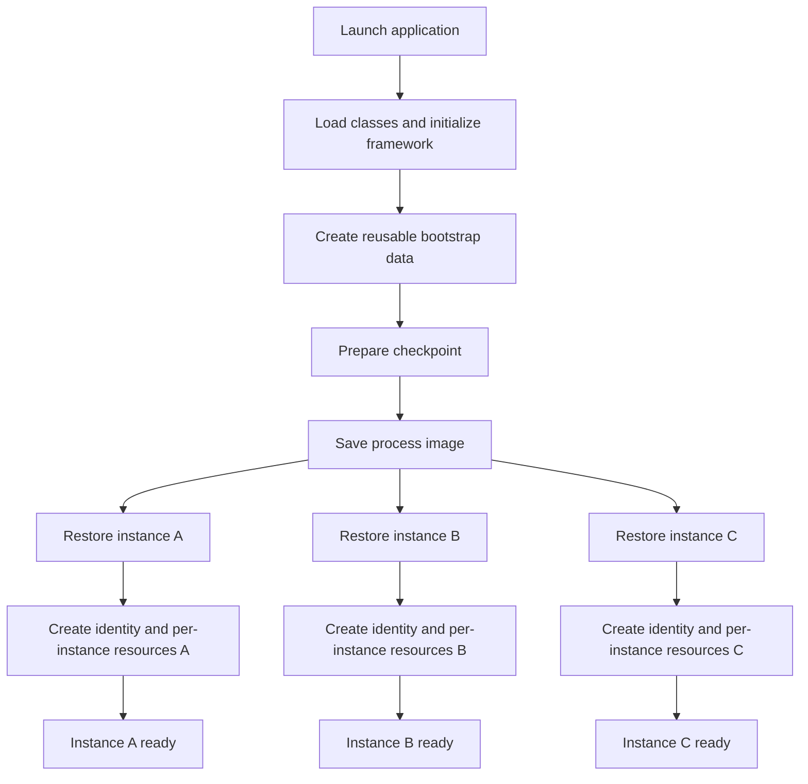
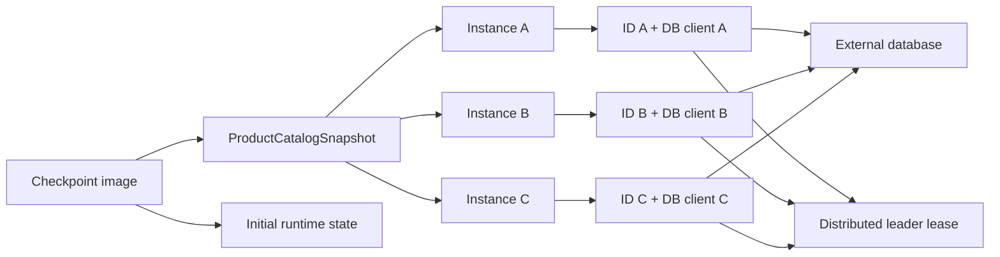

# Distinguishing Shared Bootstrap State from Per-Instance State

CRaC (Coordinated Restore at Checkpoint) allows saving the state of an initialized Java process and restoring that state to bring up serving processes faster. One checkpoint can be used as a template to launch multiple replicas of the same application. Therefore, when designing a CRaC application, it is necessary to distinguish data and structures that can be reused across replicas from state that must be created separately for each instance.

For example, class loading, template parsing, building immutable lookup tables, and framework initialization can be time-consuming yet can be performed before checkpoint. Such data is suitable for keeping in the image and reusing upon restore. Conversely, instance ID, bound ports, sockets, leader leases, scheduler state, local counters, and clients connecting to external services usually must be recreated or verified after restore.

The key point to understand clearly is that **a checkpoint holds the memory state of one process; when that image is used to restore multiple instances, each instance receives a copy of the initial memory state**. Mutable objects on the heap do not automatically become shared memory across processes. If multiple instances must see the same latest mutable state, the application must use an external storage system or coordination mechanism.

## 1. Two Categories of State in a CRaC Application

Application state can be divided into two broad categories:

- **Reusable bootstrap state:** data or structures prepared before checkpoint that can serve as the starting point for every restored instance.
- **Per-instance state:** identity data, runtime resources, ownership, and information that varies per instance. This category must be created anew, refreshed, or verified after restore.

| Category | Examples | How to handle |
| --- | --- | --- |
| Reusable bootstrap | Loaded classes, template structures, immutable lookup tables, configured parsers | Prepare before checkpoint and keep in the image if valid |
| Bootstrap cache | Infrequently changing reference data, metadata, version catalogs | Can be kept if there is a version/TTL and a post-restore refresh policy |
| Static configuration | Default rules, mappings, parsed schemas | Can be kept if the configuration remains valid for the restore environment |
| Instance identity | Instance ID, node ID, pod identity, worker name | Create or verify individually after restore |
| Connection resources | Sockets, connection pools, broker clients, stateful HTTP clients | Close before checkpoint and recreate or verify after restore |
| Coordination state | Leader lease, distributed lock, ownership token | Reacquire from the external coordination system |
| Local mutable state | Counters, internal queues, scheduler state, in-flight requests | Drain, reinitialize, or persist according to business semantics |
| Dynamic secrets and credentials | Tokens, sessions, certificates, time-limited credentials | Reload or refresh from the current authoritative source |

You should not classify solely based on the Java type. A `Map` might be a logically shared immutable lookup table, or it might be a mutable cache requiring synchronization. A singleton might hold safe bootstrap data, yet could also hold an instance ID or socket that cannot be duplicated. The meaning and lifecycle of the data determine how to handle it.

## 2. Checkpoint as a Bootstrap Template

A workflow typically consists of three phases:

1. **Initialization and warm-up:** the application loads classes, creates the framework context, parses configuration, builds bootstrap data, and warms up critical execution paths.
2. **Checkpoint:** the JVM and checkpoint mechanism save process state, including the object graph and eligible runtime state.
3. **Per-instance restore:** each process is reconstructed from the image; the application retains reusable bootstrap state and recreates the instance- or environment-dependent state.



Instances start from the same bootstrap state saved in the checkpoint. After restore, each process has its own memory space and evolves independently according to the requests, schedules, and work it receives.

### 2.1. Identical initial state does not mean state remains shared

Suppose a checkpoint contains a `Map` with 1,000 configuration entries. When restored into three instances, each process receives a `Map` with identical initial contents. If instance A updates the first entry, that change happens only in A's heap. Instances B and C do not automatically receive the update.

This can be illustrated as follows:

```text
Checkpoint image
    sharedBootstrapMap = {A: 1, B: 2, C: 3}
            |
            +---- restore ----> Instance A: {A: 10, B: 2, C: 3}
            |
            +---- restore ----> Instance B: {A: 1, B: 20, C: 3}
            |
            +---- restore ----> Instance C: {A: 1, B: 2, C: 30}
```

Each replica can modify local data without affecting other replicas. If data must be synchronized across instances, it must be placed in a database, Redis, distributed cache, message broker, or an appropriate shared service.

### 2.2. Singletons and static fields still belong to each process

A class with a `static` field or a singleton typically has one value per JVM. When restoring a checkpoint into multiple processes, those initial values are restored inside each respective process.

Example:

```java
public final class ApplicationCache {

    private static final Map<String, String> LOOKUP =
            loadImmutableLookupTable();

    private ApplicationCache() {
    }

    public static String find(String key) {
        return LOOKUP.get(key);
    }
}
```

If `LOOKUP` is only read after initialization and the data remains valid, this can be a good candidate to prepare before checkpoint. However, if `LOOKUP` is mutated per request, each instance will have its own mutable copy after restore. The `static` keyword does not turn that field into shared memory across processes.

Similarly, a singleton only guarantees one instance within a single JVM. If restored into five JVMs, each JVM has its own singleton. Do not use a singleton to ensure a single scheduler leader or a single system-wide job.

## 3. Identifying Reusable Bootstrap State

Bootstrap state suitable for keeping in a checkpoint usually has the following characteristics:

- Created before the application receives traffic.
- Expensive to create, such as parsing schemas, building indexes, loading metadata, or constructing data structures.
- Reusable without depending on the ID or resources of a specific instance.
- Immutable, or having a clear refresh policy if the data changes.
- Holds no external resources with independent lifecycles, such as sockets, file locks, or database transactions.

Example of reusable data:

```java
public final class SharedBootstrapData {

    private final Map<String, RouteDefinition> routes;
    private final List<Template> templates;
    private final SchemaRegistrySnapshot schema;

    public SharedBootstrapData(
            Map<String, RouteDefinition> routes,
            List<Template> templates,
            SchemaRegistrySnapshot schema) {
        this.routes = Map.copyOf(routes);
        this.templates = List.copyOf(templates);
        this.schema = schema;
    }

    public RouteDefinition route(String name) {
        return routes.get(name);
    }

    public List<Template> templates() {
        return templates;
    }

    public SchemaRegistrySnapshot schema() {
        return schema;
    }
}
```

Replicas can share the same initial content of `SharedBootstrapData`. `Map.copyOf` and `List.copyOf` create collections that cannot be modified through those APIs, but this provides only shallow immutability: if `RouteDefinition` or `Template` inside remains mutable, callers can still alter nested state. For data to be truly immutable, referenced elements and objects must also uphold an immutability contract.

### 3.1. Caches can be kept, but freshness must be checked

Bootstrap caches are a common source of confusion. A cache can be warmed up before checkpoint to reduce startup time, yet cached data may become stale when the image is restored minutes or hours later.

Before keeping a cache in a checkpoint, determine:

- Does the data change in the source system?
- Does the cache have a TTL or version?
- Can an older snapshot be used within an acceptable time window?
- Does it need to be invalidated or refreshed after restore?
- Are multiple instances allowed to start with the same cached data and then update independently?

For relatively stable reference caches, you can retain the initial snapshot and check the version after restore. For pricing data, access permissions, account status, or data requiring high freshness, refresh before serving requests. For a mutable cache that must be shared across multiple instances, use an out-of-process cache instead of relying on copies in the heap.

## 4. Identifying Per-Instance State

Per-instance state is data for which each process needs a unique value or must reflect the current environment and ownership.

Examples:

- Instance, worker, or node ID.
- Ports, bind addresses, sockets, and connection pools.
- Clients holding authenticated sessions or TLS connections.
- Thread pools, schedulers, and the state of running tasks.
- Leader elections, locks, or owned leases.
- Local counters, per-instance statistics, and local rate-limit state.
- Endpoints, credentials, or secrets that may change between deployments.
- Temporary directories, file handles, or resources bound to the current container.

If a value must be unique per replica, do not generate that value before checkpoint and expect each restore to automatically receive a fresh value. A value generated before checkpoint can be duplicated across every instance.

### 4.1. Instance ID and node identity

Suppose an application generates an ID during startup:

```java
public final class InstanceIdentity {
    private final String id = UUID.randomUUID().toString();
}
```

If the instance identity was generated before checkpoint, multiple restored instances may start with the exact same ID value. This causes confusion in logs, metrics, tracing, service registration, or distributed locks.

Generate a distinct identity during the restore phase or in a lifecycle hook that runs after the process is initialized from the image:

```java
public final class PerInstanceState {

    private String instanceId;

    public void initializeAfterRestore() {
        instanceId = UUID.randomUUID().toString();
    }

    public String instanceId() {
        return instanceId;
    }
}
```

If the deployment platform provides a pod UID, task ID, or instance metadata, you can read the current value after restore. This ensures the identity matches platform-managed resources. A locally generated UUID is suitable when only an application-scoped unique identifier is needed, but it does not replace infrastructure-assigned identity if other systems need to look up the instance.

### 4.2. Random generators and tokens

The state of a random number generator can reside on the heap. Do not assume every restored instance will automatically produce independent random sequences simply because processes have different PIDs. For non-sensitive data, recreate the generator in the manner supported by the provider. For security-sensitive data, use a secure API like `SecureRandom` and follow provider documentation to ensure an appropriate entropy source and reseeding mechanism.

Do not generate authentication tokens or secrets before checkpoint and share that value across all restored instances if the token is designed for a single instance or session. Tokens may expire while the image is stored, be revoked, or be bound to the original environment. Refresh credentials from an authoritative source after restore.

### 4.3. Leases, locks, and leadership

An instance may hold an object representing a distributed lock or lease on the heap at checkpoint time. That does not mean external ownership remains valid after restore. The lease may expire, the lock may be granted to another instance, or multiple restored instances may each believe they are the leader.

After restore, you must:

1. Read the current state from the coordination system or data store.
2. Verify whether the old lease/lock is still valid.
3. If ownership is needed, request a new lease using the current instance identity.
4. Run exclusive work only when the external system confirms ownership.
5. Renew the lease and handle lease loss using standard runtime mechanisms.

Do not use `synchronized`, `ReentrantLock`, or heap singletons to guarantee mutual exclusion across multiple JVMs. Those mechanisms only synchronize threads within the same process.

## 5. Distinguishing Local Mutable State from Truly Shared State

A variable may be called shared in source code because multiple services within the same application access it. However, that does not mean it is shared across multiple restored instances.

| State type | Actual sharing scope | When there are multiple restores |
| --- | --- | --- |
| `static` field | One JVM | Each JVM has its own copy |
| Singleton bean | One application context/JVM | Each JVM has its own singleton |
| `ConcurrentHashMap` on heap | Threads within one JVM | Each JVM has its own map |
| In-process cache | One process | Initial contents may match and then diverge |
| Database | Multiple processes per access permissions | Instances read/write the same external data system |
| Redis/distributed cache | Multiple processes per network config and namespace | Can represent truly shared state |
| Message broker | Multiple consumers/producers | The broker manages queues, partitions, and acknowledgments outside the process |
| Distributed lock/lease | Multiple processes per coordination protocol | Must acquire and renew ownership from the external system |

For example, a snapshotted `AtomicLong` counter on the heap can start with the same value in multiple instances. Afterward, each instance increments its own counter. If the goal is to measure total requests system-wide, a local counter is insufficient; metric aggregation or a centralized storage system is required.

### 5.1. Using an external store for state requiring synchronization

If multiple instances must observe the same mutable state, place that state in an external system with appropriate semantics:

- A database for business data and transactions.
- Redis or a distributed cache for fast-access data and suitable atomic operations.
- A message broker for work requiring distribution and acknowledgment.
- A distributed coordination service for leader election, locks, or leases.
- Object storage for artifacts or large immutable data.

Choose the system based on consistency, durability, latency, and error handling. Do not move all data into an external store if the data is merely an immutable structure that can be reproduced in every instance.

## 6. Lifecycle Before Checkpoint and After Restore

A clean way to organize this is to separate `SharedBootstrapData` from `PerInstanceRuntimeState`.

```java
public final class ApplicationState {

    private final SharedBootstrapData bootstrapData;
    private PerInstanceRuntimeState runtimeState;

    public ApplicationState(SharedBootstrapData bootstrapData) {
        this.bootstrapData = bootstrapData;
        this.runtimeState = PerInstanceRuntimeState.createFresh();
    }

    public SharedBootstrapData bootstrapData() {
        return bootstrapData;
    }

    public PerInstanceRuntimeState runtimeState() {
        return runtimeState;
    }

    public void refreshForRestoredInstance() {
        runtimeState = PerInstanceRuntimeState.createFresh();
    }
}
```

`SharedBootstrapData` holds prepared data that can be retained. `PerInstanceRuntimeState` holds values that must be created anew, such as the instance ID, local counters, and connection state.

### 6.1. Resource managing per-instance state

The example below uses a CRaC `Resource` to refresh per-instance state after restore:

```java
import java.util.UUID;
import org.crac.Context;
import org.crac.Core;
import org.crac.Resource;

public final class InstanceRuntimeResource implements Resource {

    private final SharedBootstrapData bootstrapData;
    private String instanceId;
    private RuntimeClient client;

    public InstanceRuntimeResource(SharedBootstrapData bootstrapData)
            throws Exception {
        this.bootstrapData = bootstrapData;
        initializeInstanceState();
        Core.getGlobalContext().register(this);
    }

    @Override
    public void beforeCheckpoint(Context<? extends Resource> context)
            throws Exception {
        if (client != null) {
            client.close();
            client = null;
        }
    }

    @Override
    public void afterRestore(Context<? extends Resource> context)
            throws Exception {
        initializeInstanceState();
    }

    private void initializeInstanceState() throws Exception {
        instanceId = UUID.randomUUID().toString();
        client = RuntimeClient.connect(instanceId, bootstrapData);
        client.verifyConnection();
    }

    public String instanceId() {
        return instanceId;
    }
}
```

`RuntimeClient` is an illustrative class representing an environment-dependent client. In a real application, load the current endpoint, credentials, and configuration when connecting; do not keep an old client merely because the object reference still exists after restore.

This example shows two separate lifecycles:

- `bootstrapData` is created before checkpoint and retained if the data remains valid.
- `instanceId` and `client` are reinitialized for each restore.

If the same checkpoint spawns three processes, each process will call its own `initializeInstanceState()` and receive a distinct ID. The instances can still use the same initial bootstrap data.

### 6.2. Do not rely on Java `transient` to exclude data from a checkpoint

The `transient` keyword in Java primarily affects Java serialization. A CRaC checkpoint saves process state at the JVM and operating system level; it is not an `ObjectOutputStream.writeObject()` operation.

Therefore, declaring:

```java
private transient String instanceId;
```

is not a way to ensure `instanceId` is excluded from the checkpoint. If a distinct value is needed for each restore, proactively overwrite or regenerate the value in the post-restore lifecycle. If resources need closing, use the appropriate callback.

## 7. Environment Configuration and Mutable Data

Some configuration loaded at startup may look like shared bootstrap state, yet can differ between the checkpoint environment and the restore environment.

Examples:

- Database or broker URLs may differ between staging and production.
- Secrets may be rotated while the checkpoint is stored.
- Feature flags may change.
- DNS or service discovery may return new endpoints.
- Certificates or tokens may expire.
- A Pod/VM may receive different CPU, memory limits, or network interfaces.

You should not freeze all environment configuration into the checkpoint and assume it always remains valid. Configuration can be categorized into:

| Configuration type | How to handle |
| --- | --- |
| Application-immutable rules | Can be parsed and kept in the checkpoint |
| Versioned mappings/schemas | Keep the snapshot and verify the version after restore |
| Service endpoints | Reload or verify via service discovery |
| Secrets/tokens | Refresh from the secret manager or identity provider |
| Feature flags | Refresh if immediate updates are required |
| Per-instance resource settings | Read from current metadata after restore |

An application can retain the bootstrap configuration to reduce parsing cost, then refresh only dynamic fields. This both reuses expensive preparation work and avoids using stale configuration.

## 8. Versioned Caches and Bootstrap Data

For a cache prepared before checkpoint, you can store version or creation-time metadata alongside it:

```java
public record CacheSnapshot<T>(
        String sourceVersion,
        Instant createdAt,
        T value) {
}
```

After restore, the application inspects the snapshot:

1. Does the snapshot belong to the right schema version and current configuration?
2. Is the snapshot still within its validity period?
3. Does the source data have a newer version?
4. Can the snapshot be used while refreshing, or must it wait until refresh completes?
5. Is the cache allowed to be mutated independently per instance?

If the snapshot is invalid, regenerate or refresh it before opening readiness. If the snapshot is valid yet each instance will update independently, explicitly accept that caches can diverge. If synchronized invalidation is needed, use an invalidation channel or centralized cache.

Do not use checkpoints as a cache synchronization mechanism. It only reuses the state from the time the image was created.

## 9. Threads, Schedulers, and Per-Instance State

Threads and executors can be part of process state, but not every task or schedule in the checkpoint is suitable for multiple instances to continue together.

A scheduler initialized before checkpoint may hold futures or next-run state. When multiple instances restore, each replica may have the exact same schedule and initial timer state. If the scheduler performs system-wide actions, multiple instances could execute the same job.

Common options:

- Pause the scheduler before checkpoint and create new schedules after restore.
- Allow only one instance to become leader via a distributed lease.
- Store job state and watermarks in a database or scheduler service.
- Design idempotent jobs so re-execution does not produce duplicate side effects.
- Use a centralized scheduler if only one system-wide schedule is needed.

For executor thread pools, drain running tasks and decide what to do with queued tasks. After restore, a new executor can be created for each instance. Do not assume an in-heap queue is a durable queue or guarantees exactly-once task execution.

## 10. Network Resources and Operating System Resources

Network resources are typically tied to a specific instance or session:

- A listening socket may be bound to the address and port of the original environment.
- Outbound TCP connections may be closed by the peer while the checkpoint is stored.
- TLS sessions, authentication sessions, or tokens may expire.
- DNS records and service endpoints may change.
- File descriptors may reference files or mounts that are no longer identical.
- Temporary paths may not exist in the restored container.

For these resources, the application should close them before checkpoint when needed and recreate them after restore. After recreation, verify that the resource actually works rather than merely checking that the object reference is non-`null`.

If a server listener is managed by a framework or CRaC integration library, use the framework's proper lifecycle. Avoid having both the framework automatically restore the listener and application callbacks manually binding another new socket.

## 11. Multiple Instances and Concurrency Issues

When a checkpoint is used to create multiple instances, evaluate which states may be duplicated:

| Duplicated state | Risk | Mitigation |
| --- | --- | --- |
| Old instance ID | Logs, metrics, and service registrations share duplicate identifiers | Generate a new ID after restore |
| Scheduler state | Multiple instances run the same job | Distributed lease or centralized scheduler |
| In-heap leader flag | Multiple instances simultaneously believe they are leader | Elect leader in an external system |
| Local counter | Metrics split across copies and do not reflect the total | Use metric aggregation or an out-of-process atomic counter |
| Mutable cache | Instances end up with divergent contents | Use a shared cache or invalidation |
| Random generator state | Replicas may start from identical generator state | Reinitialize per provider and security requirements |
| Consumer state | Multiple replicas may continue processing the same work | Use consumer groups, partition assignment, and idempotency |
| Credentials/tokens | Multiple instances use stale tokens or improperly share one token | Refresh credentials according to current identity |

### 11.1. Local locks are not distributed locks

`synchronized` and `ReentrantLock` coordinate threads within the same JVM. When a checkpoint is restored into multiple processes, each process has its own locks. A lock that is unlocked in the image does not grant system-wide exclusive ownership; a lock that is locked also cannot represent a valid distributed lease.

If you must ensure only one instance executes a task, use an external coordination mechanism with leases, expirations, fencing tokens, or equivalent semantics. Each critical write operation should check the fencing token or ownership version if supported by the system, so an instance that has lost its lease cannot continue writing data.

### 11.2. Do not assume only a single restore

A checkpoint can be stored and reused many times. Therefore, post-restore logic must be safe when executed on every restored instance. Do not write a callback assuming it runs only once across the entire lifecycle of the artifact.

Operations such as registering the instance in service discovery, acquiring leases, creating schedulers, or starting consumers need appropriate cleanup and identity mechanisms. If the same checkpoint is restored again after an earlier instance was terminated, external systems must be able to expire or revoke the old registration.

## 12. Security and Sensitive Data in Bootstrap State

A checkpoint can contain the heap object graph, including configuration, tokens, credentials, user data, and caches. Shared bootstrap state is not inherently safe for sharing or long-term storage.

Principles to apply:

- Do not put unnecessary secrets into caches or the object graph before checkpoint.
- Refresh time-limited credentials after restore.
- Restrict read permissions on checkpoints because the image may contain sensitive data.
- Protect artifacts in transit and at rest according to security policies.
- Define retention periods and deletion procedures for old checkpoints.
- Do not log tokens or sensitive data when creating or restoring instances.
- If each instance has its own identity, grant permissions according to that identity instead of copying an old authorization.

If a checkpoint is distributed to multiple nodes, treat it as an application memory dump that may contain sensitive information. Artifact access permissions must be controlled accordingly.

## 13. State Classification Workflow Before Creating a Checkpoint

When preparing a Java application for CRaC, you can inventory objects and resources using the following questions:

1. Is this data created before receiving traffic?
2. Is the data immutable after initialization, or will it change per request?
3. Can the data use the same initial value for all restored instances?
4. Does the data depend on instance ID, pod, port, hostname, or network address?
5. Does the data represent an external resource or time-limited ownership?
6. Does the data need to be synchronized across instances after restore?
7. If the checkpoint is restored multiple times, will duplicating this data produce duplicate side effects?
8. Can the data be recreated or refreshed after restore at an acceptable cost?

Then classify:

| Classification result | Pre-checkpoint action | Post-restore action |
| --- | --- | --- |
| Immutable and safe to reuse | Keep in checkpoint | Reuse |
| Cache that may become stale | Keep if beneficial | Check version/TTL, refresh if needed |
| Per-instance mutable | Drain or persist business progress | Initialize fresh per-instance state |
| Needs system-wide synchronization | Store in external system | Read/write via external store |
| Connection resources | Close or move to a safe state | Recreate and verify |
| Lease/lock/leader | Release or mark as no longer owned | Re-request from coordination system |
| Dynamic secrets | Avoid snapshotting if unnecessary | Refresh from authoritative source |

## 14. Example Application Design with Multiple Restores

Suppose an order-processing service has three components:

- `ProductCatalogSnapshot`: product catalog loaded and parsed before checkpoint, primarily read-only.
- `InstanceRuntime`: instance ID, local counters, and database connection client.
- `OrderScheduler`: creates order-processing jobs on a schedule, requiring only one system-wide leader.

The design can look like this:



Workflow:

1. Before checkpoint, the application loads the product catalog, parses data, and builds an immutable snapshot.
2. The scheduler stops creating new jobs; running work is drained or its progress is durably saved.
3. The database client and necessary connections are closed via resource callbacks.
4. The JVM creates the checkpoint.
5. Each restored instance keeps the initial catalog, generates a new instance ID, and connects to the database using current configuration.
6. Each instance requests a leader lease from the coordination system. Only the instance holding the lease may run the scheduler exclusively.
7. Other instances can still serve read/write requests according to their permissions, without running leader-only tasks themselves.

If the product catalog changes while the checkpoint is stored, each instance checks the version and refreshes when necessary. If the catalog is simply kept in the heap without invalidation, replicas may continue using stale data.

## 15. Common Design Pitfalls

| Pitfall | Consequence | How to handle |
| --- | --- | --- |
| Creating instance ID before checkpoint and keeping it | Restored replicas can have duplicate identities | Generate a new ID after restore |
| Thinking `static` means shared across JVMs | Each instance has its own static copy | Use an external store if truly shared state is needed |
| Keeping a mutable cache and assuming replicas stay synced | Caches diverge across instances | Make immutable, version, or use an out-of-process cache |
| Keeping old sockets/clients in the heap | Connections may already be invalid | Close and recreate after restore |
| Using a local lock as a leader lock | Multiple instances execute the job simultaneously | Use a distributed lease or leader election |
| Keeping old tokens in the checkpoint | Tokens expire or are revoked | Refresh credentials after restore |
| Believing `transient` excludes fields from checkpoint | Data can still remain in the process image | Regenerate the field via lifecycle callback |
| Resuming the scheduler on every instance | Global jobs run multiple times | Allow only the leader to run or use a centralized scheduler |
| Not checking cache version | Instances serve stale data | Check freshness before readiness |
| Treating task state in an in-heap queue as durable | Tasks may be lost or repeat side effects | Use a durable queue and idempotency |

## 16. Post-Restore Verification

When confirming that a restored instance is ready, verify both the retained bootstrap state and the newly created per-instance state.

| Item | What to confirm |
| --- | --- |
| Shared bootstrap data | Objects are available, at the right version, and safe to read |
| Cache snapshot | TTL/version is still valid or has been refreshed |
| Instance identity | Each instance has a unique ID and is properly registered with the platform |
| Database/broker client | New connections work and use current credentials |
| Scheduler/consumer | Resumed only once dependencies and ownership are ready |
| Leader lease | Reacquired from the coordination system; not relying on an old flag in the heap |
| Mutable counters | Initialized locally or retrieved from an external store with proper semantics |
| Readiness | Transitions to ready only after all mandatory resources finish restoring |

An important test is restoring the same checkpoint into multiple processes in a compatible environment. Record the identity of each process, verify that per-instance values do not collide, try modifying a local cache on one instance and confirm other instances do not change automatically, and then verify state meant to be shared through the external store.

## 17. Conclusion

Shared bootstrap state consists of data and structures reusable from the checkpoint, typically including loaded classes, immutable configuration, templates, and caches with clear freshness policies. Per-instance state consists of identity, connections, leases, schedulers, local counters, and data depending on the current environment or ownership.

When a checkpoint is restored multiple times, each process receives similar initial memory state yet evolves independently. `static`, singletons, and collections on the heap do not create shared mutable memory across JVMs. Keep safe bootstrap data in the image, recreate per-instance state in the post-restore lifecycle, and use external systems for data requiring synchronization across instances. This separation leverages prepared startup work while still ensuring each replica has an identity, resources, and ownership suited to the current environment.