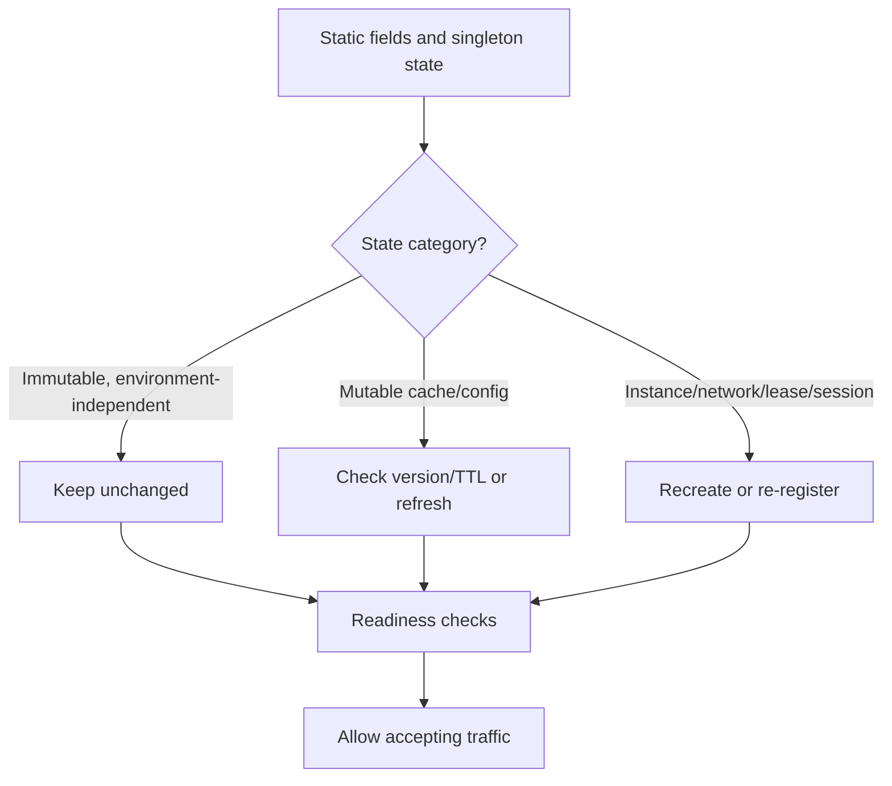

# Static Variables, Singletons, and Data Initialized Before Checkpoint

In Java, `static` variables, singletons, and objects initialized before checkpoint all reside in the process state. When CRaC restores the process from a checkpoint, those objects are restored along with the heap and their references. The JVM does not start a new Java application from scratch, so static initializers, singleton constructors, and initialization steps that ran before checkpoint do not automatically re-run merely because a restore occurred.

This helps the application avoid repeating expensive initialization work, while also introducing an important responsibility: **distinguishing data that can be kept unchanged from data that depends on time, instance, environment, or external services**. Caches may be stale, credentials may have expired, network addresses may have changed, instance IDs may be duplicated when restoring the same checkpoint into multiple replicas, and a singleton may hold connections or leader state that is no longer valid.

In the CRaC lifecycle, use `Resource.beforeCheckpoint(...)` to bring mutable state to a safe boundary and prepare components that must be closed; use `Resource.afterRestore(...)` to refresh runtime data, recreate resources, and update singleton/static holders before the application accepts new work.

## 1. What Is Preserved on Restore?

A checkpoint saves the process state at the time of capture. For a Java application, that state includes the heap, object graph, field values, references between objects, and runtime state supported by the checkpoint engine.

Therefore, if the checkpoint is created after the application has initialized:

- Objects referenced from static fields remain in the restored state.
- Already created singletons remain the singleton objects in the restored heap.
- Object field values are preserved as of checkpoint time.
- Caches, maps, counters, and configurations loaded in memory still carry the saved values.
- Certain threads, timers, or other resources may have distinct state depending on the runtime and platform; they must be managed according to their lifecycle.

Example:

```java
import java.util.Map;
import java.util.UUID;
import java.util.concurrent.ConcurrentHashMap;

public final class ApplicationState {
    public static final Map<String, String> CACHE = new ConcurrentHashMap<>();
    public static String instanceId = UUID.randomUUID().toString();

    private ApplicationState() {
    }
}
```

If `CACHE` already held data and `instanceId` was generated before checkpoint, those values may appear intact after restore. Nothing automatically invokes `UUID.randomUUID()` again merely because the process was restored.

### Static initializers do not re-run

A static initializer runs when a class is initialized in a class loader. Restoring is not equivalent to reloading classes into a fresh JVM. Therefore, do not use static initializers as restore callbacks:

```java
final class RegistryClientHolder {
    static final RegistryClient CLIENT = createAndConnect();

    private RegistryClientHolder() {
    }
}
```

`createAndConnect()` may have opened sockets, resolved DNS, fetched credentials, or registered endpoints before checkpoint. After restore, the `CLIENT` field still points to the object saved in the process image; the static initializer does not automatically run a second time to create a new client.

Separate constructing pure Java structures from opening connections and registering services. Environment-dependent operations should be invoked from a lifecycle manager that can re-run after restore.

## 2. Singletons Are Restored Like Ordinary Objects

A singleton is a design convention for a class to provide one shared instance within a certain scope, typically a single JVM or class loader. A singleton is not a distributed entity, nor is it automatically recreated by the JVM after restore.

Example of eager initialization singleton:

```java
import java.util.Map;

public final class ConfigurationManager {
    private static final ConfigurationManager INSTANCE =
            new ConfigurationManager();

    private volatile Map<String, String> properties = Map.of();

    private ConfigurationManager() {
        reload();
    }

    public static ConfigurationManager getInstance() {
        return INSTANCE;
    }

    public void reload() {
        properties = loadCurrentProperties();
    }
}
```

After restore, `INSTANCE` and the `ConfigurationManager` object already exist in the heap. The constructor does not re-run, so `reload()` inside the constructor does not re-run either. If configuration can change while the checkpoint is held, the singleton retains the old snapshot until the application explicitly reloads it.

In a dependency injection container, singleton-scoped beans are also objects residing in the heap. Do not assume constructors, `@PostConstruct`, or normal initialization callbacks will automatically re-run upon CRaC restore. Register a `Resource` or explicit lifecycle coordinator to invoke the necessary refresh operations.

### A singleton in one JVM is not cluster-wide

If one checkpoint is used to restore three replicas, each process has its own copy of the heap. Each copy will contain the singleton object with the same initial state. Therefore, a singleton holding:

- A flag `isLeader = true`.
- A sequence-issuing counter.
- A cache treated as the source of truth.
- A lock or lease assumed to belong solely to the current instance.
- An instance ID generated before checkpoint.

can produce multiple replicas with identical state after restore. Do not use an in-heap singleton to implement leader election, distributed locking, or system-wide unique ID generation. Those responsibilities require a service or store with distributed coordination.

## 3. Classifying Static and Singleton Data

Not all data initialized before checkpoint must be discarded. Classify it according to its origin and validity period.

| Data category | Examples | Post-restore handling |
|---|---|---|
| Immutable constants | Enum codes, pure lookup tables, compiled regexes | Usually keep unchanged if environment-independent |
| Stable deployment config | Service name, artifact-fixed feature flags | Keep if the config source is guaranteed unchanged; reload if dynamic |
| Mutable runtime config | Endpoints, timeouts, tenant routing, feature flags from remote config | Re-read or verify version after restore |
| Rebuildable caches | Reference data cache, metadata, lookup results | Invalidate or refresh by TTL/version |
| Instance identity | Instance ID, hostname, IP, port, pod metadata | Generate or re-discover for the current incarnation |
| Credentials and tokens | Access tokens, temporary certificates, session keys | Check expiration, refresh, or reissue from secret provider |
| Connections and clients | HTTP pools, DB clients, broker sessions, registry clients | Close/recreate or verify per library documentation |
| Temporal state | `lastRunAt`, deadlines, lease expiry, timer state | Compare against current time and durable data |
| Coordination state | Leader flag, distributed lock, lease ownership | Verify or acquire new ownership from the distributed system |
| Transient business data in heap | Unflushed counters, in-flight batches, transaction state | Drain and persist durably before checkpoint |

A useful question for every static or singleton field is: **if the process is restored an hour later, or cloned into multiple replicas, will this value still be accurate and still belong to this instance?** If the answer is no or uncertain, that field needs refreshing or verification.

## 4. `static final` Does Not Mean an Immutable Object

`final` on a reference field only prevents reassigning the reference. It does not make the referenced object immutable.

```java
static final Map<String, String> SETTINGS = new HashMap<>();
```

You cannot assign `SETTINGS = anotherMap`, yet you can still call `SETTINGS.put(...)`. The map contents will be preserved in the checkpoint and may be stale after restore.

Similarly, `Collections.unmodifiableMap(map)` only creates a view that disallows modification through that view; if other code retains the original `map`, its contents can still change. Java records also provide only shallow immutability: a record containing a mutable `List` can still observe the list changing.

For data that can genuinely be kept across restore, prefer immutable structures and input data with explicit versions:

```java
import java.util.Map;
import java.util.concurrent.atomic.AtomicReference;

record RoutingSnapshot(
        long version,
        Map<String, String> routes) {

    RoutingSnapshot {
        routes = Map.copyOf(routes);
    }
}

final class RoutingTable {
    static final AtomicReference<RoutingSnapshot> CURRENT =
            new AtomicReference<>(new RoutingSnapshot(1, Map.of()));

    private RoutingTable() {
    }
}
```

`Map.copyOf` creates a copy that cannot be modified through the returned reference. When a refresh is needed, build a new snapshot and swap the reference atomically. This prevents readers from seeing a map mid-update.

## 5. Which Data Commonly Becomes Stale?

### Caches and data read from external systems

A cache may hold valid values at checkpoint time that later become wrong because a database, registry, or remote service changed. After restore:

- Check the TTL and version of the data.
- Invalidate time-dependent or instance-dependent caches.
- Refresh critical caches before opening readiness.
- Use stale-while-revalidate only when business logic permits returning older data for a bounded period.
- Do not treat an in-heap cache as a durable data source.

If a cache can be rebuilt from the database, you can retain the snapshot to shorten startup, but verify its version before using it. If the version does not match, refresh or discard that cache.

### Configuration and feature flags

A singleton may have read configuration from files, environment variables, or remote configuration. After restore, the process environment may remain as it was at checkpoint time, yet external configuration sources may have changed. Identify which source is canonical:

- Configuration packaged with the artifact usually does not change within the same deployment version.
- Environment variables are typically inputs at process creation; do not expect them to change automatically when the same process is restored.
- Remote configuration and feature flags can change during the checkpoint window; reload or check versions.
- Platform-provided endpoints, credentials, and metadata must be re-fetched when the environment may change.

### Credentials and sessions

Tokens may be held in a singleton or static cache. While checkpointed, a token can expire or be revoked. TLS sessions, session cookies, or temporary credentials may also no longer be valid.

After restore, check expiration and refresh tokens via the provider's API. If credentials must be newly issued, fetch them from the secret manager or identity provider. Do not log secrets. Also protect the checkpoint artifact because the process image may contain tokens, private keys, or sensitive data in the heap.

### Time, deadlines, and timers

Values such as `lastRunAt`, `expiresAt`, `nextRefreshAt`, or `leaseDeadline` stored in objects do not automatically advance with elapsed time. Upon restore, compare them against `Instant.now()` or a controllable clock.

Do not carry a timeout relying solely on `System.nanoTime()` across a checkpoint without verifying runtime semantics. `nanoTime` measures elapsed intervals within a single run, not a durable timestamp to store in a database. For business deadlines, store absolute timestamps or business milestones in a durable system, and recompute remaining time after restore.

### Random generators and counters

A static `Random` or counter created before checkpoint has internal state saved along with the object. If the same checkpoint is cloned into multiple replicas, the replicas may continue from identical state. This can cause duplicate pseudo-random sequences or colliding sequence numbers if the application treats a local counter as a global ID.

For instance identity, generate a new ID after restore via an appropriate mechanism such as UUID or a platform-assigned ID. For security-related randomness, follow the documentation of `SecureRandom`, the provider, and the active runtime; do not manually copy seeds or use a static `Random` as a secure entropy source. For business sequences, issue numbers from a database/sequence service or use distributed-scoped unique keys.

## 6. Designing a Refreshable Static Holder

A practical pattern is to keep the static holder stable while storing runtime data in a replaceable snapshot. The singleton does not need to be recreated; only the environment-dependent state is refreshed.

```java
import java.time.Instant;
import java.util.Map;
import java.util.concurrent.atomic.AtomicReference;

record RuntimeSnapshot(
        String instanceId,
        String advertiseHost,
        Instant loadedAt,
        long configVersion,
        Map<String, String> featureFlags) {

    RuntimeSnapshot {
        featureFlags = Map.copyOf(featureFlags);
    }
}

final class RuntimeState {
    private static final AtomicReference<RuntimeSnapshot> CURRENT =
            new AtomicReference<>();

    private RuntimeState() {
    }

    static RuntimeSnapshot current() {
        RuntimeSnapshot snapshot = CURRENT.get();
        if (snapshot == null) {
            throw new IllegalStateException("Runtime state is not initialized");
        }
        return snapshot;
    }

    static void replace(RuntimeSnapshot snapshot) {
        CURRENT.set(snapshot);
    }

    static void clear() {
        CURRENT.set(null);
    }
}
```

Here, `CURRENT` is a static final reference to an `AtomicReference`; the holder object itself is retained across restore. The value inside can be replaced with a new snapshot. Readers obtain a consistent snapshot rather than reading multiple mutable fields that might be mid-update.

If the snapshot contains mutable objects, `Map.copyOf` protects the map structure only shallowly. Values inside the map should also be immutable or appropriately copied.

### Refreshing via a CRaC Resource

```java
import java.time.Instant;
import java.util.UUID;

import org.crac.Context;
import org.crac.Resource;

final class RuntimeStateResource implements Resource {
    private final RuntimeConfigurationProvider configurationProvider;
    private final NetworkIdentityProvider networkIdentityProvider;
    private final ExternalClientManager clients;

    RuntimeStateResource(
            RuntimeConfigurationProvider configurationProvider,
            NetworkIdentityProvider networkIdentityProvider,
            ExternalClientManager clients) {
        this.configurationProvider = configurationProvider;
        this.networkIdentityProvider = networkIdentityProvider;
        this.clients = clients;
    }

    @Override
    public void beforeCheckpoint(Context<? extends Resource> context)
            throws Exception {
        clients.stopAcceptingWork();
        clients.awaitInFlightWork();
        clients.closeConnections();
        RuntimeState.clear();
    }

    @Override
    public void afterRestore(Context<? extends Resource> context)
            throws Exception {
        RuntimeConfiguration configuration =
                configurationProvider.loadCurrent();
        NetworkIdentity identity =
                networkIdentityProvider.resolveCurrent();

        clients.recreate(configuration);

        RuntimeSnapshot snapshot = new RuntimeSnapshot(
                UUID.randomUUID().toString(),
                identity.advertiseHost(),
                Instant.now(),
                configuration.version(),
                configuration.featureFlags()
        );

        RuntimeState.replace(snapshot);
        clients.verifyReady();
    }
}
```

The types `RuntimeConfigurationProvider`, `NetworkIdentityProvider`, `ExternalClientManager`, `RuntimeConfiguration`, and `NetworkIdentity` are application abstractions. In a real implementation, open the gate and transition readiness to accepting only after the snapshot, clients, and all mandatory dependencies are ready. If the refresh step fails, let the callback throw an error and keep the instance unready.

Register the resource during application initialization, after its dependencies have been created:

```java
import org.crac.Core;

Core.getGlobalContext().register(
        new RuntimeStateResource(configurationProvider,
                networkIdentityProvider, clients)
);
```

This example uses the `org.crac` package; if the project uses `jdk.crac` directly, consistently use the types from that package.

`beforeCheckpoint` in this example clears the snapshot to avoid accidentally using stale data if the same process continues running after an aborted checkpoint. Another application might keep the old snapshot during draining and merely mark it stale; the choice depends on recovery semantics when a checkpoint attempt fails. The key requirement is having an explicit state so the rest of the application does not read invalidated data.

## 7. Refreshing Singletons Managed by Dependency Injection

In a Spring application, singleton beans are typically created once inside the ApplicationContext. When restoring from a checkpoint, the bean objects and ApplicationContext residing on the heap are restored. Constructors and `@PostConstruct` are not CRaC hooks for refreshing beans.

A bean can expose its own refresh method:

```java
import org.springframework.stereotype.Component;

@Component
final class RemoteCatalog {
    private volatile CatalogSnapshot snapshot;

    CatalogSnapshot current() {
        CatalogSnapshot current = snapshot;
        if (current == null) {
            throw new IllegalStateException("Catalog is not ready");
        }
        return current;
    }

    void reload(CatalogClient client) {
        CatalogSnapshot next = client.fetchCurrentSnapshot();
        snapshot = next;
    }
}
```

A CRaC resource or coordinator can call `reload(...)` in `afterRestore` after `CatalogClient` has been recreated. Use `volatile` or an atomic reference so readers see the latest snapshot. If multiple beans depend on each other, group the refresh process into a coordinator to guarantee ordering.

Do not call every bean directly in an arbitrary order. For example, catalog refresh may require the database client; the database client must be recreated before the catalog. Express dependencies explicitly and open readiness only after the entire refresh chain succeeds.

## 8. Distinguishing Preserved Data from Data That Must Be Recreated

A useful design model is to divide state into three groups:

### Group A — Immutable and reusable

Examples: pure lookup tables, compiled regexes, parser metadata, environment-independent mappings. These can be kept unchanged across checkpoint if the data is tied to the exact artifact version and has no refresh requirement.

### Group B — Temporarily retainable, but must be verified

Examples: caches, remote config snapshots, DNS results, metadata, feature flags. These can be kept on the heap for speed, yet TTL/version checks or asynchronous refreshes must happen before the data is used for critical decisions.

### Group C — Must be recreated or re-registered

Examples: instance IDs, leases, connections, listeners, client sessions, short-lived credentials, leader ownership. These must be recreated or reacquired from authoritative sources after restore.



This grouping should be documented in the design of every singleton or runtime holder. Whenever a new field is added, the author should specify which group it belongs to and who is responsible for refreshing it.

## 9. Common Design Mistakes

### Believing constructors will re-run

A constructor runs only when an object is created. Restore brings back existing objects rather than recreating every singleton from scratch. If refresh logic lives only in the constructor, it will not execute after restore.

### Putting I/O in static initializers

Static initializers might open sockets, read files, or call remote services. Those side effects are very hard to control on restore. Keep static initializers limited to constructing pure data structures and move I/O into a lifecycle manager with explicit callbacks.

### Using a static cache as the source of truth

A cache is preserved across checkpoint, yet the database or source service may have changed. Use versions, TTLs, and invalidation; business data must live in durable storage.

### Storing instance ID in a singleton before checkpoint

If the checkpoint is replicated, multiple replicas may share the same ID. Generate a new incarnation ID after restore and re-register endpoints with that ID.

### Keeping leader flags or distributed locks in the heap

A lease can expire while checkpointed. An `isLeader` flag remaining `true` in the heap does not prove the instance still holds leadership. Acquire or verify a fresh lease with the distributed system, using fencing tokens if write operations need protection.

### Using `static final` to assume data immutability

`final` fixes only the reference. The referenced object can still be mutable and hold stale state. Use genuinely immutable snapshots or copy data before publishing.

### Refreshing individual fields piecemeal

If `host`, `port`, `instanceId`, and `configVersion` are updated field by field, concurrent requests can read a half-old, half-new combination. Use an immutable snapshot and swap it via an atomic reference for consistent updates.

### Opening readiness before singletons are ready

If a listener starts receiving requests while runtime state or clients are still refreshing, the first requests may observe stale data. Keep readiness refusing traffic until every mandatory component has been verified successfully.

## 10. Protecting Sensitive Data in Static State

Static fields and singletons can hold access tokens, API keys, private keys, session cookies, connection details, or user data. Those values can be written into the checkpoint because the checkpoint contains an image of process state.

Treat the checkpoint artifact as sensitive data:

- Restrict read/write permissions on the artifact and its storage location.
- Encrypt at rest or in transit if required by the platform.
- Do not log secrets when refresh or restore fails.
- Use a secret manager/identity provider to obtain fresh credentials whenever possible.
- Clear or replace old tokens in runtime state once refresh succeeds.
- Do not let multiple replicas share a checkpointed token if that token is tied to an individual instance identity.

Not every credential must be rotated on every restore; the decision depends on TTL, audience, binding, and provider policy. However, the application must verify validity rather than assuming a secret is still usable simply because the object remains in the heap.

## 11. Testing Static Fields and Singletons Across Checkpoint/Restore

A test scenario should verify both retained data and refreshed data:

1. Launch the application and record a static counter, singleton ID, config version, and cache version.
2. Create a checkpoint after the singletons have initialized.
3. Modify data in the remote config, registry, or database while the process is not running.
4. Restore the process and verify that static initializers/constructors are not relied upon as a refresh mechanism.
5. Run the `afterRestore` coordinator and confirm that instance ID, endpoints, credentials, and cache version are updated.
6. Verify that immutable lookup tables still have the expected contents.
7. Restore multiple replicas from the same checkpoint and confirm each replica has its own incarnation ID.
8. Make the remote config or credential provider unreachable and confirm the instance does not yet accept traffic.
9. Verify concurrent readers never observe a half-old, half-new snapshot.
10. Confirm checkpoint artifacts and logs do not leak secrets.

Log lifecycle milestones and versions, such as `checkpointAttemptId`, `instanceId`, `configVersion`, `cacheVersion`, `restoreStartedAt`, and refresh outcomes. Do not log full configuration values or credentials.

## 12. Checklist for Static Fields and Singletons

- [ ] Listed static fields and singletons that hold mutable or environment-dependent state.
- [ ] Static initializers perform pure initialization work only, and are not treated as restore callbacks.
- [ ] Classified data into immutable, needs-verification, and must-be-recreated.
- [ ] Caches have appropriate TTL/version/invalidation and do not replace durable data sources.
- [ ] Dynamic configuration is reloaded or verified after restore.
- [ ] Credentials and sessions are checked for expiration or reissued according to policy.
- [ ] Instance ID is freshly generated for each incarnation after restore.
- [ ] Leader flags, locks, and leases are verified against the distributed system.
- [ ] Timers/deadlines are recomputed from current time and durable state.
- [ ] Singleton beans have explicit refresh methods or a lifecycle coordinator.
- [ ] Runtime snapshots are swapped atomically to avoid partially updated state.
- [ ] Readiness opens only after static/runtime state and mandatory dependencies are ready.
- [ ] Tested restoring both a single replica and multiple replicas from the same checkpoint.
- [ ] Checkpoint artifacts are protected because they may contain secrets and sensitive data in the heap.

## 13. Conclusion

`static` variables, singletons, and data initialized before checkpoint are restored together with process state. Static initializers, constructors, and `@PostConstruct` do not automatically re-run upon restore. This preserves valuable structures, while potentially also preserving stale caches, expired credentials, outdated network addresses, delayed timers, and duplicated instance identities.

Retain immutable, environment-independent data; verify or refresh caches/configuration; recreate instance identities, leases, connections, and credentials as needed. Use `Resource.afterRestore(...)` or a lifecycle coordinator to update singleton/static holders with a consistent snapshot, and open readiness only when runtime state is valid. If the checkpoint is replicated across multiple replicas, any state meaningful only within a single JVM must be reconsidered from a distributed perspective.