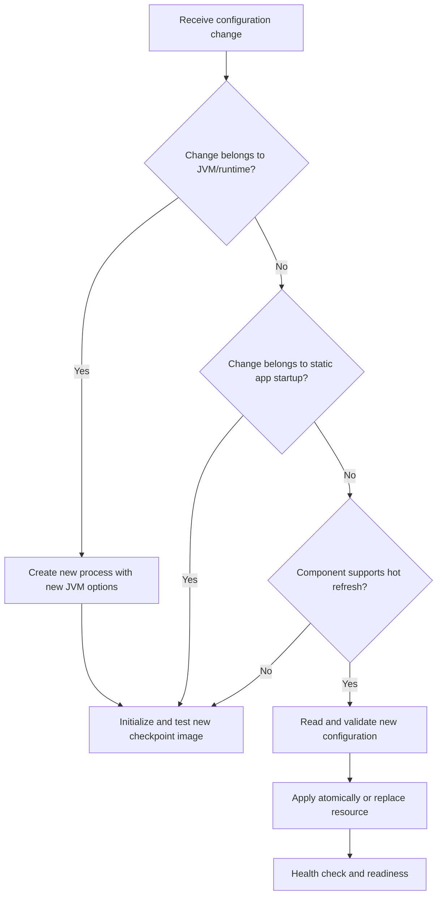

# Limits on Changing JVM Parameters and Configuration at Restore Time

CRaC recovers a checkpointed Java process. Therefore, restore continues using the already initialized JVM along with the application state captured in the image. It does not create a fresh JVM and re-run the entire process of reading command-line options, environment variables, and startup configuration as in a cold start.

This imposes an important limitation: **restore time cannot be treated like a fresh launch to arbitrarily alter JVM options or configuration already loaded into memory**. Some JVM settings are tied to how the runtime was created and cannot be changed once the process is running. Some application configuration can be refreshed, yet only if the application proactively re-reads the configuration source, validates the new values, and updates the components using them.

When designing a CRaC application, distinguish three layers: JVM startup parameters, application configuration already materialized as objects in the heap, and dynamic configuration reloadable from external systems. This classification determines when a new checkpoint image must be built, when an `afterRestore()` callback is needed, and when a cold start is the appropriate choice.

## 1. Restore Does Not Re-Run the JVM Startup Sequence

During a cold start, the launcher creates the JVM, applies startup flags, sets up the classpath/module path, loads agents, initializes the runtime, and invokes `main()`. The application proceeds to read configuration, create objects, build the dependency injection container, and open required resources.

With CRaC, the process has already gone through those steps before the checkpoint was taken. On restore, the runtime recovers the process and resumes threads from the saved state. Configuration objects, system properties, loaded classes, JIT state, and supported runtime structures already exist in the image. Restore does not automatically re-invoke `main()`, does not automatically rebuild the Spring `ApplicationContext`, and does not automatically re-read every configuration file.

```text
Cold start
  Java launcher
      |
      v
  Create JVM and apply JVM options
      |
      v
  Load classes, agents, system properties
      |
      v
  main() and application initialization
      |
      v
  Warm-up
      |
      v
  Checkpoint image

Restore
  Select compatible runtime and request restore
      |
      v
  Recover saved process
      |
      v
  Restore resources and dynamic configuration per application design
      |
      v
  Readiness
```

Configuration loaded before checkpoint remains the current state inside the process. If an external configuration file changes after checkpoint, that change does not automatically update objects that previously read the file. The application must have an explicit reload mechanism if it needs to receive new values.

## 2. Distinguishing JVM Parameters from Application Configuration

These two kinds of values are often confused because both can be passed via the command line or configuration files.

| Category | Examples | Does it change automatically on restore? |
|---|---|---|
| JVM startup parameters | `-Xms`, `-Xmx`, `-XX:+UseG1GC`, module options, native agents | No; these are settings of the already initialized JVM |
| Startup system properties | `-Duser.timezone=UTC`, `-Dapp.region=ap-southeast-1` | Values are already inside the restored process; the command line is not re-read |
| Environment variables | `DB_HOST`, `APP_PROFILE`, `JAVA_TOOL_OPTIONS` | The process already exists with its environment; restore does not automatically inherit a new run's environment |
| Application parameters | `--server.port=8080`, feature flags, batch size | Values were already read and stored by the app; they change only if an update mechanism exists |
| Dynamic configuration | Feature flags from config service, routing rules, refreshable concurrency limits | Can be reloaded if the app explicitly refreshes and components support it |
| Secrets and credentials | Passwords, access tokens, certificates | Expiration must be evaluated; usually must be re-fetched or re-authenticated after restore |

For example, `-Xmx2g` is a parameter controlling the JVM heap. It is not equivalent to `app.worker-limit=32`, a value the application might use to configure an executor. Calling `System.setProperty("app.worker-limit", "64")` neither increases the heap nor automatically reconfigures an executor already created with 32 workers.

## 3. JVM Parameters That Must Be Decided Before Creating a Checkpoint

Many JVM parameters affect runtime structure or behavior right from initialization. Common groups include:

- **Memory:** `-Xms`, `-Xmx`, thread stack sizes, and related memory region limits.
- **Garbage collector:** GC selection and collector configuration flags.
- **Class loading and modules:** classpath, module path, module exports/opens, and agents loaded at startup.
- **Native runtime:** native libraries, native agents, environment variables, and options affecting native library loading.
- **JIT and compiler:** compilation, profiling, and optimization options configured for the runtime.
- **Runtime diagnostics:** certain logging, JFR, or diagnostic options can be modified through supported APIs, though the scope of changes depends on the JDK and each specific option.

Example of how a cold run may be configured:

```bash
java \
  -Xms512m \
  -Xmx2g \
  -XX:+UseG1GC \
  -Duser.timezone=UTC \
  -jar application.jar
```

These values belong to the configuration of the created process. If an image is needed for a 4 GB maximum heap or a different GC choice, build and test the image with that corresponding JVM configuration. Do not expect passing `-Xmx4g` to the restore command to turn a process checkpointed with a 2 GB heap into a JVM with a 4 GB heap.

### Changing JVM options while the runtime is executing

HotSpot has certain management or diagnostic mechanisms that allow changing some VM options at runtime. However, this applies only to options marked writable by the JVM and supported by a specific API/JDK. It does not turn all command-line parameters into dynamic configuration.

`RuntimeMXBean.getInputArguments()` allows inspecting the JVM arguments used, not modifying them. `HotSpotDiagnosticMXBean` can provide information about certain VM options and support modifying permitted ones; check the writability of the option and documentation for your exact JDK. Do not infer that heap size, GC algorithm, module access, or any `-XX` option can be safely changed after initialization.

Even for options modifiable at runtime, verify that changing them is compatible with checkpoint/restore and creates no unexpected state divergence. If a change affects memory layout, threads, class loading, or native resources, use a fresh image build and separate testing workflow.

## 4. System Properties and Environment Variables Are Not Automatically Reloaded

### System properties

System properties can be set using `-D` at launch:

```bash
java -Dapp.region=ap-southeast-1 -jar application.jar
```

The application can read them with:

```java
String region = System.getProperty("app.region");
```

This value resides in the process's `System.getProperties()`. After restore, the process continues with the saved properties state. If an external file or deployment configuration changes, Java does not automatically re-run the launcher to load new `-D` values.

Java allows certain system properties to be modified via `System.setProperty()`:

```java
System.setProperty("app.region", "ap-southeast-1");
```

Yet this operation updates only the property map inside the JVM. It does not automatically notify every library, bean, or object that already read the old value. A library might read a property once in a static initializer, cache the value in a field, or use it to create a thread pool. Changing the property afterward does not automatically reconfigure those objects.

In particular, do not use `System.setProperty()` as a way to change an internal JVM option. For example, calling `System.setProperty("-Xmx", "4g")` does not increase the heap. JVM options have their own syntax and application timing.

### Environment variables

`System.getenv()` reads the process environment:

```java
String databaseHost = System.getenv("DB_HOST");
```

Restore recovers an existing process rather than creating a new process environment from container or shell configuration at restore time. Thus, do not expect `DB_HOST` to update simply because the deployment changed environment variables for a new launch. `System.getenv()` also provides no standard API to mutate the current process environment.

If dynamic endpoints or credentials must change, read them from a config service, secret manager, or managed file capable of refreshing. Do not use environment variables as a hot-update channel after restore.

## 5. Application Configuration Already Loaded Into the Heap

When an application initializes, it typically transforms data from files, environment variables, the command line, or a config server into Java objects. After checkpoint, those objects are restored with the process.

Example:

```java
public final class DatabaseSettings {

    private final String jdbcUrl;
    private final int maximumPoolSize;

    public DatabaseSettings(String jdbcUrl, int maximumPoolSize) {
        this.jdbcUrl = jdbcUrl;
        this.maximumPoolSize = maximumPoolSize;
    }

    public String jdbcUrl() {
        return jdbcUrl;
    }

    public int maximumPoolSize() {
        return maximumPoolSize;
    }
}
```

If `DatabaseSettings` was created before checkpoint with a pool size of 8, restore recovers the object containing 8. Changing an external YAML file to 12 does not automatically update the `maximumPoolSize` field in the saved object. Moreover, a connection pool already constructed from the old configuration does not automatically resize simply because the file changed.

To refresh, the application must implement an intentional update flow:

1. Read the new configuration from the external source.
2. Parse and validate the values.
3. Check whether the change can be applied hot or requires recreating resources.
4. Build a new immutable configuration and publish it in a thread-safe manner.
5. Update or replace dependent components.
6. Mark the new configuration as active only when the apply step finishes.

Do not directly mutate individual fields across multiple beans without synchronization. During a refresh, requests might observe part of the old configuration alongside part of the new configuration.

## 6. Classifying Configuration: Static, Refreshable, and Instance-Bound

A classification table helps decide which configuration belongs in the checkpoint image and which must be re-fetched after restore.

| Configuration group | Examples | Strategy |
|---|---|---|
| Static JVM/runtime | Heap size, GC, module access, native agents | Choose before building the image; major changes require a new image or cold start |
| Static app startup | Classpath, profiles, bean config, schema mappings | Materialized before checkpoint; changes require reinitializing components or a new image |
| Refreshable runtime app | Feature flags, routing rules, log levels, supported concurrency limits | Reload and apply via an explicit refresh mechanism |
| Current environment-bound | Endpoints, DNS, region, service discovery | Read or re-verify after restore as needed |
| Time/session-bound | Tokens, short-lived certificates, leases, sessions | Refresh, re-authenticate, or re-register after restore |
| Instance-bound | Instance ID, leader state, shard assignment | Recreate or reacquire for each restored instance |

Not every configuration change requires building a new image. Feature flags can be reloaded from a configuration service. Conversely, changing heap size or GC selection requires a JVM process initialized with the new options. Changing `maximumPoolSize` may require creating a new pool or using a dynamic configuration API supported by the pool; changing a property alone is not enough.

## 7. Designing Safe Dynamic Configuration After Restore

If an application must receive configuration changes upon restore, provide a `ConfigProvider` that reads external sources and publishes an immutable configuration snapshot. Components read the current snapshot rather than reading scattered system properties or files directly.

Simple example:

```java
import java.util.concurrent.atomic.AtomicReference;

public final class ConfigProvider {

    private final AtomicReference<AppConfig> current =
            new AtomicReference<>();

    public AppConfig current() {
        return current.get();
    }

    public void refresh() throws Exception {
        AppConfig candidate = loadFromExternalSource();
        validate(candidate);
        current.set(candidate);
    }

    private AppConfig loadFromExternalSource() throws Exception {
        // Read the current file/config service/secret manager.
        throw new UnsupportedOperationException("Provide a config source");
    }

    private void validate(AppConfig candidate) {
        if (candidate.workerLimit() < 1) {
            throw new IllegalArgumentException("workerLimit must be positive");
        }
    }
}
```

`AppConfig` should be an immutable object carrying a version or revision. `AtomicReference` publishes a complete snapshot in a single operation so threads never observe a half-updated state. In production implementations, `loadFromExternalSource()` requires timeouts, authentication, and error handling; do not let restore callbacks wait indefinitely when the config service is unresponsive.

If the new configuration requires replacing a resource, add a dedicated apply step. For example, changing a database URL cannot merely update a field if the old `DataSource` still holds open connections to the old endpoint. Create the new resource, verify it works, switch internal traffic to the new resource, and then close the old resource.

## 8. Reloading Configuration in `afterRestore()`

CRaC provides `Resource` callbacks so the application can participate before checkpoint and after restore. You can use `afterRestore()` to re-read dynamic configuration or credentials that need refreshing.

Example:

```java
import org.crac.Context;
import org.crac.Core;
import org.crac.Resource;

public final class DynamicConfigResource implements Resource {

    private final ConfigProvider configProvider;
    private final RuntimeConfigApplier applier;

    public DynamicConfigResource(ConfigProvider configProvider,
                                 RuntimeConfigApplier applier) {
        this.configProvider = configProvider;
        this.applier = applier;
        Core.getGlobalContext().register(this);
    }

    @Override
    public void beforeCheckpoint(Context<? extends Resource> context) {
        applier.stopConfigDependentWork();
    }

    @Override
    public void afterRestore(Context<? extends Resource> context)
            throws Exception {
        configProvider.refresh();
        applier.apply(configProvider.current());
    }
}
```

The types `ConfigProvider` and `RuntimeConfigApplier` are application-defined abstractions. `beforeCheckpoint()` can stop watchers or configuration-using tasks to avoid checkpointing mid-refresh. `afterRestore()` loads a new snapshot and applies the configuration before readiness completes.

In real applications, handle refresh failures properly. If configuration is mandatory for connecting to a database or authenticating, keep readiness unready and report a clear error. If the new configuration is invalid, keep the previous snapshot only when that snapshot remains safe and permitted by policy; do not silently use expired credentials or invalid endpoints.

If a library/framework already provides CRaC integration or its own resource-refresh callback, coordinate with that integration and avoid registering competing callbacks.

## 9. Spring Boot: Configuration Files and Beans Are Not Automatically Recreated

In Spring Boot, `application.yml`, profiles, environment variables, and command-line properties are normally merged into `Environment` during startup. Beans are constructed from those values, for example via `@Value`, `@ConfigurationProperties`, or constructor binding.

After checkpoint/restore:

- The `ApplicationContext` and already-created beans are restored process state.
- `@PostConstruct`, `ApplicationRunner`, and `CommandLineRunner` do not automatically re-run merely because of restore.
- Changes to `application.yml` on the filesystem do not automatically update already-bound configuration objects.
- Environment variables of a new container do not automatically alter the environment of a checkpointed process.
- Beans holding connection pools, HTTP clients, or schedulers must manage resource lifecycles through appropriate integrations.

If using Spring Cloud Config, Spring Cloud Context, or a similar refresh mechanism, verify the exact version and integration details. Refresh mechanisms update only the beans and property sources supported by the framework; they do not turn every JVM option into a runtime option, nor do they automatically refresh every external resource.

For beans with immutable configuration, changing critical startup configuration usually requires recreating the context or building a new checkpoint image. For feature flags or routing rules, use a dynamic configuration service designed for refreshing. For a datasource, replace the pool through an explicit lifecycle and ensure beans accessing the datasource see the new pool.

## 10. Secret Configuration and Credentials

A checkpoint image can contain heap data, including passwords, tokens, private keys, or credentials loaded by the application. If those values are embedded in the image, multiple restored instances may start with the exact same copy of the secret.

For time-limited or per-instance secrets:

- Do not assume a token is still valid simply because the token object was restored.
- Obtain fresh credentials from a secret manager or identity provider when needed.
- Re-authenticate with databases, brokers, and external services after restore.
- Do not log secrets or place them in metric labels.
- Protect checkpoint artifacts and access permissions to image storage.
- If multiple restored instances require distinct identities, issue identities after restore instead of sharing an exclusive session credential.

Not every secret needs rotation on every restore. A long-lived certificate or immutable key may be kept if security policy allows and it remains valid. Decisions must be based on expiry, rotation, scope, and ownership, not merely on whether the value is in the heap.

## 11. Versioning Checkpoint Images by Configuration

A checkpoint image is created with a specific application version, JDK, JVM options, and startup configuration set. Manage images together with metadata to track which inputs produced them.

Deployment metadata can record:

| Metadata | Purpose |
|---|---|
| Application build/version | Identifies the source code and artifact that produced the image |
| JDK/CRaC distribution version | Identifies the compatible runtime required |
| JVM startup profile | Records the set of JVM options used when creating the image |
| Static configuration revision | Tracks which configuration revision initialized the image |
| Resource compatibility notes | Tracks relevant drivers, clients, and CRaC integrations |
| Checkpoint creation time | Distinguishes image creation time from restore time |

Do not write passwords, private keys, or secret values directly into metadata. You can record the version or identifier of the secret to fetch its current value after restore.

When changing major JVM parameters, JDK, native agents, classpath, or startup configuration affecting the bean graph, build and test a new image. When changing only dynamic configuration, you can keep the image and refresh from external sources if supported by the application.

## 12. Which Changes Require a New Image?

| Change | Typical appropriate handling |
|---|---|
| Increasing/decreasing `-Xmx`, `-Xms` | Launch a new JVM with the new values and build a new image |
| Changing GC or core runtime parameters | Build a new image using the corresponding JDK and options |
| Changing classpath, module path, or native agents | Repackage/restart the application and build a new image |
| Changing Spring profiles that alter the bean graph | Initialize context under the new profile; usually requires a new image |
| Changing `DB_HOST` via deployment environment | Restored process does not automatically receive new env vars; read from a dynamic config source or start a new process/image |
| Changing feature flags from config service | Refresh if the application supports a refresh mechanism |
| Changing worker limits | Apply via a resizable executor or replace the executor in a controlled manner |
| Changing database URL | Create and verify a new datasource, switch over, and close the old datasource |
| Expired token | Refresh or re-authenticate after restore |
| Changing log level | Can be refreshed if the logging framework supports runtime updates |

Entries in the table are classification guidelines and do not replace documentation for each JDK, framework, and library. Some application changes can be applied hot, yet you must check whether the existing resource supports mutation or must be recreated.

## 13. Restore Commands and JVM Option Limits

A CRaC-enabled JDK typically has specific options or tools to designate the checkpoint image and perform restore. Exact syntax depends on the JDK/runtime distribution. An illustrative example may look like:

```bash
java -XX:CRaCRestoreFrom=/checkpoints/my-app
```

This instructs the supported runtime which image to restore from. Do not assume that adding arbitrary other options to that command will override parameters used when creating the process in the image. Restore requires a compatible runtime and the CRaC options mandated by the distribution. Consult the documentation for your exact JDK version regarding options allowed during restore, compatibility conditions, and change limits.

If a different JVM configuration is needed, launch a fresh process with the desired parameters and create a new checkpoint. Do not treat passing `-D`, `-Xmx`, `-XX`, or modifying environment variables on the restore command as a general hot-reconfiguration mechanism.

## 14. Decision Workflow When Configuration Changes

When a deployment changes configuration, you can follow this workflow:



Before applying, determine the impact scope. If the change is just a feature flag, refreshing may suffice. If the change affects heap, GC, module access, or native libraries, a new process is needed. If changing a database endpoint, you may need to create a new pool and perform a controlled switchover. If changing a Spring profile alters the set of beans, initialize a new context or build a new image.

## 15. Common Pitfalls

### Assuming restore re-reads `-D` and command-line arguments

Restore recovers an already created process and does not invoke the launcher to re-parse the command line. Build a new image if startup options must change, or read new configuration from a dynamic source.

### Using `System.setProperty()` to change JVM options

A system property is data inside the property map. It does not replace JVM options such as heap size, GC, or module access. Change VM options only through mechanisms supported by the JDK and only when the option is writable.

### Replacing YAML files while keeping old beans

Beans that bound configuration before checkpoint retain their values in the heap. New files do not automatically update bean fields. Use framework-supported refresh or recreate dependent components.

### Expecting a new deployment's environment variables to appear in the old process

The environment belongs to the already created process. Restore does not recreate the environment from a new container spec. Use a config service/secret manager with a refresh API or launch a new process.

### Refreshing properties without replacing resources

Changing `DB_HOST` or pool size in a config object does not automatically replace an open connection pool. Create a new resource, verify it, and switch over.

### Enabling readiness before refresh finishes

The application could serve traffic with old endpoints or expired credentials. Enable readiness only after mandatory configuration and resources have been applied and verified.

### Sharing exclusive secrets or identities across multiple restores

One image can duplicate values in the heap. Instance-bound identities, leases, and credentials must be reissued according to policy after restore.

## 16. Testing and Observing Configuration After Restore

Test both unchanged configuration and configuration that changes between checkpoint and restore.

Scenarios should include:

1. Restore with the same JDK, JVM options, and static configuration revision used to create the image.
2. Modify external configuration files and restore to confirm old beans do not change automatically.
3. Change feature flags in the config service and verify the refresh mechanism.
4. Change the database endpoint and verify a new datasource is created, tested, and switched over in proper order.
5. Expire tokens before restore and verify the application refreshes or re-authenticates.
6. Change deployment environment variables and confirm the restored process does not automatically pick up the new values.
7. Try changing a writable VM option and verify the exact JDK's limits; do not generalize that result to other options.
8. Restore multiple replicas and verify per-instance identity, secrets, leases, and configuration.
9. When the config service is unavailable, confirm readiness and fallback policies behave correctly.

Record milestones such as `afterRestore-start`, `config-source-read`, `config-validation-complete`, `resource-replaced`, `credential-refreshed`, and `readiness-ready`. Attach application version, image ID, config revision, and instance ID to logs/metrics. Do not log secrets or sensitive configuration values.

Useful metrics include configuration refresh duration, refresh failure count, active revision, count of replaced resources, and time from restore to readiness. During an incident, this information helps distinguish an image built from outdated configuration from a failed post-restore refresh.

## 17. Conclusion

CRaC restore recovers the JVM and application initialized before checkpoint. JVM parameters such as heap size, GC, module access, classpath, and native agents belong to the runtime configuration that created the image; they cannot be arbitrarily changed by passing new options at restore. System properties, environment variables, and already-loaded configuration beans also retain process state; they do not automatically re-read new sources.

If application configuration needs to change, classify it as static startup, refreshable runtime, or time/instance-bound values. Dynamic configuration must be loaded from external sources, validated, and applied via a thread-safe mechanism. Resources such as datasources, executors, and clients may need to be recreated rather than merely changing a property. When changing critical JVM or startup configuration, build a new image with the desired configuration. After restore, enable readiness only once current configuration and all mandatory resources are ready.