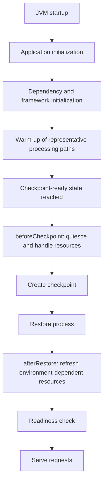

# Distinguishing Application Initialization from Warming Up Execution Paths

In Java, application initialization and warming up execution paths are two related tasks that solve two different problems. Application initialization prepares configuration, dependencies, objects, routes, and resources so the system can operate. Execution path warm-up proactively runs important processing flows so the JVM, frameworks, and application caches have the opportunity to prepare before receiving real load.

With CRaC, this distinction is especially important. An application may finish initialization yet the first request after restore is still slow because processing branches have not been run, auxiliary classes have not been loaded, serializers have not generated metadata, or hot code has not been JIT-compiled at an optimal level. Conversely, running warm-up when dependencies are not ready can produce errors or cause side effects. It is necessary to clearly determine which phase builds application state, which phase executes representative workloads, and which state needs to be refreshed after restore.

## 1. What Is Application Initialization?

Application initialization is the process of bringing a program from a newly started JVM state to a state capable of performing functionality. The work typically includes:

- Reading and validating configuration, environment variables, secrets, and deployment parameters.
- Creating the dependency injection container and required singletons.
- Initializing services, repositories, controllers, handlers, and routes.
- Registering framework listeners, serializers, converters, validators, and metadata.
- Preparing initial caches or reading required configuration data.
- Creating executors, schedulers, and lifecycle management components.
- Registering `Resource` instances to be handled in `beforeCheckpoint` and `afterRestore`.

The goal of initialization is to create a valid initial structure and state. When initialization completes, the application may already have enough objects to handle requests, but that does not mean every important method has been executed or optimized by the JVM.

Simple example:

```java
public final class ApplicationBootstrap {
    public ApplicationRuntime initialize(AppConfig config) {
        config.validate();

        DatabaseAccess database = createDatabaseAccess(config);
        PricingService pricing = new PricingService(config.pricingRules());
        OrderService orders = new OrderService(database, pricing);
        HttpHandlers handlers = new HttpHandlers(orders);

        Router router = new Router();
        router.register("POST", "/orders/preview", handlers::preview);

        return new ApplicationRuntime(database, orders, router);
    }

    private DatabaseAccess createDatabaseAccess(AppConfig config) {
        // Create the data access abstraction according to configuration.
        return new DatabaseAccess(config.database());
    }
}
```

The example illustrates building the object graph and routes. Creating `OrderService` or registering a handler does not automatically cause all the logic inside the `preview`, `validate`, or response serialization methods to be executed.

## 2. What Is Warm-up?

Warm-up is intentionally running a set of representative operations before the system receives real load. The purpose is to trigger work that simple object initialization has not yet reached.

Warm-up can prepare multiple layers of state:

| Warm-up type | Work triggered | Expected benefit |
|---|---|---|
| Class loading | Loads classes used on the processing path | Reduces lazy class loading on the first request |
| Class initialization | Runs static initializers and initializes classes when needed | Detects initialization errors and prepares static state |
| Framework warm-up | Creates proxies, metadata, route matchers, serializers, or converters | Reduces lazy initialization cost |
| Application cache warm-up | Loads frequently used data into cache | Avoids cache misses or reading from data sources during the first request |
| JIT warm-up | Executes hot methods with representative data | Collects profiles and creates opportunities to compile optimized code |
| Runtime/resource warm-up | Opens or verifies required resources | Detects connection or configuration errors early |

These types of warm-up are not synonymous with one another. For example, loading a class does not mean the class's methods have been JIT-compiled. Reading an entry into an application cache does not prove the processing path that uses that entry has been executed. Calling an endpoint once may trigger lazy initialization, but it is not enough for a method to become a hot method.

## 3. Distinguishing Application Initialization, Class Loading, and JIT Compilation

To plan properly, it is necessary to separate three layers that are often collectively referred to as "JVM startup".

### 3.1. Application Initialization

This is logic performed by the application or framework: creating objects, reading configuration, wiring dependencies, registering routes, and creating resources. This work primarily determines whether the application structure is ready or not.

### 3.2. Class Loading and Class Initialization

The JVM loads class definitions when needed and can verify and link classes. Class initialization is the phase of running `static` field assignments and `static` blocks according to JVM rules. A class may already be loaded without yet being initialized.

For example, `Class.forName(name, false, loader)` requests loading the class without actively running static initializers; `Class.forName(name, true, loader)` requests initializing the class. Neither call is a method for warming up JIT for the class's methods.

### 3.3. JIT Compilation and Execution Profiles

HotSpot can execute bytecode using the interpreter first, collect information about behavior, and compile hot methods through optimization tiers. With tiered compilation, a method can be compiled at an intermediate level and then compiled more optimally once sufficient data is available.

JIT relies on execution behavior such as invocation counts, frequently taken branches, observed object types, and call site characteristics. Therefore, merely creating objects or loading classes does not provide enough profile information to optimize methods that have not run.

| Operation | Can trigger | Does not guarantee |
|---|---|---|
| Creating a service object | Constructor and some related classes | That all methods of the service have run |
| `Class.forName(..., true, loader)` | Loading and initializing the class | That instance methods have been JIT-compiled |
| Calling an endpoint once | Part of the handler, lazy init, and auxiliary classes | Reaching the hot threshold or a representative profile |
| Running a repeated workload | Execution profiles and JIT compilation opportunities | That every method is optimally compiled |
| Loading a cache | Cache data is prepared | That JIT or framework metadata is warmed up |

## 4. Why Does an Initialized Application Still Have a Slow First Request?

A request can go through many steps that are only triggered when a real request arrives:

1. The router resolves a route or creates a handler wrapper for the first time.
2. The framework creates a proxy or resolves generic type metadata for the first time.
3. The serializer analyzes the structure of a DTO for the first time.
4. The validator builds metadata for annotations for the first time.
5. The driver creates a statement or prepares protocol state for the first time.
6. A rare business branch loads auxiliary classes for the first time.
7. The JVM starts collecting profiles and compiling frequently called methods.

If the first request goes through all of these steps, latency can be much higher than for subsequent requests. Simply marking `ApplicationContext` as started does not prove that execution paths are warmed up.

For example, `OrderService` is already created at startup, but the `preview()` method may have never run. When the first request calls `preview()`, it may perform validation, look up pricing tables, serialize the result, and trigger related classes for the first time. Subsequent requests benefit from the generated metadata, loaded caches, and accumulated execution profiles.

## 5. When Does Warm-up Fit with CRaC?

With CRaC, the workflow typically has the following stages:



Application initialization must complete before warm-up because the workload must use the dependencies that have been built. Warm-up should take place before checkpoint if the goal is to prepare execution paths for the saved state. Before checkpoint, external resources must still be brought into a safe state according to the CRaC lifecycle.

After restore, `afterRestore` may need to reopen database pools, sockets, message consumers, or refresh environment-dependent data. You should not assume every cache or connection prepared before checkpoint remains valid. It is necessary to classify which state is retained and which state must be recreated.

The extent to which JIT code, profiles, and runtime states are restored depends on the CRaC JDK/runtime, platform, and deployment method. Do not infer that a loaded class means code is already optimized, or that all warm-up benefits are guaranteed to be preserved. Measure on the exact target runtime and restore environment.

## 6. Selecting Execution Paths to Warm Up

There is no need to run every feature of the application before checkpoint. Choose based on usage data and latency impact.

A systematic selection approach:

1. Identify endpoints or jobs with high usage right after an instance becomes ready.
2. Identify processing paths with high first-request latency or heavy lazy initialization.
3. Identify critical business branches that need to be verified before receiving traffic.
4. Select a set of inputs representative of common data types and conditional branches.
5. Run warm-up within time and concurrency limits.
6. Measure whether warm-up reduces first-request latency after restore or merely prolongs startup.

Example for an order processing service:

| Execution path | Warm-up content |
|---|---|
| Preview order | Calculate pricing, apply discounts, calculate tax, and serialize response |
| Validate order | Run validators for common data types |
| Search product | Prepare query builder and mapper |
| Authentication | Initialize parser/token verifier with valid dummy data |
| Error response | Prepare serializers and handlers for some common errors |

There should be representative data for multiple branches. If warm-up only uses one very simple request type, the JIT profile may not reflect real behavior and other branches will still pay the first-time cost.

## 7. Executing Warm-up Workloads Safely

Warm-up must be repeatable without creating business side effects. Do not use real customer data or submit real transactions just to trigger code paths.

Safe options:

- Use synthetic fixtures with fixed and reproducible values.
- Use preview/validation APIs that do not write data.
- Use transaction rollback if the system guarantees all side effects reside within that transaction.
- Use mocks or sandboxes for external services.
- Separate serialization/deserialization and mapping steps from operations that send real data.
- Use a dedicated idempotency key for warm-up operations if you must call an API that supports idempotency.

A transaction rollback does not undo emails, published messages, written files, or HTTP requests already processed by another service. Therefore, do not assume database rollback is sufficient to eliminate all side effects.

Warm-up also needs load limits. Running too many threads at the same time can exhaust the connection pool, consume CPU, create GC pressure, or overload dependencies. Set appropriate maximum duration, iteration counts, and concurrency.

## 8. Example: Separating Bootstrap from Warm-up

The two responsibilities can be expressed using two separate abstractions:

```java
public final class ApplicationStartup {
    private final ApplicationBootstrap bootstrap;
    private final WarmupRunner warmupRunner;

    public ApplicationStartup(
            ApplicationBootstrap bootstrap,
            WarmupRunner warmupRunner) {
        this.bootstrap = bootstrap;
        this.warmupRunner = warmupRunner;
    }

    public ApplicationRuntime start(AppConfig config) throws Exception {
        // Phase 1: build the application structure.
        ApplicationRuntime runtime = bootstrap.initialize(config);

        // Phase 2: execute a representative workload.
        warmupRunner.warm(runtime);

        return runtime;
    }
}
```

The warm-up runner can invoke safe use cases:

```java
public final class WarmupRunner {
    public void warm(ApplicationRuntime runtime) {
        OrderPreviewInput basic = WarmupFixtures.basicOrder();
        OrderPreviewInput discounted = WarmupFixtures.discountedOrder();

        for (int i = 0; i < 500; i++) {
            runtime.orders().preview(basic);
            runtime.orders().preview(discounted);
        }

        runtime.serializers().serialize(WarmupFixtures.sampleResponse());
        runtime.validators().validate(WarmupFixtures.sampleOrder());
    }
}
```

This is an example of how to separate responsibilities. The number 500 only illustrates the loop; it is not a fixed JIT threshold or a recommendation applicable to every application. In practice, the iteration count should be determined through measurement, have a time limit, and produce no side effects. If the `preview()` method uses a cache or calls external services, use appropriate fixtures and sandboxes.

If warm-up needs to be performed asynchronously, startup must wait for the completion signal before reporting readiness to create a checkpoint. Do not let warm-up threads continue mutating state while the checkpoint is taking place.

## 9. JIT Warm-up Differs from Application Cache Warm-up

These two tasks are often collectively called warm-up, but they have different goals and verification methods.

### JIT Warm-up

JIT warm-up runs important methods multiple times with representative inputs so the JVM collects profiles and has the opportunity to compile hot code. Results depend on execution behavior, tiered compilation, runtime thresholds, and JIT optimization capabilities.

### Application Cache Warm-up

Cache warm-up loads data into application caches such as pricing tables, configuration, metadata, catalogs, or lookup results. It reduces cache misses but does not by itself cause processing methods to be JIT-compiled.

### Framework Metadata Warm-up

Frameworks can generate metadata for serializers, validators, ORM mappings, routes, or proxies on first use. Warming up execution paths can trigger this part. Some frameworks have dedicated precompute/preload APIs; prefer using those APIs when available.

| Indicator | JIT warm-up | Cache warm-up | Framework metadata warm-up |
|---|---|---|---|
| Runs methods repeatedly | Yes | Possibly | Possibly |
| Loads business data | Not necessarily | Yes | Not necessarily |
| Can reduce cache misses | Not directly | Yes | Possibly |
| Can trigger JIT | Yes | If code runs enough times | If code runs enough times |
| Should be measured by | Compilation/profile and latency | Hit ratio, misses, and latency | Metadata creation time and latency |

A warm-up request can simultaneously trigger all three types, but when analyzing effectiveness, measure separately to know where the benefit comes from.

## 10. The JVM Does Not Guarantee Every Warmed-Up Method Will Be Optimized

HotSpot uses profiles and thresholds to decide compilation. Some methods may never become hot enough to be optimally compiled. Very short methods may be inlined into callers; some code paths that only run once will not gain significant benefit from JIT.

Points to remember:

- Calling a method once usually only proves the code path was executed.
- JIT compilation can happen asynchronously after a method reaches the threshold.
- Profiles depend on input types and branch distributions.
- If warm-up uses overly uniform inputs, the profile may differ from the real workload.
- When optimization assumptions are violated, the JVM can deoptimize and continue collecting profiles.
- Do not try to force compilation of every method without data showing a benefit.

Therefore, the practical goal is to warm up critical processing paths with a workload close to reality and measure the results, rather than trying to call every method an arbitrary number of times.

## 11. Observing Class Loading and JIT Compilation

JVM logging can be used to observe loaded classes and compilation activity. For example:

```bash
java -Xlog:class+load=info,class+init=info -XX:+PrintCompilation -jar app.jar
```

`class+load` and `class+init` help observe loading/initialization. `PrintCompilation` displays HotSpot compilation events. Logging syntax and levels may vary across JDK distributions; check `java -Xlog:help` and the documentation of the runtime being used.

JFR (Java Flight Recorder) can help observe compilation, execution samples, allocations, GC, and latency. Profile on a representative workload to identify which methods are actually hot instead of relying on guesswork.

Do not enable overly verbose compilation logging in the final benchmark if logging significantly changes timing. You can use a separate diagnostic run to understand behavior and then run performance measurements with a configuration as close to production as possible.

## 12. Warm-up Before Checkpoint and After Restore

Not all warm-up should be re-run after restore. Divide it into three groups:

| Group | Timing | Example |
|---|---|---|
| Structure preparation | Application initialization before checkpoint | Building DI graph, registering routes, constructing serializers |
| Execution path warm-up | After initialization, before checkpoint | Running preview, validation, serialization with fixtures |
| Refreshing environment-dependent state | `afterRestore` | Opening connection pools, refreshing tokens, updating endpoints and dynamic caches |

If pre-checkpoint warm-up created pure Java caches or metadata, that state may be preserved in the checkpoint. However, data dependent on the environment or time may need refreshing. If the runtime cannot preserve a specific JIT/profile state or that state is invalidated in the restore environment, measurements on the target runtime will show whether the first request still needs additional warm-up.

A short post-restore validation step can be performed to verify resources and safe processing paths. Do not re-run the entire heavy workload if the goal is to keep restore time short, unless measurements show a clear benefit.

## 13. Common Design Mistakes

### Only initializing beans and calling warm-up done

Creating beans or services only builds the object graph. Important methods, serializers, validators, and lazy processing branches may still have never run. Execute representative processing paths.

### Only using `Class.forName()` to warm up JIT

`Class.forName()` can load and initialize a class, but does not automatically run business methods enough times to build JIT profiles. Call a representative workload if the goal is execution warm-up.

### Only running a single input

Overly simple inputs can miss conditional branches, data types, and real serializers. Choose multiple fixtures representative of common input distributions.

### Warm-up creating real side effects

Sending emails, publishing messages, creating orders, or writing real data can cause every startup to produce unintended results. Use fixtures, sandboxes, preview APIs, or idempotent mechanisms.

### Unbounded warm-up or consuming all CPU

Prolonged warm-up increases time to checkpoint and can cause GC pressure. Set a time budget, iteration limit, and concurrency.

### Closing dependencies before warm-up completes

Warm-up may require caches, databases, or internal services. Complete the workload before `beforeCheckpoint`; this callback must only start once warm-up has stopped and no background tasks are mutating state.

### Opening traffic immediately after JVM restore

The JVM may have restored, but network connections or dynamic resources may not be ready yet. Readiness must wait for `afterRestore` and mandatory refresh steps.

### Evaluating warm-up solely by startup time

Warm-up that makes startup longer may still be worthwhile if it reduces first-request latency or time to meet SLO after restore. Measure total time to checkpoint, restore-to-ready, and request latency.

## 14. Measuring Warm-up Effectiveness

Measure at least four stages:

1. **Initialization duration:** time to build configuration, dependencies, and frameworks.
2. **Warm-up duration:** time to run the representative workload before checkpoint.
3. **Restore-to-ready:** time from starting restore until resources and the application are ready to receive traffic.
4. **First-request and steady-state latency:** latency of the first request and subsequent requests after restore.

Compare at least two scenarios:

| Scenario | Flow |
|---|---|
| Without warm-up | Initialization → checkpoint → restore → measured request |
| With warm-up | Initialization → warm-up → checkpoint → restore → measured request |

Use the same JDK/runtime, configuration, data, and workload. Run multiple times to reduce the impact of noise. Compare the median and high percentiles such as p95/p99, rather than looking at just a single run. Record CPU, allocation, GC, and state size as well if warm-up increases memory.

If warm-up time increases by 5 seconds while the first request decreases by 20 ms, look at the request volume and latency targets to decide. For serverless workloads or frequent scale-out, reducing initial latency can be of great value; for long-running applications that rarely restore, heavy warm-up may not be worth it.

## 15. Recommended Implementation Workflow

A workflow that can be applied to a Java application using CRaC:

1. Complete application initialization: valid configuration, DI graph, routes, and services are built.
2. Identify critical execution paths based on traces, metrics, or real workloads.
3. Create safe fixtures, and determine inputs and branches to warm up.
4. Run warm-up with limits on time, iteration count, and concurrency.
5. Verify warm-up has no remaining background tasks, side effects, or in-flight writes.
6. Transition the application to a checkpoint-ready state.
7. In `beforeCheckpoint`, quiesce producers and close/flush resources dependent on the OS or external services.
8. Create the checkpoint.
9. In `afterRestore`, refresh connections, tokens, endpoints, and required dynamic caches.
10. Check readiness, and only then receive traffic.
11. Measure first-request latency and steady-state latency after restore to decide whether light post-restore warm-up is needed.

If the application uses a framework with CRaC integration, let the framework manage internal components such as event loops, connection pools, or schedulers according to its documentation. The warm-up runner should only coordinate application workloads and should not directly manipulate the framework's internal threads.

## 16. Design Checklist

- [ ] Application initialization and execution warm-up are separated into two clear phases.
- [ ] Configuration, dependency graph, routes, and services are ready before warm-up.
- [ ] The list of execution paths is selected from real workloads and latency.
- [ ] Warm-up runs inputs representative of multiple critical branches.
- [ ] Class loading, class initialization, framework metadata, cache warm-up, and JIT warm-up are distinguished.
- [ ] Warm-up creates no real business side effects.
- [ ] Limits exist for time, iteration count, and concurrency.
- [ ] Warm-up completes before `beforeCheckpoint` and no background tasks remain running.
- [ ] External resources are handled properly in CRaC callbacks.
- [ ] After restore, environment-dependent state is refreshed before readiness.
- [ ] It is not assumed that a loaded class means its methods are JIT-optimized.
- [ ] Initialization, warm-up, restore-to-ready, first-request, and steady-state latency have been measured.
- [ ] Behavior has been verified on the exact target CRaC JDK/runtime.

## 17. References

- [Java Virtual Machine Specification — Loading, Linking, and Initializing](https://docs.oracle.com/javase/specs/jvms/se21/html/jvms-5.html): distinguishes class loading, linking, and initialization.
- [Java `Class.forName`](https://docs.oracle.com/en/java/javase/21/docs/api/java.base/java/lang/Class.html#forName(java.lang.String,boolean,java.lang.ClassLoader)): loads a class and optionally initializes it.
- [Java Flight Recorder](https://docs.oracle.com/en/java/javase/21/jfapi/): observes execution behavior, allocation, GC, and runtime events.
- [CRaC API — `Resource`](https://javadoc.io/doc/org.crac/crac/latest/org/crac/Resource.html): callbacks for managing resources before checkpoint and after restore.

Application initialization prepares the structure and dependencies so the application can operate. Warm-up proactively runs critical execution paths to trigger lazy initialization, metadata, caches, and JIT profiles. With CRaC, complete initialization and workload warm-up before checkpoint, handle external resources in callbacks, and then refresh environment-dependent state after restore. Evaluate effectiveness by first-request latency and steady-state latency on the exact target runtime, rather than relying solely on objects having been created or classes having been loaded.
